# 05 - Message, Headers, Properties y Content Modifier

**Estado:** ✅ Completado
**Área:** SAP Integration Suite - Cloud Integration
**Package:** `CPI Learning Lab`
**iFlow:** `Message Headers Properties Lab`

## Objetivo

Distinguir Body, Message Headers y Exchange Properties; configurarlos mediante Content Modifier; reutilizar sus valores en una respuesta HTTP, comprobar qué ocurre al reemplazar el Body y validar la protección CSRF del HTTPS Sender con Postman.

## Conceptos

- **Message Body:** contenido principal del mensaje.
- **Message Headers:** metadatos disponibles durante el procesamiento; su propagación hacia otros sistemas depende del adaptador y de su configuración.
- **Exchange Properties:** valores internos asociados al intercambio que pueden consultarse en pasos posteriores.
- **Content Modifier:** paso para establecer o modificar Body, Headers y Exchange Properties.
- **CSRF:** protección adicional para determinadas solicitudes HTTP; no sustituye a la autenticación.
- **Expression:** en estos ejercicios, expresiones Camel Simple como `${header.origen}` y `${property.idProceso}`.

## Prerrequisitos

- Acceso a Cloud Integration con permisos de diseño, despliegue y monitorización.
- Package `CPI Learning Lab`.
- Cliente HTTP y mecanismo de autenticación previamente validados en el tema 04. No registrar credenciales ni tokens reales.

## Laboratorio 05.1 - Crear y reutilizar Headers y Properties

**Estado:** ✅ Completado

### Paso 1 - Crear el iFlow

1. Abrir **Design → Integrations and APIs** y el package `CPI Learning Lab`.
2. Crear el iFlow `Message Headers Properties Lab`.
3. Abrir su editor.

**Por qué:** preservar los artefactos y resultados del tema 04.

**Evidencia - iFlow creado**

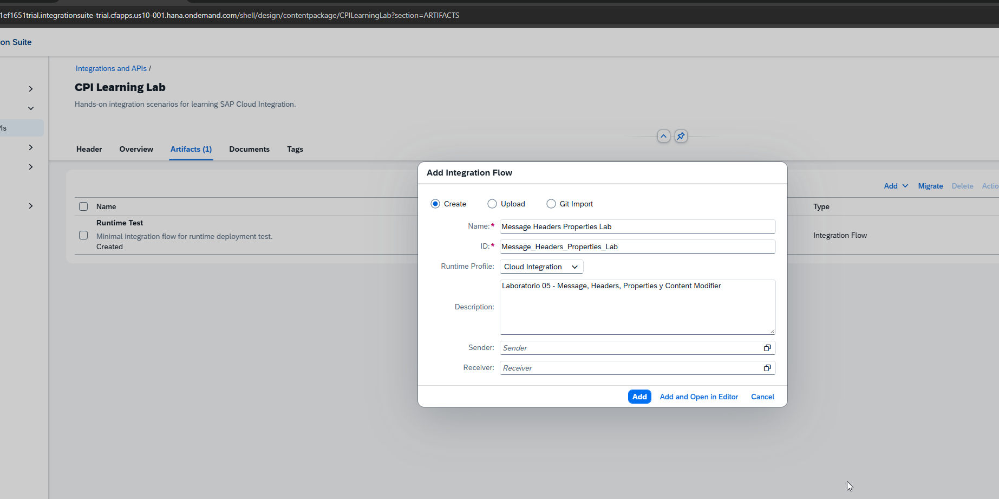

### Paso 2 - Configurar HTTPS Sender

1. Conectar el participante Sender al evento Start mediante el adaptador **HTTPS**.
2. En **Connection**, establecer `Address` como `/lab05/message`.
3. Utilizar el mecanismo de autorización ya probado en el tema 04.
4. Para este ejercicio se configuró la protección CSRF como desactivada, si el adaptador ofrece esta opción. Esta decisión no debe trasladarse automáticamente a producción.
5. Guardar el iFlow.

**Por qué:** disponer de un endpoint para ejecutar el flujo y comprobar su resultado desde un cliente HTTP.

**Evidencia - HTTPS Sender configurado**

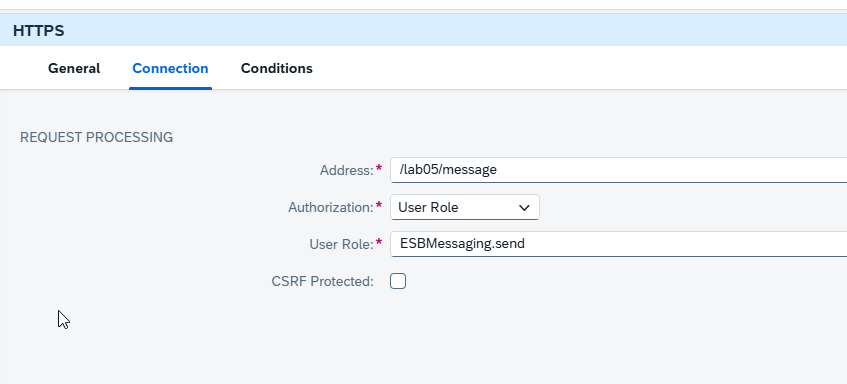

### Paso 3 - Crear Header y Exchange Property

Agregar un **Content Modifier** después de Start y nombrarlo `Set Message Metadata`.

En **Message Header**:

| Campo | Valor |
|---|---|
| Action | Create |
| Name | `origen` |
| Source Type | Constant |
| Source Value | `CPI-Learning-Lab` |
| Data Type | `java.lang.String` |

**Por qué:** identificar el origen del procesamiento mediante metadatos del mensaje.

**Evidencia - Header creado**

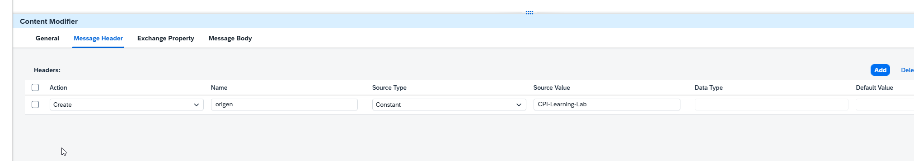

En **Exchange Property**:

| Campo | Valor |
|---|---|
| Action | Create |
| Name | `idProceso` |
| Source Type | Constant |
| Source Value | `LAB-05-001` |
| Data Type | `java.lang.String` |

**Por qué:** conservar un identificador interno reutilizable en el mismo intercambio.

**Evidencia - Property creada**

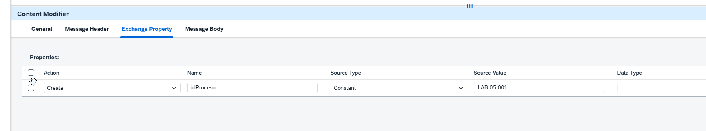

### Paso 4 - Construir la respuesta

1. Agregar un segundo **Content Modifier** después de `Set Message Metadata`, llamado `Build Response`.
2. En **Message Body**, elegir **Expression** y establecer:

```json
{
  "laboratorio": "05",
  "origen": "${header.origen}",
  "idProceso": "${property.idProceso}",
  "resultado": "Procesamiento correcto"
}
```

**Por qué:** resolver valores del header y de la property creados en un paso anterior. Los valores constantes elegidos para esta prueba no requieren escape JSON adicional.

**Evidencia - Body con expresiones**

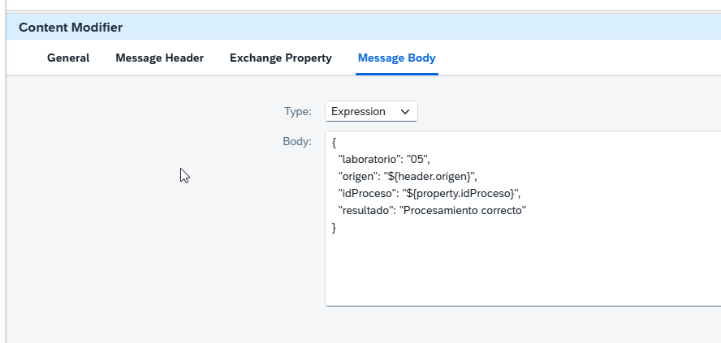

3. En **Message Header** del mismo componente, crear `Content-Type` con Source Type **Constant**, Source Value `application/json` y Data Type `java.lang.String`.

**Por qué:** indicar que el cuerpo de la respuesta corresponde a JSON.

**Evidencia - Content-Type**

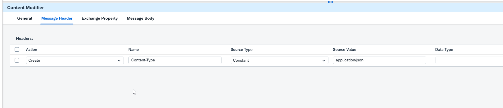

### Paso 5 - Desplegar y ejecutar

1. Guardar y desplegar el iFlow.
2. Comprobar el estado **Started** en **Monitor → Integrations and APIs → Manage Integration Content**.
3. Obtener la URL real del endpoint del tenant, con ruta `/http/lab05/message`.
4. Invocarlo con `GET`, sin Body, usando la autenticación validada previamente y `Accept: application/json`.
5. Revisar la respuesta y el registro en **Monitor Message Processing**.

**Por qué:** la configuración solo queda validada cuando se ejecuta en el runtime y devuelve el resultado esperado.

**Evidencia - Despliegue**

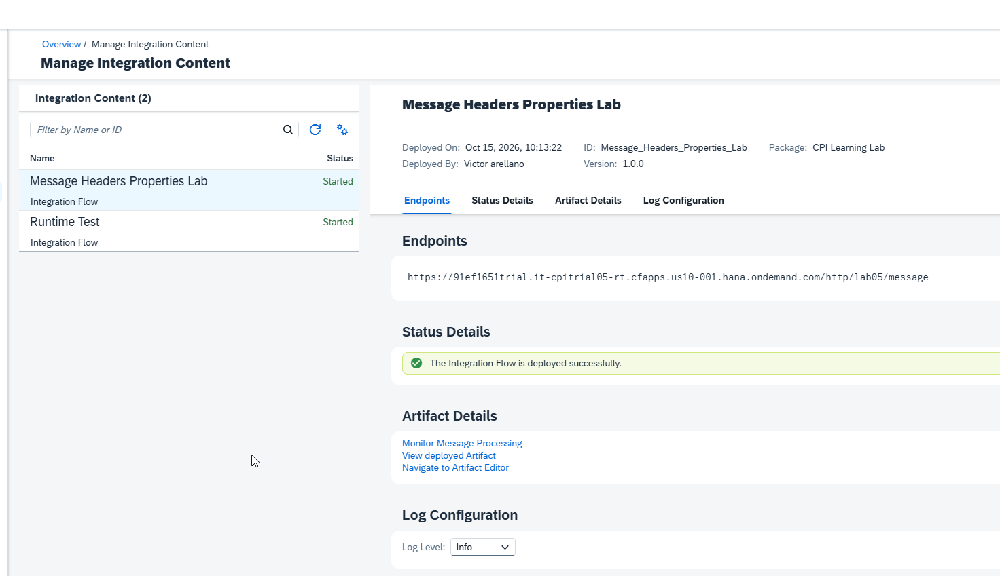

**Resultado esperado y confirmado por la ejecución:**

```json
{
  "laboratorio": "05",
  "origen": "CPI-Learning-Lab",
  "idProceso": "LAB-05-001",
  "resultado": "Procesamiento correcto"
}
```

**Evidencia - Respuesta HTTP**

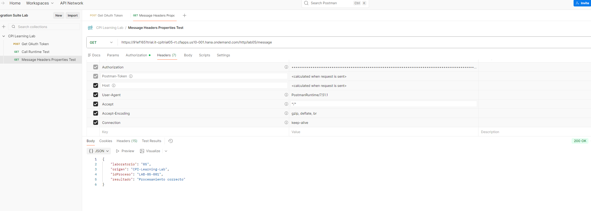

**Evidencia - Monitorización**

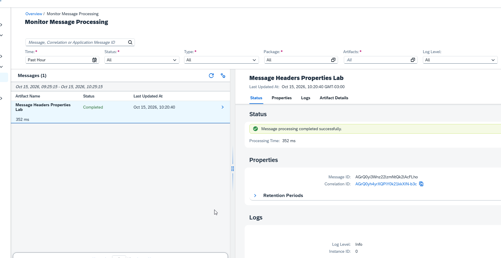

### Validación 05.1

| Comprobación | Resultado comunicado |
|---|---|
| Despliegue | Started |
| Solicitud HTTP | 200 OK |
| Contenido JSON | Coincide con lo esperado |
| Monitorización | Completed |

## Laboratorio 05.2 - Reemplazar Body sin redefinir metadatos

**Estado:** ✅ Completado

### Paso 1 - Agregar el tercer Content Modifier

1. Mantener los dos Content Modifiers del laboratorio 05.1.
2. Agregar después de `Build Response` un tercer Content Modifier llamado `Replace Message Body`.
3. En **Message Body**, seleccionar **Expression** y configurar:

```json
{
  "laboratorio": "05.2",
  "mensaje": "El Body fue reemplazado",
  "headerOriginal": "${header.origen}",
  "propertyOriginal": "${property.idProceso}"
}
```

4. No crear nuevamente el header `origen` ni la property `idProceso`.

**Por qué:** aislar el efecto de reemplazar el Body y comprobar si los valores anteriores siguen disponibles.

**Evidencia - Reemplazo del Body configurado**

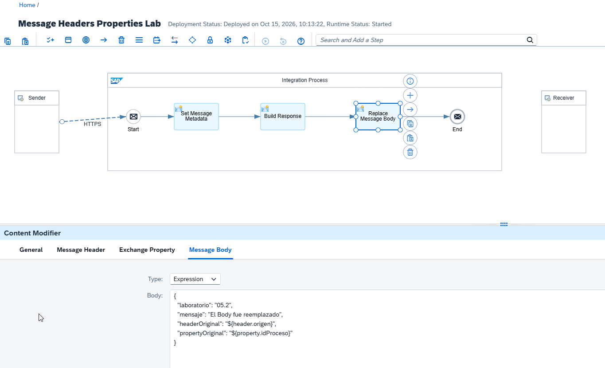

### Paso 2 - Desplegar y comprobar

1. Guardar y volver a desplegar el mismo iFlow.
2. Verificar **Started**.
3. Repetir la solicitud `GET` al mismo endpoint, con la misma autenticación.
4. Comparar la respuesta con la del laboratorio 05.1.
5. Verificar **Completed** en Monitor Message Processing.

**Resultado esperado y confirmado por la ejecución:**

```json
{
  "laboratorio": "05.2",
  "mensaje": "El Body fue reemplazado",
  "headerOriginal": "CPI-Learning-Lab",
  "propertyOriginal": "LAB-05-001"
}
```

**Evidencia - Respuesta HTTP después del reemplazo**

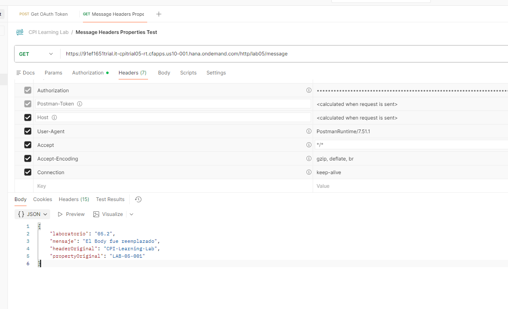

**Evidencia - Monitorización de la segunda ejecución**

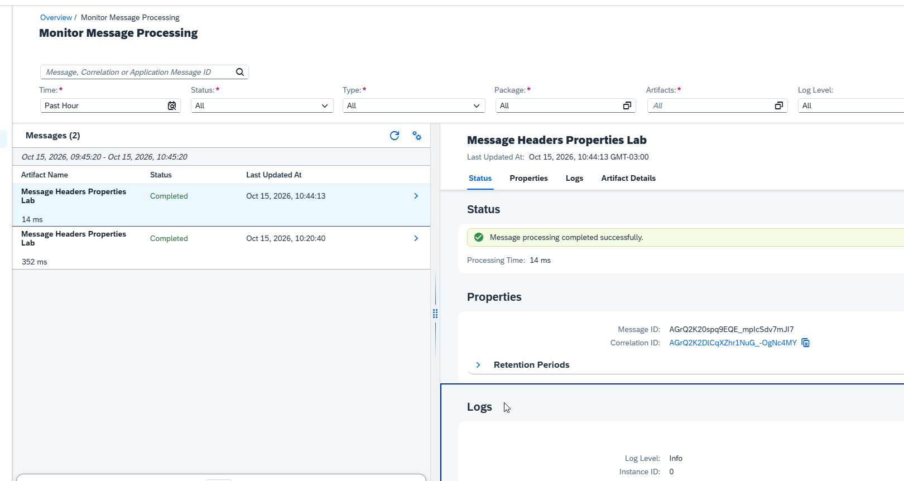

### Validación 05.2

| Comprobación | Resultado comunicado |
|---|---|
| Despliegue | Started |
| Solicitud HTTP | 200 OK |
| Body | Reemplazado correctamente |
| Header `origen` | Valor conservado |
| Property `idProceso` | Valor conservado |
| Monitorización | Completed |

## Laboratorio 05.3 - Protección CSRF en HTTPS Sender

**Estado:** ✅ Completado

### Objetivo

Habilitar la protección CSRF en el HTTPS Sender y comprobar el rechazo de una solicitud POST sin token, la obtención de un token mediante GET y su reutilización en un POST desde Postman. La autenticación Bearer previamente configurada se mantiene.

### Prerrequisitos

- iFlow y endpoint `/lab05/message` validados en 05.2.
- Colección Postman con solicitudes autenticadas mediante Bearer Token y variable `{{access_token}}`.
- No registrar tokens, cookies de sesión ni credenciales reales en Git.

### Paso 1 - Habilitar CSRF Protected

1. Abrir el iFlow `Message Headers Properties Lab`.
2. Seleccionar el adaptador HTTPS Sender y abrir **Connection**.
3. Mantener el endpoint `/lab05/message` y la autorización **User Role** (`ESBMessaging.send`).
4. Activar **CSRF Protected**, guardar y desplegar.
5. Verificar el estado **Started** en Manage Integration Content.

**Por qué:** se modifica únicamente la protección CSRF para comparar las solicitudes antes y después de habilitarla.

**Evidencia - HTTPS Sender con CSRF habilitado**

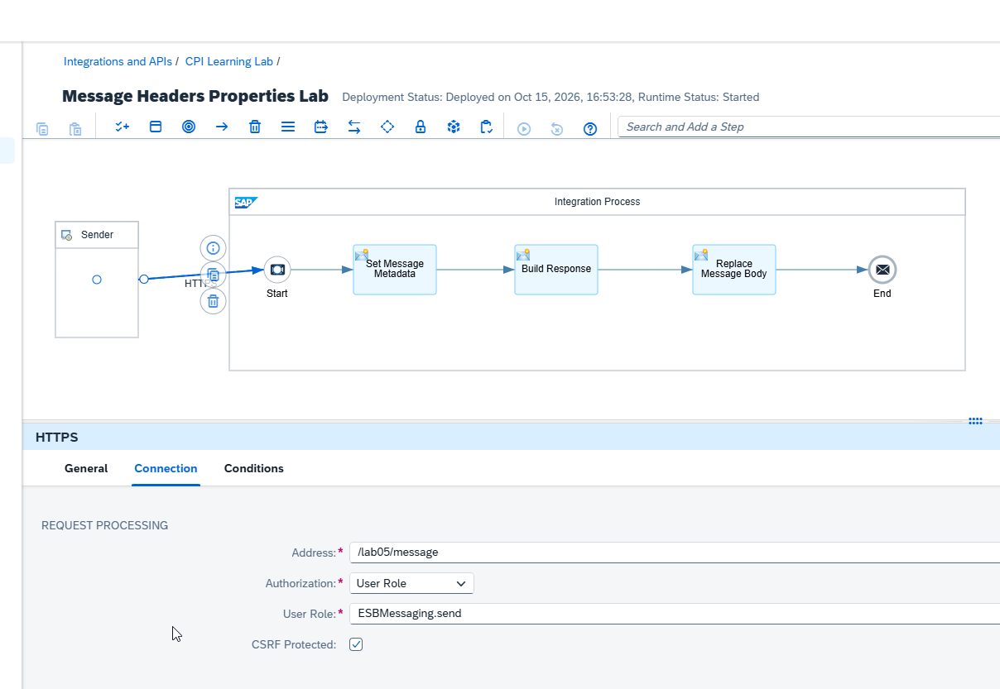

### Paso 2 - Prueba negativa: POST sin token

1. Duplicar la solicitud HTTP de prueba en Postman.
2. Configurar método **POST**, misma URL y autenticación Bearer.
3. Establecer `Content-Type: application/json` y no enviar `X-CSRF-Token`.
4. Enviar el siguiente Body:

```json
{
  "prueba": "CSRF-SIN-TOKEN",
  "laboratorio": "05.3"
}
```

**Resultado observado:** `HTTP 403 Forbidden`, con una respuesta HTML. Es consistente con el rechazo esperado al habilitar CSRF, aunque la respuesta capturada no especificó expresamente la causa. No atribuir el 403 exclusivamente a CSRF sin considerar el conjunto de pruebas.

**Evidencia - POST sin token rechazado**

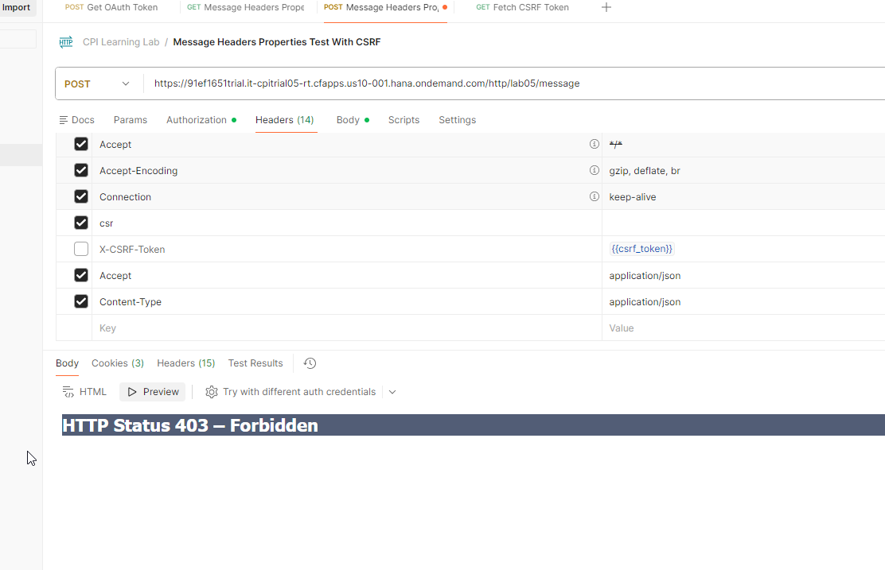

### Paso 3 - Solicitar token CSRF

1. Crear o duplicar una solicitud Postman llamada `Fetch CSRF Token`.
2. Configurar **GET**, la misma URL y autenticación Bearer.
3. Agregar el header `X-CSRF-Token: Fetch` y `Accept: application/json`.
4. Ejecutar y revisar los **headers de respuesta**.
5. Comprobar la presencia de `X-CSRF-Token` con un valor emitido por el servidor; revisar también las cookies de sesión cuando corresponda.

**Por qué:** el servidor puede exigir un token emitido previamente y, dependiendo del contexto, cookies asociadas a la sesión.

**Resultado comunicado:** se recibió un token CSRF en la respuesta.

**Evidencia - Obtención del token**

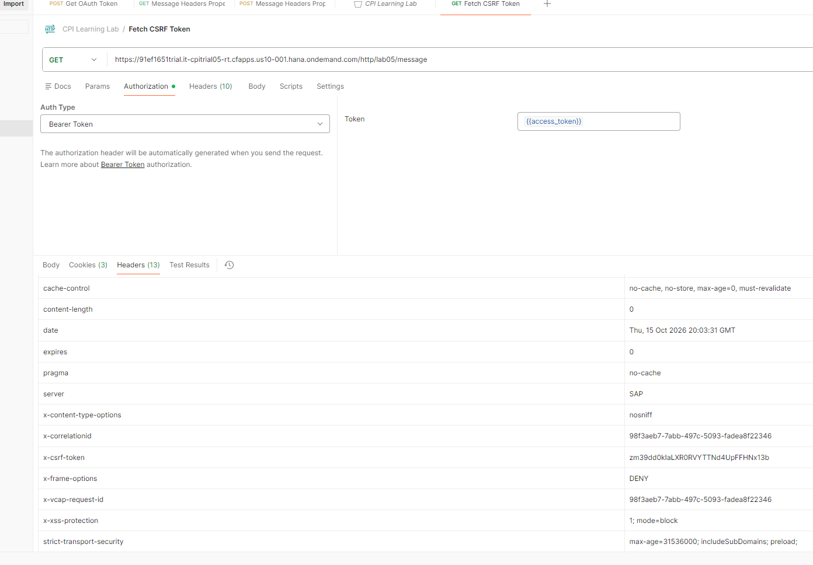

### Paso 4 - Guardar el token automáticamente en Postman

En `Fetch CSRF Token`, abrir **Scripts → Post-response** y configurar:

```javascript
const csrfToken = pm.response.headers.get("X-CSRF-Token");

pm.test("CSRF Token recibido", function () {
    pm.expect(csrfToken).to.be.a("string").and.not.empty;
});

if (pm.response.code === 200 && csrfToken) {
    pm.collectionVariables.set("csrf_token", csrfToken);
}
```

**Por qué:** la variable de colección permite reutilizar el token sin copiarlo manualmente. Este script no ejecuta por sí solo el POST; ambas solicitudes se ejecutaron por separado.

**Evidencia - Script Post-response**

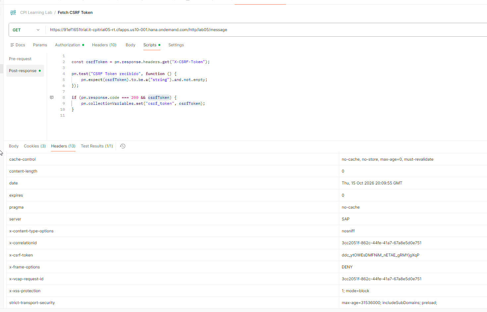

### Paso 5 - Reutilizar el token en POST

1. Abrir la solicitud POST `Message Headers Properties Test With CSRF`.
2. Mantener la autenticación Bearer y el Body de la prueba negativa.
3. Configurar `X-CSRF-Token: {{csrf_token}}`.
4. Conservar las cookies necesarias si el servidor las asocia al token.
5. Ejecutar primero `Fetch CSRF Token` y después el POST.
6. Verificar la respuesta JSON del iFlow y el resultado HTTP.

**Por qué:** se enlaza la respuesta del GET con el header de la solicitud POST mediante una variable de colección.

**Evidencia - POST con variable de colección**

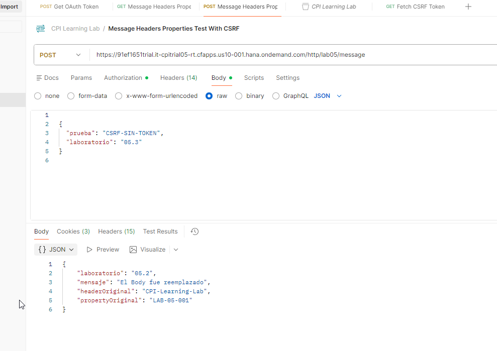

**Evidencia - POST con token aceptado**

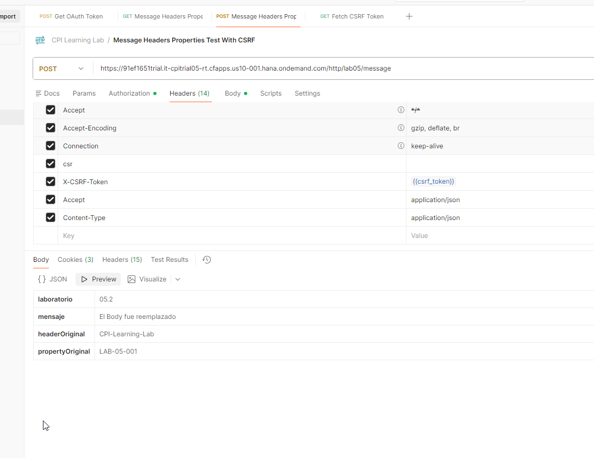

### Paso 6 - Ejecutar la secuencia mediante Collection Runner

1. Crear la carpeta `Lab 05.3 - CSRF Automated Flow` dentro de la colección `CPI Learning Lab`.
2. Duplicar las solicitudes originales para conservar las pruebas individuales.
3. Ordenarlas así: **POST Get OAuth Token → GET Fetch CSRF Token → POST Message Headers Properties Test With CSRF**.
4. Comprobar que la primera solicitud proporciona `access_token` a las siguientes, que la segunda guarda `csrf_token` y que la tercera usa ambas variables.
5. Abrir **Run** desde la carpeta y ejecutar **1 iteración**.

**Por qué:** la ejecución secuencial elimina la necesidad de lanzar manualmente cada solicitud y permite comprobar el encadenamiento de autenticación OAuth, obtención de token CSRF y llamada al iFlow.

**Evidencia - Configuración de Collection Runner**

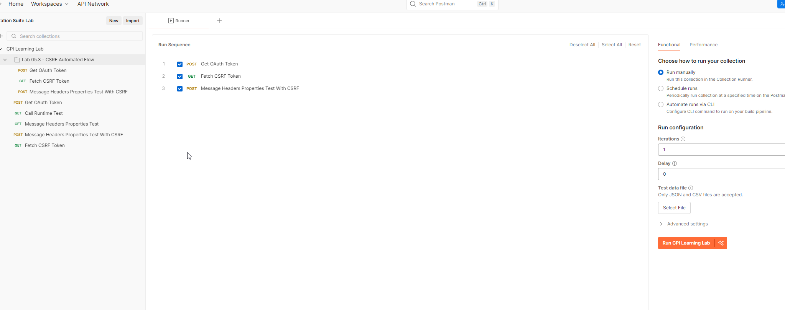

**Resultado observado:** las tres solicitudes devolvieron `HTTP 200`; el Runner mostró **1 prueba aprobada, 0 fallidas y 0 errores**. La única aserción definida entonces comprobaba la recepción del token CSRF. La respuesta final contenía el JSON esperado del laboratorio 05.2.

**Evidencia - Primera ejecución automatizada**

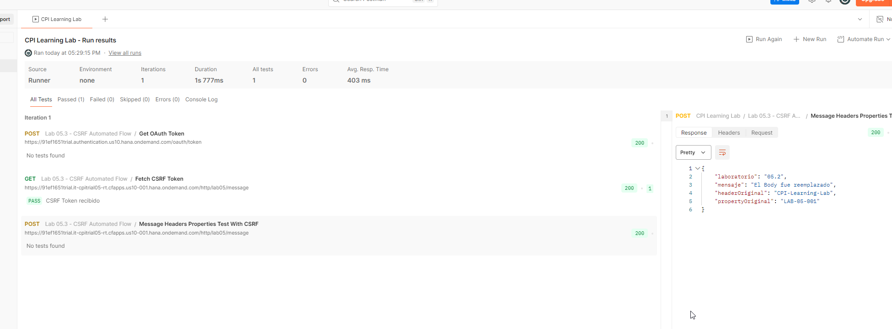

### Paso 7 - Incorporar aserciones del POST protegido

En la solicitud `Message Headers Properties Test With CSRF` de la carpeta automatizada, abrir **Scripts → Post-response** y configurar:

```javascript
pm.test("HTTP Status 200 OK", function () {
    pm.response.to.have.status(200);
});

pm.test("Content-Type es JSON", function () {
    const contentType = pm.response.headers.get("Content-Type");
    pm.expect(contentType).to.match(/^application\/json(?:\s*;|$)/i);
});

pm.test("Body contiene los valores esperados", function () {
    const json = pm.response.json();
    pm.expect(json.laboratorio).to.eql("05.2");
    pm.expect(json.mensaje).to.eql("El Body fue reemplazado");
    pm.expect(json.headerOriginal).to.eql("CPI-Learning-Lab");
    pm.expect(json.propertyOriginal).to.eql("LAB-05-001");
});
```

**Por qué:** un estado HTTP 200 no garantiza que el contenido sea correcto. Las aserciones comprueban el código HTTP, el tipo de respuesta y los valores del JSON. La validación de `Content-Type` usa `pm.response.headers.get()` junto con `to.match()` para admitir parámetros como `charset`.

**Ejecución observada antes de la corrección:** el Runner mostró `PASS` para la recepción del token CSRF, el estado HTTP 200 y el contenido del Body; la prueba de `Content-Type` falló por la forma en que estaba escrita la aserción original. Se proporcionó el script corregido mostrado arriba. **No consta aún una nueva ejecución confirmada con cuatro aserciones aprobadas.**

**Evidencia - Aserciones automáticas**

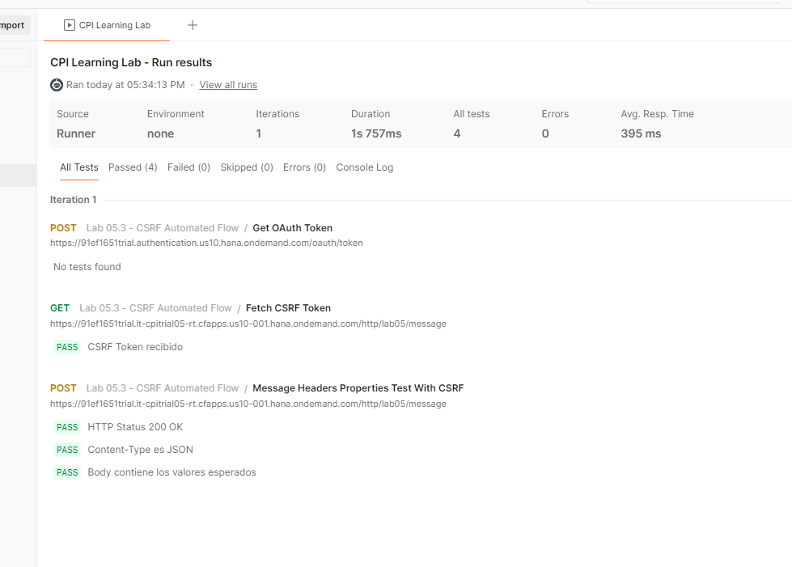

### Validación 05.3

| Comprobación | Resultado observado o comunicado |
|---|---|
| HTTPS Sender con CSRF Protected | Activado; iFlow iniciado |
| POST sin token | HTTP 403 Forbidden; respuesta sin causa CSRF explícita |
| GET con `X-CSRF-Token: Fetch` | Token recibido |
| Script Post-response y variable `csrf_token` | Funcionando |
| POST con `{{csrf_token}}` | HTTP 200 en Collection Runner; JSON esperado |
| Collection Runner (tres solicitudes) | Tres HTTP 200; una iteración; 0 errores |
| Aserciones adicionales | Tres PASS y un FAIL en la ejecución anterior a la corrección; repetición pendiente de confirmar |

### Problemas y alcance

El POST sin token devolvió 403, consistente con la protección CSRF habilitada; la respuesta HTML no identificó explícitamente la causa. La validación inicial de `Content-Type` en Postman falló por la aserción utilizada, no por el contenido HTTP observado; el script quedó corregido. No se registra este incidente en `docs/kba-y-hallazgos.md`. Los resultados corresponden al endpoint y configuración probados.

## Resultado general y alcance

**Estado del tema:** ✅ Completado. Los tres laboratorios cuentan con resultados prácticos validados; la repetición final de las cuatro aserciones de Postman está pendiente de confirmación. Las imágenes se referencian en el documento y deben copiarse al repositorio con los nombres indicados; su presencia física en el repositorio no se ha verificado aquí.

El experimento demuestra que, **en este iFlow y dentro del mismo intercambio**, reemplazar el Body mediante un Content Modifier no eliminó el header ni la exchange property creados anteriormente. No se extrapola el resultado a todos los adaptadores, intercambios o patrones de integración.

## Problemas encontrados

No se comunicaron errores durante los laboratorios 05.1 y 05.2. En 05.3 se observó HTTP 403 en la prueba negativa y se corrigió una aserción de Postman para validar `Content-Type`. No se incorpora una entrada a `docs/kba-y-hallazgos.md`.

## Aprendizajes

- Los valores de headers y exchange properties pueden recuperarse desde pasos posteriores del mismo iFlow mediante expresiones.
- El Body puede construirse a partir de metadatos internos.
- En el escenario probado, reemplazar el Body no eliminó el header ni la property previamente creados.
- `Started`, `200 OK`, el JSON recibido y `Completed` aportan comprobaciones complementarias; ninguna sustituye por sí sola a todas las demás.
- La autenticación Bearer y la protección CSRF cumplen funciones distintas.
- Postman puede extraer un token de una respuesta y reutilizarlo en otra solicitud mediante variables de colección.
- Collection Runner permite ejecutar solicitudes dependientes en orden y comprobar sus respuestas mediante aserciones.

## Referencias

- [SAP Help Portal - Cloud Integration](https://help.sap.com/docs/cloud-integration/sap-cloud-integration)
- [SAP Help Portal - Integration Suite](https://help.sap.com/docs/integration-suite)

## Historial de cambios

| Versión | Descripción |
|---|---|
| 0.1 | Estructura inicial y referencias preliminares a evidencias. |
| 1.0 | Incorporación de laboratorios 05.1 y 05.2, doce referencias de imágenes, resultados validados y aprendizajes. |
| 1.1 | Laboratorio 05.3: CSRF en HTTPS Sender, prueba negativa, obtención y reutilización de token en Postman; seis nuevas referencias de evidencia. |
| 1.2 | Collection Runner, secuencia OAuth → CSRF → POST, aserciones automáticas y referencias 05-19 a 05-21; validación final de cuatro aserciones pendiente. |
