# 06 - Sender y Receiver Adapters

**Estado:** ✅ Completado
**Área:** SAP Integration Suite — Cloud Integration
**Package:** `CPI Learning Lab`
**iFlows:** `Sender Receiver HTTP Lab` y `Sender Receiver HTTP POST Lab`

## Objetivo

Diferenciar Sender y Receiver Adapters, implementar una llamada síncrona con Request Reply, verificar la comunicación HTTPS entrante y HTTP(S) saliente, y automatizar pruebas positivas y negativas con OAuth, CSRF y Postman Collection Runner.

## Conceptos

- **Sender Adapter:** configura el protocolo y la seguridad de entrada al iFlow. En este caso, HTTPS.
- **Receiver Adapter:** configura la conexión desde el iFlow hacia el sistema externo. En este caso, HTTP hacia un destino HTTPS.
- **Request Reply:** realiza una llamada síncrona al receptor y espera su respuesta antes de continuar.
- **Participante Receiver:** representa el sistema destinatario en el modelo; no es el mismo elemento que el adaptador de la conexión.
- **CSRF:** protección del endpoint entrante frente a solicitudes de modificación sin el token requerido. No equivale a la autenticación OAuth ni configura la seguridad del sistema receptor.
- **Headers de transporte:** no debe asumirse que los headers recibidos del cliente se propagan sin cambios a la solicitud saliente.

### Arquitectura

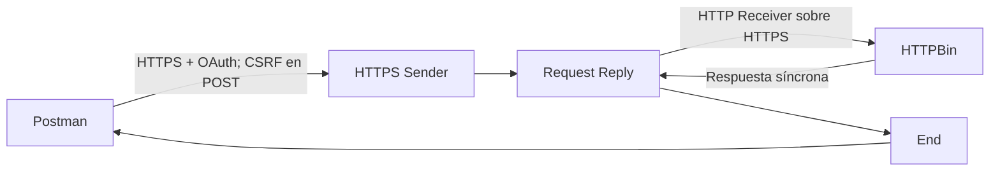

Se utilizan dos iFlows para preservar ambos escenarios: GET hacia `/get` y POST hacia `/post`.

## Prerrequisitos

- Tema 05 completado, con autenticación OAuth y pruebas CSRF conocidas.
- Permisos de diseño, despliegue y monitorización en Cloud Integration.
- Postman con variables para URL de runtime y tokens, sin almacenar secretos en Git.
- Acceso saliente desde el runtime a `https://httpbin.org` durante la ejecución de las pruebas.

## Laboratorio 06.1 — Crear el iFlow y configurar HTTPS Sender

**Estado:** ✅ Completado

### Objetivo

Crear un endpoint de entrada separado de los laboratorios anteriores.

### Procedimiento

1. En el package `CPI Learning Lab`, crear el Integration Flow `Sender Receiver HTTP Lab` (ID observado: `Sender_Receiver_HTTP_Lab`). **Por qué:** mantener intacto el tema 05.
2. Guardar el artefacto y abrir el editor.

**Evidencia 06-01 — Creación del artefacto**

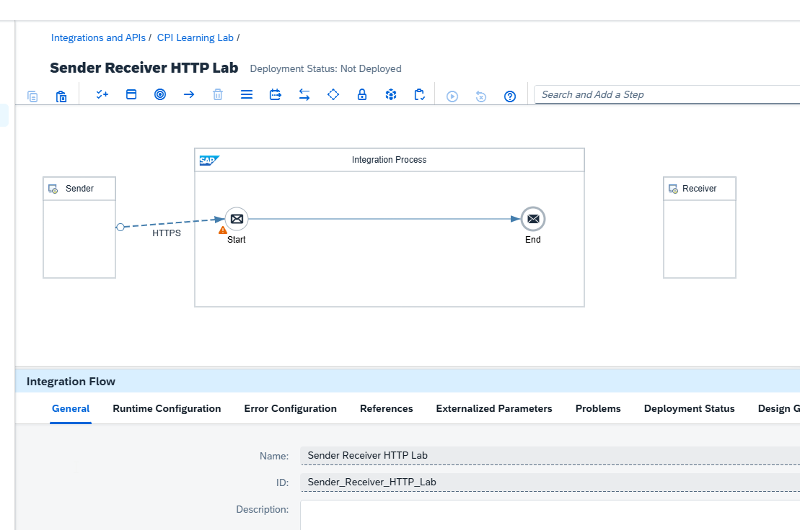

3. Conectar el participante Sender al Start mediante el adaptador **HTTPS**.
4. Configurar Address `/lab06/receiver`, Authorization `User Role`, User Role `ESBMessaging.send` y mantener la protección CSRF según la configuración elegida para el laboratorio. **Por qué:** establecer un endpoint independiente y autorizado. La protección CSRF se probó explícitamente en el escenario POST.

**Evidencia 06-02 — Configuración del HTTPS Sender**

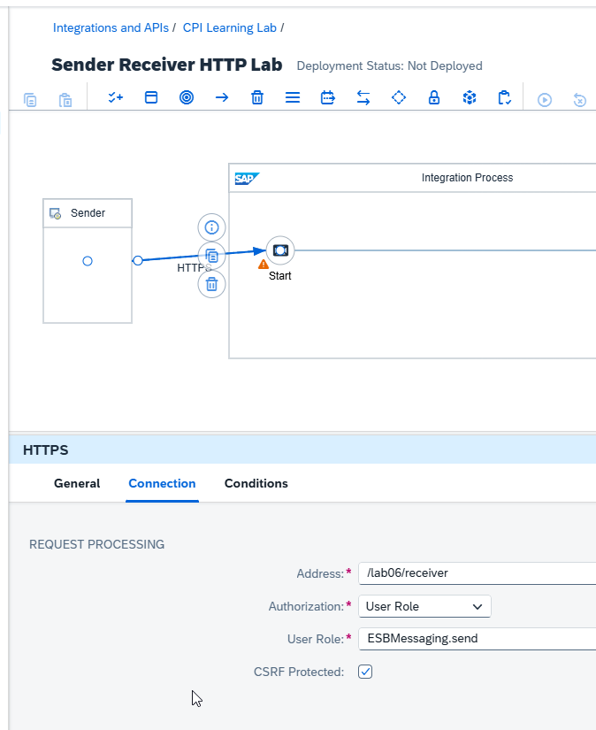

### Resultado esperado y validación

El iFlow dispone de un punto de entrada HTTPS autorizado y puede continuar su diseño. **Validado:** creación y uso posterior del endpoint en una prueba GET exitosa.

## Laboratorio 06.2 — Request Reply y HTTP Receiver

**Estado:** ✅ Completado

### Objetivo

Invocar un servicio externo desde Cloud Integration y esperar su respuesta.

### Procedimiento

1. Insertar **Request Reply** entre Start y End y nombrarlo `Call External HTTP Service`. **Por qué:** una conexión síncrona debe esperar la respuesta del destino.

**Evidencia 06-03 — Request Reply dentro del proceso**

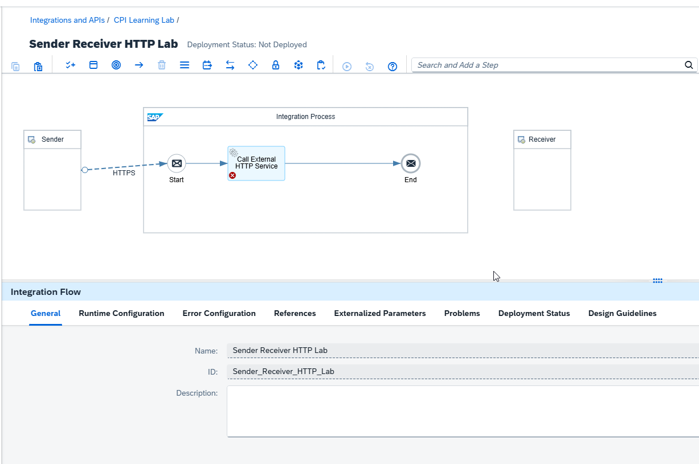

2. Crear el participante Receiver y conectarlo desde Request Reply mediante el adaptador **HTTP**.
3. Configurar Address `https://httpbin.org/get`, Proxy Type `Internet`, sin autenticación de destino y método GET según los campos disponibles. **Por qué:** HTTPBin permite observar la solicitud recibida sin exponer credenciales de otro sistema.

**Evidencia 06-04 — Configuración de HTTP Receiver**


### Problema encontrado durante el diseño

La pestaña **Problems** mostró dos mensajes: `Call External HTTP Service does not have outgoing message flow` y `Whitespace not allowed in Receiver name`. Tras corregir el nombre del participante Receiver, que contenía espacios, desaparecieron los indicadores rojos. **Causa confirmada por la ejecución:** nombre del Receiver con espacios. No se confirmó un defecto independiente de la conexión; por tanto, no se atribuye a ella la causa del incidente.

**Evidencia 06-05 — Corrección de validación del diseño**

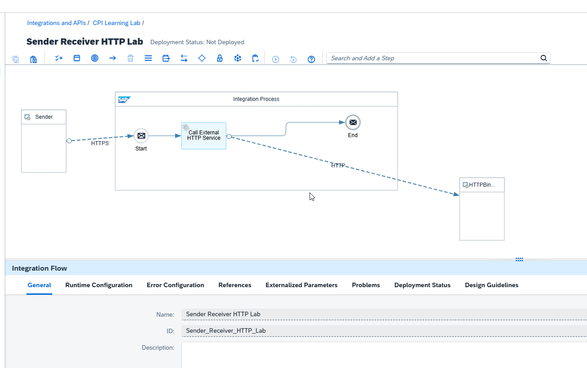

4. Guardar, desplegar y comprobar el estado **Started**. **Por qué:** un diseño válido no garantiza por sí solo que el artefacto esté ejecutándose.

**Evidencia 06-06 — Despliegue del iFlow GET**

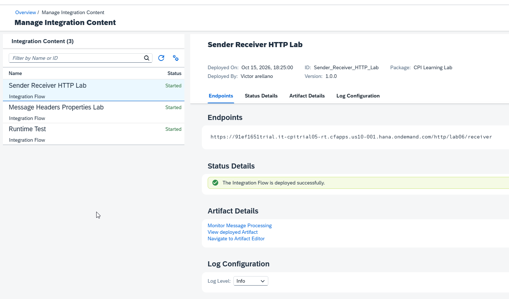

### Resultado esperado y validación

Request Reply queda asociado a un HTTP Receiver y el iFlow GET se despliega. **Validado:** la prueba posterior alcanzó HTTPBin y devolvió la respuesta esperada.

## Laboratorio 06.3 — Prueba GET de extremo a extremo

**Estado:** ✅ Completado

### Objetivo

Verificar el recorrido Postman → HTTPS Sender → Request Reply → HTTP Receiver → HTTPBin y el retorno de la respuesta.

### Procedimiento

1. En Postman, obtener un token OAuth válido con la solicitud existente `Get OAuth Token`.
2. Crear `Sender Receiver Test`, método **GET**, contra la URL real del endpoint `/http/lab06/receiver`, con `Authorization: Bearer {{access_token}}`. **Por qué:** probar el runtime real y no llamar directamente a HTTPBin.
3. En **Scripts → Post-response**, configurar:

```javascript
pm.test("HTTP Status 200 OK", function () {
    pm.response.to.have.status(200);
});

pm.test("La respuesta es JSON", function () {
    const contentType = pm.response.headers.get("Content-Type");
    pm.expect(contentType).to.match(/^application\/json(?:\s*;|$)/i);
});

pm.test("HTTPBin procesó la solicitud GET", function () {
    const json = pm.response.json();
    pm.expect(json.url).to.eql("https://httpbin.org/get");
    pm.expect(json.headers).to.be.an("object");
});
```

4. Ejecutar y revisar Body y Test Results. **Por qué:** el código HTTP por sí solo no demuestra que se haya invocado el destino previsto.

**Evidencia 06-07 — GET validado con tres aserciones**

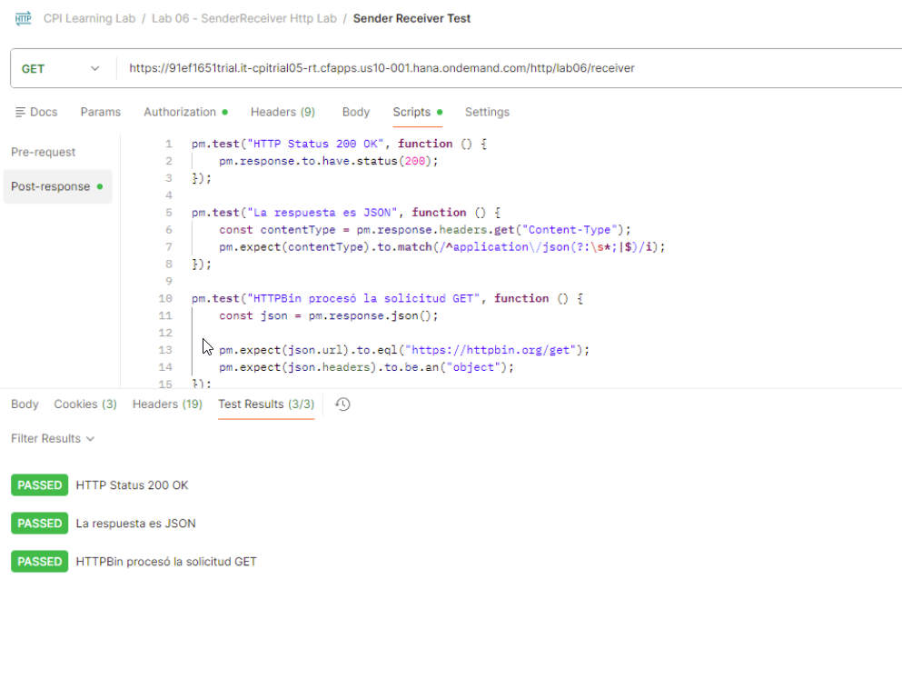

### Resultado esperado y validación

**Validado:** HTTP 200, JSON y URL `https://httpbin.org/get`, con **3/3 aserciones aprobadas**. La respuesta incluyó `Accept: */*` y `User-Agent: AHC/2.1`; esto permite observar que la solicitud saliente no es necesariamente una copia idéntica de los headers enviados por Postman.

## Laboratorio 06.4 — Variante POST con protección CSRF y Collection Runner

**Estado:** ✅ Completado

### Objetivo

Mantener el escenario GET y demostrar una llamada POST saliente con validación negativa de CSRF y pruebas automatizadas.

### Procedimiento

1. Copiar el iFlow GET y crear `Sender Receiver HTTP POST Lab` (ID `Sender_Receiver_HTTP_POST_Lab`). **Por qué:** conservar un escenario GET reproducible.

**Evidencia 06-08 — Variante POST creada**


2. En HTTPS Sender, establecer Address `/lab06/receiver-post`, autorización `User Role` / `ESBMessaging.send` y activar **CSRF Protected**. **Por qué:** separar el endpoint y exigir token en solicitudes POST protegidas.

**Evidencia 06-09 — HTTPS Sender con CSRF**


3. En HTTP Receiver, configurar Address `https://httpbin.org/post`, Proxy Type `Internet`, sin autenticación de destino y método **POST**. **Por qué:** el método entrante no determina automáticamente el método de la llamada saliente.

**Evidencia 06-10 — HTTP Receiver POST**


4. Guardar, revisar Problems y desplegar hasta **Started**.

**Evidencia 06-11 — Variante POST desplegada**

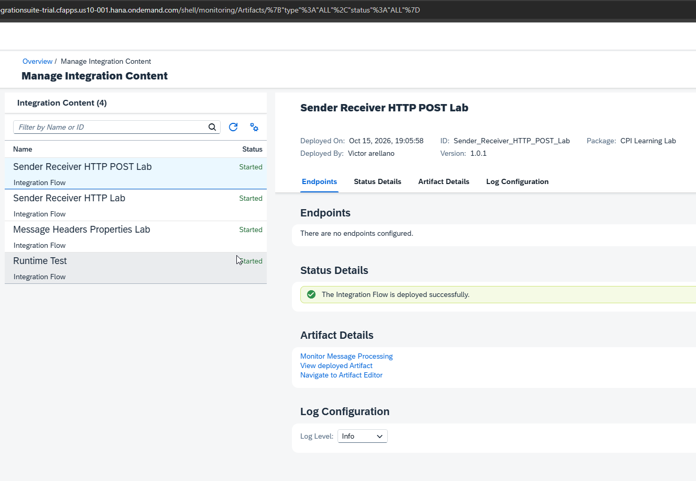

5. Crear en Postman la carpeta `Lab 06.4 - POST with CSRF`. Configurar una solicitud **POST Without CSRF Token** con Bearer OAuth y Body JSON, sin enviar el header `X-CSRF-Token` ni heredarlo. **Por qué:** demostrar que el endpoint rechaza la operación sin el token exigido.

```javascript
pm.test("POST sin CSRF es rechazado con 403", function () {
    pm.response.to.have.status(403);
});
```

**Evidencia 06-12 — Rechazo del POST sin CSRF**

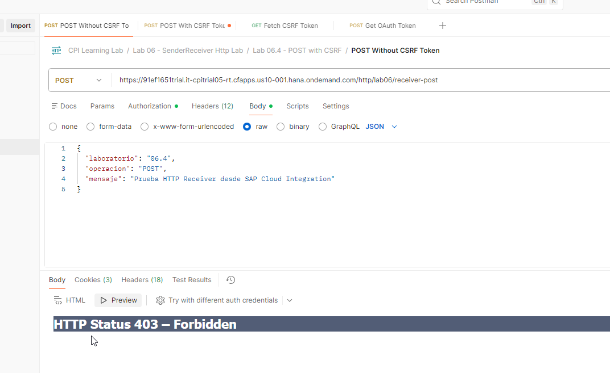

6. Crear **Fetch CSRF Token** mediante GET al endpoint `/lab06/receiver-post`, enviando `X-CSRF-Token: Fetch` y Bearer OAuth. Guardar el token en variable de colección, conservando las cookies que correspondan. **Por qué:** obtener un token asociado al endpoint antes del POST protegido. La solicitud GET de obtención del token puede activar el procesamiento del iFlow; la comprobación aquí se centra en el header devuelto.

```javascript
const csrfToken = pm.response.headers.get("X-CSRF-Token");

pm.test("CSRF Token recibido", function () {
    pm.expect(csrfToken).to.be.a("string").and.not.empty;
});

if (csrfToken) {
    pm.collectionVariables.set("csrf_token", csrfToken);
}
```

**Evidencia 06-13 — Obtención del token CSRF**

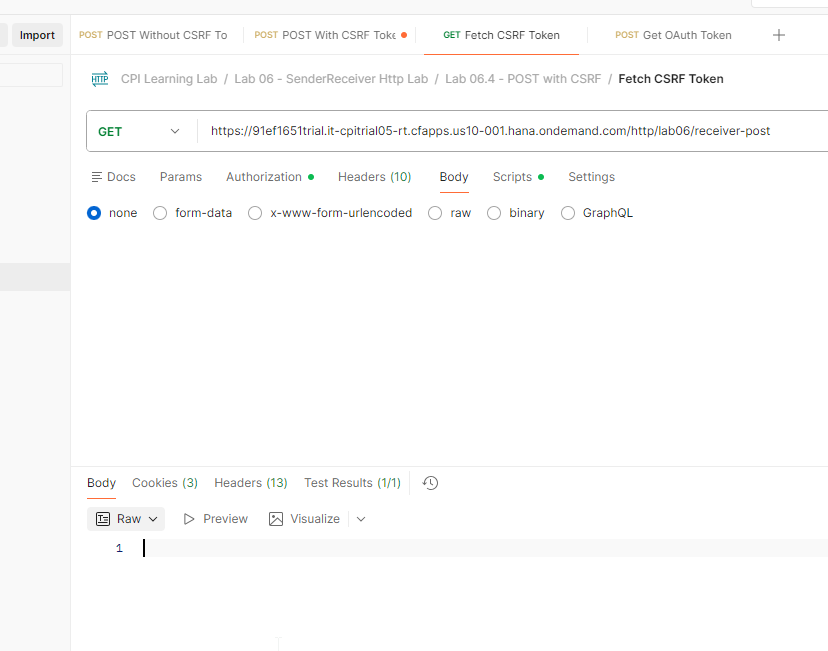

7. Crear **POST With CSRF Token** con Bearer OAuth, `X-CSRF-Token: {{csrf_token}}`, `Content-Type: application/json` y Body:

```json
{
  "laboratorio": "06.4",
  "operacion": "POST",
  "mensaje": "Prueba HTTP Receiver desde SAP Cloud Integration"
}
```

**Por qué:** comprobar que el cuerpo recibido por el Sender llega al servicio HTTP externo.

8. Configurar cuatro aserciones en **Scripts → Post-response**:

```javascript
pm.test("HTTP Status 200 OK", function () {
    pm.response.to.have.status(200);
});

pm.test("La respuesta es JSON", function () {
    const contentType = pm.response.headers.get("Content-Type");
    pm.expect(contentType).to.match(/^application\/json(?:\s*;|$)/i);
});

pm.test("HTTPBin recibió el Body esperado", function () {
    const response = pm.response.json();
    pm.expect(response.json).to.be.an("object");
    pm.expect(response.json.laboratorio).to.eql("06.4");
    pm.expect(response.json.operacion).to.eql("POST");
    pm.expect(response.json.mensaje).to.eql(
        "Prueba HTTP Receiver desde SAP Cloud Integration"
    );
});

pm.test("HTTPBin procesó el endpoint POST", function () {
    const response = pm.response.json();
    pm.expect(response.url).to.eql("https://httpbin.org/post");
});
```

**Evidencia 06-14 — POST con CSRF y respuesta HTTPBin**

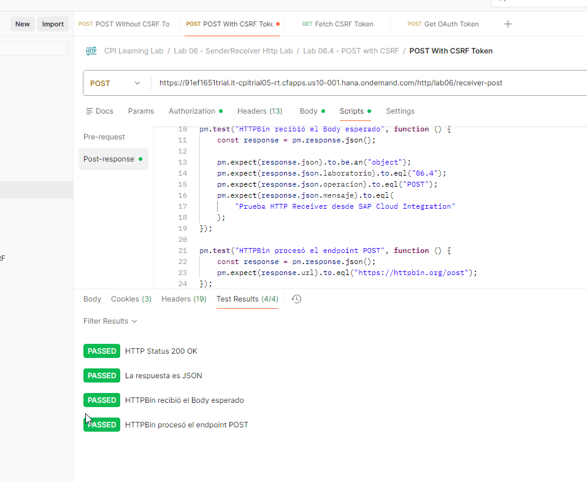

9. Ejecutar **Postman Collection Runner**, una iteración, en este orden:
   1. `Get OAuth Token`.
   2. `POST Without CSRF Token`.
   3. `Fetch CSRF Token`.
   4. `POST With CSRF Token`.

**Por qué:** reproducir el ciclo de autenticación, rechazo de operación no protegida, obtención de CSRF y ejecución correcta. La solicitud negativa no debe heredar un token de ejecuciones previas.

**Evidencia 06-15 — Primera ejecución del Runner**

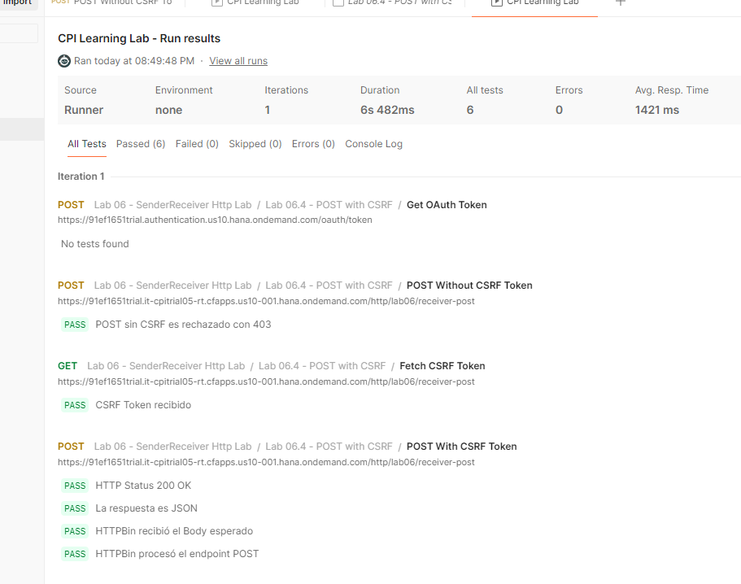

10. Incorporar la aserción HTTP 403 a la solicitud negativa y volver a ejecutar el Runner.

**Evidencia 06-16 — Runner completo validado**

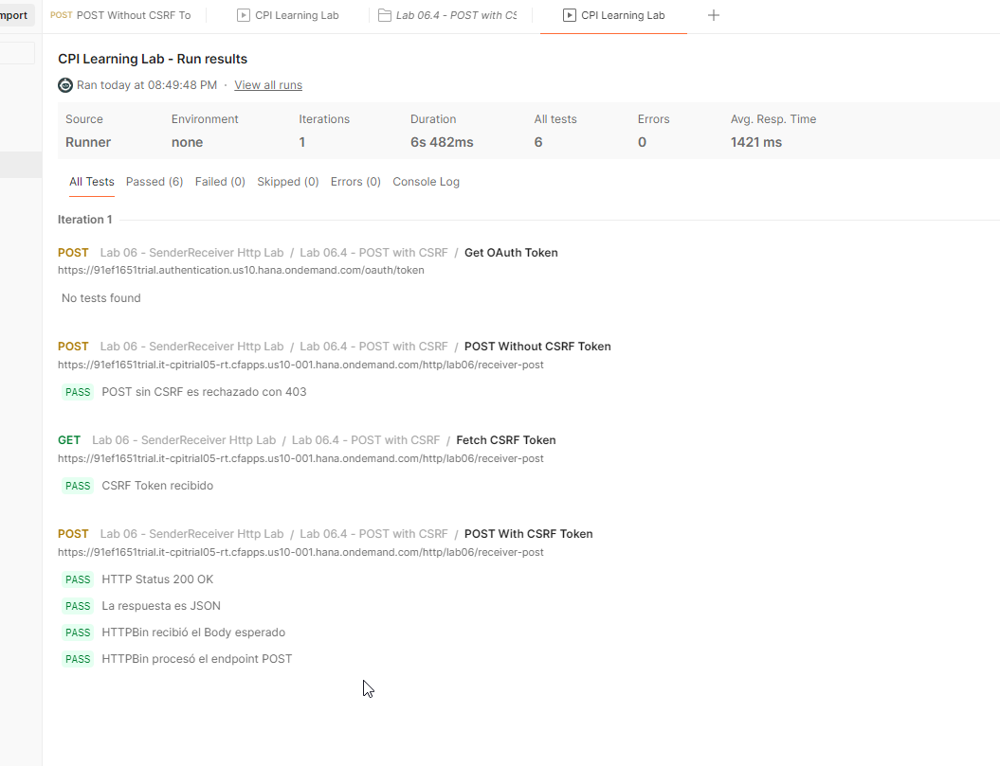

### Resultado esperado y validación

**Validado:** Runner de una iteración con **6/6 pruebas aprobadas, 0 fallidas, 0 errores**, duración observada **6,482 s**. Incluye rechazo 403 sin CSRF, recepción del token, POST HTTP 200, respuesta JSON, Body esperado y URL `/post`.

## Validación consolidada del tema

| Criterio | Evidencia | Estado |
|---|---|---|
| Entrada HTTPS autenticada y llamada saliente GET | Respuesta HTTPBin y Postman 3/3 | ✅ Completado |
| Request Reply y HTTP Receiver | Diseño y respuesta del servicio externo | ✅ Completado |
| Variante POST desplegada | Ejecución de POST a HTTPBin | ✅ Completado |
| Rechazo CSRF sin token | Runner: aserción HTTP 403 | ✅ Completado |
| POST con CSRF y Body correcto | Runner: cuatro aserciones positivas | ✅ Completado |
| Automatización del escenario POST | Runner: 6/6, sin errores | ✅ Completado |

**Alcance:** la comunicación y las respuestas quedaron verificadas desde Postman. No se adjuntó evidencia específica de Message Processing Monitor para cada ejecución; no se afirma una inspección individual de trazas de runtime.

## Problemas encontrados

- **Síntoma:** mensajes de validación del diseño, incluido `Whitespace not allowed in Receiver name`.
- **Diagnóstico confirmado:** el nombre del participante Receiver contenía espacios.
- **Solución:** utilizar un nombre sin espacios y volver a validar el diseño.
- **Alcance:** problema de nomenclatura en este iFlow. No se confirmó una falla independiente del flujo saliente, aunque inicialmente apareció también el mensaje `does not have outgoing message flow`.

Se documenta aquí por corresponder al procedimiento. No se crea una KBA separada para una corrección menor sin un hallazgo adicional reutilizable.

## Aprendizajes

- Sender y Receiver cumplen funciones distintas; la llamada saliente se define en el HTTP Receiver.
- Request Reply permite esperar una respuesta antes de finalizar la interacción síncrona.
- El método HTTP entrante no determina automáticamente el método saliente.
- Un código HTTP 200 es una verificación insuficiente por sí sola: se validaron también el formato, la URL de destino y el Body.
- La protección CSRF requiere comprobar tanto el rechazo sin token como la operación correcta con token.
- Postman Collection Runner permite ejecutar pruebas repetibles, pero solo cuenta como validado aquello que tiene aserciones y evidencia.

## Seguridad y publicación de evidencias

- No subir `access_token`, `csrf_token`, secretos OAuth, contraseñas, cookies de sesión ni service keys.
- Ocultar o recortar en capturas los tokens, cookies, valores de trazabilidad (`Sap-Passport`, `Traceparent`, `Tracestate`, `X-Dynatrace`) y otros identificadores que no sean necesarios para demostrar el resultado.
- Si una credencial real se expone accidentalmente, rotarla antes de publicar y descartar la captura afectada.
- Las rutas de imagen son referencias para incorporar capturas revisadas a `docs/images/tema-06/`; este documento no presupone que todas las imágenes ya estén copiadas.

## Referencias

- [SAP Help Portal — Cloud Integration](https://help.sap.com/docs/integration-suite/cloud-integration)
- [HTTPBin — HTTP Request & Response Service](https://httpbin.org/)
- [Postman Learning Center](https://learning.postman.com/)
