# 07 - Transformaciones: Message Mapping

**Estado del tema:** ✅ Completado
**Laboratorio 07.1:** ✅ Completado (creación y simulación del mapping)
**Laboratorio 07.2:** ✅ Completado (ejecución HTTPS y verificación de la salida desde Postman).

## Objetivo

Definir contratos XML mediante XSD, crear un artefacto Message Mapping en SAP Cloud Integration, configurar un mapeo directo y una concatenación, y comprobar su salida mediante la simulación del editor y una invocación HTTPS a un iFlow desplegado.

## Conceptos

- **Message Mapping:** transforma mensajes mediante correspondencias entre estructuras de origen y destino.
- **XSD:** define los elementos, tipos y restricciones de los mensajes XML.
- **Mapeo directo:** transfiere un valor del origen al destino sin transformarlo.
- **`concat`:** combina dos cadenas con un delimitador configurable.
- **Simulación:** comprueba el mapping con datos de prueba sin demostrar todavía su ejecución en un iFlow desplegado.

## Prerrequisitos

- Acceso a SAP Integration Suite / Cloud Integration y al paquete `CPI Learning Lab`.
- Conocimientos de packages, artefactos e iFlows de los laboratorios anteriores.
- Editor de texto para crear archivos `.xsd` y `.xml`.

## Laboratorio 07.1 — XML a XML

### 1. Preparar el esquema de origen

Guardar `docs/xsd/tema-07/Empleado_Source.xsd`:

```xml
<?xml version="1.0" encoding="UTF-8"?>
<xs:schema xmlns:xs="http://www.w3.org/2001/XMLSchema">
    <xs:element name="Empleado">
        <xs:complexType>
            <xs:sequence>
                <xs:element name="Id" type="xs:string"/>
                <xs:element name="Nombre" type="xs:string"/>
                <xs:element name="Apellido" type="xs:string"/>
            </xs:sequence>
        </xs:complexType>
    </xs:element>
</xs:schema>
```

**Por qué:** el editor necesita conocer la estructura de entrada. `Id` se define como texto para preservar identificadores que puedan contener ceros iniciales.

### 2. Preparar el esquema de destino

Guardar `docs/xsd/tema-07/Trabajador_Target.xsd`:

```xml
<?xml version="1.0" encoding="UTF-8"?>
<xs:schema xmlns:xs="http://www.w3.org/2001/XMLSchema">
    <xs:element name="Trabajador">
        <xs:complexType>
            <xs:sequence>
                <xs:element name="Codigo" type="xs:string"/>
                <xs:element name="NombreCompleto" type="xs:string"/>
            </xs:sequence>
        </xs:complexType>
    </xs:element>
</xs:schema>
```

**Por qué:** el destino tiene una estructura distinta: renombra `Id` y combina `Nombre` y `Apellido`.

### 3. Crear el artefacto

En el paquete **CPI Learning Lab**, crear un artefacto **Message Mapping** con:

| Campo | Valor |
|---|---|
| Name | `MM_Empleado_Trabajador` |
| ID | `MM_Empleado_Trabajador` |
| Runtime Profile | `Cloud Integration` |
| Description | Transforma la estructura XML de Empleado a Trabajador mediante Message Mapping. |

Seleccionar **Add and Open in Editor**.

### 4. Cargar los XSD

En el editor, activar **Edit**, usar **References → Local → Upload** y cargar ambos esquemas.

**Resultado observado:** `Local (2)` con dos recursos de tipo XSD: origen (456 bytes) y destino (406 bytes), según la captura del laboratorio.

### 5. Asignar los mensajes

En **Add source message**, seleccionar el esquema `Empleado_Source.xsd` y la estructura raíz `Empleado`. En **Add target message**, seleccionar `Trabajador_Target.xsd` y `Trabajador`.

**Por qué:** cargar los archivos como recursos no determina automáticamente cuál es la entrada ni cuál es la salida.

**Resultado observado:** campos de origen `Id`, `Nombre`, `Apellido`; destino `Codigo`, `NombreCompleto`. Todos muestran ocurrencia `1..1`.

### 6. Configurar el mapeo directo

Conectar `Empleado/Id` con `Trabajador/Codigo` y revisar la expresión gráfica.

**Por qué:** el código conserva el mismo valor, por lo que no necesita función de transformación.

### 7. Configurar la concatenación

Seleccionar `NombreCompleto`, insertar la función **`concat`** y conectar:

- `Nombre` → `string1`
- `Apellido` → `string2`
- `Delimiter String` → un espacio en blanco (` `)
- salida de `concat` → `NombreCompleto`

**Por qué:** sin separador, la unión produciría `VictorArellano`; con un espacio produce `Victor Arellano`.

Guardar los cambios con **Save**.

### 8. Simular la transformación

Guardar `docs/xml/tema-07/Empleado_Test.xml`:

```xml
<?xml version="1.0" encoding="UTF-8"?>
<Empleado>
    <Id>1001</Id>
    <Nombre>Victor</Nombre>
    <Apellido>Arellano</Apellido>
</Empleado>
```

Cargar el archivo en **Upload test file** y ejecutar **Simulate**.

**Resultado esperado (estructura y valores):**

```xml
<Trabajador>
    <Codigo>1001</Codigo>
    <NombreCompleto>Victor Arellano</NombreCompleto>
</Trabajador>
```

**Resultado observado en la simulación:**

| Campo destino | Esperado | Observado | Validación |
|---|---|---|---|
| `Codigo` | `1001` | `1001` | ✅ |
| `NombreCompleto` | `Victor Arellano` | `Victor Arellano` | ✅ |

**Evidencia 07.1-H — Después de simular:** panel *Test Input / Test Output* con los valores esperados.

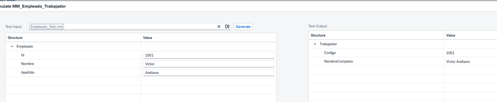

> Esta evidencia valida la simulación. La ejecución real se documenta por separado en el laboratorio 07.2.

## Validación y estado

| Criterio | Evidencia | Estado |
|---|---|---|
| Artefacto creado | Editor de `MM_Empleado_Trabajador` abierto | ✅ |
| XSD cargados | `Local (2)` | ✅ |
| Source y target asignados | Estructuras visibles | ✅ |
| Mapeo directo | Expresión `Id → Codigo` | ✅ |
| Concatenación | Expresión gráfica y resultado simulado | ✅ |
| Simulación | `1001` y `Victor Arellano` | ✅ |
| Ejecución en iFlow desplegado | POST HTTPS con respuesta XML esperada | ✅ |

**Estado final del laboratorio 07.1: ✅ Completado.**

## Problemas encontrados

En 07.1 no se observaron errores funcionales en la simulación. La verificación visual del espacio del delimitador era ambigua, pero el resultado simulado `Victor Arellano` confirmó el separador en la ejecución de prueba.

## Aprendizajes

1. Importar XSD y asignar source/target son acciones distintas.
2. El mapeo directo es suficiente cuando no cambia el valor.
3. La función `concat` requiere definir explícitamente el delimitador para el formato deseado.
4. La simulación aporta evidencia funcional, pero no reemplaza una prueba en un iFlow desplegado.

## Laboratorio 07.2 — Ejecutar el Message Mapping desde un iFlow HTTPS

### Objetivo

Reutilizar `MM_Empleado_Trabajador` en un iFlow que reciba XML por HTTPS, lo transforme y devuelva la estructura `Trabajador` al cliente HTTP.

### Prerrequisitos

- Laboratorio 07.1 simulado correctamente.
- Acceso al paquete `CPI Learning Lab` y autorización para desplegar iFlows.
- Postman con autenticación válida, sin incluir tokens ni secretos en Git.

### 1. Crear el iFlow

Crear el artefacto de tipo Integration Flow `Empleado Mapping HTTP` dentro de `CPI Learning Lab`.

**Por qué:** el artefacto Message Mapping define la transformación, pero requiere un proceso de integración para ejecutarse al recibir un mensaje externo.

**Evidencia 07.2-A — Antes de configurar el proceso:** iFlow con Start y End, todavía sin adaptador ni paso de mapping.

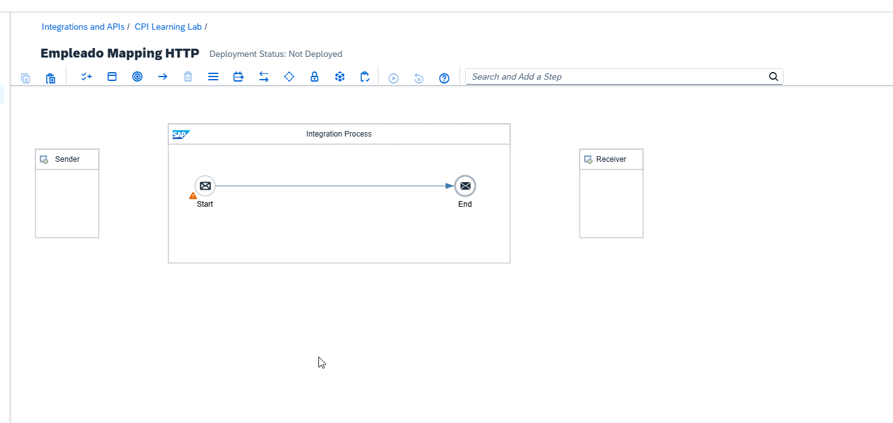

### 2. Configurar el adaptador HTTPS Sender

Conectar Sender al evento Start y configurar el canal HTTPS:

| Parámetro | Valor observado |
|---|---|
| Address | `/empleado/mapping` |
| Authorization | `User Role` |
| User Role | `ESBMessaging.send` |
| CSRF Protected | Activado |

**Por qué:** el endpoint expone el proceso para invocaciones HTTP autenticadas. La protección CSRF requiere gestionar el token en clientes que realizan solicitudes modificadoras, de acuerdo con la configuración efectiva.

**Evidencia 07.2-B — Después de configurar el Sender:** ruta, autorización y protección CSRF visibles.

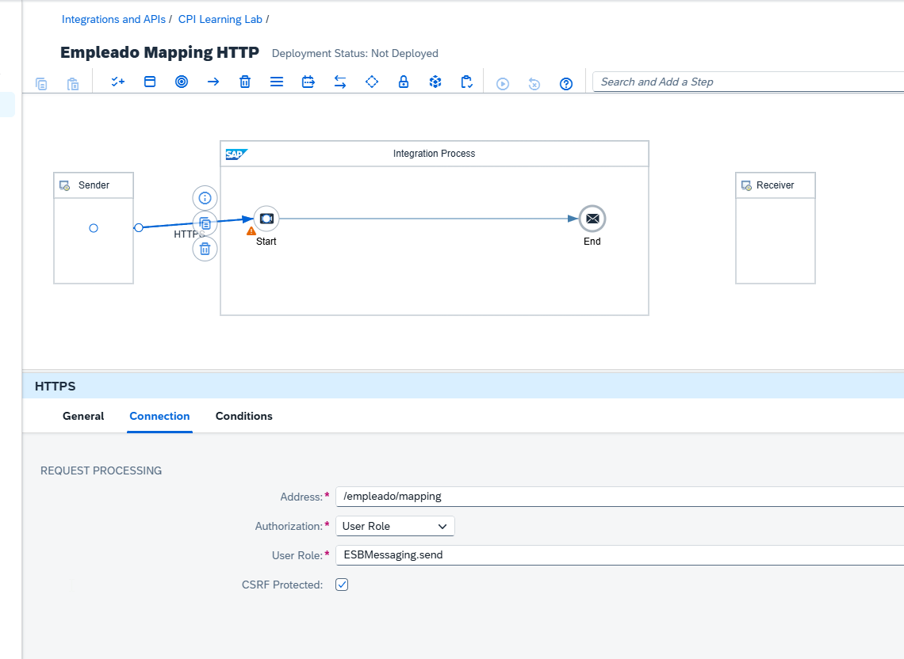

### 3. Agregar el paso Message Mapping

Insertar un paso **Message Mapping** entre Start y End. Renombrarlo como `Map Empleado to Trabajador`, para indicar su función en el proceso.

**Por qué:** un nombre funcional facilita localizar el paso en los registros de ejecución y diagnosticar fallos.

### 4. Referenciar el artefacto de mapping

El mapping se creó como artefacto independiente del mismo paquete. Inicialmente, la selección de recursos locales y globales no mostraba resultados.

**Evidencia 07.2-C — Antes de agregar la referencia:** selector de recurso sin elementos disponibles.

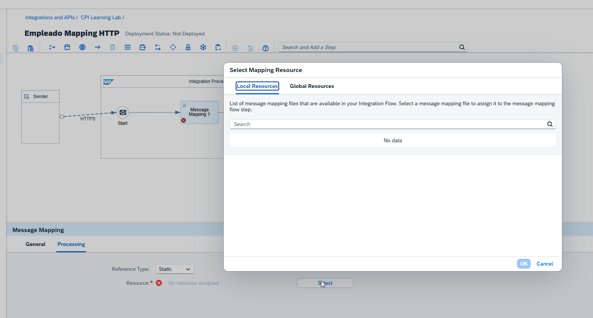

**Evidencia 07.2-D — Búsqueda global sin resultados:** búsqueda del mapping antes de incorporarlo como referencia.

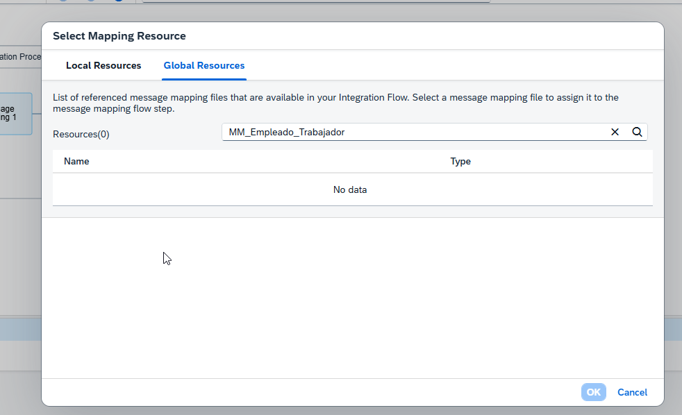

Desde el iFlow en modo edición, abrir **References → Global → Add References → Mapping → Message Mapping**, elegir el paquete `CPI Learning Lab` y seleccionar `MM_Empleado_Trabajador`.

**Por qué:** un artefacto existente en el paquete no necesariamente está referenciado por el iFlow. La referencia explícita permite seleccionarlo en el paso Message Mapping.

**Evidencia 07.2-E — Menú para agregar una referencia:** opción Mapping → Message Mapping.

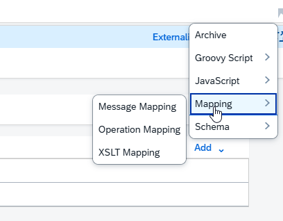

**Evidencia 07.2-F — Selección del artefacto global:** mapping del paquete seleccionado para crear la referencia.

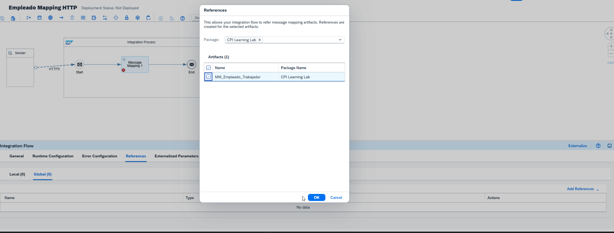

Guardar el iFlow y verificar que el paso tenga un recurso asignado. No confundir **References del iFlow** con **References del editor del propio mapping**.

### 5. Revisar la advertencia de formato

En la pestaña Problems apareció la advertencia:

> Http Sender Component may not pass XML or JSON message to Message Mapping. Message Mapping supports XML or JSON input only.

**Interpretación:** es una advertencia de diseño sobre el formato potencial del mensaje recibido. No demuestra por sí sola que la configuración sea incorrecta. El contenido real de la solicitud debe comprobarse en la ejecución.

**Evidencia 07.2-G — Advertencia antes de la prueba:** aviso en la pestaña Problems.

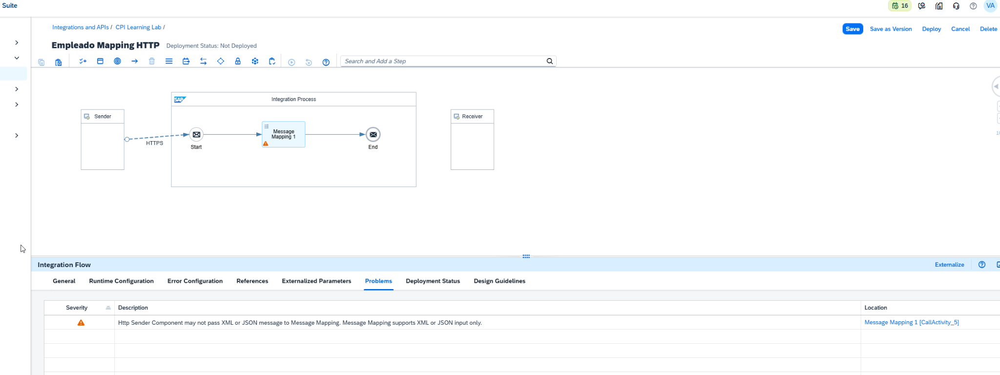

### 6. Desplegar y verificar el endpoint

Desplegar `Empleado Mapping HTTP` y revisar **Monitor → Manage Integration Content**.

**Resultado observado:** iFlow `Started`, mensaje `The Integration Flow is deployed successfully` y endpoint HTTPS terminado en `/http/empleado/mapping`.

**Evidencia 07.2-H — Después del despliegue:** estado Started, endpoint y confirmación del despliegue.

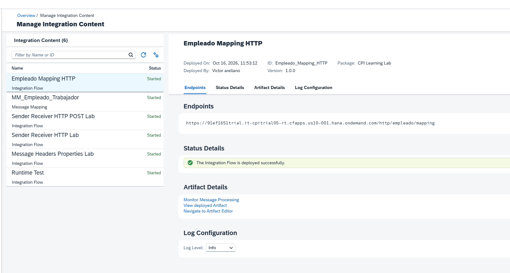

### 7. Diagnosticar el primer POST fallido

La primera invocación desde Postman devolvió `500 Internal Server Error`.

**Evidencia 07.2-I — Antes de corregir la solicitud:** respuesta HTTP 500 en Postman.

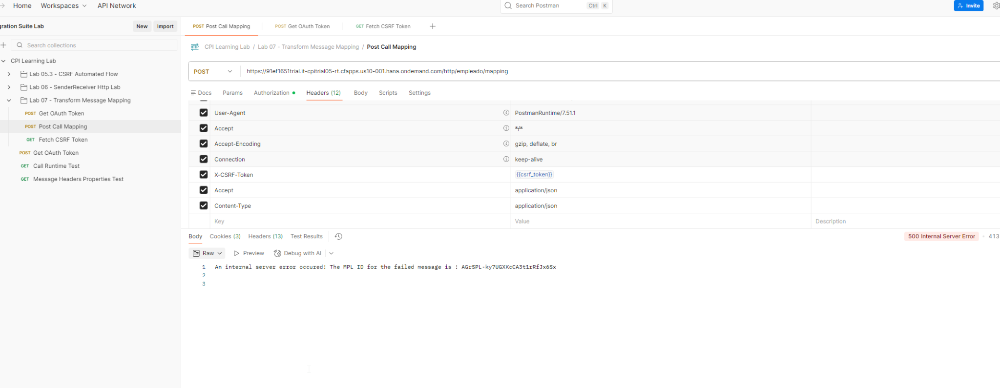

En **Monitor Message Processing** se observó el error `Premature end of file`, y el paso señalado como fallido fue `Map Empleado to Trabajador`.

**Diagnóstico confirmado mediante la prueba posterior:** la solicitud no llevaba el cuerpo XML requerido. Al incorporar un Body XML válido, el mismo flujo devolvió la transformación esperada. No se necesita atribuir el fallo a la región, el runtime o a los esquemas XSD.

### 8. Corregir el Body y volver a ejecutar

En Postman, configurar:

| Elemento | Configuración |
|---|---|
| Método | `POST` |
| URL | Endpoint desplegado terminado en `/http/empleado/mapping` |
| Body | `raw` → `XML` |
| Content-Type | `application/xml` |
| Autenticación | Según la configuración de seguridad del endpoint |
| CSRF | Token válido cuando corresponda a la protección activada |

Enviar el contenido de `docs/xml/tema-07/Empleado_Test.xml`:

```xml
<?xml version="1.0" encoding="UTF-8"?>
<Empleado>
    <Id>1001</Id>
    <Nombre>Victor</Nombre>
    <Apellido>Arellano</Apellido>
</Empleado>
```

**Resultado observado en el Body de respuesta:**

```xml
<?xml version="1.0" encoding="UTF-8"?>
<Trabajador><Codigo>1001</Codigo><NombreCompleto>Victor Arellano</NombreCompleto></Trabajador>
```

**Evidencia 07.2-J — Después de corregir la solicitud:** Postman muestra el Body XML enviado y la respuesta transformada correctamente.

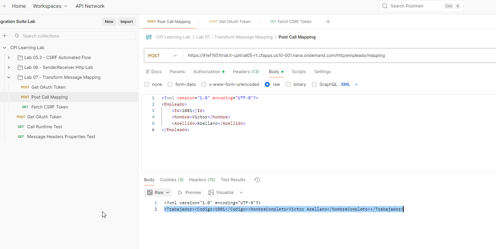

**Verificación adicional:** la ejecución posterior de Postman Runner confirmó `200 OK` y las cuatro pruebas automatizadas aprobadas.

### 9. Pruebas automatizadas en Postman Runner

La ejecución final de la colección mostró **4 pruebas aprobadas, 0 fallidas y 0 errores**, en una iteración. Las validaciones fueron: recepción del token CSRF, respuesta HTTP `200 OK`, respuesta XML y transformación correcta de Empleado a Trabajador. La solicitud de obtención del token OAuth respondió correctamente, aunque no tenía pruebas automatizadas asociadas en ese resultado.

La ejecución anterior había mostrado un fallo en la prueba del encabezado `Content-Type`; la nueva ejecución confirmó que esa comprobación pasó.

### 10. Validación

| Criterio | Evidencia | Estado |
|---|---|---|
| iFlow creado y configurado | Diagrama y canal HTTPS | ✅ |
| Mapping referenciado | Selección del artefacto y ejecución de la transformación | ✅ |
| iFlow desplegado | Estado Started y confirmación de despliegue | ✅ |
| Error inicial identificado | HTTP 500 y `Premature end of file` | ✅ |
| Transformación en runtime | Body XML de salida en Postman | ✅ |
| Código HTTP de la ejecución exitosa | Postman Runner: `200 OK` | ✅ |
| Pruebas automatizadas de Postman | 4 aprobadas, 0 fallidas, 0 errores | ✅ |

**Estado del laboratorio 07.2: ✅ Completado**, con transformación en runtime y pruebas HTTP automatizadas satisfactorias.

## Problemas encontrados

1. **Referencia no disponible inicialmente:** el mapping independiente no aparecía en el selector hasta gestionar la referencia global del iFlow. La secuencia de configuración y capturas queda registrada arriba.
2. **Visualización intermitente del target en el editor:** al abrir `MM_Empleado_Trabajador`, en ocasiones `Target Messages` aparecía vacío y volvía a visualizarse al seleccionar el XSD destino. No se puede confirmar la causa; no se debe afirmar que el XSD estuviera dañado.
3. **Error `Premature end of file`:** primera invocación sin el Body XML requerido. La prueba posterior con XML correcto devolvió el resultado esperado. Registrar este aprendizaje en `docs/kba-y-hallazgos.md`.

## Aprendizajes

- Simular un mapping y ejecutarlo en runtime son validaciones distintas.
- Un mapping independiente puede necesitar una referencia explícita en el iFlow.
- Un aviso de diseño no reemplaza la evidencia de una prueba real.
- `Premature end of file` obliga a comprobar primero el Body recibido antes de modificar el mapping.
- Los tokens y secretos deben mantenerse fuera de los archivos publicados en Git.

## Cierre del tema

**Tema 07: ✅ Completado.** Se verificaron la simulación del Message Mapping, el despliegue del iFlow HTTPS, la transformación en runtime y las pruebas automatizadas en Postman. En la ejecución final de Postman Runner se registraron 4 pruebas aprobadas, 0 fallidas y 0 errores. La exportación de la colección Postman no forma parte de los criterios de validación de este tema.

## Referencias

- [SAP Integration Suite — Documentación oficial](https://help.sap.com/docs/integration-suite/sap-integration-suite)

## Evidencia y archivos incluidos

- `docs/xsd/tema-07/Empleado_Source.xsd`
- `docs/xsd/tema-07/Trabajador_Target.xsd`
- `docs/xml/tema-07/Empleado_Test.xml`
- Evidencias de simulación y ejecución bajo `docs/images/tema-07/`, según las referencias de cada paso.

