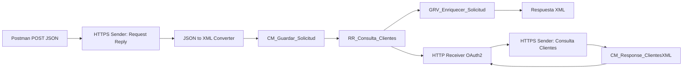
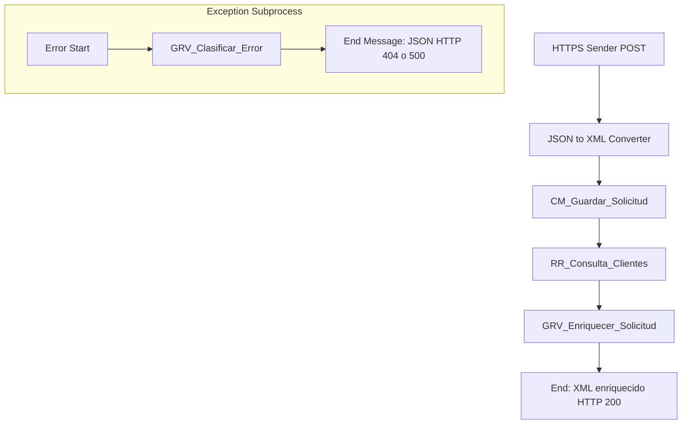

# 08 — Content Enricher y Request-Reply

**Estado del tema:** 🟨 En curso
**08.1 — Request-Reply:** ✅ Completado
**08.2 — Enriquecimiento mediante Request-Reply y Groovy:** ✅ Completado
**08.3 — Headers y Transformaciones:** ✅ Completado
**08.4 — Manejo de errores:** 🟨 En curso

## Objetivo

Construir y validar integraciones síncronas entre iFlows, conservando una solicitud original y agregando datos de un servicio consultado. Distinguir el patrón Request-Reply del componente Content Enricher y comprender las limitaciones de los adaptadores admitidos.

## Conceptos

- **HTTPS Sender:** expone un endpoint para recibir solicitudes.
- **Request Reply:** suspende la continuación del flujo hasta recibir la respuesta del receptor.
- **Content Modifier / Exchange Property:** conserva el contenido original mientras el body cambia durante la llamada.
- **JSON to XML Converter:** adapta el formato de entrada para el procesamiento XML posterior.
- **Groovy + MarkupBuilder:** construye el documento enriquecido a partir de los dos mensajes.
- **OAuth2 Client Credentials:** autenticación configurada en el HTTP Receiver para consumir el segundo iFlow.
- **Exception Subprocess:** captura excepciones del procesamiento y permite generar respuestas HTTP controladas.
- **CamelExceptionCaught:** propiedad de intercambio que permite consultar la excepción capturada.

## Prerrequisitos

- SAP Cloud Integration habilitado y acceso al paquete `CPI Learning Lab`.
- Permisos de despliegue y monitorización; Postman con autorización OAuth2 operativa.
- Laboratorios de HTTPS Sender, Content Modifier y Request Reply revisados previamente.
- Nunca almacenar tokens, `client_secret` ni Service Keys en el repositorio.

## Laboratorio 08.1 — Request-Reply HTTP GET

**Estado:** ✅ Completado.

1. Crear el iFlow `Request Reply` en `CPI Learning Lab`, con HTTPS Sender y un paso Request Reply conectado a HTTP Receiver. **Por qué:** el sender publica el servicio y Request Reply permite esperar la respuesta del destino.
2. Configurar el receptor HTTP con método `GET`, dirección `https://httpbin.org/get`, proxy `Internet` y autenticación `None`. **Por qué:** este endpoint permite verificar la llamada saliente sin credenciales del receptor.
3. Guardar, desplegar y verificar `Started`. Ejecutar la petición GET desde Postman usando el endpoint HTTPS publicado y el token autorizado.
4. Confirmar `200 OK` y respuesta JSON de httpbin; registrar la versión `1.0.1` indicada en la evidencia del laboratorio.

## Laboratorio 08.2 — Enriquecimiento de una solicitud

**Estado:** ✅ Completado.

### Objetivo y diseño

Recibir un POST JSON en `Request Reply`, conservar los campos de la solicitud, consultar el iFlow `Consulta Clientes` mediante un Request Reply HTTP GET y generar un XML con los datos originales y los atributos del cliente.



**Decisión de diseño:** inicialmente se exploró el paso Content Enricher con algoritmo `Enrich`, pero el diseñador reportó que este componente admite determinados adaptadores y no el HTTP Receiver utilizado. Se adoptó **Request Reply + Exchange Property + Groovy**. Por tanto, este laboratorio demuestra el **patrón de enriquecimiento**, no la ejecución exitosa del paso nativo Content Enricher.

### Configuración paso a paso

1. En el iFlow `Consulta Clientes`, crear un HTTPS Sender con dirección `/lab08/consulta-clientes` y autorización por rol `ESBMessaging.send`. Configurar un Content Modifier `CM_Response_ClientesXML` con header `Content-Type` = `application/xml`, Source Type `Constant`, y body XML de prueba. **Por qué:** ofrece un segundo servicio reproducible para consultar los datos del cliente.

```xml
<Clientes>
  <Cliente>
    <clienteId>1001</clienteId>
    <nombre>Ana</nombre>
    <segmento>PREMIUM</segmento>
  </Cliente>
</Clientes>
```

2. Desplegar `Consulta Clientes` y comprobar por Postman un GET con `200 OK` y el XML anterior. **Por qué:** se valida el servicio receptor independientemente del enriquecimiento.
3. En `Request Reply`, agregar `CONV_JsonToXml_...` antes del Content Modifier. Mantener desmarcadas `Use Namespace Mapping` y `Add XML Root Element` según la configuración final observada. **Por qué:** el body JSON incluye ya la raíz `Solicitud`, que debe quedar disponible como XML.
4. Configurar `CM_Guardar_Solicitud`, pestaña `Exchange Property`: Action `Create`, Name `SolicitudOriginal`, Source Type `Expression`, Source Value `${in.body}`, Data Type `java.lang.String`. **Por qué:** Request Reply sustituirá el body con la respuesta del servicio consultado; la propiedad conserva el XML original.
5. Configurar `RR_Consulta_Clientes` conectado a HTTP Receiver: método `GET`, dirección HTTPS del iFlow `Consulta Clientes`, Proxy Type `Internet`, `Send Body` desactivado, Authentication `OAuth2 Client Credentials`, Credential Name `OAUTH2_Consulta_Clientes`. **Por qué:** el receptor necesita un token válido para invocar el endpoint protegido. El material OAuth2 se gestiona en `Manage Security Material`, no en el código ni en Git.
6. Agregar `GRV_Enriquecer_Solicitud`, Script File `GRV_Enriquecer_Solicitud.groovy`, función `processData`. **Por qué:** combina la propiedad `SolicitudOriginal` con el XML de respuesta y produce el XML final. El recurso Groovy corregido se entrega junto a esta documentación.
7. Guardar y desplegar el iFlow `Request Reply`. Confirmar estado `Started` antes de probarlo.

### Prueba Postman

**Colección:** `CPI Learning Lab / Lab 08 - Content Enricher y Request-Reply / 08.2 - Content Enricher`
**Request:** `POST Enriquecer Solicitud Cliente`
**Método:** `POST`
**Endpoint:** `/http/lab08/request-reply` en el host del runtime (no publicar hostname ni tokens como secretos).
**Authorization:** Bearer token obtenido con OAuth2
**Content-Type:** `application/json`
**Accept:** `application/xml` (coherente con el resultado validado).

Body → raw → JSON:

```json
{
  "Solicitud": {
    "solicitudId": "SOL-1001",
    "clienteId": "1001",
    "origen": "POSTMAN"
  }
}
```

**Resultado esperado y observado:** HTTP `200 OK`, tiempo `828 ms` en la captura y body:

```xml
<SolicitudEnriquecida>
  <solicitudId>SOL-1001</solicitudId>
  <clienteId>1001</clienteId>
  <origen>POSTMAN</origen>
  <Cliente>
    <nombre>Ana</nombre>
    <segmento>PREMIUM</segmento>
  </Cliente>
</SolicitudEnriquecida>
```

### Validación

| Comprobación | Evidencia | Resultado |
|---|---|---|
| Servicio `Consulta Clientes` | GET en Postman con XML de Ana / PREMIUM | Validado |
| iFlow `Request Reply` | Pantalla de runtime `Started` | Validado |
| Preservación de datos originales | `solicitudId`, `clienteId`, `origen` en respuesta | Validado |
| Enriquecimiento | `nombre` y `segmento` agregados | Validado |
| Resultado HTTP | `200 OK` y XML enriquecido | Validado |

### Problemas encontrados y solución

- **Content Enricher nativo:** error de compatibilidad de adaptador con el diseño HTTP. Se sustituyó por Request Reply + Groovy. No se atribuye una limitación más amplia a la plataforma sin evidencia.
- **Advertencia del JSON to XML Converter:** el diseñador advirtió que el HTTPS Sender podría no entregar JSON; el POST real con JSON se procesó correctamente. La advertencia no equivale a un fallo de ejecución.
- **Groovy `java.lang.String.call()`:** al construir XML con `MarkupBuilder`, los nombres de variables `solicitudId`, `clienteId` y `origen` coincidían con nombres de nodos invocados. Se renombraron a `vSolicitudId`, `vClienteId`, `vOrigen`; tras el cambio, Postman devolvió `200 OK` y el XML esperado. Véase KBA-LAB-007.

### Aprendizajes

Un Request Reply reemplaza el body con la respuesta de la consulta; una Exchange Property permite preservar el mensaje original. El enriquecimiento se puede implementar sin el paso Content Enricher nativo cuando la combinación de adaptadores no es compatible. En Groovy, los nombres de variables deben evitar colisiones con los métodos dinámicos de `MarkupBuilder`. El despliegue `Started` no sustituye una prueba funcional de extremo a extremo.

### Referencias

- [SAP Integration Suite — SAP Help Portal](https://help.sap.com/docs/integration-suite)
- [KBA y hallazgos del laboratorio](kba-y-hallazgos.md)

## Laboratorio 08.3 — Headers y Exchange Properties

**Estado:** ✅ Completado.

### Objetivo

Distinguir los headers HTTP de las Exchange Properties y comprobar su lectura y escritura desde Groovy durante el enriquecimiento.

### Configuración y laboratorio

1. Enviar desde Postman el header `X-Lab-Origen: POSTMAN` junto con el POST JSON del laboratorio 08.2. **Por qué:** un header transporta metadatos de la solicitud y puede leerse sin modificar el body.
2. En `GRV_Enriquecer_Solicitud`, leer `message.getHeader("X-Lab-Origen", String)` y almacenar el valor con `message.setProperty("HeaderOrigenDetectado", headerOrigen)`. **Por qué:** permite conservar información del header como propiedad interna para pasos posteriores.
3. Ejecutar la solicitud y revisar el mensaje en modo TRACE, en el paso final del procesamiento. **Por qué:** la inspección del intercambio confirma el valor almacenado, sin asumir que basta con haber guardado el script.

### Resultado esperado y validación

La propiedad `HeaderOrigenDetectado` debe contener `POSTMAN`. En la inspección TRACE del mensaje, el valor fue verificado en el paso final del iFlow.

### Problemas encontrados

No se registraron problemas adicionales para esta comprobación.

### Aprendizajes

Los headers forman parte de los metadatos del mensaje y pueden participar en el intercambio HTTP. Las Exchange Properties sirven para conservar información interna del procesamiento; no deben confundirse con headers de respuesta.

## Laboratorio 08.4 — Manejo de errores con Exception Subprocess

**Estado:** 🟨 En curso.

### Objetivo

Devolver una respuesta funcional `404 Not Found` cuando el cliente consultado no existe, sin afectar el enriquecimiento exitoso (`200 OK`), y disponer de una respuesta genérica para otras excepciones (`500 Internal Server Error`).

### Conceptos y diseño

- **Error Start:** inicia el Exception Subprocess cuando se produce una excepción en el proceso principal.
- **`CamelExceptionCaught`:** permite obtener la excepción capturada desde Groovy.
- **`CamelHttpResponseCode`:** header que establece el estado HTTP de la respuesta.
- **`JsonOutput`:** genera el JSON de error de forma estructurada.



**Decisión de diseño:** el Exception Subprocess utiliza un único script para clasificar la excepción y construir la respuesta. La clasificación funcional implementada en este laboratorio reconoce un mensaje de excepción específico; esta dependencia del texto es una limitación conocida del ejemplo.

### Prerrequisitos

- Laboratorio 08.2 operativo, con `Consulta Clientes` y `Request Reply` desplegados.
- Solicitud POST autorizada en Postman y acceso a **Monitor Message Processing**.

### Configuración paso a paso

1. En `GRV_Enriquecer_Solicitud`, después de buscar el cliente en el XML recibido, comprobar la cantidad de coincidencias. **Por qué:** una solicitud sin cliente asociado debe distinguirse del procesamiento exitoso.

```groovy
if (coincidencias.size() == 0) {
    message.setProperty("CodigoErrorFuncional", "CLIENTE_NO_ENCONTRADO")
    throw new IllegalStateException("No se encontró el cliente solicitado")
}

if (coincidencias.size() > 1) {
    throw new IllegalStateException(
        "Se encontraron múltiples clientes para el ID solicitado"
    )
}
```

2. Agregar un **Exception Subprocess** al iFlow `Request Reply` con `Error Start` → `GRV_Clasificar_Error` → `End Message`. **Por qué:** centraliza la respuesta a excepciones sin modificar el recorrido exitoso.
3. Crear el recurso `GRV_Clasificar_Error.groovy` con el siguiente contenido. **Por qué:** la excepción capturada identifica el caso funcional y el script genera tanto el código HTTP como el cuerpo JSON.

```groovy
import com.sap.gateway.ip.core.customdev.util.Message
import groovy.json.JsonOutput

def Message processData(Message message) {

    def exception = message.getProperty("CamelExceptionCaught")

    String tipoExcepcion = exception?.getClass()?.getName() ?: "SIN_EXCEPCION"
    String mensajeOriginal = exception?.getMessage() ?: "SIN_MENSAJE"

    int httpStatus = 500
    String codigo = "ERROR_INTERNO"
    String mensaje = "No fue posible procesar la solicitud."

    if (mensajeOriginal.contains("No se encontró el cliente solicitado")) {
        httpStatus = 404
        codigo = "CLIENTE_NO_ENCONTRADO"
        mensaje = "El cliente solicitado no existe."
    }

    def respuesta = [
        error: [
            codigo: codigo,
            mensaje: mensaje
        ]
    ]

    message.setHeader("CamelHttpResponseCode", httpStatus)
    message.setHeader("Content-Type", "application/json")
    message.setBody(JsonOutput.toJson(respuesta))

    message.setHeader("X-Lab-Tipo-Excepcion", tipoExcepcion)
    message.setHeader("X-Lab-Mensaje-Excepcion", mensajeOriginal)

    return message
}
```

4. Guardar y desplegar `Request Reply`; comprobar `Started` y revisar la pestaña **Problems**. **Por qué:** una validación del diseño y un despliegue activo son condiciones necesarias, pero no sustituyen las pruebas HTTP.
5. Ejecutar las solicitudes de validación con Postman. **Por qué:** el comportamiento del contrato HTTP debe comprobarse desde el consumidor.

### Pruebas y resultados

**Solicitud:** POST `/http/lab08/request-reply`, con autorización OAuth2 y `Content-Type: application/json`.

**Caso A — Cliente existente (`1001`).** Enviar:

```json
{
  "Solicitud": {
    "solicitudId": "SOL-1001",
    "clienteId": "1001",
    "origen": "POSTMAN"
  }
}
```

**Resultado esperado y observado:** `200 OK` con XML enriquecido:

```xml
<SolicitudEnriquecida>
  <solicitudId>SOL-1001</solicitudId>
  <clienteId>1001</clienteId>
  <origen>POSTMAN</origen>
  <Cliente>
    <nombre>Ana</nombre>
    <segmento>PREMIUM</segmento>
  </Cliente>
</SolicitudEnriquecida>
```

**Caso B — Cliente inexistente (`9999`).** Enviar la misma solicitud cambiando únicamente `clienteId` a `9999`.

**Resultado esperado y observado:** `404 Not Found` con JSON:

```json
{
  "error": {
    "codigo": "CLIENTE_NO_ENCONTRADO",
    "mensaje": "El cliente solicitado no existe."
  }
}
```

**Caso C — Excepción técnica diferente.** El script define la respuesta genérica `500 Internal Server Error` con código `ERROR_INTERNO`, pero no se realizó una prueba técnica controlada que valide este escenario de forma independiente.

| Escenario | Resultado observado | Validación |
|---|---|---|
| Cliente `1001` | HTTP `200`, XML enriquecido con Ana / PREMIUM | ✅ Validado |
| Cliente `9999` | HTTP `404`, JSON `CLIENTE_NO_ENCONTRADO` | ✅ Validado |
| Excepción técnica controlada | Respuesta `500` configurada, sin prueba independiente | 🟦 Revisado |

### Problemas encontrados y alcance

- **Propiedad de clasificación no disponible:** durante el manejo de la excepción, `CodigoErrorFuncional` no estuvo disponible en el script clasificador (`SIN_PROPIEDAD` en la prueba de diagnóstico). En cambio, `CamelExceptionCaught` contenía una `javax.script.ScriptException` cuyo mensaje incluía la `IllegalStateException` generada en `GRV_Enriquecer_Solicitud`. Por ello, la solución implementada clasifica a partir del mensaje capturado. Esta observación corresponde al flujo probado y no demuestra una regla universal sobre la propagación de propiedades.
- **Clasificación basada en texto:** cambiar el mensaje `No se encontró el cliente solicitado` sin actualizar el clasificador puede hacer que el caso funcional reciba `500`. Para integraciones productivas conviene un contrato de errores menos dependiente de mensajes literales.
- **Headers de diagnóstico:** el script conserva `X-Lab-Tipo-Excepcion` y `X-Lab-Mensaje-Excepcion` como parte de la implementación del laboratorio. Pueden exponer información interna; no se recomienda publicarlos en un entorno productivo.

### Aprendizajes

El Exception Subprocess permite controlar la respuesta de una excepción en una integración síncrona. La existencia de una respuesta HTTP `404` no implica que el procesamiento del mensaje deba aparecer como fallido en el monitor: la excepción puede haberse gestionado correctamente. La clasificación y la construcción de la respuesta deben validarse desde el consumidor, y un escenario configurado no debe marcarse como completado sin evidencia de ejecución.

### Referencias

- [SAP Integration Suite — SAP Help Portal](https://help.sap.com/docs/integration-suite)
- [KBA y hallazgos del laboratorio](kba-y-hallazgos.md)
