# 09 - Routing: Router y condiciones

**Estado general:** ✅ Completado

## Objetivo
Implementar y validar enrutamiento condicional en SAP Cloud Integration con headers, exchange properties y expresiones XPath, comprendiendo cómo se determina la ruta y cómo se comprueba su ejecución.

## Conceptos
- **Router:** selecciona un camino según condiciones evaluadas sobre el mensaje.
- **Header:** metadato accesible mediante expresiones como `${header.tipoOperacion}`.
- **Exchange property:** dato interno del intercambio accesible mediante `${property.nombre}`.
- **Default Route:** camino de respaldo cuando no coincide ninguna condición.
- **Allowed Header(s):** configuración relevante para permitir el uso de determinados headers durante el procesamiento.

## Prerrequisitos
Acceso al package `CPI Learning Lab`, permisos de edición/despliegue, autenticación para invocar el endpoint HTTPS, Postman y conocimientos de Content Modifier.

## Índice y estado
| Sección | Laboratorio | Estado |
|---|---|---|
| 09.1 | Router básico con headers | ✅ Completado |
| 09.2 | Condiciones sobre exchange properties | ✅ Completado |
| 09.3 | Ruta por defecto y casos no contemplados | ✅ Completado |
| 09.4 | Routing mediante XPath sobre XML | ✅ Completado |
| 09.5 | Laboratorio integrador | ✅ Completado |

## 09.1 - Router básico con condiciones sobre headers

**Estado:** ✅ Completado

### Objetivo
Dirigir una solicitud HTTP hacia una de tres respuestas según el valor del header `tipoOperacion` y comprobar cada ruta desde Postman.

### Laboratorio paso a paso

1. Se creó el iFlow `Routing Router Lab` (ID `Routing_Router_Lab`) en el package `CPI Learning Lab`, con runtime profile `Cloud Integration`.
2. Se conectó el Sender al Start mediante un adaptador **HTTPS**, configurando Address `/routing/router-lab`, Authorization `User Role`, rol `ESBMessaging.send` y CSRF Protected desactivado **solo para este laboratorio**. Esto permite realizar pruebas HTTP autenticadas.

   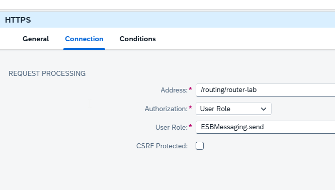

3. Se incorporó un **Router** después del Start y se crearon tres caminos, cada uno con su evento End. Las conexiones quedaron configuradas así:

   | Ruta | Expression Type | Condición | Default Route |
   |---|---|---|---|
   | ALTA | Non-XML | `${header.tipoOperacion} = 'ALTA'` | No |
   | BAJA | Non-XML | `${header.tipoOperacion} = 'BAJA'` | No |
   | DEFAULT | - | Sin expresión | Sí |

   El tipo `Non-XML` permite evaluar el header; la ruta por defecto cubre los valores no contemplados.

   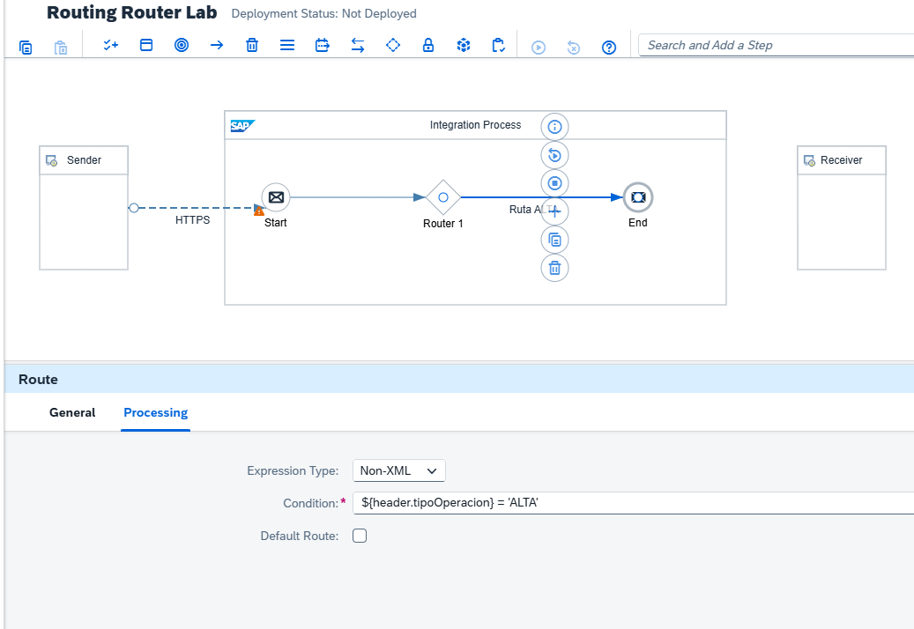
   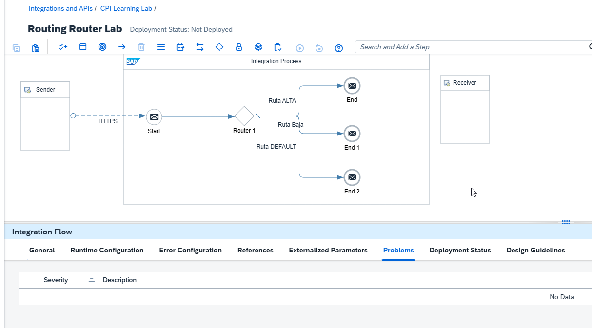

4. Se incorporaron tres Content Modifiers, uno por ruta, con cuerpo constante JSON. Cada uno identifica la ruta seleccionada:

   ```json
   {"operacion":"ALTA","resultado":"Ruta ALTA ejecutada"}
   ```
   ```json
   {"operacion":"BAJA","resultado":"Ruta BAJA ejecutada"}
   ```
   ```json
   {"operacion":"DEFAULT","resultado":"Ruta DEFAULT ejecutada"}
   ```

   Se configuró además el header de respuesta `Content-Type` con valor constante `application/json`.

   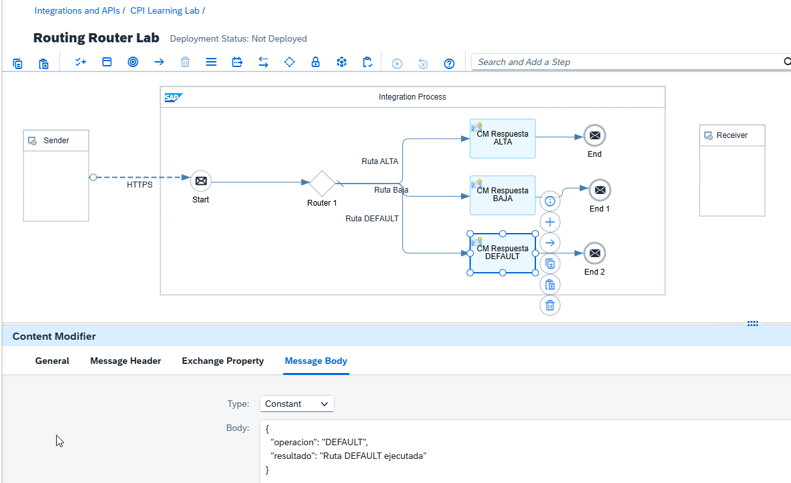
   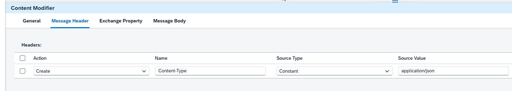

5. En **Runtime Configuration** se configuró `Allowed Header(s)` con `tipoOperacion`, para que el header personalizado estuviera disponible para el enrutamiento.

   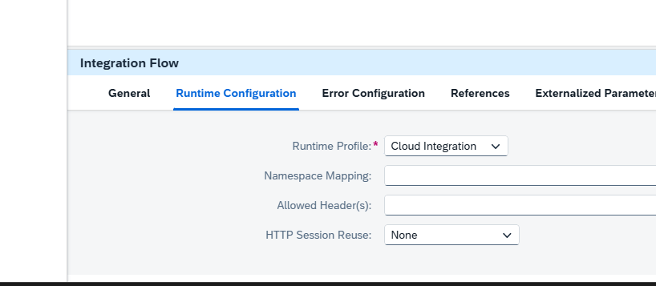

6. Se desplegó el iFlow. La pantalla de administración confirmó estado `Started`, versión `1.0.1` en el despliegue capturado y mensaje de despliegue exitoso. Posteriormente se desplegó nuevamente el iFlow tras configurar Allowed Header(s).

   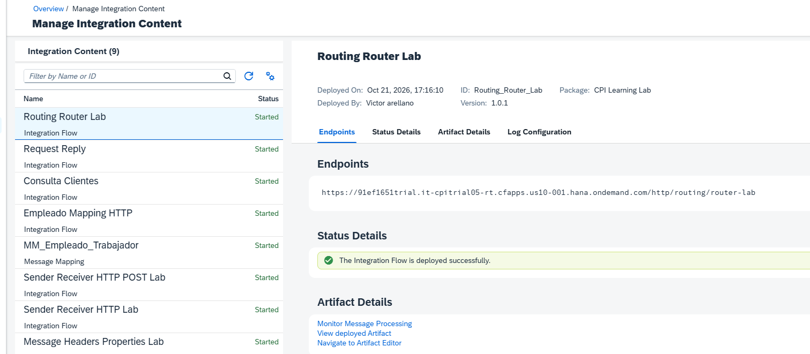

7. Se probó desde Postman el mismo endpoint HTTPS con solicitudes `POST` autenticadas, variando el header `tipoOperacion`. El cuerpo de prueba fue `{"id":1001,"nombre":"Prueba Router"}`; la decisión depende del header, no de ese cuerpo.

### Resultado esperado y validación

| Prueba | Header `tipoOperacion` | Respuesta observada | Resultado |
|---|---|---|---|
| 1 | `ALTA` | `{"operacion":"ALTA","resultado":"Ruta ALTA ejecutada"}` | ✅ |
| 2 | `BAJA` | `{"operacion":"BAJA","resultado":"Ruta BAJA ejecutada"}` | ✅ |
| 3 | Vacío | `{"operacion":"DEFAULT","resultado":"Ruta DEFAULT ejecutada"}` | ✅ |

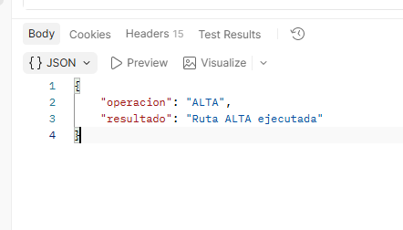
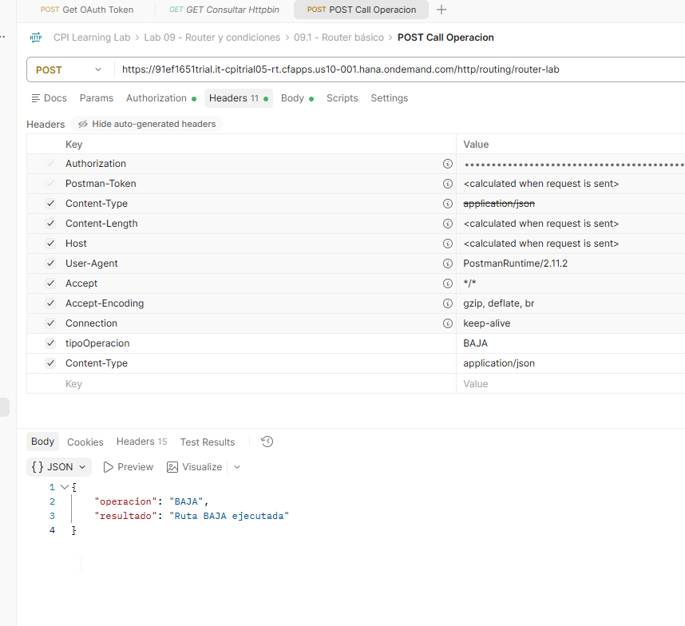
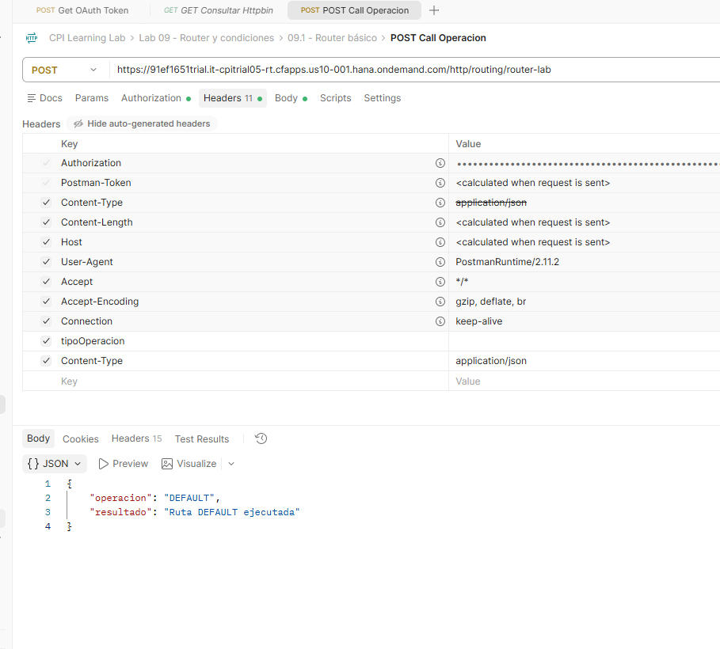

### Problemas encontrados
- **Error de diseño:** `Content Based Router model must have a default route`. Se resolvió agregando una tercera conexión y activando **Default Route**; después, la pestaña Problems mostró `No Data`.
- **Selección inesperada de DEFAULT:** una solicitud con `tipoOperacion: ALTA` devolvió inicialmente el JSON de DEFAULT. Se observó que `Allowed Header(s)` estaba vacío; después de agregar `tipoOperacion` y desplegar nuevamente, la misma prueba devolvió ALTA. La secuencia respalda que la disponibilidad del header era el problema, aunque no se obtuvo una traza interna que lo demostrara directamente.

### Aprendizajes
- Un Router debe contar con una ruta por defecto en este diseño.
- Las condiciones sobre headers necesitan que esos headers estén disponibles en el intercambio.
- El estado `Started` no demuestra por sí solo que las condiciones enruten correctamente: es indispensable validar las respuestas de cada camino.

## 09.2 - Condiciones sobre Exchange Properties

**Estado:** ✅ Completado

### Objetivo
Utilizar una Exchange Property como origen de las condiciones del Router y distinguir su función de la de un header HTTP.

### Conceptos
- **Exchange Property:** valor interno del intercambio que puede crearse mediante Content Modifier y consultarse con `${property.nombre}`.
- **Source Type = Header:** permite tomar el valor de un header existente al definir la property.
- **Condición Non-XML:** expresión del Router que puede evaluar una Exchange Property.

### Prerrequisitos
Laboratorio 09.1 implementado y validado; iFlow `Routing Router Lab` con HTTPS Sender, tres rutas y tres Content Modifiers de respuesta. Se mantiene `tipoOperacion` en `Allowed Header(s)`.

### Laboratorio paso a paso

1. En el iFlow existente se agregó el Content Modifier **`CM Definir Property`** entre Start y Router 1. Esta ubicación permite crear la property **antes** de evaluar las condiciones.
2. En la pestaña **Exchange Property** se configuró:

   | Campo | Valor |
   |---|---|
   | Action | `Create` |
   | Name | `tipoOperacionInterna` |
   | Source Type | `Header` |
   | Source Value | `tipoOperacion` |

   Así se toma el valor del header HTTP previamente admitido y se almacena en una property interna.

   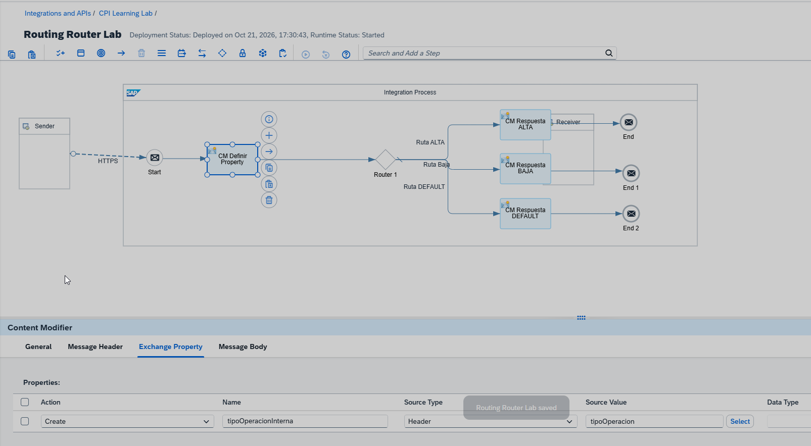

3. Se cambió la condición de **Ruta ALTA** a `Non-XML` con la expresión:

   ```text
   ${property.tipoOperacionInterna} = 'ALTA'
   ```

   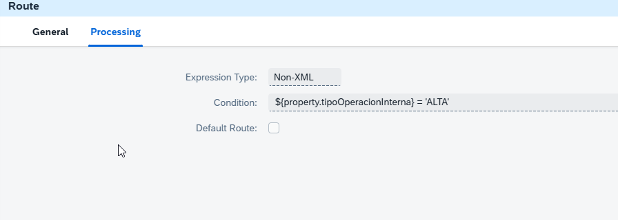

4. Se cambió la condición de **Ruta BAJA** a `Non-XML` con la expresión:

   ```text
   ${property.tipoOperacionInterna} = 'BAJA'
   ```

   

5. Se conservó la tercera ruta **DEFAULT** como ruta por defecto, sin condición, y los Content Modifiers que generan las respuestas JSON de cada camino.

### Resultado esperado
Después de guardar y desplegar los cambios, la misma solicitud POST del 09.1 debería producir las siguientes respuestas:

| Header `tipoOperacion` | Respuesta JSON esperada |
|---|---|
| `ALTA` | `{"operacion":"ALTA","resultado":"Ruta ALTA ejecutada"}` |
| `BAJA` | `{"operacion":"BAJA","resultado":"Ruta BAJA ejecutada"}` |
| Vacío | `{"operacion":"DEFAULT","resultado":"Ruta DEFAULT ejecutada"}` |

### Validación
Se verificaron las condiciones sobre la Exchange Property y se ejecutaron los escenarios ALTA, BAJA y DEFAULT desde Postman.

**Evidencias de validación:**

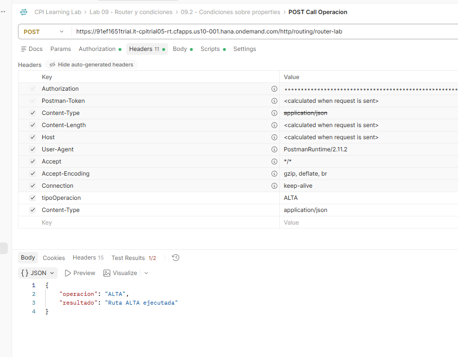
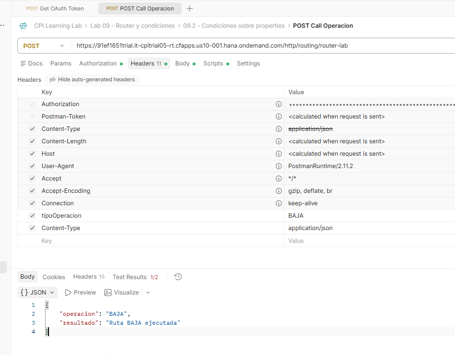
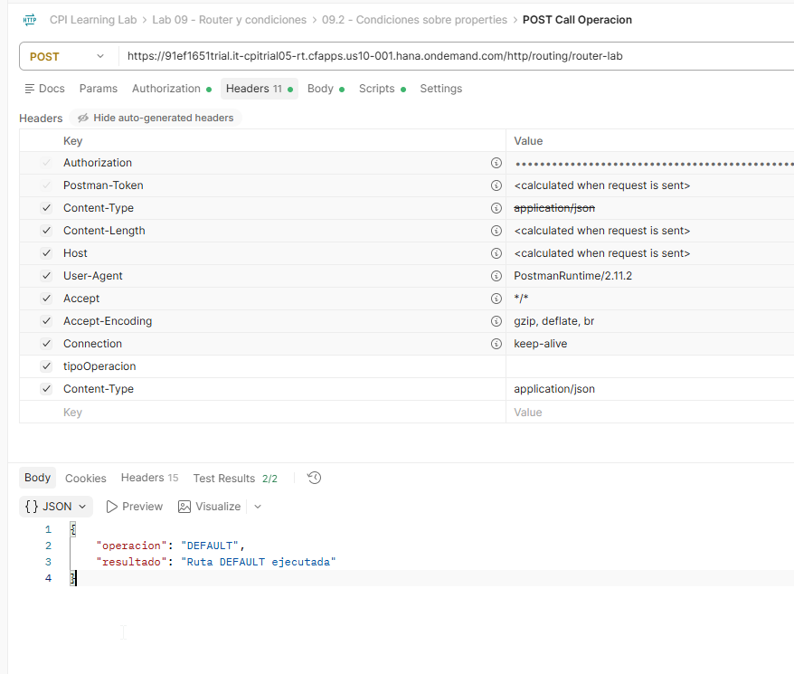

### Problemas encontrados
No se registraron incidencias funcionales persistentes en la configuración final.

### Aprendizajes
- Un header y una Exchange Property son mecanismos distintos de almacenamiento de información del mensaje.
- El Content Modifier puede copiar el valor de un header a una property, que luego consulta el Router.
- La validez visual de las expresiones no sustituye la comprobación de cada ruta después del despliegue.

## 09.3 - Ruta por defecto y casos no contemplados

**Estado:** ✅ Completado
**Versión del laboratorio:** `1.0.3`

### Objetivo
Responder de forma explícita a operaciones desconocidas o solicitudes sin el header `tipoOperacion`, conservando una ruta DEFAULT en el Router.

### Conceptos
- **DEFAULT:** ruta seleccionada cuando ninguna de las condiciones de enrutamiento coincide.
- **Error funcional:** una respuesta JSON puede comunicar un error de negocio aunque la respuesta HTTP sea `200`; el código HTTP no se cambió en este ejercicio.

### Prerrequisitos
Laboratorios 09.1 y 09.2; iFlow `Routing Router Lab` desplegable; Postman con autenticación configurada.

### Laboratorio paso a paso
1. Se guardó una versión del iFlow con el propósito del laboratorio 09.3; se registró la versión `1.0.3`.
2. En `CM Respuesta DEFAULT` se configuró **Message Body → Constant** con el siguiente JSON:

   ```json
   {
     "operacion": "DESCONOCIDA",
     "resultado": "ERROR",
     "mensaje": "La operacion solicitada no esta soportada"
   }
   ```

   Esta respuesta distingue una operación no contemplada de una ruta de negocio válida.

   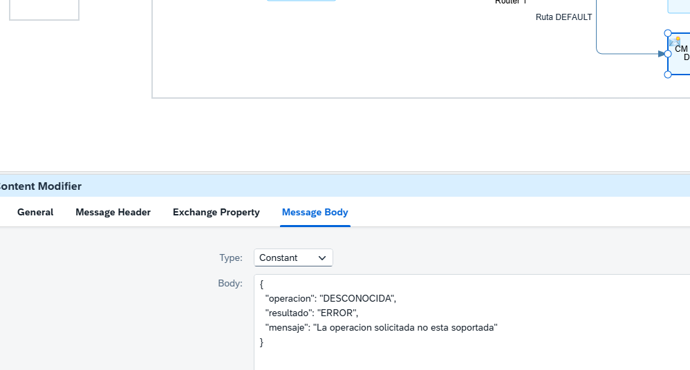

3. En la carpeta de Postman `09.3 - Ruta por defecto y casos no contemplados` se reutilizó la solicitud `POST Call Operacion`, junto con `POST Get OAuth Token`, sin crear una carpeta por escenario.
4. Se probó el header `tipoOperacion: MODIFICACION`. La respuesta observada fue el JSON `DESCONOCIDA / ERROR` esperado.

   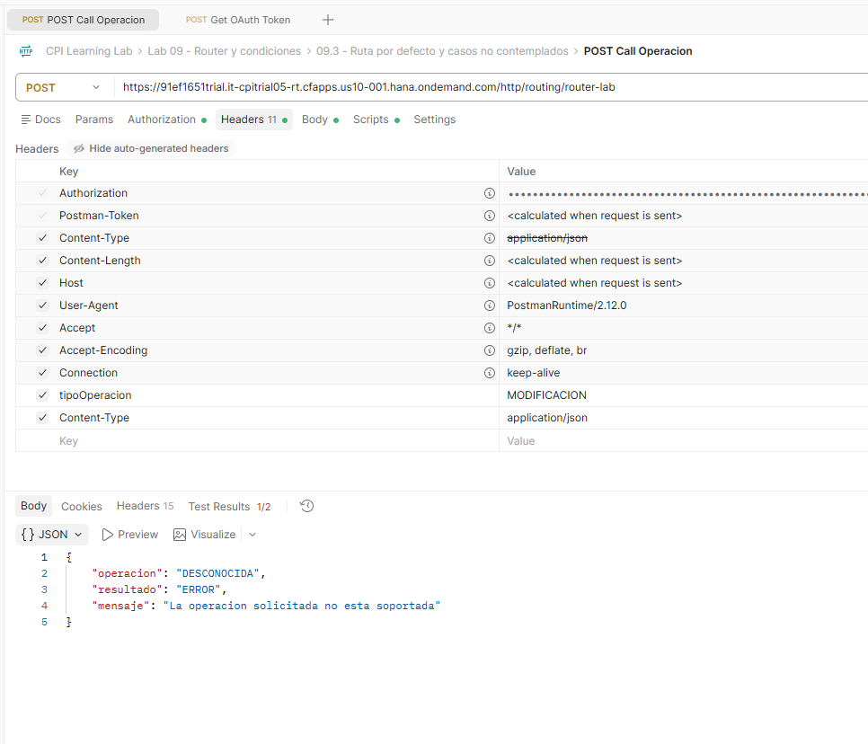

5. Se deshabilitó el header `tipoOperacion` y se ejecutó nuevamente la solicitud. La respuesta volvió a ser el JSON de DEFAULT.

   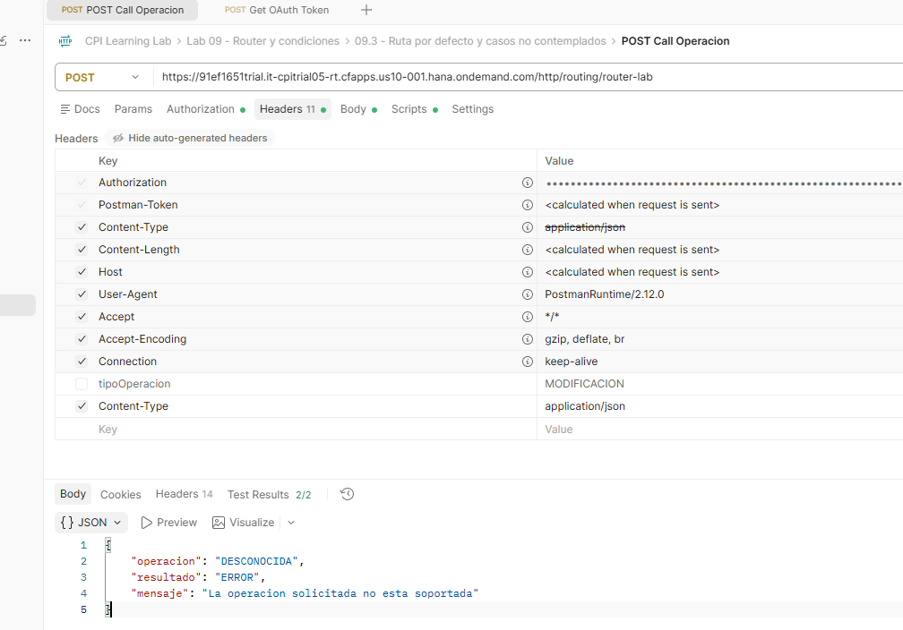

6. Se revisaron las aserciones de Postman. Una captura muestra `2/2` tests **PASSED**: comprobación de estado HTTP `200` y presencia de los campos esperados.

   

   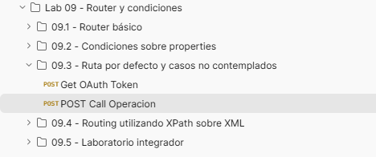

### Resultado esperado y validación
| Escenario | Resultado observado | Estado |
|---|---|---|
| `tipoOperacion: MODIFICACION` | Respuesta JSON `DESCONOCIDA / ERROR` | ✅ Validado |
| Header `tipoOperacion` deshabilitado | Respuesta JSON `DESCONOCIDA / ERROR` | ✅ Validado |
| Tests de Postman | `2/2` PASSED en la captura presentada | ✅ Verificado |

### Problemas encontrados
No se registraron incidencias funcionales persistentes en las pruebas finales.

### Aprendizajes
La ruta DEFAULT permite manejar entradas no reconocidas de manera controlada. El error funcional del JSON no implica por sí mismo un código HTTP de error: ese contrato debe diseñarse explícitamente.

## 09.4 - Routing utilizando XPath sobre XML

**Estado:** ✅ Completado
**Versión del laboratorio:** `1.0.4`

### Objetivo
Evaluar el nodo `tipoOperacion` del cuerpo XML mediante XPath para decidir entre ALTA, BAJA y DEFAULT, sin depender de una condición sobre header o property.

### Conceptos
- **XPath:** expresión que consulta nodos y valores de un documento XML.
- **Expression Type = XML:** configura una condición de ruta basada en el cuerpo XML.
- **Formato de entrada y salida:** se recibe XML, pero los Content Modifiers existentes continúan produciendo JSON.

### Prerrequisitos
Laboratorios anteriores; iFlow `Routing Router Lab`; endpoint HTTPS y autorización operativos; Postman configurado.

### Laboratorio paso a paso
1. Se registró la versión `1.0.4` en el historial del iFlow antes de trabajar en el laboratorio XPath.

   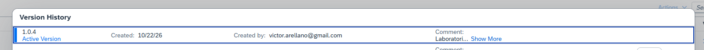

2. En la conexión **Ruta ALTA**, se configuró `Expression Type = XML` y la condición:

   ```xpath
   /solicitud/tipoOperacion = 'ALTA'
   ```

   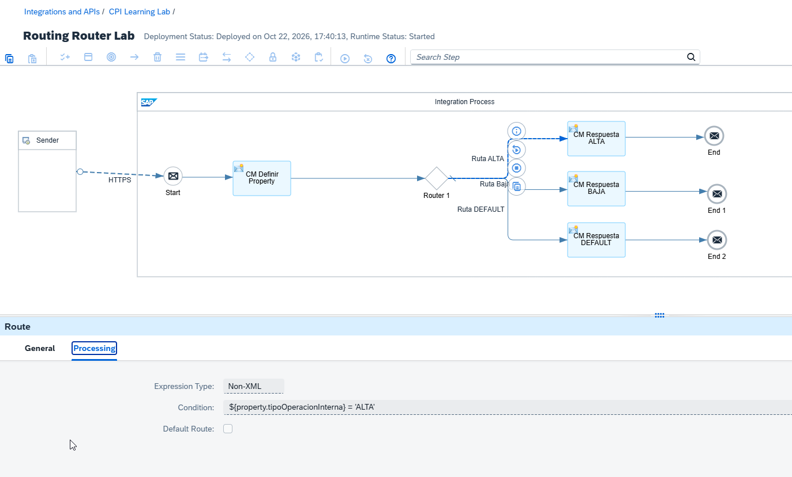

3. En la conexión **Ruta BAJA**, se configuró `Expression Type = XML` y la condición:

   ```xpath
   /solicitud/tipoOperacion = 'BAJA'
   ```

   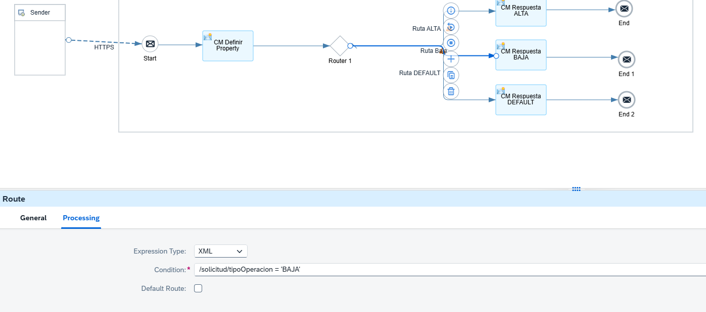

4. Se mantuvo la ruta DEFAULT y los Content Modifiers de respuesta. `CM Definir Property` puede permanecer en el diseño, aunque las condiciones XPath de este laboratorio no consultan esa property.
5. En Postman, dentro de `09.4 - Routing utilizando XPath sobre XML`, se preparó `POST Call Operacion` con `Content-Type: application/xml` y cuerpo `raw → XML`. Para ALTA se utilizó:

   ```xml
   <solicitud>
     <id>1001</id>
     <nombre>Prueba Router XPath</nombre>
     <tipoOperacion>ALTA</tipoOperacion>
   </solicitud>
   ```

   La captura confirma que la respuesta fue `{"operacion":"ALTA","resultado":"Ruta ALTA ejecutada"}` y muestra `2/2` tests de Postman.

   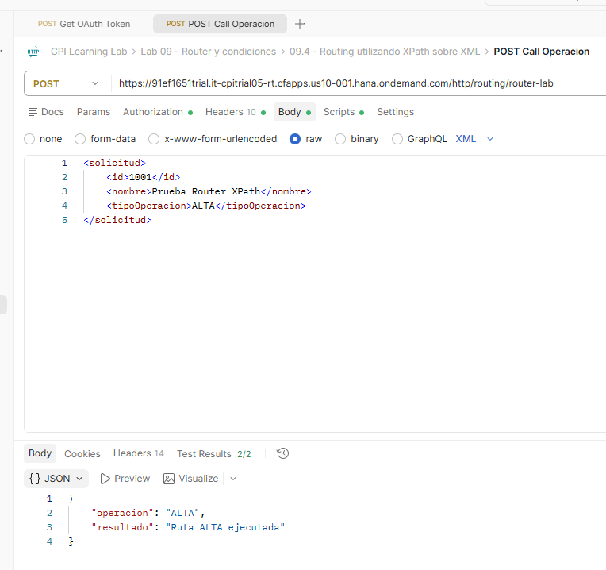

6. Para BAJA se utilizó el nodo `<tipoOperacion>BAJA</tipoOperacion>` y se obtuvo la respuesta `{"operacion":"BAJA","resultado":"Ruta BAJA ejecutada"}`.

   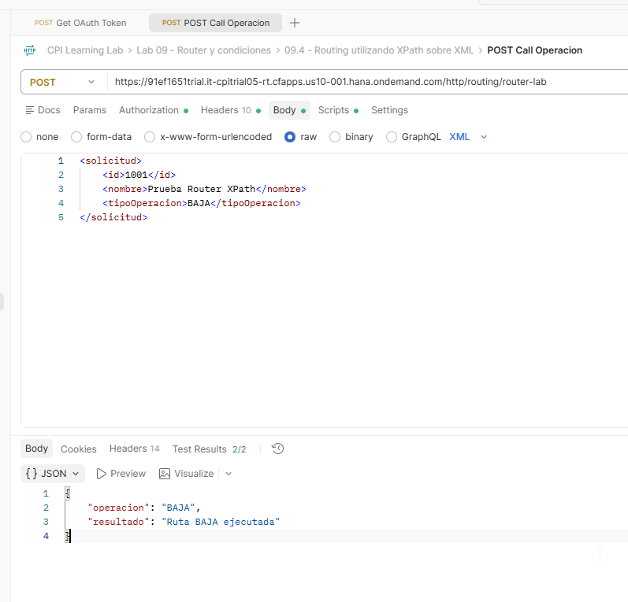

7. Para DEFAULT se utilizó `<tipoOperacion>MODIFICACION</tipoOperacion>` en un XML válido y se obtuvo el JSON de error funcional definido en 09.3.

   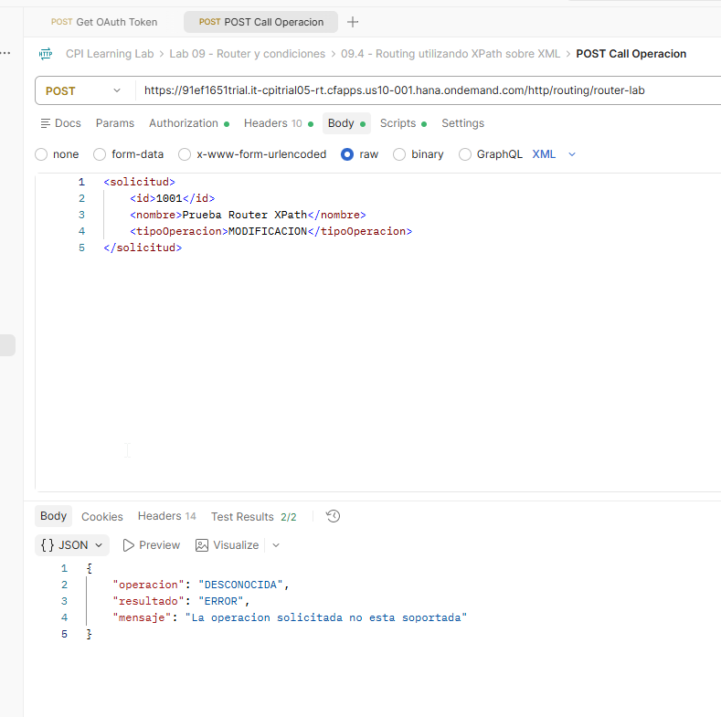

### Resultado esperado y validación
| Entrada XML (`tipoOperacion`) | Respuesta | Validación |
|---|---|---|
| `ALTA` | `ALTA / Ruta ALTA ejecutada` | ✅ Validado |
| `BAJA` | `BAJA / Ruta BAJA ejecutada` | ✅ Validado |
| `MODIFICACION` | `DESCONOCIDA / ERROR` | ✅ Validado |


### Problemas encontrados
La pestaña **Problems** mostró dos advertencias: `Http Sender Component may not pass XML message to Sequence Flow. Sequence Flow supports XML input only.` El diseñador no garantiza que toda entrada HTTPS sea XML. La prueba ALTA demuestra que una entrada XML válida se procesó satisfactoriamente, pero no elimina el riesgo de entradas no XML o XML malformado.

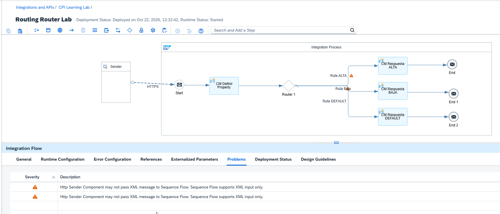

### Aprendizajes
- XPath permite enrutar según el contenido XML del mensaje.
- Una entrada XML puede producir una respuesta JSON cuando el flujo transforma o reemplaza el body.
- Las advertencias del diseñador deben evaluarse con pruebas, sin atribuirles automáticamente un fallo de ejecución.
- No se probó el tratamiento de XML malformado; queda fuera del alcance de esta sección.

## 09.5 - Laboratorio integrador: Routing combinado

**Estado:** ✅ Completado
**iFlow:** `Routing Router Lab` · **Package:** `CPI Learning Lab`
**Control de versiones:** `Laboratorio 09.5 - Routing combinado mediante XPath y Exchange Properties para clasificar operaciones y prioridades.`

### Objetivo
Combinar el enrutamiento XPath del contenido XML con una segunda decisión basada en una Exchange Property, manteniendo respuestas diferenciadas para operaciones desconocidas y prioridades inválidas.

### Conceptos
- **Enrutamiento encadenado:** el primer Router determina la operación; únicamente la rama ALTA continúa hacia la clasificación de prioridad.
- **XPath en Content Modifier:** extrae `/solicitud/prioridad/text()` desde el cuerpo XML y lo guarda como `prioridadInterna`.
- **Non-XML en Router:** evalúa `${property.prioridadInterna}` después de extraer el valor.
- **Dos rutas DEFAULT independientes:** una maneja operaciones no reconocidas y otra prioridades no reconocidas dentro de ALTA.

### Prerrequisitos
Laboratorios 09.1-09.4; iFlow `Routing Router Lab`; acceso al diseñador y despliegue de SAP Cloud Integration; Postman con autorización operativa y `Content-Type: application/xml`. No se incluyen credenciales en este documento.

### Laboratorio paso a paso

1. **Versionar antes de modificar.** Se guardó una versión del iFlow con la descripción del laboratorio 09.5 para conservar el diseño anterior.

   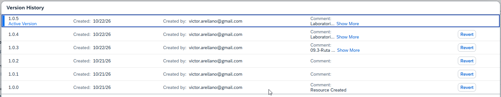

2. **Conservar el primer Router con condiciones XPath.** `Router Tipo Operacion` evalúa el XML mediante `/solicitud/tipoOperacion = 'ALTA'` y `/solicitud/tipoOperacion = 'BAJA'`; la tercera conexión es DEFAULT. Esto evita que una operación no reconocida alcance el Router de prioridades.

3. **Extraer la prioridad en la rama ALTA.** Se ubicó `CM Clasificar Prioridad` inmediatamente después de la conexión ALTA y antes de `Router Prioridad`. En **Exchange Property** se configuró:

   | Campo | Valor |
   |---|---|
   | Action | `Create` |
   | Name | `prioridadInterna` |
   | Source Type | `XPath` |
   | Source Value | `/solicitud/prioridad/text()` |
   | Data Type | `java.lang.String` |

   La extracción separa la lectura del XML de la evaluación de la prioridad en el siguiente Router.

   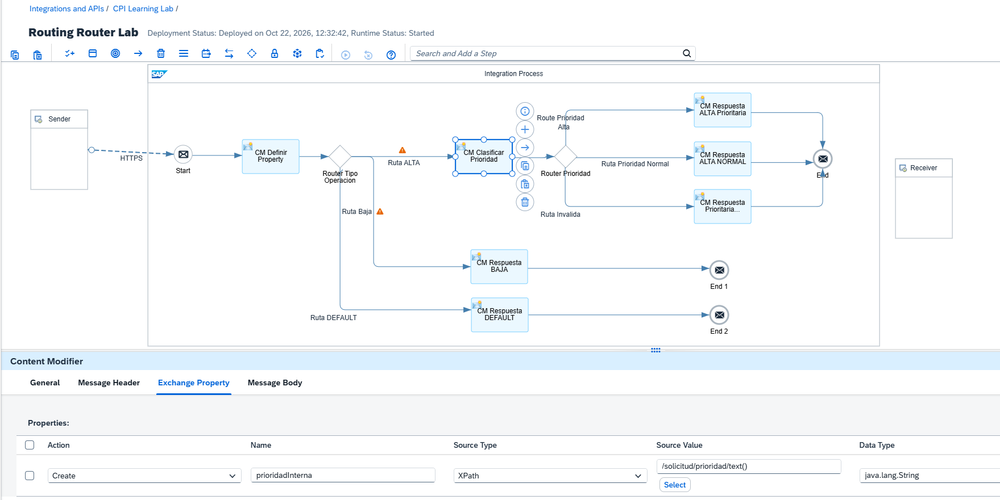

4. **Configurar `Router Prioridad`.** Se crearon tres conexiones:

   | Ruta | Expression Type | Condición | Default Route |
   |---|---|---|---|
   | Prioridad alta | `Non-XML` | `${property.prioridadInterna} = 'PRIORITARIA'` | No |
   | Prioridad normal | `Non-XML` | `${property.prioridadInterna} = 'NORMAL'` | No |
   | Prioridad inválida | - | Sin expresión | Sí |

   Se evalúa la propiedad interna y no directamente el cuerpo XML. Los valores de comparación distinguen mayúsculas y minúsculas.

   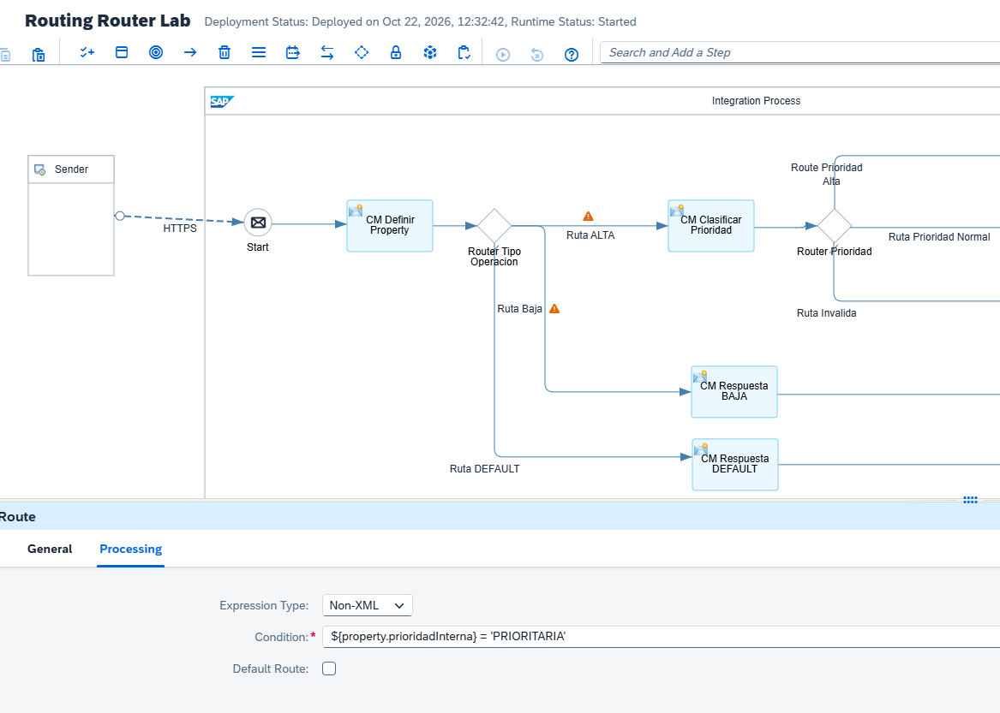

5. **Configurar los cuerpos de respuesta.** Cada rama finaliza en un Content Modifier con **Message Body → Type: Constant**. Para las tres ramas de ALTA se establecieron estos JSON:

   **ALTA prioritaria**

   ```json
   {
     "operacion": "ALTA",
     "prioridad": "Prioritaria",
     "resultado": "Ruta ALTA Prioritaria ejecutada"
   }
   ```

   **ALTA normal**

   ```json
   {
     "operacion": "ALTA",
     "prioridad": "Normal",
     "resultado": "Ruta ALTA Normal ejecutada"
   }
   ```

   **Prioridad inválida**

   ```json
   {
     "operacion": "ALTA",
     "prioridad": "DESCONOCIDA",
     "resultado": "ERROR",
     "mensaje": "La prioridad solicitada no esta soportada"
   }
   ```

   Las ramas BAJA y DEFAULT del primer Router conservaron sus respuestas previas. La distinción entre ambos DEFAULT permite identificar si falló la selección de operación o la clasificación de prioridad.

6. **Desplegar y revisar el diseño final.** El diseñador mostró `Runtime Status: Started` y el iFlow completo con ambos Routers y las cinco salidas. Se conservaron dos advertencias del diseñador sobre la posibilidad de que HTTPS entregue un mensaje no XML; no impidieron procesar los XML válidos de las pruebas.

   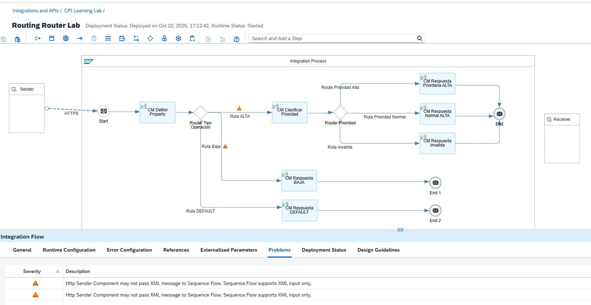

7. **Validar desde Postman.** En la carpeta `09.5 - Laboratorio integrador`, se reutilizó la solicitud `POST Call Operacion`, con cuerpo XML, el mismo endpoint y autorización ya configurados. Se cambió el contenido de `<tipoOperacion>` y `<prioridad>` para cubrir los cinco escenarios; no se creó una carpeta independiente por prueba.

### Resultado esperado y validación

| Escenario XML | Ruta esperada | Respuesta observada | Validación |
|---|---|---|---|
| `ALTA` + `PRIORITARIA` | ALTA → Prioridad alta | `ALTA / Prioritaria / Ruta ALTA Prioritaria ejecutada` | ✅ 2/2 tests |
| `ALTA` + `NORMAL` | ALTA → Prioridad normal | `ALTA / Normal / Ruta ALTA Normal ejecutada` | ✅ Validado |
| `BAJA` + `PRIORITARIA` | BAJA, sin segundo Router | `BAJA / Ruta BAJA ejecutada` | ✅ 2/2 tests |
| `MODIFICACION` + `PRIORITARIA` | DEFAULT del primer Router | `DESCONOCIDA / ERROR / La operacion solicitada no esta soportada` | ✅ 2/2 tests |
| `ALTA` + `URGENTE` | DEFAULT del segundo Router | `ALTA / DESCONOCIDA / ERROR / La prioridad solicitada no esta soportada` | ✅ 2/2 tests |

**Evidencias de ejecución:**

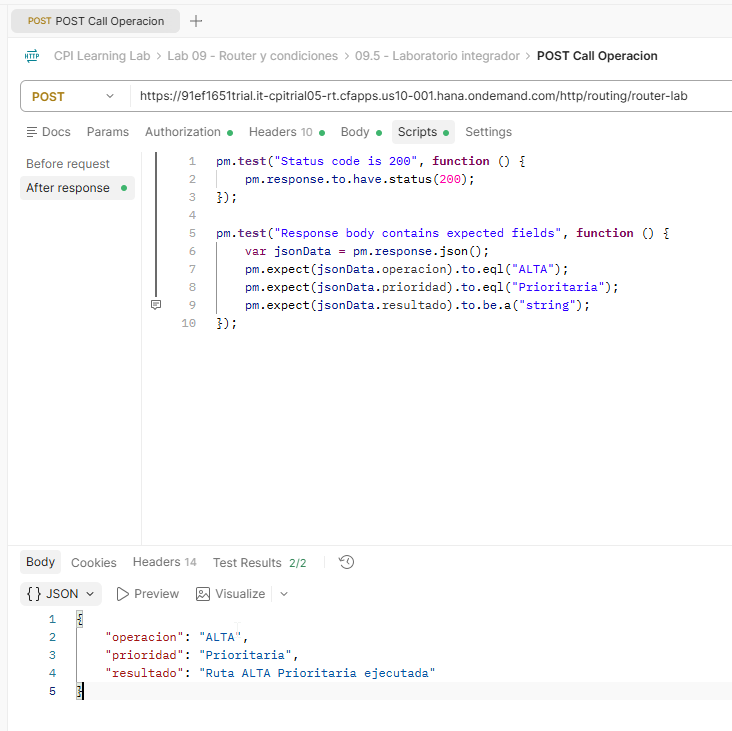

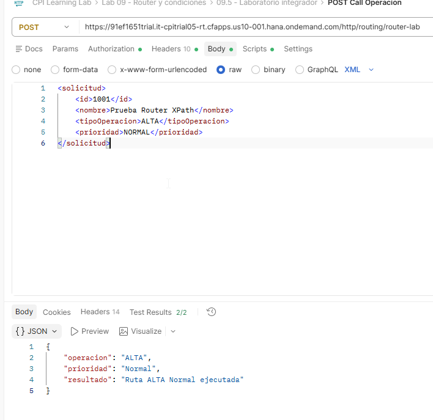

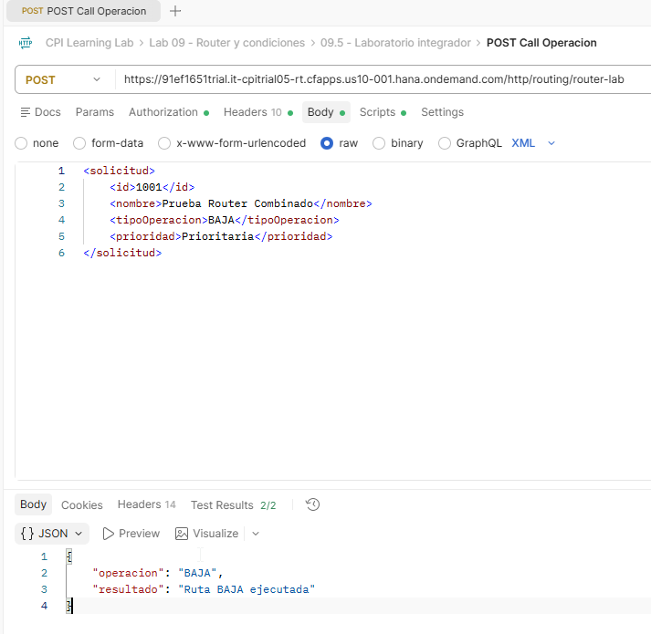

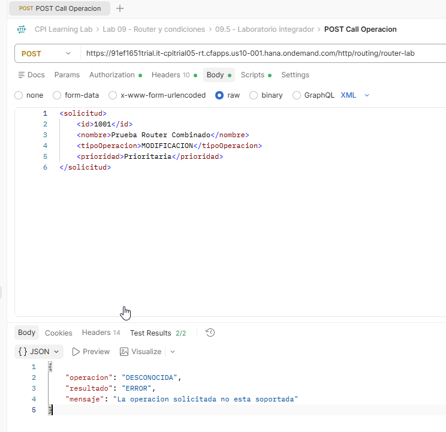

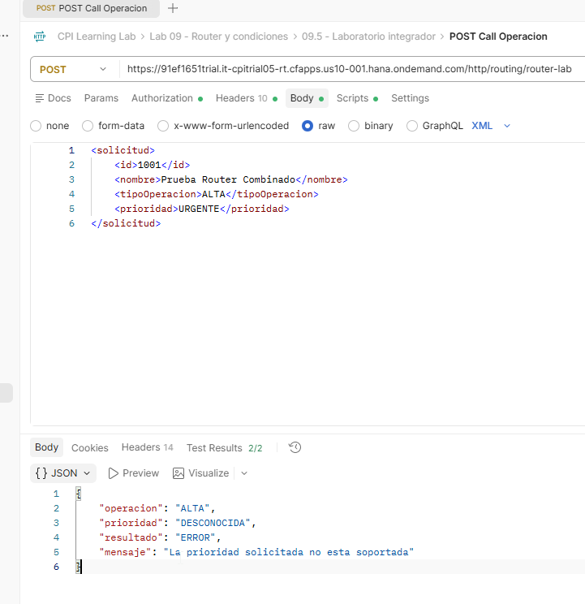

### Problemas encontrados
- El diseñador mantuvo las advertencias de entrada XML ya descritas en 09.4. Los escenarios probados con XML válido funcionaron; no se probó XML malformado.

### Aprendizajes
- Un Router puede resolver la operación y delegar una decisión secundaria solo a la rama que lo requiere.
- Extraer un valor XML a Exchange Property facilita reutilizarlo en condiciones Non-XML.
- Los DEFAULT de cada nivel tienen responsabilidades distintas y permiten respuestas funcionales precisas.
- Cada escenario se valida comparando el contenido de la respuesta con la ruta y el resultado esperado.
- Las respuestas de error funcional conservaron HTTP 200 en este laboratorio; no se implementó un contrato de códigos HTTP de error.

### Referencias
Evidencias de configuración en SAP Cloud Integration y pruebas funcionales en Postman, referenciadas en cada laboratorio.
