# 10 - Splitter, Gather y procesamiento de colecciones

**Estado del módulo:** ✅ Completado
**Plataforma:** SAP Integration Suite - Cloud Integration
**Package:** `CPI Learning Lab`
**Integration Flow:** `CPI_LAB_10_Splitter_Gather`

## Objetivo del módulo

Procesar colecciones de mensajes XML mediante separación, tratamiento individual y agregación, verificando el comportamiento mediante pruebas HTTP y trazas de ejecución.

## Laboratorios

| Laboratorio | Objetivo | Estado |
|---|---|---|
| 10.1 - General Splitter | Separar una colección XML en mensajes individuales | ✅ Completado |
| 10.2 - Procesamiento individual | Aplicar reglas de clasificación a cada pedido | ✅ Completado |
| 10.3 - Gather | Consolidar los mensajes XML separados | ✅ Completado |
| 10.4 - Casos especiales | Validar colecciones vacías, XPath sin coincidencias, XML mal formado y montos negativos | ✅ Completado |

---

## 10.1 - General Splitter

**Estado:** ✅ Completado
**Fecha de validación:** 2026-10-23

### Objetivo

Recibir por HTTPS un documento XML con tres pedidos, separarlos mediante un General Splitter y comprobar en el monitor que cada pedido se procesa individualmente.

### Conceptos

- **General Splitter:** componente que separa un mensaje XML utilizando una expresión XPath y produce mensajes para su procesamiento individual.
- **XPath:** expresión que selecciona los nodos XML que se desea separar.
- **Trace:** nivel de registro temporal que permite inspeccionar los pasos y contenidos del procesamiento.
- **Segmento:** unidad de ejecución que permite observar el recorrido de los mensajes procesados en la traza.

### Prerrequisitos

- Acceso al package `CPI Learning Lab` y al editor de Cloud Integration.
- Permisos para desplegar y monitorizar iFlows.
- Postman con un mecanismo de autenticación OAuth previamente probado para invocar endpoints HTTPS de CPI.

### Laboratorio paso a paso

#### Paso 1 - Crear el Integration Flow

En el package `CPI Learning Lab` se creó el artefacto con los siguientes datos:

| Campo | Valor |
|---|---|
| Name | `CPI_LAB_10_Splitter_Gather` |
| ID | `CPI_LAB_10_Splitter_Gather` |
| Runtime Profile | Cloud Integration |
| Description | Laboratorio de SAP Cloud Integration para implementar Splitter y Gather, procesar individualmente elementos de una colección XML, aplicar reglas de transformación y reunir los resultados en un mensaje consolidado. |

Se reutiliza el package del curso para mantener agrupados los artefactos de aprendizaje.

#### Paso 2 - Configurar HTTPS Sender

Se conectó el participante Sender al evento Start mediante un adaptador HTTPS:

| Propiedad | Valor |
|---|---|
| Address | `/lab10/splitter` |
| Authorization | `User Role` |
| User Role | `ESBMessaging.send` |
| CSRF Protected | Desactivado en la configuración final de la prueba |

**Motivo:** el adaptador HTTPS permite invocar el flujo desde Postman y enviar una colección XML. La autenticación mediante rol restringe la invocación a identidades autorizadas. La desactivación de CSRF corresponde únicamente a la configuración de este ejercicio; en otros escenarios debe evaluarse de acuerdo con los requisitos de seguridad.

**Observación:** al desactivar CSRF Protected desapareció una advertencia visual en el editor. No se determinó de forma concluyente la causa original de esa advertencia.

**Evidencia 10-01 - Configuración del HTTPS Sender**
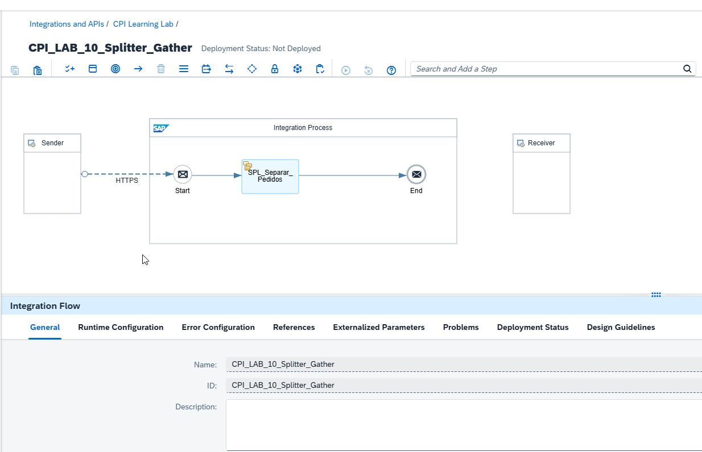

#### Paso 3 - Configurar General Splitter

Se insertó el componente entre Start y End.

**Nombre técnico:** `SPL_Separar_Pedidos`

| Propiedad | Valor |
|---|---|
| Expression Type | `XPath` |
| XPath Expression | `/Pedidos/Pedido` |
| Grouping | Vacío |
| Streaming | Activado |
| Parallel Processing | Desactivado |
| Stop on Exception | Activado |

**Motivo:** `/Pedidos/Pedido` selecciona cada elemento `Pedido` hijo de `Pedidos`. Se mantuvieron las opciones de procesamiento mostradas en el editor para la prueba inicial, sin introducir paralelismo.

**Evidencia 10-02 - Configuración XPath y procesamiento del General Splitter**
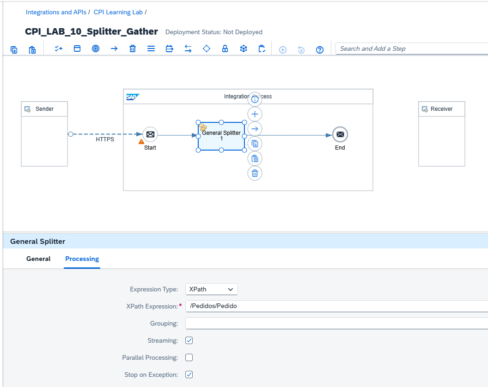

#### Paso 4 - Desplegar y habilitar Trace

Se guardó y desplegó el iFlow. El monitor mostró estado **Started**, mensaje de despliegue exitoso y versión desplegada **1.0.0**. Se activó temporalmente el nivel de log **Trace** para inspeccionar el procesamiento.

**Motivo:** el despliegue confirma que el artefacto está disponible en el runtime; Trace permite examinar el contenido de los mensajes por paso. Trace expira automáticamente y no debe dejarse activo innecesariamente.

**Evidencia 10-03 - Despliegue exitoso y nivel Trace**
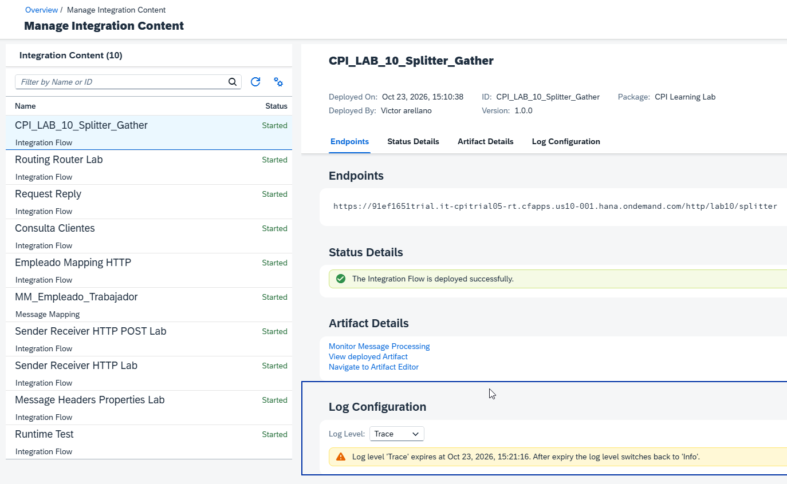

#### Paso 5 - Enviar colección XML desde Postman

Se ejecutó una petición `POST` al endpoint HTTPS desplegado, con autenticación Bearer Token y `Content-Type: application/xml`.

**Nombre de la petición:** `LAB10 - Splitter - Tres pedidos`

**Body enviado:**

```xml
<Pedidos>
    <Pedido>
        <Id>1001</Id>
        <Cliente>Cliente A</Cliente>
        <Monto>150</Monto>
    </Pedido>
    <Pedido>
        <Id>1002</Id>
        <Cliente>Cliente B</Cliente>
        <Monto>300</Monto>
    </Pedido>
    <Pedido>
        <Id>1003</Id>
        <Cliente>Cliente C</Cliente>
        <Monto>75</Monto>
    </Pedido>
</Pedidos>
```

**Resultado observado:** Postman mostró una respuesta con los tres pedidos y `Test Results 2/2`. El código de estado HTTP no estaba visible en la captura, por lo que no se documenta un código específico. La respuesta por sí sola no demuestra la separación interna; esa validación se realizó con Trace.

**Evidencia 10-04 - Petición XML y respuesta de Postman**
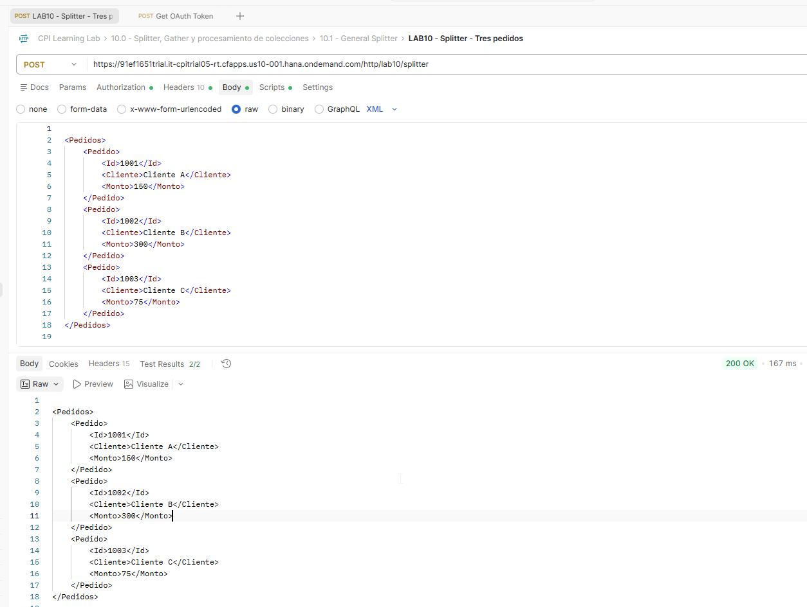

#### Paso 6 - Verificar los segmentos en Trace

En **Monitor Message Processing**, se inspeccionó la ejecución. La traza mostró nueve pasos y segmentos asociados al General Splitter y al evento End.

| Segmento | Pedido validado | Evidencia de validación |
|---|---|---|
| 2 | `1001` | Payload revisado y confirmado durante la sesión |
| 3 | `1002` | Payload revisado y confirmado durante la sesión |
| 4 | `1003` | Payload visible en la captura de Trace |

El payload observado para el pedido 1003 fue:

```xml
<?xml version='1.0' encoding='UTF-8'?>
<Pedidos>
    <Pedido>
        <Id>1003</Id>
        <Cliente>Cliente C</Cliente>
        <Monto>75</Monto>
    </Pedido>
</Pedidos>
```

**Motivo:** la revisión de cada segmento permite comprobar que la selección XPath se tradujo en procesamiento individual, en lugar de inferirlo únicamente desde la respuesta HTTP.

**Evidencia 10-05 - Trace con procesamiento individual de pedidos**
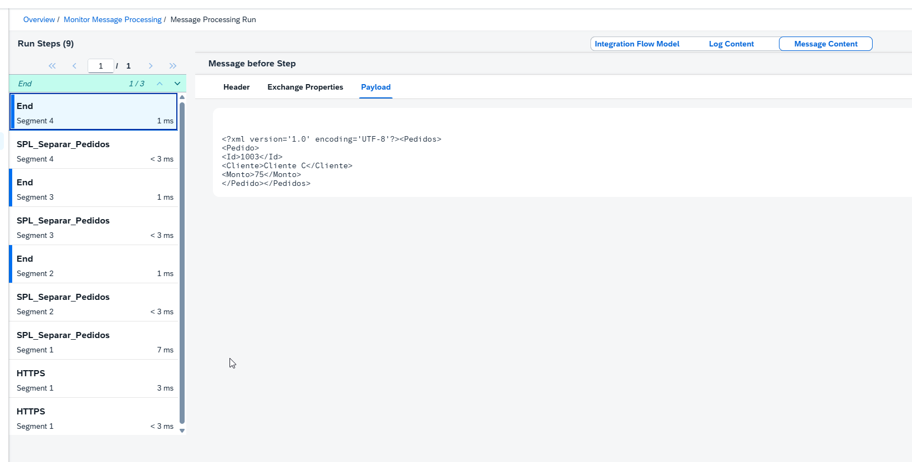

### Resultado esperado

El mensaje de entrada con tres pedidos se divide en tres mensajes procesados individualmente y cada uno conserva los datos del pedido correspondiente.

### Validación

| Criterio | Resultado |
|---|---|
| iFlow desplegado y en estado Started | ✅ Verificado |
| Petición XML ejecutada desde Postman | ✅ Verificado |
| Tres pedidos identificados en segmentos separados | ✅ Verificado |
| Payload del pedido 1001 | ✅ Confirmado |
| Payload del pedido 1002 | ✅ Confirmado |
| Payload del pedido 1003 | ✅ Visible en Trace |

**Conclusión:** laboratorio 10.1 completado con evidencia de ejecución. La agregación mediante Gather no forma parte de este laboratorio.

### Problemas encontrados

- Se observó una advertencia visual en el editor mientras CSRF Protected estaba activado. La advertencia desapareció al desactivar esa opción; no se confirmó la causa técnica exacta.
- La respuesta de Postman contenía los tres pedidos, por lo que fue necesario utilizar Trace para verificar el procesamiento individual.

### Aprendizajes

- El XPath `/Pedidos/Pedido` selecciona los elementos que deben procesarse individualmente.
- La respuesta HTTP y la ejecución interna del Splitter deben analizarse por separado.
- Trace permite comprobar el contenido de cada segmento de procesamiento.
- Un laboratorio se considera completado únicamente después de validar su comportamiento en ejecución.

### Referencias

- SAP Help Portal - SAP Cloud Integration: documentación de General Splitter, adaptador HTTPS y monitorización de mensajes. Consultar la documentación correspondiente a la versión del tenant.

---

## 10.2 - Procesamiento individual de pedidos

**Estado:** ✅ Completado
**Fecha de validación:** 2026-10-23
**Versión de trabajo del iFlow:** `1.0.1` (indicada durante el guardado; la captura final no muestra el número de versión desplegada).

### Objetivo

Clasificar individualmente los pedidos separados en el laboratorio 10.1 mediante un Router y asignar la clasificación mediante Exchange Properties, sin modificar el XML del pedido.

### Conceptos

- **Router:** selecciona una ruta según una condición evaluada sobre el mensaje actual.
- **Default Route:** alternativa utilizada cuando ninguna condición previa corresponde.
- **Content Modifier:** permite crear propiedades del intercambio, entre otras modificaciones.
- **Exchange Property:** dato interno del procesamiento que no se añade automáticamente al payload.

### Prerrequisitos

- Laboratorio 10.1 completado y sus tres pedidos validados mediante Trace.
- Acceso al editor, despliegue y monitor de Cloud Integration.
- Petición Postman `LAB10 - Splitter - Tres pedidos` disponible para reutilización.

### Laboratorio paso a paso

#### Paso 1 - Guardar versión de trabajo y agregar Router

Se trabajó sobre el mismo iFlow `CPI_LAB_10_Splitter_Gather`. Se indicó la versión `1.0.1` y el comentario de versionado: `LAB 10.2 - Incorporación de Router para clasificación individual de pedidos por monto.`

Se insertó el Router **después** de `SPL_Separar_Pedidos` y se le asignó el nombre `RTR_Clasificar_Pedido`.

**Motivo:** la condición se evalúa sobre el XML de cada pedido, ya separado de la colección original.

**Evidencia 10-06 - Router después del General Splitter**
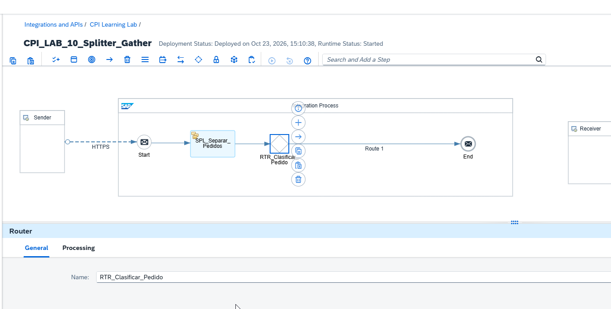

#### Paso 2 - Configurar la ruta PRIORITARIO

Se renombró la primera conexión del Router a `RTE_Pedido_Prioritario` y se configuró una condición XML XPath:

```xpath
number(/Pedidos/Pedido/Monto) >= 200
```

**Motivo:** el General Splitter conservó el contenedor `Pedidos` en los mensajes observados en Trace; por ello la expresión accede al monto mediante `/Pedidos/Pedido/Monto`. La conversión numérica evita realizar una comparación textual de importes.

**Evidencia 10-07 - Condición de la ruta PRIORITARIO**
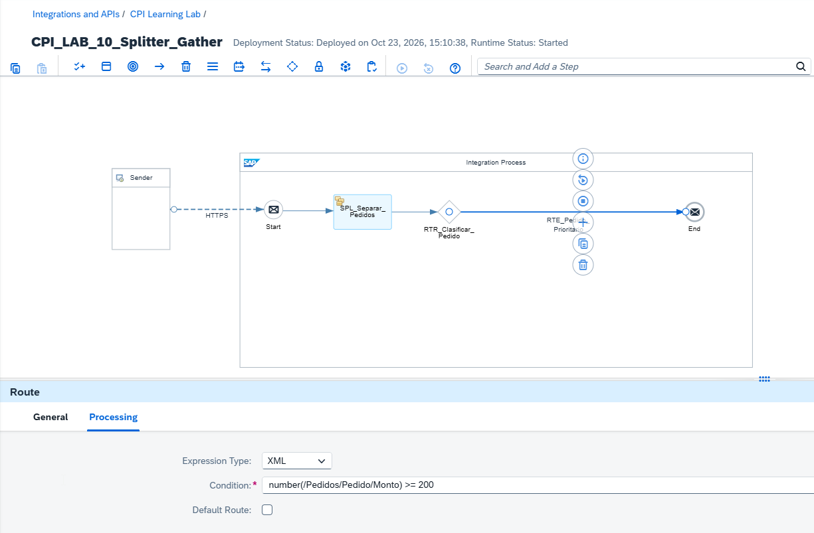

#### Paso 3 - Configurar la ruta NORMAL

Se añadió una segunda conexión desde el Router hasta un evento End adicional, con el nombre `RTE_Pedido_Normal`, y se activó **Default Route**.

**Motivo:** los pedidos que no cumplan la condición PRIORITARIO siguen la ruta NORMAL. Para este laboratorio los importes son numéricos y válidos; la ruta por defecto no constituye por sí misma una validación de datos de entrada.

**Evidencia 10-08 - Ruta NORMAL configurada como Default Route**
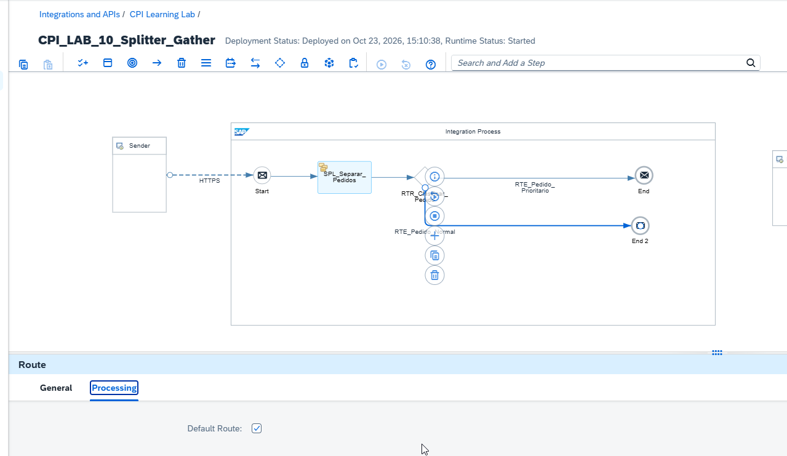

#### Paso 4 - Asignar clasificación PRIORITARIO

Se insertó el Content Modifier `CM_Pedido_Prioritario` en la ruta prioritaria. En **Exchange Property** se configuró:

| Campo | Valor |
|---|---|
| Action | `Create` |
| Name | `ClasificacionPedido` |
| Source Type | `Constant` |
| Source Value | `PRIORITARIO` |
| Data Type | Sin modificar; el campo no era editable en el entorno observado |

**Motivo:** almacenar la clasificación para los pasos siguientes sin alterar el contenido XML original.

**Evidencia 10-09 - Content Modifier de pedidos prioritarios**
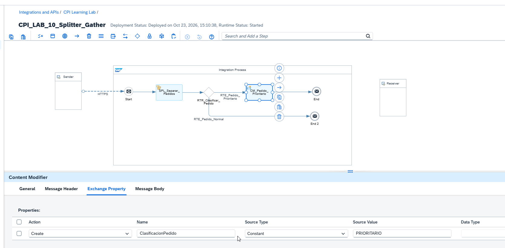

#### Paso 5 - Asignar clasificación NORMAL

Se insertó `CM_Pedido_Normal` en la ruta por defecto, con los siguientes valores:

| Campo | Valor |
|---|---|
| Action | `Create` |
| Name | `ClasificacionPedido` |
| Source Type | `Constant` |
| Source Value | `NORMAL` |
| Data Type | Sin modificar; el campo no era editable en el entorno observado |

**Motivo:** mantener un nombre de propiedad común para ambas ramas, variando únicamente el valor de la clasificación.

**Evidencia 10-10 - Content Modifier de pedidos normales**
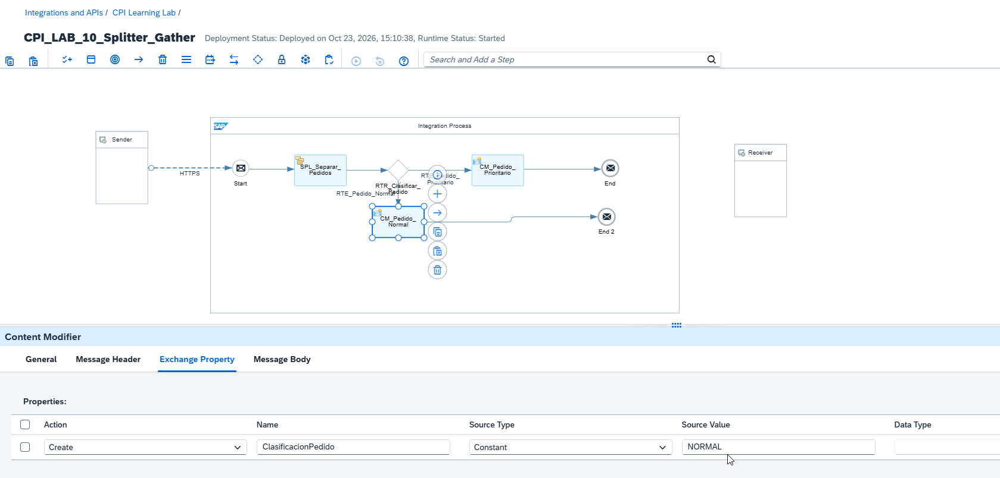

#### Paso 6 - Desplegar y habilitar Trace

Se desplegó el iFlow actualizado y se ejecutó la petición Postman ya utilizada en 10.1. Se inspeccionó la ejecución mediante Trace. La captura disponible de esta fase muestra la traza de la ejecución, pero no una pantalla separada con el estado del nuevo despliegue.

**Evidencia 10-11 - Despliegue del iFlow con clasificación**
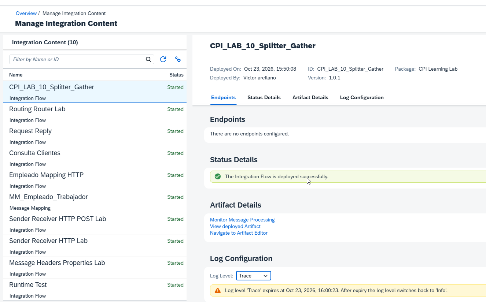

#### Paso 7 - Verificar la clasificación en ejecución

En **Monitor Message Processing**, la ejecución presentó **15 Run Steps**. Se revisaron los segmentos y la propiedad `ClasificacionPedido`.

| Segmento | Pedido | Monto | Ruta / clasificación comprobada |
|---|---|---:|---|
| 2 | `1001` | 150 | NORMAL |
| 3 | `1002` | 300 | PRIORITARIO |
| 4 | `1003` | 75 | NORMAL |

La captura de Exchange Properties muestra `ClasificacionPedido = PRIORITARIO` en el segmento 3. La correspondencia de los segmentos 2 y 4 con los pedidos normales fue confirmada durante la revisión de la ejecución.

**Evidencia 10-12 - Clasificación PRIORITARIO en Exchange Properties**
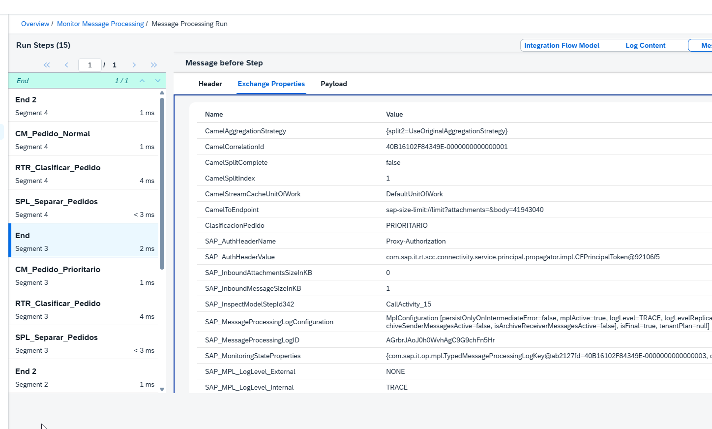

### Resultado esperado

Los pedidos con monto mayor o igual a 200 reciben la propiedad `ClasificacionPedido = PRIORITARIO`; los restantes, `ClasificacionPedido = NORMAL`. El payload XML se conserva sin incorporar esa propiedad al cuerpo del mensaje.

### Validación

| Criterio | Resultado |
|---|---|
| Router y dos rutas configuradas | ✅ Verificado visualmente |
| Content Modifiers con propiedad común | ✅ Verificado visualmente |
| Pedido 1001 clasificado NORMAL | ✅ Confirmado en revisión de Trace |
| Pedido 1002 clasificado PRIORITARIO | ✅ Visible en Exchange Properties y confirmado |
| Pedido 1003 clasificado NORMAL | ✅ Confirmado en revisión de Trace |

**Conclusión:** laboratorio 10.2 completado con verificación del enrutamiento y la clasificación por pedido.

### Problemas encontrados

- El campo **Data Type** de los Content Modifiers no era editable en la interfaz observada. Se mantuvo sin modificar; no se infirió un tipo Java específico sin evidencia.
- Las primeras capturas de Trace no mostraban simultáneamente el payload y la propiedad. Se contrastaron los segmentos para verificar la correspondencia entre pedido y clasificación.

### Aprendizajes

- El Router después del Splitter aplica la condición a cada pedido individual.
- Default Route evita repetir una condición complementaria, pero no reemplaza una validación de entrada.
- Una Exchange Property permite transportar la clasificación internamente sin cambiar el payload.
- La validación funcional requiere revisar el valor asignado en el contexto de cada segmento, no solo observar la topología del iFlow.

### Referencias

- SAP Help Portal - SAP Cloud Integration: Router, Content Modifier y monitorización de mensajes. Consultar la documentación correspondiente a la versión del tenant.


---

## 10.3 - Gather: consolidación de mensajes XML

**Estado:** ✅ Completado
**Fecha de validación:** 2026-10-23
**Versión de trabajo del iFlow:** se propuso `1.0.2`; el número efectivo no se comprobó en captura (el usuario mencionó `10.0.2`).

### Objetivo

Reunir los tres mensajes XML producidos por `SPL_Separar_Pedidos` mediante un componente Gather y verificar tanto la respuesta HTTP como el payload final en Trace.

### Conceptos

- **Gather:** componente que agrega mensajes producidos por un procesamiento de división compatible.
- **XML (Same Format):** formato de entrada seleccionado para los mensajes XML.
- **Combine:** algoritmo de agregación que, en este ejercicio, generó un XML con envoltura `multimap:Messages`.
- **Estructura de salida:** la agregación no implica reconstruir automáticamente el XML original ni incluir propiedades de intercambio en el cuerpo.

### Prerrequisitos

- Laboratorios 10.1 y 10.2 validados.
- iFlow `CPI_LAB_10_Splitter_Gather` y petición Postman con los pedidos 1001, 1002 y 1003.
- Acceso a diseño, despliegue y monitorización con Trace.

### Laboratorio paso a paso

#### Paso 1 - Preservar la versión anterior

Se solicitó **Save as Version** antes de modificar la implementación de clasificación del laboratorio 10.2. El comentario propuesto fue:

`LAB 10.3 - Incorporación de Gather para consolidar los pedidos procesados por Splitter y Router.`

El usuario confirmó disponer de una versión guardada, sin que se verificara visualmente su numeración exacta.

**Evidencia 10-13 - Versión de trabajo antes de Gather**
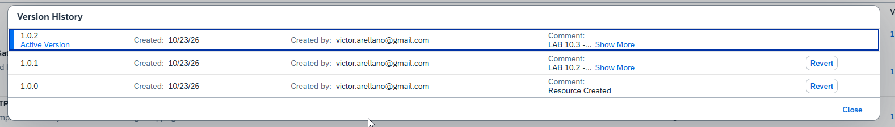

#### Paso 2 - Incorporar Gather

Se añadió el componente `GTH_Consolidar_Pedidos`, inicialmente sin conexiones, con los parámetros:

| Parámetro | Valor |
|---|---|
| Incoming Format | `XML (Same Format)` |
| Aggregation Algorithm | `Combine` |

**Motivo:** probar la combinación de mensajes XML de estructura homogénea y observar la forma real del documento agregado.

**Evidencia 10-14 - Componente Gather y estrategia**
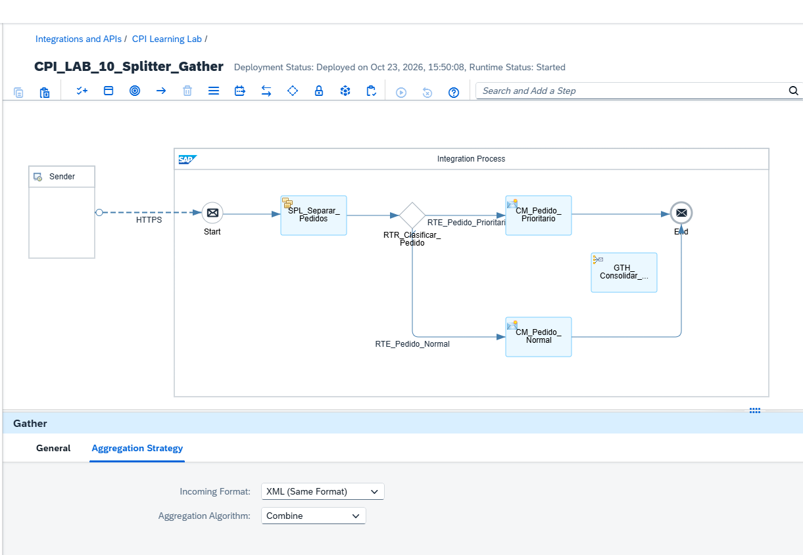

#### Paso 3 - Comprobar la compatibilidad de la topología

Se intentó conectar las dos ramas del Router, cada una con su Content Modifier, hacia un Gather común. La estructura quedó dibujada, pero **el validador rechazó esa combinación** con el mensaje:

`You cannot use Router with gather; use gather after splitter or join`

La ausencia inicial de errores en la pestaña Problems no se consideró evidencia suficiente; una comprobación posterior mostró la incompatibilidad.

**Evidencia 10-15 - Intento de conexión de las dos ramas a Gather**
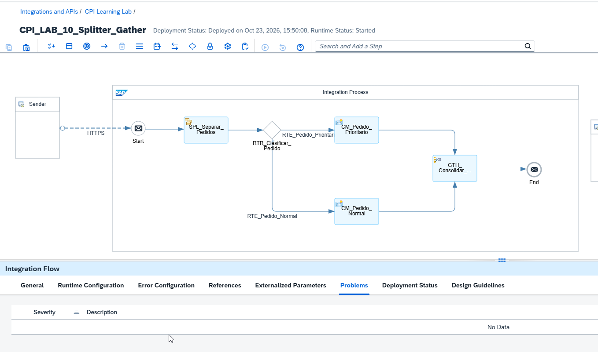

**Evidencia 10-16 - Error de validación Router con Gather**


#### Paso 4 - Corregir la arquitectura

Se retiraron del diseño activo el Router y los dos Content Modifiers, conservando la versión previa para recuperar el laboratorio 10.2. La topología validada quedó:

```text
HTTPS Sender → Start → SPL_Separar_Pedidos → GTH_Consolidar_Pedidos → End
```

El panel **Problems** mostró `No Data` después de la corrección. Esta comprobación validó el diseño, no aún su ejecución.

**Evidencia 10-17 - Arquitectura corregida**
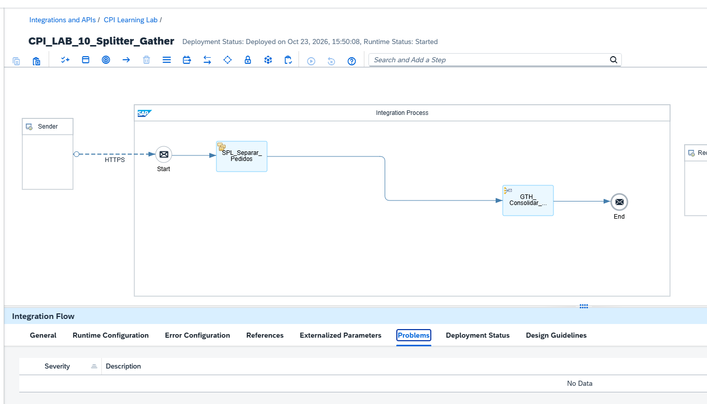

#### Paso 5 - Desplegar y ejecutar la petición

Se desplegó la estructura corregida y se reutilizó desde Postman la petición `LAB10 - Splitter - Tres pedidos`, con el XML de entrada documentado en 10.1.

Postman mostró **HTTP 200 OK** y **Tests 2/2**. La respuesta contenía los pedidos `1001`, `1002` y `1003` dentro de la envoltura XML:

```xml
<multimap:Messages xmlns:multimap="http://sap.com/xi/XI/SplitAndMerge">
    <multimap:Message1>
        <Pedidos><Pedido><Id>1001</Id><Cliente>Cliente A</Cliente><Monto>150</Monto></Pedido></Pedidos>
        <Pedidos><Pedido><Id>1002</Id><Cliente>Cliente B</Cliente><Monto>300</Monto></Pedido></Pedidos>
        <Pedidos><Pedido><Id>1003</Id><Cliente>Cliente C</Cliente><Monto>75</Monto></Pedido></Pedidos>
    </multimap:Message1>
</multimap:Messages>
```

**Motivo de la revisión:** diferenciar la agregación real de una reconstrucción del XML original `<Pedidos>` con tres hijos `<Pedido>`.

**Evidencia 10-18 - Respuesta consolidada en Postman**
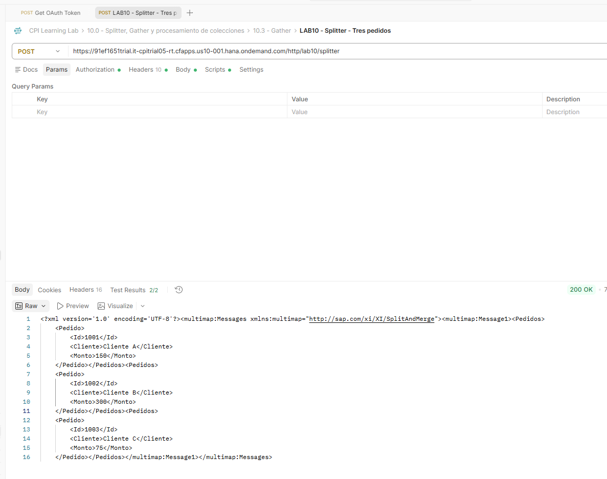

#### Paso 6 - Validar mediante Trace

En **Monitor Message Processing**, el Trace mostró **10 Run Steps**, con ejecuciones de `SPL_Separar_Pedidos` y `GTH_Consolidar_Pedidos`. En el evento **End**, el payload contenía los tres pedidos bajo `multimap:Messages`, coincidiendo con la respuesta observada en Postman.

**Evidencia 10-19 - Payload agregado en Trace**
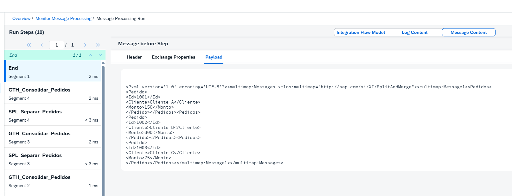

### Resultado esperado

Un único mensaje XML de respuesta que reúna los tres pedidos separados por el Splitter, utilizando la estructura generada por Gather con algoritmo `Combine`.

### Validación

| Criterio | Resultado |
|---|---|
| Topología Splitter → Gather sin problemas de diseño | ✅ Verificada |
| Respuesta HTTP `200 OK` | ✅ Verificada |
| Pedidos 1001, 1002 y 1003 presentes | ✅ Verificados |
| Envoltura `multimap:Messages` en Postman | ✅ Verificada |
| Payload agregado coincidente en Trace | ✅ Verificado |

**Conclusión:** laboratorio 10.3 completado con evidencia práctica. No se ha implementado una transformación para reconstruir el XML original ni conservar las propiedades de clasificación del laboratorio 10.2 en el payload agregado.

### Problemas encontrados

- **Incompatibilidad de topología:** el validador mostró `You cannot use Router with gather; use gather after splitter or join` para el diseño Router → Gather. Se corrigió utilizando Splitter → Gather y se validó su ejecución.
- **Forma del resultado:** Gather generó una envoltura `multimap:Messages` y no el mismo documento XML de entrada.

### Aprendizajes

- Las conexiones gráficas no garantizan que una topología sea admitida por el validador.
- Es necesario verificar tanto la respuesta HTTP como el Trace para confirmar una agregación.
- El comportamiento de Gather depende de su algoritmo y de la estructura de los mensajes entrantes.
- El versionado permite preservar implementaciones previas cuando un laboratorio requiere cambiar la arquitectura del iFlow.

### Referencias

- SAP Help Portal - SAP Cloud Integration: General Splitter, Gather y monitorización de mensajes. Consultar la documentación correspondiente a la versión del tenant.

---

## 10.4 - Casos especiales

**Estado:** ✅ Completado
**Fecha de validación:** 2026-10-23

### Objetivo

Comprobar el comportamiento del General Splitter frente a entradas sin elementos seleccionables, documentos XML inválidos y reglas de validación de negocio aplicadas a pedidos individuales.

### Conceptos

- **Colección vacía:** XML válido sin elementos `Pedido` para separar.
- **XPath sin coincidencias:** documento XML que no contiene nodos seleccionados por `/Pedidos/Pedido`.
- **XML mal formado:** documento que incumple las reglas sintácticas de XML, como un cierre de etiqueta incorrecto.
- **Validación de negocio:** regla implementada mediante Groovy que rechaza un pedido cuando su monto es negativo.
- **Message Processing Log (MPL):** registro que permite correlacionar una ejecución y consultar su error.

### Prerrequisitos

- Laboratorios 10.1 y 10.3 validados.
- iFlow `CPI_LAB_10_Splitter_Gather` desplegado con HTTPS Sender, General Splitter y Gather.
- Postman configurado para invocar `POST /http/lab10/splitter` con autenticación válida.
- Acceso al monitor de mensajes de SAP Cloud Integration.

### Laboratorio paso a paso

#### 10.4.1 - Colección vacía

1. En Postman, crear una solicitud POST al endpoint del laboratorio con `Content-Type: application/xml`.
2. Enviar el siguiente body:

```xml
<Pedidos/>
```

3. Consultar la respuesta y la ejecución en Monitor Message Processing.

**Por qué:** se comprueba qué ocurre cuando el documento es válido pero el XPath del Splitter no selecciona pedidos.

**Resultado observado:** Postman devolvió `200 OK` con `<Pedidos/>`. La traza mostró el payload `<Pedidos/>` y cuatro pasos de ejecución, sin segmentos adicionales de pedidos.

**Validación:** ✅ Completada.

**Evidencia 10-20 - Postman: colección vacía y respuesta HTTP 200**
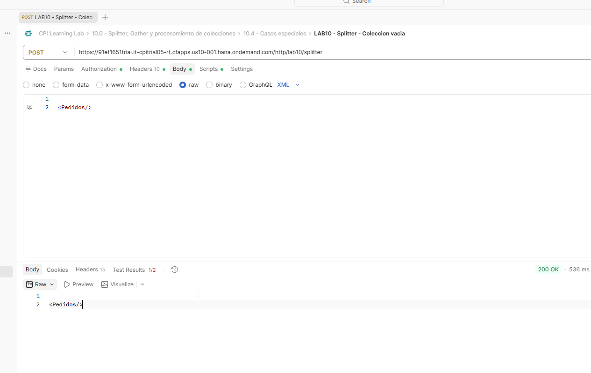

**Evidencia 10-21 - Trace: colección vacía**
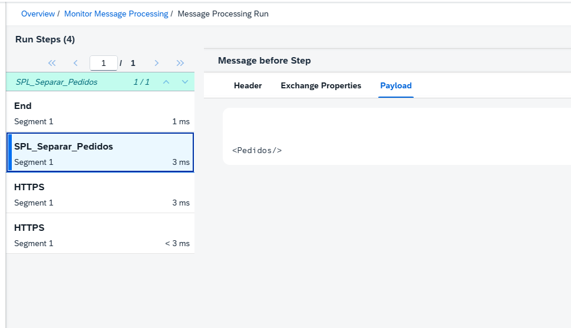

#### 10.4.2 - XPath sin coincidencias

1. Mantener la expresión del General Splitter `/Pedidos/Pedido`.
2. Enviar un documento que contiene `Orden` en lugar de `Pedido`:

```xml
<Pedidos>
    <Orden>
        <Id>2001</Id>
        <Cliente>Cliente Prueba</Cliente>
        <Monto>250</Monto>
    </Orden>
</Pedidos>
```

3. Comparar la respuesta HTTP con el payload inspeccionado en el monitor.

**Por qué:** se diferencia una ausencia de coincidencias XPath de un error de sintaxis XML.

**Resultado observado:** Postman devolvió `200 OK` y conservó el XML de entrada. En Trace se observó el mismo documento y cuatro pasos, sin procesamiento individual de `Orden`.

**Validación:** ✅ Completada.

**Evidencia 10-22 - Postman: XPath sin coincidencias**
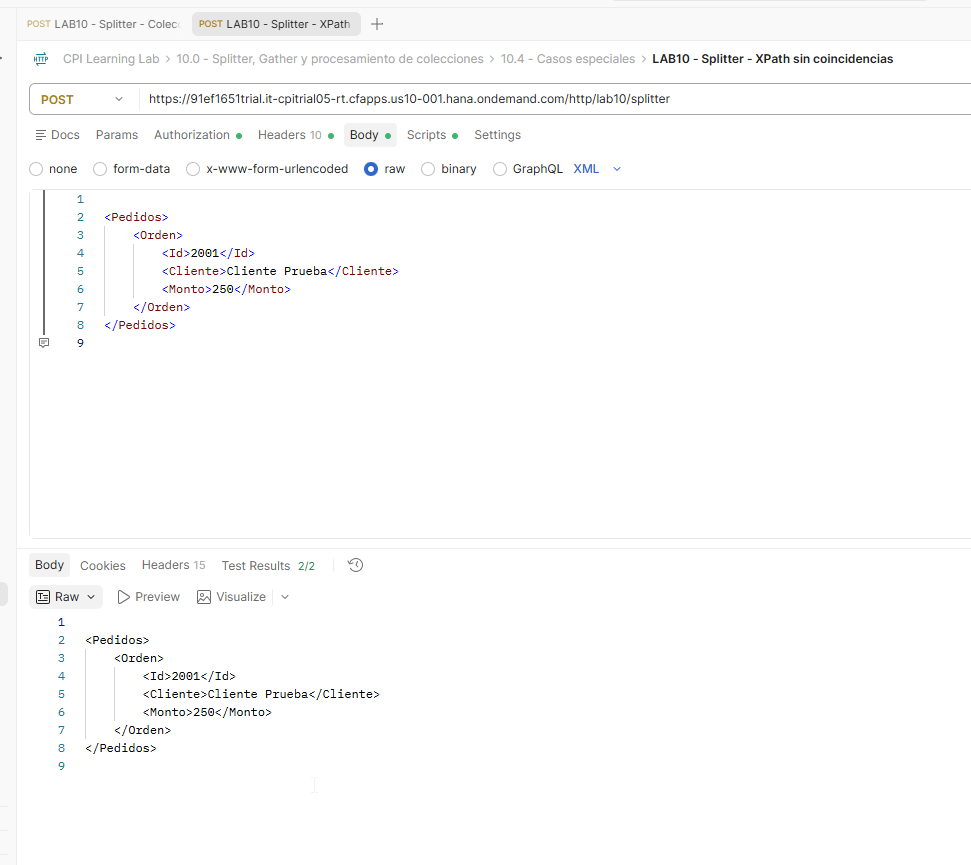

**Evidencia 10-23 - Trace: XPath sin coincidencias**
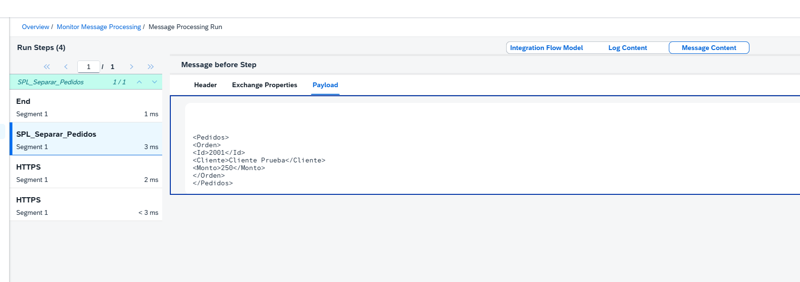

#### 10.4.3 - XML mal formado

1. Enviar un XML con la etiqueta raíz `Pedidos` y un cierre incorrecto `</Pedido>`:

```xml
<Pedidos>
    <Pedido>
        <Id>3001</Id>
        <Cliente>Cliente Error</Cliente>
        <Monto>400</Monto>
    </Pedido>
</Pedido>
```

2. Revisar la respuesta de Postman y abrir el mensaje fallido en el monitor.
3. Identificar el paso donde se interrumpió el procesamiento.

**Por qué:** se comprueba que el Splitter necesita un documento XML bien formado para evaluar XPath; el fallo ocurre antes de la validación Groovy posterior.

**Resultado observado:** Postman devolvió `500 Internal Server Error`. En el monitor se registró `Unexpected close tag </Pedido>; expected </Pedidos>` en la posición `[8,8]`; el diagrama de ejecución señaló el fallo en `SPL_Separar_Pedidos` y no mostró ejecución del script posterior.

**Validación:** ✅ Completada. No se configuró un manejador de excepciones en este tema.

**Evidencia 10-24 - Postman: XML mal formado y HTTP 500**
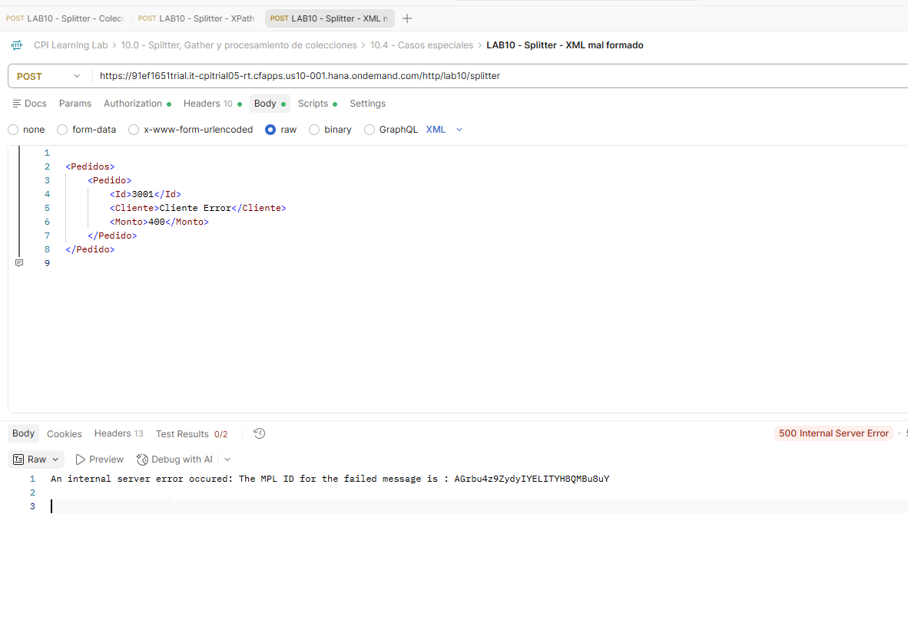

**Evidencia 10-25 - Monitor: detalle del error XML**
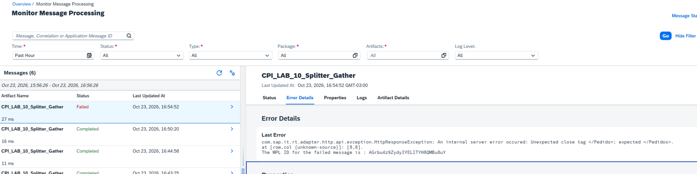

**Evidencia 10-26 - Trace: fallo en General Splitter**
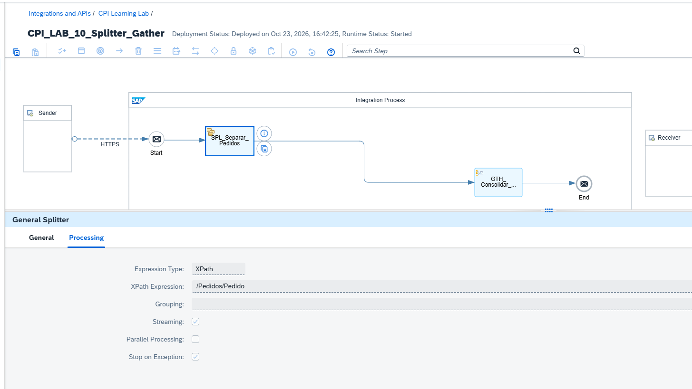

#### 10.4.4 - Monto negativo

1. Incorporar la validación Groovy después del General Splitter, mediante el recurso `GRV_Validar_Pedido2.groovy`, asociado al paso `GRV_Validar_Pedido`.
2. Conservar la regla previa de rechazo intencional del pedido `1002` y agregar la comprobación del monto negativo mediante `BigDecimal`.
3. Guardar y desplegar la versión modificada del iFlow antes de invocarlo.
4. Enviar el siguiente XML:

```xml
<Pedidos>
    <Pedido>
        <Id>4001</Id>
        <Cliente>Cliente Prueba</Cliente>
        <Monto>-100</Monto>
    </Pedido>
</Pedidos>
```

5. Verificar la respuesta en Postman y consultar `Error Details` en el monitor.

**Por qué:** se valida cada pedido separado, antes de la agregación, aplicando una regla de negocio distinta de la validación sintáctica del XML.

**Resultado observado:** Postman devolvió `500 Internal Server Error`; SAP CPI registró `IllegalStateException` con el texto `LAB10_MONTO_NEGATIVO: Pedido 4001 tiene monto -100` en la línea 25 del recurso `GRV_Validar_Pedido2.groovy`. El identificador MPL de la respuesta coincide con el del mensaje fallido del monitor.

**Validación:** ✅ Completada. El HTTP 500 se documenta como resultado de la excepción lanzada por el script, no como una respuesta de negocio personalizada.

**Evidencia 10-27 - Postman: monto negativo y respuesta HTTP 500**
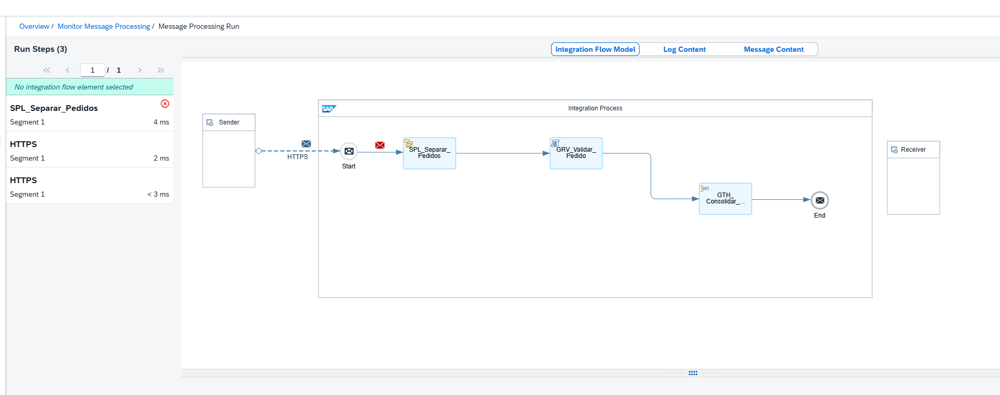

**Evidencia 10-28 - Monitor: excepción de monto negativo**
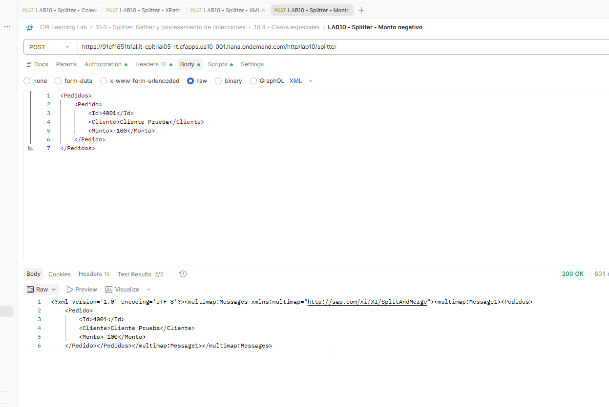

### Resultado esperado y validación consolidada

| Prueba | Resultado comprobado | Estado |
|---|---|---|
| Colección vacía | HTTP 200, `<Pedidos/>`, sin pedidos individuales | ✅ Completado |
| XPath sin coincidencias | HTTP 200, XML original conservado | ✅ Completado |
| XML mal formado | HTTP 500, fallo de cierre XML en Splitter | ✅ Completado |
| Monto negativo | HTTP 500, excepción `LAB10_MONTO_NEGATIVO` identificada en Groovy | ✅ Completado |

### Problemas encontrados

- El XML mal formado no llega a la validación Groovy: la evaluación del documento falla en el General Splitter.
- El script Groovy generó una advertencia de comprobación sobre el uso de `XmlSlurper` sin streaming. Se revisó durante la configuración; no se infiere de esta advertencia que el script no pueda ejecutarse.
- La excepción de negocio se propagó como HTTP 500. La personalización de respuestas de error no pertenece al alcance del tema 10.

### Aprendizajes

- Una colección sin elementos seleccionados no equivale a XML inválido.
- El resultado HTTP debe contrastarse con el monitor y la traza, especialmente en pruebas negativas.
- La ubicación de la validación dentro del iFlow determina si una entrada llega o no a Groovy.
- La correlación mediante MPL permite demostrar que el error observado por el cliente corresponde a la ejecución registrada en CPI.

### Referencias

- SAP Help Portal - Cloud Integration: General Splitter, Gather, Groovy Script y Monitor Message Processing.

---

## Historial de versiones del documento

| Versión | Fecha | Cambios |
|---|---|---|
| 1.0 | 2026-10-23 | Creación del módulo y documentación validada del laboratorio 10.1. |
| 1.1 | 2026-10-23 | Incorporación del laboratorio 10.2, clasificación individual validada y evidencias 10-06 a 10-12. |
| 1.2 | 2026-10-23 | Incorporación del laboratorio 10.3, Gather validado, evidencias 10-13 a 10-19 y diagnóstico de topología incompatible. |
| 1.3 | 2026-10-23 | Cierre del módulo: laboratorio 10.4 validado en cuatro casos, evidencias 10-20 a 10-28 y estado general Completado. |

---
