# 11 — Formatos JSON, XML y conversores

**Estado del tema:** ✅ Completado
**Package:** `CPI Learning Lab`
**Alcance documentado:** laboratorios 11.1 a 11.5, validados el 26-10-2026.

## Objetivo

Comprender las diferencias estructurales entre JSON y XML, recibir ambos formatos mediante HTTPS en SAP Cloud Integration y utilizar los conversores estándar JSON → XML y XML → JSON, incluida una conversión de ida y vuelta, verificando resultados y limitaciones mediante Postman y Monitor Message Processing.

## Prerrequisitos

- Acceso a SAP Integration Suite / Cloud Integration y al package `CPI Learning Lab`.
- Permisos para diseñar, desplegar y monitorizar iFlows.
- Postman configurado con el mecanismo OAuth 2.0 Client Credentials utilizado en laboratorios anteriores. No almacenar tokens ni secretos en el repositorio.
- Conocimientos previos de HTTPS Sender, Content Modifier, headers, Exchange Properties y monitorización.

## Índice y estado de microaprendizajes

| ID | Microaprendizaje | Estado | Evidencia |
|---|---|---|---|
| 11.1 | Estructura JSON y XML | ✅ Completado | Recepción JSON/XML, pruebas Postman y mensajes completados en CPI |
| 11.2 | JSON to XML Converter | ✅ Completado | XML generado, header de respuesta corregido, 4/4 pruebas Postman y monitorización |
| 11.3 | XML to JSON Converter | ✅ Completado | XML convertido a JSON, HTTP 200, 4/4 pruebas Postman y mensajes Completed |
| 11.4 | Estructuras complejas y conversiones | ✅ Completado | Roundtrip JSON → XML → JSON, HTTP 200, 4/4 pruebas; pérdida de tipos documentada |
| 11.5 | Validaciones y casos especiales | ✅ Completado | Cinco casos probados con Postman: HTTP 500 diagnosticado y respuestas HTTP 200 con 4/4, 4/4, 5/5 y 5/5 tests |

> Los estados «Completado» corresponden a los objetivos funcionales efectivamente probados. Las limitaciones y comprobaciones no realizadas se indican expresamente en cada laboratorio.

---

## 11.1 — Estructura y diferencias entre JSON y XML

**Estado:** ✅ Completado
**iFlow:** `LAB11_01_JSON_XML_Estructura`
**Versión desplegada observada:** `1.0.0`
**Endpoint relativo:** `/http/lab11/formatos`

### Objetivo

Comprobar la recepción y devolución de mensajes JSON y XML mediante un mismo endpoint HTTPS, sin transformar el body, y comparar cómo representan objetos, colecciones y valores.

### Conceptos

- **JSON:** objetos con propiedades, arrays y valores tipados como números, booleanos y cadenas.
- **XML:** elementos anidados y repetidos; los valores textuales no adquieren automáticamente tipos JSON.
- **`Content-Type`:** header HTTP que declara el formato del contenido, sin demostrar por sí mismo que esté bien formado.
- **Exchange Property:** dato interno del procesamiento; no es automáticamente un header de respuesta.

### Laboratorio paso a paso

#### 1. Crear el iFlow

En `CPI Learning Lab`, crear `LAB11_01_JSON_XML_Estructura`, inicialmente con Start y End, sin desplegar.

**Evidencia 11-01 — Estructura inicial del iFlow**
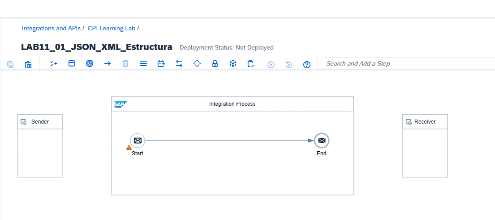

#### 2. Configurar HTTPS Sender

Conectar Sender con Start usando el adaptador HTTPS:

| Parámetro | Valor |
|---|---|
| Address | `/lab11/formatos` |
| Authorization | `User Role` |
| User Role | `ESBMessaging.send` |
| CSRF Protected | Desactivado para este laboratorio |

**Motivo:** recibir solicitudes HTTP autenticadas sin introducir una validación CSRF adicional en un ejercicio centrado en formatos. Esta decisión de laboratorio no constituye una recomendación general de seguridad.

**Evidencia 11-02 — Configuración HTTPS Sender**
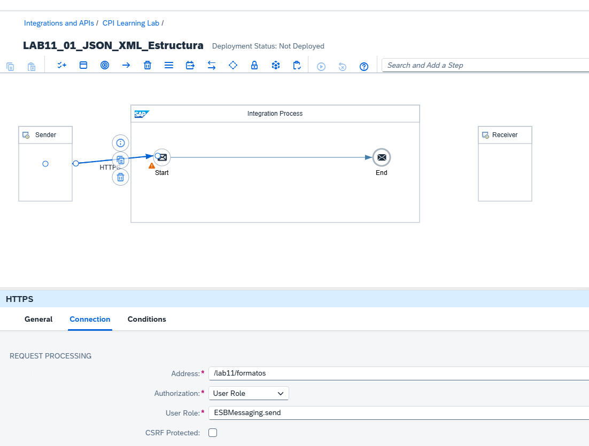

#### 3. Registrar el formato declarado

Insertar un Content Modifier `CM_Identificar_Formato` entre Start y End. En **Exchange Property** configurar:

| Campo | Valor |
|---|---|
| Action | Create |
| Name | `FormatoEntrada` |
| Source Type | Header |
| Source Value | `Content-Type` |
| Data Type | No editable en el editor observado |

Dejar **Message Body** sin modificar. La propiedad copia el valor declarado en el header de entrada; no valida sintácticamente el payload.

**Evidencia 11-03 — Content Modifier y Exchange Property**
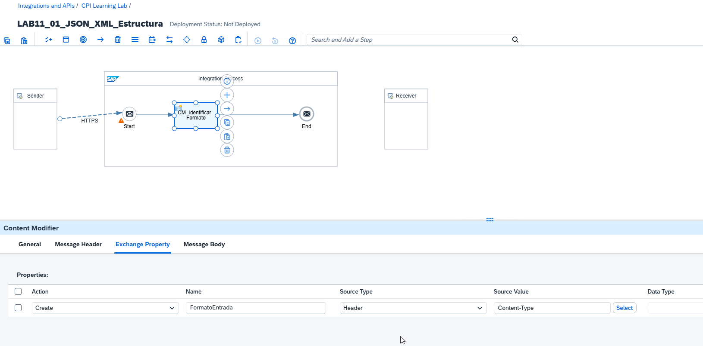

#### 4. Desplegar y verificar el runtime

Guardar, desplegar y comprobar el artefacto en Manage Integration Content. Se observó despliegue exitoso, estado `Started` y versión `1.0.0`.

**Evidencia 11-04 — Despliegue iniciado**
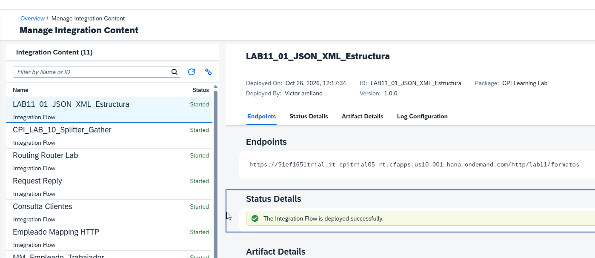

#### 5. Enviar JSON desde Postman

Enviar **POST** al endpoint con `Content-Type: application/json` y autenticación Bearer. Payload:

```json
{
  "pedido": {
    "id": 1001,
    "cliente": {"codigo": "C001", "nombre": "Cliente Demo"},
    "items": [
      {"producto": "P001", "cantidad": 2, "precio": 1500},
      {"producto": "P002", "cantidad": 1, "precio": 3000}
    ],
    "total": 6000,
    "activo": true
  }
}
```

**Resultado observado:** `200 OK`; 3/3 pruebas Postman exitosas, verificando código HTTP, existencia de `pedido`, ID `1001`, total `6000` y dos posiciones. Las pruebas no establecen igualdad byte a byte de todo el mensaje.

**Evidencia 11-05 — Respuesta JSON y pruebas Postman**
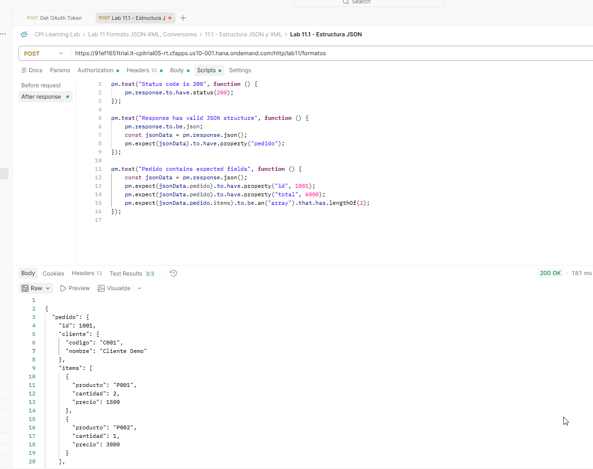

#### 6. Comprobar procesamiento en CPI

En Monitor Message Processing, filtrar por el iFlow. Se observaron cuatro mensajes en estado `Completed`; la ejecución seleccionada mostró 6 ms de procesamiento.

**Evidencia 11-06 — Monitor JSON Completed**
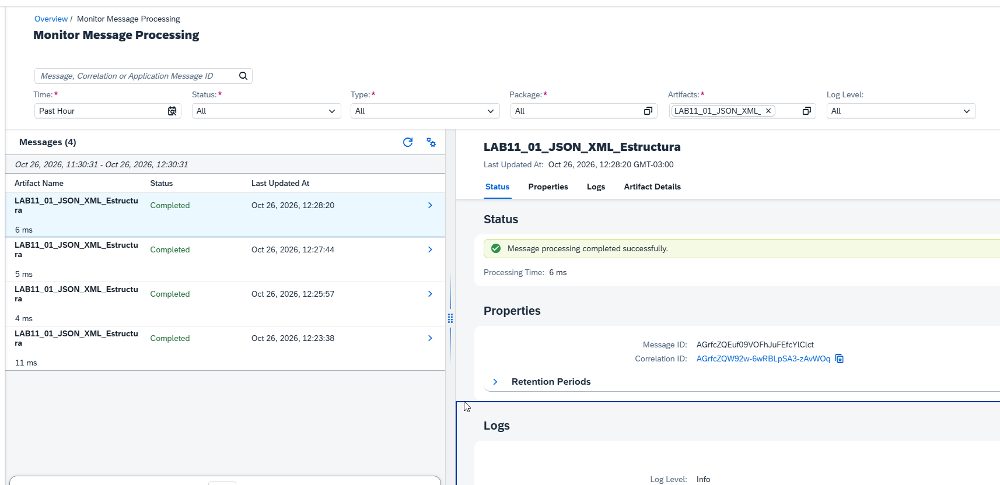

#### 7. Enviar XML desde Postman

Con el mismo endpoint y método **POST**, usar `Content-Type: application/xml`:

```xml
<?xml version="1.0" encoding="UTF-8"?>
<pedido>
    <id>1001</id>
    <cliente>
        <codigo>C001</codigo>
        <nombre>Cliente Demo</nombre>
    </cliente>
    <items>
        <item><producto>P001</producto><cantidad>2</cantidad><precio>1500</precio></item>
        <item><producto>P002</producto><cantidad>1</cantidad><precio>3000</precio></item>
    </items>
    <total>6000</total>
    <activo>true</activo>
</pedido>
```

**Resultado observado:** `200 OK`, respuesta XML con estructura esperada en la parte visible y 3/3 pruebas Postman exitosas. El test llamado «Response is valid XML» comprobaba fragmentos y el header, **no** efectuaba un parseo XML formal ni validación XSD.

**Evidencia 11-07 — Respuesta XML y pruebas Postman**
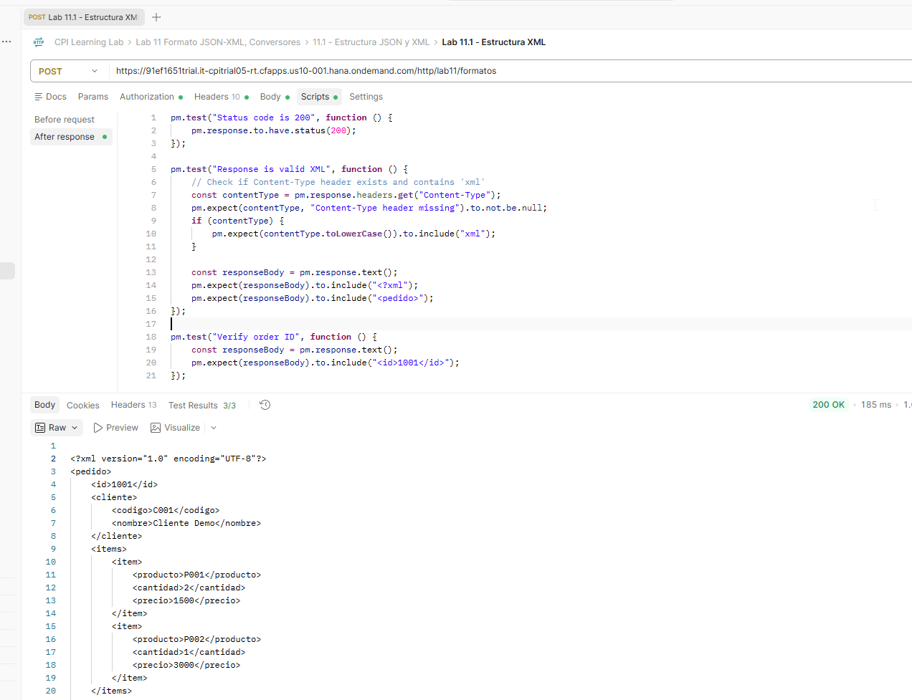

### Validación y aprendizajes

- La recepción y devolución de ambos formatos quedó demostrada mediante solicitudes HTTP y respuestas exitosas.
- JSON representa `items` como un array de objetos; el XML del ejercicio utiliza un contenedor `items` con elementos `item` repetidos.
- Los valores numéricos y booleanos de JSON aparecen como contenido textual en XML, salvo interpretación adicional mediante esquema o transformación.
- **Limitación:** no se inspeccionó directamente el valor de `FormatoEntrada`; el monitor estándar en nivel `Info` no aportó evidencia de esa Exchange Property. No se afirma que haya fallado.

### Problemas encontrados

La primera prueba JSON se ejecutó con GET en lugar de POST; se corrigió el método y se repitió con resultados exitosos. La prueba XML utilizó verificaciones textuales, no validación formal de XML.

---

## 11.2 — Conversión JSON a XML

**Estado:** ✅ Completado
**iFlow:** `LAB11_02_JSON_to_XML`
**Versión observada en el primer despliegue:** `1.0.0`
**Versión final tras agregar Content Modifier:** no confirmada mediante captura
**Endpoint relativo:** `/http/lab11/json-to-xml`

### Objetivo

Convertir el pedido JSON del laboratorio 11.1 a XML con el componente estándar **JSON To XML Converter**, comprobar la representación de colecciones y declarar explícitamente el tipo de contenido de la respuesta HTTP.

### Conceptos

- **JSON To XML Converter:** transforma el body de JSON a XML.
- **Elemento raíz:** el conversor puede envolver el documento generado en un elemento configurado.
- **Namespace Mapping:** asociación de prefijos JSON con namespaces XML; innecesaria para este payload sin prefijos.
- **Header HTTP de salida:** debe corresponder al formato efectivamente devuelto; es independiente del `Content-Type` enviado por Postman.

### Laboratorio paso a paso

#### 1. Crear iFlow independiente

Crear `LAB11_02_JSON_to_XML` en el package existente, conservando sin cambios el artefacto del laboratorio 11.1.

**Evidencia 11-08 — Estructura inicial**
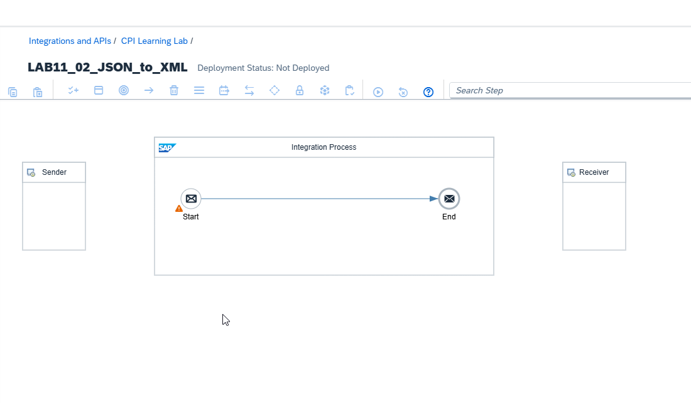

#### 2. Configurar HTTPS Sender

| Parámetro | Valor |
|---|---|
| Address | `/lab11/json-to-xml` |
| Authorization | `User Role` |
| User Role | `ESBMessaging.send` |
| CSRF Protected | Desactivado para el laboratorio |

**Motivo:** aislar la conversión en un endpoint propio y reutilizar la autenticación conocida.

**Evidencia 11-09 — HTTPS Sender del conversor**
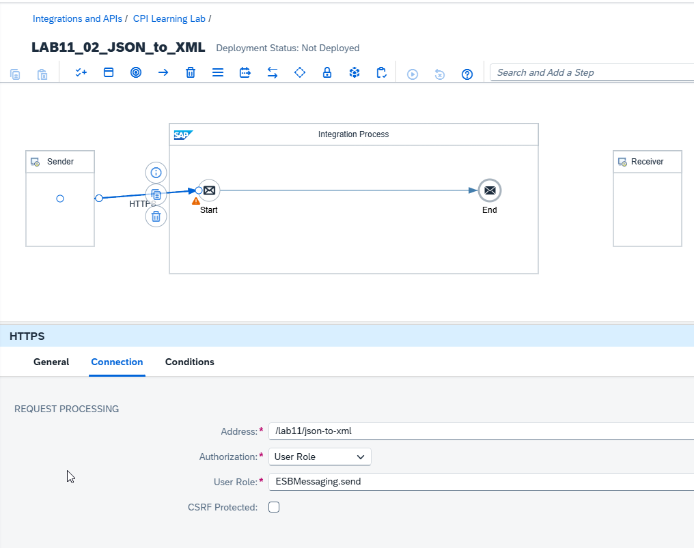

#### 3. Insertar y configurar JSON To XML Converter

Añadir `CONV_JSON_to_XML` entre Start y End, con:

| Parámetro | Configuración |
|---|---|
| Use Namespace Mapping | Desactivado |
| JSON Prefix Separator | `Colon (:)` |
| Add XML Root Element | Activado |
| Name | `root` |

**Motivo:** el payload no utiliza namespaces y se desea una raíz XML explícita para examinar la conversión.

**Evidencia 11-10 — Configuración definitiva del conversor**
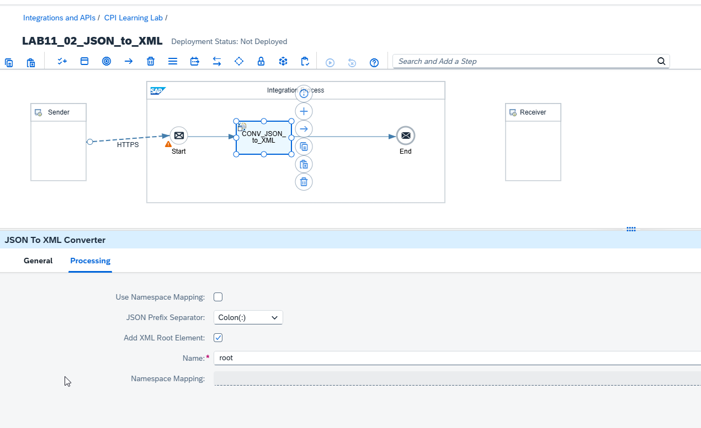

#### 4. Primer despliegue

Se observó despliegue exitoso del iFlow con versión `1.0.0` y endpoint publicado.

**Evidencia 11-11 — Primer despliegue**
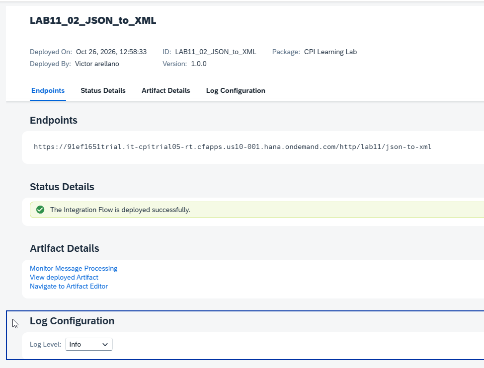

#### 5. Probar conversión JSON → XML

Enviar mediante Postman el JSON del pedido `1001` del laboratorio 11.1 con método POST, Bearer Token y `Content-Type: application/json`.

**Resultado observado:** HTTP `200 OK`, documento XML con raíz `root`, elemento `pedido`, valores esperados y **dos elementos hermanos `items`** (uno por objeto del array JSON), cada uno con producto, cantidad y precio. Este resultado difiere de la estructura XML manual del laboratorio 11.1, que tenía un contenedor `items` con dos hijos `item`.

Fragmento representativo de la respuesta observada:

```xml
<root>
  <pedido>
    <id>1001</id>
    <cliente><codigo>C001</codigo><nombre>Cliente Demo</nombre></cliente>
    <items><producto>P001</producto><cantidad>2</cantidad><precio>1500</precio></items>
    <items><producto>P002</producto><cantidad>1</cantidad><precio>3000</precio></items>
    <total>6000</total>
    <activo>true</activo>
  </pedido>
</root>
```

**Evidencia 11-12 — Conversión y primera prueba Postman**
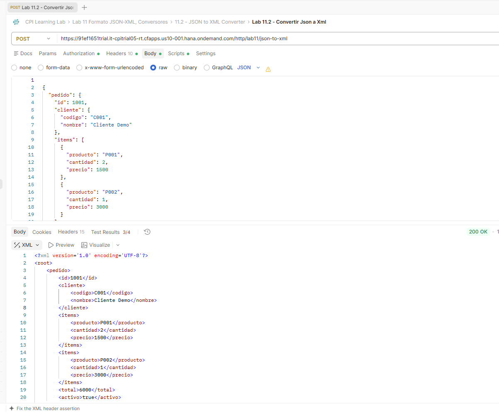

#### 6. Corregir declaración del Content-Type de salida

La conversión devolvía XML, pero la prueba Postman que buscaba el header de respuesta `Content-Type` fallaba (3/4). Se observó además un `Content-Type` duplicado en los **headers de solicitud** de Postman (`application/json` automático y `application/xml` manual). Se corrigió la solicitud para conservar únicamente `application/json`.

Para declarar explícitamente el formato de **respuesta**, se añadió después del conversor un Content Modifier `CM_Response_XML`, con **Message Header**:

| Campo | Valor |
|---|---|
| Action | Create |
| Name | `Content-Type` |
| Source Type | Constant |
| Source Value | `application/xml; charset=UTF-8` |

El body del Content Modifier permanece sin modificar. Se observó posteriormente el iFlow en estado de runtime `Started`. **No se dispone de evidencia suficiente para registrar el número final de versión desplegada**, por lo que no se afirma que haya sido `1.0.1`.

**Evidencia 11-14 — Content Modifier de respuesta XML**
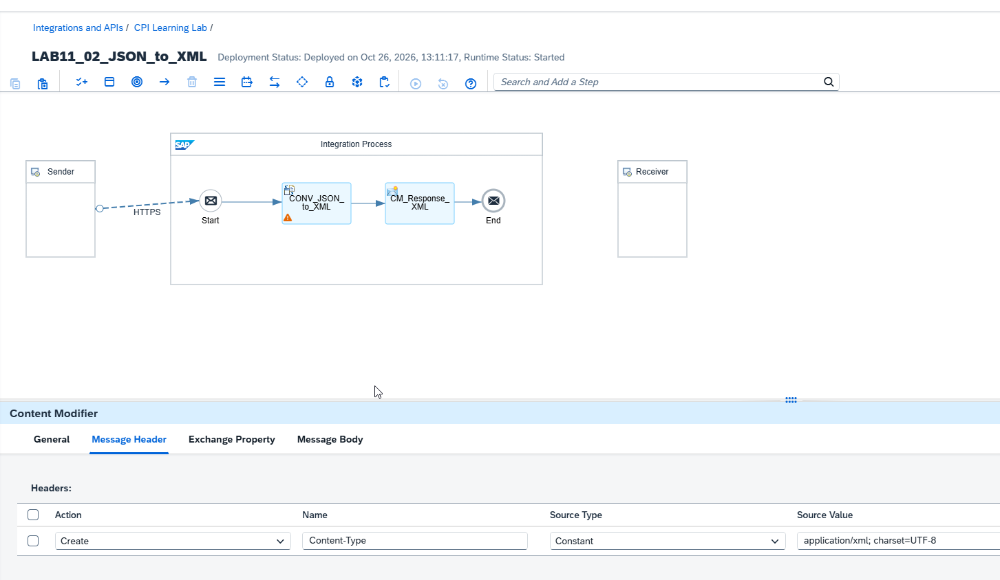

> **Evidencia 11-13:** se solicitó una captura de los headers de respuesta para el diagnóstico, pero no consta una captura recibida con ese nombre. No se agrega un enlace a un archivo no verificado.

#### 7. Validar corrección con Postman

Con una única declaración `Content-Type: application/json` en la solicitud, se repitió la prueba. Se observaron `200 OK` y **4/4 pruebas exitosas**:

1. `Status code is 200`.
2. `Response is XML` (prueba que comprobaba el header esperado).
3. `Response contains expected order ID`.
4. `Response contains correct total`.

Estas pruebas confirman los controles configurados; no constituyen validación XML contra XSD.

**Evidencia 11-15 — Validación final 4/4**
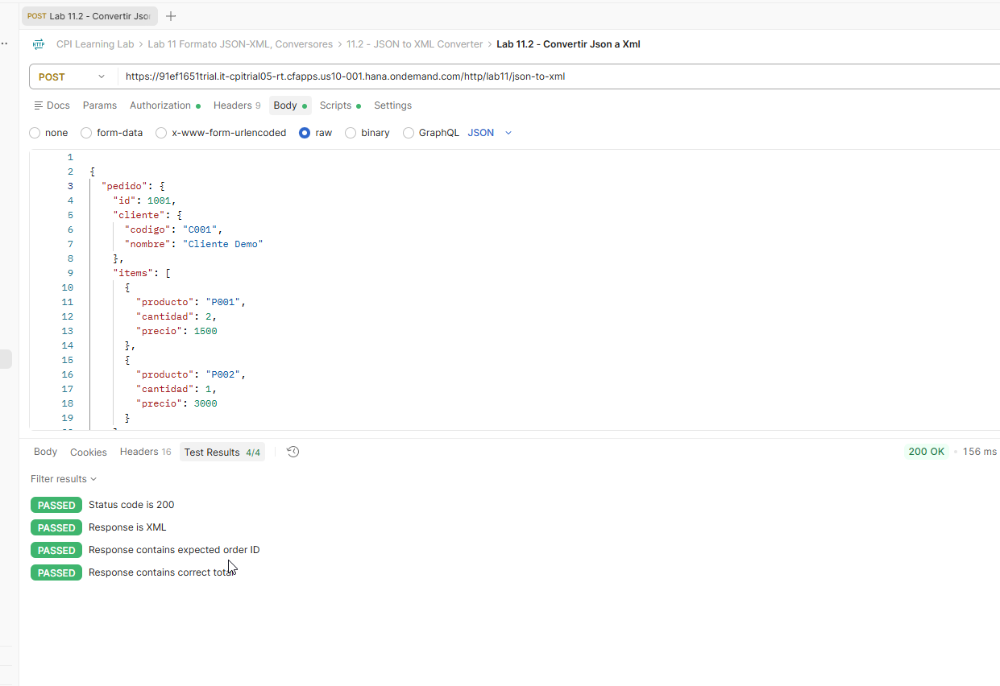

#### 8. Comprobar procesamiento en CPI

En Monitor Message Processing se observaron seis mensajes del iFlow en estado `Completed`; el último seleccionado tenía fecha 26-10-2026 13:13:02 y tiempo de procesamiento de 4 ms.

**Evidencia 11-16 — Monitor del conversor**
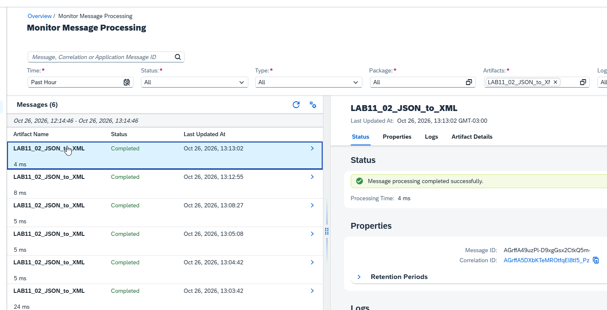

### Validación y aprendizajes

- La conversión estándar JSON → XML se ejecutó correctamente y devolvió un XML con raíz `root`.
- Un array JSON puede generar elementos XML repetidos con el nombre de la propiedad (`items`), no necesariamente un contenedor con elementos `item`.
- El header de entrada `application/json` no debe sustituirse por `application/xml` en Postman para describir la salida.
- Se agregó un header explícito de respuesta mediante Content Modifier y la prueba pasó de 3/4 a 4/4.
- La secuencia de capturas respalda la corrección funcional; **no prueba** que todos los conversores de CPI omitan siempre `Content-Type`.

### Problemas encontrados

**Síntoma:** conversión XML visible, pero test «Response is XML» fallido por ausencia del header esperado en la respuesta.
**Diagnóstico acotado:** la prueba de Postman no encontraba `Content-Type` en la respuesta observada; además había headers `Content-Type` duplicados en la solicitud.
**Solución aplicada:** eliminar el duplicado de solicitud y agregar `CM_Response_XML` con `Content-Type: application/xml; charset=UTF-8` después del conversor.
**Resultado:** cuatro pruebas Postman exitosas y mensajes completados en CPI.
**Alcance:** comportamiento observado en este laboratorio; no generalizable a todos los iFlows sin pruebas adicionales.

Este hallazgo es candidato para `docs/kba-y-hallazgos.md` cuando se consolide la documentación del repositorio.

---

## 11.3 — Conversión XML a JSON

**Estado:** ✅ Completado
**iFlow:** `LAB11_03_XML_to_JSON`
**Endpoint relativo:** `/http/lab11/xml-to-json`

### Objetivo

Convertir el XML de un pedido a JSON mediante el conversor estándar, verificando la estructura del objeto, los elementos repetidos y los tipos de datos resultantes.

### Conceptos

- **XML To JSON Converter:** transforma el body XML en JSON.
- **Suppress JSON Root Element:** permite omitir el elemento raíz XML en la representación JSON cuando corresponde al formato deseado.
- **Elementos repetidos:** pueden convertirse en un arreglo JSON.
- **Tipos:** un número representado como texto XML puede resultar como cadena JSON.

### Laboratorio paso a paso

1. Crear el iFlow `LAB11_03_XML_to_JSON` en el package `CPI Learning Lab`, sin modificar los iFlows de los laboratorios anteriores.
2. Configurar HTTPS Sender con dirección `/lab11/xml-to-json`, autorización `User Role` y rol `ESBMessaging.send`. El objetivo es reutilizar la autenticación ya practicada.
3. Incorporar `CONV_XML_to_JSON` entre Start y End. Revisar la configuración de codificación UTF-8, namespaces y tratamiento del elemento raíz; estas opciones determinan la forma del JSON resultante.
4. Incorporar `CM_Response_JSON` después del conversor y establecer el **Message Header** `Content-Type` con valor `application/json; charset=UTF-8`. Esto declara el formato real de la respuesta HTTP.
5. Guardar y desplegar. Verificar el estado `Started` antes de enviar solicitudes.
6. En Postman, enviar un POST con `Content-Type: application/xml` y el pedido XML utilizado en los ejercicios anteriores. Examinar el JSON recibido y Monitor Message Processing.

### Resultado esperado

Una respuesta JSON con el pedido `1001`, datos del cliente, dos ítems y total `6000`, considerando que los valores pueden quedar representados como cadenas.

### Validación observada

El iFlow se observó en estado `Started`. Postman devolvió **HTTP 200 OK**, con **4/4 pruebas exitosas**. El JSON contenía `pedido.id` igual a `"1001"`, el total `"6000"` y dos elementos bajo `pedido.items.item`. En Monitor Message Processing se observaron ejecuciones `Completed`.

### Problemas encontrados

No consta un incidente pendiente de resolución para este iFlow en las evidencias disponibles. La conversión de valores numéricos a cadenas es una limitación del resultado observado, no un error de ejecución.

### Aprendizajes

La correspondencia XML → JSON no garantiza recuperar los tipos de datos originales. El nombre y repetición de los elementos XML afectan la forma de los arreglos JSON.

### Evidencia

La validación funcional se observó en las capturas de Postman y monitorización del laboratorio. No se asignan nombres de archivo ni enlaces de imagen que no hayan sido confirmados en el repositorio.

---

## 11.4 — Estructuras complejas y conversiones JSON → XML → JSON

**Estado:** ✅ Completado
**iFlow:** `LAB11_04_JSON_XML_Roundtrip`
**Endpoint relativo:** `/http/lab11/json-xml-roundtrip`

### Objetivo

Verificar una conversión de ida y vuelta de un JSON con objeto anidado y arreglo de ítems, identificar las diferencias de tipos y diagnosticar un error de respuesta HTTP independiente del procesamiento interno del iFlow.

### Conceptos

- **Roundtrip:** transformación JSON → XML → JSON sobre el mismo mensaje.
- **Raíz XML auxiliar:** permite construir un documento XML bien formado cuando se parte de un objeto JSON.
- **Supresión de raíz:** evita devolver al cliente una envoltura introducida solo para la conversión intermedia.
- **Headers HTTP:** `Content-Type` debe escribirse exactamente con guion; `Content/Type` no es equivalente.
- **Monitorización:** un mensaje `Completed` en CPI no garantiza por sí solo que el cliente HTTP haya recibido una respuesta válida.

### Laboratorio paso a paso

1. Crear un iFlow independiente `LAB11_04_JSON_XML_Roundtrip` en `CPI Learning Lab`, conservando los artefactos anteriores.
2. Configurar HTTPS Sender con Address `/lab11/json-xml-roundtrip`, Authorization `User Role`, User Role `ESBMessaging.send` y CSRF Protected desactivado para esta prueba.
3. Insertar `CONV_JSON_to_XML` con namespace mapping desactivado y elemento raíz `root`. **Por qué:** se necesita una raíz XML para el documento intermedio.
4. Insertar `CONV_XML_to_JSON`, configurado para omitir la raíz auxiliar y emitir JSON UTF-8. **Por qué:** recuperar la estructura de nivel superior del JSON enviado.
5. Insertar `CM_Response_JSON` después de ambos conversores. Crear el Message Header **`Content-Type`** con Source Type `Constant` y Source Value **`application/json; charset=UTF-8`**. **Por qué:** el receptor HTTP necesita una cabecera de respuesta válida y coherente con el body.
6. Guardar, desplegar y verificar el iFlow en runtime.
7. Enviar desde Postman un POST con Bearer Token, `Content-Type: application/json` y el pedido complejo del laboratorio 11.1, con cliente anidado y dos ítems.
8. Contrastar respuesta HTTP, pruebas de Postman y pasos ejecutados en Monitor Message Processing.

### Resultado esperado

HTTP 200 y una estructura JSON equivalente en sus objetos y colecciones, sin asumir conservación de los tipos primitivos.

### Validación observada

- En Monitor Message Processing se observó el recorrido HTTPS → `CONV_JSON_to_XML` → `CONV_XML_to_JSON` → `CM_Response_JSON` → End, con intercambio completado.
- El payload antes de End contenía el pedido y sus ítems como JSON.
- Tras corregir el header de salida, Postman devolvió **200 OK**, con **4/4 pruebas aprobadas**.
- La respuesta conservó los dos elementos del arreglo, pero valores originalmente numéricos, como `1001`, `2` y `1500`, aparecieron como cadenas (`"1001"`, `"2"` y `"1500"`). No se comprobó conservación estricta de tipos primitivos.

### Problema encontrado — HTTP 502 Bad Gateway

**Síntoma:** Postman devolvía `502 Bad Gateway` aunque el monitor mostraba el intercambio como `Completed`.

**Evidencia diagnóstica:** el header `X-Cf-Routererror` indicaba:

```text
endpoint_failure (net/http: HTTP/1.x transport connection broken:
malformed MIME header line: "Content/Type: application/json; charset=UTF-8")
```

**Diagnóstico:** en el Content Modifier se había escrito `Content/Type` como nombre del header. El error del router identificó explícitamente esa línea como mal formada.

**Solución:** corregir el nombre a `Content-Type`, mantener `application/json; charset=UTF-8` como valor y volver a probar.

**Resultado:** HTTP 200 y cuatro pruebas Postman aprobadas. El incidente se registra también en `docs/kba-y-hallazgos.md` mediante el texto complementario entregado para incorporar al repositorio.

### Aprendizajes

- Un iFlow puede completar sus pasos y aun así producir una respuesta HTTP que el router rechaza.
- Para diagnosticar un 502 es necesario examinar también los headers y mensajes del cliente, no solo el estado `Completed` de CPI.
- El roundtrip no garantiza equivalencia de tipos JSON, aunque preserve la estructura observada.
- No es correcto atribuir este incidente a SAP, la región o el runtime sin evidencia; el mensaje del router permitió identificar el header mal formado.

### Evidencias del laboratorio

Las capturas examinadas muestran configuración HTTPS Sender, actividades de los conversores, headers y exchange properties antes de End, payload JSON, error 502 y prueba final 200 con 4/4 resultados. **No se crean referencias Markdown a imágenes con nombres aún no confirmados.**

---

## 11.5 — Validaciones y casos especiales

**Estado:** ✅ Completado
**iFlow reutilizado:** `LAB11_04_JSON_XML_Roundtrip`
**Endpoint relativo:** `/http/lab11/json-xml-roundtrip`
**Fecha de validación:** 26-10-2026

### Objetivo

Evaluar la respuesta del roundtrip JSON → XML → JSON ante entradas inválidas, valores nulos, arrays vacíos, caracteres especiales y distintos tipos de datos, distinguiendo fallos de procesamiento de conversiones funcionales con pérdida de información.

### Conceptos

- **JSON mal formado:** documento que no puede analizarse sintácticamente; distinto de un JSON válido que incumple un esquema.
- **`null` y array vacío:** representan ausencia de valor y colección sin elementos, respectivamente; no equivalen a una cadena vacía.
- **Caracteres especiales:** XML requiere escapar caracteres reservados en el contenido intermedio; el JSON final puede recuperar el texto original.
- **Tipos JSON:** números, booleanos y cadenas pueden perder su distinción durante una conversión XML sin esquema.
- **Pruebas Postman:** comprueban condiciones observables; no sustituyen validación XSD ni certifican otros escenarios no ejecutados.

### Prerrequisitos y configuración común

Se reutilizó el iFlow `LAB11_04_JSON_XML_Roundtrip` previamente desplegado. **No se modificó ni versionó el iFlow** para estas pruebas. Cada escenario tuvo una petición independiente dentro de la carpeta Postman `11.5 - Validaciones y casos especiales`.

Todas las peticiones utilizaron `POST`, autenticación Bearer obtenida mediante OAuth 2.0 Client Credentials, `Content-Type: application/json` y el mismo endpoint. No se guardan credenciales en este documento.

### Laboratorio paso a paso y validaciones

#### 11.5.1 — JSON mal formado

**Objetivo:** comprobar el rechazo de un documento JSON incompleto y diagnosticar el error real en CPI.

1. Crear la petición `11.5.1 - JSON mal formado` y utilizar el endpoint del roundtrip (no el endpoint `/http/lab10/splitter` del tema anterior).
2. Enviar este body deliberadamente incompleto:

   ```json
   {
     "pedido": {
       "id": 1001,
       "cliente": "Cliente Demo",
       "total": 6000
   ```

3. Verificar en Postman el código HTTP y el mensaje de error.
4. Localizar la ejecución fallida mediante su MPL ID en Monitor Message Processing y consultar `Error Details`.

**Resultado esperado:** rechazo de la entrada inválida, sin presuponer el código exacto antes de ejecutar.

**Resultado observado:** HTTP `500 Internal Server Error`. Las **3/3 pruebas Postman** verificaron código `500`, tiempo de respuesta inferior a 2000 ms en esa ejecución y presencia de `An internal server error occured` en el cuerpo. CPI registró:

```text
End of input at line 5 column 18 path $.pedido.total.
```

El mensaje confirma un error de análisis por fin prematuro del JSON; por sí solo no identifica el componente exacto que lo produjo.

**Problema encontrado:** se probó inicialmente por error `/http/lab10/splitter`, que también devolvió HTTP 500. Esa ejecución **no se usa como evidencia del conversor**; la solicitud se corrigió al endpoint de 11.4 y se repitió.

**Aprendizaje:** un HTTP 500 requiere correlación con el monitor; un error HTTP aislado no permite asignar una causa al conversor.

**Evidencias:**

**Evidencia 11-17 — JSON mal formado: respuesta HTTP 500 en el endpoint correcto**
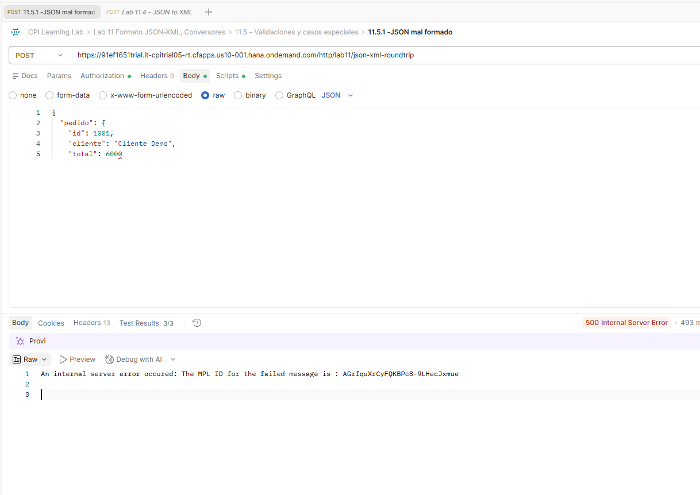

**Evidencia 11-18 — Tests de rechazo del JSON mal formado (3/3)**
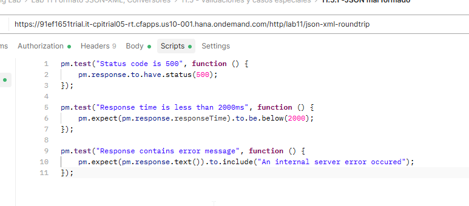

**Evidencia 11-19 — Error de fin de entrada registrado en CPI**
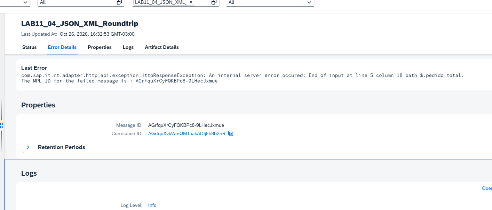

#### 11.5.2 — Valores `null`

**Objetivo:** verificar si `null` conserva su significado después del roundtrip.

1. Crear la petición `11.5.2 - Valores null`.
2. Enviar:

   ```json
   {
     "pedido": {
       "id": 1002,
       "cliente": {"codigo": "C002", "nombre": null},
       "observacion": null,
       "total": 2500,
       "activo": true
     }
   }
   ```

3. Comparar la respuesta JSON y ejecutar tests de estado, campos nulos, números y booleano.

**Resultado esperado:** determinar empíricamente cómo se representan los valores nulos.

**Resultado observado:** HTTP `200 OK`; `cliente.nombre` y `observacion` cambiaron de `null` a `""`; `id`, `total` y `activo` se devolvieron como `"1002"`, `"2500"` y `"true"`. **4/4 tests aprobados**.

**Problema encontrado:** pérdida de distinción entre `null` y cadena vacía; no es un error HTTP.

**Aprendizaje:** un resultado HTTP exitoso no garantiza equivalencia semántica de los datos.

**Evidencia 11-20 — Respuesta JSON con valores null convertidos**
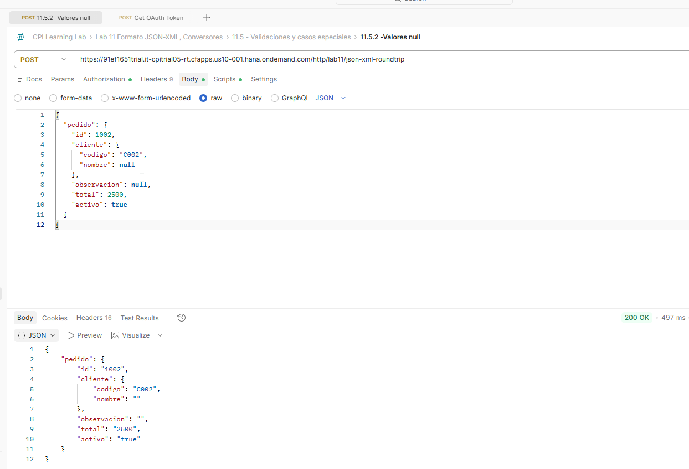

**Evidencia 11-21 — Tests de valores null (4/4)**
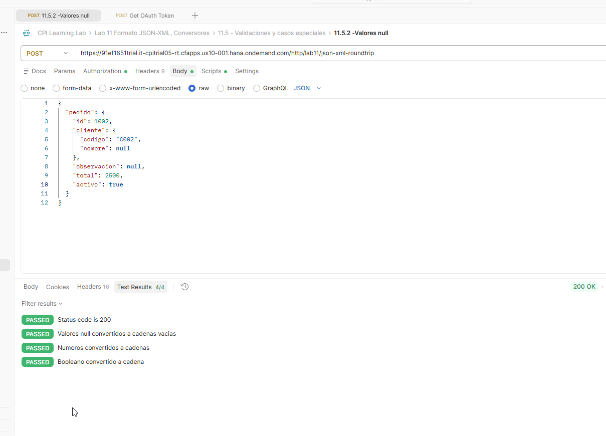

#### 11.5.3 — Arrays vacíos

**Objetivo:** comprobar si un array sin elementos mantiene su estructura.

1. Crear `11.5.3 - Arrays vacíos`.
2. Enviar:

   ```json
   {
     "pedido": {
       "id": 1003,
       "cliente": {"codigo": "C003", "nombre": "Cliente Demo"},
       "items": [],
       "total": 0,
       "activo": false
     }
   }
   ```

3. Comprobar el campo `items` y los tipos de `total` y `activo` mediante tests.

**Resultado esperado:** identificar si `items` continúa siendo un array o cambia de representación.

**Resultado observado:** HTTP `200 OK`; `items: []` se devolvió como `"items": ""`, `total: 0` como `"total": "0"` y `activo: false` como `"activo": "false"`. **4/4 tests aprobados**.

**Problema encontrado:** pérdida del tipo colección en `items`; un consumidor que espera un array podría rechazar el mensaje.

**Aprendizaje:** las estructuras vacías deben incluirse explícitamente en pruebas de contratos de integración.

**Evidencia 11-22 — Respuesta del roundtrip con array vacío**
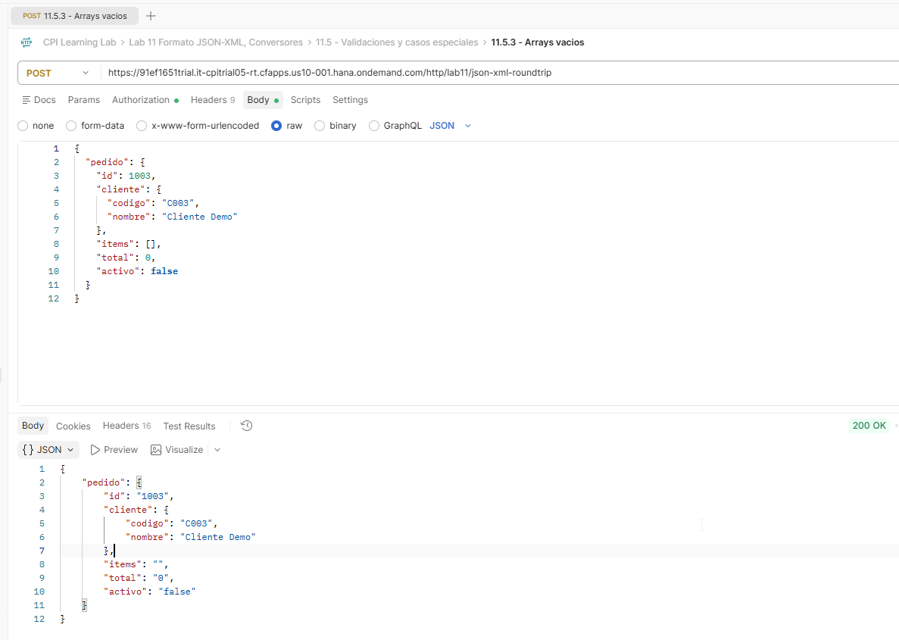

**Evidencia 11-23 — Tests de arrays vacíos (4/4)**
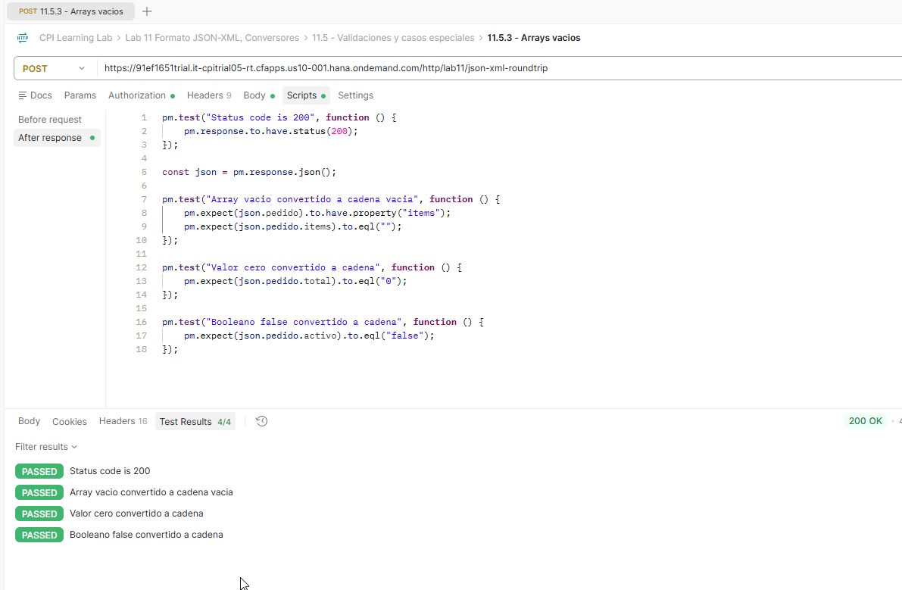

#### 11.5.4 — Caracteres especiales

**Objetivo:** comprobar que la conversión conserva texto con acentos, caracteres reservados de XML y Unicode.

1. Crear `11.5.4 - Caracteres especiales`.
2. Enviar:

   ```json
   {
     "pedido": {
       "id": 1004,
       "cliente": {"codigo": "C004", "nombre": "José Muñoz"},
       "descripcion": "Café & té <premium> \"especial\"",
       "ciudad": "Viña del Mar",
       "simbolo": "€",
       "emoji": "🚀"
     }
   }
   ```

3. Comparar la respuesta y ejecutar pruebas sobre texto, símbolos y emoji.

**Resultado esperado:** preservar el contenido textual en el JSON final, aunque los caracteres reservados se representen de forma escapada durante la conversión intermedia.

**Resultado observado:** HTTP `200 OK`; se conservaron `José Muñoz`, `Viña del Mar`, `Café & té <premium> "especial"`, `€` y `🚀`. El ID se devolvió como cadena. **5/5 tests aprobados**.

**Problemas encontrados:** ninguno para los caracteres ensayados. No se inspeccionó el XML intermedio para verificar su escape exacto.

**Aprendizaje:** la preservación de caracteres Unicode puede coexistir con pérdida de tipos numéricos.

**Evidencia 11-24 — Respuesta con caracteres especiales conservados**
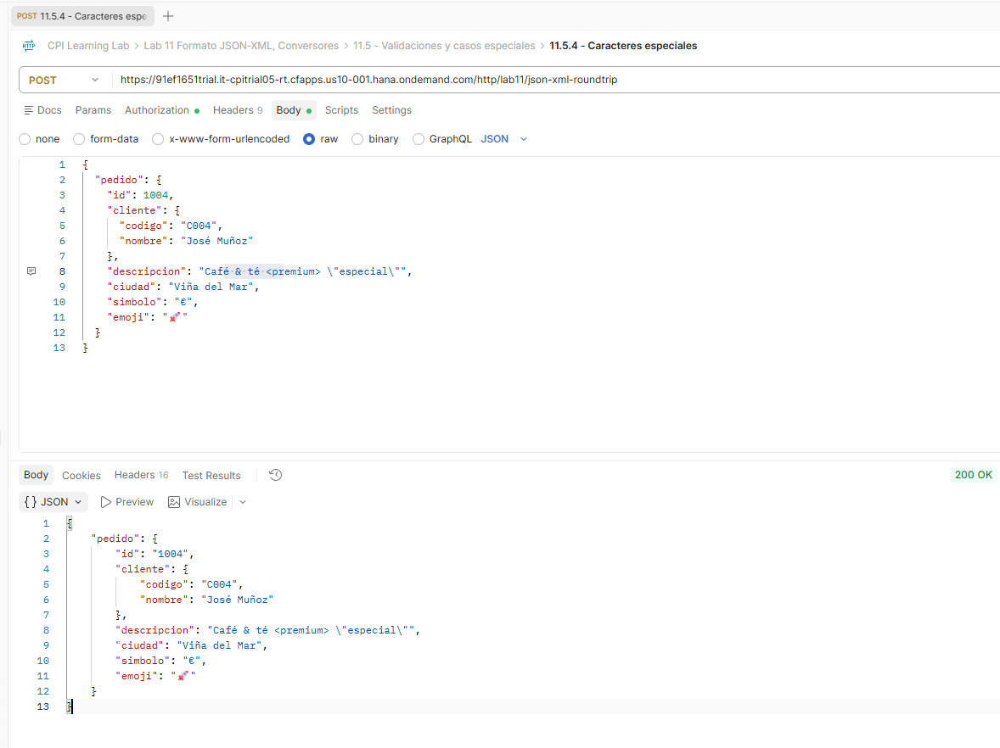

**Evidencia 11-25 — Tests de caracteres especiales (5/5)**
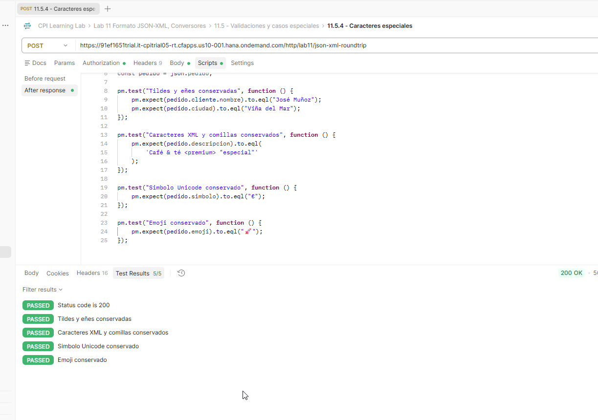

#### 11.5.5 — Tipos de datos

**Objetivo:** comparar tipos JSON primitivos antes y después del roundtrip.

1. Crear `11.5.5 - Tipos de datos`.
2. Enviar:

   ```json
   {
     "datos": {
       "entero": 123,
       "decimal": 45.67,
       "cero": 0,
       "negativo": -25,
       "booleanoTrue": true,
       "booleanoFalse": false,
       "texto": "123",
       "textoVacio": ""
     }
   }
   ```

3. Verificar mediante tests el código HTTP, los valores numéricos, booleanos y cadenas.

**Resultado esperado:** identificar qué tipos se preservan y cuáles se convierten en texto.

**Resultado observado:** HTTP `200 OK`; `123`, `45.67`, `0`, `-25`, `true` y `false` se devolvieron como `"123"`, `"45.67"`, `"0"`, `"-25"`, `"true"` y `"false"`. Las cadenas `"123"` y `""` permanecieron como cadenas. **5/5 tests aprobados**.

**Problema encontrado:** la representación textual de los valores se conserva en los ejemplos probados, pero se pierde la distinción de tipos entre números, booleanos y cadenas.

**Aprendizaje:** para integraciones con contrato tipado no debe suponerse que un roundtrip con conversores estándar conserva los tipos JSON.

**Evidencia 11-26 — Respuesta con tipos convertidos a cadenas**
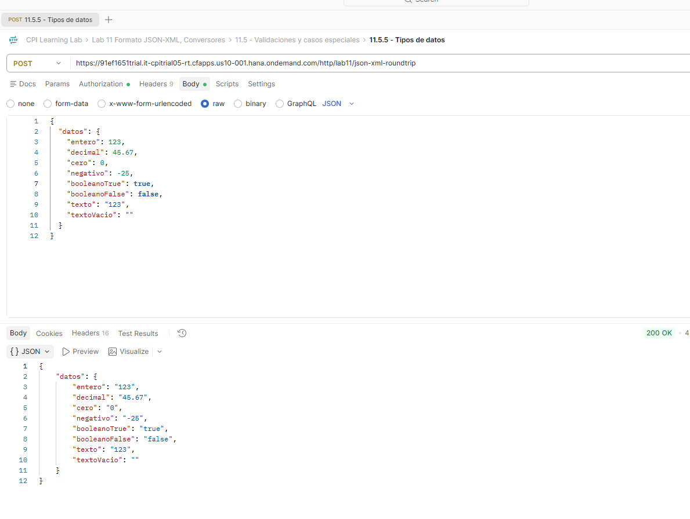

**Evidencia 11-27 — Tests de tipos de datos (5/5)**
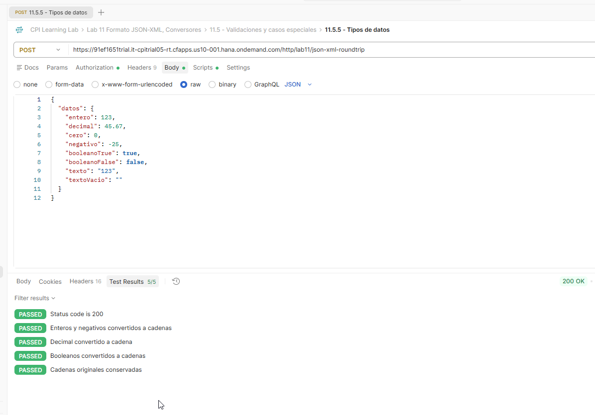

### Validación global del laboratorio 11.5

| Caso | Respuesta HTTP | Tests | Estado |
|---|---|---|---|
| 11.5.1 — JSON mal formado | 500 | 3/3 | ✅ Completado |
| 11.5.2 — Valores `null` | 200 | 4/4 | ✅ Completado |
| 11.5.3 — Arrays vacíos | 200 | 4/4 | ✅ Completado |
| 11.5.4 — Caracteres especiales | 200 | 5/5 | ✅ Completado |
| 11.5.5 — Tipos de datos | 200 | 5/5 | ✅ Completado |

### Aprendizajes y alcance

Los conversores permitieron procesar satisfactoriamente las entradas JSON válidas ensayadas, pero el roundtrip no conservó `null`, arrays vacíos ni los tipos primitivos numéricos y booleanos. Los caracteres especiales se conservaron en los ejemplos probados. El JSON mal formado produjo un error de análisis registrado en CPI.

Estos resultados describen **la configuración y los mensajes efectivamente probados**; no constituyen una validación de esquema JSON, XSD, ni una afirmación universal sobre cualquier configuración de conversores.

---

## Resultado global y próximos temas

Los laboratorios **11.1, 11.2, 11.3, 11.4 y 11.5** alcanzaron sus objetivos funcionales y cuentan con evidencia práctica. **Estado global del tema: ✅ Completado.** El siguiente tema de la ruta es **12 — Groovy Script: cuándo usarlo y cuándo evitarlo**.

**Límites conocidos:** no se inspeccionó directamente `FormatoEntrada` en 11.1; no se ejecutó validación formal XML contra XSD; no se confirmó mediante captura el número final de versión del iFlow 11.2. Estas limitaciones se documentan sin atribuir resultados no probados.

## Referencias

- SAP Help Portal — *Cloud Integration*: https://help.sap.com/docs/cloud-integration
- SAP Help Portal — *Create the HTTPS Sender Channel*: https://help.sap.com/docs/cloud-integration/sap-cloud-integration/create-https-sender-channel
- Evidencias propias del curso en `docs/images/tema-11/`.

## Historial de versiones del documento

| Versión | Fecha | Cambio |
|---|---|---|
| 1.0 | 2026-10-26 | Documentación consolidada de laboratorios 11.1 y 11.2 y sus evidencias. |
| 1.1 | 2026-10-26 | Incorporados 11.3 y 11.4, diagnóstico y resolución de HTTP 502. |
| 1.2 | 2026-10-26 | Incorporado 11.5 con cinco escenarios y evidencias 11-17 a 11-27; cierre del tema como Completado. |
