# 12 — Groovy Script: cuándo usarlo y cuándo evitarlo

**Estado del tema:** 🟨 En curso
**Package:** `CPI Learning Lab`
**Alcance documentado:** fundamentos, headers/properties/body y procesamiento XML y JSON con Groovy, validados el 27-10-2026. Los siguientes laboratorios permanecen pendientes.

## Objetivo

Comprender el uso de Groovy Script en SAP Cloud Integration para consultar y modificar mensajes, distinguir Headers de Exchange Properties y decidir cuándo utilizar código y cuándo preferir componentes nativos.

## Prerrequisitos

- Acceso a SAP Integration Suite / Cloud Integration y al package `CPI Learning Lab`.
- Permisos para diseñar, versionar, desplegar y monitorizar iFlows.
- Postman con autenticación OAuth 2.0 Client Credentials operativa, sin publicar secretos.
- Conocimientos previos de HTTPS Sender, Content Modifier, Headers, Exchange Properties y expresiones Camel.

## Conceptos

- **Groovy Script:** paso de procesamiento programable para operaciones que no conviene o no es posible resolver mediante los componentes estándar.
- **Message Body:** contenido principal del mensaje, accesible con `getBody` y modificable con `setBody`.
- **Message Header:** metadato del mensaje, accesible con `getHeader` y modificable con `setHeader`. La disponibilidad de headers HTTP personalizados depende de la configuración de propagación.
- **Exchange Property:** dato de contexto interno del intercambio, accesible con `getProperty` y modificable con `setProperty`.
- **Content Modifier:** componente nativo preferible para asignaciones simples de headers, properties y bodies sin lógica programática.
- **Expression vs Constant:** en Message Body, `Expression` resuelve expresiones como `${property.Nombre}`; `Constant` conserva el texto literal.

## Índice y estado de microaprendizajes

| ID | Microaprendizaje | Estado | Validación |
|---|---|---|---|
| 12.1 | Fundamentos de Groovy | ✅ Completado | iFlow iniciado; longitud del body calculada; HTTP 200; 4/4 tests Postman |
| 12.2 | Headers, Properties y Body | ✅ Completado | iFlow iniciado; header personalizado, propiedades y transformación verificados; HTTP 200; 4/4 tests Postman |
| 12.3 (XML) | Procesamiento XML | ✅ Completado | iFlow Started 1.0.2; HTTP 200; total 67500; 4/4 tests Postman |
| 12.3 (JSON) | Procesamiento JSON | ✅ Completado | iFlow Started 1.0.0; HTTP 200; total numérico 67500; tests Postman aprobados |
| 12.4 | Reglas de negocio | ⬜ Pendiente | — |
| 12.5 | Alternativas nativas | ⬜ Pendiente | — |
| 12.6 | Buenas prácticas y validación | ⬜ Pendiente | — |

> Los ejercicios XML y JSON utilizan la identificación 12.3 en los artefactos y peticiones existentes. Se distinguen como **12.3 (XML)** y **12.3 (JSON)** en este documento para no alterar los nombres ya validados. Los siguientes ejercicios conservan su numeración prevista.

---

## 12.1 — Fundamentos de Groovy

**Estado:** ✅ Completado
**iFlow:** `LAB12_01_Groovy_Fundamentos`
**Versión desplegada:** `1.0.1`
**Endpoint relativo:** `/http/lab12/groovy/fundamentos`
**Postman:** `Lab 12 Groovy Script / 12.1 - Fundamentos de Groovy`

### Objetivo

Leer el body de una solicitud mediante Groovy, calcular su longitud, almacenarla como Exchange Property y devolverla en una respuesta JSON.

### Laboratorio paso a paso

#### 1. Crear el iFlow y configurar el HTTPS Sender

Crear el iFlow dentro de `CPI Learning Lab`, conectar Sender con Start mediante HTTPS y conservar Start → End.

| Parámetro | Valor |
|---|---|
| Address | `/lab12/groovy/fundamentos` |
| Authorization | `User Role` |
| User Role | `ESBMessaging.send` |
| CSRF Protected | Desactivado en este laboratorio |

**Motivo:** exponer un endpoint independiente para probar el procesamiento Groovy sin introducir otros componentes de integración.

**Evidencia 12-01 — Creación del iFlow**
Estructura inicial del artefacto.

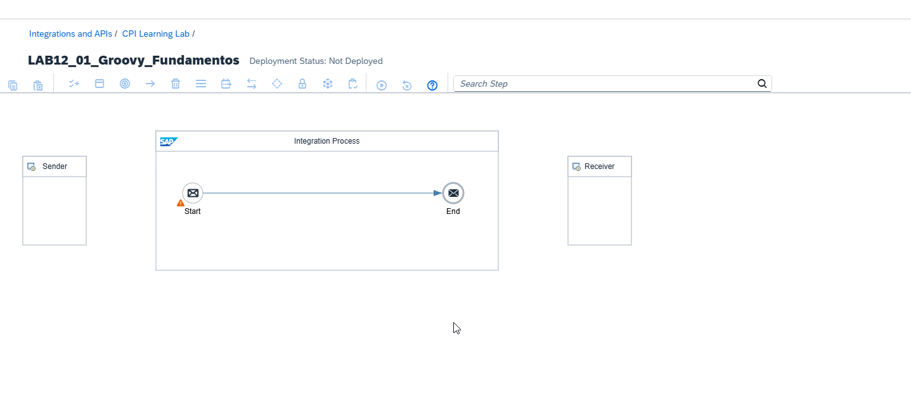

**Evidencia 12-02 — HTTPS Sender**
Endpoint y autorización de entrada.

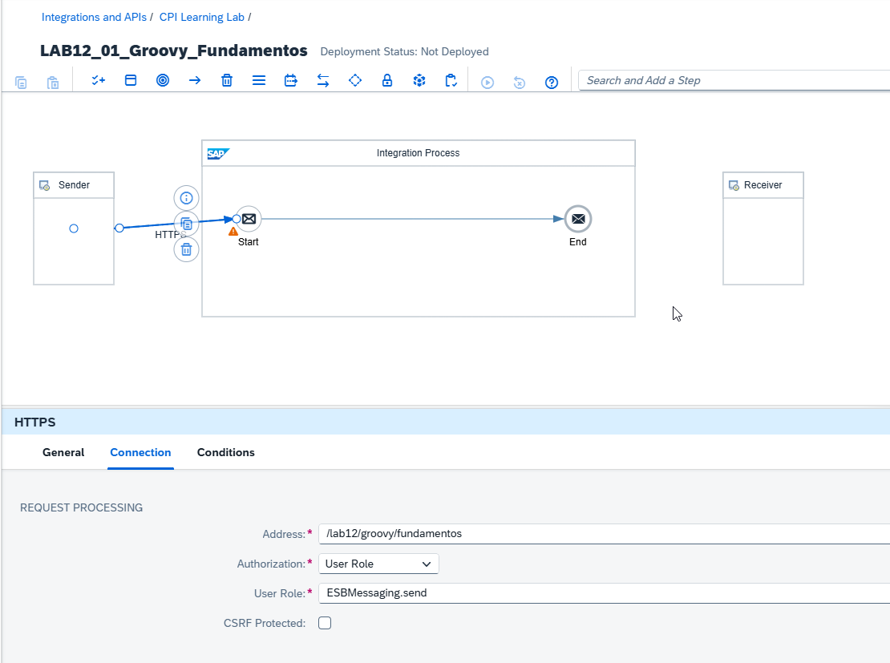

#### 2. Incorporar Groovy Script

Insertar un paso Groovy Script `Calcular Longitud Body`, crear el recurso `GRV_CalcularLongitudBody.groovy` y seleccionar la función `processData`.

```groovy
import com.sap.gateway.ip.core.customdev.util.Message

def Message processData(Message message) {
    String body = message.getBody(String)
    int longitud = body.length()
    message.setProperty("LongitudBody", longitud)
    return message
}
```

**Motivo:** `getBody(String)` obtiene el texto de entrada; `length()` cuenta sus caracteres y `setProperty` conserva el resultado para pasos posteriores sin sustituir el body original.

**Evidencia 12-05 — Recurso Groovy asociado**
Script `GRV_CalcularLongitudBody.groovy` y función `processData` configurados.

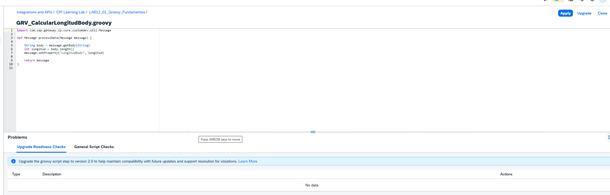

#### 3. Construir la respuesta con Content Modifier

Insertar `CM_Respuesta_Longitud` después de Groovy. En **Message Body**, seleccionar `Type = Expression` y configurar:

```json
{
  "laboratorio": "12.1",
  "longitudBody": "${property.LongitudBody}",
  "resultado": "Procesado con Groovy"
}
```

En **Message Header**, crear `Content-Type`, `Source Type = Constant`, `Source Value = application/json`. Si `Data Type` no es editable, dejarlo sin modificar.

**Motivo:** la expresión recupera la propiedad creada por Groovy y el header identifica el formato HTTP de salida. El tipo `Constant` en el body devolvería la expresión como texto literal.

**Evidencia 12-06 — Respuesta con Expression**
Content Modifier con sustitución de `${property.LongitudBody}`.

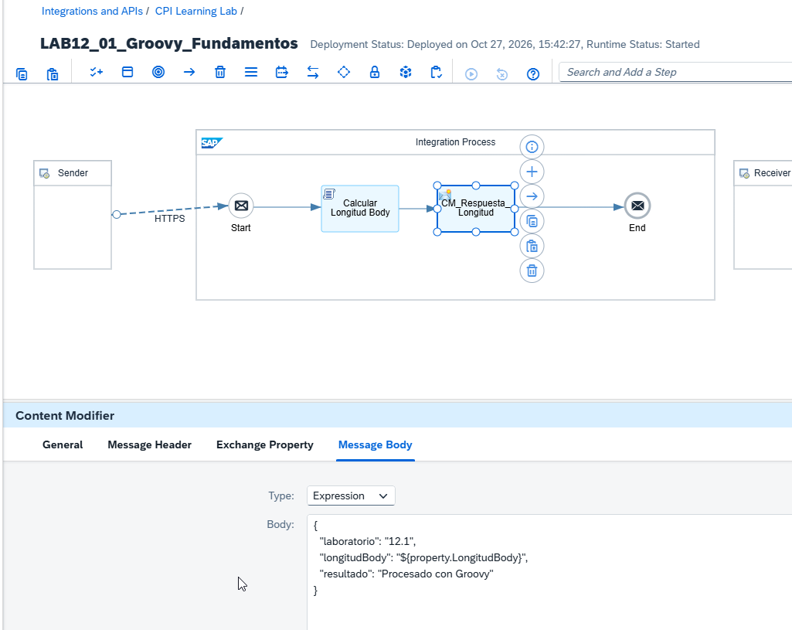

**Evidencia 12-07 — Header Content-Type**
Configuración del header de respuesta JSON.

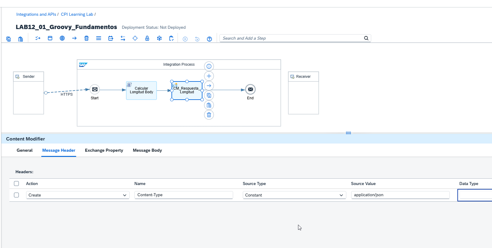

#### 4. Versionar y desplegar

Guardar la versión `1.0.1` y desplegar. En Manage Integration Content se comprobó el estado `Started` y el endpoint publicado.

**Evidencia 12-08 — Versión del iFlow**
Información de versión `1.0.1`.

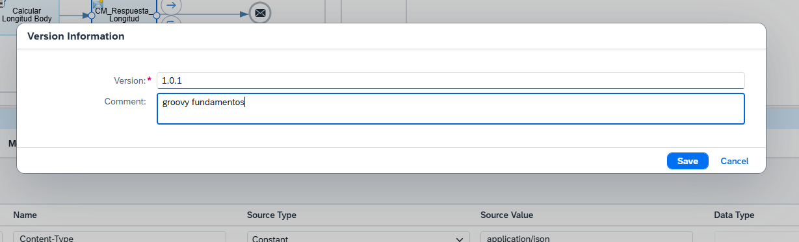

**Evidencia 12-09 — Despliegue exitoso**
Artefacto iniciado en el runtime.


#### 5. Ejecutar y validar con Postman

Crear la petición independiente `12.1 - Fundamentos de Groovy` dentro de `Lab 12 Groovy Script`, método POST, autenticación OAuth 2.0 y `Content-Type: application/json`.

Body utilizado (con formato multilínea en Postman):

```json
{
  "mensaje": "Hola Groovy"
}
```

**Motivo:** el script mide el body recibido como texto, incluidos espacios y saltos de línea. La longitud observada fue `33`, correspondiente al payload realmente enviado en la prueba, no a una versión compactada del JSON.

**Evidencia 12-10 — Organización de Postman**
Carpeta del capítulo y petición independiente 12.1.

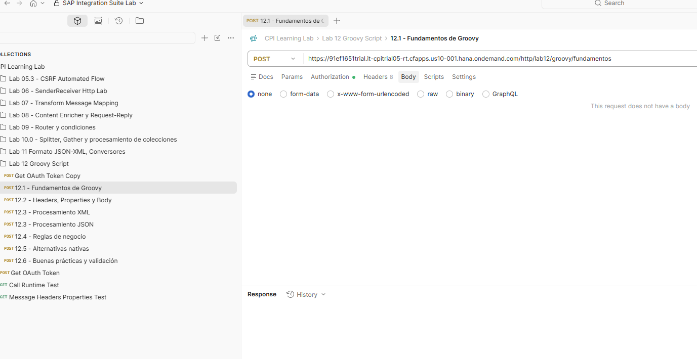

**Evidencia 12-11 — Respuesta calculada**
Postman recibió HTTP 200 y `longitudBody = "33"`.

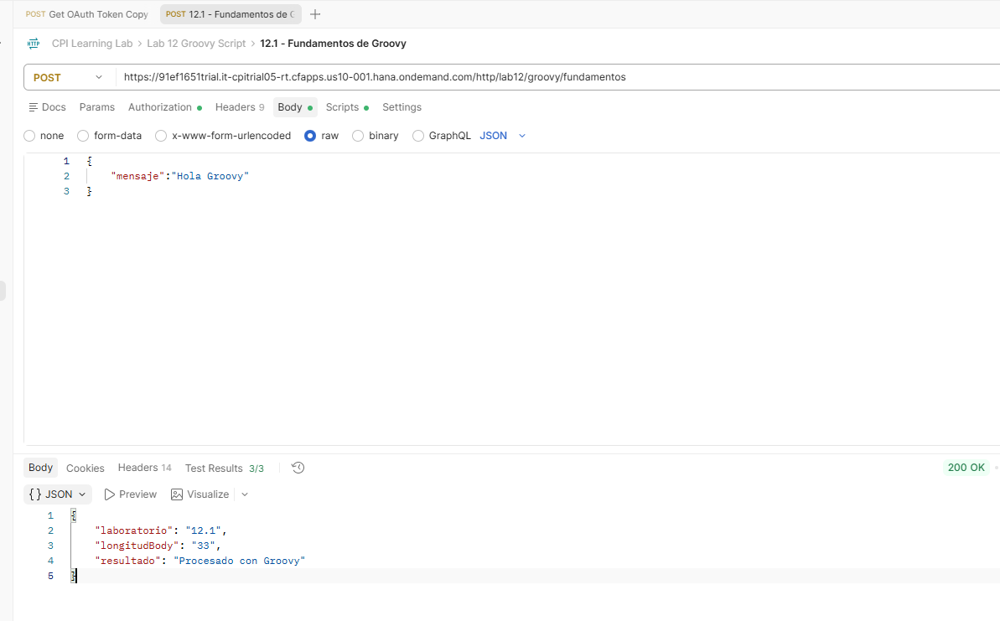

El test que compara la longitud de entrada con el valor devuelto es:

```javascript
pm.test("Groovy calcula correctamente la longitud", function () {
    const response = pm.response.json();
    const body = pm.request.body.raw;
    pm.expect(Number(response.longitudBody)).to.eql(body.length);
});
```

**Resultado validado:** HTTP `200 OK`; respuesta con `laboratorio = "12.1"`, `longitudBody = "33"` y `resultado = "Procesado con Groovy"`; **4/4 tests Postman exitosos**, incluido el cálculo de longitud.

**Evidencia 12-13 — Tests automáticos exitosos**
Comparación de la longitud real del request con la propiedad calculada por Groovy.

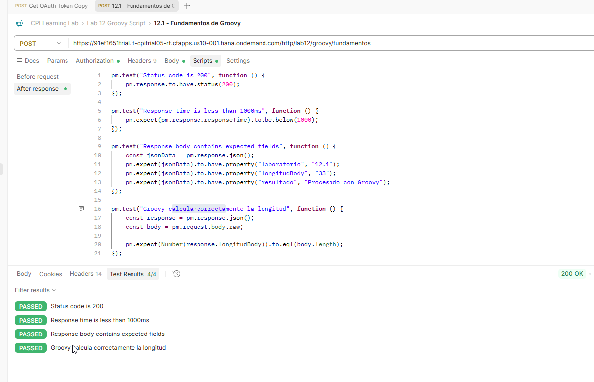

### Problemas encontrados y aprendizajes

- Para resolver `${property.LongitudBody}` dentro del body del Content Modifier fue necesario `Type = Expression`; `Constant` devolvía la referencia literalmente.
- El resultado depende del texto exacto enviado, incluidos espacios y saltos de línea.
- Para esta operación sencilla, Groovy es útil para aprender la API de mensajes, pero debe compararse con alternativas nativas antes de incorporarlo a un diseño productivo.

---

## 12.2 — Headers, Properties y Body

**Estado:** ✅ Completado
**iFlow:** `LAB12_02_Groovy_Headers_Properties_Body`
**Versión desplegada observada:** `1.0.1` (antes de ajustar Allowed Headers); la versión del despliegue posterior no quedó identificada en las capturas disponibles.
**Endpoint relativo:** `/http/lab12/groovy/headers-properties-body`
**Postman:** `Lab 12 Groovy Script / 12.2 - Headers, Properties y Body`

### Objetivo

Leer un header personalizado y el body de entrada, crear un header y dos Exchange Properties, transformar el body a mayúsculas y comprobar el resultado mediante una respuesta JSON.

### Laboratorio paso a paso

#### 1. Crear el iFlow y configurar HTTPS Sender

Crear `LAB12_02_Groovy_Headers_Properties_Body` con Start y End. Conectar HTTPS Sender:

| Parámetro | Valor |
|---|---|
| Address | `/lab12/groovy/headers-properties-body` |
| Authorization | `User Role` |
| User Role | `ESBMessaging.send` |
| CSRF Protected | Desactivado en este laboratorio |

**Motivo:** aislar la práctica de manipulación de mensajes sin modificar el iFlow del laboratorio 12.1.

**Evidencia 12-14 — iFlow inicial**
Nuevo artefacto antes de configurar el procesamiento.

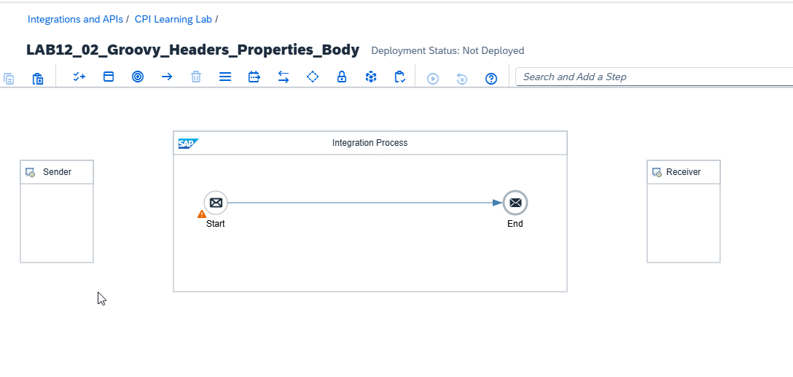

**Evidencia 12-15 — HTTPS Sender**
Dirección y permisos del endpoint 12.2.

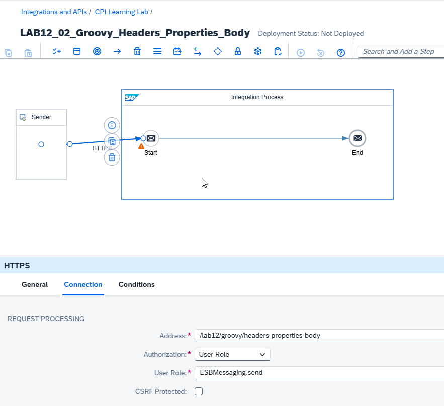

#### 2. Crear el recurso Groovy

Insertar el paso `Procesar Headers`, crear `GRV_ProcesarHeadersPropertiesBody.groovy` y asociarlo mediante la función `processData`.

```groovy
import com.sap.gateway.ip.core.customdev.util.Message

def Message processData(Message message) {
    String bodyOriginal = message.getBody(String)
    String origen = message.getHeader("X-Origen", String)
    if (!origen) {
        origen = "No informado"
    }
    message.setHeader("X-Procesado-Por", "Groovy")
    message.setProperty("OrigenPeticion", origen)
    message.setProperty("LongitudOriginal", bodyOriginal.length())
    message.setBody(bodyOriginal.toUpperCase())
    return message
}
```

**Motivo:** demostrar en un mismo paso la lectura y escritura de headers, el almacenamiento de datos internos en properties y la modificación del body.

**Evidencia 12-16 — Paso Groovy incorporado**
Componente entre Start y End.

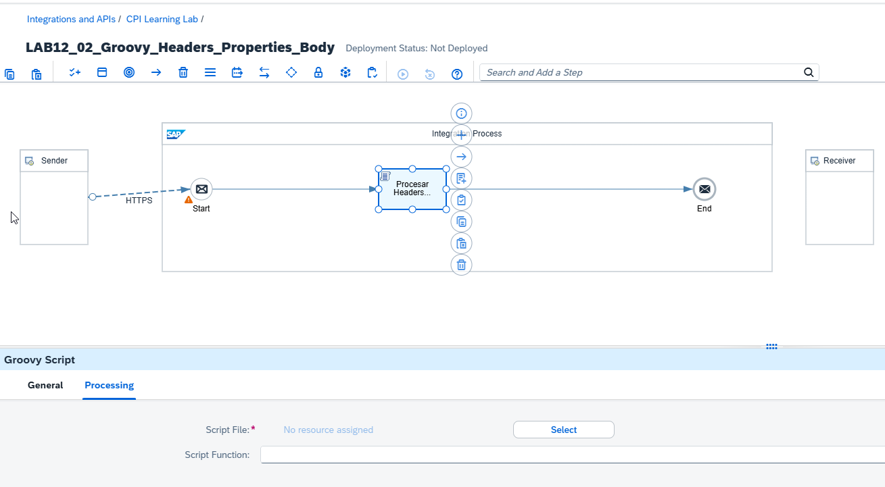

**Evidencia 12-17 — Código Groovy**
Script que procesa headers, properties y body.

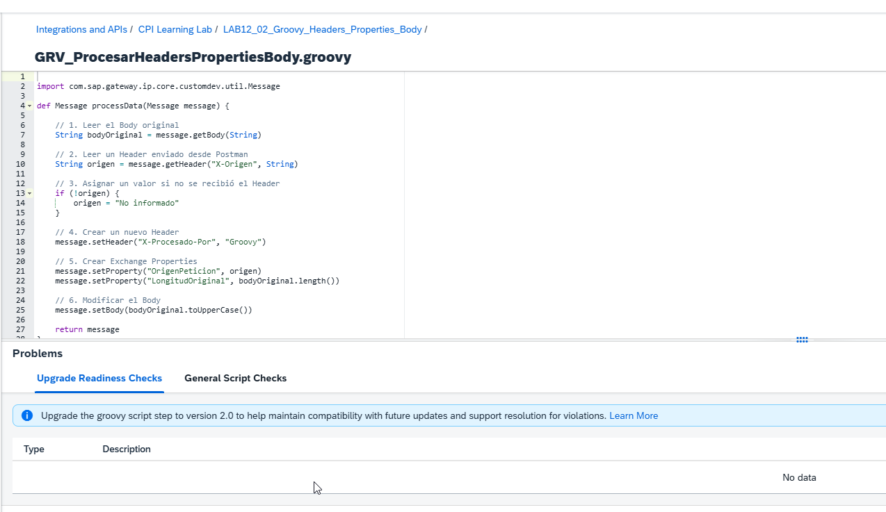

#### 3. Construir la respuesta JSON

Agregar `CM_Respuesta_Headers_Properties` después del script. En **Message Body** seleccionar `Type = Expression`:

```json
{
  "origen": "${property.OrigenPeticion}",
  "longitudOriginal": "${property.LongitudOriginal}",
  "procesadoPor": "${header.X-Procesado-Por}",
  "bodyTransformado": "${body}"
}
```

En **Message Header** crear `Content-Type = application/json` con `Source Type = Constant`.

**Motivo:** mostrar los datos internos en una respuesta HTTP sin añadir un segundo script. La interpolación directa de `${body}` es apropiada para el texto simple usado en esta prueba; para contenido arbitrario se necesita una serialización JSON segura.

**Evidencia 12-18 — Content Modifier de respuesta**
Body con expresiones para properties, header y mensaje transformado.

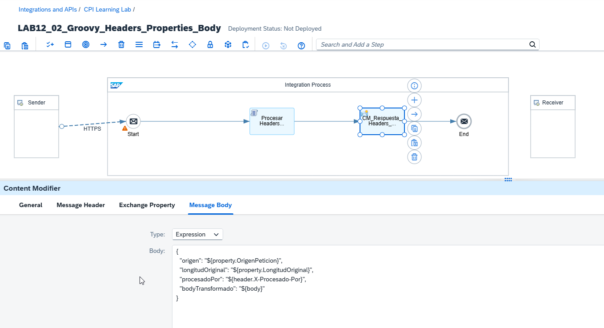

**Evidencia 12-19 — Header de respuesta**
Content-Type configurado como application/json.

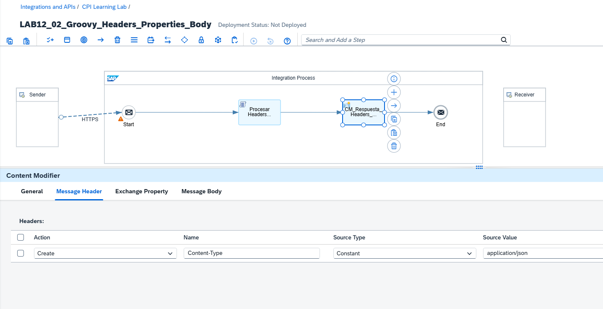

#### 4. Desplegar y permitir el header de entrada

El primer despliegue de la versión `1.0.1` quedó en `Started`. Para que el header HTTP personalizado `X-Origen` fuera accesible al script, se configuró en **Integration Flow → Runtime Configuration → Allowed Header(s)** el valor `X-Origen` y se comprobó nuevamente la ejecución.

**Motivo:** los headers HTTP personalizados no deben suponerse automáticamente disponibles en el contexto de mensaje; su propagación debe configurarse y verificarse.

**Evidencia 12-20 — Despliegue del iFlow**
Artefacto `LAB12_02_Groovy_Headers_Properties_Body` iniciado.

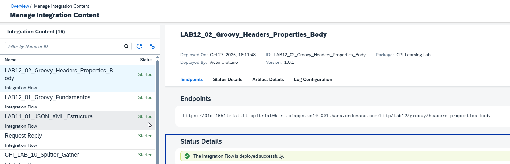

**Evidencia 12-21 — Procesamiento validado desde Postman**
Tras permitir el header `X-Origen`, la respuesta devuelve `origen = "Postman"`, longitud 15 y body en mayúsculas.

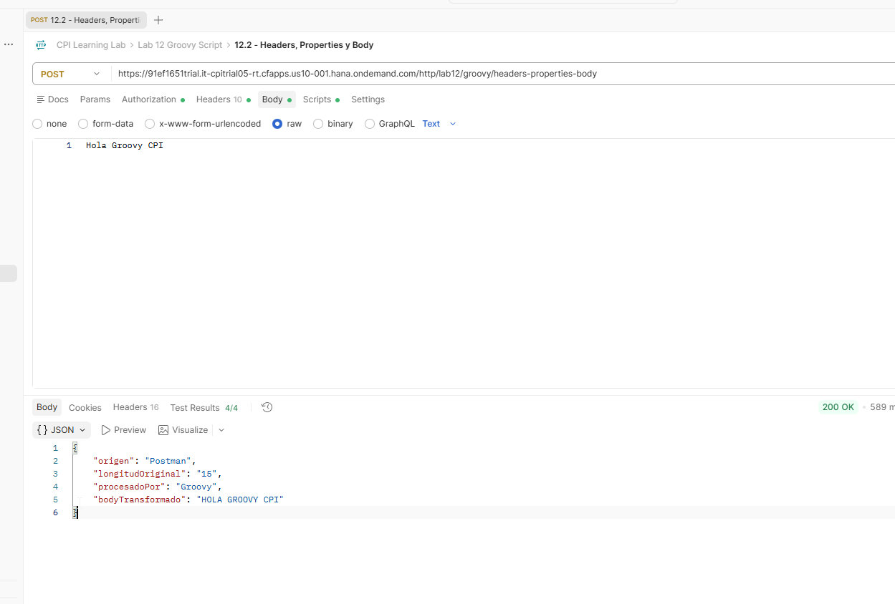

#### 5. Verificar con Postman

Enviar POST al endpoint 12.2, autenticado con OAuth 2.0, con:

| Elemento | Valor |
|---|---|
| Header `X-Origen` | `Postman` |
| Header `Content-Type` | `text/plain` |
| Body raw/Text | `Hola Groovy CPI` |

Respuesta observada:

```json
{
  "origen": "Postman",
  "longitudOriginal": "15",
  "procesadoPor": "Groovy",
  "bodyTransformado": "HOLA GROOVY CPI"
}
```

Los tests automáticos comprobaron el HTTP 200, el tiempo de respuesta inferior a 1000 ms, la igualdad entre `Number(response.longitudOriginal)` y `pm.request.body.raw.length`, además de los valores exactos de `origen`, `procesadoPor` y `bodyTransformado`.

**Resultado validado:** HTTP `200 OK` y **4/4 tests Postman exitosos**.

**Evidencia 12-22 — Tests Postman exitosos**
Aserciones de estado, latencia, longitud y valores de respuesta.

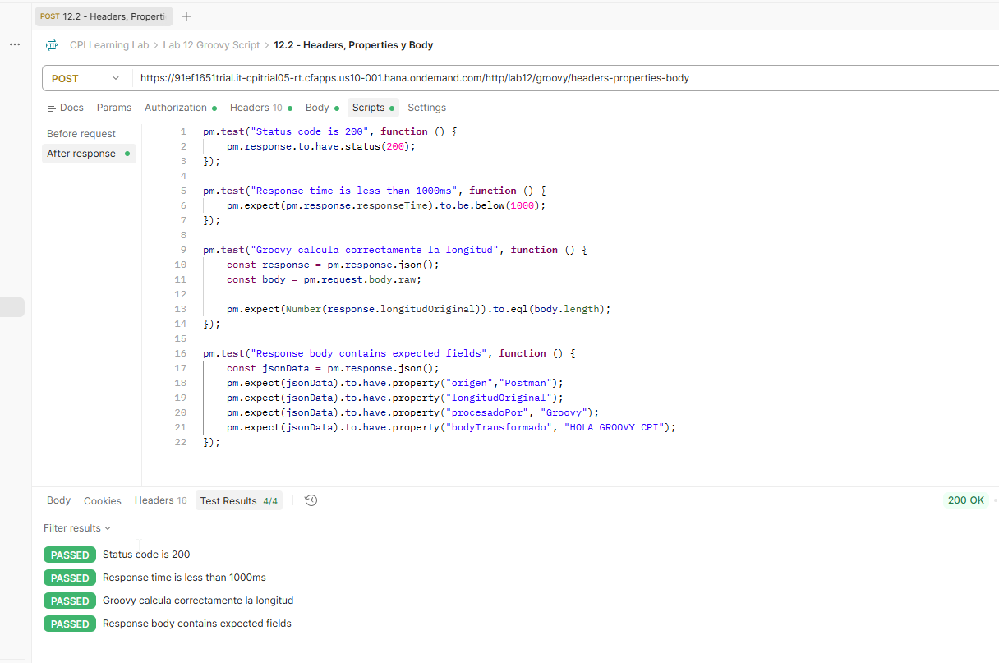

### Problemas encontrados y aprendizajes

- Sin incluir `X-Origen` en **Allowed Header(s)**, la ejecución devolvió `origen = "No informado"` pese a que Postman enviaba el header. Tras configurar la lista permitida, el valor observado fue `Postman`.
- Un HTTP 200 no demuestra que todos los campos del mensaje sean correctos: las aserciones deben comprobar los valores funcionales.
- Los Headers permiten transportar metadatos; las Exchange Properties conservan información durante el intercambio sin exponerse automáticamente al cliente HTTP.
- `Content Modifier` es suficiente para construir esta respuesta simple; el script se reservó para la manipulación programática que se quería estudiar.

---

## 12.3 (XML) — Procesamiento XML con Groovy

**Estado:** ✅ Completado
**iFlow:** `LAB12_03_Groovy_Procesamiento_XML`
**Versión runtime final observada:** `1.0.2`
**Postman:** petición independiente de procesamiento XML en `Lab 12 Groovy Script`.

### Objetivo y conceptos

Procesar un pedido XML mediante Groovy, leer elementos repetidos y calcular el importe total. Se utiliza `XmlSlurper` para recorrer la estructura y se devuelve una respuesta JSON. El ejercicio permite comparar el acceso a nodos XML con el acceso a objetos JSON del laboratorio siguiente.

### Laboratorio y resultado comprobado

1. Crear y configurar un iFlow independiente con HTTPS Sender autenticado, sin modificar los laboratorios anteriores.
2. Incorporar un paso Groovy con el recurso de procesamiento XML, utilizando `XmlSlurper` para leer `Pedido`, `Id`, `Cliente` y los elementos `Producto`.
3. Para cada producto, multiplicar `Precio` por `Cantidad` y acumular el resultado. Construir una respuesta JSON con `idPedido`, `cliente` y `totalPedido`.
4. Guardar y desplegar; comprobar el estado `Started` del artefacto. La versión final observada fue `1.0.2`.
5. Enviar desde Postman un pedido XML con identificador `1001`, cliente `Empresa Demo` y tres productos: 15000 × 2, 8500 × 3 y 12000 × 1.
6. Verificar respuesta HTTP 200, total calculado y aserciones automatizadas.

**Entrada utilizada:**

```xml
<Pedido>
  <Id>1001</Id>
  <Cliente>Empresa Demo</Cliente>
  <Productos>
    <Producto><Precio>15000</Precio><Cantidad>2</Cantidad></Producto>
    <Producto><Precio>8500</Precio><Cantidad>3</Cantidad></Producto>
    <Producto><Precio>12000</Precio><Cantidad>1</Cantidad></Producto>
  </Productos>
</Pedido>
```

**Respuesta observada:**

```json
{
  "idPedido": "1001",
  "cliente": "Empresa Demo",
  "totalPedido": "67500"
}
```

**Validación:** despliegue `Started`, HTTP `200 OK` y **4/4 tests Postman exitosos**.

**Evidencias 12-32 y 12-33 — Corrección del script y despliegue XML**
Se verificaron la corrección del recurso Groovy y el despliegue final `Started`. Las referencias a imágenes de estos dos pasos se incorporarán cuando se confirme el nombre exacto de cada archivo en `docs/images/tema-12/`.

**Evidencia 12-34 — Respuesta XML procesada desde Postman**
La respuesta JSON contiene el pedido `1001`, el cliente y el total `67500`.

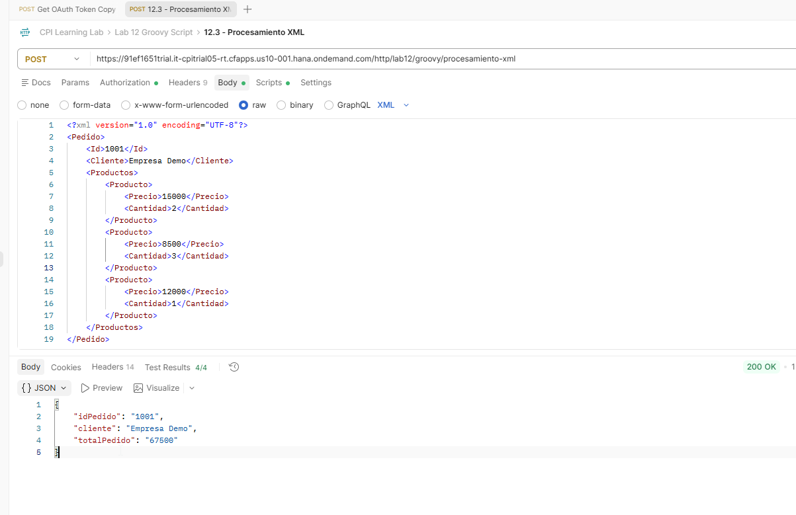

**Evidencia 12-35 — Tests de procesamiento XML**
Cuatro comprobaciones automatizadas exitosas.

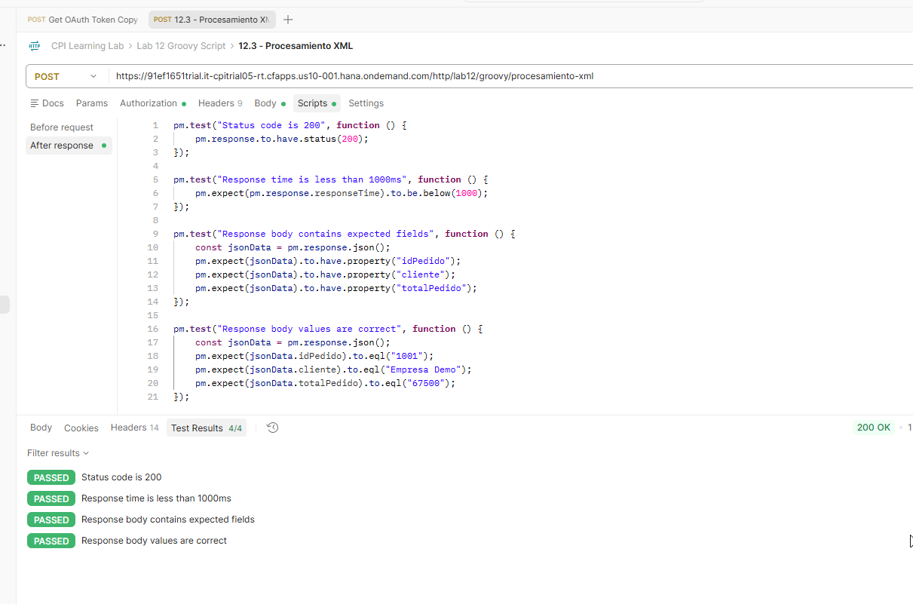

### Problemas encontrados y aprendizajes

Durante el ajuste del script XML se requirió una corrección de lectura de los datos y un nuevo despliegue. El resultado final fue verificado con Postman. La estructura XML utiliza nodos repetidos para los productos y sus valores se leen inicialmente como texto; por ello, el cálculo requiere conversión numérica explícita. La respuesta validada presenta `totalPedido` como cadena JSON, a diferencia del ejercicio JSON posterior.

---

## 12.3 (JSON) — Procesamiento JSON con Groovy

**Estado:** ✅ Completado
**iFlow:** `LAB12_03_Groovy_Procesamiento_JSON`
**Versión runtime observada:** `1.0.0`
**Endpoint relativo:** `/http/lab12/groovy/procesamiento-json`
**Postman:** `Lab 12 Groovy Script / 12.3 - Procesamiento JSON`.

### Objetivo y conceptos

Procesar el mismo pedido del laboratorio XML, esta vez como JSON, utilizando `JsonSlurper`, cálculo decimal con `BigDecimal` y serialización mediante `JsonOutput`. Se compara la preservación de tipos de datos con los resultados de los conversores estándar del capítulo 11.

### Laboratorio paso a paso

1. Crear el iFlow independiente `LAB12_03_Groovy_Procesamiento_JSON` dentro de `CPI Learning Lab`, sin alterar el iFlow XML.

   **Evidencia 12-36 — iFlow JSON inicial**
   Artefacto creado, todavía sin desplegar.

   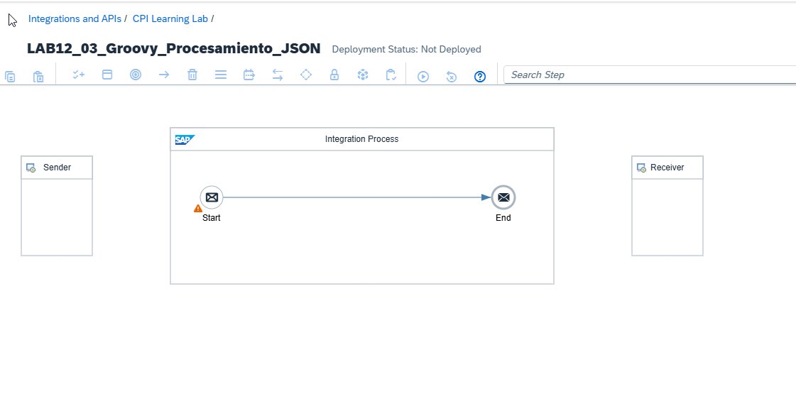

2. Configurar HTTPS Sender con `Address = /lab12/groovy/procesamiento-json`, `Authorization = User Role`, `User Role = ESBMessaging.send` y `CSRF Protected` desactivado para esta prueba autenticada.

   **Motivo:** exponer un endpoint separado para comparar formatos sin afectar los ejercicios anteriores.

   **Evidencia 12-37 — HTTPS Sender JSON**
   Dirección, autorización y protección CSRF configuradas.

   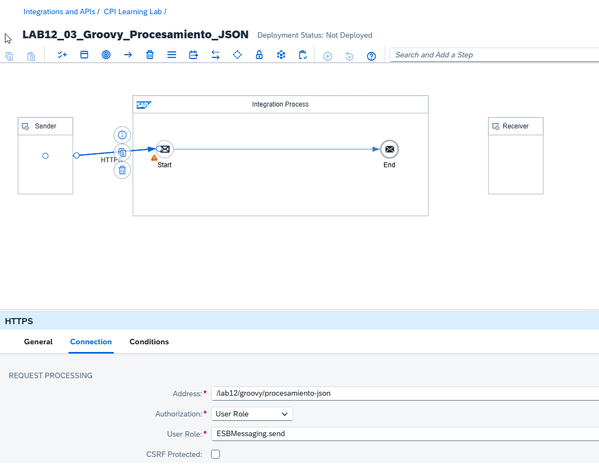

3. Insertar el componente Groovy Script `Procesar Pedido JSON` entre Start y End y crear el recurso `GRV_ProcesarPedidoJSON.groovy`.

   **Evidencia 12-38 — Componente Groovy JSON**
   Paso de procesamiento incorporado al flujo.

   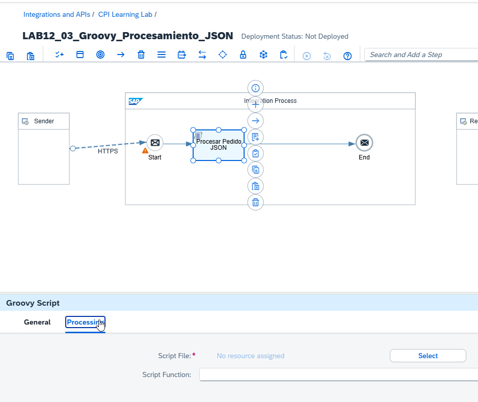

4. Implementar el procesamiento con lectura del body mediante `Reader`, cálculo de importes con `BigDecimal` y generación de JSON con `JsonOutput`:

   ```groovy
   import com.sap.gateway.ip.core.customdev.util.Message
   import groovy.json.JsonSlurper
   import groovy.json.JsonOutput

   def Message processData(Message message) {
       def pedido = new JsonSlurper().parse(
           message.getBody(java.io.Reader)
       )

       BigDecimal total = 0
       pedido.productos.each { producto ->
           BigDecimal precio = new BigDecimal(producto.precio.toString())
           BigDecimal cantidad = new BigDecimal(producto.cantidad.toString())
           total += precio * cantidad
       }

       def respuesta = [
           idPedido: pedido.id.toString(),
           cliente: pedido.cliente,
           totalPedido: total
       ]

       message.setBody(JsonOutput.toJson(respuesta))
       message.setHeader("Content-Type", "application/json")
       return message
   }
   ```

   **Motivo:** `Reader` evita crear explícitamente una cadena intermedia antes del parseo; `JsonSlurper` sigue construyendo el objeto JSON en memoria. `BigDecimal` permite el cálculo decimal y `JsonOutput` serializa el resultado sin convertir el total a texto.

   **Validación de diseño:** el editor dejó de mostrar la observación de `General Script Checks` tras utilizar `Reader`.

   **Evidencia 12-39 — Código Groovy JSON**
   Recurso de script y lógica de cálculo.

   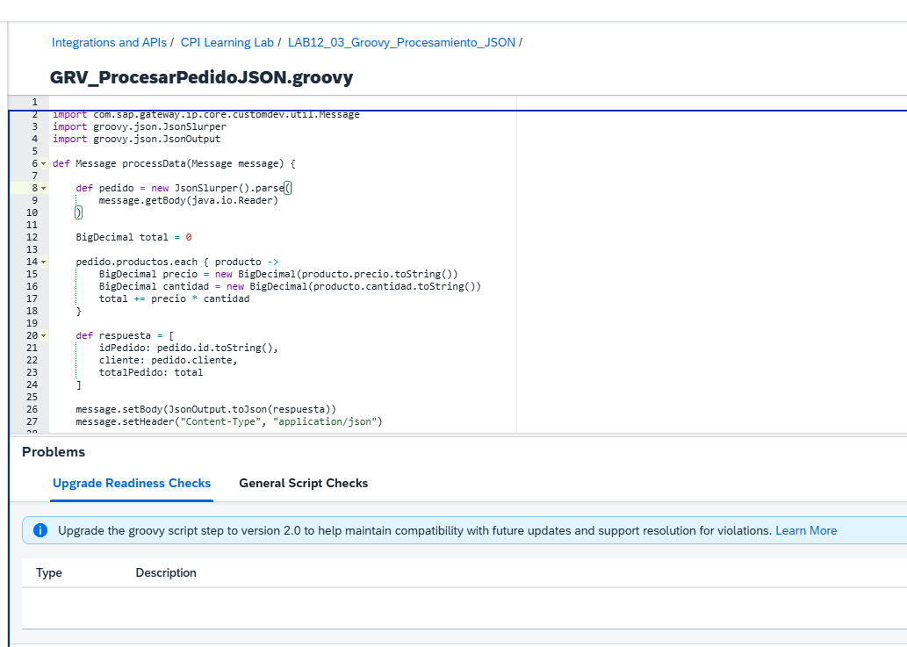

5. Asociar `/script/GRV_ProcesarPedidoJSON.groovy` al paso con `Script Function = processData`.

   **Evidencia 12-40 — Recurso asociado**
   Asociación del archivo y de la función ejecutable.

   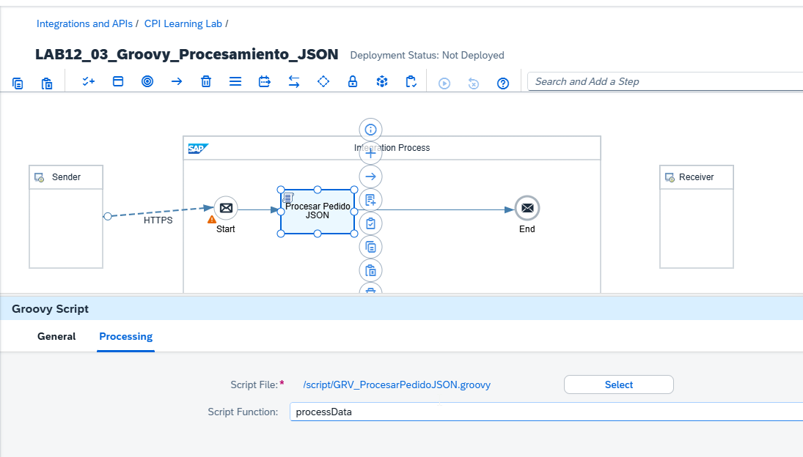

6. Guardar y desplegar el iFlow. Se observó `Started`, versión `1.0.0`, sin necesidad de un Content Modifier adicional, pues Groovy construye el body y define el header de respuesta.

   **Evidencia 12-41 — Despliegue JSON**
   Estado `Started`, versión y endpoint del artefacto.

   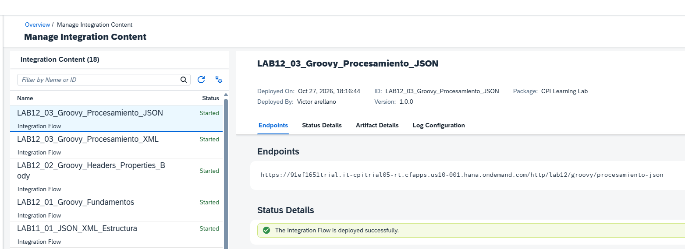

7. Crear la petición Postman `12.3 - Procesamiento JSON` con método POST, autenticación OAuth 2.0 Client Credentials y `Content-Type: application/json`. Enviar:

   ```json
   {
     "id": 1001,
     "cliente": "Empresa Demo",
     "productos": [
       {"precio": 15000, "cantidad": 2},
       {"precio": 8500, "cantidad": 3},
       {"precio": 12000, "cantidad": 1}
     ]
   }
   ```

   **Respuesta observada:** HTTP `200 OK`.

   ```json
   {
     "idPedido": "1001",
     "cliente": "Empresa Demo",
     "totalPedido": 67500
   }
   ```

   **Evidencia 12-42 — Respuesta Postman JSON**
   Pedido procesado y total `67500` devuelto como número JSON.

   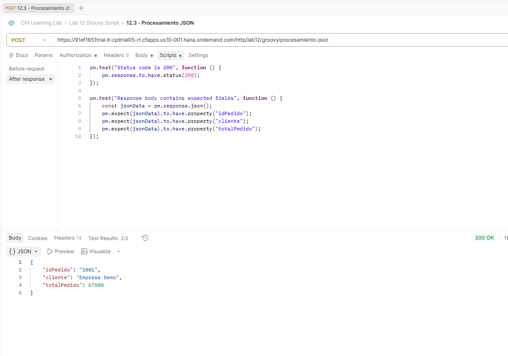

8. Ejecutar las pruebas de Postman sobre el código HTTP, los campos esperados y los tipos. La ejecución inicial aprobó **4/4 tests**. Después se comprobó también el valor exacto del total, el identificador y el cliente mediante un test adicional, con resultado **4/4** en la configuración final (sustituyendo la prueba de tiempo de respuesta).

   **Evidencia 12-43 — Tests Postman JSON**
   Validación de respuesta y aserciones automáticas. Esta evidencia se conserva como única captura de tests; no se duplica la imagen de la comprobación posterior.

   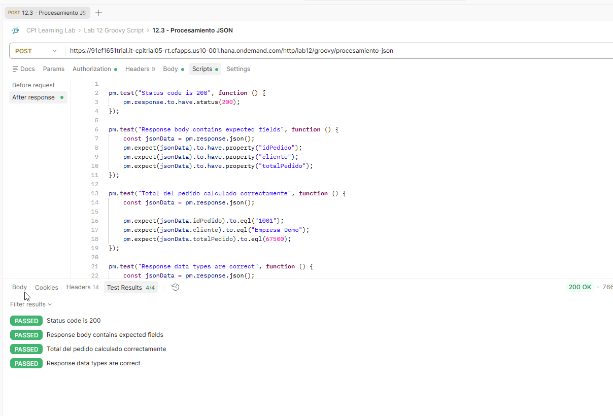

### Resultado, problemas encontrados y aprendizajes

El procesamiento JSON quedó validado con HTTP 200, respuesta con los tres campos esperados, `totalPedido = 67500` como número JSON y tests Postman exitosos. Se atendió una observación del editor sobre el uso de `JsonSlurper` con `String` antes del despliegue, cambiando a `Reader`. No se requirió una nueva versión ni se produjo un error de runtime durante la validación final. A diferencia del procesamiento XML documentado, el total del JSON se devolvió como número, lo que permite verificar su tipo directamente.

---


## 12.4 — Reglas de negocio con Groovy

**Estado:** ✅ Completado
**iFlow:** `LAB12_04_Groovy_Reglas_Negocio`
**Versión desplegada observada:** `1.0.1`
**Endpoint relativo:** `/http/lab12/groovy/reglas-negocio`
**Postman:** carpeta `Lab 12 Groovy Script`, cuatro peticiones independientes para 0 %, 5 %, 10 % y rechazo.

### Objetivo y conceptos

Aplicar reglas condicionales a un pedido JSON, calcular el total y los descuentos con `BigDecimal`, validar que exista una lista de productos y generar respuestas JSON con `JsonSlurper` y `JsonOutput`. El procesamiento se realiza en un Groovy Script para contrastarlo después con alternativas nativas.

### Prerrequisitos

iFlows y autenticación HTTPS/OAuth operativos; lectura de JSON con `Reader` y cálculo de importes practicados en 12.3.

### Laboratorio paso a paso

#### 1. Crear el iFlow

Crear `LAB12_04_Groovy_Reglas_Negocio` en `CPI Learning Lab` con Start → End, sin modificar el iFlow del laboratorio 12.3.

**Evidencia 12-44 — iFlow creado.** Se observa el nuevo artefacto antes del despliegue.

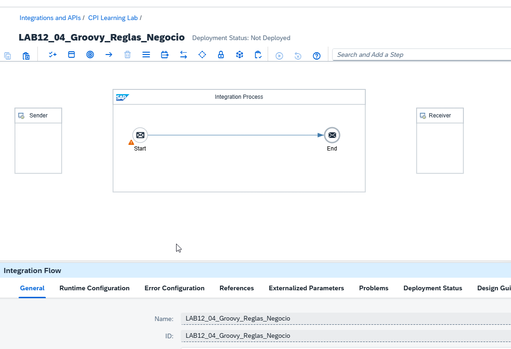

#### 2. Configurar el HTTPS Sender

Conectar Sender con Start mediante HTTPS, dirección `/lab12/groovy/reglas-negocio`, autorización `User Role`, rol `ESBMessaging.send` y CSRF desactivado para el ejercicio autenticado.

**Motivo:** exponer una ruta independiente para ejecutar pedidos desde Postman.

**Evidencia 12-45 — HTTPS Sender.** Dirección y autorización configuradas.

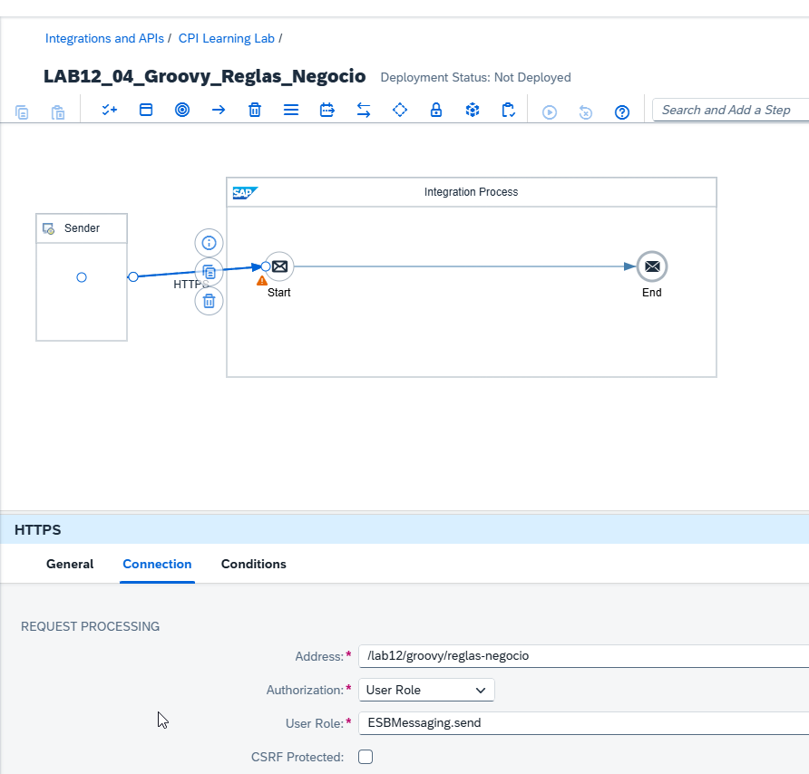

#### 3. Incorporar Groovy Script

Insertar el componente `Evaluar Reglas Negocio` entre Start y End. Crear el recurso `GRV_EvaluarReglasNegocio.groovy`.

**Evidencia 12-46 — Paso Groovy.** Componente incorporado al flujo.

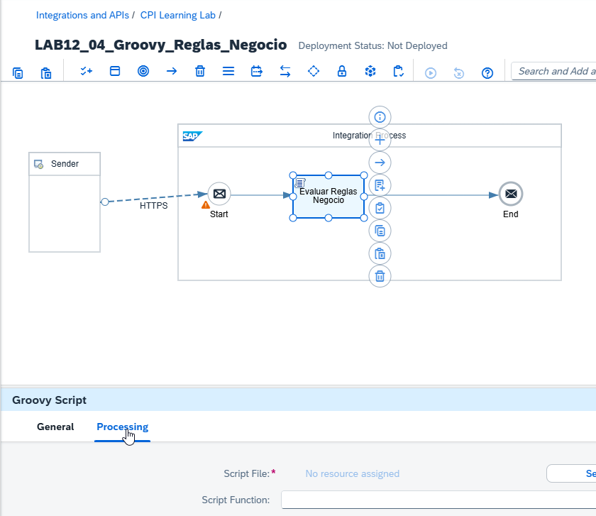

#### 4. Implementar las reglas

Usar el siguiente script:

```groovy
import com.sap.gateway.ip.core.customdev.util.Message
import groovy.json.JsonSlurper
import groovy.json.JsonOutput

def Message processData(Message message) {
    def pedido = new JsonSlurper().parse(message.getBody(java.io.Reader))
    def productos = pedido.productos

    if (!(productos instanceof List) || productos.isEmpty()) {
        def respuesta = [
            estado: "RECHAZADO",
            motivo: "El pedido debe contener productos"
        ]
        message.setBody(JsonOutput.toJson(respuesta))
        message.setHeader("Content-Type", "application/json")
        message.setHeader("CamelHttpResponseCode", 400)
        return message
    }

    BigDecimal total = BigDecimal.ZERO
    productos.each { producto ->
        BigDecimal precio = new BigDecimal(producto.precio.toString())
        BigDecimal cantidad = new BigDecimal(producto.cantidad.toString())
        total += precio * cantidad
    }

    BigDecimal porcentaje = BigDecimal.ZERO
    if (total >= 100000) {
        porcentaje = 0.10G
    } else if (total >= 50000) {
        porcentaje = 0.05G
    }

    BigDecimal descuento = total * porcentaje
    BigDecimal totalFinal = total - descuento
    def respuesta = [
        idPedido: pedido.id,
        cliente: pedido.cliente,
        estado: "APROBADO",
        totalOriginal: total,
        porcentajeDescuento: porcentaje * 100,
        descuento: descuento,
        totalFinal: totalFinal
    ]
    message.setBody(JsonOutput.toJson(respuesta))
    message.setHeader("Content-Type", "application/json")
    return message
}
```

**Motivo:** `Reader` permite leer el JSON sin materializar previamente una cadena adicional; `BigDecimal` evita el uso de aritmética binaria de punto flotante para importes. Los umbrales son reglas didácticas. El script presupone precios y cantidades numéricos válidos; la validación exhaustiva de entradas se tratará en el capítulo de errores.

**Evidencia 12-47 — Código Groovy.** Recurso con reglas de descuento y rechazo.

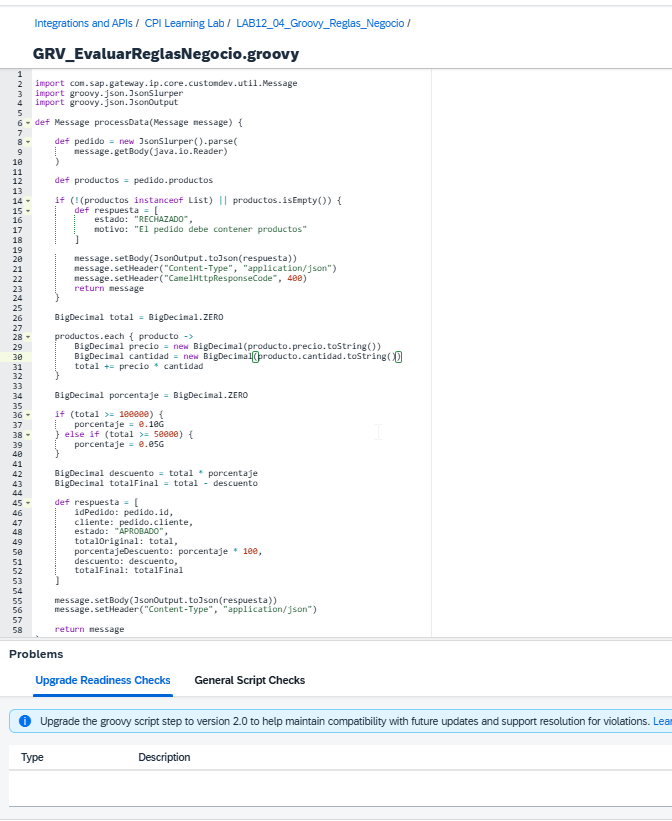

#### 5. Asociar el recurso y desplegar

En el paso Groovy, seleccionar `/script/GRV_EvaluarReglasNegocio.groovy` y función `processData`. Guardar y desplegar. En Manage Integration Content se observó estado `Started` y versión `1.0.1`.

**Evidencia 12-48 — Recurso asociado.** Script File y Script Function configurados.

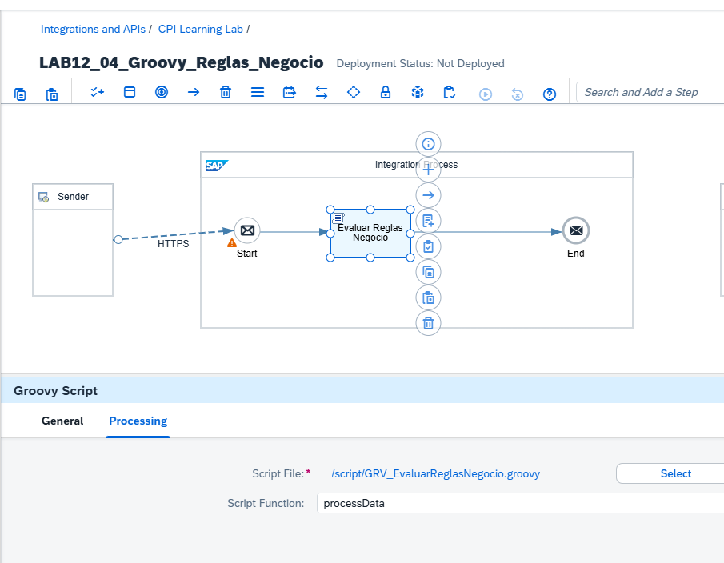

**Evidencia 12-49 — Despliegue.** iFlow iniciado y endpoint publicado.

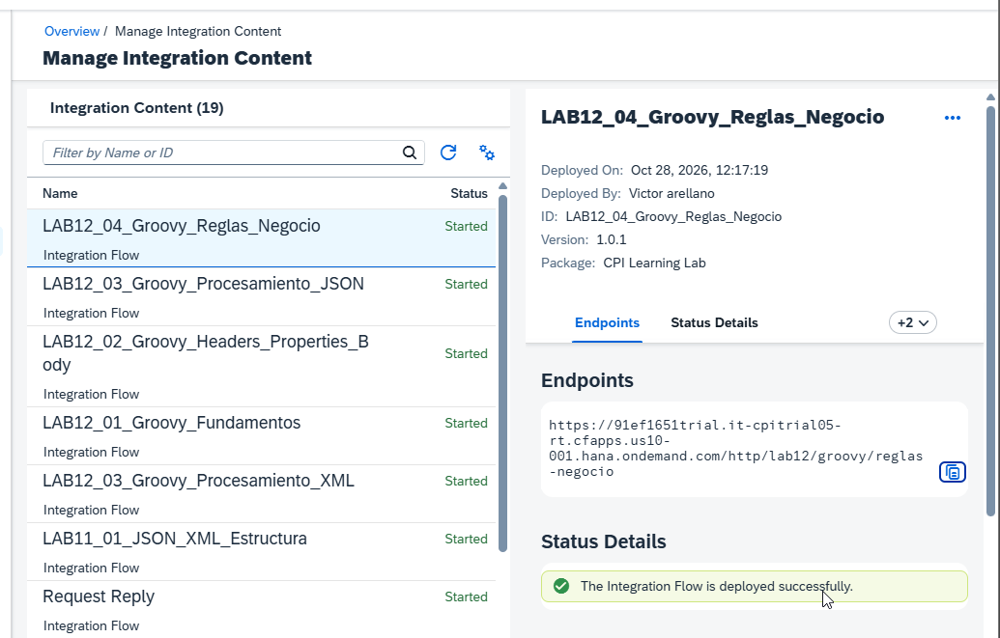

#### 6. Validar reglas con Postman

Enviar peticiones POST autenticadas, `Content-Type: application/json`, con los siguientes escenarios:

| Escenario | Entrada representativa | HTTP | Resultado observado | Tests |
|---|---|---|---|---|
| Descuento 5 % | Productos 15000×2, 8500×3, 12000×1 | 200 | Total 67500; descuento 3375; total final 64125 | 3/3 |
| Descuento 10 % | Productos 40000×2, 20000×2 | 200 | Total 120000; descuento 12000; total final 108000 | 3/3 |
| Sin productos | `"productos": []` | 400 | `RECHAZADO`; motivo `El pedido debe contener productos` | 2/2 |
| Sin descuento | Productos 10000×2, 5000×3 | 200 | Total 35000; descuento 0; total final 35000 | 2/2 |

**Evidencia 12-50 — Descuento 5 %.** Respuesta HTTP 200 y cálculo de 64125.

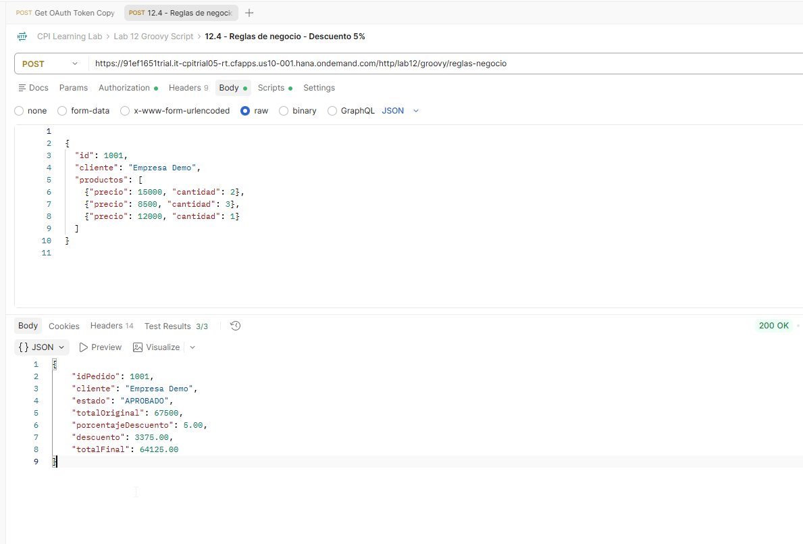

**Evidencia 12-51 — Tests del 5 %.** Tres pruebas Postman aprobadas.

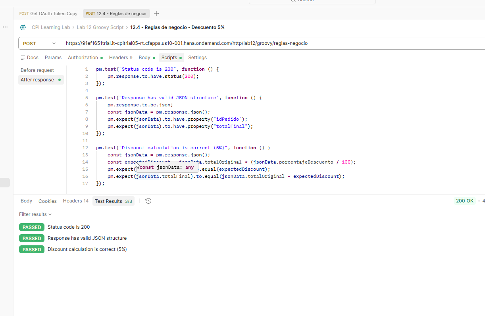

**Evidencia 12-52 — Descuento 10 %.** Respuesta HTTP 200 y cálculo de 108000.

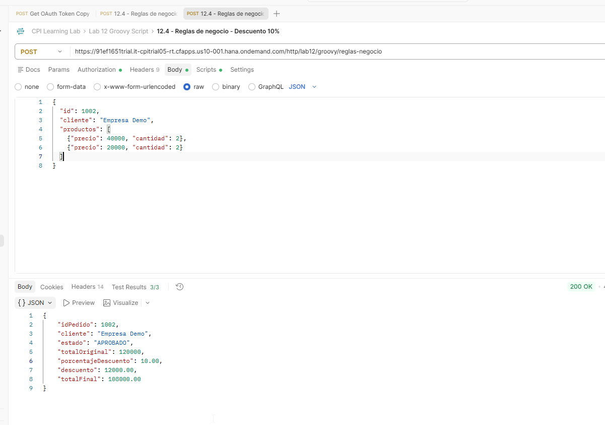

**Evidencia 12-53 — Tests del 10 %.** Tres pruebas Postman aprobadas.

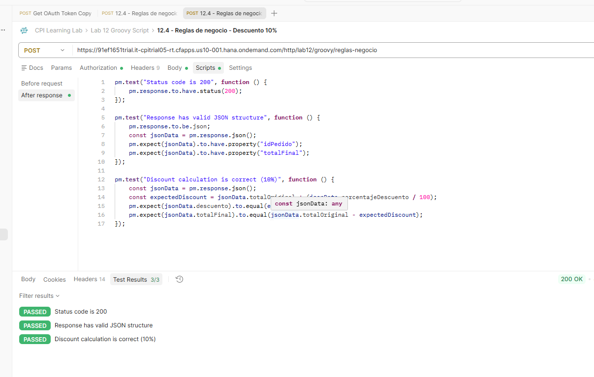

**Evidencia 12-54 — Pedido sin productos.** HTTP 400 y rechazo funcional.

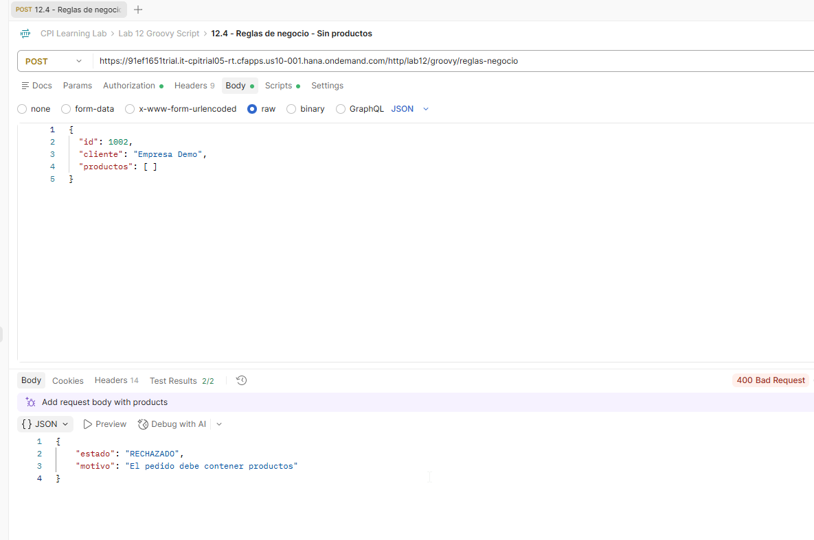

**Evidencia 12-55 — Tests del rechazo.** Dos pruebas Postman aprobadas.

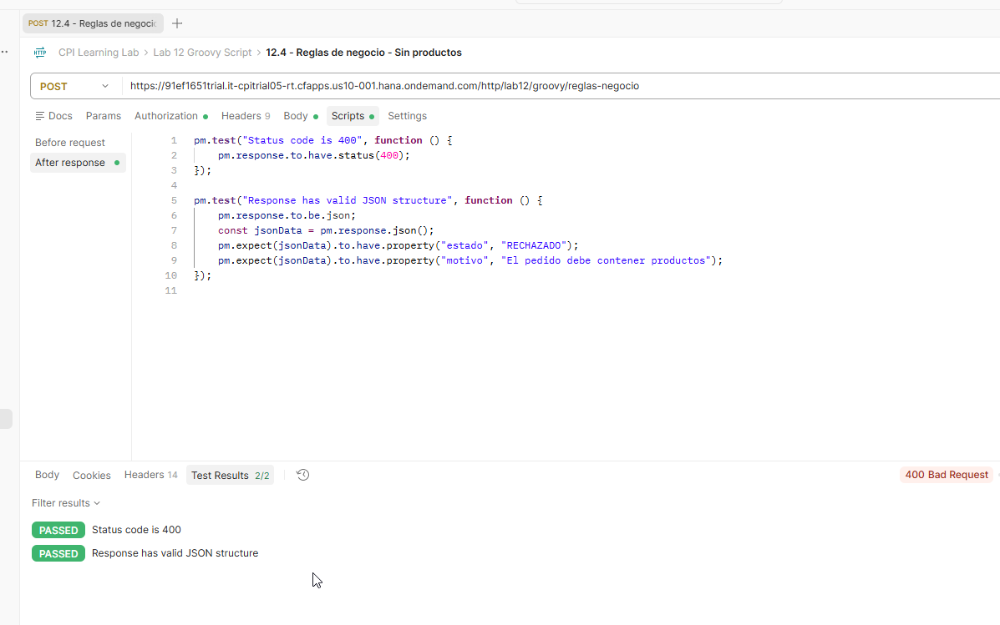

**Evidencia 12-56 — Pedido sin descuento.** HTTP 200, total final 35000.

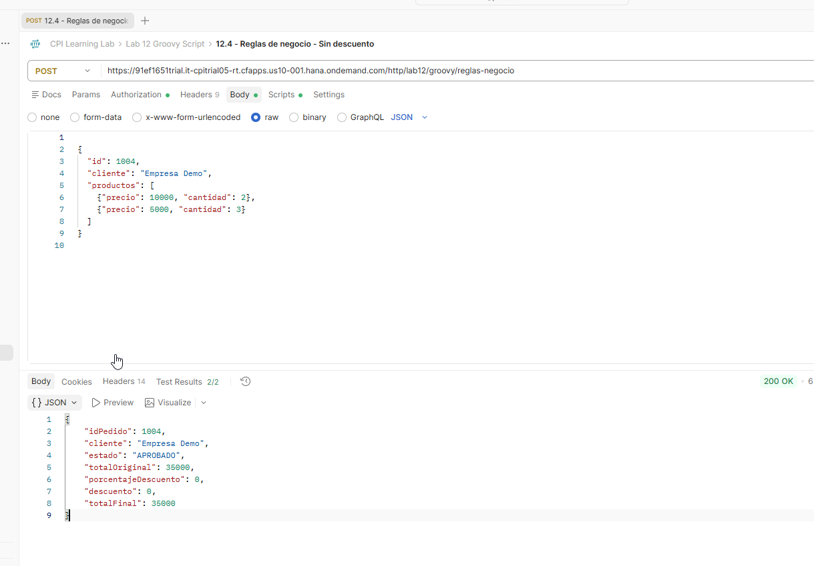

**Evidencia 12-57 — Tests sin descuento.** Dos pruebas Postman aprobadas. Estas pruebas comprueban estado HTTP y estructura JSON; los importes se verificaron en la respuesta.

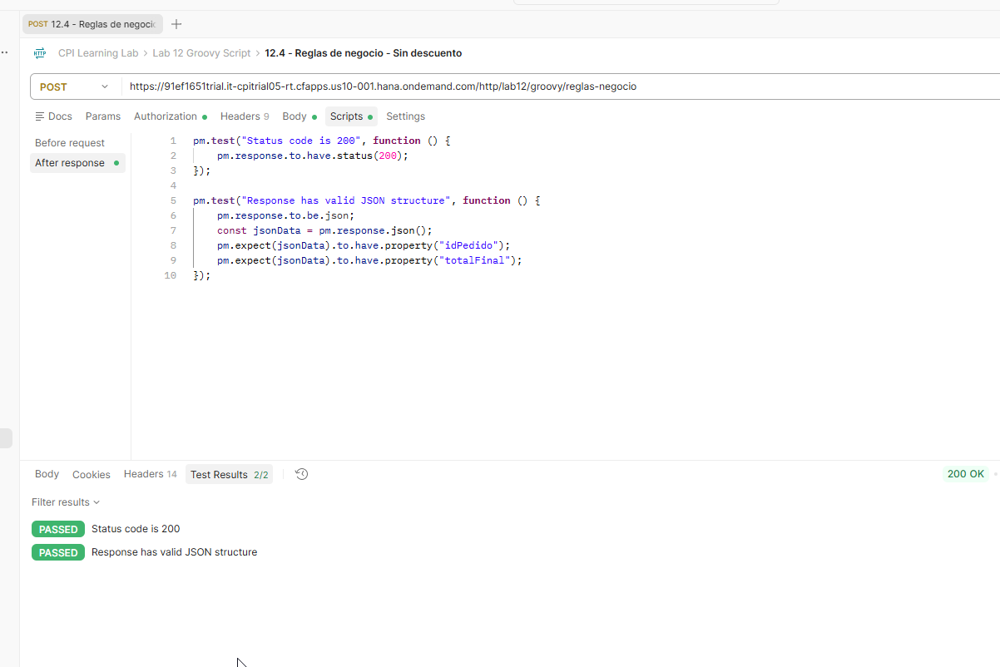

### Resultado esperado y validación

Los tres tramos de descuento y el rechazo de una lista vacía fueron ejecutados y comprobados. **Estado: ✅ Completado.**

### Problemas encontrados y aprendizajes

El ejercicio diferencia validaciones de negocio (lista vacía) de errores técnicos que requerirían manejo adicional. La respuesta HTTP 200 por sí sola no acredita que el descuento sea correcto: se contrastaron valores y aserciones Postman. El script requiere un esquema de entrada consistente.

---

## 12.5 — Alternativas nativas a Groovy

**Estado:** ✅ Completado
**iFlow:** `LAB12_05_Alternativas_Nativas`
**Versión desplegada observada:** `1.0.1`
**Endpoint relativo:** `/http/lab12/alternativas-nativas`
**Postman:** `Lab 12 Groovy Script`, peticiones independientes de pedido prioritario y normal.

### Objetivo y conceptos

Clasificar pedidos sin Groovy, utilizando JSON to XML Converter, Router con condición XPath y Content Modifier para generar respuestas JSON. A diferencia del 12.4, el pedido **ya incluye `totalPedido`**: aquí se evalúa una clasificación, no se calculan descuentos.

### Prerrequisitos

Conocimientos previos de conversión JSON/XML, XPath, Router, Content Modifier y HTTPS Sender.

### Laboratorio paso a paso

#### 1. Crear el iFlow y configurar HTTPS

Crear `LAB12_05_Alternativas_Nativas` en `CPI Learning Lab`, inicialmente Start → End. Configurar HTTPS Sender con dirección `/lab12/alternativas-nativas`, `User Role`, rol `ESBMessaging.send` y CSRF desactivado para el laboratorio autenticado.

**Motivo:** mantener separado el ejercicio de componentes nativos y poder comparar soluciones sin modificar el 12.4.

**Evidencia 12-58 — iFlow inicial.** Artefacto creado.

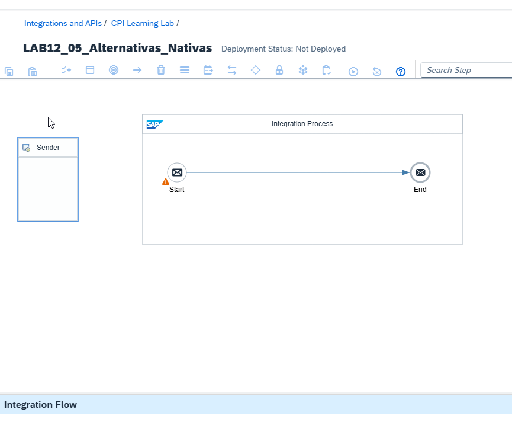

**Evidencia 12-59 — HTTPS Sender.** Endpoint y autorización configurados.

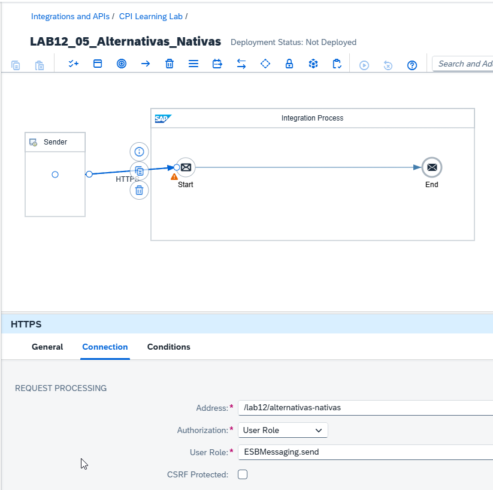

#### 2. Convertir JSON a XML

Insertar `Convertir Pedido JSON a XML`, con `Add XML Root Element` activado y nombre de raíz `root`, sin namespace mapping.

Para el mensaje `{"idPedido":1005,"totalPedido":67500}`, la estructura esperada permite acceder al importe mediante `/root/totalPedido`.

**Motivo:** evaluar el campo con XPath desde un Router nativo.

**Evidencia 12-60 — JSON to XML Converter.** Conversor y raíz `root` configurados.

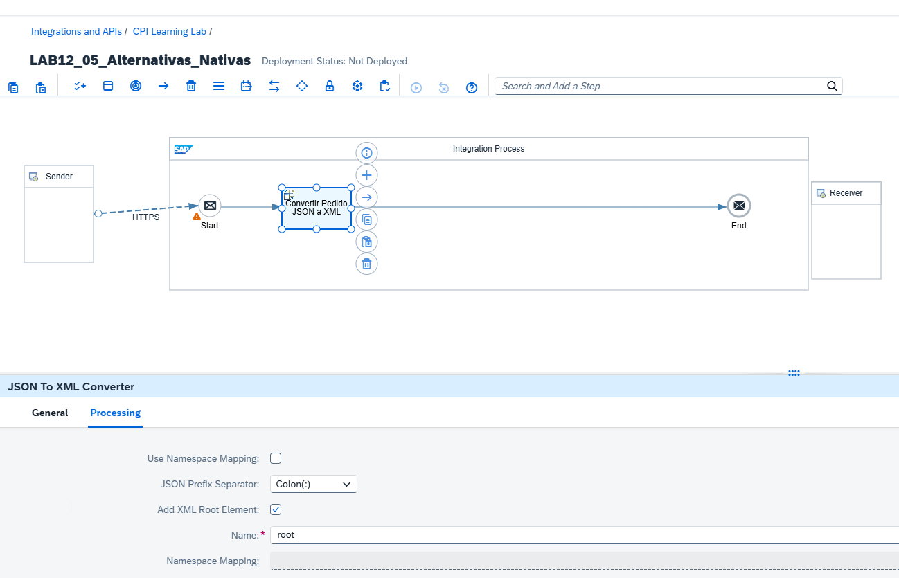

#### 3. Incorporar y configurar el Router

Agregar `Clasificar Pedido` después del conversor. Definir `Ruta_Prioritario` con `Expression Type = XML`, condición `/root/totalPedido >= 50000` y `Default Route` desactivado. Crear `Ruta_Normal` como `Default Route` sin condición XPath.

**Motivo:** separar las decisiones según el importe. La ruta predeterminada recibe los mensajes que no satisfacen la condición de prioritario. Se emplea un umbral didáctico de 50000.

**Evidencia 12-61 — Router incorporado.** Componente de decisión en el flujo.

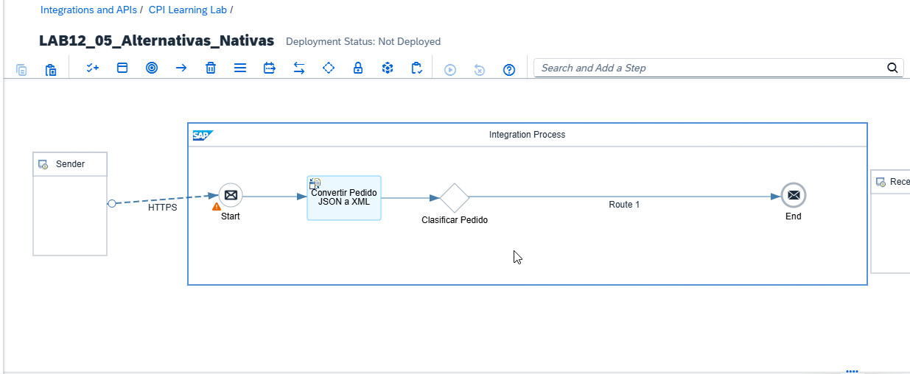

**Evidencia 12-62 — Ruta prioritaria.** Condición XPath y ruta no predeterminada.

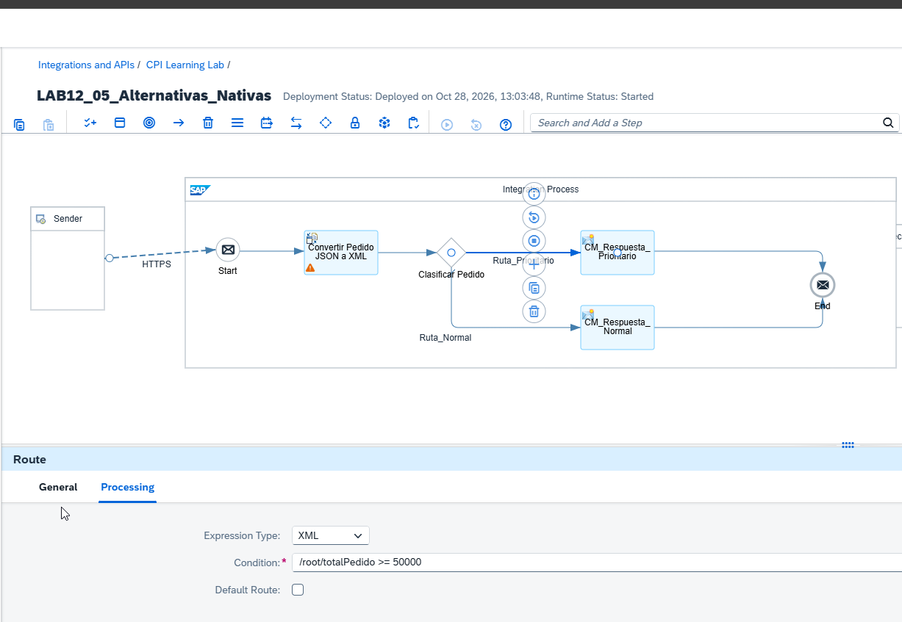

**Evidencia 12-63 — Ruta normal.** Segunda ruta configurada como predeterminada.

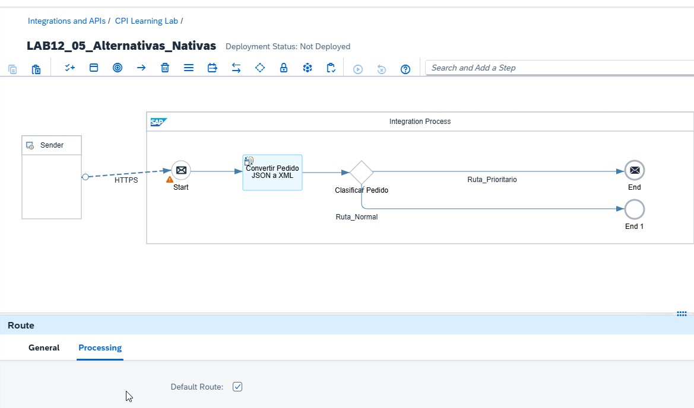

#### 4. Construir las respuestas con Content Modifier

En `Ruta_Prioritario`, insertar `CM_Respuesta_Prioritario`, con `Message Body / Type = Constant`:

```json
{
  "clasificacion": "PEDIDO_PRIORITARIO",
  "procesamiento": "Componentes nativos CPI",
  "laboratorio": "12.5"
}
```

En `Ruta_Normal`, insertar `CM_Respuesta_Normal`, con `Message Body / Type = Constant`:

```json
{
  "clasificacion": "PEDIDO_NORMAL",
  "procesamiento": "Componentes nativos CPI",
  "laboratorio": "12.5"
}
```

En ambos Content Modifiers crear el header `Content-Type` con `Source Type = Constant`, `Source Value = application/json`. Ambas ramas finalizan en End.

**Motivo:** el Router decide el camino; cada Content Modifier produce una respuesta fija, sin código personalizado.

**Evidencia 12-64 — Respuesta prioritaria.** Body JSON con clasificación `PEDIDO_PRIORITARIO`.

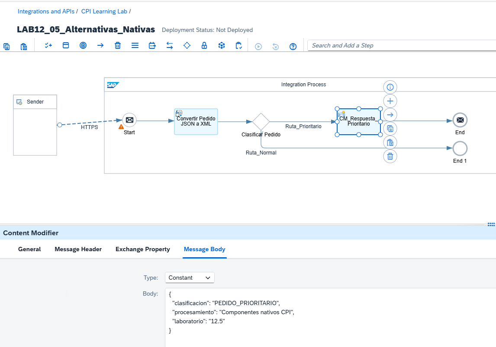

**Evidencia 12-65 — Respuesta normal.** Dos ramas y body JSON con clasificación `PEDIDO_NORMAL`.

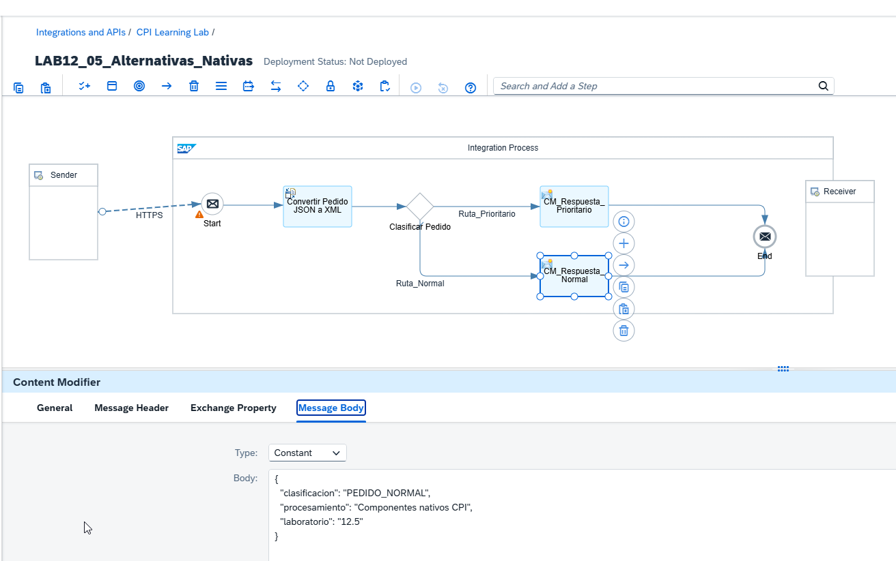

#### 5. Desplegar

Guardar y desplegar el iFlow. En Manage Integration Content se observó versión `1.0.1`, estado `Started` y endpoint publicado.

**Evidencia 12-66 — Despliegue.** iFlow iniciado en el runtime.


#### 6. Validar ambas rutas con Postman

Ejecutar peticiones POST autenticadas con `Content-Type: application/json`.

**Pedido prioritario:**

```json
{"idPedido":1005,"totalPedido":67500}
```

**Resultado observado:** HTTP 200, `clasificacion = PEDIDO_PRIORITARIO`, `laboratorio = 12.5`, **4/4 tests aprobados**.

**Evidencia 12-67 — Respuesta prioritaria.** Clasificación correcta para total 67500.


**Evidencia 12-68 — Tests prioritarios.** Cuatro aserciones Postman aprobadas.


**Pedido normal:**

```json
{"idPedido":1006,"totalPedido":35000}
```

**Resultado observado:** HTTP 200, `clasificacion = PEDIDO_NORMAL`, `laboratorio = 12.5`, **4/4 tests aprobados**.

**Evidencia 12-69 — Respuesta normal.** Clasificación correcta de pedido normal.


**Evidencia 12-70 — Tests normales.** Cuatro aserciones Postman aprobadas.


### Resultado esperado y validación

Ambas rutas devolvieron la clasificación prevista y superaron las aserciones de Postman. **Estado: ✅ Completado.**

### Problemas encontrados y aprendizajes

El Router requiere una estructura XML y una condición XPath coherentes. La prueba funcional de cada rama es necesaria: que el iFlow esté `Started` y devuelva HTTP 200 no basta para demostrar que se eligió la ruta esperada. La solución nativa simplifica una clasificación basada en un campo ya calculado, pero no reproduce el cálculo de descuentos del 12.4.

---


## 12.6 — Buenas prácticas y validación: Groovy + Router XPath

**Estado:** ✅ Completado
**iFlow:** `LAB12_06_Groovy_Router_Buenas_Practicas`
**Package:** `CPI Learning Lab`
**Endpoint relativo:** `/http/lab12/buenas-practicas`
**Postman:** `CPI Learning Lab / Lab 12 Groovy Script`, cuatro peticiones independientes del laboratorio 12.6.

### Objetivo

Combinar Groovy para calcular reglas de negocio con componentes nativos de SAP Cloud Integration para transformar, clasificar y devolver una respuesta enriquecida. Verificar por separado el cálculo de descuentos, la selección de rutas y el rechazo funcional de pedidos sin productos.

### Conceptos y decisiones de diseño

- **Groovy Script:** interpreta el pedido JSON, comprueba la lista de productos y calcula `totalOriginal`, `porcentajeDescuento`, `descuento` y `totalFinal` con `BigDecimal`. Aplica 5 % cuando el total original es al menos 50.000 y menor que 100.000; 10 % cuando es al menos 100.000; 0 % en otro caso.
- **JSON to XML Converter:** transforma el JSON resultante de Groovy a XML con elemento raíz `root`, permitiendo evaluar el importe mediante XPath.
- **Router XPath:** clasifica como `PEDIDO_PRIORITARIO` cuando `/root/totalFinal >= 50000`. La ruta predeterminada genera `PEDIDO_NORMAL`. Este umbral se aplica **al total final**, no al total original usado para decidir el porcentaje de descuento.
- **Content Modifier y Exchange Properties:** cada rama extrae los importes desde el XML mediante XPath y construye la respuesta JSON usando expresiones Camel Simple `${property.Nombre}`. La condición del Router sigue siendo XPath sobre XML: no depende de las Exchange Properties.
- **Separación de responsabilidades:** Groovy calcula; el Router decide; los Content Modifiers construyen la respuesta. Para clasificaciones simples basadas en un importe ya calculado, un Router nativo evita añadir código innecesario.

### Prerrequisitos

HTTPS Sender y OAuth operativos, conocimientos de Groovy, JSON/XML, XPath, Router, Content Modifier, Exchange Properties y pruebas de Postman de los laboratorios anteriores.

### Laboratorio paso a paso

#### 1. Construir el flujo de integración

Crear `LAB12_06_Groovy_Router_Buenas_Practicas` en `CPI Learning Lab` y configurar el HTTPS Sender en `/lab12/buenas-practicas`, con autorización `User Role` y rol `ESBMessaging.send`. Incorporar la secuencia:

`HTTPS Sender → Start → Evaluar Reglas Negocio (Groovy) → Convertir Pedido JSON a XML → Clasificar Pedido (Router) → Content Modifier de cada ruta → End`.

Reutilizar la lógica de reglas de negocio comprobada en 12.4; el Groovy devuelve un JSON con los importes calculados y utiliza el código HTTP 400 cuando el pedido no contiene productos. El conversor añade la raíz XML `root`.

**Motivo:** la transformación permite aplicar XPath sobre los valores producidos por Groovy, mientras que las dos ramas mantienen independiente la representación de la respuesta.

**Evidencia 12-71 — Arquitectura del iFlow.** Se observa la combinación de Groovy, conversor, Router y dos Content Modifiers.


#### 2. Configurar la clasificación mediante XPath

Configurar la ruta `Ruta_Prioritaria` con `Expression Type = XML` y condición:

```xpath
/root/totalFinal >= 50000
```

Configurar `Ruta_Normal` como ruta predeterminada. Ambas rutas terminan en el evento End.

**Motivo:** un pedido puede recibir descuento del 5 % y seguir siendo prioritario; el descuento y la clasificación son decisiones de negocio distintas.

**Evidencia 12-72 — Condición XPath de prioridad.** Se verifica el umbral de 50.000 sobre `totalFinal`.


#### 3. Conservar los importes en la respuesta

En los Content Modifiers `CM_Respuesta_Prioritaria` y `CM_Respuesta_Normal`, crear las siguientes Exchange Properties con `Source Type = XPath`:

| Nombre | Source Value |
|---|---|
| `TotalOriginal` | `/root/totalOriginal` |
| `PorcentajeDescuento` | `/root/porcentajeDescuento` |
| `Descuento` | `/root/descuento` |
| `TotalFinal` | `/root/totalFinal` |

En `Message Body`, utilizar `Type = Expression` y las referencias `${property.TotalOriginal}`, `${property.PorcentajeDescuento}`, `${property.Descuento}` y `${property.TotalFinal}`. Cada rama fija el valor de `clasificacion` que le corresponde y conserva el header `Content-Type: application/json`.

La respuesta de un pedido aprobado sigue esta estructura:

```json
{
  "clasificacion": "PEDIDO_PRIORITARIO",
  "procesamiento": "Componentes nativos CPI",
  "laboratorio": "12.6",
  "totalOriginal": "67500",
  "porcentajeDescuento": "5.00",
  "descuento": "3375.00",
  "totalFinal": "64125.00"
}
```

**Motivo:** los Content Modifiers sustituyen el body del mensaje. Extraer primero los valores evita perder los importes calculados por Groovy. Las referencias a Exchange Properties distinguen mayúsculas y minúsculas. Los importes se presentan como cadenas JSON en la respuesta de este ejercicio.

#### 4. Desplegar y verificar el endpoint

Guardar y desplegar el iFlow. En `Manage Integration Content`, verificar el estado `Started` y el endpoint `/http/lab12/buenas-practicas`. El despliegue se valida además mediante peticiones reales a Postman; `Started` por sí solo no demuestra el resultado funcional.

**Evidencia 12-73 — Despliegue operativo.** El artefacto aparece iniciado y el endpoint está publicado.


#### 5. Validar los cuatro escenarios con Postman

Ejecutar cuatro peticiones POST independientes, autenticadas y con `Content-Type: application/json`.

| Escenario | Entrada | HTTP observado | Resultado observado | Tests |
|---|---|---|---|---|
| Descuento 5 % — Prioritaria | 15.000×2 + 8.500×3 + 12.000×1 | 200 | Original 67.500; 5 %; descuento 3.375; final 64.125; `PEDIDO_PRIORITARIO` | 4/4 |
| Sin descuento — Normal | 15.000×1 + 8.000×3 + 9.000×1 | 200 | Original 48.000; 0 %; descuento 0; final 48.000; `PEDIDO_NORMAL` | 4/4 |
| Descuento 10 % — Prioritario | 40.000×2 + 20.000×2 | 200 | Original 120.000; 10 %; descuento 12.000; final 108.000; `PEDIDO_PRIORITARIO` | 4/4 |
| Sin productos | `"productos": []` | 400 | Rechazo funcional HTTP; body observado con `PEDIDO_NORMAL` e importes vacíos | 4/4 |

**Evidencia 12-76 — Descuento del 5 % y pedido prioritario.** Se comprueban el total final 64.125, la clasificación prioritaria y las cuatro pruebas aprobadas.


**Evidencia 12-77 — Pedido normal sin descuento.** Se comprueban el total 48.000, el descuento cero y las cuatro pruebas aprobadas.


**Evidencia 12-78 — Descuento del 10 % y pedido prioritario.** Se comprueban el total final 108.000, la clasificación prioritaria y las cuatro pruebas aprobadas.


**Evidencia 12-79 — Pedido sin productos.** Se comprueban el HTTP 400 y las cuatro aserciones aprobadas. La captura también evidencia que el body de respuesta no conserva el mensaje de rechazo estructurado de Groovy.


### Resultado esperado y validación

El iFlow debe calcular descuentos, clasificar según el total final y responder a los cuatro escenarios de Postman. Se comprobaron los tres casos de aprobación (HTTP 200, importes y clasificación) y el caso sin productos (HTTP 400), con **16/16 aserciones aprobadas** en cuatro peticiones. **Estado del laboratorio: ✅ Completado.**

### Problemas encontrados y aprendizajes

- El uso de `${xpath:/root/...}` dentro de `Message Body / Type = Expression` produjo `SimpleParserException: Unknown function: xpath:/root/totalOriginal/text()` durante el despliegue. En esta implementación, XPath se utilizó como origen de Exchange Properties y `${property.Nombre}` para construir el body.
- Las referencias a propiedades distinguen mayúsculas y minúsculas. En las trazas se observaron propiedades con valores correctos y respuestas vacías cuando los nombres utilizados en el body no coincidían.
- La ruta prioritaria utiliza **50.000** como umbral del total final; el umbral de **100.000** corresponde al descuento del 10 % calculado sobre el total original. Confundirlos altera las expectativas de Postman.
- En el escenario sin productos, el código HTTP 400 se conserva, pero la respuesta pasa por la ruta normal y reemplaza el body con campos vacíos. Esto **no valida la conservación de un JSON de rechazo estructurado**; ese diseño se puede mejorar en el capítulo de manejo de errores.
- La diferencia entre el texto del editor en distintas revisiones no permite atribuir un fallo de persistencia al runtime sin una reproducción controlada.

### Referencias

- [SAP Help Portal — Cloud Integration](https://help.sap.com/docs/integration-suite/sap-integration-suite/cloud-integration)
- [Apache Camel — Simple Language](https://camel.apache.org/components/latest/languages/simple-language.html)
- [Apache Camel — XPath Language](https://camel.apache.org/components/latest/languages/xpath-language.html)

---

## Validación acumulada del capítulo 12 — Estado final

| Laboratorio | Evidencia práctica | Estado |
|---|---|---|
| 12.1 | Started, longitud de body y 4/4 tests | ✅ Completado |
| 12.2 | Headers, properties y body; HTTP 200 y 4/4 tests | ✅ Completado |
| 12.3 XML | XML procesado; total 67.500 y 4/4 tests | ✅ Completado |
| 12.3 JSON | JSON procesado; total numérico 67.500 y tests aprobados | ✅ Completado |
| 12.4 | Reglas de negocio: 0 %, 5 %, 10 % y rechazo funcional | ✅ Completado |
| 12.5 | Alternativas nativas: dos rutas, HTTP 200 y 8/8 tests | ✅ Completado |
| 12.6 | Groovy + Router XPath: tres aprobaciones y rechazo HTTP 400, 16/16 tests | ✅ Completado |

