# 13 - Manejo de errores y Exception Subprocess

**Estado del tema:** 🟨 En curso
**Package:** `CPI Learning Lab`
**Alcance documentado:** laboratorios 13.1 y 13.2 validados el 29-10-2026.

## Objetivo

Comprender cómo se comporta SAP Cloud Integration ante una excepción no gestionada, capturarla mediante Exception Subprocess y distinguir la respuesta HTTP al consumidor del estado de procesamiento registrado en el Message Processing Log (MPL).

## Prerrequisitos

- Acceso a SAP Integration Suite / Cloud Integration y permisos de diseño, despliegue y monitorización.
- Package `CPI Learning Lab`.
- Postman configurado con OAuth 2.0 para invocar los endpoints protegidos, sin guardar secretos en el repositorio.
- Conocimientos de HTTPS Sender, Groovy Script, Content Modifier, headers y Exchange Properties.

## Conceptos

- **Excepción no gestionada:** fallo que interrumpe el procesamiento normal sin una ruta de tratamiento configurada.
- **Exception Subprocess:** subproceso que se activa ante una excepción del proceso de integración y permite ejecutar pasos de tratamiento.
- **End Message:** evento que finaliza la ruta del subproceso; su efecto sobre el estado MPL debe contrastarse con la ejecución real.
- **`CamelHttpResponseCode`:** header utilizado aquí para fijar el código de respuesta HTTP.
- **MPL:** registro de procesamiento consultable en Monitor Message Processing; su estado no equivale necesariamente al código HTTP devuelto al cliente.

## Índice de microaprendizajes

| ID | Microaprendizaje | Estado | Validación |
|---|---|---|---|
| 13.1 | Fundamentos: error no controlado | ✅ Completado | Excepción Groovy, HTTP 500, Postman 1/1, MPL `Failed` |
| 13.2 | Exception Subprocess básico | ✅ Completado | JSON personalizado, HTTP 500, pruebas Postman aprobadas, MPL `Completed` |
| 13.3 | Información de la excepción | ⬜ Pendiente | - |
| 13.4 | Errores funcionales y técnicos | ⬜ Pendiente | - |
| 13.5 | Propagación y finalización: Message End y Error End | ⬜ Pendiente | - |
| 13.6 | Manejo centralizado y buenas prácticas | ⬜ Pendiente | - |

## Organización de Postman

**Carpeta:** `Lab 13 - Manejo de Errores y Exception Subprocess` dentro de la colección `CPI Learning Lab`.

Se acordaron seis requests iniciales, uno por microaprendizaje; se pueden incorporar requests adicionales cuando un escenario lo requiera. En este documento se describen los dos requests ejecutados:

- `13.1 - Error no controlado`
- `13.2 - Exception Subprocess básico`

Los requests comparten el endpoint de laboratorio, pero se ejecutaron contra dos configuraciones desplegadas sucesivamente del mismo iFlow. La autenticación se realiza mediante OAuth 2.0.

---

## 13.1 - Error no controlado

**Estado:** ✅ Completado
**iFlow:** `LAB13_01_Error_No_Controlado`
**Versión desplegada:** `1.0.1`
**Endpoint relativo:** `/http/lab13/error-no-controlado`
**Postman:** `13.1 - Error no controlado`

### Objetivo

Generar una excepción deliberada sin Exception Subprocess, observar la respuesta HTTP y relacionarla con el fallo registrado en MPL.

### Laboratorio paso a paso

#### 1. Crear el iFlow

En el package `CPI Learning Lab`, crear `LAB13_01_Error_No_Controlado` con la secuencia inicial `Start → End`.

**Motivo:** disponer de un artefacto independiente para observar un error reproducible sin alterar los laboratorios previos.

**Evidencia 13-01 - iFlow creado**
La estructura inicial muestra el artefacto aún sin desplegar.

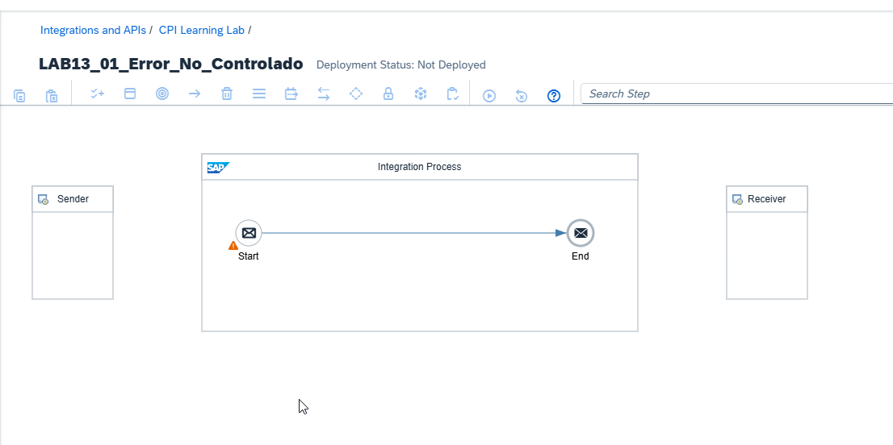

#### 2. Configurar HTTPS Sender

Conectar `Sender` a `Start` mediante HTTPS:

| Campo | Valor |
|---|---|
| Address | `/lab13/error-no-controlado` |
| Authorization | `User Role` |
| User Role | `ESBMessaging.send` |
| CSRF Protected | Desactivado |

**Motivo:** exponer un endpoint autenticado que pueda invocarse desde Postman sin añadir dependencias externas.

**Evidencia 13-02 - HTTPS Sender**
Se observan la dirección, el rol de autorización y CSRF desactivado.

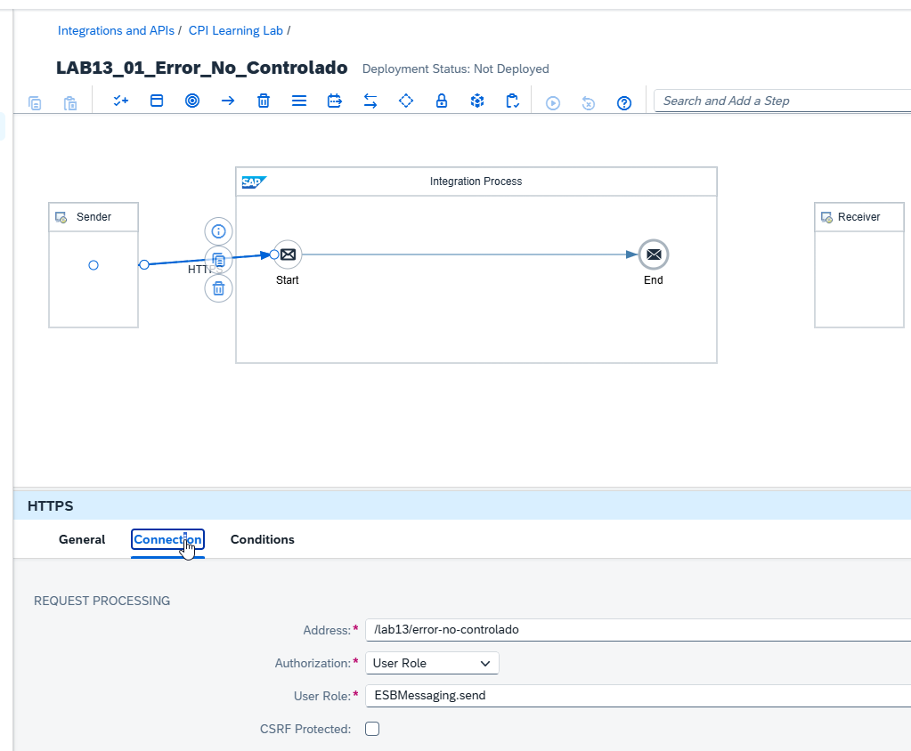

#### 3. Incorporar Groovy Script

Insertar el paso `Provocar Error` entre `Start` y `End`, asociar el recurso `GRV_ProvocarError.groovy` y utilizar la función `processData`.

**Evidencia 13-03 - Paso Groovy incorporado**
La secuencia queda `Start → Provocar Error → End`.

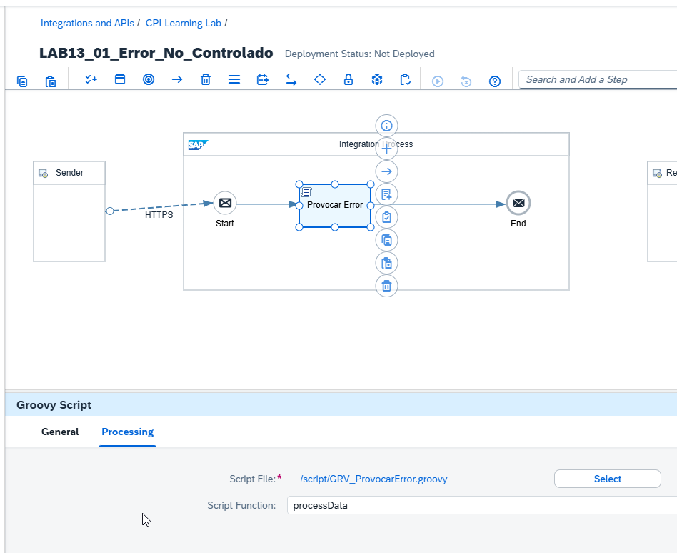

Configurar el script definitivo:

```groovy
import com.sap.gateway.ip.core.customdev.util.Message

def Message processData(Message message) {
    message.setProperty("Laboratorio", "13.1")

    throw new IllegalStateException(
        "LAB13_01: Error provocado intencionalmente"
    )
}
```

**Motivo:** `setProperty` identifica el escenario y `throw` interrumpe el procesamiento mediante una excepción identificable, sin depender de un receptor externo. No se incorpora tratamiento de excepciones en esta versión.

**Evidencia 13-04 - Código Groovy definitivo**
El editor muestra la excepción deliberada y ninguna advertencia en General Script Checks.

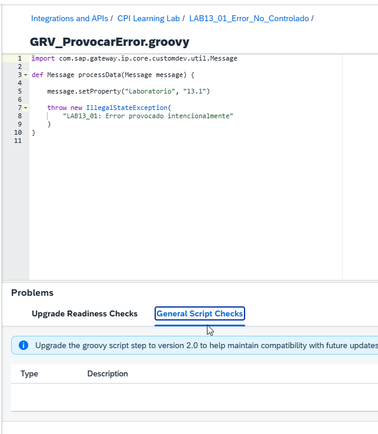

#### 4. Desplegar y comprobar el runtime

Guardar y desplegar el iFlow. En **Monitor → Manage Integration Content** se comprobó la versión `1.0.1`, el estado `Started` y el endpoint publicado.

**Evidencia 13-05 - Despliegue Started**
Confirma el despliegue correcto; no implica que los mensajes se procesen sin errores.

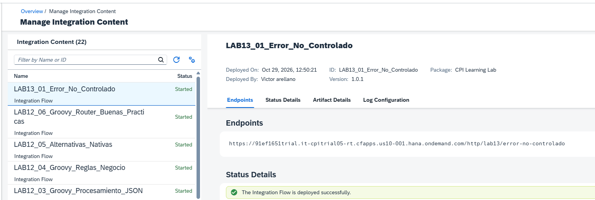

#### 5. Ejecutar el request 13.1 en Postman

Configurar `POST`, OAuth 2.0, `Content-Type: application/json` y el endpoint del iFlow. Enviar:

```json
{
  "laboratorio": "13.1",
  "mensaje": "Prueba de error no controlado"
}
```

**Resultado observado:** `500 Internal Server Error`. El body contiene un mensaje genérico de error interno y un identificador MPL, no el texto personalizado de la excepción. Tiempo de respuesta observado: 173 ms.

**Evidencia 13-06 - Error HTTP sin tratamiento**
La respuesta de Postman muestra HTTP 500 y el identificador MPL.

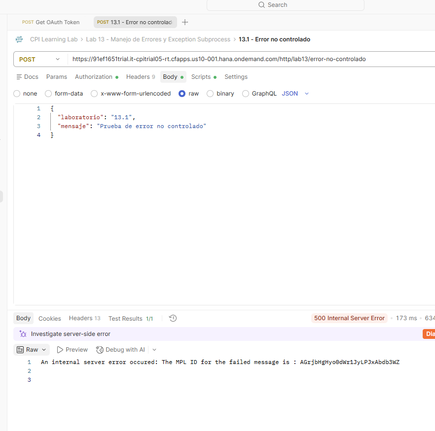

La aserción de Postman fue:

```javascript
pm.test("Status code is 500", function () {
    pm.response.to.have.status(500);
});
```

**Resultado:** `1/1 PASSED`.

**Evidencia 13-07 - Test HTTP 500**
La prueba automática verifica el código de respuesta.

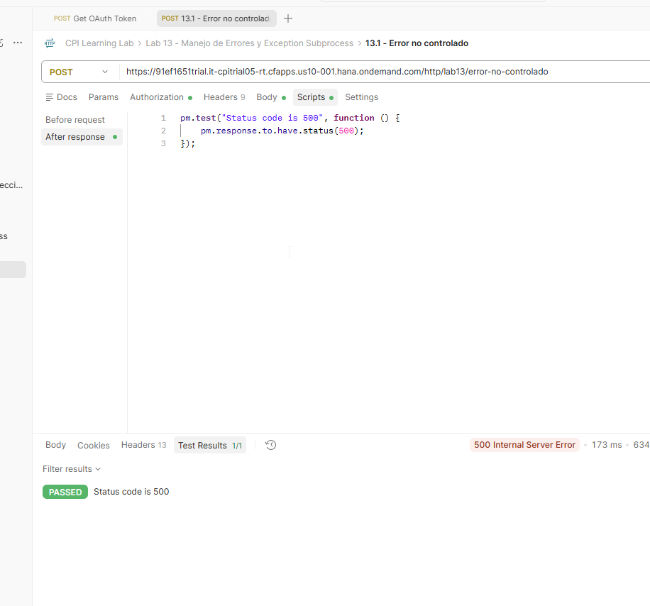

#### 6. Diagnosticar la ejecución en MPL

En **Monitor → Monitor Message Processing**, abrir la ejecución fallida del iFlow.

**Resultado observado:** estado `Failed`; excepción `java.lang.IllegalStateException`; texto `LAB13_01: Error provocado intencionalmente`; referencia a `GRV_ProvocarError.groovy`, línea 7. En la ejecución capturada se observó un tiempo de procesamiento de 12 ms.

**Evidencia 13-08 - Excepción registrada en MPL**
El monitor identifica el error generado en el script y confirma el estado fallido.

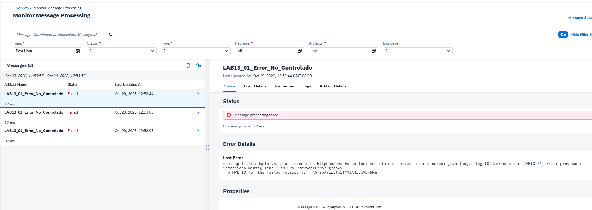

### Validación y aprendizajes

**Resultado esperado y confirmado:** el iFlow puede desplegarse correctamente y, aun así, fallar al procesar mensajes. La respuesta HTTP 500 por sí sola no identifica la causa; el MPL permite asociarla con la excepción y su ubicación en el script.

---

## 13.2 - Exception Subprocess básico

**Estado:** ✅ Completado
**iFlow reutilizado:** `LAB13_01_Error_No_Controlado`
**Versión desplegada:** `1.0.2`
**Endpoint relativo:** `/http/lab13/error-no-controlado`
**Postman:** `13.2 - Exception Subprocess básico`

### Objetivo

Capturar la excepción del laboratorio anterior y devolver un JSON personalizado, comparando el código HTTP con el estado de procesamiento en MPL.

### Control de versiones

Antes de modificar el iFlow utilizado en 13.1, preservar la configuración anterior mediante el versionado del artefacto. La versión desplegada en 13.1 fue `1.0.1` y la versión desplegada tras incorporar el Exception Subprocess fue `1.0.2`. No se cambia el endpoint ni el recurso Groovy que provoca el error.

**Motivo:** mantener una referencia reproducible del comportamiento sin tratamiento y diferenciar los resultados de ambos laboratorios.

### Laboratorio paso a paso

#### 1. Incorporar Exception Subprocess

Dentro del Integration Process agregar `Exception Subprocess 1`, inicialmente con `Error Start 1 → End 1`. Mantener intacta la secuencia principal `Start → Provocar Error → End`.

**Evidencia 13-09 - Exception Subprocess incorporado**
Se observan el proceso principal y el subproceso de excepción.

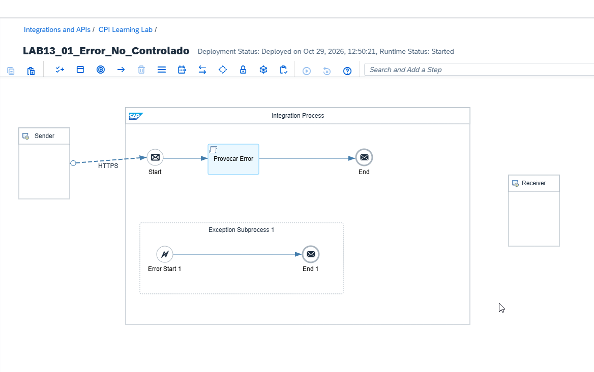

#### 2. Agregar Content Modifier

Insertar `CM_Respuesta_Error` entre `Error Start 1` y `End 1`.

**Motivo:** utilizar un componente nativo para construir la respuesta, sin introducir otro script Groovy.

**Evidencia 13-10 - Content Modifier en el subproceso**
La ruta queda `Error Start 1 → CM_Respuesta_Error → End 1`.

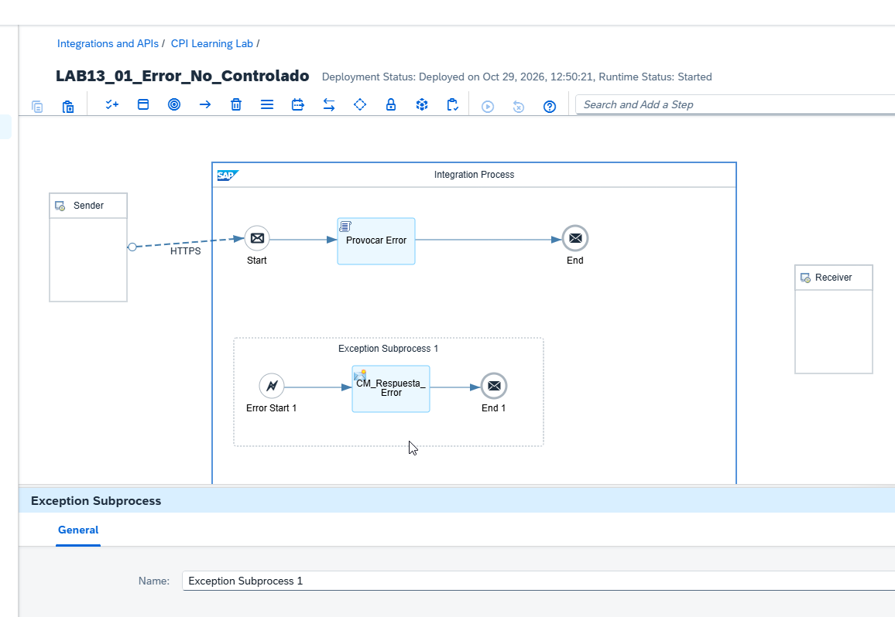

#### 3. Configurar Message Body

En `CM_Respuesta_Error`, pestaña **Message Body**, establecer `Type = Constant`:

```json
{
  "laboratorio": "13.2",
  "estado": "ERROR_CONTROLADO",
  "mensaje": "La excepcion fue capturada por Exception Subprocess"
}
```

**Motivo:** comprobar inicialmente la ejecución del subproceso con un cuerpo fijo; la lectura dinámica de la excepción se reserva para 13.3.

**Evidencia 13-11 - Body JSON**
El Content Modifier contiene el JSON de error controlado.

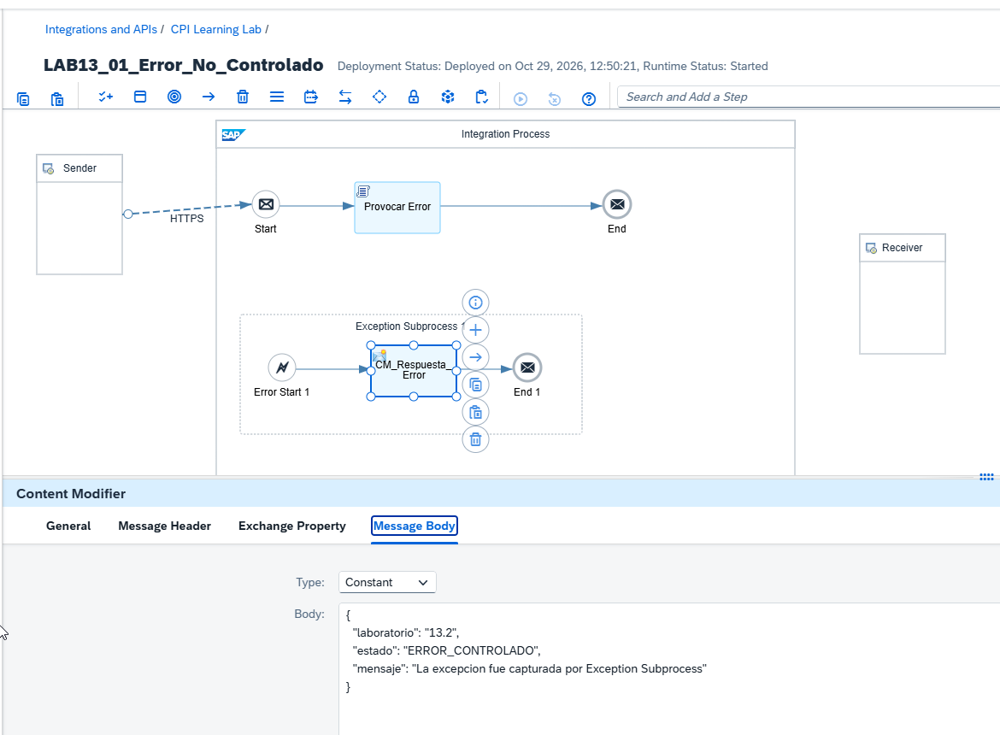

#### 4. Configurar headers HTTP

En **Message Header**, agregar:

| Action | Name | Source Type | Source Value |
|---|---|---|---|
| Create | `CamelHttpResponseCode` | Constant | `500` |
| Create | `Content-Type` | Constant | `application/json` |

Si `Data Type` no permite edición, conservar su valor predeterminado.

**Motivo:** devolver HTTP 500 y anunciar explícitamente un cuerpo JSON, en vez de depender de la respuesta genérica del error no gestionado.

**Evidencia 13-12 - Headers HTTP**
Se verifican los dos headers configurados.

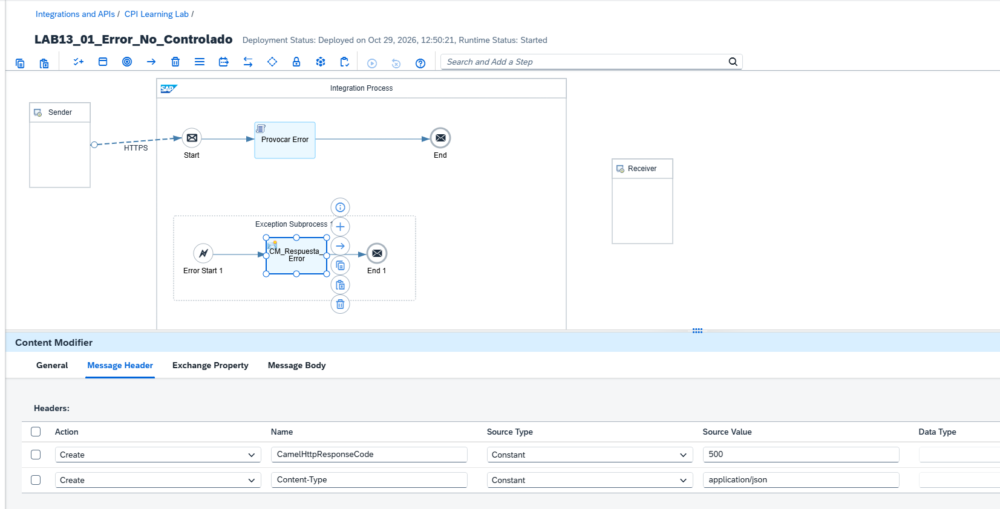

#### 5. Verificar el evento final

Conservar `End 1` como **End Message**.

**Motivo:** comprobar experimentalmente si el tratamiento de la excepción termina el procesamiento con estado `Completed`, incluso al devolver HTTP 500.

**Evidencia 13-13 - End Message**
Las propiedades del evento muestran el tipo `End Message`.

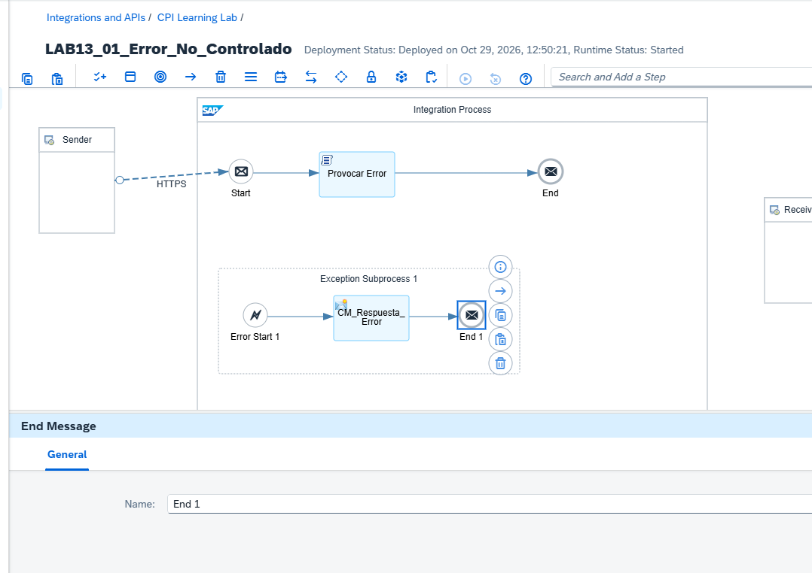

#### 6. Guardar, desplegar y verificar

Guardar y desplegar la configuración actualizada. En **Manage Integration Content** se comprobó la versión `1.0.2`, el estado `Started` y el mismo endpoint.

**Evidencia 13-14 - Despliegue de versión 1.0.2**
Confirma que la configuración con Exception Subprocess está activa.

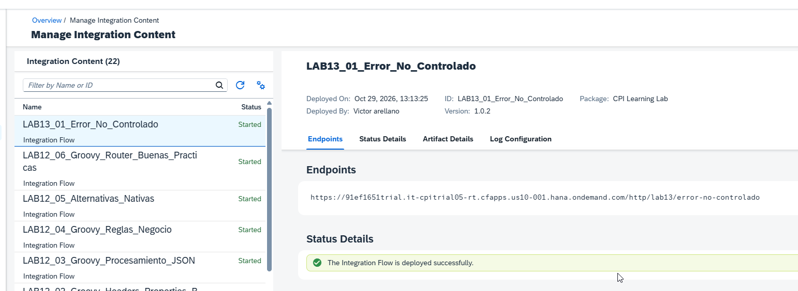

#### 7. Probar el request 13.2 en Postman

Configurar un request independiente `POST` con OAuth 2.0, `Content-Type: application/json` y el mismo endpoint. Enviar:

```json
{
  "laboratorio": "13.2",
  "mensaje": "Prueba de Exception Subprocess"
}
```

**Resultado observado:** `500 Internal Server Error` y el JSON personalizado:

```json
{
  "laboratorio": "13.2",
  "estado": "ERROR_CONTROLADO",
  "mensaje": "La excepcion fue capturada por Exception Subprocess"
}
```

Tiempo de respuesta observado en la primera captura: 562 ms.

**Evidencia 13-15 - Respuesta personalizada**
Postman recibe HTTP 500 con el JSON definido por el Content Modifier.

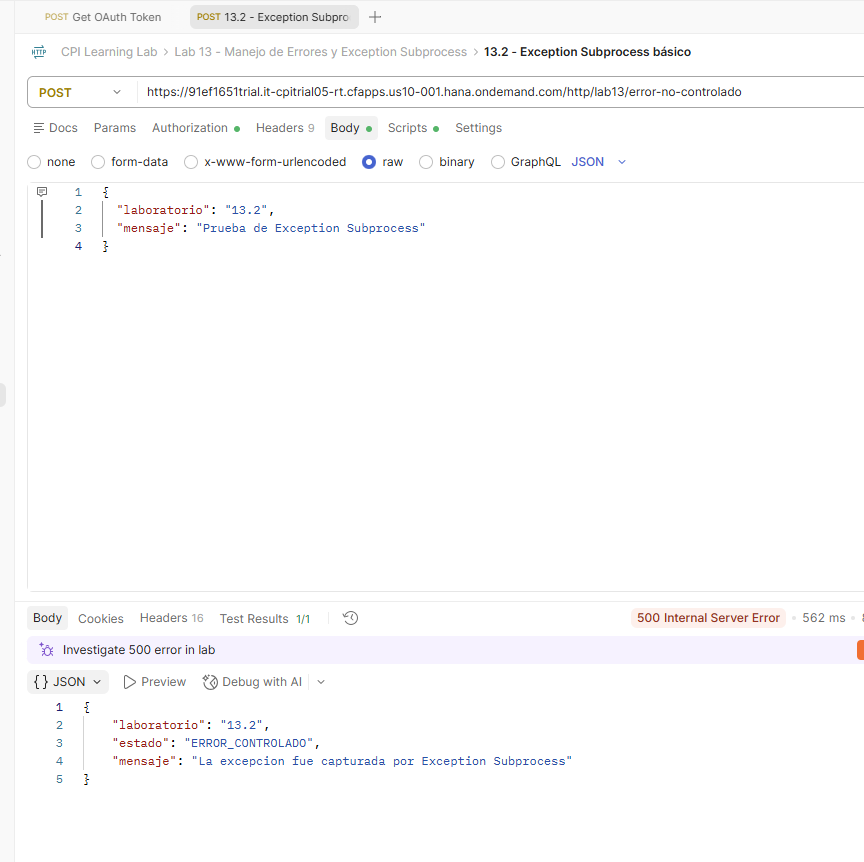

**Evidencia 13-16 - Test inicial de Postman**
La primera aserción automática verifica el código HTTP 500 (`1/1 PASSED`).

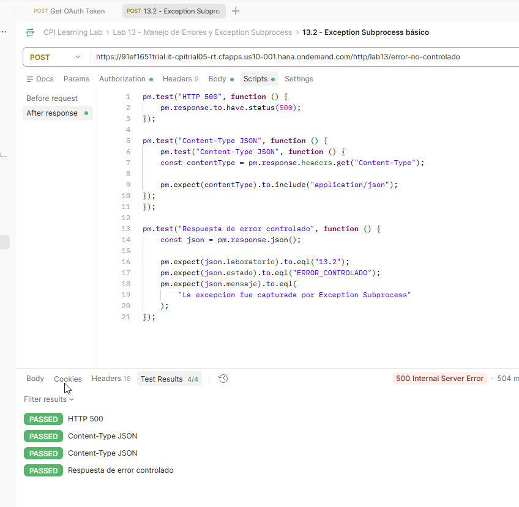

#### 8. Comprobar el estado del MPL

Abrir la ejecución correspondiente a la prueba 13.2 en **Monitor → Monitor Message Processing**.

**Resultado observado:** `Completed`, tiempo de procesamiento 48 ms, pese a que el consumidor recibió HTTP 500. Las ejecuciones anteriores sin Exception Subprocess permanecían registradas como `Failed`.

**Evidencia 13-17 - MPL Completed**
El monitor muestra el estado completado del mensaje tratado por el Exception Subprocess.

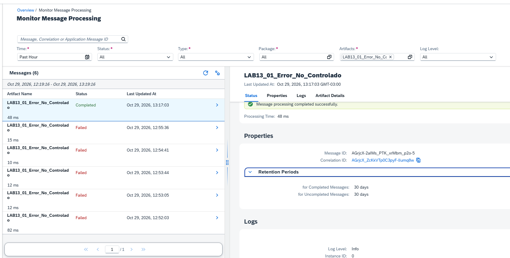

#### 9. Reforzar las aserciones de Postman

En **Scripts → After response**, verificar código HTTP, Content-Type y contenido del JSON. Versión limpia del script de validación:

```javascript
pm.test("HTTP 500", function () {
    pm.response.to.have.status(500);
});

pm.test("Content-Type JSON", function () {
    const contentType = pm.response.headers.get("Content-Type");
    pm.expect(contentType).to.include("application/json");
});

pm.test("Respuesta de error controlado", function () {
    const json = pm.response.json();
    pm.expect(json.laboratorio).to.eql("13.2");
    pm.expect(json.estado).to.eql("ERROR_CONTROLADO");
    pm.expect(json.mensaje).to.eql(
        "La excepcion fue capturada por Exception Subprocess"
    );
});
```

La ejecución final mostrada en Postman obtuvo **4/4 PASSED**, porque el test `Content-Type JSON` estaba anidado y duplicado en el script mostrado. Las cuatro comprobaciones ejecutadas fueron exitosas; el código anterior representa la forma depurada, con tres tests independientes. La ejecución final se verificó visualmente, sin añadir una captura adicional al conjunto de evidencias del capítulo.

### Comparación validada

| Aspecto | 13.1: sin Exception Subprocess | 13.2: con Exception Subprocess |
|---|---|---|
| Excepción provocada | `IllegalStateException` | `IllegalStateException` |
| Código HTTP | 500 | 500 |
| Body HTTP | Mensaje genérico de CPI | JSON personalizado |
| Finalización del tratamiento | Sin tratamiento de excepción | End Message |
| Estado MPL observado | `Failed` | `Completed` |

### Validación y aprendizajes

**Resultado esperado y confirmado:** el Exception Subprocess intercepta la excepción y permite devolver una respuesta personalizada. El código HTTP y el estado MPL representan aspectos distintos: en esta configuración concreta se devolvió HTTP 500 mientras el procesamiento quedó `Completed`. Para la monitorización, no debe asumirse que todos los errores HTTP aparecen como mensajes `Failed`.

---

## Problemas encontrados y aprendizajes del capítulo

- El script de error intencional puede provocar advertencias de análisis estático si contiene código inalcanzable o parámetros no utilizados. La implementación definitiva utiliza el objeto `message` antes de lanzar la excepción.
- El estado `Started` del iFlow verifica el despliegue, no el éxito de cada mensaje.
- La excepción detallada se identificó en MPL; la respuesta HTTP sin tratamiento no exponía directamente ese texto.
- `End Message` dentro del Exception Subprocess permitió observar MPL `Completed` con HTTP 500. Este comportamiento se comprobó en el escenario concreto del laboratorio, sin extrapolarlo a todos los adaptadores o tipos de finalización.
- Al reutilizar un iFlow para otro laboratorio, se debe preservar primero la versión anterior, antes de efectuar cambios de diseño.

## Referencias

- [SAP Help Portal - SAP Integration Suite](https://help.sap.com/docs/integration-suite)
- [SAP Help Portal - Cloud Integration](https://help.sap.com/docs/cloud-integration)
- [Metodología de laboratorios](METODOLOGIA-LABORATORIOS.md)
- [KBA y hallazgos](kba-y-hallazgos.md)

> Las rutas `images/tema-13/` siguen la convención de evidencias del curso. Las imágenes se referencian por su nombre acordado; su incorporación física al repositorio debe comprobarse al publicar el documento.
