# 13 - Manejo de errores y Exception Subprocess

**Estado del tema:** ✅ Completado
**Package:** `CPI Learning Lab`
**iFlow reutilizado:** `LAB13_01_Error_No_Controlado`
**Endpoint relativo:** `/http/lab13/error-no-controlado`
**Postman:** `CPI Learning Lab / Lab 13 - Manejo de Errores y Exception Subprocess`

## Objetivo

Distinguir los errores no controlados de los errores tratados por un Exception Subprocess; obtener información diagnóstica y diferenciar respuestas funcionales, técnicas y exitosas mediante pruebas reales.

## Conceptos

- **Excepción no controlada:** interrumpe el procesamiento sin una respuesta de error personalizada.
- **Exception Subprocess:** ruta de manejo que se activa ante una excepción del proceso de integración.
- **Message End:** finaliza la ruta de procesamiento; en los ejercicios observados, un error tratado de esta manera produjo un MPL `Completed` aun cuando el cliente recibió HTTP 500.
- **`CamelHttpResponseCode`:** header que permite definir el estado HTTP de la respuesta en la ruta donde se establece.
- **Exchange Property:** almacena información de contexto del mensaje, como el detalle de una excepción.
- **Error funcional:** entrada rechazada por una regla de negocio; puede devolverse directamente sin lanzar una excepción técnica.
- **Error técnico:** fallo de ejecución que se trata mediante el Exception Subprocess, con respuesta genérica para el consumidor.

## Prerrequisitos

- SAP Cloud Integration operativo y permisos para diseñar, versionar, desplegar y monitorizar iFlows.
- Postman con autenticación OAuth 2.0 Client Credentials y acceso al endpoint del runtime.
- Conocimientos de HTTPS Sender, Groovy Script, Content Modifier, headers y Exchange Properties.
- Antes de cada cambio de laboratorio sobre el mismo iFlow, conservar la versión y las evidencias del ejercicio anterior.

## Estado de los microaprendizajes

| ID | Laboratorio | Estado | Validación |
|---|---|---|---|
| 13.1 | Error no controlado | ✅ Completado | HTTP 500; MPL `Failed`; excepción identificada |
| 13.2 | Exception Subprocess básico | ✅ Completado | HTTP 500 personalizado; MPL `Completed`; pruebas Postman |
| 13.3 | Información de la excepción | ✅ Completado | Detalle real de la excepción en respuesta; 4/4 tests |
| 13.4 | Errores funcionales y técnicos | ✅ Completado | HTTP 400 (7/7), 500 (4/4) y 200 (4/4) |
| 13.5 | Message End vs Error End | ✅ Completado | HTTP 500; Message End/MPL Completed; Error End/MPL Failed |
| 13.6 | Manejo centralizado y buenas prácticas | ✅ Completado | Versión 1.0.6 Started; HTTP 200/400/500; MPL Completed |

---

## 13.1 - Error no controlado

**Estado:** ✅ Completado
**Versión desplegada:** `1.0.1`
**Postman:** `13.1 - Error no controlado`

### Objetivo

Provocar una excepción sin tratamiento explícito y observar su impacto en la respuesta HTTP y el monitoreo.

### Laboratorio paso a paso

1. Crear el iFlow `LAB13_01_Error_No_Controlado` en el package `CPI Learning Lab`, con Sender HTTPS → Start → Groovy Script → End. Se conserva un diseño mínimo para aislar el comportamiento de la excepción.

   **Evidencia 13-01 - iFlow inicial.** Estructura creada para la prueba de error no controlado.

   

2. Configurar HTTPS Sender con `Address = /lab13/error-no-controlado`, `Authorization = User Role`, `User Role = ESBMessaging.send` y CSRF desactivado para la prueba autenticada.

   **Motivo:** recibir una solicitud POST desde Postman y ejecutar el script en el runtime.

   **Evidencia 13-02 - HTTPS Sender.** Dirección y autorización configuradas.

   

3. Incorporar el paso `Provocar Error` y asociar el recurso `GRV_ProvocarError.groovy`.

   **Evidencia 13-03 - Paso Groovy.** Script incorporado a la ruta principal.

   

   Implementar:

   ```groovy
   import com.sap.gateway.ip.core.customdev.util.Message

   def Message processData(Message message) {
       message.setProperty("Laboratorio", "13.1")
       throw new IllegalStateException(
           "LAB13_01: Error provocado intencionalmente"
       )
   }
   ```

   **Motivo:** `throw` interrumpe el flujo normal; la propiedad identifica el laboratorio sin alterar el tipo de excepción.

   **Evidencia 13-04 - Excepción intencional.** Código final del recurso Groovy.

   

4. Guardar y desplegar la versión `1.0.1`; comprobar `Started`.

   **Evidencia 13-05 - Despliegue.** Versión iniciada en Manage Integration Content.

   

5. Enviar un POST autenticado desde Postman con body JSON:

   ```json
   {"laboratorio":"13.1","mensaje":"Prueba de error no controlado"}
   ```

   **Resultado observado:** HTTP `500`, respuesta genérica con identificador MPL y ejecución marcada `Failed`. El detalle del monitor identificó `java.lang.IllegalStateException: LAB13_01: Error provocado intencionalmente`.

   **Evidencia 13-06 - HTTP 500 no controlado.** Respuesta recibida por Postman.

   

   **Evidencia 13-07 - Pruebas Postman.** Aserción del estado HTTP esperado.

   

   **Evidencia 13-08 - MPL Failed.** Registro de la excepción original en Monitor Message Processing.

   

### Resultado, validación y aprendizajes

La excepción no controlada generó HTTP 500 y un MPL `Failed`. El monitor permitió localizar el fallo y su mensaje original. Un código HTTP 500 por sí solo no identifica la causa: es necesario revisar el MPL.

---

## 13.2 - Exception Subprocess básico

**Estado:** ✅ Completado
**Versión desplegada:** `1.0.2`
**Postman:** `13.2 - Exception Subprocess básico`

### Objetivo

Capturar una excepción mediante un Exception Subprocess y devolver una respuesta JSON controlada.

### Laboratorio paso a paso

1. Conservar las evidencias del laboratorio 13.1 y crear una nueva versión del mismo iFlow antes de modificarlo. Agregar un Exception Subprocess con `Error Start 1 → CM_Respuesta_Error → End 1` (Message End).

   **Motivo:** mantener el error provocado por Groovy, pero cambiar su tratamiento mediante una ruta separada.

   **Evidencia 13-09 - Exception Subprocess.** Estructura de captura incorporada.

   

2. Configurar `CM_Respuesta_Error` para construir una respuesta fija:

   **Message Body**, `Type = Constant`:

   ```json
   {
     "laboratorio": "13.2",
     "estado": "ERROR_CONTROLADO",
     "mensaje": "La excepcion fue capturada por Exception Subprocess"
   }
   ```

   **Message Header**, `Source Type = Constant`:

   | Name | Source Value |
   |---|---|
   | `CamelHttpResponseCode` | `500` |
   | `Content-Type` | `application/json` |

   **Motivo:** definir explícitamente la respuesta técnica del subproceso, sin depender del texto de error devuelto automáticamente.

   **Evidencia 13-10 - Content Modifier.** Componente de respuesta dentro del subproceso.

   

   **Evidencia 13-11 - Body JSON.** Contenido constante de la respuesta.

   

   **Evidencia 13-12 - Headers HTTP.** Código 500 y tipo de contenido.

   

3. Terminar el subproceso con `End 1` (Message End), guardar y desplegar `1.0.2`.

   **Evidencia 13-13 - Message End.** Evento de finalización utilizado.

   

   **Evidencia 13-14 - Despliegue.** Runtime `Started` para la versión `1.0.2`.

   

4. Crear una petición Postman independiente, con el mismo endpoint y autenticación:

   ```json
   {"laboratorio":"13.2","mensaje":"Prueba de Exception Subprocess"}
   ```

   **Resultado observado:** HTTP `500` y el JSON controlado definido en el Content Modifier. Las aserciones de estado, formato y contenido se ejecutaron correctamente. El MPL correspondiente figuró `Completed`.

   **Evidencia 13-15 - Respuesta controlada.** JSON devuelto por el Exception Subprocess.

   

   **Evidencia 13-16 - Pruebas Postman.** Validación de la respuesta controlada.

   

   **Evidencia 13-17 - MPL Completed.** El procesamiento quedó completado a pesar de responder HTTP 500.

   

   **Evidencia 13-18 - Validación ampliada.** Pruebas posteriores de la respuesta JSON, sin necesidad de duplicar capturas.

   

### Resultado, validación y aprendizajes

Se comprobó la diferencia entre **estado HTTP 500** y **estado interno MPL `Completed`**. Cuando la excepción se trata y el subproceso termina con Message End, el monitor puede mostrar una ejecución completada aunque el consumidor haya recibido un error. La monitorización de integraciones debe contemplar ambas dimensiones.

---

## 13.3 - Información de la excepción

**Estado:** ✅ Completado
**Versión desplegada:** `1.0.3`
**Postman:** `13.3 - Detalle de excepción`

### Objetivo

Obtener información real de una excepción capturada y utilizarla en una respuesta dinámica para comprender la información diagnóstica disponible.

### Laboratorio paso a paso

1. Crear una nueva versión del iFlow reutilizado, conservando el Exception Subprocess y la lógica de error del ejercicio anterior.

2. En `CM_Respuesta_Error`, crear una **Exchange Property**:

   | Campo | Valor |
   |---|---|
   | Action | `Create` |
   | Name | `ExcepcionCapturada` |
   | Source Type | `Expression` |
   | Source Value | `${exception.message}` |
   | Data Type | `java.lang.String` |

   **Motivo:** capturar la información de la excepción y reutilizarla desde el body mediante una propiedad del intercambio.

   **Evidencia 13-19 - Propiedad de excepción.** Expresión utilizada para recuperar el detalle.

   

3. Cambiar el **Message Body** a `Type = Expression`:

   ```json
   {
     "laboratorio": "13.3",
     "estado": "ERROR_CONTROLADO",
     "mensaje": "La excepcion fue capturada por Exception Subprocess",
     "detalleExcepcion": "${property.ExcepcionCapturada}"
   }
   ```

   **Motivo:** comprobar la interpolación de una propiedad calculada durante el tratamiento del error, en lugar de devolver exclusivamente texto fijo. Este formato es didáctico; no se recomienda exponer detalles técnicos internos a consumidores de una API productiva.

   **Evidencia 13-20 - Body dinámico.** Respuesta con referencia a la Exchange Property.

   

4. Guardar, desplegar la versión `1.0.3` y verificar `Started`.

   **Evidencia 13-21 - Despliegue.** Versión iniciada y endpoint disponible.

   

5. Ejecutar la petición independiente de Postman y comprobar HTTP `500`, `laboratorio = 13.3`, `estado = ERROR_CONTROLADO` y un campo `detalleExcepcion` que contiene la excepción original, incluida la clase `java.lang.IllegalStateException`.

   **Evidencia 13-22 - Detalle real en Postman.** Respuesta con la excepción capturada.

   

   **Evidencia 13-23 - Tests de detalle.** Cuatro aserciones aprobadas, incluida la comprobación de la excepción real.

   

### Resultado, validación y aprendizajes

La respuesta incluyó el detalle real de la excepción y **4/4 tests Postman aprobados**. Se comprobó el uso de expresiones y Exchange Properties para diagnóstico. Exponer nombres de clases, archivos o trazas en una respuesta HTTP es útil en el laboratorio, pero debe evitarse en integraciones productivas.

---

## 13.4 - Errores funcionales y técnicos

**Estado:** ✅ Completado
**Versión desplegada observada:** `1.0.4` (versión de diseño/runtime comprobada antes de las pruebas finales)
**Script:** `GRV_ProvocarError_v2.groovy`
**Postman:** `13.4 - Error funcional`, `13.4 - Error tecnico`, `13.4 - Solicitud valida`

### Objetivo

Diferenciar tres resultados: éxito HTTP 200, rechazo funcional HTTP 400 y fallo técnico HTTP 500, evitando confundir errores de negocio con excepciones del runtime.

### Laboratorio paso a paso

1. Crear una nueva versión antes de modificar el iFlow reutilizado. Sustituir el recurso Groovy del paso `Provocar Error` por `GRV_ProvocarError_v2.groovy` para evaluar el JSON de entrada y producir tres rutas posibles.

   ```groovy
   import com.sap.gateway.ip.core.customdev.util.Message
   import groovy.json.JsonSlurper
   import groovy.json.JsonOutput

   def Message processData(Message message) {
       def body = new JsonSlurper().parse(message.getBody(java.io.Reader))

       if (body.escenario == "tecnico") {
           throw new IllegalStateException(
               "LAB13_04: Fallo tecnico provocado intencionalmente"
           )
       }

       if (body.monto == null || !(body.monto instanceof Number) ||
           body.monto <= 0) {

           message.setHeader("CamelHttpResponseCode", 400)
           message.setHeader("Content-Type", "application/json")

           message.setBody(JsonOutput.toJson([
               laboratorio: "13.4",
               tipoError: "FUNCIONAL",
               codigo: "MONTO_INVALIDO",
               mensaje: "El monto debe ser mayor que cero"
           ]))

           return message
       }

       message.setHeader("CamelHttpResponseCode", 200)
       message.setHeader("Content-Type", "application/json")

       message.setBody(JsonOutput.toJson([
           laboratorio: "13.4",
           estado: "OK",
           mensaje: "Solicitud procesada correctamente",
           monto: body.monto
       ]))

       return message
   }
   ```

   **Motivo:** una entrada inválida de negocio puede resolverse con HTTP 400 sin lanzar excepción. La rama técnica utiliza `throw` para activar el Exception Subprocess. La solicitud válida retorna HTTP 200.

   **Evidencia 13-24 - Groovy de tres escenarios.** Script con condiciones técnica, funcional y exitosa.

   

2. Cambiar `CM_Respuesta_Error` para devolver una respuesta técnica genérica mediante **Message Body, Type = Constant**:

   ```json
   {
     "laboratorio": "13.4",
     "tipoError": "TECNICO",
     "codigo": "ERROR_INTERNO",
     "mensaje": "Ocurrio un error durante el procesamiento"
   }
   ```

   Conservar en el Exception Subprocess `CamelHttpResponseCode = 500` y `Content-Type = application/json`. Esos headers se aplican cuando se ejecuta esta ruta, no a todas las respuestas del iFlow.

   **Motivo:** impedir que los detalles internos de una excepción se filtren al consumidor.

   **Evidencia 13-25 - Respuesta técnica genérica.** Content Modifier configurado para errores técnicos.

   

3. Guardar y desplegar el iFlow. Se comprobó `Started` para la versión `1.0.4` antes de las pruebas. Tras un ajuste de sintaxis del script, se volvieron a ejecutar las pruebas y se obtuvieron los resultados esperados. El comportamiento del editor ante esa sintaxis se documenta separadamente en el KBA.

4. **Error funcional:** enviar en la petición `13.4 - Error funcional`:

   ```json
   {"escenario":"funcional","monto":-100}
   ```

   **Resultado observado:** HTTP `400 Bad Request`:

   ```json
   {
     "laboratorio":"13.4",
     "tipoError":"FUNCIONAL",
     "codigo":"MONTO_INVALIDO",
     "mensaje":"El monto debe ser mayor que cero"
   }
   ```

   Se aprobaron **7/7 tests** de Postman.

   **Evidencia 13-26 - HTTP 400 funcional.** Respuesta de rechazo por monto inválido.

   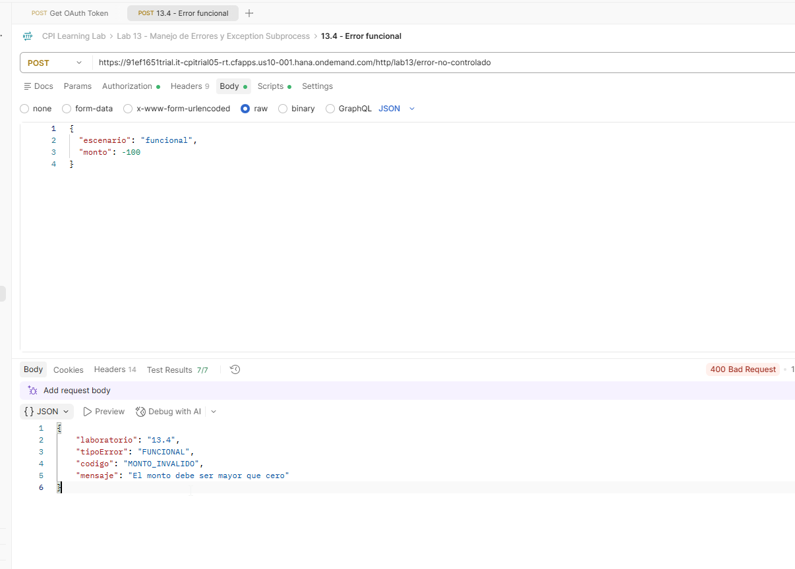

   **Evidencia 13-27 - Tests funcionales.** Siete validaciones aprobadas.

   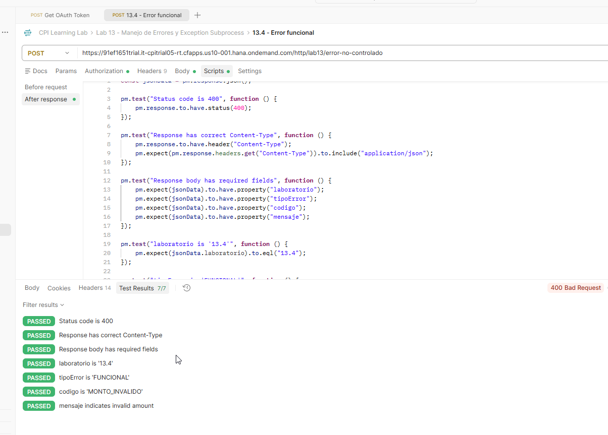

5. **Error técnico:** enviar en la petición `13.4 - Error tecnico`:

   ```json
   {"escenario":"tecnico","monto":100}
   ```

   **Resultado observado:** HTTP `500 Internal Server Error` con `tipoError = TECNICO`, `codigo = ERROR_INTERNO` y mensaje genérico. Se aprobaron **4/4 tests**.

   **Evidencia 13-28 - HTTP 500 técnico.** Respuesta controlada sin detalles internos.

   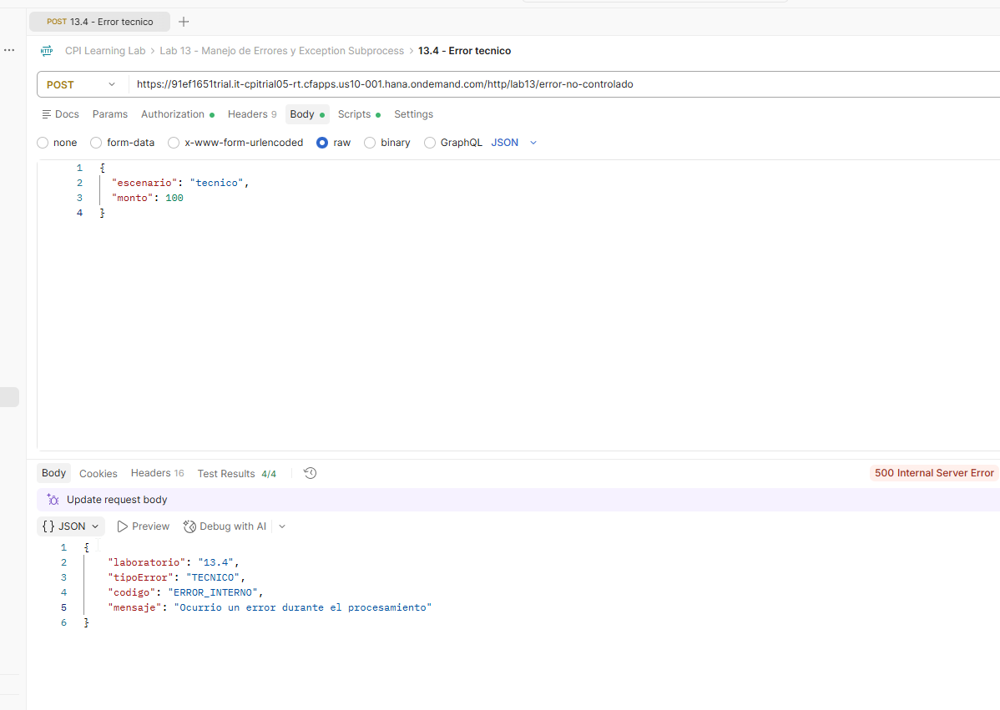

   **Evidencia 13-29 - Tests técnicos.** Cuatro comprobaciones aprobadas.

   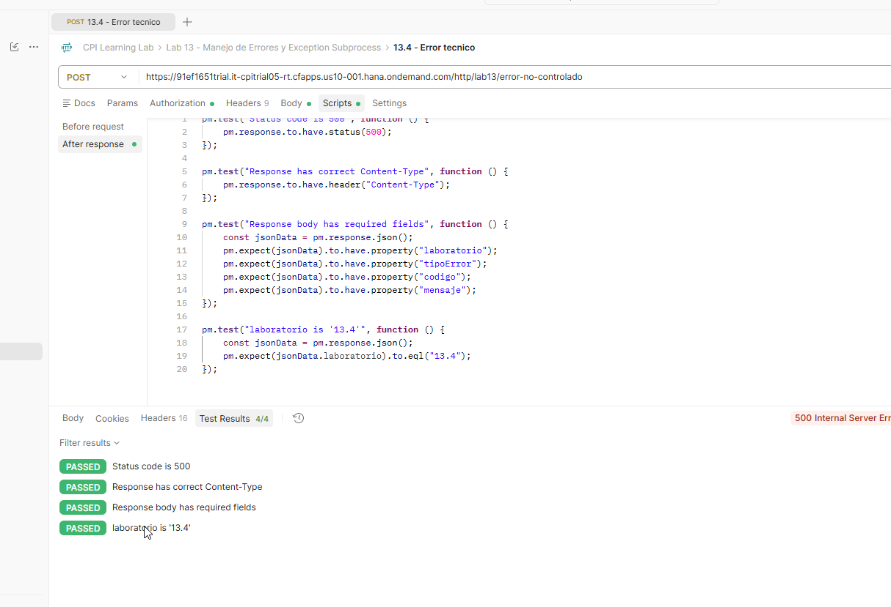

6. **Solicitud válida:** enviar en la petición `13.4 - Solicitud valida`:

   ```json
   {"escenario":"correcto","monto":100}
   ```

   **Resultado observado:** HTTP `200 OK`:

   ```json
   {
     "laboratorio":"13.4",
     "estado":"OK",
     "mensaje":"Solicitud procesada correctamente",
     "monto":100
   }
   ```

   Se aprobaron **4/4 tests** de Postman.

   **Evidencia 13-30 - HTTP 200 válido.** Respuesta normal con monto 100.

   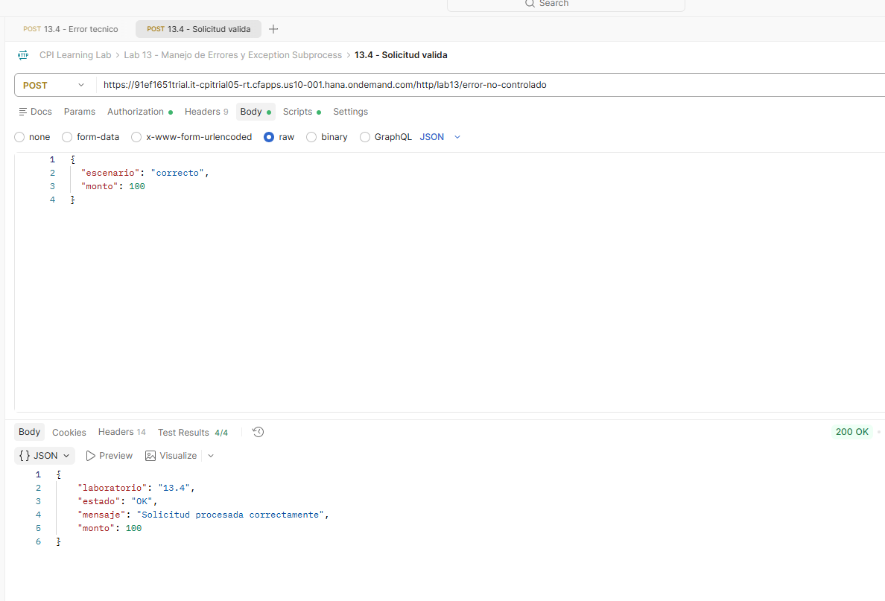

   **Evidencia 13-31 - Tests de solicitud válida.** Cuatro comprobaciones aprobadas.

   

### Resultado y validación

| Escenario | HTTP | Respuesta | Tests |
|---|---|---|---|
| Válido | 200 | `estado = OK`, `monto = 100` | 4/4 |
| Error funcional | 400 | `tipoError = FUNCIONAL`, `codigo = MONTO_INVALIDO` | 7/7 |
| Error técnico | 500 | `tipoError = TECNICO`, `codigo = ERROR_INTERNO` | 4/4 |

### Problemas encontrados y aprendizajes

- Un fallo de compilación del script activó el Exception Subprocess y produjo inicialmente HTTP 500 en una prueba funcional. El MPL permitió identificar el error de sintaxis; se corrigió y las tres rutas quedaron validadas. El caso concreto y la particularidad del editor se registran en `docs/kba-y-hallazgos.md`.
- El código HTTP no depende únicamente de que exista un header configurado en el diseño: depende de la ruta que se ejecuta.
- Los errores funcionales no necesitan convertirse artificialmente en excepciones técnicas.
- La respuesta técnica debe evitar divulgar mensajes internos de excepción.

---

## 13.5 - Message End vs Error End

**Estado:** ✅ Completado
**iFlow:** `LAB13_01_Error_No_Controlado`
**Versión:** `1.0.5`
**Postman:** `13.5 - Message End - Error técnico` y `13.5 - Error End - Error técnico`.

### Objetivo

Comparar dos eventos de finalización del Exception Subprocess, manteniendo la misma excepción, el mismo Content Modifier y el mismo endpoint. Distinguir el código HTTP del estado de procesamiento MPL.

### Laboratorio paso a paso

1. **Versionar.** Conservar la configuración anterior y crear la versión `1.0.5` con comentario `Message End vs Error End`. **Motivo:** preservar las pruebas validadas del laboratorio 13.4.
2. **Probar Message End.** Mantener `Error Start 1 → CM_Respuesta_Error → Message End`. Enviar un POST autenticado a `/http/lab13/error-no-controlado` con `{"escenario":"tecnico","monto":100}`. El resultado fue HTTP `500` con el JSON personalizado del contrato `13.4`. La aserción Postman debe comprobar `laboratorio = "13.4"`, ya que el contrato no fue modificado.

   **Evidencia 13-32 - HTTP 500 con Message End.** Respuesta técnica JSON controlada.

   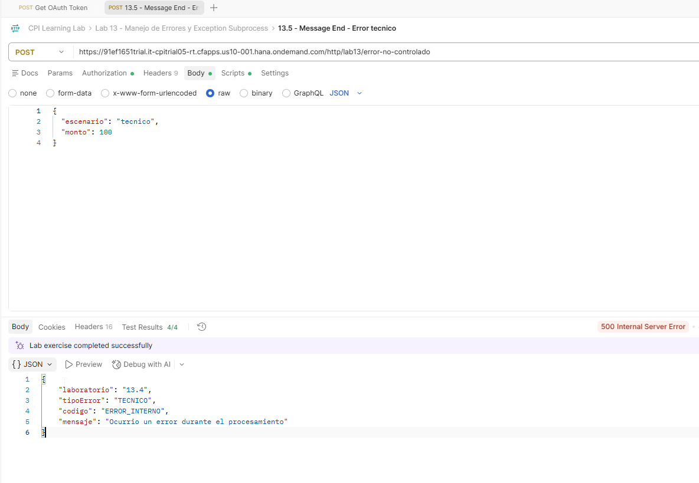

3. **Consultar el MPL.** La ejecución terminó en `Completed` pese al HTTP 500. **Motivo:** el Exception Subprocess gestionó la excepción y finalizó con Message End.

   **Evidencia 13-33 - MPL Completed con Message End.** Estado de la ejecución técnica.

   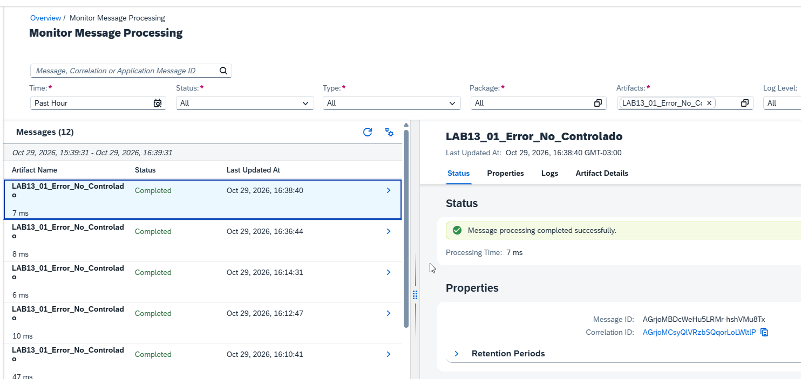

4. **Cambiar solo el evento final.** Sustituir Message End por Error End, dejando `Error Start 1 → CM_Respuesta_Error → Error End 1`; conservar Groovy, body y headers. **Motivo:** aislar el efecto del evento final.

   **Evidencia 13-34 - Exception Subprocess con Error End.** Configuración previa al despliegue.

   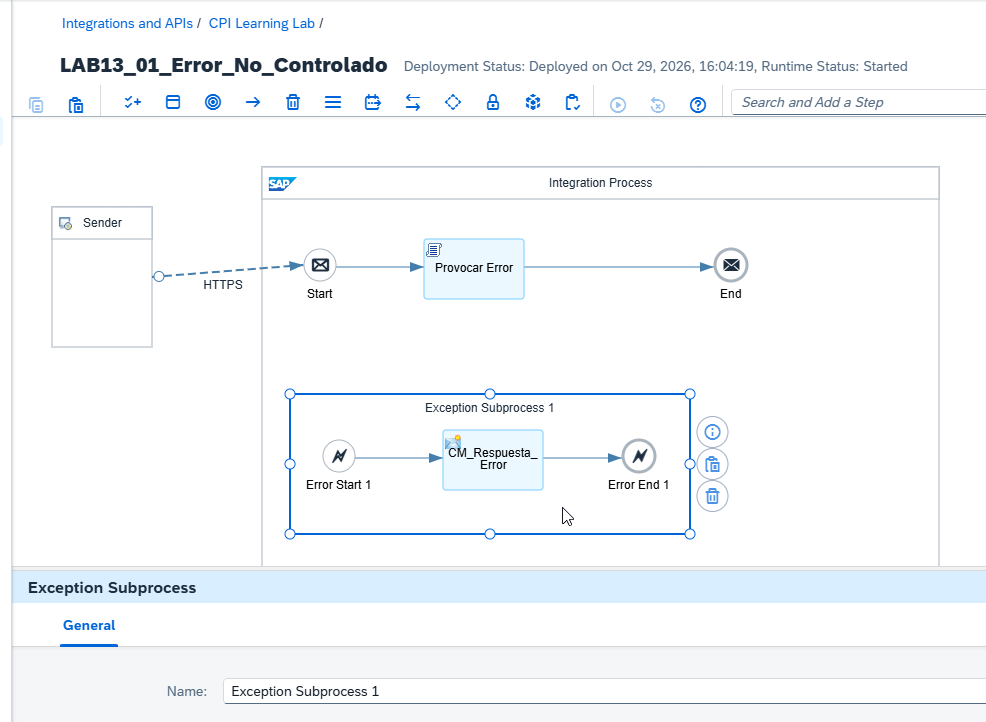

5. **Desplegar y ejecutar la misma petición técnica.** El artefacto quedó `Started`. Postman devolvió HTTP `500` con un mensaje genérico y el identificador MPL, no el JSON personalizado. Se observaron 2/4 tests aprobados; las aserciones que esperaban JSON dejaron de corresponder a la respuesta recibida.

   **Evidencia 13-35 - Respuesta HTTP 500 con Error End.** Mensaje genérico con referencia al MPL.

   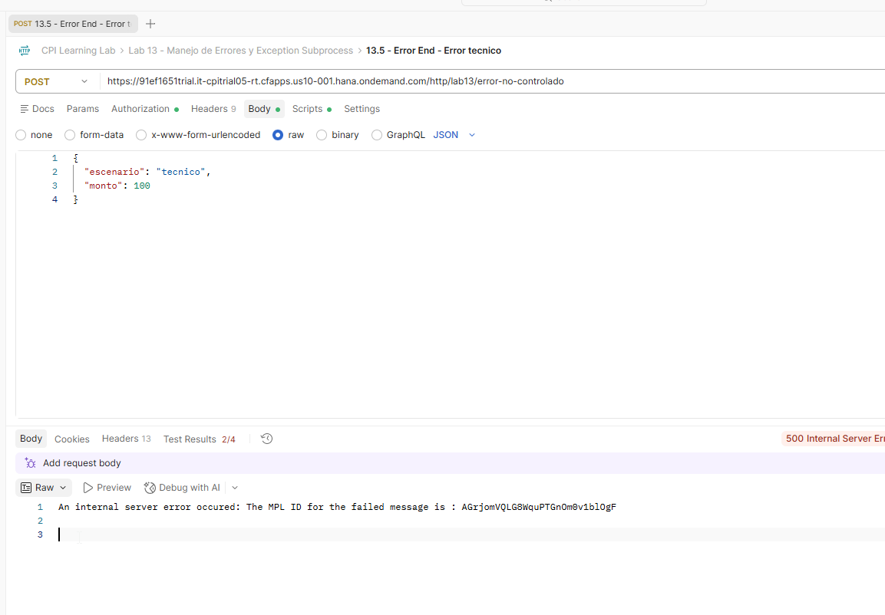

6. **Consultar el MPL.** La ejecución terminó en `Failed` y Error Details mostró la excepción `IllegalStateException` del script `GRV_ProvocarError_v2.groovy`.

   **Evidencia 13-36 - MPL Failed con Error End.** Comparación con las ejecuciones anteriores `Completed`.

   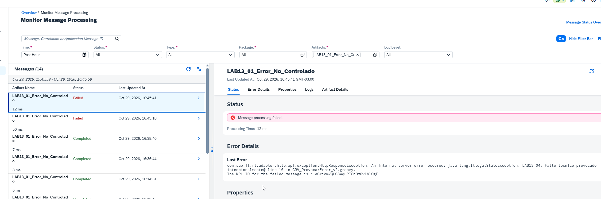

### Resultado esperado y validación

| Observación | Message End | Error End |
|---|---|---|
| HTTP | 500 | 500 |
| Respuesta | JSON técnico personalizado | Mensaje genérico con MPL ID |
| MPL | `Completed` | `Failed` |
| Diagnóstico | Monitor | Monitor / Error Details |

**Aprendizaje:** HTTP 500 y MPL Failed no son equivalentes. En el diseño validado, el evento final determina el estado MPL y afecta a la respuesta del consumidor.

---

## 13.6 - Manejo centralizado y buenas prácticas

**Estado:** ✅ Completado
**iFlow:** `LAB13_01_Error_No_Controlado`
**Versión final:** `1.0.6`
**Postman:** `13.6 - Solicitud válida - HTTP 200`, `13.6 - Error funcional - HTTP 400`, `13.6 - Error técnico - HTTP 500`.

### Objetivo

Centralizar el tratamiento de excepciones técnicas en el Exception Subprocess, devolver un contrato JSON sin detalles internos y conservar la separación entre validaciones de negocio y errores técnicos.

### Laboratorio paso a paso

1. **Versionar.** Crear `1.0.6` con comentario `Manejo centralizado de errores y buenas practicas`. **Motivo:** preservar la versión `1.0.5` con Error End.
2. **Restablecer Message End.** Configurar `Error Start 1 → CM_Respuesta_Error → Message End`, sin alterar el flujo principal ni el Groovy. **Motivo:** devolver una respuesta técnica controlada.

   **Evidencia 13-37 - Exception Subprocess centralizado.** Content Modifier y Message End.

   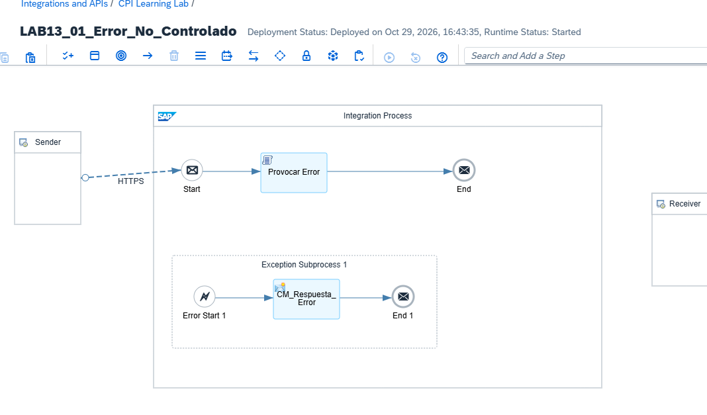

3. **Verificar la respuesta técnica.** `CM_Respuesta_Error` conserva Message Body `Constant`:

   ```json
   {
     "laboratorio": "13.4",
     "tipoError": "TECNICO",
     "codigo": "ERROR_INTERNO",
     "mensaje": "Ocurrio un error durante el procesamiento"
   }
   ```

   Headers: `CamelHttpResponseCode = 500` y `Content-Type = application/json`, ambos `Constant`. **Motivo:** mantener un contrato técnico estable sin exponer clases, scripts ni líneas internas. El valor `laboratorio = "13.4"` identifica el contrato reutilizado, no la petición Postman.
4. **Desplegar.** Comprobar versión `1.0.6` y estado `Started` en Manage Integration Content.

   **Evidencia 13-38 - Despliegue final.** Versión 1.0.6 iniciada.

   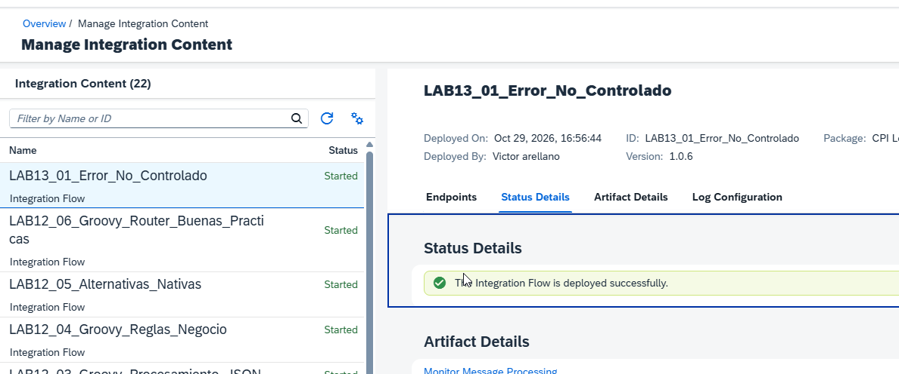

5. **Probar solicitud válida.** POST `{"escenario":"correcto","monto":100}`. Resultado HTTP `200`, `estado = "OK"`, `monto = 100`, **1/1 test Postman**. **Motivo:** verificar que el tratamiento de errores no interfiere con el flujo normal.

   **Evidencia 13-39 - HTTP 200.** Respuesta de solicitud válida.

   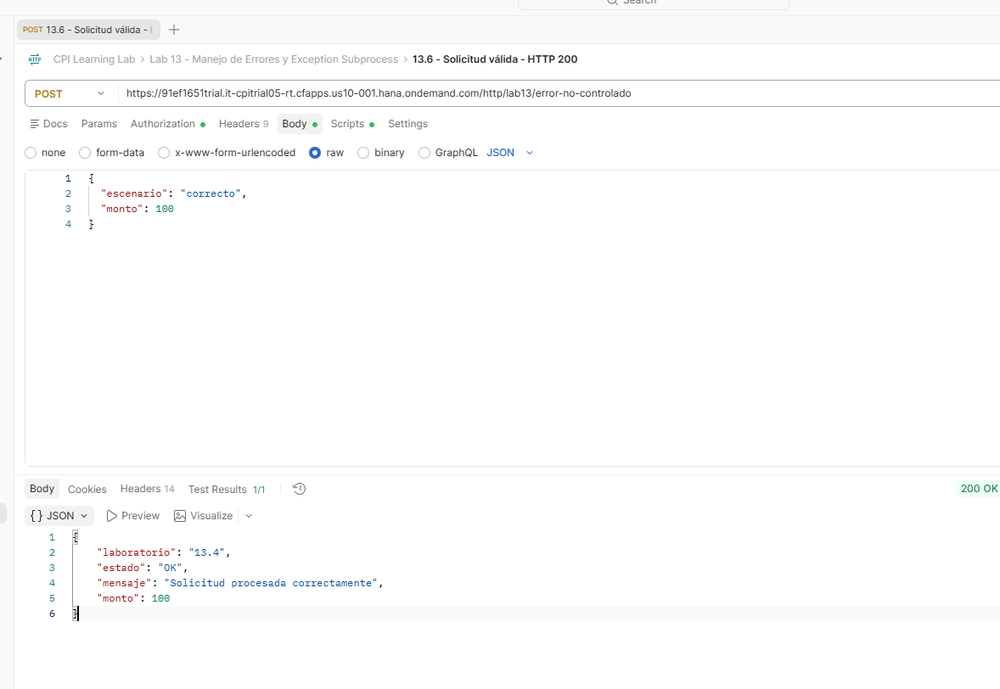

6. **Probar error funcional.** POST `{"escenario":"funcional","monto":-100}`. Resultado HTTP `400`, `tipoError = "FUNCIONAL"`, `codigo = "MONTO_INVALIDO"`, **1/1 test Postman**. **Motivo:** rechazar una entrada inválida sin generar una excepción técnica.

   **Evidencia 13-40 - HTTP 400.** Error de validación de negocio.

   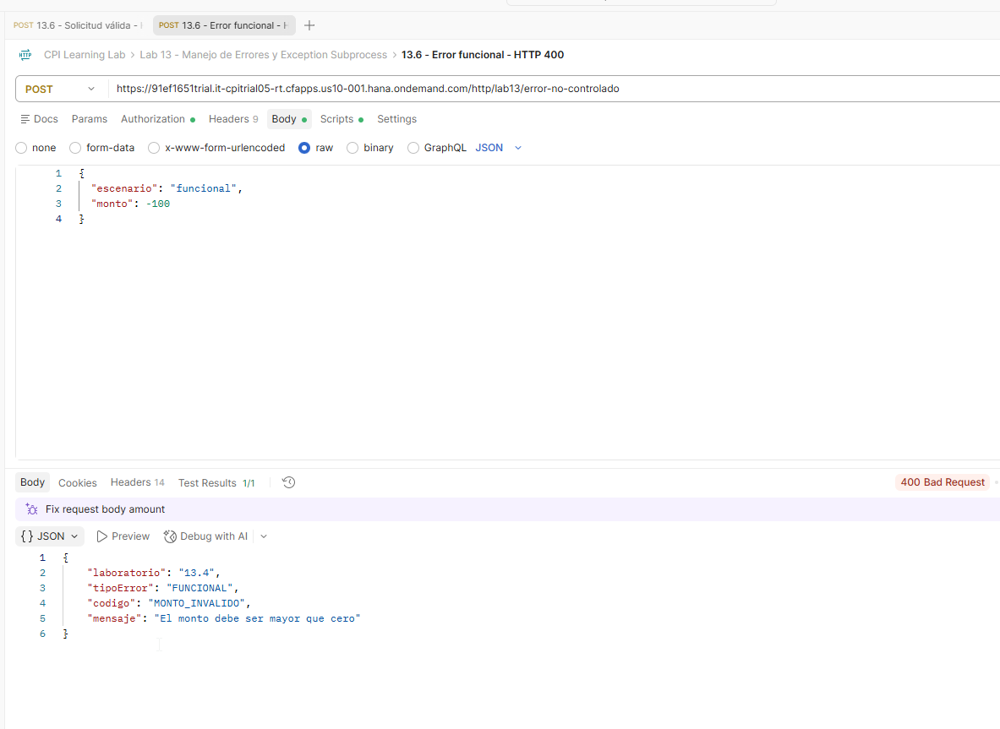

7. **Probar error técnico.** POST `{"escenario":"tecnico","monto":100}`. Resultado HTTP `500`, `tipoError = "TECNICO"`, `codigo = "ERROR_INTERNO"`, **1/1 test Postman**. El body no expone información interna. **Motivo:** verificar el contrato del Exception Subprocess.

   **Evidencia 13-41 - HTTP 500.** Respuesta técnica controlada.

   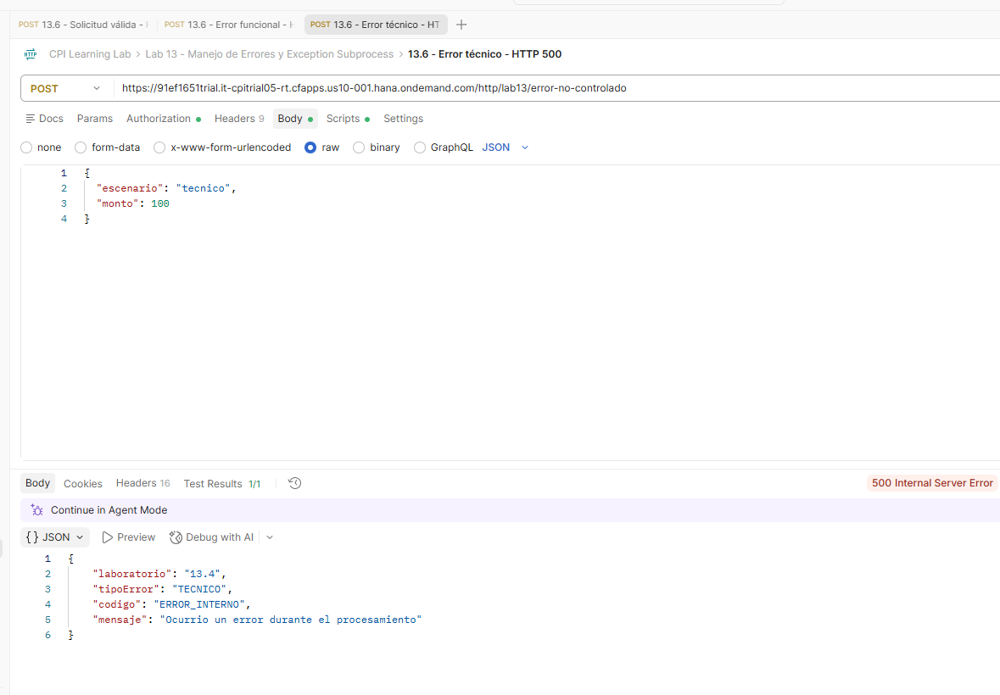

8. **Consultar el MPL.** La ejecución técnica más reciente quedó `Completed` (13 ms), aunque Postman recibió HTTP 500. **Motivo:** validar por separado respuesta HTTP y estado de procesamiento.

   **Evidencia 13-42 - MPL Completed.** Ejecución de error técnico gestionado con Message End.

   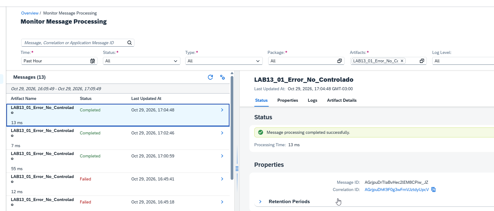

### Resultado esperado y validación

| Escenario | HTTP | Resultado | Tests |
|---|---|---|---|
| Solicitud válida | 200 | `estado = OK`, `monto = 100` | 1/1 |
| Error funcional | 400 | `tipoError = FUNCIONAL`, `codigo = MONTO_INVALIDO` | 1/1 |
| Error técnico | 500 | `tipoError = TECNICO`, `codigo = ERROR_INTERNO` | 1/1 |

**Resultado final:** versión `1.0.6` desplegada en `Started`; tres respuestas validadas y MPL `Completed` en el escenario técnico.

**Aprendizajes:** el manejo de excepciones técnicas puede centralizarse sin convertir errores funcionales en fallos de ejecución. Para integraciones productivas, elegir Message End o Error End requiere considerar monitorización, alertas y reintentos; aquí se documenta el comportamiento observado en el laboratorio.

---

## Aprendizajes consolidados

1. HTTP 500 no implica necesariamente MPL `Failed`; una excepción capturada y finalizada con Message End puede producir MPL `Completed`.
2. El MPL es indispensable para localizar errores técnicos que no se muestran en la respuesta HTTP.
3. La información real de la excepción puede recuperarse en un Exception Subprocess, pero no debe exponerse indiscriminadamente en producción.
4. Los errores de validación de negocio y las excepciones técnicas requieren rutas de respuesta diferentes.
5. Un despliegue `Started` debe complementarse con pruebas de procesamiento reales.
6. Message End y Error End produjeron estados MPL diferentes y respuestas distintas al consumidor.
7. La versión 1.0.6 distingue los contratos HTTP 200, 400 y 500.

## Referencias

- [SAP Integration Suite - SAP Help Portal](https://help.sap.com/docs/integration-suite)
- [Metodología de laboratorios](METODOLOGIA-LABORATORIOS.md)
- [KBA y hallazgos](kba-y-hallazgos.md)
