# 14 - Monitorización, MPL y trazabilidad

**Estado del tema:** 🟨 En curso
**Package:** `CPI Learning Lab`
**iFlow reutilizado:** `LAB13_01_Error_No_Controlado`
**Versión desplegada observada:** `1.0.6`
**Endpoint relativo:** `/http/lab13/error-no-controlado`

## Objetivo

Localizar ejecuciones de Cloud Integration, interpretar estados y registros de procesamiento (MPL), investigar segmentos, actividades y tiempos, y utilizar Trace para comparar el contenido del mensaje a lo largo de su procesamiento.

## Conceptos

- **Monitor Message Processing:** consulta de ejecuciones y sus detalles.
- **Message Processing Log (MPL):** registro técnico de procesamiento de un mensaje.
- **Completed / Failed:** estados internos que no equivalen necesariamente al código HTTP.
- **Message ID:** identifica una ejecución concreta.
- **Correlation ID:** permite buscar mensajes relacionados por contexto de correlación.
- **Segment / Activities:** etapas y operaciones técnicas registradas.
- **Log Level Info:** ofrece estados, tiempos, identificadores y determinados errores.
- **Trace:** habilita inspección de pasos y contenido del mensaje en puntos registrados; debe utilizarse temporalmente y con precauciones de seguridad.
- **Headers:** metadatos asociados al mensaje, incluidos los códigos HTTP.
- **Exchange Properties:** datos de contexto del intercambio, distintos de la pestaña Properties del MPL.

## Prerrequisitos

- SAP Integration Suite y permisos para Monitor Message Processing.
- iFlow `LAB13_01_Error_No_Controlado`, versión `1.0.6`, disponible.
- Postman con acceso autorizado al endpoint.
- Conocimientos del capítulo 13: Groovy, Exception Subprocess y respuestas HTTP.
- No es necesario modificar, versionar ni desplegar el iFlow para estos laboratorios.

## Estado de los microaprendizajes

| ID | Laboratorio | Estado | Validación |
|---|---|---|---|
| 14.1 | Monitor Message Processing y estados de ejecución | ✅ Completado | Completed/Failed, MPL y Artifact Details; evidencias 14-01 a 14-08 |
| 14.2 | MPL: identificadores, segmentos y tiempos | ✅ Completado | Message ID, Correlation ID, segmentos y tiempos; evidencias 14-09 a 14-13 |
| 14.3 | Trace y seguimiento paso a paso | ✅ Completado | Trace, Run Steps, Model Step ID y payload inspeccionados |
| 14.4 | Headers, Properties y Body durante la ejecución | ✅ Completado | Comparación de HTTPS, headers, propiedades y payload |
| 14.5 | Diagnóstico de errores técnicos y funcionales | ⬜ Pendiente | — |
| 14.6 | Correlación y trazabilidad de mensajes | ⬜ Pendiente | — |

---

## 14.1 - Monitor Message Processing y estados de ejecución

**Estado:** ✅ Completado

### Objetivo

Localizar ejecuciones y distinguir el estado interno del procesamiento de la respuesta HTTP.

### Laboratorio paso a paso

1. Abrir **Monitor → Integrations and APIs → Message Status Overview** y seleccionar **Past Week**. Se observaron 35 mensajes para el iFlow: 28 Completed y 7 Failed.

   **Motivo:** obtener una visión agregada del estado de procesamiento.

   **Evidencia 14-01 — Vista inicial.** Resumen por artefacto y período.

   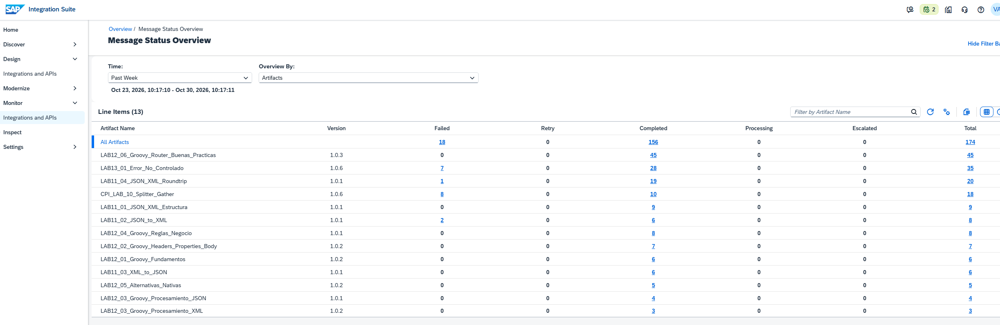

2. Seleccionar las 28 ejecuciones **Completed**. Una ejecución del 29/10/2026 a las 17:04:48 mostró 13 ms y log Info.

   **Evidencia 14-02 — Completed.** Ejecuciones completadas.

   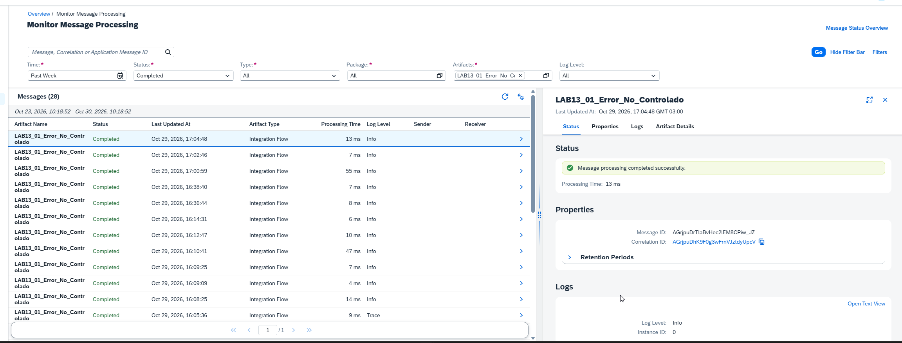

3. Revisar la pestaña **Properties** del mensaje: se observaron Message ID, Correlation ID y Retention Periods. Esta pestaña no equivale a la colección completa de Exchange Properties del iFlow.

   **Evidencia 14-03 — Properties.** Identificadores y retención.

   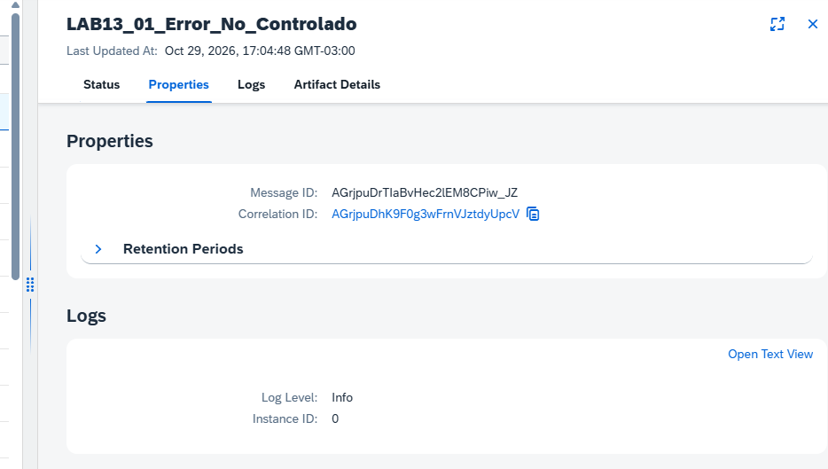

4. Abrir **Logs → Open Text View**. La ejecución Completed registró `OverallStatus = COMPLETED`, `IntermediateError = true` y una `IllegalStateException` asociada a `GRV_ProvocarError_v2.groovy`.

   **Motivo:** comprobar que un MPL Completed puede conservar información de una excepción intermedia.

   **Evidencia 14-04 — Logs Info.** Nivel de logging.

   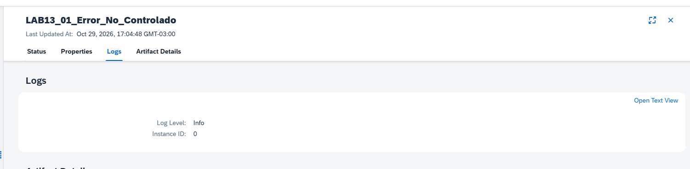

   **Evidencia 14-05 — MPL textual.** Estado y error intermedio.

   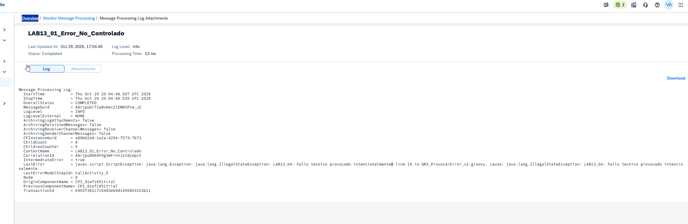

5. Abrir **Artifact Details**: nombre e ID `LAB13_01_Error_No_Controlado`, tipo Integration Flow y package CPI Learning Lab.

   **Evidencia 14-06 — Artifact Details.** Identificación del artefacto.

   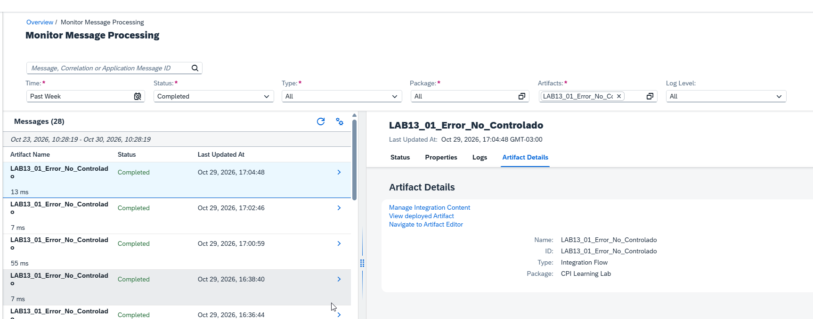

6. Seleccionar las siete ejecuciones **Failed**. La elegida, del 29/10/2026 a las 16:45:41, duró 12 ms; Error Details incluyó `HttpResponseException` y la excepción del script.

   **Evidencia 14-07 — Failed.** Listado y error.

   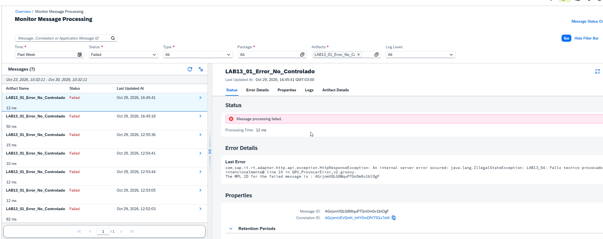

7. Consultar su **Open Text View**: `OverallStatus = FAILED`, `LogLevel = INFO`, `IntermediateError = true`, `LastErrorModelStepId = CallActivity_5`.

   **Evidencia 14-08 — MPL Failed.** Estado, excepción e ID técnico.

   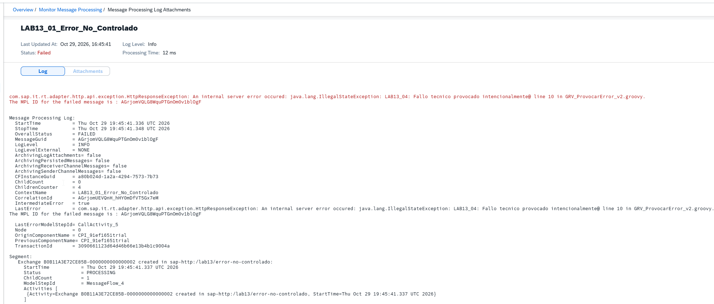

### Resultado esperado y validación

| Observación | Completed | Failed |
|---|---|---|
| Estado MPL | `COMPLETED` | `FAILED` |
| Log Level | `INFO` | `INFO` |
| IntermediateError | `true` | `true` |
| Duración | 13 ms | 12 ms |

**Aprendizaje:** el estado MPL y la respuesta HTTP son dimensiones diferentes; un MPL Completed puede registrar errores intermedios.

---

## 14.2 - Message Processing Log: identificadores, segmentos y tiempos

**Estado:** ✅ Completado

### Objetivo

Buscar ejecuciones por identificadores y comprender sus segmentos, actividades e IDs técnicos.

### Laboratorio paso a paso

1. Buscar la ejecución Failed por **Message ID**. El monitor devolvió un mensaje.

   **Evidencia 14-09 — Message ID.** Búsqueda individual.

   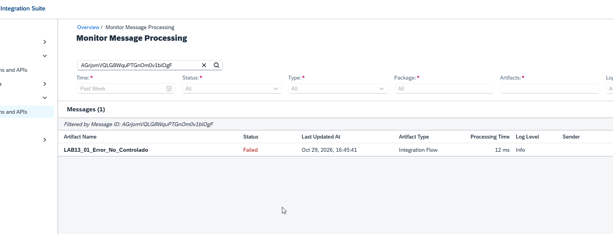

2. Buscar el mismo mensaje por **Correlation ID**. Se obtuvo un mensaje, sin otros registros correlacionados en esa búsqueda.

   **Evidencia 14-10 — Correlation ID.** Búsqueda por correlación.

   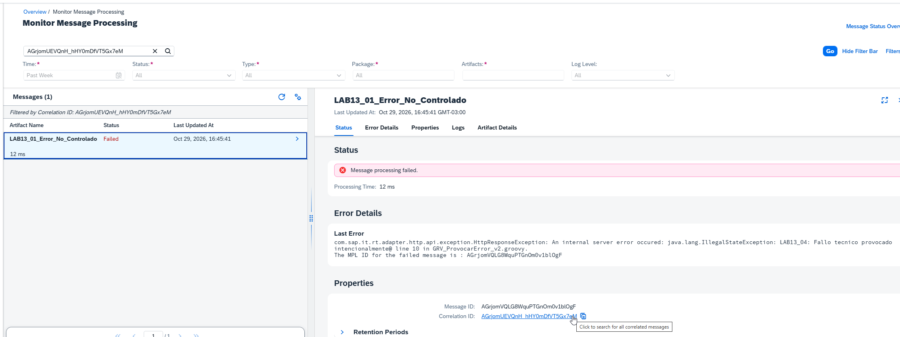

3. Revisar **Logs → Open Text View**, secciones Segment y Activities. Aparecieron operaciones `setHeader`, `bean`, `direct`, el ID `CallActivity_5` y la excepción del script.

   **Evidencia 14-11 — Segmentos y actividades.** Detalle técnico.

   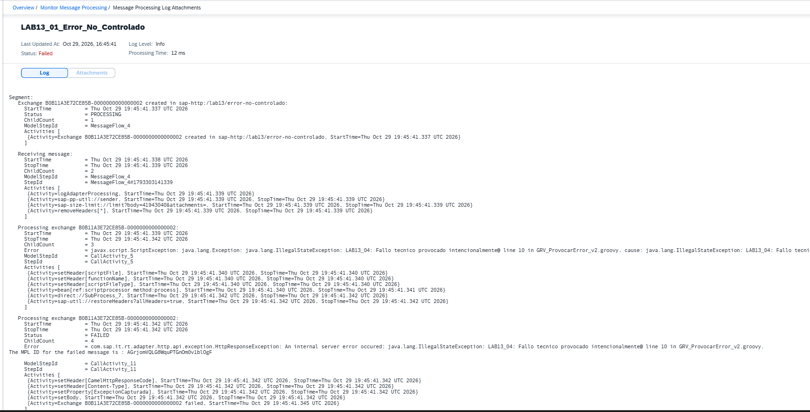

4. Desde Artifact Details abrir **View deployed Artifact**. Se observó `Start → Provocar Error → End` y el Exception Subprocess `Error Start 1 → CM_Respuesta_Error → End 1`.

   **Evidencia 14-12 — Artefacto desplegado.** Estructura del iFlow.

   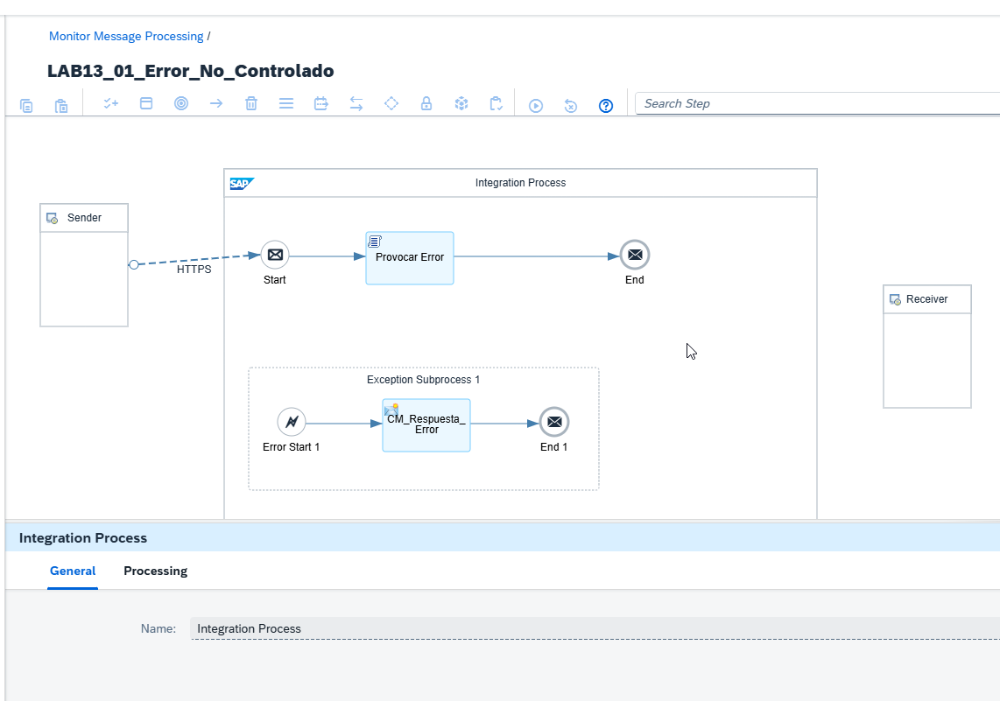

5. Seleccionar **Provocar Error → General**. La vista mostró el nombre, pero no un ID visible que demostrara la equivalencia con `CallActivity_5`. Esa correspondencia se verificó posteriormente en 14.3 mediante Trace.

   **Evidencia 14-13 — Groovy.** Identificación visual y limitación de la pestaña General.

   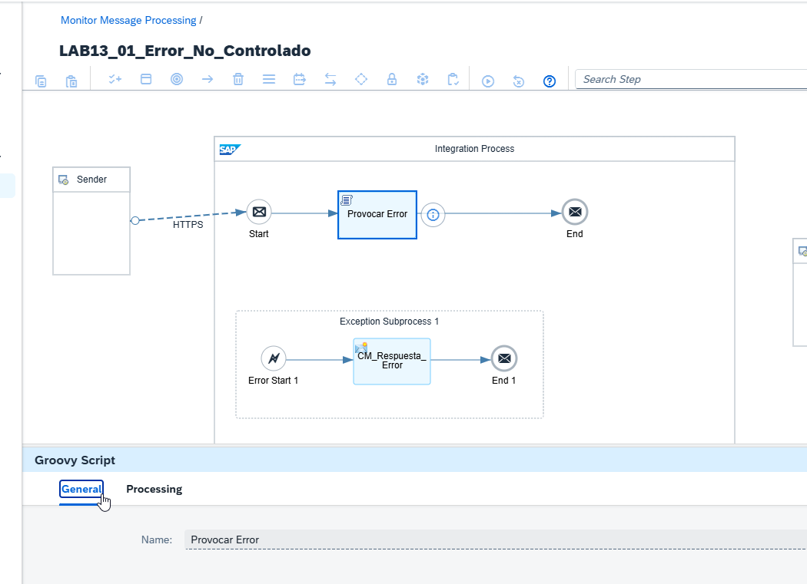

6. Comparar los timestamps del MPL Failed: 19:45:41.336 a 19:45:41.348 UTC. Diferencia: **12 ms**, coincidente con Processing Time. Se reutiliza la evidencia 14-08.

### Resultado esperado y validación

Se recuperó la ejecución mediante ambos identificadores, se inspeccionaron segmentos y se verificó la duración. El MPL Info aportó información técnica útil, pero la pestaña General no permitió relacionar directamente el ID interno con el nombre visual.

---

## 14.3 - Trace y seguimiento paso a paso

**Estado:** ✅ Completado

### Objetivo

Inspeccionar una ejecución con Trace y relacionar los identificadores internos con los componentes del proceso.

### Laboratorio paso a paso

1. En **Manage Integration Content**, seleccionar `LAB13_01_Error_No_Controlado`, versión `1.0.6`, estado Started. Cambiar temporalmente el nivel de logging de **Info** a **Trace**.

   **Motivo:** habilitar la inspección del contenido y de los pasos de procesamiento sin modificar el diseño del iFlow.

   **Resultado observado:** SAP informó expiración de Trace y retorno a Info el 30/10/2026 a las 11:48:09.

2. Ejecutar desde Postman el POST existente al endpoint `/http/lab13/error-no-controlado` con:

   ```json
   {"laboratorio":"13.1","mensaje":"Prueba de error no controlado"}
   ```

   **Resultado observado:** HTTP 400 y respuesta:

   ```json
   {
     "laboratorio": "13.4",
     "tipoError": "FUNCIONAL",
     "codigo": "MONTO_INVALIDO",
     "mensaje": "El monto debe ser mayor que cero"
   }
   ```

   **Motivo:** el script de la versión vigente valida el campo `monto`; el cuerpo reutilizado no lo incluye. La petición denominada 13.1 no reproduce el comportamiento histórico de la versión 1.0.1.

3. Abrir la ejecución correspondiente en **Monitor Message Processing**. Se observó estado **Completed**, nivel Trace y tiempo total de **1 s 322 ms**.

   **Motivo:** comprobar que el estado de procesamiento Completed puede coexistir con una respuesta HTTP 400.

4. Revisar **Message Processing Run**. La ejecución presentó cuatro pasos:

   | Process Step | Componente | Duración observada |
   |---|---|---|
   | 1 | HTTPS | Menos de 3 ms |
   | 2 | HTTPS | 89 ms |
   | 3 | Provocar Error (Groovy Script) | 932 ms |
   | 4 | End | 3 ms |

   **Motivo:** distinguir los pasos registrados y localizar el procesamiento del script.

5. Seleccionar **Provocar Error → Log Content → Properties**. Se observó `Model Step ID = CallActivity_5`, tipo **Groovy Script**. En **End**, `Model Step ID = EndEvent_2`, tipo **End Message**.

   **Resultado validado:** en esta ejecución se confirmó la correspondencia `CallActivity_5` ↔ `Provocar Error`, que no era visible desde la pestaña General del artefacto en 14.2.

6. Consultar las actividades del paso Groovy: `setHeader[scriptFile]`, `setHeader[functionName]`, `setHeader[scriptFileType]` y `bean[ref:scriptprocessor method:process]`.

   **Motivo:** distinguir el tiempo total del paso de las actividades internas registradas.

### Resultado esperado y validación

Trace permitió observar la secuencia de ejecución, los tiempos, los nombres visuales de componentes y los identificadores técnicos. Se verificó el mapeo de `CallActivity_5` con `Provocar Error` sin editar ni desplegar el iFlow.

---

## 14.4 - Headers, Exchange Properties y Body durante la ejecución

**Estado:** ✅ Completado

### Objetivo

Comparar el contenido del mensaje antes del procesamiento Groovy y antes del evento final, diferenciando los datos de entrada, los metadatos HTTP y las propiedades técnicas del intercambio.

### Laboratorio paso a paso

1. En **Trace**, seleccionar el primer paso **HTTPS**. Su Log Content identificó `Model Step ID = MessageFlow_4`, descripción **Exchange created**. El contenido del mensaje no estaba disponible en ese punto.

   **Motivo:** comprender que la ausencia de Message Content en una etapa no implica que la petición completa carezca de contenido.

2. Seleccionar el segundo paso **HTTPS**, también asociado a `MessageFlow_4`, descripción **Receiving message**. Se observaron actividades de recepción y preparación, como `logAdapterProcessing`, `sap-pp-util://sender`, comprobación de tamaño y eliminación de headers.

   **Motivo:** diferenciar dos etapas registradas del mismo flujo de entrada; no se trata de un adaptador Receiver independiente.

3. Seleccionar **Provocar Error → Message Content → Payload**, opción **Message before Step**. Se observó el JSON original enviado por Postman.

   **Motivo:** establecer el contenido de entrada antes de la validación funcional.

4. Consultar **Message Content → Header** antes de Groovy. Entre los valores observados figuraron `CamelHttpMethod = POST`, `CamelHttpUrl` y `SAP_MessageProcessingLogID`.

   **Motivo:** identificar metadatos de transporte y el identificador de la ejecución.

5. Consultar **Message Content → Exchange Properties** antes de Groovy. Se observaron propiedades internas como `SAP_MessageProcessingLogConfiguration = TRACE`, `SAP_MPL_LogLevel_Internal = TRACE`, `SAP_RunId` y `SAP_MonitoringStateProperties`.

   **Motivo:** distinguir el contexto técnico del intercambio de los headers HTTP. Estas propiedades son datos de la ejecución observada, no configuraciones que el usuario deba crear manualmente.

6. Seleccionar **End → Message Content → Payload**, opción **Message before Step**. Se observó el JSON de error funcional con `MONTO_INVALIDO`, distinto del cuerpo original.

   **Motivo:** comprobar que el contenido fue transformado antes de finalizar el procesamiento.

7. Consultar **Header** antes de End. Se observaron `CamelHttpResponseCode = 400` y `Content-Type = application/json`, además de `CamelHttpMethod = POST`.

   **Motivo:** verificar cómo la respuesta funcional define el estado HTTP y el formato devuelto al consumidor.

8. Comparar **Exchange Properties** antes de End con las observadas antes de Groovy. Se mantuvieron los identificadores de ejecución y el nivel Trace; `SAP_MonitoringStateProperties` pasó a referenciar `EndEvent_2` en lugar de `CallActivity_5`. La propiedad `SAP_InspectModelStepId241` seguía mostrando `CallActivity_5` en la captura examinada.

   **Motivo:** evitar asumir que todas las propiedades técnicas cambian de forma uniforme entre pasos.

### Resultado esperado y validación

Se comprobó el cambio del Body desde el JSON original a la respuesta funcional, la incorporación de headers de respuesta HTTP 400 y la persistencia de propiedades técnicas del mensaje. Los dos pasos HTTPS compartieron `MessageFlow_4` pero registraron actividades distintas.

### Aprendizajes

- **Process Step** y **Model Step ID** no son equivalentes.
- Trace ofrece contexto visual y contenido por etapa, mientras Info ya contiene numerosos datos técnicos en formato textual.
- El estado MPL Completed no demuestra que la respuesta HTTP sea 200.
- La correspondencia entre nombres visibles e IDs técnicos debe verificarse en la ejecución concreta.
- Los datos de Trace pueden incluir valores sensibles: revisar capturas antes de publicarlas.

---

## Problemas encontrados y hallazgos

- La pestaña General del artefacto desplegado no mostraba la correspondencia de `CallActivity_5`; Trace permitió confirmarla para `Provocar Error`.
- La petición Postman histórica del laboratorio 13.1 devolvió HTTP 400 al ejecutarse contra la versión 1.0.6; el script vigente aplicó la validación funcional del capítulo 13.
- Los dos registros HTTPS compartieron `MessageFlow_4`, pero representaron etapas distintas de la recepción.
- La observación de nombres e IDs en esta ejecución no demuestra una regla universal sobre el efecto de renombrar componentes.

## Continuidad del capítulo

Los laboratorios 14.1 a 14.4 quedaron validados mediante pruebas prácticas. Permanecen pendientes 14.5 y 14.6. El capítulo continúa **🟨 En curso**. Durante los laboratorios 14.3 y 14.4 se cambió temporalmente el nivel de logging a Trace, sin modificar ni versionar el iFlow.

## Referencias

- [Metodología de laboratorios](METODOLOGIA-LABORATORIOS.md)
- [Capítulo 13 — Manejo de errores y Exception Subprocess](13-manejo-errores-exception-subprocess.md)
- [SAP Help Portal — Cloud Integration](https://help.sap.com/docs/integration-suite/sap-integration-suite/cloud-integration)
