# 15 - Seguridad: OAuth, Basic, certificados y Security Material

**Estado del tema:** ✅ `Completado`
**Package:** `CPI Learning Lab`
**iFlows reutilizados:** `Request Reply` (`Request_Reply`) y `Consulta Clientes`
**Fecha de las validaciones:** 30–31/10/2026 y 03/11/2026

## Objetivo

Comprender los mecanismos de autenticación y autorización de entrada y salida en SAP Cloud Integration, administrar credenciales mediante Security Material y distinguir la validación de TLS de la autorización HTTP. Las pruebas prácticas y sus límites se documentan por laboratorio.

## Conceptos

- **Inbound / HTTPS Sender:** controla la recepción de solicitudes y la autorización necesaria para invocar un endpoint de integración.
- **Outbound / HTTP Receiver:** configura la comunicación de CPI hacia otro servicio, incluida la autenticación que exige el receptor.
- **OAuth 2.0 Client Credentials:** permite a un cliente solicitar un token de acceso mediante sus credenciales, sin intervención de un usuario final.
- **Bearer token:** credencial de acceso que debe protegerse durante su vigencia.
- **Security Material:** almacena configuraciones de credenciales referenciables por componentes compatibles.
- **Where-Used:** identifica artefactos que referencian un material de seguridad.
- **MPL:** registro de procesamiento de mensajes; su ausencia en una búsqueda no identifica por sí sola la causa interna de un rechazo HTTP.

## Prerrequisitos

- Acceso a SAP Integration Suite, Cloud Integration, Design y Monitor.
- Package `CPI Learning Lab` e iFlows del capítulo 08 disponibles.
- Colección Postman `CPI Learning Lab`, con peticiones del capítulo 08.
- No publicar tokens, secretos, contraseñas, claves privadas ni service keys.

---

## 15.1 - Arquitectura de seguridad: autenticación y autorización

**Estado:** ✅ Completado

### Objetivo

Identificar las funciones de seguridad disponibles en el tenant, distinguir la seguridad de entrada y salida, y comprobar una dependencia real entre un iFlow y un Security Material desplegado.

### Laboratorio paso a paso y validación

1. Abrir **Monitor → Integrations and APIs → Manage Security**. Se observaron `Security Material` (1 artefacto), `Keystore` (13 entradas), `PGP Keys` (0), `Access Policies` (0), `User Roles` (2), además de `JDBC Material` y `Connectivity Tests` sin contador visible en la captura.

   **Motivo:** verificar las funciones visibles en el entorno antes de diseñar ejercicios dependientes de ellas.

   **Evidencia 15-01 — Secciones de Manage Security.** Vista general de las tarjetas disponibles.

   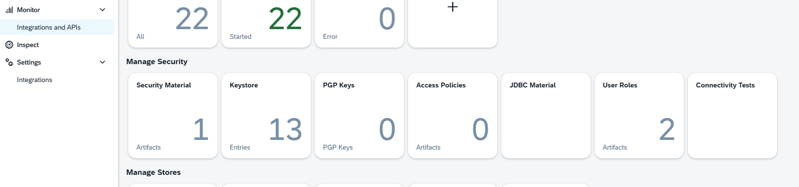

2. Abrir **Security Material**. Se observó `OAUTH2_Consulta_Clientes`, tipo `OAuth2 Client Credentials`, estado `Deployed`, con fecha de despliegue 20/10/2026.

   **Motivo:** identificar un artefacto real y evitar crear credenciales redundantes.

   **Evidencia 15-02 — Material OAuth existente.** Lista de Security Material y estado de despliegue.

   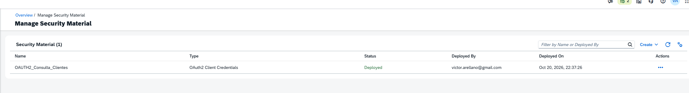

3. Abrir la configuración del material, **sin guardar ni desplegar cambios**. Se observaron Token Service URL, Client ID, Client Secret, Grant Type `Send as Part of URL`, Client Authentication `Send as Request Header`, Scope vacío, Content Type `application/json`, Resource y Audience vacíos, y ausencia de Custom Parameters. Los valores sensibles fueron ocultados.

   **Motivo:** diferenciar el mecanismo de solicitud del token de la autenticación del cliente ante el servidor de autorización. Esta inspección no demuestra emisión exitosa del token desde el adaptador.

   **Evidencia 15-03 — Configuración OAuth.** Campos de OAuth2 Client Credentials con identificadores y secretos ocultos.

   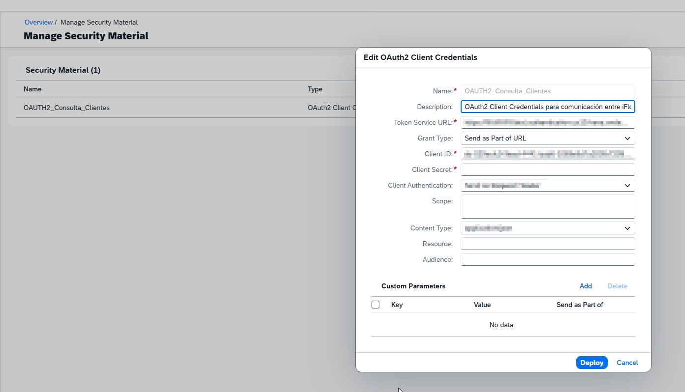

4. Utilizar **Actions → Where-Used** sobre `OAUTH2_Consulta_Clientes`. SAP mostró una referencia: iFlow `Request Reply`, ID `Request_Reply`, package `CPI Learning Lab`, componente `HTTP` de tipo `Adapter`.

   **Motivo:** localizar dependencias sin abrir todos los iFlows individualmente. El resultado demuestra una referencia de configuración, no una ejecución correcta.

   **Evidencia 15-04 — Where-Used.** Identificación del iFlow y del adaptador que referencian el material.

   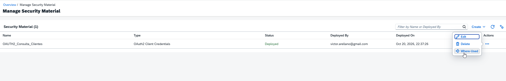

5. Abrir `Request Reply` en visualización y seleccionar **HTTP Receiver → Connection**. Se observó método `GET`, Proxy Type `Internet`, autenticación `OAuth2 Client Credentials`, Credential Name `OAUTH2_Consulta_Clientes` y destino `/http/lab08/consulta-clientes`.

   **Motivo:** verificar dónde se utiliza el material de seguridad en una comunicación saliente.

   **Evidencia 15-05 — HTTP Receiver y credencial OAuth.** Configuración del adaptador y referencia al material desplegado.

   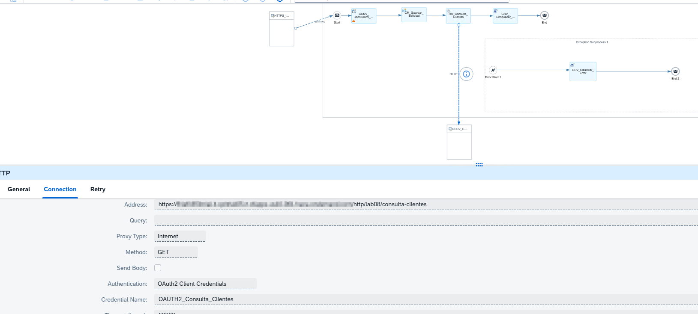

6. Reutilizar en Postman la petición **08.2 - Content Enricher → POST Enriquecer Solicitud Cliente**. Se envió `solicitudId = SOL-1001`, `clienteId = 1001` y `origen = POSTMAN` al endpoint `/http/lab08/request-reply`. Se obtuvo **HTTP 200** y XML `SolicitudEnriquecida` con cliente `1001`, nombre `Ana` y segmento `PREMIUM`.

   **Motivo:** validar el resultado funcional del escenario existente sin crear otro iFlow.

   **Evidencia 15-06 — Respuesta enriquecida.** Petición y respuesta XML correctas en Postman.

   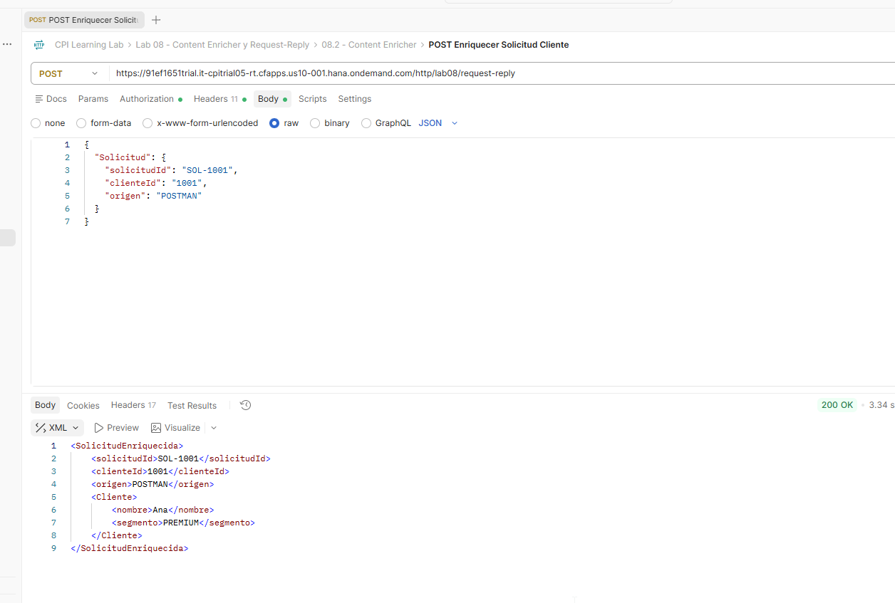

7. Revisar **Monitor Message Processing**. Se observaron `Request Reply` con estado `Completed`, duración **2 s 600 ms** y actualización a las **18:27:44**, y `Consulta Clientes` con estado `Completed`, duración **8 ms** y actualización a las **18:27:43**, hora GMT-03:00.

   **Motivo:** contrastar la respuesta del consumidor con el registro de procesamiento de ambos iFlows.

   **Evidencia 15-07 — Ejecuciones Completed.** Monitor con ambos iFlows y sus tiempos observados.

   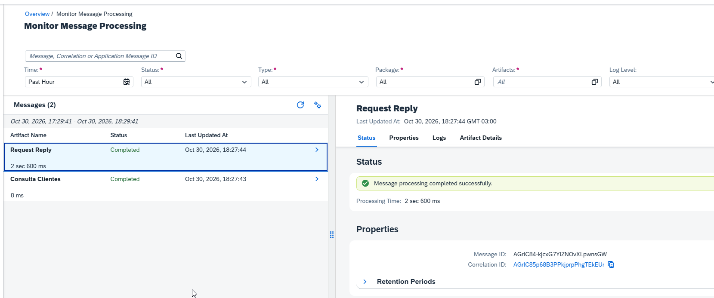

### Resultado esperado y validación

Se verificó la disponibilidad de las funciones de seguridad, la existencia del material OAuth, su dependencia en un HTTP Receiver, una respuesta enriquecida HTTP 200 y dos MPL Completed. **No se inspeccionó directamente el intercambio de tokens que realiza el adaptador.**

### Aprendizajes

- La seguridad de entrada y de salida se configura en componentes diferentes.
- Where-Used permite analizar dependencias antes de modificar materiales compartidos.
- La referencia de configuración, la respuesta funcional y el MPL son evidencias complementarias, pero no equivalentes.

---

## 15.2 - OAuth 2.0 Client Credentials

**Estado:** ✅ Completado (alcance práctico definido; prueba de permisos insuficientes no realizada)

### Objetivo

Verificar la emisión de un token Client Credentials, sus metadatos, el rechazo de solicitudes sin credenciales o con token inválido y el rol requerido por el HTTPS Sender.

### Laboratorio paso a paso y validación

1. Revisar la petición existente de Postman **08.2 → Get OAuth Token**. Configuración observada: método `POST`, URL `{{token_url}}`, Body `x-www-form-urlencoded` con `grant_type=client_credentials`, autenticación `Basic Auth` con `{{client_id}}` y `{{client_secret}}`, y encabezado `Content-Type: application/x-www-form-urlencoded`.

   **Motivo:** distinguir la autenticación del cliente OAuth mediante Basic de la autenticación Bearer ante el recurso final. Las capturas de configuración se utilizaron para inspección; no se duplicaron como evidencias numeradas.

2. Ejecutar **Get OAuth Token**. Postman devolvió **HTTP 200**, `token_type = bearer`, `expires_in = 3599`, `scope` con `ESBMessaging.send` y `API.invoke`, y campo `jti`. La duración anunciada equivale a `3599 / 60 = 59,98` minutos, aproximadamente 60 minutos desde la emisión. No se verificó renovación automática.

   **Motivo:** comprobar la emisión del token y distinguir su duración, tipo e información de permisos. `jti` identifica el token; no es el Message ID ni el Correlation ID de CPI.

   **Evidencia 15-08 — Respuesta del servidor OAuth.** HTTP 200 y metadatos del token; valor de `access_token` oculto.

   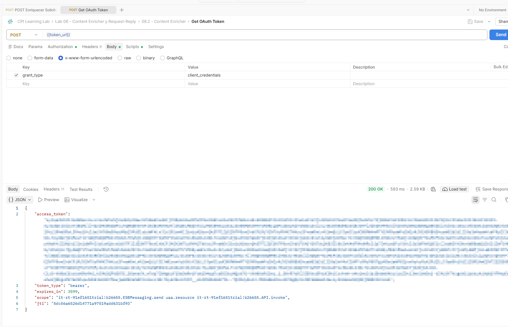

3. Crear la carpeta de Postman **Lab 15 - Seguridad** y duplicar la petición de enriquecimiento como **15.2 - OAuth - Token inválido**. Confirmar `Authorization = Bearer Token` y uso original de `{{access_token}}`. Sustituir **solo en la petición duplicada** por `TOKEN_INVALIDO_LAB15` y ejecutar. Resultado: **HTTP 401 Unauthorized**.

   **Motivo:** comprobar rechazo de un token incorrecto sin modificar variables compartidas ni la petición histórica.

   **Evidencia 15-09 — Token inválido.** Valor de prueba literal y respuesta HTTP 401.

   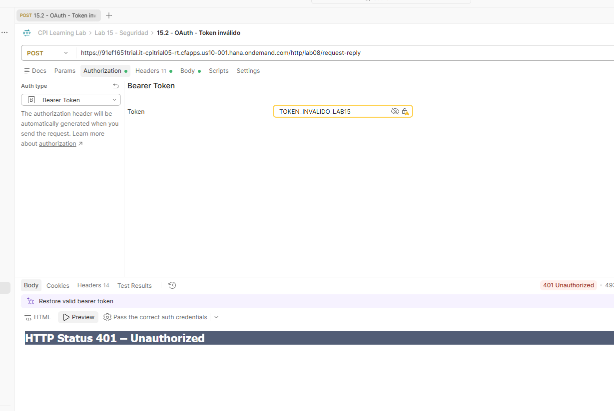

4. Revisar **Monitor Message Processing** con filtro temporal `Past Hour`. Solo aparecieron las ejecuciones anteriores de `Request Reply` y `Consulta Clientes`, sin nueva ejecución visible correspondiente al intento HTTP 401.

   **Motivo:** evaluar si el rechazo se registró como procesamiento del iFlow. El resultado es coherente con rechazo previo al procesamiento, pero no permite identificar de manera concluyente el componente interno que lo produjo.

   **Evidencia 15-10 — Sin nuevo MPL visible.** Resultado de la búsqueda en el intervalo consultado.

   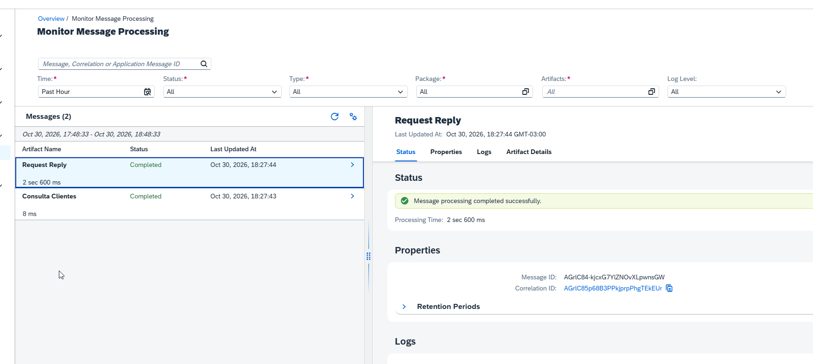

5. Duplicar la petición negativa como **15.2 - OAuth - Sin token**, seleccionar `No Auth` y comprobar que Postman no genera un encabezado Authorization. Ejecutar: **HTTP 401 Unauthorized**.

   **Motivo:** diferenciar ausencia de credenciales y credenciales inválidas; ambas fueron rechazadas en este endpoint.

   **Evidencia 15-11 — Solicitud sin token.** Lista de headers sin Authorization y respuesta HTTP 401.

   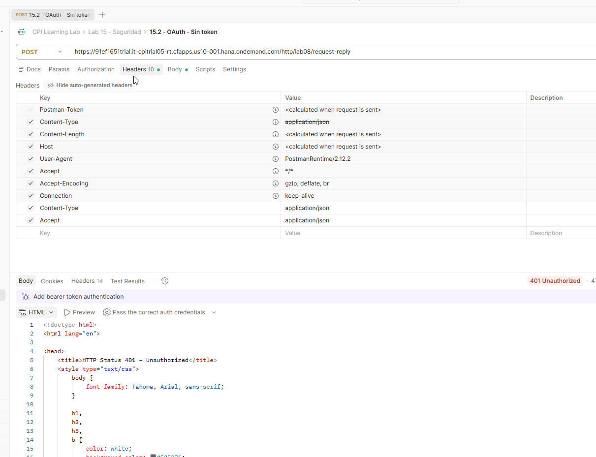

6. Abrir **Manage Security → User Roles**. Se observaron dos roles administrados por SAP: `API.invoke` (descripción: rol predeterminado para invocar API y MCP Server) y `ESBMessaging.send` (rol predeterminado para enviar mensajes a integration flows).

   **Motivo:** relacionar los nombres de roles visibles en CPI con los scopes recibidos en la respuesta OAuth. Su presencia no demuestra asignación a una identidad específica.

   **Evidencia 15-12 — User Roles.** Lista de roles disponibles y propietarios SAP.

   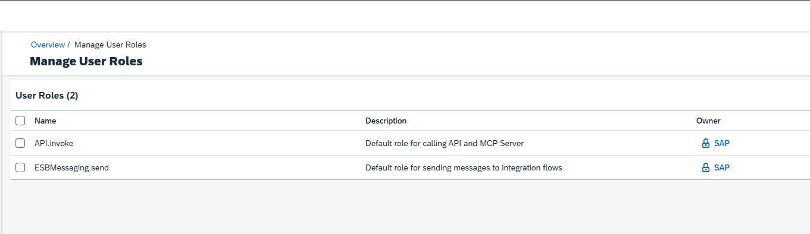

7. Abrir `Request Reply` y seleccionar **HTTPS Sender → Connection**. Se verificó Address `/lab08/request-reply`, `Authorization = User Role`, `User Role = ESBMessaging.send` y `CSRF Protected` desactivado.

   **Motivo:** identificar el requisito de autorización **de entrada**, distinto de la credencial OAuth del HTTP Receiver.

   **Evidencia 15-13 — HTTPS Sender y rol exigido.** Configuración de autorización de entrada.

   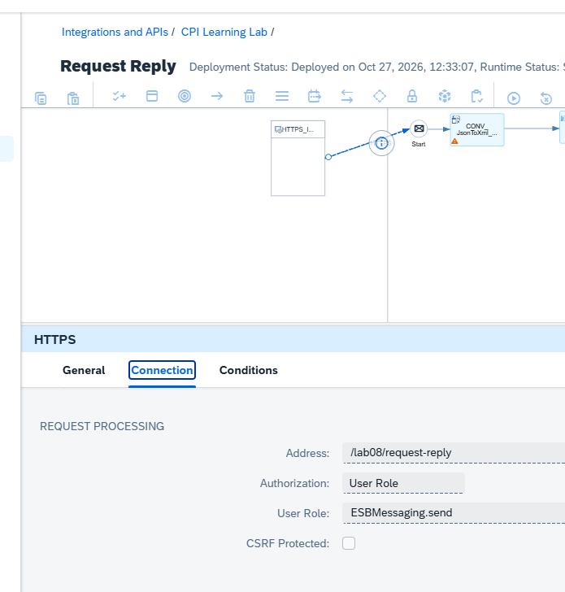

### Resultado esperado y validación

| Escenario | Resultado observado | Validación |
|---|---|---|
| Obtención del token | HTTP 200; Bearer; `expires_in=3599`; scopes presentes | Confirmado |
| Solicitud con token válido (escenario reutilizado de 15.1) | HTTP 200; XML enriquecido | Confirmado |
| Solicitud con token inválido | HTTP 401 | Confirmado |
| Solicitud sin token | HTTP 401 | Confirmado |
| Nuevo MPL del rechazo por token inválido | No visible en la búsqueda realizada | Observación confirmada, causa interna no demostrada |
| HTTPS Sender requiere `ESBMessaging.send` | Configuración visible | Confirmado |
| Token válido sin el rol requerido | No ejecutado | No validado |

### Aprendizajes

- Basic Auth puede servir para autenticar al cliente ante el servidor de tokens, mientras que el endpoint de integración recibe un Bearer token.
- La presencia de scopes en el token y la exigencia de un User Role en el Sender son hechos distintos; no se probó un escenario de permisos insuficientes.
- HTTP 401 se observó tanto para ausencia de token como para token inválido.
- No todos los rechazos HTTP se reflejan necesariamente como un nuevo MPL visible en el monitor consultado.

---

## 15.3 — Basic Authentication

**Estado:** ✅ Completado

### Objetivo

Configurar una autenticación Basic saliente mediante un material de seguridad de tipo User Credentials, comprobar la ejecución correcta y diagnosticar un rechazo por contraseña incorrecta.

### Conceptos y prerrequisitos

- La autenticación Bearer del HTTPS Sender protege la entrada a CPI; la autenticación Basic del HTTP Receiver protege la salida hacia el servicio externo.
- `User Credentials` permite almacenar usuario y contraseña sin escribirlos en el iFlow.
- Package `CPI Learning Lab`, acceso a Design, Monitor, Security Material y Postman.

### Laboratorio paso a paso

1. Crear el iFlow `LAB15_03_Basic_Authentication` en `CPI Learning Lab`.

   **Motivo:** aislar el escenario Basic sin modificar los iFlows utilizados en laboratorios anteriores.

   **Evidencia 15-14 — iFlow creado.**

   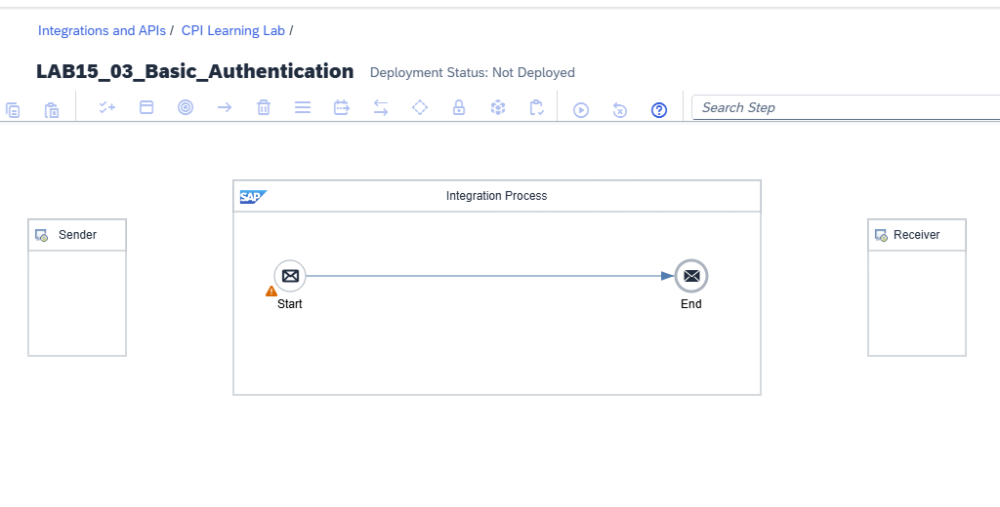

2. Configurar HTTPS Sender con dirección `/lab15/basic-authentication`, `Authorization = User Role`, rol `ESBMessaging.send` y CSRF desactivado.

   **Motivo:** conservar la protección OAuth de entrada y distinguirla de la autenticación Basic de salida.

   **Evidencia 15-15 — HTTPS Sender configurado.**

   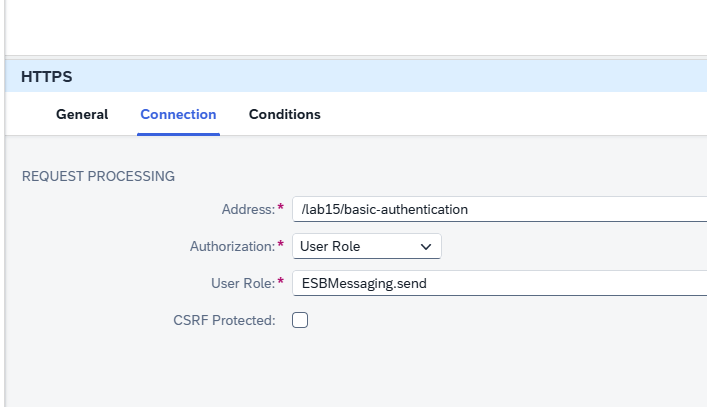

3. Incorporar `Request Reply` y conectar un Receiver mediante adaptador HTTP.

   **Motivo:** realizar una llamada síncrona al servicio externo y devolver su respuesta al consumidor.

   **Evidencia 15-16 — Request Reply.**

   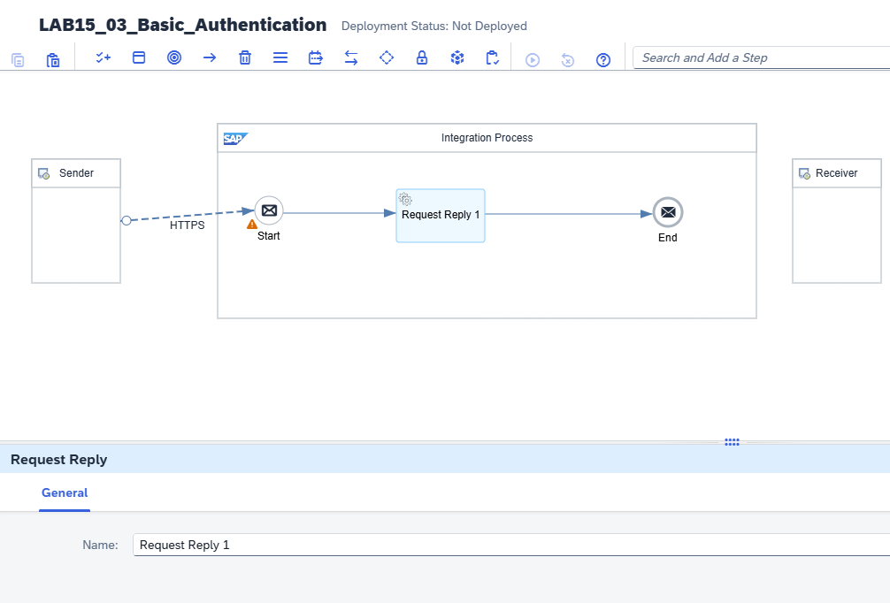

   **Evidencia 15-17 — Receiver conectado.**

   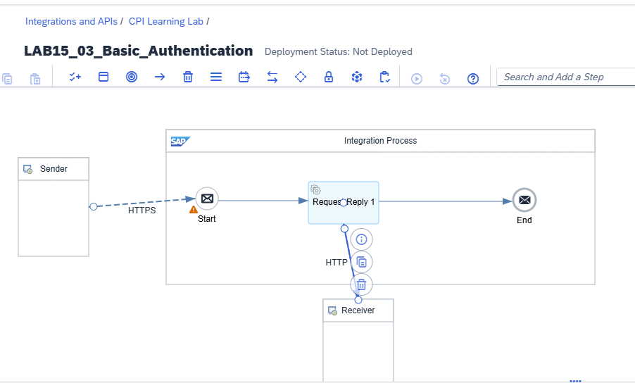

4. Revisar la configuración inicial del HTTP Receiver y cambiar `Authentication` a `Basic`, habilitando el campo `Credential Name`.

   **Motivo:** configurar explícitamente el mecanismo de autenticación requerido por el receptor.

   **Evidencia 15-18 — Configuración inicial.**

   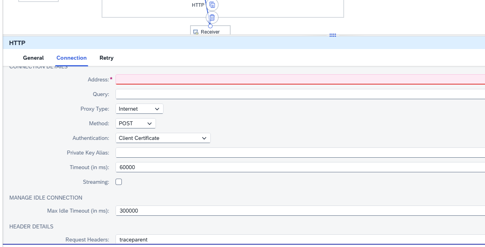

   **Evidencia 15-19 — Basic Authentication seleccionado.**

   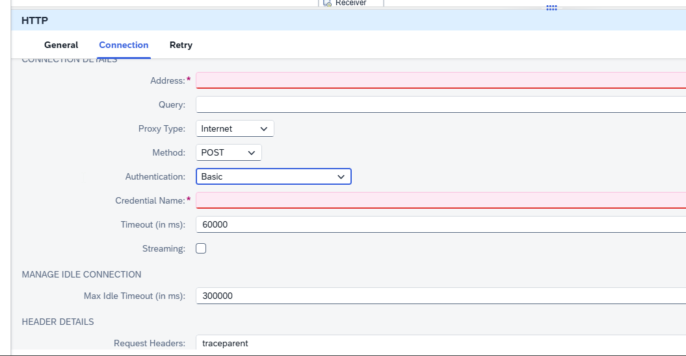

5. Crear en Security Material un `User Credentials` llamado `BASIC_LAB15_HTTPBIN`, utilizando exclusivamente credenciales de demostración para HTTPBin. Validar separadamente el desafío Basic de HTTPBin mediante navegador.

   **Motivo:** mantener las credenciales fuera del diseño del iFlow y comprobar el comportamiento del destino.

   **Evidencia 15-20 — Formulario de User Credentials.**

   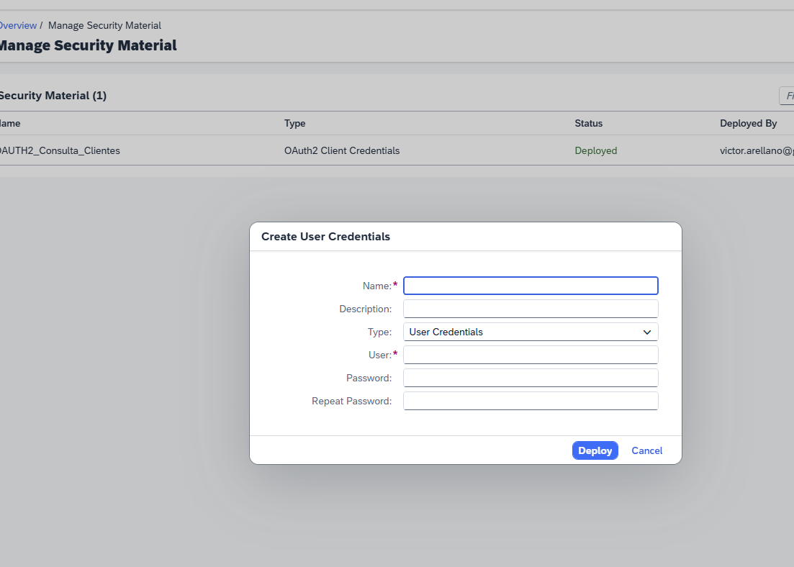

   **Evidencia 15-21 — Autenticación Basic directa en HTTPBin.** Respuesta con `authenticated: true` y `authorized: true`.

   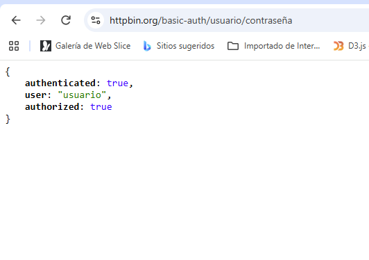

6. Desplegar `BASIC_LAB15_HTTPBIN` y referenciarlo en HTTP Receiver con dirección `https://httpbin.org/basic-auth/usuario/contrase%C3%B1a`, método `GET`, proxy `Internet`, `Authentication = Basic` y `Credential Name = BASIC_LAB15_HTTPBIN`.

   **Motivo:** recuperar las credenciales por alias durante la llamada saliente, sin incorporarlas al mensaje ni al diseño.

   **Evidencia 15-22 — Security Material desplegado.**

   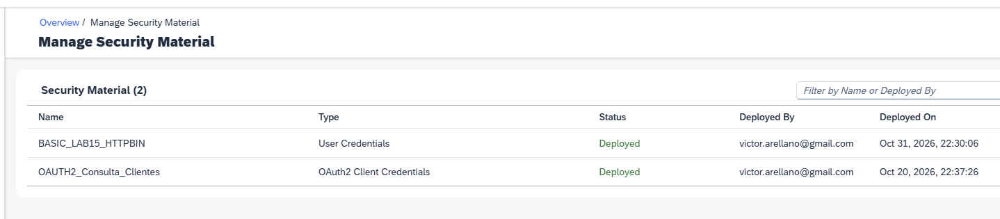

   **Evidencia 15-23 — HTTP Receiver configurado.**

   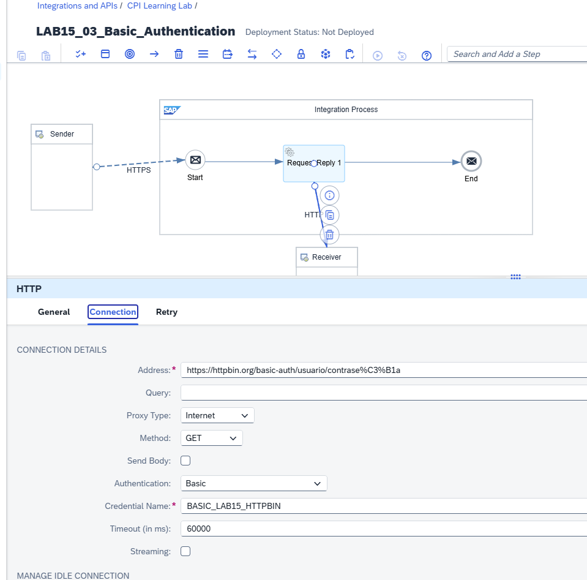

7. Desplegar el iFlow. Se verificó estado `Started`, versión runtime `1.0.1` y endpoint `/http/lab15/basic-authentication`.

   **Motivo:** comprobar que la configuración está disponible en el runtime.

   **Evidencia 15-24 — iFlow Started.**

   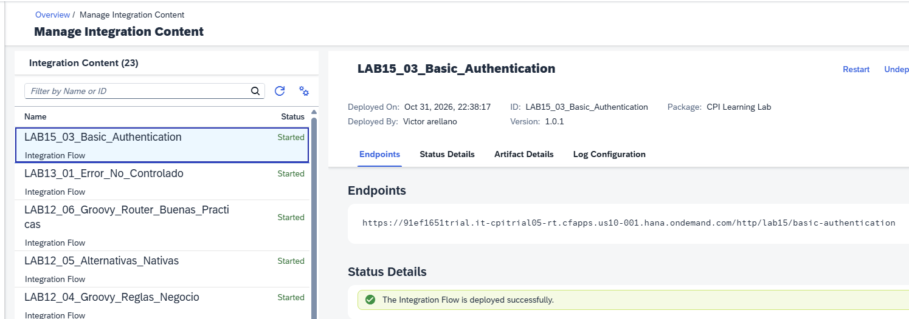

8. Ejecutar desde la carpeta Postman `Lab 15 - Seguridad` la petición independiente `15.3 - Basic Authentication - Credenciales válidas`, con método GET y Bearer `{{access_token}}` para la entrada a CPI. Se obtuvo HTTP `200` y JSON `authenticated: true`, `user: usuario`, `authorized: true`.

   **Motivo:** verificar el recorrido completo: OAuth de entrada y Basic de salida.

   **Evidencia 15-25 — Prueba positiva HTTP 200.**

   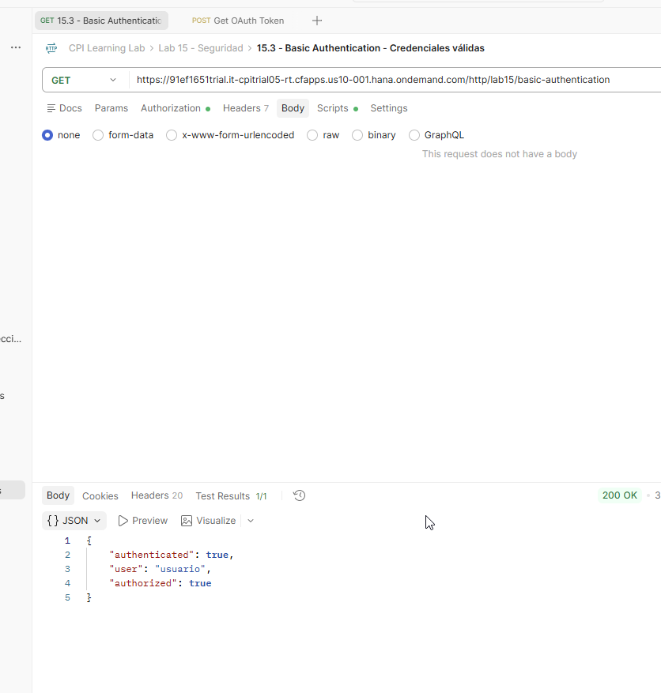

9. Consultar `Where-Used` de `BASIC_LAB15_HTTPBIN`. La vista devolvió `Artifacts (0)` y `No references found`, pese a la referencia visible en HTTP Receiver y la ejecución correcta.

   **Motivo:** contrastar el índice de dependencias con la configuración y ejecución observadas.

   **Evidencia 15-26 — Where-Used sin referencias.**

   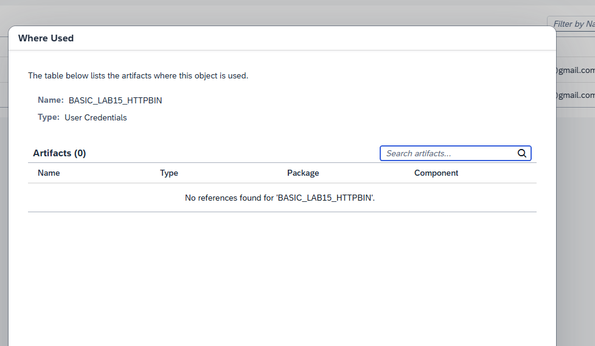

10. Modificar temporalmente la contraseña de demostración en `BASIC_LAB15_HTTPBIN`, sin modificar ni volver a desplegar el iFlow. Ejecutar la petición independiente `15.3 - Basic Authentication - Credenciales incorrectas` en Postman. CPI respondió HTTP `500`; la petición registró una aserción fallida porque esperaba HTTP `200`.

    **Motivo:** observar el rechazo de autenticación saliente y distinguir la respuesta del servicio externo de la respuesta propagada al consumidor.

    **Evidencia 15-27 — Material actualizado para prueba negativa.**

    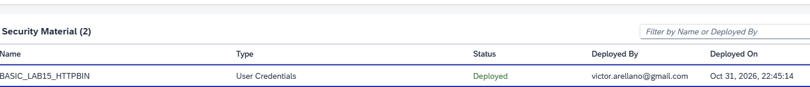

    **Evidencia 15-28 — Prueba negativa en Postman.**

    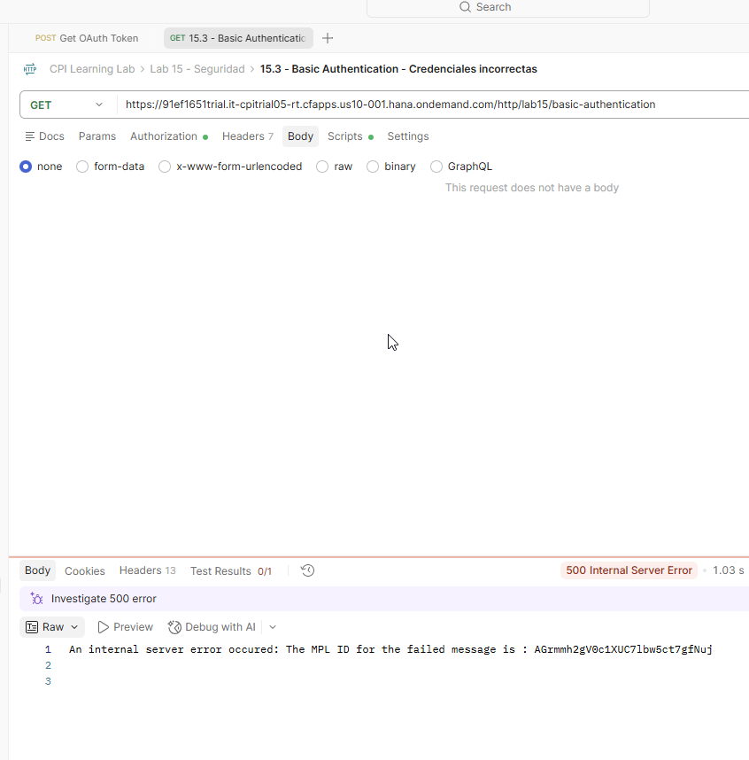

11. Inspeccionar el MPL `Failed`. El error `com.sap.it.rt.adapter.http.api.exception.HttpResponseException` identificó una operación HTTP fallida hacia HTTPBin con `statusCode: 401`. El consumidor recibió HTTP `500`.

    **Motivo:** identificar el código real devuelto por el receptor y evitar confundirlo con el error expuesto por CPI.

    **Evidencia 15-29 — Error Details del MPL.**

    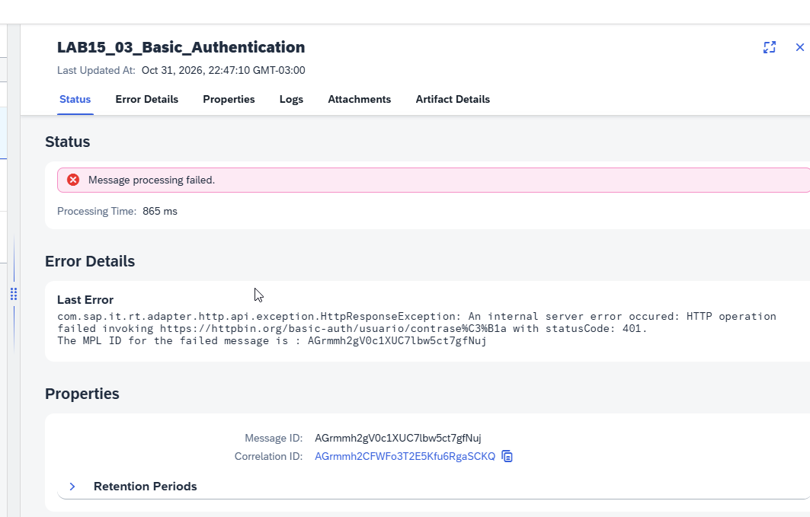

12. Restaurar el material de demostración `BASIC_LAB15_HTTPBIN` y verificar su estado `Deployed`, sin modificar el iFlow. No se repitió la prueba positiva porque su resultado ya estaba demostrado y la repetición no era necesaria para el objetivo del ejercicio.

    **Evidencia 15-30 — Security Material restaurado.** La captura confirma el estado `Deployed`, pero no expone la contraseña ni prueba por sí sola su valor.

    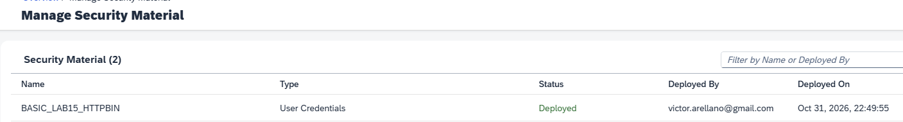

### Resultado esperado y validación

| Escenario | Resultado observado | Estado |
|---|---|---|
| Credenciales Basic correctas | HTTP 200; `authenticated=true` y `authorized=true` | Confirmado |
| Credenciales Basic incorrectas | HTTPBin 401 identificado en MPL; CPI devolvió HTTP 500 | Confirmado |
| Dependencia Where-Used | Cero referencias mostradas pese al uso comprobado | Discrepancia observada; causa no confirmada |
| Material restaurado | Estado `Deployed` | Confirmado; sin nueva prueba funcional |

### Problemas encontrados y aprendizajes

- La respuesta HTTP `500` de CPI no equivale al código `401` recibido del servicio externo: el MPL permitió distinguirlos.
- `Where-Used` no mostró una referencia conocida en este caso. No se ha demostrado la causa; no debe utilizarse como única comprobación de dependencias antes de eliminar materiales.
- La separación de credenciales y diseño facilita actualizar Security Material sin editar el iFlow.

---

## 15.4 — Security Material: administración y dependencias

**Estado:** 🟦 Revisado

### Objetivo

Analizar el inventario, el uso y las precauciones de administración de Security Material a partir de evidencias obtenidas en los laboratorios 15.1 y 15.3.

### Conceptos y prerrequisitos

- Materiales `OAuth2 Client Credentials` y `User Credentials`.
- Referencias de adaptadores mediante `Credential Name`.
- Diferencia entre material desplegado, referencia visible en diseño y uso funcional comprobado.
- Evidencias 15-02, 15-04, 15-05, 15-22, 15-23, 15-25 y 15-26.

### Revisión de evidencias existentes

1. `OAUTH2_Consulta_Clientes`: material OAuth desplegado, referenciado en el HTTP Receiver de `Request Reply`; `Where-Used` mostró una referencia (evidencias 15-02, 15-04 y 15-05).
2. `BASIC_LAB15_HTTPBIN`: material `User Credentials` desplegado, referenciado en el HTTP Receiver de `LAB15_03_Basic_Authentication`, con ejecución HTTP 200 (evidencias 15-22, 15-23 y 15-25).
3. Para `BASIC_LAB15_HTTPBIN`, `Where-Used` mostró cero referencias (evidencia 15-26). La diferencia con el material OAuth es un hecho observado, **no una explicación confirmada de cómo funciona internamente Where-Used**.

### Resultado y validación

La revisión permitió contrastar referencias y resultados previamente demostrados, sin crear nuevas credenciales, repetir capturas ni modificar iFlows. **No se ejecutó un laboratorio independiente de administración o eliminación segura**; por ello el estado es `🟦 Revisado`, no `✅ Completado`.

### Problemas encontrados y aprendizajes

- No asumir que `Where-Used` proporciona un inventario exhaustivo en todas las situaciones: el caso Basic mostró una discrepancia no explicada.
- Antes de modificar o eliminar un material, contrastar referencias de diseño, consumidores conocidos y pruebas existentes.
- Evitar publicar secretos o capturas que expongan contraseñas y tokens.

---

## 15.5 — Certificados, Keystore y TLS

**Estado:** ✅ Completado

### Objetivo

Reconocer el inventario de certificados del Keystore y validar conectividad TLS con comprobación del certificado del servidor, distinguiendo certificados de confianza y pares de claves de identidad.

### Laboratorio paso a paso

1. Abrir **Monitor → Manage Security → Keystore**. Se observaron **13 entradas de tipo Certificate** y ninguna de tipo Key Pair antes de 15.6. **Motivo:** distinguir material de confianza del material que permite autenticación del cliente.

   **Evidencia 15-31 — Inventario inicial del Keystore.** Vista del inventario anterior a la creación del par de claves.

2. Inspeccionar la cadena presentada por `httpbin.org:443`. Se observaron las relaciones de sujeto/emisor:

   | Certificado (Subject DN) | Emisor (Issuer DN) |
   |---|---|
   | `CN=httpbin.hbin.postmanlabs.com` | `CN=YE1,O=Let's Encrypt,C=US` |
   | `CN=YE1,O=Let's Encrypt,C=US` | `CN=Root YE,O=ISRG,C=US` |
   | `CN=Root YE,O=ISRG,C=US` | `CN=ISRG Root X2,O=Internet Security Research Group,C=US` |
   | `CN=ISRG Root X2,O=Internet Security Research Group,C=US` | `CN=ISRG Root X1,O=Internet Security Research Group,C=US` |

   El certificado de servidor incluía `httpbin.org` en SAN. **Motivo:** comprender cómo se relacionan los certificados por emisor y sujeto, sin confundir coincidencia de nombres con validación criptográfica.

   **Evidencia 15-32 — Cadena de certificados del servidor.** Sujetos, emisores y nombre del servicio inspeccionados.

3. Consultar la entrada `sap_isrg_root_x1` del Keystore. Su Subject DN coincidía con el Issuer DN del certificado `ISRG Root X2`. **Motivo:** ilustrar un posible anclaje de confianza. La coincidencia de DN **no prueba** que esa entrada concreta haya sido utilizada por el runtime ni demuestra por sí sola la verificación de firmas.

   **Evidencia 15-33 — Certificado de confianza en Keystore.** Identificación de la entrada y su Subject DN.

4. Abrir **Connectivity Tests → TLS**, host `httpbin.org`, puerto `443`, activar `Valid Server Certificate Required` y mantener desactivado `Authenticate with Client Certificate`. Ejecutar la prueba. SAP informó conexión exitosa y certificado de servidor válido. **Motivo:** verificar conectividad TLS con validación del certificado del servidor.

   **Evidencia 15-34 — TLS Test Connectivity exitoso.** Conexión a `httpbin.org:443` y validación de certificado del servidor.

### Diagrama conceptual del handshake y la confianza

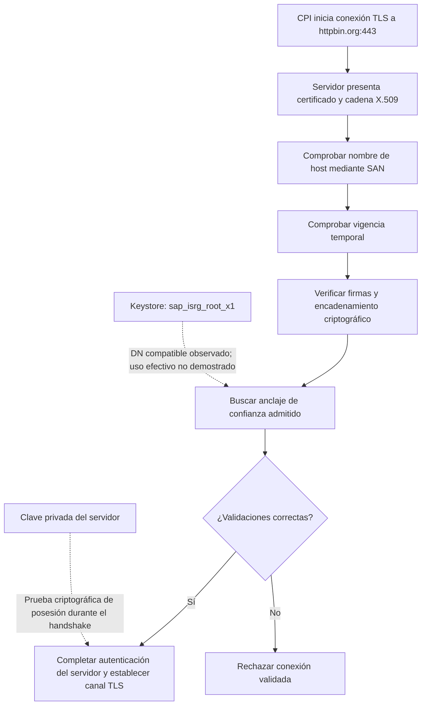

**Nota:** diagrama conceptual, no una traza interna del runtime SAP. La verificación exacta depende de la negociación TLS y la cadena de confianza efectiva.

### Resultado esperado y validación

La prueba de SAP confirmó conectividad a `httpbin.org:443` con certificado de servidor válido. Se inspeccionaron certificados y coincidencia de DN. No se comprobó qué entrada exacta del truststore utilizó el runtime.

### Problemas y aprendizajes

La coincidencia de Subject/Issuer DN sirve para explorar la cadena, pero no reemplaza la validación de firmas ni permite identificar con certeza el anclaje realmente utilizado.

---

## 15.6 — Autenticación mediante certificados (mTLS)

**Estado:** ✅ Completado, limitado a creación de identidad cliente y prueba TLS de conectividad

### Objetivo

Crear una identidad criptográfica de laboratorio en el Keystore y comprobar la conexión TLS de CPI con una opción de certificado cliente, sin modificar iFlows.

### Laboratorio paso a paso

1. En **Monitor → Manage Security → Keystore → Create → Key Pair**, inspeccionar el formulario. Se observaron Alias, RSA, tamaño 2048, SHA-512/RSA, campos de identidad y vigencia. **Motivo:** identificar los parámetros de una clave privada y su certificado asociado antes de crear el recurso.

**Evidencia 15-35 — Formulario Create Key Pair.** Parámetros disponibles.

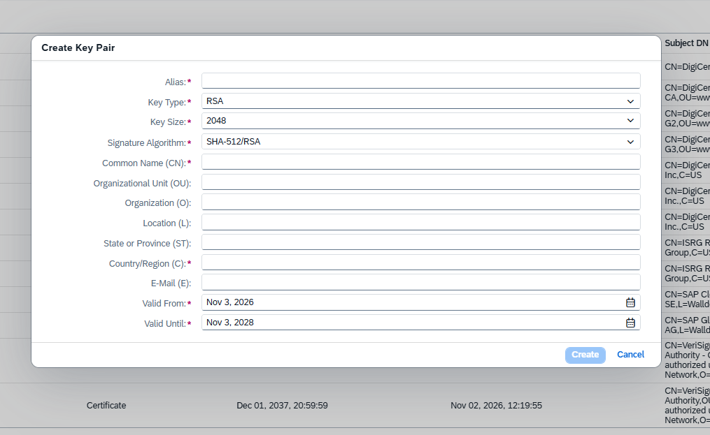

2. Crear un par de claves exclusivamente para laboratorio con alias solicitado `LAB15_MTLS_CLIENT`, tipo RSA, 2048 bits, firma SHA-512/RSA, `CN=LAB15_MTLS_CLIENT`, `O=CPI Learning Lab`, `C=CL`, vigencia del 03/11/2026 al 03/11/2028. SAP mostró el alias como `lab15_mtls_client`. **Motivo:** disponer de identidad de cliente independiente del material de confianza del servidor.

**Evidencia 15-36 — Key Pair creado.** Inventario de 14 entradas y alias `lab15_mtls_client`.

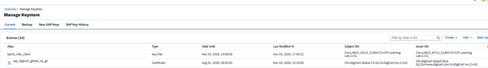

3. Inspeccionar el detalle: Key Pair, RSA 2048, `SHA512withRSA`, Subject e Issuer DN `CN=LAB15_MTLS_CLIENT,O=CPI Learning Lab,C=CL`, vigencia 2026–2028. **Motivo:** confirmar características de la identidad. La igualdad de DN es compatible con un certificado autofirmado, pero no demuestra por sí sola la firma criptográfica.

**Evidencia 15-37 — Detalle del Key Pair.** Algoritmo, identidad y vigencia.

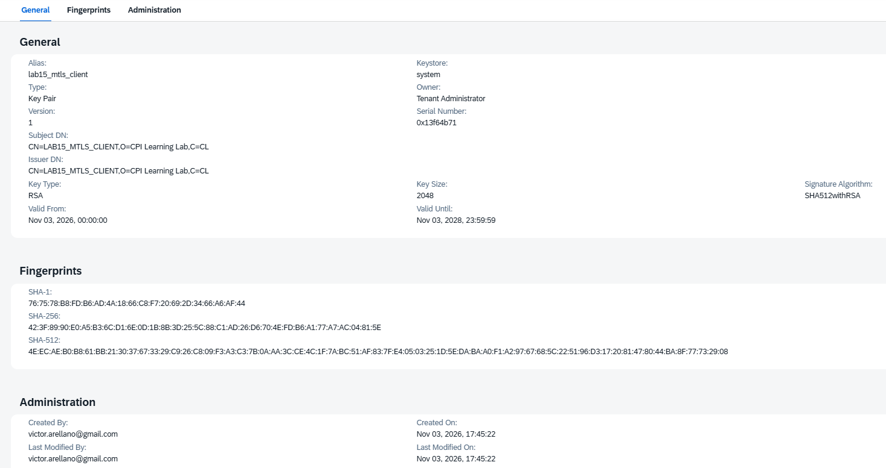

4. En **Connectivity Tests → TLS**, probar `httpbin.org:443` con `Authenticate with Client Certificate` activo, alias `lab15_mtls_client`, `Valid Server Certificate Required` activo e `Include new SAP Key` desactivado. SAP informó: `Successfully reached host at httpbin.org:443 but client certificate was not used`. **Motivo:** comprobar que configurar un alias no implica que el servidor solicite o utilice el certificado. No se asignó una captura numerada adicional a esta prueba.

5. Repetir la prueba TLS hacia `certauth.cryptomix.com:443` con el mismo alias y validación del servidor activa. SAP informó `Successfully reached host at certauth.cryptomix.com:443`, `Client Certificate Alias: lab15_mtls_client` y `Server Certificate: Valid`. **Motivo:** utilizar un destino compatible con la presentación de certificado cliente.

**Evidencia 15-38 — TLS Connectivity con alias cliente.** Conexión exitosa y alias de certificado cliente informado.

6. Como contraste, se observó que la prueba TLS de SAP hacia el mismo host también informó éxito **sin** seleccionar autenticación de certificado cliente. En navegador, el sitio solicitó elegir un certificado y, al cancelar, respondió `Error: No TLS client certificate presented`. **Motivo:** distinguir éxito de conexión TLS de aceptación HTTP por la aplicación. Reiniciar el navegador no permite inferir el estado de sesiones TLS del runtime CPI. No se solicitaron capturas adicionales ni se creó un iFlow solo para comprobar rechazo.

### Resultado esperado y validación

| Comprobación | Resultado observado | Alcance |
|---|---|---|
| Crear Key Pair | Alias `lab15_mtls_client`, RSA 2048, vigencia 2026–2028 | Configuración validada |
| HTTPBin con alias | Conexión exitosa; certificado cliente no utilizado | No demuestra mTLS |
| CertAuth con alias | Conexión exitosa, alias informado, certificado servidor válido | Uso reportado en TLS Test Connectivity |
| CertAuth sin alias | Prueba TLS exitosa | No equivale a autorización HTTP |
| Navegador sin certificado | Error HTTP de certificado ausente | Contraste externo, no ejecución CPI |
| Autorización HTTP desde CPI mediante certificado | No probada | Fuera del alcance validado |

### Problemas encontrados y aprendizajes

Un servidor puede permitir completar una conexión TLS sin certificado cliente y exigir identidad después, a nivel de aplicación. La salida de Connectivity Tests no debe describirse como prueba de autorización HTTP. El certificado de laboratorio no debe confundirse con una identidad emitida por una CA corporativa.

---

## Problemas encontrados y hallazgos

- **Where-Used:** `BASIC_LAB15_HTTPBIN` devolvió cero referencias pese al uso comprobado. Causa no determinada.
- **OAuth:** no se probó token válido sin `ESBMessaging.send`. Un HTTP 401 sin MPL visible no permite identificar por sí solo la capa exacta de rechazo.
- **Correlación:** no se verificó correlación conjunta entre los iFlows `Request Reply` y `Consulta Clientes`.
- **TLS:** Subject/Issuer DN coincidentes no demuestran qué anclaje de confianza usó CPI.
- **Certificado cliente:** la prueba TLS y la autorización HTTP son comprobaciones diferentes.

## Aprendizajes consolidados

Los mecanismos inbound y outbound se configuran por separado; Security Material y Keystore gestionan tipos de credenciales diferentes; las pruebas positivas y negativas deben interpretarse según su capa técnica. Los certificados y secretos no deben publicarse en el repositorio.

## 15.7 — Validación integral de seguridad

**Estado:** 🟦 Revisado — síntesis y contraste de evidencias prácticas anteriores, sin ejecución independiente.

### Objetivo

Contrastar las validaciones de seguridad de los laboratorios 15.1 a 15.6, identificar sus límites y determinar si es necesaria una prueba adicional para interpretar correctamente los resultados.

### Conceptos y prerrequisitos

- Diferencia entre autenticación de entrada (HTTPS Sender) y de salida (HTTP Receiver).
- Distinción entre autorización HTTP, conectividad TLS, certificado de servidor y certificado cliente.
- Evidencias y resultados documentados en los laboratorios 15.1 a 15.6.

### Laboratorio paso a paso

1. **Contrastar la autenticación de entrada y salida.** Revisar la ejecución positiva del iFlow `LAB15_03_Basic_Authentication`: el HTTPS Sender recibió Bearer y el HTTP Receiver utilizó Basic mediante `BASIC_LAB15_HTTPBIN`. La evidencia **15-25** documenta HTTP 200 con `authenticated: true` y `authorized: true`. **Motivo:** una misma ejecución demuestra ambos mecanismos, sin repetir la petición.
2. **Contrastar las pruebas negativas.** Revisar las evidencias **15-12 y 15-13** para solicitudes sin autorización válida, y **15-28 y 15-29** para Basic incorrecto. **Motivo:** diferenciar rechazo de entrada HTTP 401, rechazo del receptor HTTPBin 401 registrado en MPL y HTTP 500 recibido desde CPI.
3. **Revisar la administración de credenciales.** Contrastar las referencias y ejecuciones de OAuth y Basic con la discrepancia observada en `Where-Used` (**15-26**). **Motivo:** no interpretar un inventario de referencias como prueba exhaustiva de ausencia de consumidores.
4. **Revisar TLS y certificados.** Contrastar las evidencias **15-31 a 15-38**. **Motivo:** distinguir validación del certificado de servidor, existencia de Key Pair, conectividad TLS con alias de cliente y autorización HTTP mediante certificado.
5. **Determinar el alcance final.** Registrar qué resultados están comprobados y cuáles no, sin crear nuevos iFlows, alterar credenciales, desplegar versiones ni duplicar capturas. **Motivo:** cerrar el análisis con trazabilidad y sin transformar inferencias en resultados experimentales.

### Matriz integral de validación

| Mecanismo o escenario | Evidencia existente | Resultado observado | Alcance y límite |
|---|---|---|---|
| OAuth inbound válido | 15-10, 15-11, 15-25 | Solicitudes autorizadas y HTTP 200 | Acceso positivo demostrado en escenarios probados |
| OAuth inbound ausente o inválido | 15-12, 15-13 | HTTP 401 | No se probó un token válido sin el rol requerido |
| Basic outbound correcto | 15-23 a 15-25 | HTTP 200; `authenticated=true`, `authorized=true` | Entrada Bearer y salida Basic validadas conjuntamente |
| Basic outbound incorrecto | 15-27 a 15-29 | HTTPBin 401 en MPL; CPI 500 hacia Postman | Distingue error del destino y respuesta del flujo |
| Security Material | 15-02, 15-04, 15-05, 15-22, 15-23, 15-26, 15-30 | Materiales desplegados y consumidos; `Where-Used` discrepante para Basic | Causa de la discrepancia no confirmada |
| TLS y confianza del servidor | 15-31 a 15-34 | Conectividad TLS exitosa; certificado de servidor válido | No se identificó el anclaje exacto utilizado por el runtime |
| Key Pair y certificado cliente | 15-35 a 15-38 | Key Pair creado; prueba TLS exitosa con alias informado en CertAuth | No demuestra autorización HTTP desde CPI mediante mTLS |

### Resultado esperado y validación

La matriz consolida las comprobaciones ya documentadas y sus límites. **No se realizó una nueva ejecución ni se generaron nuevas capturas en 15.7.** El estado de este apartado es `🟦 Revisado`, porque su resultado es un análisis de evidencia práctica anterior, no un laboratorio independiente validado.

### Problemas encontrados y aprendizajes

- No equiparar una respuesta HTTP 500 de CPI con el HTTP 401 del servicio externo sin revisar el MPL.
- No deducir que el certificado cliente fue aceptado por la aplicación a partir de una prueba de conectividad TLS.
- Evitar repetir pruebas o capturas cuando las evidencias existentes permiten responder la pregunta técnica.
- Conservar como limitaciones explícitas las comprobaciones que no se realizaron.

---

## Cierre del capítulo

**Estado del capítulo: ✅ `Completado`.** Los laboratorios 15.1, 15.2, 15.3, 15.5 y 15.6 disponen de validaciones prácticas dentro de los alcances indicados; 15.4 y 15.7 son revisiones analíticas de evidencias existentes. El capítulo queda cerrado para continuidad del curso, sin declarar completadas pruebas no ejecutadas. La autorización HTTP mediante certificado cliente y el uso exacto del anclaje de confianza permanecen fuera del alcance comprobado.

## Referencias

- [SAP Help Portal — Cloud Integration](https://help.sap.com/docs/cloud-integration)
- [RFC 6749 — OAuth 2.0](https://www.rfc-editor.org/rfc/rfc6749)
- [RFC 6750 — Bearer Token Usage](https://www.rfc-editor.org/rfc/rfc6750)
- [RFC 5280 — X.509 PKI](https://www.rfc-editor.org/rfc/rfc5280)
- [RFC 8446 — TLS 1.3](https://www.rfc-editor.org/rfc/rfc8446)

**Control de evidencias:** las capturas 15-31 a 15-34 están identificadas por número y contenido, pero sus nombres exactos no pudieron verificarse en el contexto disponible. No se inventaron rutas para ellas. Las referencias de imágenes restantes preservan los nombres del documento publicado o los acordados durante el laboratorio. No se afirma que las nuevas imágenes ya estén subidas a GitHub.
