# 15 - Seguridad: OAuth, Basic, certificados y Security Material

**Estado del tema:** 🟨 En curso
**Package:** `CPI Learning Lab`
**iFlows reutilizados:** `Request Reply` (`Request_Reply`) y `Consulta Clientes`
**Fecha de las validaciones:** 30/10/2026

## Objetivo

Comprender y validar los mecanismos de autenticación y autorización de entrada y salida en SAP Cloud Integration, la administración de credenciales mediante Security Material y, en laboratorios posteriores, Basic Authentication, certificados y mecanismos de confianza.

## Conceptos

- **Inbound / HTTPS Sender:** controla la recepción de solicitudes y la autorización necesaria para invocar un endpoint de integración.
- **Outbound / HTTP Receiver:** configura la comunicación de CPI hacia otro servicio, incluida la autenticación que exige el receptor.
- **OAuth 2.0 Client Credentials:** permite a un cliente solicitar un token de acceso mediante sus credenciales, sin intervención de un usuario final.
- **Bearer token:** credencial de acceso que debe protegerse durante su vigencia.
- **Security Material:** almacena configuraciones de credenciales referenciables por componentes compatibles.
- **Where-Used:** identifica artefactos que referencian un material de seguridad.
- **MPL:** registro de procesamiento de mensajes; su ausencia en una búsqueda no identifica por sí sola la causa interna de un rechazo HTTP.

## Prerrequisitos

- Acceso a SAP Integration Suite, Cloud Integration, Design y Monitor.
- Package `CPI Learning Lab` e iFlows del capítulo 08 disponibles.
- Colección Postman `CPI Learning Lab`, con peticiones del capítulo 08.
- No publicar tokens, secretos, contraseñas, claves privadas ni service keys.

---

## 15.1 - Arquitectura de seguridad: autenticación y autorización

**Estado:** ✅ Completado

### Objetivo

Identificar las funciones de seguridad disponibles en el tenant, distinguir la seguridad de entrada y salida, y comprobar una dependencia real entre un iFlow y un Security Material desplegado.

### Laboratorio paso a paso y validación

1. Abrir **Monitor → Integrations and APIs → Manage Security**. Se observaron `Security Material` (1 artefacto), `Keystore` (13 entradas), `PGP Keys` (0), `Access Policies` (0), `User Roles` (2), además de `JDBC Material` y `Connectivity Tests` sin contador visible en la captura.

   **Motivo:** verificar las funciones visibles en el entorno antes de diseñar ejercicios dependientes de ellas.

   **Evidencia 15-01 — Secciones de Manage Security.** Vista general de las tarjetas disponibles.

   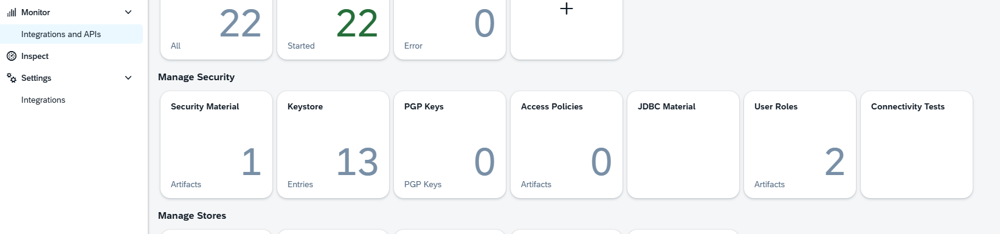

2. Abrir **Security Material**. Se observó `OAUTH2_Consulta_Clientes`, tipo `OAuth2 Client Credentials`, estado `Deployed`, con fecha de despliegue 20/10/2026.

   **Motivo:** identificar un artefacto real y evitar crear credenciales redundantes.

   **Evidencia 15-02 — Material OAuth existente.** Lista de Security Material y estado de despliegue.

   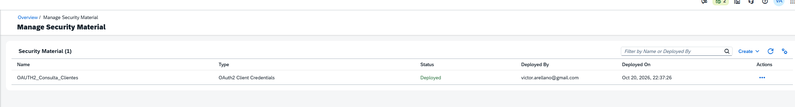

3. Abrir la configuración del material, **sin guardar ni desplegar cambios**. Se observaron Token Service URL, Client ID, Client Secret, Grant Type `Send as Part of URL`, Client Authentication `Send as Request Header`, Scope vacío, Content Type `application/json`, Resource y Audience vacíos, y ausencia de Custom Parameters. Los valores sensibles fueron ocultados.

   **Motivo:** diferenciar el mecanismo de solicitud del token de la autenticación del cliente ante el servidor de autorización. Esta inspección no demuestra emisión exitosa del token desde el adaptador.

   **Evidencia 15-03 — Configuración OAuth.** Campos de OAuth2 Client Credentials con identificadores y secretos ocultos.

   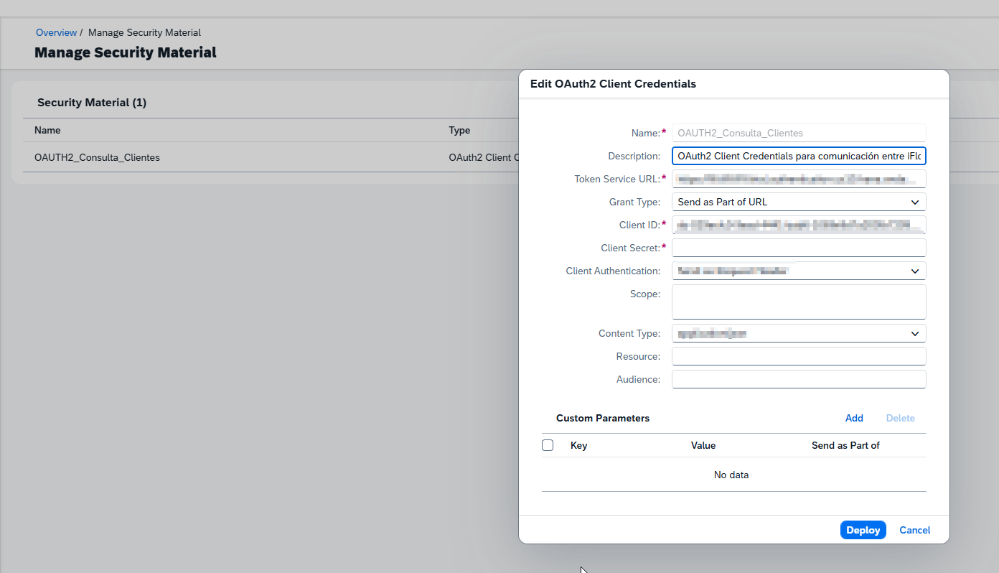

4. Utilizar **Actions → Where-Used** sobre `OAUTH2_Consulta_Clientes`. SAP mostró una referencia: iFlow `Request Reply`, ID `Request_Reply`, package `CPI Learning Lab`, componente `HTTP` de tipo `Adapter`.

   **Motivo:** localizar dependencias sin abrir todos los iFlows individualmente. El resultado demuestra una referencia de configuración, no una ejecución correcta.

   **Evidencia 15-04 — Where-Used.** Identificación del iFlow y del adaptador que referencian el material.

   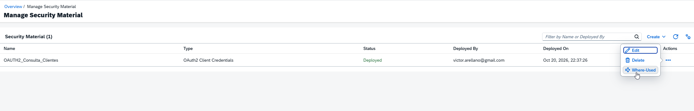

5. Abrir `Request Reply` en visualización y seleccionar **HTTP Receiver → Connection**. Se observó método `GET`, Proxy Type `Internet`, autenticación `OAuth2 Client Credentials`, Credential Name `OAUTH2_Consulta_Clientes` y destino `/http/lab08/consulta-clientes`.

   **Motivo:** verificar dónde se utiliza el material de seguridad en una comunicación saliente.

   **Evidencia 15-05 — HTTP Receiver y credencial OAuth.** Configuración del adaptador y referencia al material desplegado.

   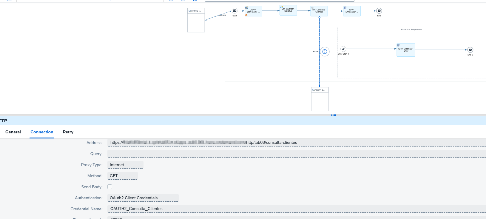

6. Reutilizar en Postman la petición **08.2 - Content Enricher → POST Enriquecer Solicitud Cliente**. Se envió `solicitudId = SOL-1001`, `clienteId = 1001` y `origen = POSTMAN` al endpoint `/http/lab08/request-reply`. Se obtuvo **HTTP 200** y XML `SolicitudEnriquecida` con cliente `1001`, nombre `Ana` y segmento `PREMIUM`.

   **Motivo:** validar el resultado funcional del escenario existente sin crear otro iFlow.

   **Evidencia 15-06 — Respuesta enriquecida.** Petición y respuesta XML correctas en Postman.

   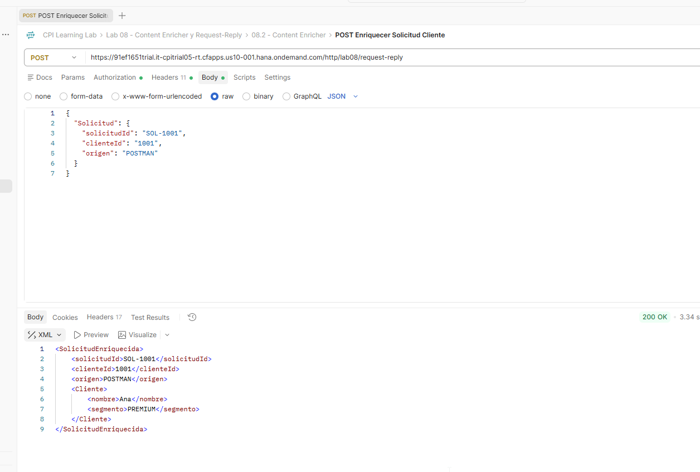

7. Revisar **Monitor Message Processing**. Se observaron `Request Reply` con estado `Completed`, duración **2 s 600 ms** y actualización a las **18:27:44**, y `Consulta Clientes` con estado `Completed`, duración **8 ms** y actualización a las **18:27:43**, hora GMT-03:00.

   **Motivo:** contrastar la respuesta del consumidor con el registro de procesamiento de ambos iFlows.

   **Evidencia 15-07 — Ejecuciones Completed.** Monitor con ambos iFlows y sus tiempos observados.

   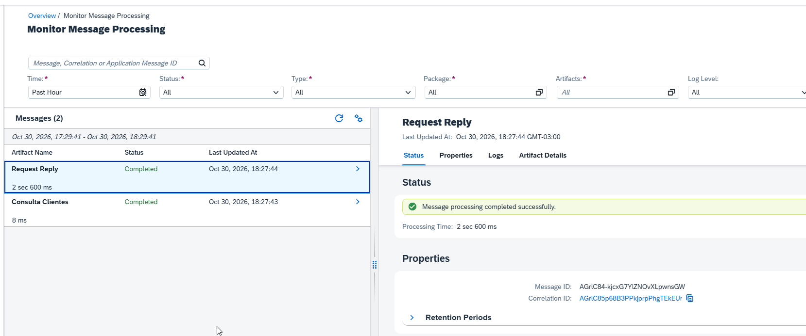

### Resultado esperado y validación

Se verificó la disponibilidad de las funciones de seguridad, la existencia del material OAuth, su dependencia en un HTTP Receiver, una respuesta enriquecida HTTP 200 y dos MPL Completed. **No se inspeccionó directamente el intercambio de tokens que realiza el adaptador.**

### Aprendizajes

- La seguridad de entrada y de salida se configura en componentes diferentes.
- Where-Used permite analizar dependencias antes de modificar materiales compartidos.
- La referencia de configuración, la respuesta funcional y el MPL son evidencias complementarias, pero no equivalentes.

---

## 15.2 - OAuth 2.0 Client Credentials

**Estado:** ✅ Completado (alcance práctico definido; prueba de permisos insuficientes no realizada)

### Objetivo

Verificar la emisión de un token Client Credentials, sus metadatos, el rechazo de solicitudes sin credenciales o con token inválido y el rol requerido por el HTTPS Sender.

### Laboratorio paso a paso y validación

1. Revisar la petición existente de Postman **08.2 → Get OAuth Token**. Configuración observada: método `POST`, URL `{{token_url}}`, Body `x-www-form-urlencoded` con `grant_type=client_credentials`, autenticación `Basic Auth` con `{{client_id}}` y `{{client_secret}}`, y encabezado `Content-Type: application/x-www-form-urlencoded`.

   **Motivo:** distinguir la autenticación del cliente OAuth mediante Basic de la autenticación Bearer ante el recurso final. Las capturas de configuración se utilizaron para inspección; no se duplicaron como evidencias numeradas.

2. Ejecutar **Get OAuth Token**. Postman devolvió **HTTP 200**, `token_type = bearer`, `expires_in = 3599`, `scope` con `ESBMessaging.send` y `API.invoke`, y campo `jti`. La duración anunciada equivale a `3599 / 60 = 59,98` minutos, aproximadamente 60 minutos desde la emisión. No se verificó renovación automática.

   **Motivo:** comprobar la emisión del token y distinguir su duración, tipo e información de permisos. `jti` identifica el token; no es el Message ID ni el Correlation ID de CPI.

   **Evidencia 15-08 — Respuesta del servidor OAuth.** HTTP 200 y metadatos del token; valor de `access_token` oculto.

   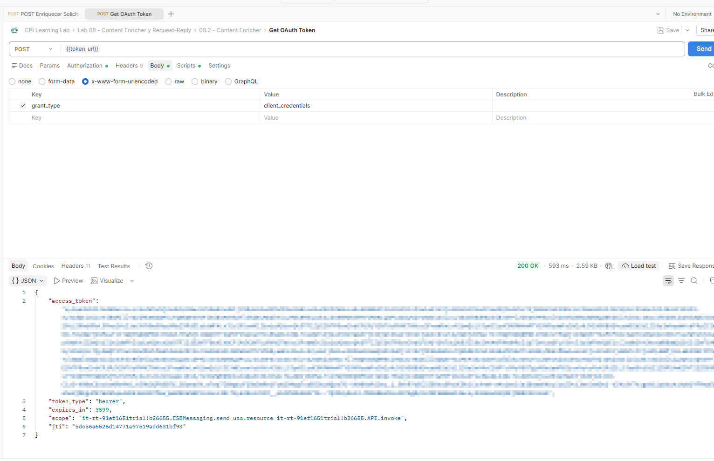

3. Crear la carpeta de Postman **Lab 15 - Seguridad** y duplicar la petición de enriquecimiento como **15.2 - OAuth - Token inválido**. Confirmar `Authorization = Bearer Token` y uso original de `{{access_token}}`. Sustituir **solo en la petición duplicada** por `TOKEN_INVALIDO_LAB15` y ejecutar. Resultado: **HTTP 401 Unauthorized**.

   **Motivo:** comprobar rechazo de un token incorrecto sin modificar variables compartidas ni la petición histórica.

   **Evidencia 15-09 — Token inválido.** Valor de prueba literal y respuesta HTTP 401.

   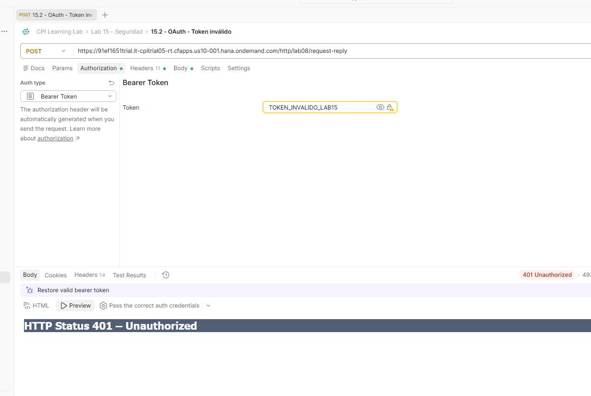

4. Revisar **Monitor Message Processing** con filtro temporal `Past Hour`. Solo aparecieron las ejecuciones anteriores de `Request Reply` y `Consulta Clientes`, sin nueva ejecución visible correspondiente al intento HTTP 401.

   **Motivo:** evaluar si el rechazo se registró como procesamiento del iFlow. El resultado es coherente con rechazo previo al procesamiento, pero no permite identificar de manera concluyente el componente interno que lo produjo.

   **Evidencia 15-10 — Sin nuevo MPL visible.** Resultado de la búsqueda en el intervalo consultado.

   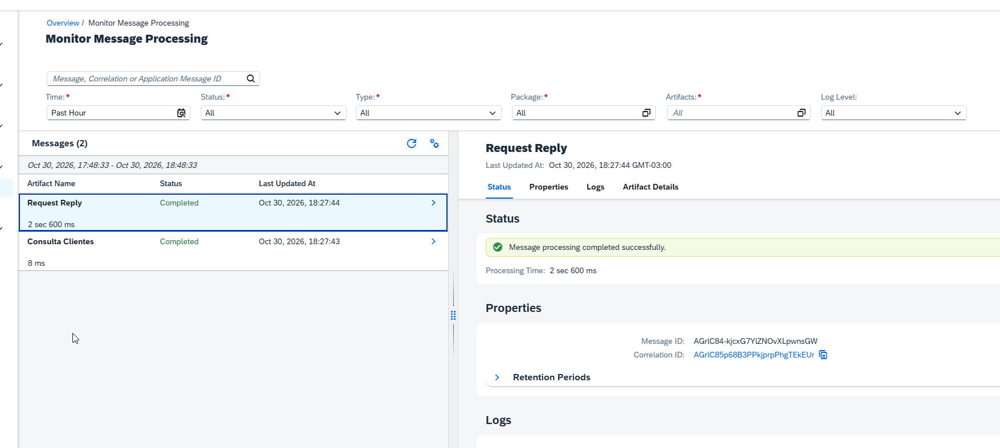

5. Duplicar la petición negativa como **15.2 - OAuth - Sin token**, seleccionar `No Auth` y comprobar que Postman no genera un encabezado Authorization. Ejecutar: **HTTP 401 Unauthorized**.

   **Motivo:** diferenciar ausencia de credenciales y credenciales inválidas; ambas fueron rechazadas en este endpoint.

   **Evidencia 15-11 — Solicitud sin token.** Lista de headers sin Authorization y respuesta HTTP 401.

   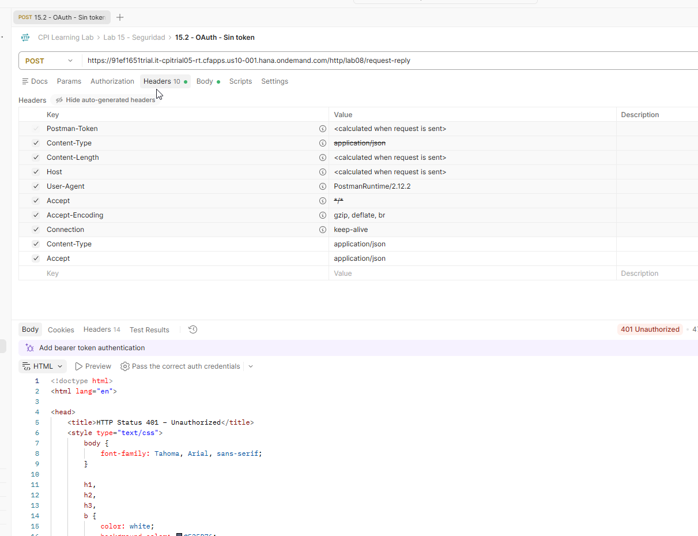

6. Abrir **Manage Security → User Roles**. Se observaron dos roles administrados por SAP: `API.invoke` (descripción: rol predeterminado para invocar API y MCP Server) y `ESBMessaging.send` (rol predeterminado para enviar mensajes a integration flows).

   **Motivo:** relacionar los nombres de roles visibles en CPI con los scopes recibidos en la respuesta OAuth. Su presencia no demuestra asignación a una identidad específica.

   **Evidencia 15-12 — User Roles.** Lista de roles disponibles y propietarios SAP.

   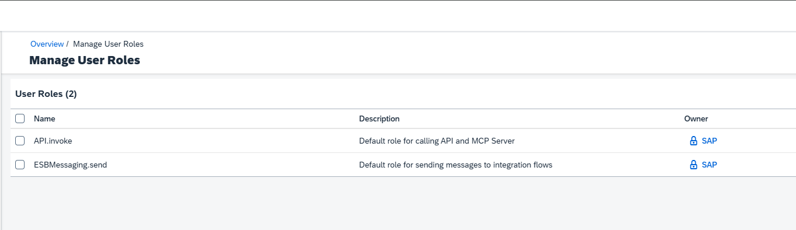

7. Abrir `Request Reply` y seleccionar **HTTPS Sender → Connection**. Se verificó Address `/lab08/request-reply`, `Authorization = User Role`, `User Role = ESBMessaging.send` y `CSRF Protected` desactivado.

   **Motivo:** identificar el requisito de autorización **de entrada**, distinto de la credencial OAuth del HTTP Receiver.

   **Evidencia 15-13 — HTTPS Sender y rol exigido.** Configuración de autorización de entrada.

   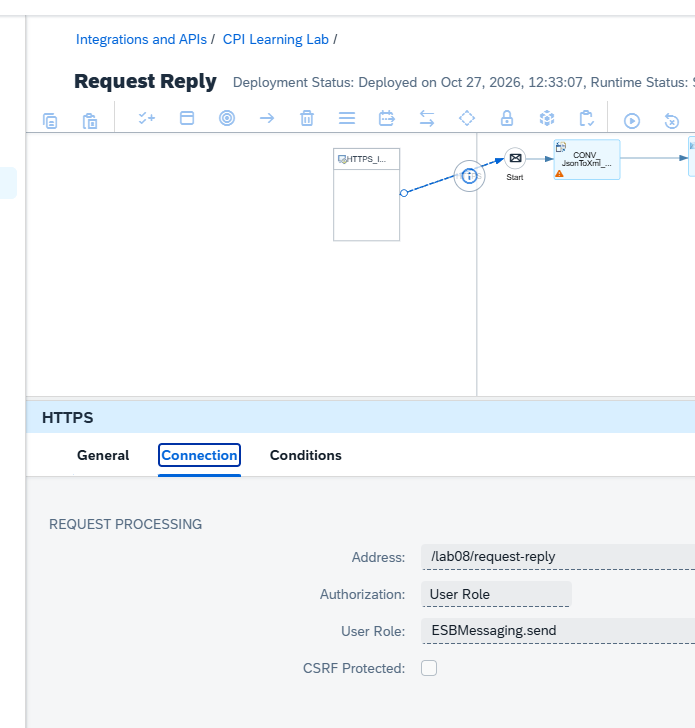

### Resultado esperado y validación

| Escenario | Resultado observado | Validación |
|---|---|---|
| Obtención del token | HTTP 200; Bearer; `expires_in=3599`; scopes presentes | Confirmado |
| Solicitud con token válido (escenario reutilizado de 15.1) | HTTP 200; XML enriquecido | Confirmado |
| Solicitud con token inválido | HTTP 401 | Confirmado |
| Solicitud sin token | HTTP 401 | Confirmado |
| Nuevo MPL del rechazo por token inválido | No visible en la búsqueda realizada | Observación confirmada, causa interna no demostrada |
| HTTPS Sender requiere `ESBMessaging.send` | Configuración visible | Confirmado |
| Token válido sin el rol requerido | No ejecutado | No validado |

### Aprendizajes

- Basic Auth puede servir para autenticar al cliente ante el servidor de tokens, mientras que el endpoint de integración recibe un Bearer token.
- La presencia de scopes en el token y la exigencia de un User Role en el Sender son hechos distintos; no se probó un escenario de permisos insuficientes.
- HTTP 401 se observó tanto para ausencia de token como para token inválido.
- No todos los rechazos HTTP se reflejan necesariamente como un nuevo MPL visible en el monitor consultado.

---

## Problemas encontrados y hallazgos

- **Correlación entre iFlows no validada:** se intentó buscar por Correlation ID las ejecuciones `Request Reply` y `Consulta Clientes`, pero no se obtuvo una correlación conjunta verificable. No se atribuye causa ni se afirma propagación de identificadores. Se reserva para un escenario posterior de trazabilidad si corresponde.
- **Alcance de autorización:** no se generó un token válido carente de `ESBMessaging.send`; por ello no se documenta una respuesta HTTP 403 como resultado de laboratorio.
- **Rechazo sin MPL visible:** ante token inválido se obtuvo HTTP 401 y no apareció una nueva ejecución en el intervalo consultado. La observación puede reutilizarse como caso de diagnóstico, sin adjudicar la causa interna sin evidencia adicional.

## Aprendizajes consolidados

- El adaptador HTTPS Sender controla la autorización de entrada; el HTTP Receiver utiliza el material de seguridad para la salida.
- Where-Used ayuda a evaluar el impacto de modificar credenciales.
- La prueba positiva, las negativas y la inspección de roles se complementan para entender la seguridad del endpoint.
- La documentación de seguridad debe excluir secretos y evitar duplicar evidencias.

## Continuidad del capítulo

**15.1 y 15.2 están completados dentro del alcance práctico documentado.** El capítulo 15 continúa **🟨 En curso**. No se modificaron ni versionaron iFlows durante estos ejercicios.

| Laboratorio | Estado | Próximo alcance |
|---|---|---|
| 15.1 Arquitectura de seguridad | ✅ Completado | — |
| 15.2 OAuth 2.0 Client Credentials | ✅ Completado | Prueba de permisos insuficientes expresamente fuera del alcance validado |
| 15.3 Basic Authentication | ⬜ Pendiente | Configuración y pruebas de autenticación |
| 15.4 Security Material | ⬜ Pendiente | Administración y referencias prácticas |
| 15.5 Certificados, Keystore y TLS | ⬜ Pendiente | Confianza y protección del transporte |
| 15.6 Autenticación mediante certificados | ⬜ Pendiente | Escenario compatible con el entorno disponible |
| 15.7 Validación integral | ⬜ Pendiente | Comparación y diagnóstico de mecanismos |

## Referencias

- [SAP Help Portal — Cloud Integration](https://help.sap.com/docs/cloud-integration)
- [RFC 6749 — OAuth 2.0 Authorization Framework](https://www.rfc-editor.org/rfc/rfc6749)
- [RFC 6750 — OAuth 2.0 Bearer Token Usage](https://www.rfc-editor.org/rfc/rfc6750)

> **Seguridad documental:** las referencias de imágenes indican las rutas previstas en el repositorio. Su incorporación física debe verificarse al publicar; no se afirma que ya estén subidas.
