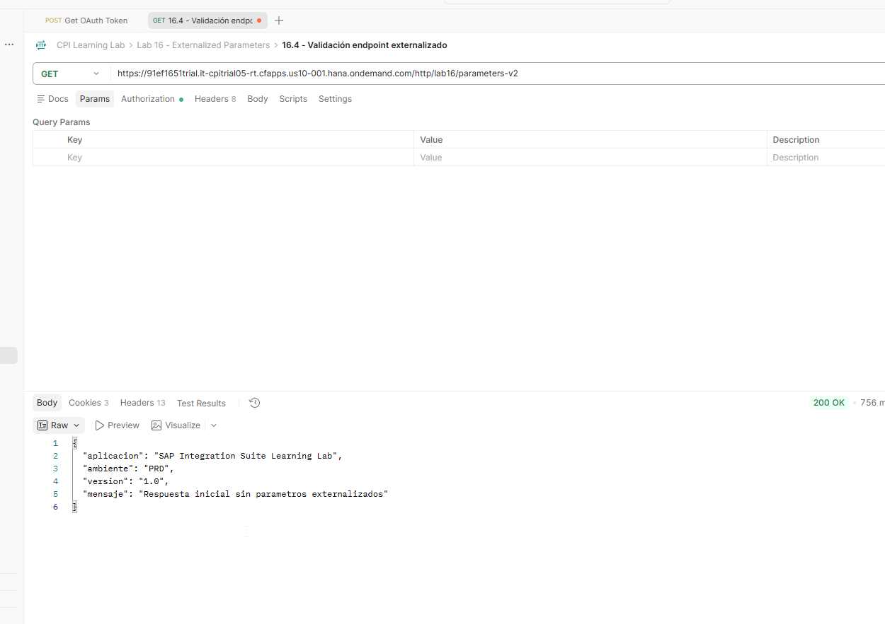
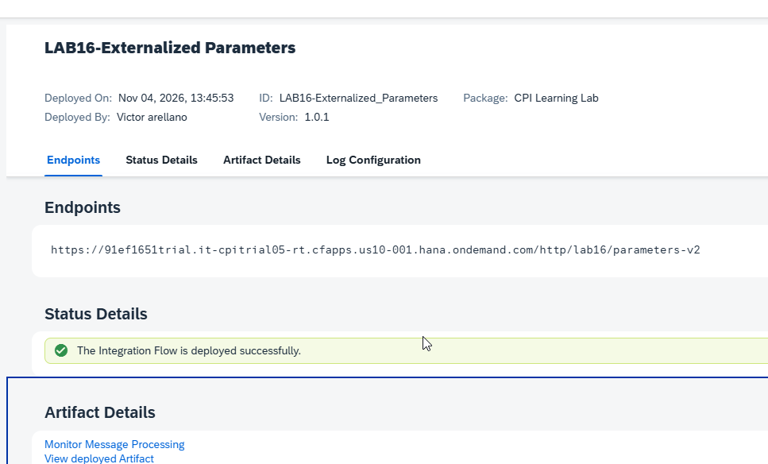

# 16 - Externalized Parameters y configuración por ambiente

**Estado del tema:** ✅ Completado
**Package:** `CPI Learning Lab`
**iFlow:** `LAB16-Externalized Parameters`
**ID:** `LAB16-Externalized_Parameters`
**Versión de runtime final observada:** `1.0.1`
**Fecha de validación:** 04/11/2026

## Objetivo

Externalizar valores de SAP Cloud Integration, modificarlos mediante **Configure** sin editar el diseño del iFlow y comprobar su aplicación al runtime. Validar tanto un valor del cuerpo de respuesta como la dirección del adaptador HTTPS Sender.

## Conceptos

- **Parámetro externalizado:** valor definido en el diseño que puede modificarse desde la configuración del artefacto.
- **Valor predeterminado:** valor inicial asociado al parámetro en el diseño.
- **Configure:** permite establecer valores para el despliegue sin modificar los pasos del proceso.
- **Save y Deploy:** guardar el diseño y aplicar la configuración al runtime son operaciones diferentes.
- **Versión:** cambiar un valor configurado no equivale necesariamente a crear una nueva versión de diseño.
- **Ambientes simulados:** DEV, QA y PRD fueron valores sucesivos de un parámetro en **un mismo tenant**, no tres ambientes SAP independientes.

## Prerrequisitos

- Acceso a **Design** y **Monitor** de SAP Cloud Integration.
- Package `CPI Learning Lab`.
- Postman con autorización funcional para HTTPS Sender, sin registrar secretos en las evidencias.
- Colección `CPI Learning Lab` y carpeta `Lab 16 - Externalized Parameters`.

## Alcance y estado

| Laboratorio | Alcance | Estado | Evidencias |
|---|---|---|---|
| 16.1 | Creación, externalización de `P_AMBIENTE` y respuesta DEV | ✅ Completado | 16-01 a 16-07 |
| 16.2 | Cambio DEV → QA mediante Configure | ✅ Completado | 16-08 a 16-10 |
| 16.3 | Cambio QA → PRD y validación sin alterar el diseño | ✅ Completado | Pruebas de Configure, Postman y Monitor |
| 16.4 | Externalización y cambio del endpoint HTTPS Sender | ✅ Completado | Configuración, versión 1.0.1, Postman y Monitor |

## 16.1 — Externalización inicial y respuesta DEV

**Estado:** ✅ Completado

### Objetivo

Crear un iFlow con HTTPS Sender y Content Modifier; externalizar `ambiente` y comprobar su resolución en ejecución.

### Laboratorio paso a paso

1. En **Design → Integrations and APIs → CPI Learning Lab**, crear `LAB16-Externalized Parameters`, ID `LAB16-Externalized_Parameters`. Se utiliza un artefacto independiente para no afectar ejercicios anteriores.

   **Evidencia 16-01 — iFlow creado.** Artefacto nuevo, todavía sin desplegar.

   

2. Conectar **Sender → Start** con adaptador **HTTPS**: `Address = /lab16/parameters`, `Authorization = User Role`, `User Role = ESBMessaging.send`, `CSRF Protected` desactivado. La dirección estable permite comparar respuestas posteriores.

   **Evidencia 16-02 — HTTPS Sender.** Configuración del adaptador.

   

3. Insertar `CM_Respuesta_Parametros` entre Start y End, **Message Body → Constant**, con respuesta inicial:

   ```json
   {
     "aplicacion": "SAP Integration Suite Learning Lab",
     "ambiente": "DEV",
     "version": "1.0",
     "mensaje": "Respuesta inicial sin parametros externalizados"
   }
   ```

   **Evidencia 16-03 — Content Modifier inicial.** Respuesta de referencia antes de externalizar.

   

4. En **Externalize → Message Body**, sustituir solo el valor de `ambiente` por `{{P_AMBIENTE}}`; conservar el tipo `Constant` y asignar valor predeterminado `DEV`. Así el resto del JSON permanece fijo.

   **Evidencia 16-04 — Parámetro externalizado.** Marcador `{{P_AMBIENTE}}` y valor `DEV`.

   

5. Confirmar con **OK**, ejecutar **Save** y abrir **Configure**. Comprobar `P_AMBIENTE = DEV`, verificando que el parámetro está disponible fuera del editor.

   **Evidencia 16-05 — Parámetro en Configure.** Valor DEV expuesto para el artefacto.

   

6. Desplegar y comprobar en **Monitor → Manage Integration Content** el estado `Started`, versión `1.0.0` y endpoint `/http/lab16/parameters`.

   **Evidencia 16-06 — Despliegue inicial.** Versión y endpoint publicados.

   

7. En Postman, ejecutar `16.1 - Validación inicial DEV` mediante GET al endpoint, con la autorización configurada. Resultado: `200 OK` y `"ambiente": "DEV"`.

   **Evidencia 16-07 — Respuesta DEV.** HTTP 200 y JSON esperado.

   

### Resultado esperado y validación

`P_AMBIENTE` aparece en Configure y el endpoint devuelve DEV. Ambas comprobaciones se realizaron.

### Problemas encontrados y aprendizajes

El editor de externalización exige la sintaxis `{{NOMBRE_PARAMETRO}}`; introducir únicamente `P_BODY_RESPUESTA` generó un aviso de formato. Se externalizó un campo del JSON, no el cuerpo completo.

## 16.2 — Cambio DEV → QA sin modificar el diseño

**Estado:** ✅ Completado

### Objetivo

Demostrar que la configuración modifica la respuesta sin incrementar la versión del artefacto.

### Laboratorio paso a paso

1. Abrir **Configure** desde el artefacto y cambiar `P_AMBIENTE` de `DEV` a `QA` sin editar el Content Modifier.

   **Evidencia 16-08 — Configuración QA.** Valor `P_AMBIENTE = QA`.

   

2. Confirmar y desplegar la nueva configuración. El despliegue aplica el valor al runtime.

3. Ejecutar la petición independiente de Postman para QA. Se obtuvo HTTP `200 OK` y `"ambiente": "QA"`, con el resto del JSON sin cambios.

   **Evidencia 16-09 — Respuesta QA.** Resultado funcional del cambio.

   

4. Revisar Monitor: `Started`, endpoint `/http/lab16/parameters`, versión `1.0.0`.

   **Evidencia 16-10 — Versión conservada.** Configuración QA sin incremento de versión.

   

### Resultado esperado y validación

La respuesta pasó a QA sin editar el diseño; la versión se mantuvo en `1.0.0`.

### Problemas encontrados y aprendizajes

En el entorno del laboratorio, **Configure** se localizó desde el artefacto en Design. La respuesta HTTP confirma el cambio efectivo, mientras Monitor permite comprobar la versión.

## 16.3 — Configuración simulada PRD

**Estado:** ✅ Completado

### Objetivo

Completar la comparación DEV, QA y PRD mediante un mismo parámetro externalizado, sin crear tenants adicionales.

### Laboratorio paso a paso

1. Confirmar que la respuesta vigente continuaba en QA antes del siguiente cambio. Este control establece el punto de partida.
2. Abrir **Configure**, cambiar `P_AMBIENTE` a `PRD`, confirmar y desplegar. Se conserva el diseño y la versión `1.0.0`.
3. Ejecutar en Postman la petición independiente `16.2 - Validación inicial PRD` (nombre observado en la captura). Resultado: HTTP `200 OK`, JSON con `"ambiente": "PRD"`, `"version": "1.0"` y el mismo mensaje.
4. Verificar en Monitor `Started`, versión `1.0.0` y endpoint original `/http/lab16/parameters`.

### Resultado esperado y validación

La respuesta PRD fue comprobada en Postman; Monitor mostró despliegue exitoso sin incremento de versión. Los tres valores DEV, QA y PRD fueron validados **sucesivamente**, no en paralelo.

### Problemas encontrados y aprendizajes

El valor de `P_AMBIENTE` representa una configuración lógica. No debe confundirse con la existencia de tres subaccounts, tenants o runtimes diferentes.

## 16.4 — Externalización del endpoint HTTPS Sender

**Estado:** ✅ Completado

### Objetivo

Comprobar que la dirección del adaptador HTTPS Sender puede exponerse como parámetro de configuración y modificarse sin editar nuevamente el diseño.

### Laboratorio paso a paso

1. **Antes de modificar el iFlow**, crear una nueva versión de diseño. Se creó la versión `1.0.1` de `LAB16-Externalized Parameters` para separar el cambio de diseño del ejercicio previo.
2. Abrir el adaptador **HTTPS Sender → Connection → Externalize**. Definir el parámetro `P_HTTP_ADDRESS` para **Address**, con valor predeterminado `/lab16/parameters`. Conservar `Authorization = User Role`, `User Role = ESBMessaging.send` y CSRF desactivado. Externalizar la dirección permite modificarla desde Configure sin editar el adaptador en cada despliegue.
3. Confirmar la externalización y guardar. En **Configure → Sender**, comprobar que la dirección inicial es `/lab16/parameters`; en **More**, comprobar que `P_AMBIENTE` conserva `PRD`. Estas vistas corresponden a parámetros distintos: conectividad y contenido.
4. Desplegar la versión `1.0.1`. Monitor mostró estado `Started`, endpoint `/http/lab16/parameters` y despliegue exitoso. Postman devolvió `200 OK` y el JSON con `"ambiente": "PRD"`.
5. Volver a **Configure → Sender** y modificar el valor editable de **Address** a `/lab16/parameters-v2`, sin editar el diseño. Aplicar el cambio mediante despliegue.
6. Ejecutar la petición de Postman `16.4 - Validación endpoint externalizado` contra `/http/lab16/parameters-v2`. Resultado observado: `200 OK` y respuesta JSON con `"ambiente": "PRD"`.
7. Revisar Monitor para comprobar el estado del artefacto, la versión y el endpoint actualizado.

   **Evidencia 16-22 — Endpoint externalizado v2 en Postman.** Solicitud GET a `/http/lab16/parameters-v2`, HTTP 200 y respuesta PRD.

   

   **Evidencia 16-23 — Monitor de versión y endpoint v2.** Verificación del despliegue final reportada al cierre del laboratorio.

   

### Resultado esperado y validación

El endpoint `/http/lab16/parameters-v2` respondió correctamente mediante Postman con HTTP 200 y valor PRD. Se observó previamente la versión `1.0.1` desplegada y se confirmó la revisión final del monitor.

### Problemas encontrados y aprendizajes

- Durante la configuración se observó que la interfaz de externalización presenta **nombre del parámetro** y **valor predeterminado** en campos distintos. Se corrigió el valor inicial a `/lab16/parameters` antes de validar el despliegue.
- La externalización de la dirección se realizó sobre el **HTTPS Sender**. No se modificaron las opciones de autorización ni CSRF.
- El cambio de `/lab16/parameters` a `/lab16/parameters-v2` demuestra que la dirección publicada puede depender de la configuración del artefacto. La prueba funcional del nuevo endpoint es indispensable; no basta con visualizar el valor en Configure.

## Validación global

| Prueba | Resultado observado |
|---|---|
| Configuración inicial DEV | HTTP 200; `ambiente = DEV` |
| Configuración QA | HTTP 200; `ambiente = QA`; versión 1.0.0 |
| Configuración PRD | HTTP 200; `ambiente = PRD`; versión 1.0.0 |
| Externalización del HTTPS Sender | Versión de diseño/runtime 1.0.1 observada en despliegue |
| Cambio de endpoint a `/parameters-v2` | HTTP 200; `ambiente = PRD` |

## Aprendizajes

1. Externalizar un valor separa la configuración del diseño.
2. Cambiar la configuración exige comprobar su aplicación al runtime; **Save** por sí solo no sustituye la validación de despliegue.
3. La configuración de `P_AMBIENTE` pudo modificarse sin incrementar la versión `1.0.0`.
4. La externalización del adaptador requirió una modificación del diseño y se creó la versión `1.0.1`; los cambios posteriores del valor de Address se efectuaron mediante Configure.
5. Las etiquetas DEV, QA y PRD se simularon en un solo tenant. No se probó transporte entre ambientes independientes.

## Referencias

- [SAP Help Portal — SAP Cloud Integration](https://help.sap.com/docs/cloud-integration)
- `docs/METODOLOGIA-LABORATORIOS.md`
- `docs/15-seguridad-oauth-basic-certificados-material.md`

