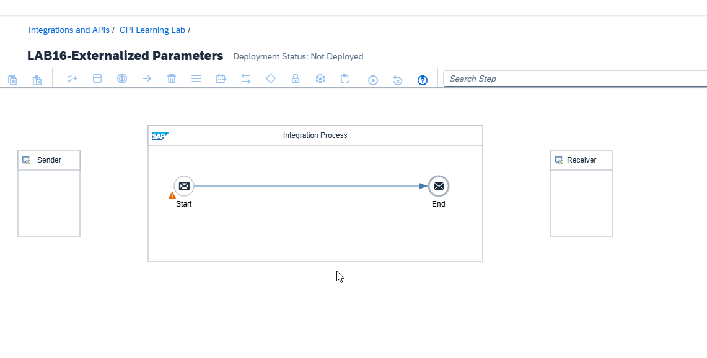
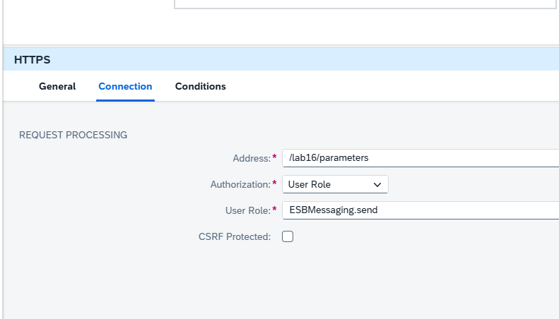
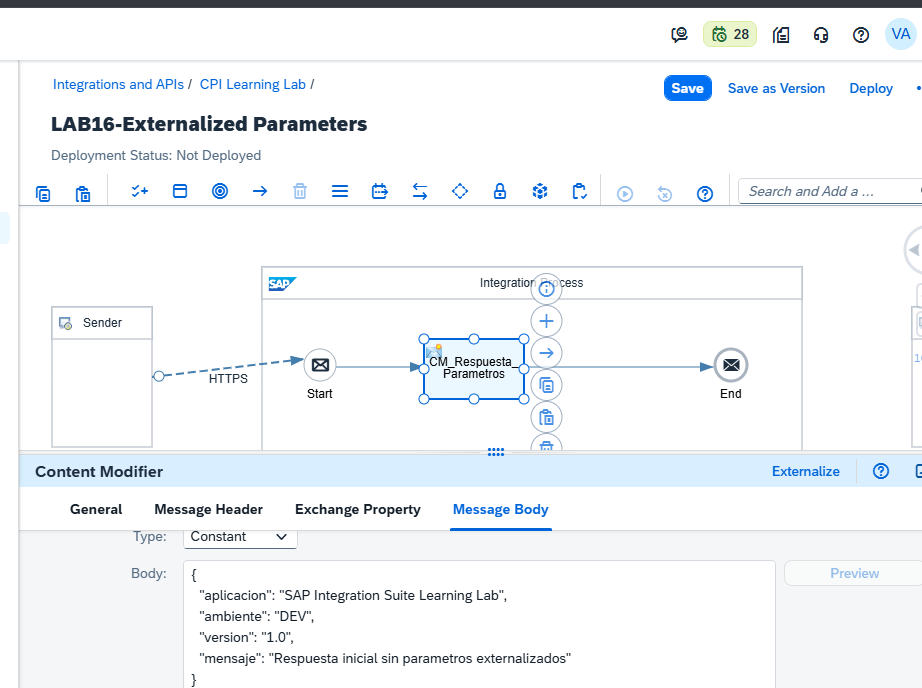
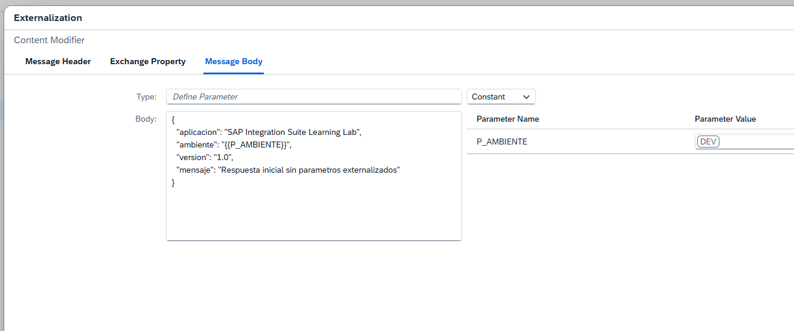
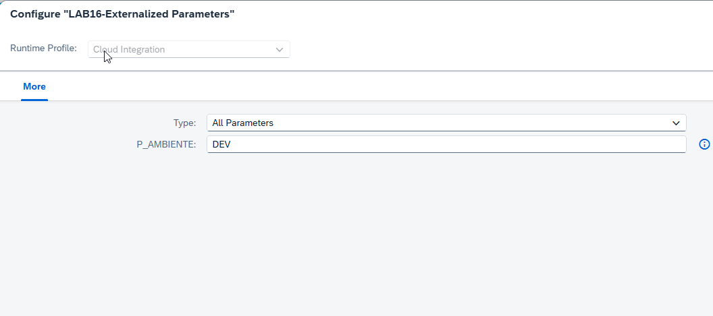
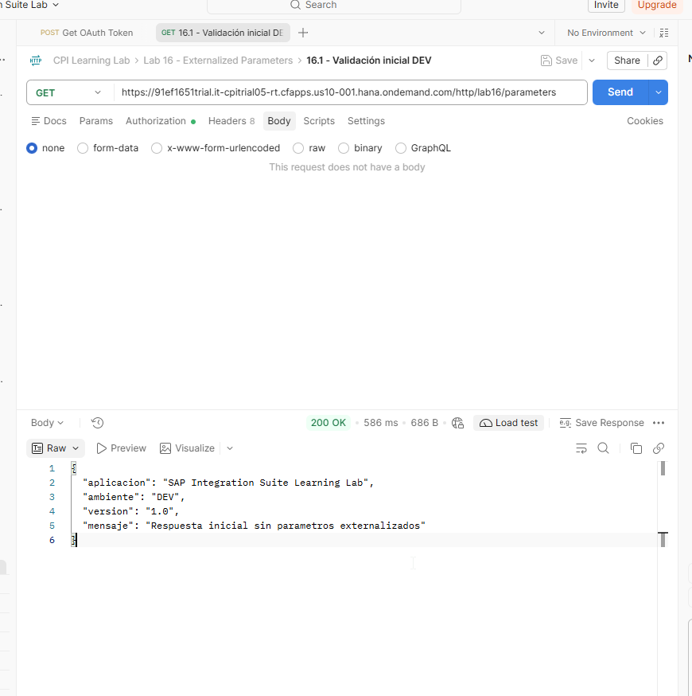
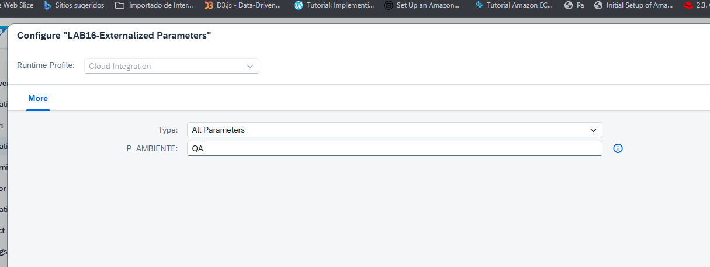
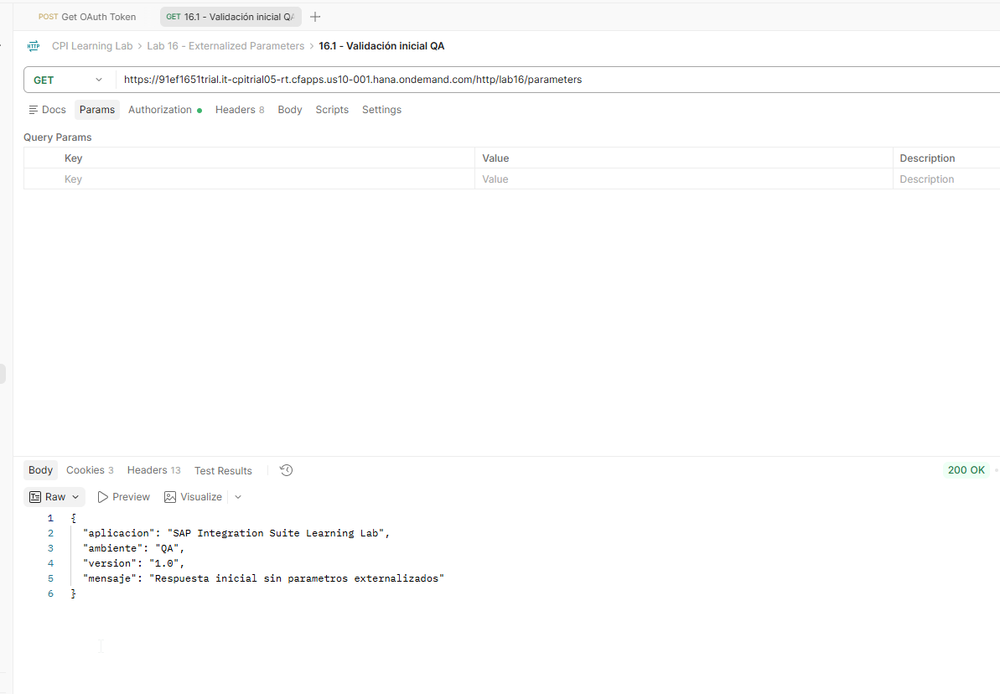
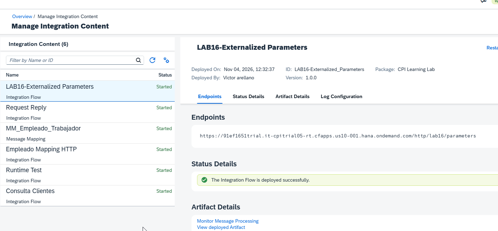

# 16 - Externalized Parameters y configuración por ambiente

**Estado del tema:** 🟨 En curso
**Package:** `CPI Learning Lab`
**iFlow:** `LAB16-Externalized Parameters`
**ID del iFlow:** `LAB16-Externalized_Parameters`
**Versión de runtime verificada:** `1.0.0`
**Fecha de validación:** 04/11/2026

## Objetivo

Comprender y validar cómo externalizar valores de configuración en SAP Cloud Integration para modificar el comportamiento de un iFlow sin editar su diseño ni incrementar su versión. Los laboratorios posteriores ampliarán esta práctica a configuraciones por ambiente y parámetros de conectividad.

## Conceptos

- **Externalized Parameter:** parámetro definido en el diseño y expuesto en la opción **Configure** del artefacto.
- **Valor predeterminado:** valor asociado al parámetro en el diseño; en este laboratorio se definió `DEV`.
- **Configuración del artefacto:** permite establecer valores de parámetros sin editar los pasos del proceso.
- **Save, Configure y Deploy:** operaciones diferentes. Guardar el diseño no equivale a aplicar una configuración al runtime; la aplicación de cambios se verifica mediante despliegue y ejecución.
- **Versión del iFlow:** el número de versión del artefacto se comprueba de forma independiente de los valores configurados.

## Prerrequisitos

- Acceso a **Design** y **Monitor** en SAP Integration Suite, Cloud Integration.
- Package `CPI Learning Lab` disponible.
- Postman con un mecanismo de autorización funcional para invocar HTTPS Sender, sin publicar credenciales ni tokens.
- Colección de Postman `CPI Learning Lab` y carpeta del capítulo `Lab 16 - Externalized Parameters`.

## Alcance y estado de laboratorios

| Laboratorio | Alcance | Estado | Evidencias |
|---|---|---|---|
| 16.1 | Creación del iFlow, externalización inicial y respuesta DEV | ✅ Completado | 16-01 a 16-07 |
| 16.2 | Cambio de configuración DEV → QA sin editar el diseño | ✅ Completado | 16-08 a 16-10 |
| 16.3 | Simulación de configuraciones DEV, QA y PRD | ⬜ Pendiente | — |
| 16.4 | Externalización de parámetros de conectividad | ⬜ Pendiente | — |
| 16.5 | Validación integral de configuración y despliegue | ⬜ Pendiente | — |

---

## 16.1 - Externalización inicial y validación DEV

**Estado:** ✅ Completado

### Objetivo

Crear un iFlow independiente con HTTPS Sender y un Content Modifier, externalizar el campo `ambiente` de su respuesta JSON y comprobar la sustitución del parámetro durante la ejecución.

### Laboratorio paso a paso

1. En **Design → Integrations and APIs**, abrir `CPI Learning Lab` y crear el iFlow `LAB16-Externalized Parameters`, con ID `LAB16-Externalized_Parameters`.

   **Motivo:** aislar el capítulo de los artefactos de laboratorios anteriores y conservar una base controlada para los cambios de configuración.

   **Evidencia 16-01 — iFlow creado.** Se observa el artefacto nuevo con proceso Start → End y estado inicial `Not Deployed`.

   

2. Conectar **Sender → Start** mediante un adaptador **HTTPS**. Configurar **Address** como `/lab16/parameters`, **Authorization** como `User Role`, rol `ESBMessaging.send` y **CSRF Protected** desactivado.

   **Motivo:** disponer de un endpoint estable para comparar respuestas obtenidas con distintas configuraciones del mismo iFlow.

   **Evidencia 16-02 — HTTPS Sender configurado.** Se verifican dirección, autorización, rol y opción CSRF.

   

3. Agregar un **Content Modifier** entre Start y End, denominado `CM_Respuesta_Parametros`. En **Message Body**, seleccionar `Constant` y definir el contenido inicial:

   ```json
   {
     "aplicacion": "SAP Integration Suite Learning Lab",
     "ambiente": "DEV",
     "version": "1.0",
     "mensaje": "Respuesta inicial sin parametros externalizados"
   }
   ```

   **Motivo:** establecer una respuesta de referencia antes de separar el valor configurable del diseño.

   **Evidencia 16-03 — Content Modifier inicial.** Se observa el flujo conectado y el JSON con el valor fijo `DEV`.

   

4. En el Content Modifier, abrir **Externalize → Message Body**. Sustituir únicamente el valor de `ambiente` por `{{P_AMBIENTE}}`, conservando el tipo `Constant` y los demás campos del JSON. En la tabla de parámetros, definir `P_AMBIENTE` con valor `DEV`.

   **Motivo:** parametrizar solo el ambiente, sin reemplazar el Body completo. La referencia `{{P_AMBIENTE}}` identifica el valor que debe resolverse mediante la configuración del artefacto.

   **Evidencia 16-04 — Parámetro externalizado.** Se observa `{{P_AMBIENTE}}` dentro del JSON y `P_AMBIENTE = DEV` en la tabla de parámetros.

   

5. Confirmar la externalización con **OK** y guardar el iFlow mediante **Save**. Desde el artefacto en **Design**, abrir **Configure** y verificar que `P_AMBIENTE` aparece con valor `DEV`.

   **Motivo:** comprobar que el parámetro es visible y configurable fuera del editor del Content Modifier.

   **Evidencia 16-05 — Parámetro en Configure.** Se observa `P_AMBIENTE = DEV` bajo el runtime profile `Cloud Integration`.

   

6. Desplegar el iFlow y revisar **Monitor → Manage Integration Content**. Se verificó estado `Started`, versión `1.0.0`, endpoint con ruta `/http/lab16/parameters` y mensaje de despliegue exitoso.

   **Motivo:** comprobar que el diseño y la configuración se encuentran disponibles para ejecución en el runtime.

   **Evidencia 16-06 — Despliegue inicial.** Monitor muestra `Started`, versión `1.0.0` y endpoint publicado.

   

7. En Postman, dentro de `Lab 16 - Externalized Parameters`, ejecutar la petición **`16.1 - Validación inicial DEV`**, método `GET`, contra el endpoint desplegado y utilizando la autorización configurada para el tenant. Se obtuvo **HTTP 200 OK** y el siguiente contenido:

   ```json
   {
     "aplicacion": "SAP Integration Suite Learning Lab",
     "ambiente": "DEV",
     "version": "1.0",
     "mensaje": "Respuesta inicial sin parametros externalizados"
   }
   ```

   **Motivo:** demostrar en ejecución que la referencia externalizada se resuelve como `DEV` y que el resto del mensaje se conserva.

   **Evidencia 16-07 — Respuesta DEV en Postman.** Se observa `200 OK` y `"ambiente": "DEV"`.

   

### Resultado esperado y validación

El parámetro `P_AMBIENTE` debe aparecer en **Configure** con valor `DEV`, y el endpoint HTTPS debe devolver `"ambiente": "DEV"`. Ambos resultados fueron verificados mediante capturas del editor, la configuración, el monitor y Postman.

### Problemas encontrados y aprendizajes

- La sintaxis de referencia reconocida por la ventana de externalización es `{{NOMBRE_PARAMETRO}}`; el nombre aislado no cumple el formato exigido por ese editor.
- La externalización de un valor dentro del JSON permite conservar constantes los demás campos.
- La aparición del parámetro en **Configure** demuestra disponibilidad de configuración; la respuesta de Postman demuestra su aplicación efectiva en runtime.

---

## 16.2 - Modificación de parámetros sin alterar el diseño

**Estado:** ✅ Completado

### Objetivo

Cambiar `P_AMBIENTE` de `DEV` a `QA` mediante **Configure**, aplicar el cambio al runtime y comprobar que el iFlow conserva su versión `1.0.0` y el mismo endpoint.

### Laboratorio paso a paso

1. En **Design → Integrations and APIs → CPI Learning Lab**, seleccionar `LAB16-Externalized Parameters` y abrir **Configure**. Cambiar únicamente `P_AMBIENTE` de `DEV` a `QA`.

   **Motivo:** modificar un valor de configuración sin entrar al editor del Content Modifier ni cambiar el diseño del proceso.

   **Evidencia 16-08 — Configuración QA.** Se observa `P_AMBIENTE = QA` en la ventana Configure.

   

2. Confirmar la configuración y desplegar el cambio. No se utilizó **Save as Version** ni se editó el Content Modifier.

   **Motivo:** aplicar el nuevo valor al runtime manteniendo separado el ciclo de configuración del versionado de diseño.

3. En Postman, utilizar una petición independiente para el laboratorio 16.2, con método `GET`, el mismo endpoint y el mismo mecanismo de autorización del laboratorio 16.1. Se obtuvo **HTTP 200 OK** con:

   ```json
   {
     "aplicacion": "SAP Integration Suite Learning Lab",
     "ambiente": "QA",
     "version": "1.0",
     "mensaje": "Respuesta inicial sin parametros externalizados"
   }
   ```

   **Motivo:** comparar el comportamiento del mismo iFlow con una configuración diferente, sin alterar los otros valores de respuesta.

   **Evidencia 16-09 — Respuesta QA en Postman.** Se observa `200 OK` y `"ambiente": "QA"` con el resto del JSON sin cambios.

   

4. En **Monitor → Manage Integration Content**, seleccionar el iFlow y comprobar estado `Started`, versión `1.0.0`, mismo endpoint `/http/lab16/parameters` y despliegue exitoso.

   **Motivo:** distinguir un cambio de configuración de la creación de una nueva versión del artefacto.

   **Evidencia 16-10 — Versión conservada después de QA.** Se observa estado `Started` y versión `1.0.0` después del nuevo despliegue.

   

### Resultado esperado y validación

El endpoint debe responder `"ambiente": "QA"` sin cambiar los demás campos del JSON. El monitor debe mostrar el iFlow iniciado, el mismo endpoint y versión `1.0.0`. Los resultados se comprobaron con las evidencias 16-08 a 16-10.

### Problemas encontrados y aprendizajes

- En este entorno, la opción **Configure** utilizada para modificar el parámetro se accedió desde el artefacto en **Design**, no desde la pantalla de **Manage Integration Content**.
- La versión `1.0.0` permaneció sin cambios tras aplicar y desplegar la nueva configuración.
- La comparación de respuestas DEV y QA permite atribuir el cambio observado al valor externalizado, manteniendo constantes el endpoint y el resto del JSON.

---

## Estado actual y próximos laboratorios

Los laboratorios **16.1** y **16.2** están **✅ Completados** mediante configuración, despliegue y respuestas HTTP verificadas. El capítulo permanece **🟨 En curso**.

- **16.3 — Simulación DEV, QA y PRD:** ⬜ Pendiente.
- **16.4 — Parámetros de conectividad:** ⬜ Pendiente.
- **16.5 — Validación integral:** ⬜ Pendiente.

El iFlow se conserva en versión `1.0.0` y su última configuración validada es `P_AMBIENTE = QA`.

## Referencias

- SAP Help Portal — SAP Cloud Integration, documentación de **Externalized Parameters** y **Configuring Integration Flow Parameters**.
- `docs/METODOLOGIA-LABORATORIOS.md` — convenciones de ejecución, validación y evidencias del proyecto.
- `docs/15-seguridad-oauth-basic-certificados-material.md` — continuidad del capítulo anterior.

> **Evidencias:** las rutas `images/tema-16/` son referencias para incorporar las capturas del laboratorio al repositorio. El documento no presupone que esos archivos ya se hayan subido a GitHub.
