# 17 - Data Store y persistencia temporal

**Estado del tema:** 🟨 En curso
**Package:** `CPI Learning Lab`
**Fecha de validación parcial:** 04/11/2026

## Objetivo

Persistir mensajes mediante Data Store Write y recuperarlos con Data Store Get. Diferenciar el alcance de almacenamiento por iFlow y global mediante dos artefactos independientes y comprobar los resultados en Postman y Monitor.

## Conceptos

- **Data Store:** almacenamiento de mensajes accesible mediante operaciones específicas de Cloud Integration.
- **Data Store Write:** persiste el mensaje bajo un nombre de almacén y un identificador de entrada.
- **Data Store Get:** recupera una entrada mediante su identificador.
- **Visibility = Integration Flow:** alcance asociado al iFlow que escribe la entrada.
- **Visibility = Global:** alcance compartido, comprobado en este capítulo mediante lectura desde otro iFlow.
- **Entry ID:** identificador utilizado para escribir y recuperar una entrada.
- **Overwrite Existing Message:** controla si una escritura puede reemplazar una entrada existente con el mismo identificador en el mismo ámbito.
- **Delete On Completion:** opción de lectura que, en estos ejercicios, se mantuvo desactivada para conservar la entrada.

## Prerrequisitos

- SAP Integration Suite / Cloud Integration con acceso a Design y Monitor.
- Package `CPI Learning Lab`.
- Postman con autorización configurada para los HTTPS Sender, sin documentar credenciales.
- Colección `CPI Learning Lab`, carpeta `Lab 17 - Data Store`, con peticiones separadas `17.1 - Data Store Write` y `17.2 - Data Store Get`.

## Alcance y estado

| Laboratorio | Alcance | Estado |
|---|---|---|
| 17.1 | Persistencia inicial mediante Data Store Write | ✅ Completado |
| 17.2 | Recuperación desde un segundo iFlow mediante Data Store Get y visibilidad Global | ✅ Completado |
| 17.3 | Selección y eliminación de entradas | ⬜ Pendiente |
| 17.4 | Retención y expiración | ⬜ Pendiente |
| 17.5 | Escenario integrado de persistencia | ⬜ Pendiente |

## 17.1 — Data Store Write

**Estado:** ✅ Completado

### Objetivo

Crear un iFlow HTTPS que construya un JSON y lo persista en `LAB17_ORDENES` con el identificador `ORD-17001`.

### Laboratorio paso a paso

1. Crear en `CPI Learning Lab` el iFlow **`LAB17-Data Store`**, ID **`LAB17-Data_Store`**. Mantener un artefacto independiente evita modificar ejercicios anteriores.

   **Evidencia 17-01 — Creación del iFlow.** Se identifica el nuevo artefacto.

   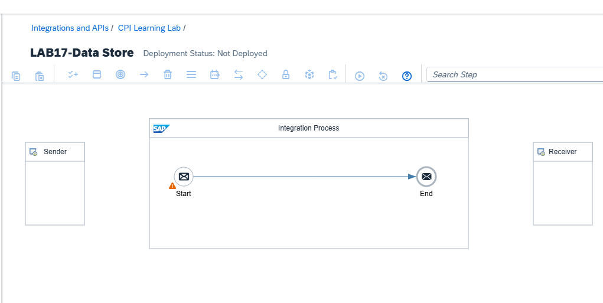

2. Configurar el adaptador **HTTPS Sender** con `Address = /lab17/datastore/write`, `Authorization = User Role`, `User Role = ESBMessaging.send` y protección CSRF desactivada. Se utiliza un endpoint específico para ejecutar la escritura desde Postman.

   **Evidencia 17-02 — HTTPS Sender de escritura.** Dirección y autorización del adaptador.

   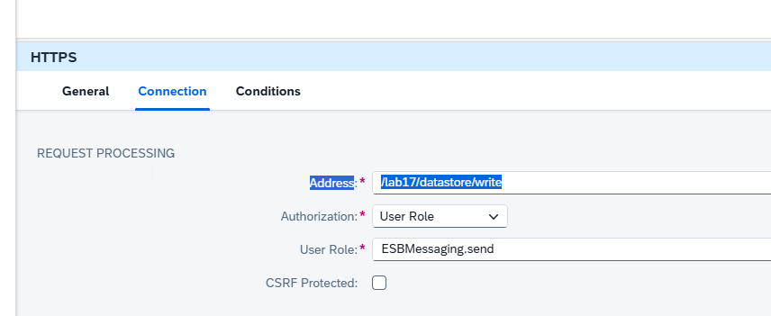

3. Incorporar `CM_Preparar_Mensaje`, con **Message Body → Constant**. El cuerpo fijo permite comprobar exactamente qué contenido se persiste, independientemente del body recibido desde Postman.

   ```json
   {
     "id": "ORD-17001",
     "cliente": "Cliente Laboratorio",
     "monto": 150000,
     "moneda": "CLP",
     "estado": "PENDIENTE"
   }
   ```

   **Evidencia 17-03 — JSON de la orden.** Configuración del Content Modifier.

   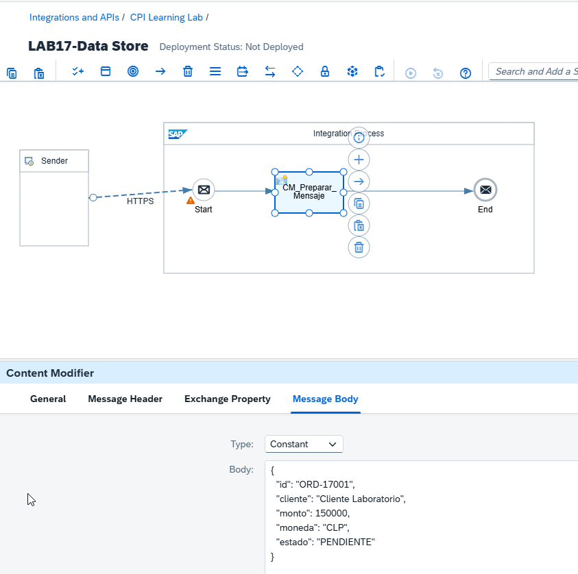

4. Añadir `DS_Write_Orden` y configurar Data Store Write: `Data Store Name = LAB17_ORDENES`, `Visibility = Integration Flow`, `Entry ID = ORD-17001`, `Retention Threshold = 2 días`, `Expiration Period = 30 días`, cifrado activado, sobrescritura desactivada e inclusión de headers desactivada. La visibilidad inicial limita el ámbito de esta primera prueba; la sobrescritura desactivada permite detectar entradas duplicadas.

   **Evidencia 17-04 — Configuración inicial de Data Store Write.** Parámetros de persistencia.

   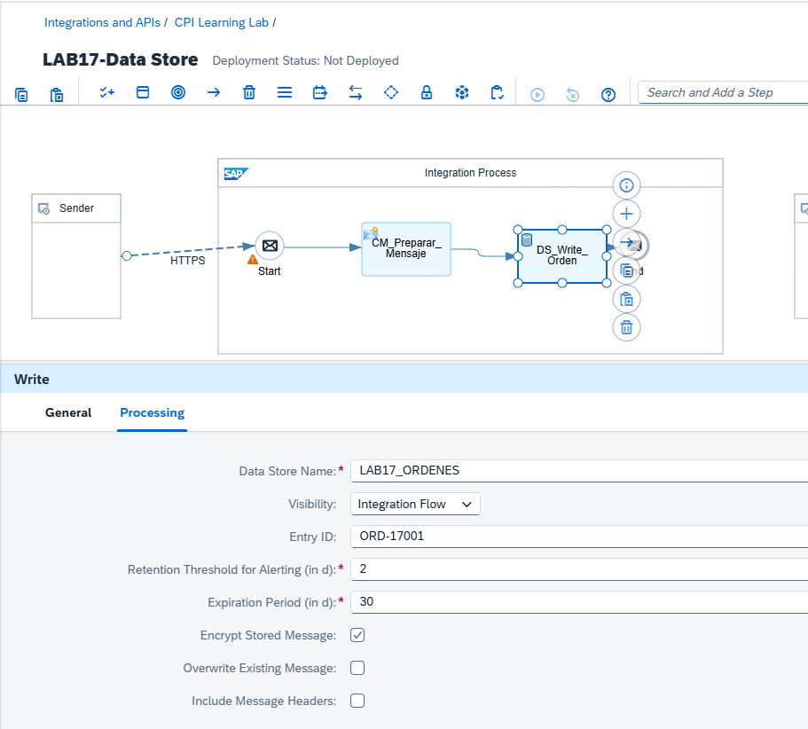

5. Guardar, desplegar la versión `1.0.0` y comprobar `Started`.

   **Evidencia 17-05 — iFlow iniciado.** Estado de despliegue.

   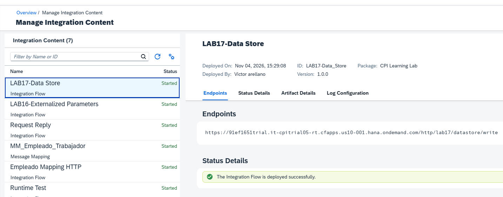

6. Ejecutar desde Postman la petición `17.1 - Data Store Write` mediante POST. Se obtuvo HTTP `200 OK` y el JSON esperado.

   **Evidencia 17-06 — Escritura desde Postman.** Respuesta HTTP satisfactoria.

   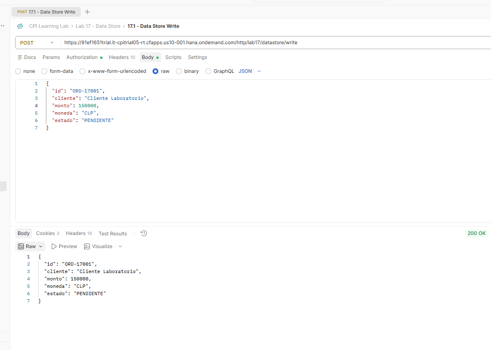

7. En **Monitor → Manage Data Stores**, comprobar la entrada `ORD-17001` y su payload. La inspección del almacén complementa el HTTP 200 y demuestra la persistencia.

   **Evidencia 17-07 — Orden persistida.** Entrada y contenido almacenado.

   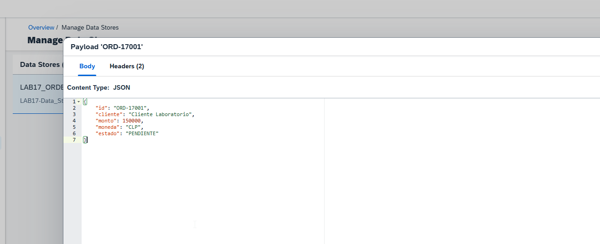

### Resultado esperado y validación

Se confirmó despliegue `Started`, HTTP `200 OK` y presencia de `ORD-17001` en Monitor con el JSON esperado.

### Problemas encontrados y aprendizajes

La prueba inicial demostró la persistencia dentro del ámbito del iFlow. El acceso desde un artefacto independiente se estudió en 17.2.

## 17.2 — Data Store Get y acceso global

**Estado:** ✅ Completado

### Objetivo

Recuperar una entrada desde un segundo iFlow, comprobar la diferencia entre los ámbitos `Integration Flow` y `Global` y conservar el mensaje tras su lectura.

### Laboratorio paso a paso

1. Crear el segundo iFlow **`LAB17-Data Store Get`**, ID **`LAB17-Data_Store_Get`**. Separar escritura y lectura permite validar el acceso entre artefactos.

   **Evidencia 17-08 — iFlow de lectura.** Segundo artefacto independiente.

   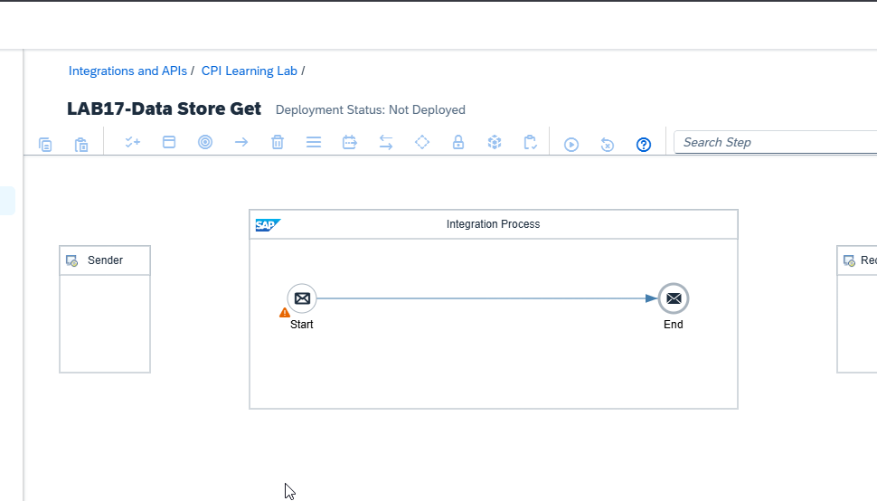

2. Configurar **HTTPS Sender** con `Address = /lab17/datastore/get`, `Authorization = User Role`, `User Role = ESBMessaging.send` y CSRF desactivado. Crear la petición Postman independiente `17.2 - Data Store Get` con método GET y sin body.

   **Evidencia 17-09 — HTTPS Sender de lectura.** Endpoint de consulta.

   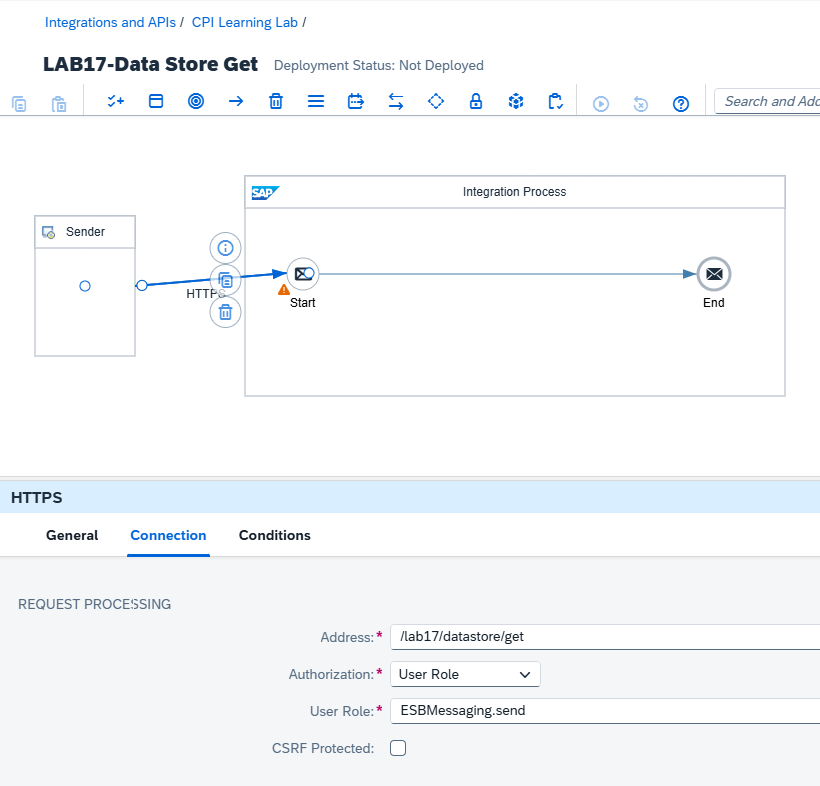

3. Configurar Data Store Get con `Data Store Name = LAB17_ORDENES`, `Visibility = Global`, `Entry ID = ORD-17001`, `Delete On Completion = desactivado` y `Throw Exception on Missing Entry = activado`. La excepción permite distinguir una entrada no encontrada de una recuperación correcta. Desplegar la versión `1.0.0` y comprobar `Started`.

   **Evidencia 17-10 — iFlow de lectura iniciado.** Despliegue de la primera versión.

   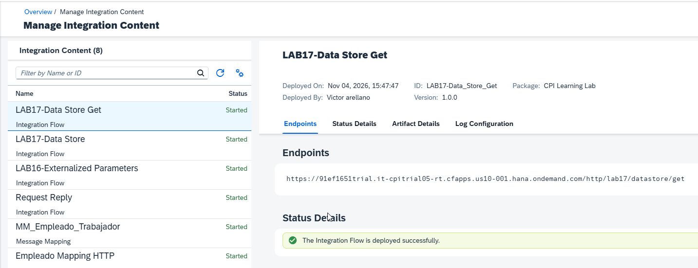

4. Ejecutar GET para `ORD-17001`. La respuesta fue HTTP `500` y el MPL informó `No message found for id ORD-17001 in store LAB17_ORDENES.` La entrada original continuaba visible en el almacenamiento asociado a `LAB17-Data_Store`, mientras la lectura solicitaba ámbito global.

   **Evidencia 17-12 — Entrada no encontrada en lectura global.** MPL con el mensaje de error.

   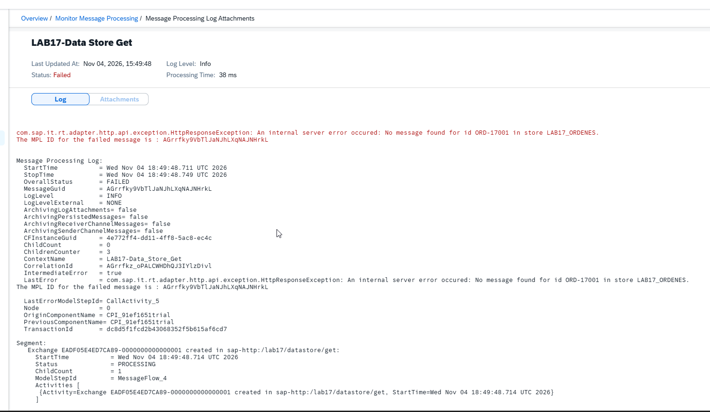

   **Evidencia 17-13 — Entrada original conservada.** Monitor muestra `ORD-17001` en el ámbito del iFlow escritor.

   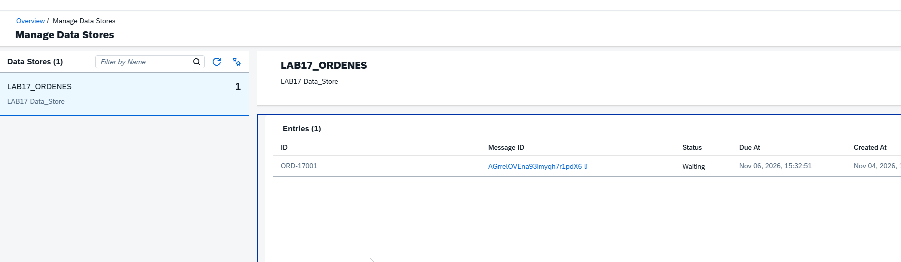

5. Cambiar la configuración de escritura a `Visibility = Global` conservando la versión anterior del iFlow mediante versionado `1.0.1`. Una nueva escritura con `ORD-17001` devolvió HTTP `500`; el MPL informó `An entry with id ORD-17001 does already exist in data store LAB17_ORDENES with qualifier LAB17-Data_Store.` La prueba mostró un conflicto con la entrada existente; cambiar la configuración no demostró una migración de la entrada original al ámbito global.

   **Evidencia 17-14 — Escritura duplicada.** MPL con identificador y qualifier del conflicto.

   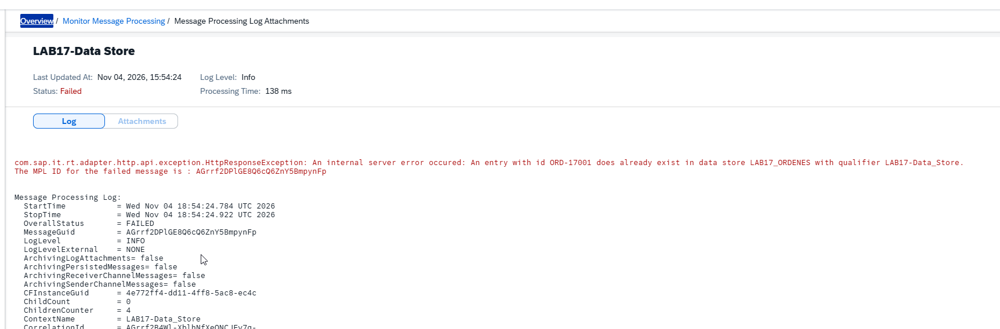

6. Crear la versión `1.0.2` del escritor. Configurar `DS_Write_Orden` con `Visibility = Global` y `Entry ID = ORD-17002`; actualizar el `id` del JSON de `CM_Preparar_Mensaje` a `ORD-17002`, conservando los demás campos. Desplegar. El identificador nuevo evita sobrescribir el registro anterior y permite aislar la prueba global.

7. Ejecutar POST desde Postman. Se obtuvo HTTP `200 OK` con `ORD-17002`. Aunque el body de Postman conservaba `ORD-17001`, la respuesta contenía `ORD-17002` porque el Content Modifier generaba el mensaje utilizado en el flujo.

   **Evidencia 17-16 — Escritura global correcta.** HTTP 200 y respuesta `ORD-17002`.

   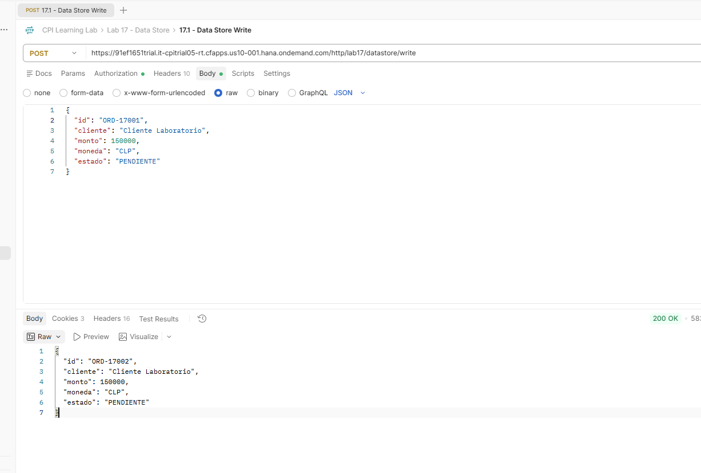

8. Inspeccionar **Monitor → Manage Data Stores**. Se observaron dos entradas de almacén diferenciadas por su ámbito: una asociada a `LAB17-Data_Store` y otra identificada como `Global`. En esta última, el payload `ORD-17002` contenía el JSON esperado.

   **Evidencia 17-17 — Orden en almacén global.** Vista del almacén global y payload de `ORD-17002`.

   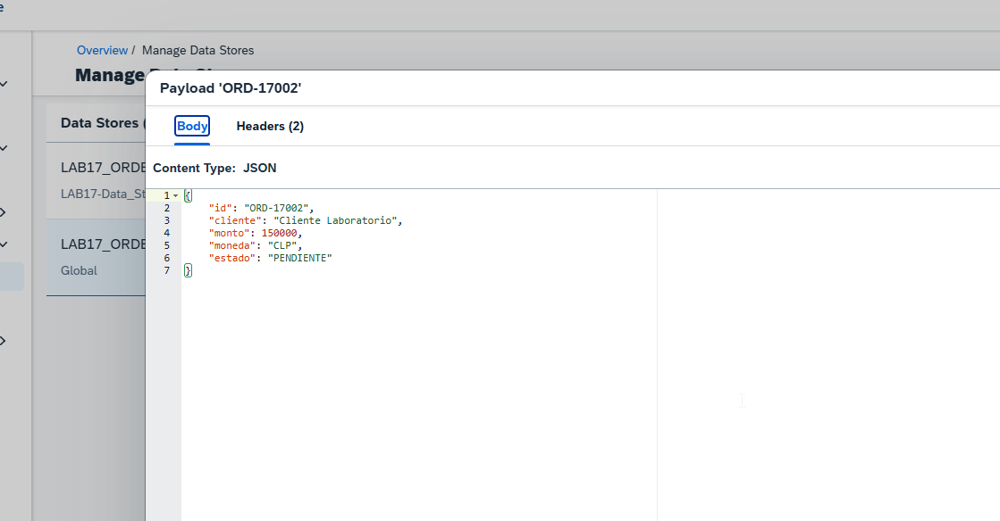

9. Crear la versión `1.0.1` del lector. Mantener `Data Store Name = LAB17_ORDENES`, `Visibility = Global`, `Delete On Completion = desactivado` y `Throw Exception on Missing Entry = activado`; cambiar solamente `Entry ID = ORD-17002`. Guardar y desplegar.

10. Ejecutar GET desde Postman. La respuesta fue **HTTP `200 OK`** con el contenido exacto de la orden `ORD-17002`. Esta prueba demuestra el acceso a la entrada global desde el segundo iFlow.

    **Evidencia 17-18 — Recuperación global validada.** Petición GET, HTTP 200 y JSON de `ORD-17002`.

    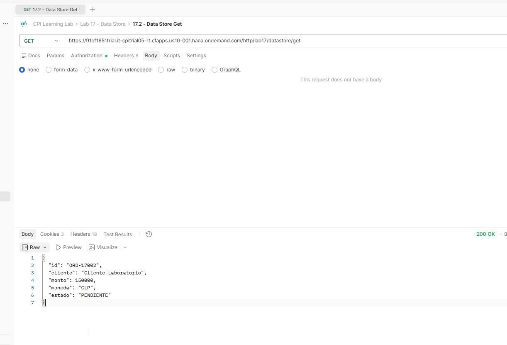

### Resultado esperado y validación

El iFlow lector recuperó desde el almacenamiento global la orden escrita por otro iFlow, con HTTP `200 OK` y el JSON esperado:

```json
{
  "id": "ORD-17002",
  "cliente": "Cliente Laboratorio",
  "monto": 150000,
  "moneda": "CLP",
  "estado": "PENDIENTE"
}
```

La opción `Delete On Completion` quedó desactivada. La prueba no incluyó una nueva consulta a Monitor posterior al GET para demostrar visualmente que la entrada continuara presente.

### Problemas encontrados y aprendizajes

- El mensaje `No message found` debe interpretarse junto con la visibilidad configurada y el ámbito donde realmente existe la entrada.
- La entrada `ORD-17001` apareció asociada al iFlow escritor; la nueva entrada `ORD-17002` apareció en el ámbito Global.
- La escritura duplicada produjo una excepción al mantenerse desactivada la sobrescritura.
- La recuperación de `ORD-17002` desde un segundo iFlow fue exitosa. No se demostró que cambiar la visibilidad de un paso migre automáticamente entradas ya almacenadas.

## Validación general del corte

| Comprobación | Resultado |
|---|---|
| Persistencia inicial de `ORD-17001` | Validada |
| Escritura de `ORD-17002` con visibilidad Global | Validada |
| Presencia del payload `ORD-17002` en Monitor | Validada |
| Recuperación de `ORD-17002` desde otro iFlow | Validada, HTTP 200 |
| Select/Delete | Pendiente, laboratorio 17.3 |
| Retención y expiración efectivas | Pendiente, laboratorio 17.4 |
| Escenario integrado | Pendiente, laboratorio 17.5 |

## Referencias

- [SAP Help Portal — SAP Integration Suite](https://help.sap.com/docs/integration-suite)
- `docs/METODOLOGIA-LABORATORIOS.md`
- `docs/kba-y-hallazgos.md`
