# 17 - Data Store y persistencia temporal

**Estado del tema:** 🟨 En curso
**Package:** `CPI Learning Lab`
**Última validación práctica:** 05/11/2026

## Objetivo

Persistir, consultar, seleccionar y eliminar mensajes en SAP Cloud Integration; diferenciar los ámbitos `Integration Flow` y `Global`; y verificar cómo los parámetros de retención y expiración determinan las fechas de las entradas.

## Conceptos

- **Data Store Write:** almacena el mensaje con un nombre de almacén y un Entry ID.
- **Data Store Get:** recupera una entrada identificada.
- **Data Store Select:** selecciona entradas y, en el escenario XML validado, devuelve un documento `<messages>` con los mensajes seleccionados.
- **Data Store Delete:** elimina una entrada identificada.
- **Visibility:** `Integration Flow` restringe el ámbito al iFlow; `Global` permite el acceso compartido, como se comprobó con dos iFlows.
- **Retention Threshold for Alerting:** período utilizado para calcular `Due At`.
- **Expiration Period:** período utilizado para calcular `Retain Until`. La fecha registrada no demuestra por sí sola la ejecución de la eliminación automática.
- **Overwrite Existing Message:** controla la sobrescritura de una entrada con el mismo identificador.

## Prerrequisitos

SAP Integration Suite / Cloud Integration, acceso a Design y Monitor, package `CPI Learning Lab` y Postman con autenticación configurada. En la colección `CPI Learning Lab`, carpeta `Lab 17 - Data Store`, se mantienen peticiones independientes por laboratorio. No almacenar tokens ni credenciales en el repositorio.

## Alcance y estado

| Laboratorio | Alcance | Estado |
|---|---|---|
| 17.1 | Data Store Write | ✅ Completado |
| 17.2 | Data Store Get y visibilidad Global | ✅ Completado |
| 17.3 | Select, Router y Delete | ✅ Completado |
| 17.4 | Retención y expiración | 🟨 En curso: fechas verificadas; eliminación automática pendiente |
| 17.5 | Escenario integrado | ⬜ Pendiente |

## 17.1 — Data Store Write

**Estado:** ✅ Completado

### Objetivo y procedimiento

1. Crear `LAB17-Data Store` (ID `LAB17-Data_Store`) en `CPI Learning Lab`.

   **Evidencia 17-01 — iFlow creado.** Artefacto de persistencia independiente.

   

2. Configurar HTTPS Sender: `Address = /lab17/datastore/write`, `Authorization = User Role`, `User Role = ESBMessaging.send`, CSRF desactivado.

   **Evidencia 17-02 — HTTPS Sender.** Endpoint de escritura.

   

3. Añadir `CM_Preparar_Mensaje` con `Message Body → Constant`. Un cuerpo fijo permite verificar el contenido persistido independientemente del body de Postman.

   ```json
   {"id":"ORD-17001","cliente":"Cliente Laboratorio","monto":150000,"moneda":"CLP","estado":"PENDIENTE"}
   ```

   **Evidencia 17-03 — Mensaje de prueba.** JSON configurado en Content Modifier.

   

4. Configurar `DS_Write_Orden`: `Data Store Name = LAB17_ORDENES`, `Visibility = Integration Flow`, `Entry ID = ORD-17001`, umbral de alerta 2 días, expiración 30 días, cifrado activado, sobrescritura e inclusión de headers desactivadas.

   **Evidencia 17-04 — Write configurado.** Parámetros iniciales.

   

5. Desplegar versión `1.0.0` y verificar `Started`.

   **Evidencia 17-05 — Despliegue.** iFlow iniciado.

   

6. Ejecutar POST desde `17.1 - Data Store Write`: HTTP 200; comprobar después la entrada y el payload en Monitor.

   **Evidencia 17-06 — Postman.** Escritura satisfactoria.

   

   **Evidencia 17-07 — Monitor.** Persistencia de `ORD-17001`.

   

### Validación, problemas y aprendizajes

Se validaron despliegue, respuesta HTTP 200 y persistencia de `ORD-17001`. La visibilidad inicial `Integration Flow` se contrastó posteriormente con `Global` en 17.2.

## 17.2 — Data Store Get y acceso global

**Estado:** ✅ Completado

### Objetivo y procedimiento

1. Crear `LAB17-Data Store Get` (ID `LAB17-Data_Store_Get`), separado del escritor.

   **Evidencia 17-08 — Lector independiente.**

   

2. Configurar HTTPS Sender `/lab17/datastore/get`, `User Role = ESBMessaging.send`, CSRF desactivado; crear `17.2 - Data Store Get` en Postman.

   **Evidencia 17-09 — HTTPS Sender Get.**

   

3. Configurar Data Store Get con `LAB17_ORDENES`, `Global`, `ORD-17001`, `Delete On Completion = off`, `Throw Exception on Missing Entry = on`; desplegar versión `1.0.0`.

   **Evidencia 17-10 — Lector iniciado.**

   

4. Ejecutar GET. HTTP 500; MPL: `No message found for id ORD-17001 in store LAB17_ORDENES.` Monitor confirmó que la entrada original estaba en el ámbito del escritor, no en el almacén global consultado.

   **Evidencia 17-12 — Error de lectura.**

   

   **Evidencia 17-13 — Entrada original en Monitor.**

   

5. Versionar el escritor `1.0.1` y cambiar visibilidad a `Global`. Reescribir `ORD-17001` falló por duplicado con qualifier `LAB17-Data_Store`. Cambiar la configuración no migró la entrada preexistente.

   **Evidencia 17-14 — Duplicado en MPL.**

   

6. Versionar escritor `1.0.2`, escribir `ORD-17002` en ámbito `Global` y actualizar el JSON para que coincida el ID. POST HTTP 200.

   **Evidencia 17-16 — Escritura global.**

   

7. Verificar `ORD-17002` en el Data Store global.

   **Evidencia 17-17 — Entrada global y payload.**

   

8. Versionar lector `1.0.1`, configurar Get con Entry ID `ORD-17002`, desplegar y ejecutar GET. HTTP 200 y JSON esperado.

   **Evidencia 17-18 — Lectura desde otro iFlow.**

   

### Validación, problemas y aprendizajes

La lectura entre iFlows funcionó con visibilidad Global. Un mismo nombre de almacén no implica un mismo ámbito; la entrada inicial y la global se distinguieron en Monitor. La escritura duplicada fue rechazada con sobrescritura desactivada.

## 17.3 — Data Store Select y Delete

**Estado:** ✅ Completado

### Objetivo

Seleccionar mensajes almacenados, dirigir peticiones a Select o Delete mediante Router y comprobar la eliminación con una consulta posterior.

### Laboratorio paso a paso

1. Crear el iFlow independiente `LAB17-Data Store Select Delete` (ID `LAB17-Data_Store_Select_Delete`) y configurar HTTPS Sender `/lab17/datastore/select`, con autorización `ESBMessaging.send` y CSRF desactivado. Separar este artefacto evita alterar Write y Get.

   **Evidencia 17-19 — iFlow Select/Delete creado.**

   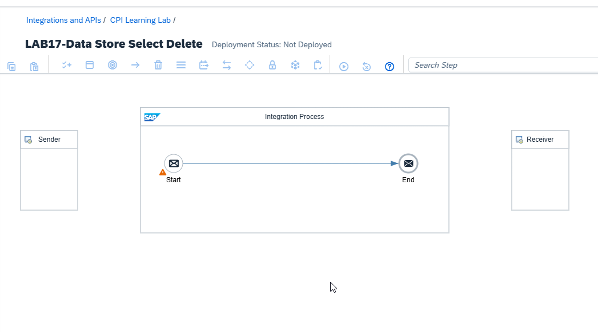

   **Evidencia 17-20 — Sender configurado.**

   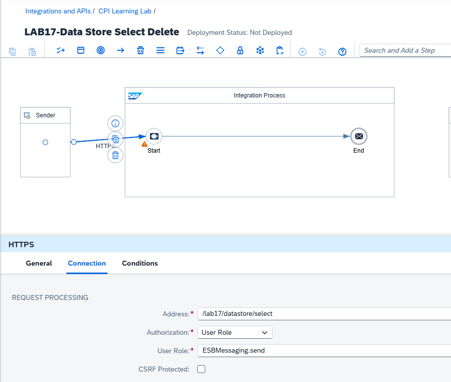

2. Incorporar `DS_Select_Ordenes` con `Data Store Name = LAB17_ORDENES`, `Visibility = Global`, `Number of Polled Messages = 1`, `Delete On Completion = off`. Desplegar y probar GET.

   **Evidencia 17-21 — Configuración inicial de Select.**

   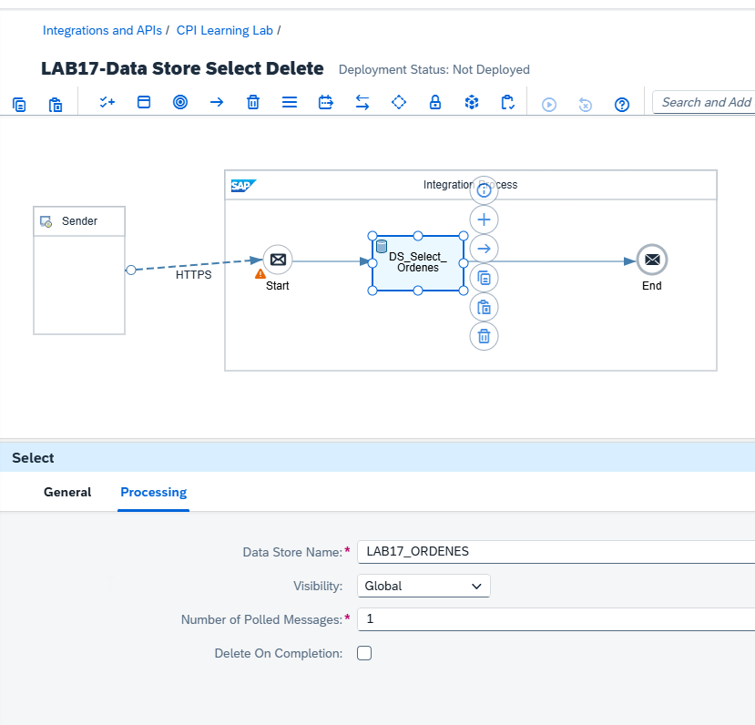

3. Diagnosticar el fallo inicial: HTTP 500 y MPL `Unexpected character '{' (code 123) in prolog; expected '<'`. El paso Select identificó `ORD-17002`, cuyo payload almacenado era JSON. La prueba evidenció un intento de procesamiento XML de contenido que comenzaba por `{`. No se comprobó que todos los usos de Select con JSON fallen en cualquier configuración.

4. Preparar una entrada XML para aislar el formato de la prueba. En una versión nueva del escritor se configuró el Content Modifier con XML y Entry ID `ORD-17003`. La versión `1.0.3` se desplegó y se comprobó la escritura. El almacén de la prueba Select se separó como `LAB17_ORDENES_XML`, `Global`, y el lector Select se apuntó al mismo almacén. Esta separación evita que Select vuelva a recuperar la entrada JSON anterior.

   ```xml
   <?xml version="1.0" encoding="UTF-8"?>
   <orden>
     <id>ORD-17003</id>
     <cliente>Cliente Laboratorio</cliente>
     <monto>150000</monto>
     <moneda>CLP</moneda>
     <estado>PENDIENTE</estado>
   </orden>
   ```

5. Ejecutar POST para escribir XML y comprobar `ORD-17003` en `LAB17_ORDENES_XML`. Ejecutar GET Select: HTTP 200, respuesta XML con `<messages><message id="ORD-17003">...`.

6. Crear una versión nueva de `LAB17-Data Store Select Delete` y añadir `DS_Delete_Ordenes`, apuntando a `LAB17_ORDENES_XML`, `Global`, Entry ID `ORD-17003`. Incorporar Router antes de las operaciones para que la eliminación sea una ruta explícita, no un efecto de Select.

7. Configurar Router: ruta Delete con `Expression Type = Non-XML`, condición `${header.OperacionDataStore} = 'DELETE'`; ruta Select como `Default Route`. Conectar ambas ramas al final del proceso y desplegar.

8. Mantener peticiones independientes en Postman:
   - `17.3 - Data Store Select`: GET `/lab17/datastore/select`, header `OperacionDataStore: SELECT`, sin body. HTTP 200 y XML con `ORD-17003`.
   - `17.3 - Data Store Delete`: DELETE a la misma dirección, header `OperacionDataStore: DELETE`, sin body. HTTP 200 y respuesta vacía.

   **Evidencia 17-37 — Router y Select correctos.** La respuesta contiene `ORD-17003` dentro de `<messages>`.

   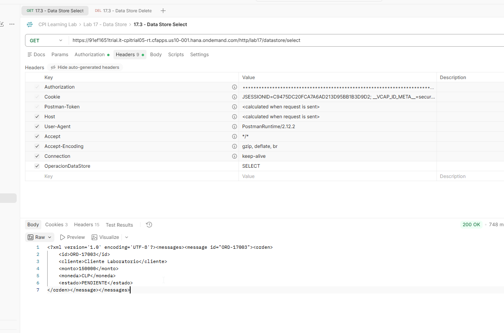

   **Evidencia 17-38 — Delete ejecutado.** HTTP 200 con header `OperacionDataStore = DELETE`.

   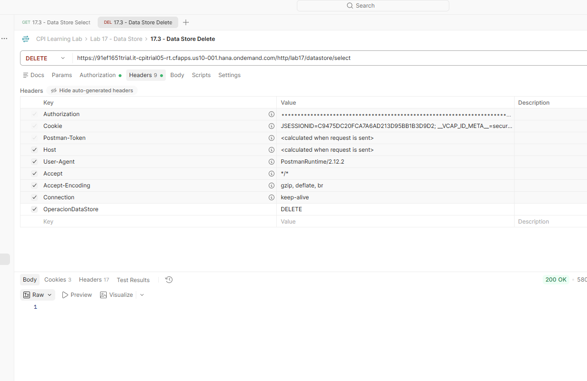

9. Verificar en Monitor que `LAB17_ORDENES_XML` deja de aparecer tras eliminar su única entrada, mientras el almacén original conserva sus entradas.

   **Evidencia 17-39 — Almacén XML sin entradas.** Vista posterior al Delete.

   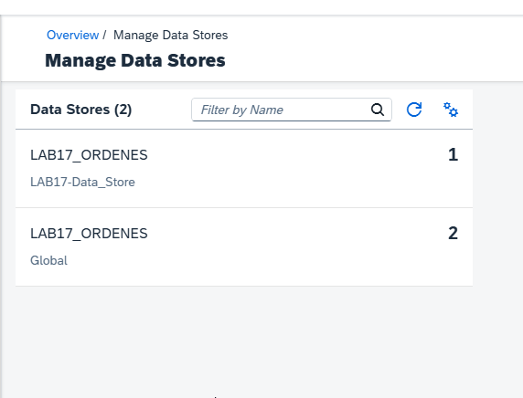

10. Ejecutar nuevamente GET Select. HTTP 200 y body `<?xml version="1.0" encoding="UTF-8"?><messages/>`. El resultado confirma una selección vacía.

    **Evidencia 17-40 — Select sin entradas.**

    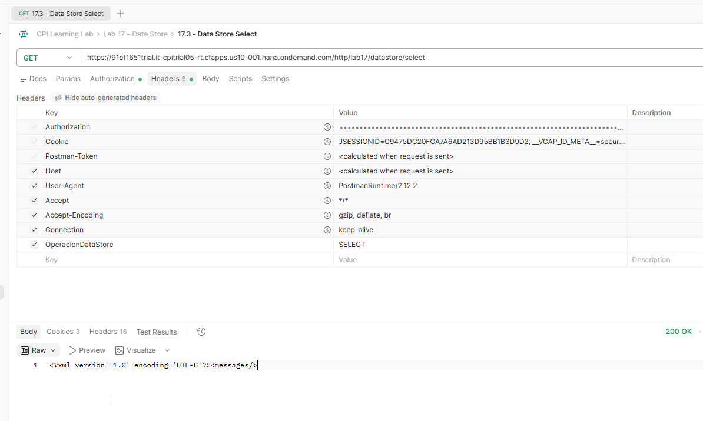

### Resultado esperado y validación

Se comprobaron selección XML, separación de rutas por header, eliminación y respuesta de selección vacía. La prueba inicial con JSON falló y se resolvió en este escenario con un almacén independiente de mensajes XML. Véase el KBA del capítulo 17.

### Aprendizajes

Select y Get no son operaciones equivalentes: Get recuperó un JSON por ID en 17.2, mientras Select produjo un error de parseo en el escenario inicial y funcionó con la entrada XML. `Delete On Completion` permaneció desactivado en Select; la eliminación se ejecutó exclusivamente mediante la ruta Delete.

## 17.4 — Retención y expiración

**Estado:** 🟨 En curso — cálculo de fechas validado; eliminación automática no verificada.

### Objetivo

Comparar las fechas de retención de dos entradas almacenadas bajo diferentes configuraciones, sin eliminar la entrada inicial ni confundir fecha de expiración con eliminación efectiva.

### Laboratorio paso a paso

1. Reutilizar `LAB17-Data Store`, preservando su historial de versiones. En versión `1.0.5`, configurar `DS_Write_Orden` con `LAB17_EXPIRACION`, `Global`, Entry ID `ORD-17004`, umbral de alerta 2 días, expiración 30 días y cifrado activado. Mantener el identificador del XML del Content Modifier alineado con el Entry ID.

   **Evidencia 17-42 — Configuración inicial de expiración.** Write con períodos 2 y 30 días.

   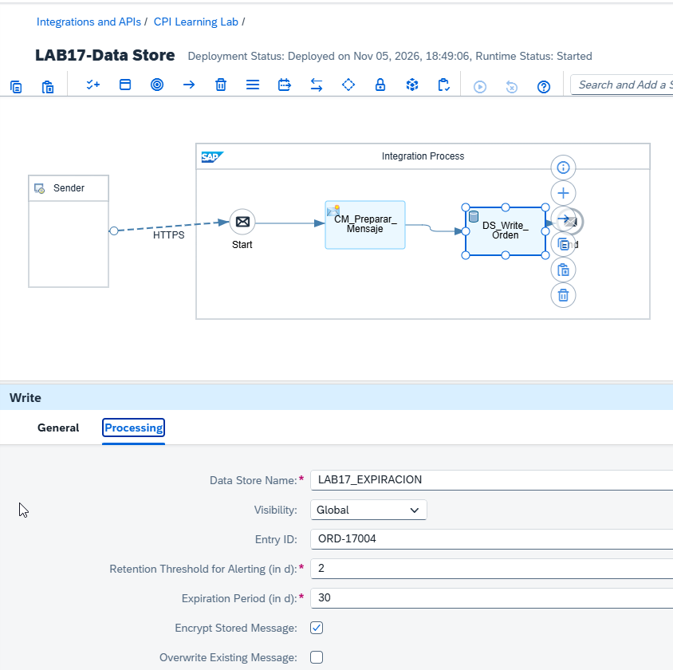

2. Desplegar, ejecutar POST y comprobar en Monitor que `ORD-17004` está almacenada como XML en `LAB17_EXPIRACION`.

   **Evidencia 17-43 — Entrada persistida.** Payload XML de `ORD-17004`.

   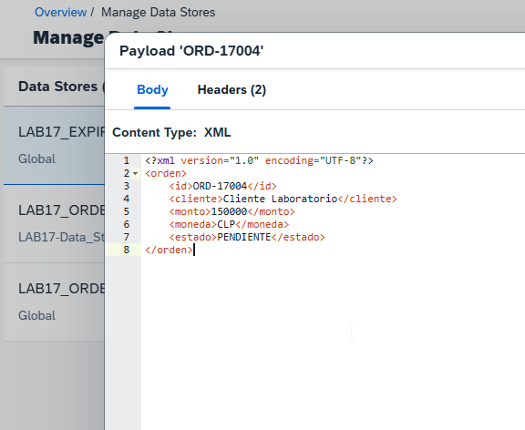

3. Inspeccionar las fechas de `ORD-17004`:
   - `Created At`: 05/11/2026 18:51:58
   - `Due At`: 07/11/2026 18:51:58
   - `Retain Until`: 05/12/2026 18:51:58

   **Evidencia 17-44 — Fechas de la configuración 2/30.**

   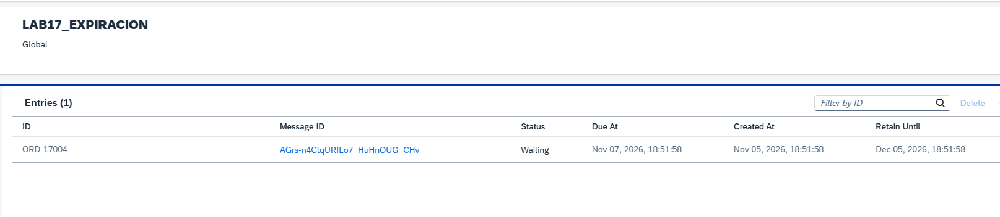

4. Crear versión `1.0.6` del mismo escritor. Cambiar únicamente los períodos y el identificador de la entrada: umbral de alerta 1 día, expiración 2 días, Entry ID `ORD-17005`, y `<id>ORD-17005</id>` en el XML. Mantener `LAB17_EXPIRACION`, visibilidad Global, cifrado y sobrescritura desactivada. La interfaz rechazó la combinación 1/1 con el mensaje `'Expiration Period' should be greater than 'Retention Threshold for Alerting'`; por ello se adoptó 1/2.

5. Guardar, desplegar versión `1.0.6`, ejecutar POST y consultar ambas entradas en Monitor. Se observaron los siguientes valores:

   | Campo | `ORD-17004` (2/30) | `ORD-17005` (1/2) |
   |---|---|---|
   | Created At | 05/11/2026 18:51:58 | 05/11/2026 19:02:57 |
   | Due At | 07/11/2026 18:51:58 | 06/11/2026 19:02:57 |
   | Retain Until | 05/12/2026 18:51:58 | 07/11/2026 19:02:57 |
   | Estado observado | Waiting | Waiting |

   **Evidencia 17-45 — Comparación de retención y expiración.** Las entradas conservan sus fechas propias pese al cambio de versión del escritor.

   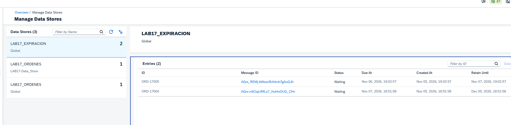

### Resultado esperado y validación

La configuración 2/30 produjo fechas a +2 y +30 días; la configuración 1/2 produjo fechas a +1 y +2 días. La entrada previa conservó sus fechas después del nuevo despliegue. Se verificó además que el editor exige `Expiration Period > Retention Threshold for Alerting` para los valores probados.

### Limitación y comprobación pendiente

**No se ha validado la eliminación automática por expiración.** La entrada `ORD-17005` tiene `Retain Until = 07/11/2026 19:02:57` según Monitor. La comprobación debe realizarse después de esa fecha, revisando el almacén y, si corresponde, los registros de procesamiento. No debe interpretarse que el borrado ocurrirá exactamente a esa hora. Mientras no exista evidencia de la eliminación, 17.4 permanece `🟨 En curso`.

### Aprendizajes

La fecha `Due At` corresponde al umbral de alerta configurado; `Retain Until`, al período de expiración. La configuración se refleja en las entradas nuevas y no modificó las fechas ya registradas en la entrada anterior. La eliminación manual validada en 17.3 es distinta de la expiración automática.

## 17.5 — Escenario integrado

**Estado:** ⬜ Pendiente. Alcance y ejecución por confirmar antes de iniciar.

## Validación general

| Comprobación | Resultado |
|---|---|
| Escritura y persistencia | Validada |
| Lectura global entre iFlows | Validada |
| Select de XML | Validada |
| Delete explícito y consulta posterior vacía | Validada |
| Cálculo de fechas de retención y expiración | Validado |
| Eliminación automática por expiración | Pendiente de evidencia |
| Escenario integrado 17.5 | Pendiente |

## Referencias

- [SAP Help Portal — SAP Integration Suite](https://help.sap.com/docs/integration-suite)
- `docs/METODOLOGIA-LABORATORIOS.md`
- `docs/kba-y-hallazgos.md`
