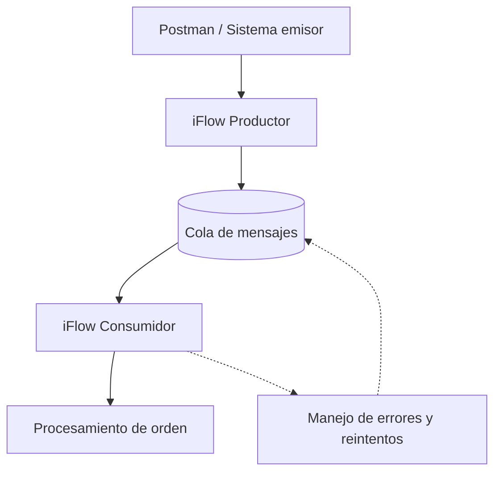

# 18 - Integraciones asíncronas y colas

**Estado del tema:** 🟨 En curso — alcance aprobado; implementación y validaciones pendientes
**Package previsto:** `CPI Learning Lab`
**Inicio:** 06/11/2026
**Fecha objetivo de cierre:** 08/11/2026 (planificación, no resultado confirmado)

## Objetivo y contexto

Comprender el desacoplamiento entre productor y consumidor en SAP Cloud Integration, diseñar un escenario de mensajería asíncrona y validar mediante pruebas observables la publicación, consumo, recuperación ante fallos y trazabilidad de mensajes.
El capítulo continúa los aprendizajes de los capítulos 13 (errores), 14 (monitorización) y 17 (persistencia e idempotencia). El escenario propuesto reutiliza el dominio de órdenes, pero no presupone reutilizar ni modificar iFlows existentes.

## Alcance aprobado

- Comparar integración síncrona y asíncrona, desacoplamiento y garantías de entrega.
- Verificar la disponibilidad real de infraestructura de mensajería en SAP BTP Trial.
- Diseñar un productor y un consumidor separados, con una cola intermedia si el entorno lo permite.
- Probar procesamiento, fallos controlados, reintentos y duplicados según las capacidades efectivamente disponibles.
- Validar la monitorización y la trazabilidad de extremo a extremo.
- Documentar configuraciones, resultados y evidencias verificadas.

**Fuera de alcance inicial:** garantizar entrega exactamente una vez, asumir una política específica de reintentos o incorporar servicios no disponibles en el entorno. SAP Event Mesh podrá compararse conceptualmente; su uso práctico dependerá de la verificación de disponibilidad. Se prioriza evaluar JMS en Cloud Integration, sin dar por confirmada su habilitación.

## Plan de laboratorios y tiempos estimados

| Laboratorio | Objetivo y actividad prevista | Validación observable prevista | Estimación |
|---|---|---|---|
| 18.1 | Fundamentos de sincronía, asincronía y garantías de entrega; verificar capacidades disponibles | Inventario de capacidades y diseño técnicamente viable | 35–45 min |
| 18.2 | Configurar infraestructura disponible y publicar mensajes desde un productor CPI | Mensaje publicado y recepción comprobada | 70–90 min |
| 18.3 | Consumir mensajes mediante iFlow independiente | Mensaje procesado y correlacionado | 60–80 min |
| 18.4 | Simular errores, estudiar reintentos y duplicados | Fallo y recuperación observados, sin asumir comportamiento | 90–120 min |
| 18.5 | Monitorización, trazabilidad y validación integral | Evidencias del recorrido extremo a extremo | 75–115 min |
| **Total** | | | **5 h 30 min – 7 h 30 min** |

Los tiempos son estimaciones de trabajo efectivo e incluyen pruebas, capturas y documentación; excluyen pausas y posibles bloqueos por permisos, aprovisionamiento o límites de Trial. La arquitectura y la distribución de laboratorios se revisarán si la infraestructura requerida no está disponible.

## Arquitectura conceptual propuesta

El productor entrega mensajes a una infraestructura intermedia; el consumidor los recupera y procesa de forma independiente. Las flechas punteadas son conceptuales: **no demuestran** un mecanismo automático de reintentos ni el retorno efectivo a la cola. La arquitectura no se considera validada hasta confirmar el servicio, el adaptador y su comportamiento en el entorno.

## Prerrequisitos y restricciones

- Acceso a SAP Integration Suite / Cloud Integration, Design y Monitor.
- Package `CPI Learning Lab` y Postman con una carpeta específica del capítulo 18.
- Conocimientos de HTTPS Sender, headers, properties, manejo de errores, MPL y Data Store.
- **Pendiente de verificar:** disponibilidad y restricciones de JMS o de una alternativa de mensajería en la cuenta Trial, permisos y operaciones del adaptador.
- **Pendiente de investigación técnica:** documentación oficial SAP aplicable a la capacidad y versión utilizadas, semántica de consumo, confirmación, reintentos y recuperación.
- No crear ni modificar iFlows ni versiones hasta presentar la ficha de diseño y obtener aprobación expresa.

## Laboratorios

### 18.1 - Fundamentos y viabilidad de mensajería

**Estado:** ⬜ Pendiente

**Objetivo:** distinguir patrones síncronos y asíncronos y verificar qué tecnología de colas puede utilizarse realmente.

**Conceptos:** productor, consumidor, cola, desacoplamiento, entrega, confirmación, duplicados y reintentos.

**Laboratorio paso a paso:** pendiente de la investigación técnica previa y de la aprobación de su ficha de diseño.

**Resultado esperado:** alternativa de mensajería confirmada o limitación documentada, con arquitectura ajustada a las capacidades verificadas.

**Validación:** comprobaciones observables del entorno y fuentes oficiales aplicables. **Evidencias:** aún no asignadas.

**Problemas encontrados:** ninguno documentado hasta el inicio de las pruebas.

**Aprendizajes:** pendientes de validación.

### 18.2 - Publicación de mensajes en una cola

**Estado:** ⬜ Pendiente

**Objetivo:** implementar el envío desacoplado desde CPI.

**Laboratorio paso a paso:** se definirá después de verificar el servicio y aprobar el diseño.

**Resultado esperado:** publicación comprobada de un mensaje.

**Validación y evidencias:** pendientes de ejecución; numeración correlativa `18-XX-descripcion.png`.

**Problemas encontrados y aprendizajes:** pendientes.

### 18.3 - Consumo asíncrono mediante iFlow

**Estado:** ⬜ Pendiente

**Objetivo:** procesar mensajes sin acoplar el ciclo de vida del consumidor a la solicitud original.

**Laboratorio paso a paso:** pendiente de diseño aprobado.

**Resultado esperado:** mensaje consumido y procesamiento verificable.

**Validación y evidencias:** pendientes.

**Problemas encontrados y aprendizajes:** pendientes.

### 18.4 - Errores, reintentos y duplicados

**Estado:** ⬜ Pendiente

**Objetivo:** observar el comportamiento real ante fallos y diferenciar recuperación de idempotencia.

**Laboratorio paso a paso:** pendiente de confirmar la semántica del adaptador y la cola.

**Resultado esperado:** pruebas controladas con resultados registrados, incluidos los límites del entorno.

**Validación y evidencias:** pendientes.

**Problemas encontrados y aprendizajes:** pendientes.

### 18.5 - Monitorización y validación integral

**Estado:** ⬜ Pendiente

**Objetivo:** seguir el mensaje desde su publicación hasta el procesamiento y registrar su resultado.

**Laboratorio paso a paso:** pendiente de diseño aprobado.

**Resultado esperado:** correlación y trazabilidad verificables del escenario implementado.

**Validación y evidencias:** pendientes.

**Problemas encontrados y aprendizajes:** pendientes.

## Criterios de validación y cierre

Cada laboratorio solo pasará a `✅ Completado` con evidencia práctica que respalde su resultado. Los conceptos explicados sin comprobación conservarán `🟦 Revisado`; los bloqueos reales se registrarán como `⛔ Bloqueado`. Las evidencias usarán numeración correlativa `18-01`, `18-02`, etc., asignada antes de solicitar cada captura, con título y descripción junto al paso correspondiente.

La documentación se consolidará cada dos laboratorios abordados. Al cierre se actualizarán el Markdown del capítulo, el fragmento del README y, si corresponde, `docs/kba-y-hallazgos.md`. El usuario publicará los archivos en GitHub.

## Referencias

- `README.md` — estado y ruta del curso.
- `INSTRUCCIONES.md` — reglas generales.
- `docs/METODOLOGIA-LABORATORIOS.md` — preparación, investigación técnica, evidencias y documentación.
- `docs/17-data-store-persistencia-temporal.md` — continuidad del escenario de órdenes.
- SAP Help Portal — referencias técnicas específicas pendientes de consulta antes de la implementación.
