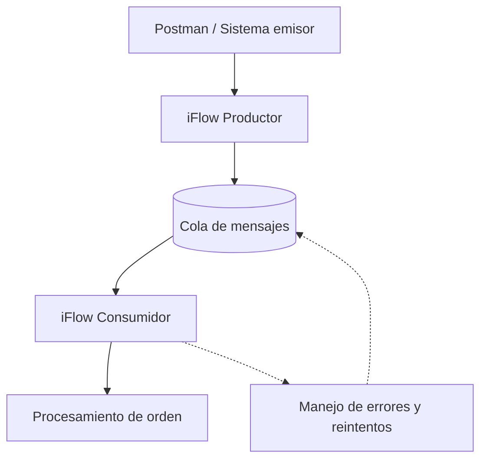
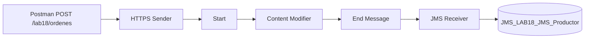
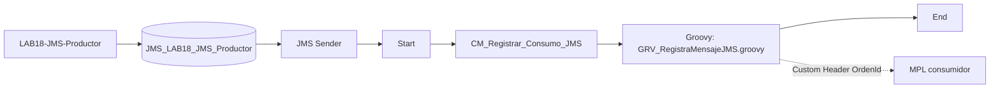

# 18 - Integraciones asíncronas y colas

**Estado del tema:** 🟨 En curso - 18.1, 18.2 y 18.3 validados; 18.4 y 18.5 pendientes
**Package:** `CPI Learning Lab`
**Inicio:** 06/11/2026
**Fecha objetivo de cierre:** 08/11/2026 (planificación, no resultado confirmado)

## Objetivo y contexto

Comprender el desacoplamiento entre productor y consumidor en SAP Cloud Integration, diseñar un escenario de mensajería asíncrona y validar mediante pruebas observables la publicación, consumo, recuperación ante fallos y trazabilidad de mensajes.
El capítulo continúa los aprendizajes de los capítulos 13 (errores), 14 (monitorización) y 17 (persistencia e idempotencia). El escenario propuesto reutiliza el dominio de órdenes, pero no presupone reutilizar ni modificar iFlows existentes.

## Alcance aprobado

- Comparar integración síncrona y asíncrona, desacoplamiento y garantías de entrega.
- Verificar la disponibilidad real de infraestructura de mensajería en SAP BTP Trial.
- Diseñar un productor y un consumidor separados, con una cola intermedia si el entorno lo permite.
- Probar procesamiento, fallos controlados, reintentos y duplicados según las capacidades efectivamente disponibles.
- Validar la monitorización y la trazabilidad de extremo a extremo.
- Documentar configuraciones, resultados y evidencias verificadas.

**Fuera de alcance inicial:** garantizar entrega exactamente una vez, asumir una política específica de reintentos o incorporar servicios no disponibles en el entorno. SAP Event Mesh podrá compararse conceptualmente; su uso práctico dependerá de la verificación de disponibilidad. Se prioriza evaluar JMS en Cloud Integration, con disponibilidad y publicación verificadas en el entorno.

## Plan de laboratorios y tiempos estimados

| Laboratorio | Objetivo y actividad prevista | Validación observable prevista | Estimación |
|---|---|---|---|
| 18.1 | Fundamentos de sincronía, asincronía y garantías de entrega; verificar capacidades disponibles | Inventario de capacidades y diseño técnicamente viable | 35–45 min |
| 18.2 | Configurar infraestructura disponible y publicar mensajes desde un productor CPI | Mensaje publicado y recepción comprobada | 70–90 min |
| 18.3 | Consumir mensajes mediante iFlow independiente | Mensaje procesado y correlacionado | 60–80 min |
| 18.4 | Simular errores, estudiar reintentos y duplicados | Fallo y recuperación observados, sin asumir comportamiento | 90–120 min |
| 18.5 | Monitorización, trazabilidad y validación integral | Evidencias del recorrido extremo a extremo | 75–115 min |
| **Total** | | | **5 h 30 min – 7 h 30 min** |

Los tiempos son estimaciones de trabajo efectivo e incluyen pruebas, capturas y documentación; excluyen pausas y posibles bloqueos por permisos, aprovisionamiento o límites de Trial. La arquitectura y la distribución de laboratorios se revisarán si la infraestructura requerida no está disponible.

## Arquitectura conceptual propuesta



El productor entrega mensajes a una infraestructura intermedia; el consumidor los recupera y procesa de forma independiente. Las flechas punteadas son conceptuales: **no demuestran** un mecanismo automático de reintentos ni el retorno efectivo a la cola. La publicación y el consumo normales quedaron validados en 18.2 y 18.3. Las rutas punteadas de recuperación siguen siendo conceptuales y no han sido comprobadas.

## Prerrequisitos y restricciones

- Acceso a SAP Integration Suite / Cloud Integration, Design y Monitor.
- Package `CPI Learning Lab` y Postman con una carpeta específica del capítulo 18.
- Conocimientos de HTTPS Sender, headers, properties, manejo de errores, MPL y Data Store.
- **Verificado:** JMS Resources OK, 20 colas y 6000 MB máximos visibles; productor desplegado, cola creada y publicación comprobada.
- **Pendiente de investigación técnica para 18.4:** semántica de reintentos, cola de mensajes fallidos, confirmación y recuperación bajo error.
- No crear ni modificar iFlows ni versiones hasta presentar la ficha de diseño y obtener aprobación expresa.

## Laboratorios

### 18.1 - Fundamentos y viabilidad de mensajería

**Estado:** ✅ Completado

**Objetivo:** comprender el desacoplamiento productor/consumidor y comprobar recursos JMS disponibles.

**Conceptos:** la integración asíncrona permite que la publicación y el consumo ocurran en momentos distintos. La disponibilidad de una cola no garantiza procesamiento exactamente una vez.

**Prerrequisitos:** acceso a Monitor y Manage Stores.

**Laboratorio paso a paso:**

1. Abrir **Monitor → Manage Stores → Message Queues**. Inicialmente se observaron cero colas.
2. Comprobar el estado **JMS Resources: OK** y abrir **Details**.
3. Verificar los límites observados: **20 colas**, **6000 MB**, productores, consumidores y transacciones disponibles; un nodo runtime.
4. Aprobar una arquitectura con productor, cola y consumidor separados. No se modificaron iFlows anteriores.

**Evidencia 18-01 - Disponibilidad de recursos JMS**

Se comprueba el estado OK y los límites de recursos informados por Monitor.


**Resultado y validación:** recursos JMS disponibles según el monitor. La publicación efectiva se validó en 18.2.

**Problemas encontrados:** ninguno durante la comprobación de recursos.

**Aprendizaje:** distinguir la disponibilidad de infraestructura de una operación de mensajería ejecutada.

### 18.2 - Publicación de mensajes en una cola

**Estado:** ✅ Completado

**Objetivo:** publicar una orden JSON desde HTTPS en JMS y verificarla en Monitor.

**Prerrequisitos:** 18.1, package `CPI Learning Lab`, acceso a Postman y autorización de invocación.

**Arquitectura implementada:**



**iFlow:** `LAB18-JMS-Productor`, versión desplegada `1.0.0`.

| Configuración | Valor validado |
|---|---|
| HTTPS Address | `/lab18/ordenes` |
| Authorization | `User Role`, `ESBMessaging.send` |
| CSRF Protected | Desactivado |
| Content Modifier / Message Header | `Create`, `CamelHttpResponseCode`, `Constant`, `202` |
| JMS Queue Name | `JMS_LAB18_JMS_Productor` |
| Access Type | `Non-Exclusive` |
| Retention Threshold for Alerting | `2` días |
| Expiration Period | `30` días |
| Compress / Encrypt Stored Message | Activados |
| Transfer Exchange Properties | Desactivado |

**Laboratorio paso a paso:**

1. Crear el iFlow con HTTPS Sender, Start, Content Modifier, End Message y JMS Receiver; configurar los parámetros anteriores. Guardar y desplegar.

   **Evidencia 18-02 - Cola creada y Started**

   Se observa la cola JMS creada automáticamente con cero entradas iniciales.

   

   **Evidencia 18-03 - Productor desplegado**

   Se confirma estado `Started`, versión `1.0.0` y endpoint HTTPS.

   

2. Crear en Postman la carpeta `18 - Integraciones asíncronas y colas` y la petición `18.2 - Publicar orden JMS - Caso positivo`, con método `POST`, autenticación y `Content-Type: application/json`. Enviar una sola vez:

   ```json
   {
     "ordenId": "ORD-18001",
     "cliente": "CLI-18001",
     "monto": 15000,
     "moneda": "CLP",
     "estado": "PENDIENTE"
   }
   ```

   **Evidencia 18-04 - Respuesta HTTP de Postman**

   Se observa `202 Accepted` y un body binario no legible. El código HTTP por sí solo no acredita la entrega a la cola.

   

3. Verificar la arquitectura del productor en Design.

   **Evidencia 18-05 - iFlow productor configurado**

   Se observan los componentes y las conexiones HTTPS, Content Modifier y JMS.

   

4. Abrir **Monitor → Manage Stores → Message Queues**. Se observa una entrada `Waiting`, `Retry Count = 0` y fecha `Retain Until` del 06/12/2026.

   **Evidencia 18-06 - Orden publicada en JMS**

   Se confirma una entrada en `JMS_LAB18_JMS_Productor`.

   

5. Abrir el detalle del mensaje y comprobar que el JSON contiene `ORD-18001` y los demás campos originales.

   **Evidencia 18-07 - Payload JSON conservado**

   El mensaje JMS contiene el JSON legible e íntegro.

   

6. Revisar el MPL del productor: `Completed`, 882 ms, `IntermediateError = false`. El `MessageGuid` coincide con el identificador mostrado en la cola y los headers HTTP.

   **Evidencia 18-08 - MPL completado**

   Se comprueba el procesamiento y la correlación con la publicación.

   

**Resultado y validación:** publicación efectiva de `ORD-18001`, mensaje almacenado en JMS con JSON íntegro, productor iniciado y MPL completado. El consumo posterior se validó en 18.3.

**Problema encontrado:** Postman devolvió un cuerpo binario no legible con HTTP `202`. Los headers de respuesta no incluían `Content-Type`; aparecían `Sap_use_data_compression: true` y `Transfer-Encoding: chunked`. No se confirmó la causa; no se modificó el iFlow. Se documenta como hallazgo abierto en KBA.

**Aprendizajes:** verificar el mensaje en la cola y correlacionarlo con el MPL; una respuesta HTTP no legible no implica corrupción del payload JMS.

### 18.3 - Consumo asíncrono mediante iFlow

**Estado:** ✅ Completado - validado el 06/11/2026.

**Objetivo:** recuperar una orden previamente publicada en JMS mediante un iFlow independiente, verificar su ejecución y relacionar los MPL de productor y consumidor sin modificar el JSON original.

**Conceptos:** el JMS Sender del consumidor lee desde la cola que alimenta el JMS Receiver del productor. El procesamiento se realiza con independencia temporal de la solicitud HTTPS inicial. Un Custom Header del MPL permite buscar por identificador funcional; los IDs de correlación permiten relacionar ejecuciones.

**Prerrequisitos:** 18.1 y 18.2 completados; mensaje `ORD-18001` aún almacenado en `JMS_LAB18_JMS_Productor` antes del primer despliegue del consumidor.

**Arquitectura implementada:**



**iFlow:** `LAB18-JMS-Consumidor`, ID `LAB18_JMS_Consumidor`, versión observada `1.0.0` durante el primer despliegue. No se verificó un número de versión posterior al ajuste; no se presupone uno.

**Configuración del adaptador JMS Sender:**

| Parámetro | Valor observado/configurado |
|---|---|
| Queue Name | `JMS_LAB18_JMS_Productor` |
| Access Type | `Non-Exclusive` |
| Number of Concurrent Processes | `1` |
| Retry Interval | `1` minuto (valor observado) |
| Exponential Backoff | Activado (valor observado) |
| Maximum Retry Interval | `60` minutos (valor observado) |
| Dead-Letter Queue | Activado (valor observado) |

Los parámetros de reintento se observaron en la interfaz, **pero su comportamiento no fue probado** en este laboratorio; se evaluará en 18.4.

**Laboratorio paso a paso y evidencias:**

1. Confirmar en Monitor que la orden `ORD-18001` permanecía almacenada en la cola. Crear en `CPI Learning Lab` un iFlow independiente `LAB18-JMS-Consumidor`, con JMS Sender conectado a Start y con End. Configurar la cola existente, acceso `Non-Exclusive` y un proceso concurrente. No desplegar aún: el consumidor podría retirar el mensaje inmediatamente.
2. Incorporar `CM_Registrar_Consumo_JMS`. Inicialmente se configuró una Exchange Property `OrdenId` mediante `${jsonpath:$.ordenId}`. Esta expresión **no es parte de la configuración final**, pues impidió el arranque del iFlow; la extracción se trasladó a Groovy.

   **Evidencia 18-09 - Configuración inicial del consumidor**

   Se documenta el Content Modifier con la expresión inicialmente configurada. La captura corresponde al estado previo a la corrección, no al diseño final.

   

3. Incorporar un Groovy Script entre Content Modifier y End, con función `processData`. Verificar que el recurso asociado es `/script/GRV_RegistraMensajeJMS.groovy` (nombre efectivo observado, distinto del nombre inicialmente propuesto).

   **Evidencia 18-10 - Arquitectura y asociación del Groovy**

   Se comprueba la conexión JMS Sender → Start → Content Modifier → Groovy Script → End y el recurso vinculado.

   

4. Crear y guardar el recurso Groovy. El primer código recuperaba `OrdenId` desde una Exchange Property. Tras detectar el error de arranque, se corrigió para leer el JSON directamente con `JsonSlurper` y `java.io.Reader`, establecer `OrdenId` como propiedad y registrarlo en el MPL. El contenido funcional final es:

   ```groovy
   import com.sap.gateway.ip.core.customdev.util.Message
   import groovy.json.JsonSlurper

   def Message processData(Message message) {
       def json = new JsonSlurper().parse(message.getBody(java.io.Reader))
       def ordenId = json.ordenId

       if (ordenId == null || ordenId.toString().trim().isEmpty()) {
           throw new IllegalArgumentException("El mensaje no contiene un ordenId valido")
       }

       message.setProperty("OrdenId", ordenId.toString())
       def messageLog = messageLogFactory.getMessageLog(message)
       if (messageLog != null) {
           messageLog.addCustomHeaderProperty("OrdenId", ordenId.toString())
       }
       return message
   }
   ```

   La captura siguiente documenta el recurso asociado **antes de la corrección definitiva**; el código anterior representa la corrección que se utilizó para obtener el procesamiento exitoso.

   **Evidencia 18-11 - Recurso Groovy del consumidor**

   Se identifica el recurso y la lógica inicial de registro de `OrdenId` en el MPL.

   

5. Desplegar inicialmente el consumidor. El estado fue `The Integration Flow is not operational`; el detalle indicó `Unknown function: jsonpath:$.ordenId` durante `Context startup failed`. El fallo ocurrió al crear la propiedad del Content Modifier, antes de validar consumo. Se conservó el error y se autorizó la corrección.

   **Evidencia 18-12 - Error de despliegue por expresión JSONPath**

   La captura del monitor muestra el error de arranque y la expresión rechazada.

   

6. Eliminar la Exchange Property problemática del Content Modifier. Actualizar el Groovy para extraer el identificador directamente del JSON. El editor advirtió que analizar el body con `message.getBody(String)` y `parseText` no utilizaba streaming; se aplicó el patrón ya registrado en KBA: `new JsonSlurper().parse(message.getBody(java.io.Reader))`. El usuario confirmó que desapareció la advertencia, guardó y desplegó.
7. Revisar **Monitor → Message Processing**. El consumidor finalizó `Completed` en **836 ms**; el Custom Header `OrdenId` mostró `ORD-18001`. El `Correlation ID` coincidió con el del productor y el `Predecessor ID` correspondió al Message ID del productor.

   **Evidencia 18-13 - Consumo JMS completado y correlacionado**

   El MPL confirma la ejecución exitosa y la trazabilidad funcional de `ORD-18001`.

   

8. Abrir **Monitor → Manage Stores → Message Queues**, actualizar la vista y comprobar la cola. Se observaron `JMS Resources: OK`, `State: Started`, **Entries = 0** y `Messages (0)`.

   **Evidencia 18-14 - Cola vacía tras el consumo**

   La cola no conserva entradas pendientes después de la ejecución exitosa del consumidor.

   

**Resultado esperado y validación:** procesamiento del JSON por el consumidor, registro de `OrdenId` en MPL, correlación con el productor y cola sin entradas pendientes. **Todos estos criterios fueron observados** para `ORD-18001`. No se afirma que se hayan probado fallos, reintentos, duplicados o semánticas de entrega en escenarios adversos.

**Problemas encontrados:** (1) expresión `${jsonpath:$.ordenId}` no reconocida en el Content Modifier al iniciar el runtime; (2) advertencia de streaming al usar `getBody(String)` con `JsonSlurper.parseText`, resuelta mediante `java.io.Reader`. El primer problema se registra como hallazgo reutilizable; el segundo se relaciona con el KBA ya existente.

**Aprendizajes:** comprobar el despliegue real, no solo la sintaxis visual del editor; usar un parser de JSON compatible con streaming; mantener el body original; correlacionar MPLs mediante identificadores técnicos y el identificador funcional `OrdenId`; verificar el vaciado de la cola tras el consumo.

### 18.4 - Errores, reintentos y duplicados

**Estado:** ⬜ Pendiente

**Objetivo:** observar el comportamiento real ante fallos y diferenciar recuperación de idempotencia.

**Laboratorio paso a paso:** pendiente de confirmar la semántica del adaptador y la cola.

**Resultado esperado:** pruebas controladas con resultados registrados, incluidos los límites del entorno.

**Validación y evidencias:** pendientes.

**Problemas encontrados y aprendizajes:** pendientes.

### 18.5 - Monitorización y validación integral

**Estado:** ⬜ Pendiente

**Objetivo:** seguir el mensaje desde su publicación hasta el procesamiento y registrar su resultado.

**Laboratorio paso a paso:** pendiente de diseño aprobado.

**Resultado esperado:** correlación y trazabilidad verificables del escenario implementado.

**Validación y evidencias:** pendientes.

**Problemas encontrados y aprendizajes:** pendientes.

## Criterios de validación y cierre

Cada laboratorio solo pasará a `✅ Completado` con evidencia práctica que respalde su resultado. Los conceptos explicados sin comprobación conservarán `🟦 Revisado`; los bloqueos reales se registrarán como `⛔ Bloqueado`. Las evidencias usarán numeración correlativa `18-01`, `18-02`, etc., asignada antes de solicitar cada captura, con título y descripción junto al paso correspondiente.
Se realizó el primer corte documental tras 18.1 y 18.2; el segundo corte se preparó al finalizar la jornada tras 18.3, antes de iniciar 18.4. Al cierre se actualizarán el Markdown del capítulo, el fragmento del README y, si corresponde, `docs/kba-y-hallazgos.md`. El usuario publicará los archivos en GitHub.

## Referencias

- `README.md` - estado y ruta del curso.
- `INSTRUCCIONES.md` - reglas generales.
- `docs/METODOLOGIA-LABORATORIOS.md` - preparación, investigación técnica, evidencias y documentación.
- `docs/17-data-store-persistencia-temporal.md` - continuidad del escenario de órdenes.
- SAP Help Portal - referencias técnicas específicas pendientes de consulta antes de la implementación.
