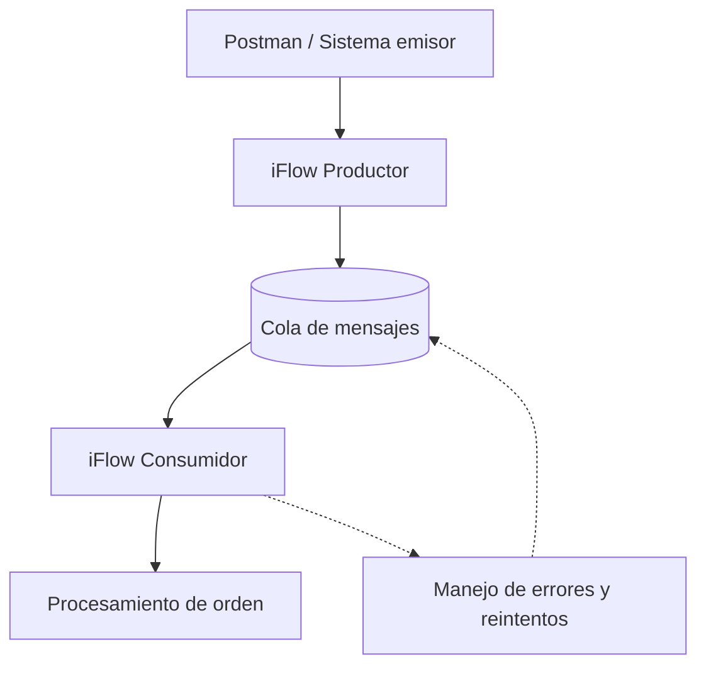
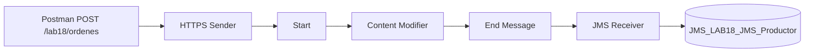

# 18 - Integraciones asíncronas y colas

**Estado del tema:** 🟨 En curso - 18.1 y 18.2 validados; 18.3–18.5 pendientes
**Package:** `CPI Learning Lab`
**Inicio:** 06/11/2026
**Fecha objetivo de cierre:** 08/11/2026 (planificación, no resultado confirmado)

## Objetivo y contexto

Comprender el desacoplamiento entre productor y consumidor en SAP Cloud Integration, diseñar un escenario de mensajería asíncrona y validar mediante pruebas observables la publicación, consumo, recuperación ante fallos y trazabilidad de mensajes.
El capítulo continúa los aprendizajes de los capítulos 13 (errores), 14 (monitorización) y 17 (persistencia e idempotencia). El escenario propuesto reutiliza el dominio de órdenes, pero no presupone reutilizar ni modificar iFlows existentes.

## Alcance aprobado

- Comparar integración síncrona y asíncrona, desacoplamiento y garantías de entrega.
- Verificar la disponibilidad real de infraestructura de mensajería en SAP BTP Trial.
- Diseñar un productor y un consumidor separados, con una cola intermedia si el entorno lo permite.
- Probar procesamiento, fallos controlados, reintentos y duplicados según las capacidades efectivamente disponibles.
- Validar la monitorización y la trazabilidad de extremo a extremo.
- Documentar configuraciones, resultados y evidencias verificadas.

**Fuera de alcance inicial:** garantizar entrega exactamente una vez, asumir una política específica de reintentos o incorporar servicios no disponibles en el entorno. SAP Event Mesh podrá compararse conceptualmente; su uso práctico dependerá de la verificación de disponibilidad. Se prioriza evaluar JMS en Cloud Integration, con disponibilidad y publicación verificadas en el entorno.

## Plan de laboratorios y tiempos estimados

| Laboratorio | Objetivo y actividad prevista | Validación observable prevista | Estimación |
|---|---|---|---|
| 18.1 | Fundamentos de sincronía, asincronía y garantías de entrega; verificar capacidades disponibles | Inventario de capacidades y diseño técnicamente viable | 35–45 min |
| 18.2 | Configurar infraestructura disponible y publicar mensajes desde un productor CPI | Mensaje publicado y recepción comprobada | 70–90 min |
| 18.3 | Consumir mensajes mediante iFlow independiente | Mensaje procesado y correlacionado | 60–80 min |
| 18.4 | Simular errores, estudiar reintentos y duplicados | Fallo y recuperación observados, sin asumir comportamiento | 90–120 min |
| 18.5 | Monitorización, trazabilidad y validación integral | Evidencias del recorrido extremo a extremo | 75–115 min |
| **Total** | | | **5 h 30 min – 7 h 30 min** |

Los tiempos son estimaciones de trabajo efectivo e incluyen pruebas, capturas y documentación; excluyen pausas y posibles bloqueos por permisos, aprovisionamiento o límites de Trial. La arquitectura y la distribución de laboratorios se revisarán si la infraestructura requerida no está disponible.

## Arquitectura conceptual propuesta



El productor entrega mensajes a una infraestructura intermedia; el consumidor los recupera y procesa de forma independiente. Las flechas punteadas son conceptuales: **no demuestran** un mecanismo automático de reintentos ni el retorno efectivo a la cola. La arquitectura no se considera validada hasta confirmar el servicio, el adaptador y su comportamiento en el entorno.

## Prerrequisitos y restricciones

- Acceso a SAP Integration Suite / Cloud Integration, Design y Monitor.
- Package `CPI Learning Lab` y Postman con una carpeta específica del capítulo 18.
- Conocimientos de HTTPS Sender, headers, properties, manejo de errores, MPL y Data Store.
- **Verificado:** JMS Resources OK, 20 colas y 6000 MB máximos visibles; productor desplegado, cola creada y publicación comprobada.
- **Pendiente de investigación técnica:** documentación oficial SAP aplicable a la capacidad y versión utilizadas, semántica de consumo, confirmación, reintentos y recuperación.
- No crear ni modificar iFlows ni versiones hasta presentar la ficha de diseño y obtener aprobación expresa.

## Laboratorios

### 18.1 - Fundamentos y viabilidad de mensajería

**Estado:** ✅ Completado

**Objetivo:** comprender el desacoplamiento productor/consumidor y comprobar recursos JMS disponibles.

**Conceptos:** la integración asíncrona permite que la publicación y el consumo ocurran en momentos distintos. La disponibilidad de una cola no garantiza procesamiento exactamente una vez.

**Prerrequisitos:** acceso a Monitor y Manage Stores.

**Laboratorio paso a paso:**

1. Abrir **Monitor → Manage Stores → Message Queues**. Inicialmente se observaron cero colas.
2. Comprobar el estado **JMS Resources: OK** y abrir **Details**.
3. Verificar los límites observados: **20 colas**, **6000 MB**, productores, consumidores y transacciones disponibles; un nodo runtime.
4. Aprobar una arquitectura con productor, cola y consumidor separados. No se modificaron iFlows anteriores.

**Evidencia 18-01 - Disponibilidad de recursos JMS**

Se comprueba el estado OK y los límites de recursos informados por Monitor.


**Resultado y validación:** recursos JMS disponibles según el monitor. La publicación efectiva se validó en 18.2.

**Problemas encontrados:** ninguno durante la comprobación de recursos.

**Aprendizaje:** distinguir la disponibilidad de infraestructura de una operación de mensajería ejecutada.

### 18.2 - Publicación de mensajes en una cola

**Estado:** ✅ Completado

**Objetivo:** publicar una orden JSON desde HTTPS en JMS y verificarla en Monitor.

**Prerrequisitos:** 18.1, package `CPI Learning Lab`, acceso a Postman y autorización de invocación.

**Arquitectura implementada:**



**iFlow:** `LAB18-JMS-Productor`, versión desplegada `1.0.0`.

| Configuración | Valor validado |
|---|---|
| HTTPS Address | `/lab18/ordenes` |
| Authorization | `User Role`, `ESBMessaging.send` |
| CSRF Protected | Desactivado |
| Content Modifier / Message Header | `Create`, `CamelHttpResponseCode`, `Constant`, `202` |
| JMS Queue Name | `JMS_LAB18_JMS_Productor` |
| Access Type | `Non-Exclusive` |
| Retention Threshold for Alerting | `2` días |
| Expiration Period | `30` días |
| Compress / Encrypt Stored Message | Activados |
| Transfer Exchange Properties | Desactivado |

**Laboratorio paso a paso:**

1. Crear el iFlow con HTTPS Sender, Start, Content Modifier, End Message y JMS Receiver; configurar los parámetros anteriores. Guardar y desplegar.

   **Evidencia 18-02 - Cola creada y Started**

   Se observa la cola JMS creada automáticamente con cero entradas iniciales.

   

   **Evidencia 18-03 - Productor desplegado**

   Se confirma estado `Started`, versión `1.0.0` y endpoint HTTPS.

   

2. Crear en Postman la carpeta `18 - Integraciones asíncronas y colas` y la petición `18.2 - Publicar orden JMS - Caso positivo`, con método `POST`, autenticación y `Content-Type: application/json`. Enviar una sola vez:

   ```json
   {
     "ordenId": "ORD-18001",
     "cliente": "CLI-18001",
     "monto": 15000,
     "moneda": "CLP",
     "estado": "PENDIENTE"
   }
   ```

   **Evidencia 18-04 - Respuesta HTTP de Postman**

   Se observa `202 Accepted` y un body binario no legible. El código HTTP por sí solo no acredita la entrega a la cola.

   

3. Verificar la arquitectura del productor en Design.

   **Evidencia 18-05 - iFlow productor configurado**

   Se observan los componentes y las conexiones HTTPS, Content Modifier y JMS.

   

4. Abrir **Monitor → Manage Stores → Message Queues**. Se observa una entrada `Waiting`, `Retry Count = 0` y fecha `Retain Until` del 06/12/2026.

   **Evidencia 18-06 - Orden publicada en JMS**

   Se confirma una entrada en `JMS_LAB18_JMS_Productor`.

   

5. Abrir el detalle del mensaje y comprobar que el JSON contiene `ORD-18001` y los demás campos originales.

   **Evidencia 18-07 - Payload JSON conservado**

   El mensaje JMS contiene el JSON legible e íntegro.

   

6. Revisar el MPL del productor: `Completed`, 882 ms, `IntermediateError = false`. El `MessageGuid` coincide con el identificador mostrado en la cola y los headers HTTP.

   **Evidencia 18-08 - MPL completado**

   Se comprueba el procesamiento y la correlación con la publicación.

   

**Resultado y validación:** publicación efectiva de `ORD-18001`, mensaje almacenado en JMS con JSON íntegro, productor iniciado y MPL completado. El consumo permanece pendiente para 18.3.

**Problema encontrado:** Postman devolvió un cuerpo binario no legible con HTTP `202`. Los headers de respuesta no incluían `Content-Type`; aparecían `Sap_use_data_compression: true` y `Transfer-Encoding: chunked`. No se confirmó la causa; no se modificó el iFlow. Se documenta como hallazgo abierto en KBA.

**Aprendizajes:** verificar el mensaje en la cola y correlacionarlo con el MPL; una respuesta HTTP no legible no implica corrupción del payload JMS.

### 18.3 - Consumo asíncrono mediante iFlow

**Estado:** ⬜ Pendiente

**Objetivo:** procesar mensajes sin acoplar el ciclo de vida del consumidor a la solicitud original.

**Laboratorio paso a paso:** pendiente de diseño aprobado.

**Resultado esperado:** mensaje consumido y procesamiento verificable.

**Validación y evidencias:** pendientes.

**Problemas encontrados y aprendizajes:** pendientes.

### 18.4 - Errores, reintentos y duplicados

**Estado:** ⬜ Pendiente

**Objetivo:** observar el comportamiento real ante fallos y diferenciar recuperación de idempotencia.

**Laboratorio paso a paso:** pendiente de confirmar la semántica del adaptador y la cola.

**Resultado esperado:** pruebas controladas con resultados registrados, incluidos los límites del entorno.

**Validación y evidencias:** pendientes.

**Problemas encontrados y aprendizajes:** pendientes.

### 18.5 - Monitorización y validación integral

**Estado:** ⬜ Pendiente

**Objetivo:** seguir el mensaje desde su publicación hasta el procesamiento y registrar su resultado.

**Laboratorio paso a paso:** pendiente de diseño aprobado.

**Resultado esperado:** correlación y trazabilidad verificables del escenario implementado.

**Validación y evidencias:** pendientes.

**Problemas encontrados y aprendizajes:** pendientes.

## Criterios de validación y cierre

Cada laboratorio solo pasará a `✅ Completado` con evidencia práctica que respalde su resultado. Los conceptos explicados sin comprobación conservarán `🟦 Revisado`; los bloqueos reales se registrarán como `⛔ Bloqueado`. Las evidencias usarán numeración correlativa `18-01`, `18-02`, etc., asignada antes de solicitar cada captura, con título y descripción junto al paso correspondiente.
Se realizó el primer corte documental tras 18.1 y 18.2; el siguiente corresponde tras 18.3 y 18.4. Al cierre se actualizarán el Markdown del capítulo, el fragmento del README y, si corresponde, `docs/kba-y-hallazgos.md`. El usuario publicará los archivos en GitHub.

## Referencias

- `README.md` - estado y ruta del curso.
- `INSTRUCCIONES.md` - reglas generales.
- `docs/METODOLOGIA-LABORATORIOS.md` - preparación, investigación técnica, evidencias y documentación.
- `docs/17-data-store-persistencia-temporal.md` - continuidad del escenario de órdenes.
- SAP Help Portal - referencias técnicas específicas pendientes de consulta antes de la implementación.
