# 18 - Integraciones asíncronas y colas

**Estado del tema:** 🟨 En curso - 18.1, 18.2, 18.3 y 18.4 validados; 18.5 pendiente
**Package:** `CPI Learning Lab`
**Inicio:** 06/11/2026
**Fecha objetivo de cierre:** 08/11/2026 (planificación, no resultado confirmado)

## Objetivo y contexto

Comprender el desacoplamiento entre productor y consumidor en SAP Cloud Integration, diseñar un escenario de mensajería asíncrona y validar mediante pruebas observables la publicación, consumo, recuperación ante fallos y trazabilidad de mensajes.
El capítulo continúa los aprendizajes de los capítulos 13 (errores), 14 (monitorización) y 17 (persistencia e idempotencia). El escenario propuesto reutiliza el dominio de órdenes, pero no presupone reutilizar ni modificar iFlows existentes.

## Alcance aprobado

- Comparar integración síncrona y asíncrona, desacoplamiento y garantías de entrega.
- Verificar la disponibilidad real de infraestructura de mensajería en SAP BTP Trial.
- Diseñar un productor y un consumidor separados, con una cola intermedia si el entorno lo permite.
- Probar procesamiento, fallos controlados, reintentos y duplicados según las capacidades efectivamente disponibles.
- Validar la monitorización y la trazabilidad de extremo a extremo.
- Documentar configuraciones, resultados y evidencias verificadas.

**Fuera de alcance inicial:** garantizar entrega exactamente una vez, asumir una política específica de reintentos o incorporar servicios no disponibles en el entorno. SAP Event Mesh podrá compararse conceptualmente; su uso práctico dependerá de la verificación de disponibilidad. Se prioriza evaluar JMS en Cloud Integration, con disponibilidad y publicación verificadas en el entorno.

## Plan de laboratorios y tiempos estimados

| Laboratorio | Objetivo y actividad prevista | Validación observable prevista | Estimación |
|---|---|---|---|
| 18.1 | Fundamentos de sincronía, asincronía y garantías de entrega; verificar capacidades disponibles | Inventario de capacidades y diseño técnicamente viable | 35–45 min |
| 18.2 | Configurar infraestructura disponible y publicar mensajes desde un productor CPI | Mensaje publicado y recepción comprobada | 70–90 min |
| 18.3 | Consumir mensajes mediante iFlow independiente | Mensaje procesado y correlacionado | 60–80 min |
| 18.4 | Simular errores, estudiar reintentos y duplicados | Fallo y recuperación observados, sin asumir comportamiento | 90–120 min |
| 18.5 | Monitorización, trazabilidad y validación integral | Evidencias del recorrido extremo a extremo | 75–115 min |
| **Total** | | | **5 h 30 min – 7 h 30 min** |

Los tiempos son estimaciones de trabajo efectivo e incluyen pruebas, capturas y documentación; excluyen pausas y posibles bloqueos por permisos, aprovisionamiento o límites de Trial. La arquitectura y la distribución de laboratorios se revisarán si la infraestructura requerida no está disponible.

## Arquitectura conceptual propuesta

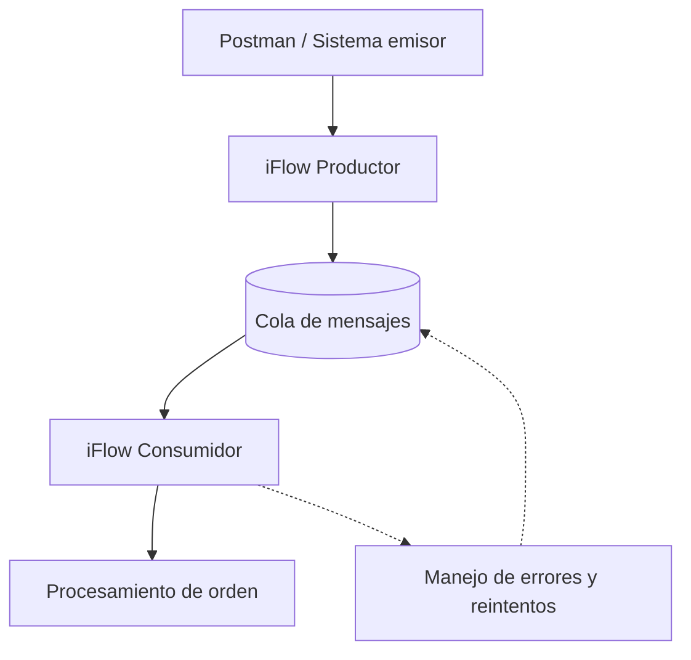

El productor entrega mensajes a una infraestructura intermedia; el consumidor los recupera y procesa de forma independiente. Las flechas punteadas son conceptuales: **no demuestran** un mecanismo automático de reintentos ni el retorno efectivo a la cola. La publicación y el consumo normales quedaron validados en 18.2 y 18.3. Las rutas punteadas de recuperación siguen siendo conceptuales y no han sido comprobadas.

## Prerrequisitos y restricciones

- Acceso a SAP Integration Suite / Cloud Integration, Design y Monitor.
- Package `CPI Learning Lab` y Postman con una carpeta específica del capítulo 18.
- Conocimientos de HTTPS Sender, headers, properties, manejo de errores, MPL y Data Store.
- **Verificado:** JMS Resources OK, 20 colas y 6000 MB máximos visibles; productor desplegado, cola creada y publicación comprobada.

## Laboratorios

### 18.1 - Fundamentos y viabilidad de mensajería

**Estado:** ✅ Completado

**Objetivo:** comprender el desacoplamiento productor/consumidor y comprobar recursos JMS disponibles.

**Conceptos:** la integración asíncrona permite que la publicación y el consumo ocurran en momentos distintos. La disponibilidad de una cola no garantiza procesamiento exactamente una vez.

**Prerrequisitos:** acceso a Monitor y Manage Stores.

**Laboratorio paso a paso:**

1. Abrir **Monitor → Manage Stores → Message Queues**. Inicialmente se observaron cero colas.
2. Comprobar el estado **JMS Resources: OK** y abrir **Details**.
3. Verificar los límites observados: **20 colas**, **6000 MB**, productores, consumidores y transacciones disponibles; un nodo runtime.
4. Aprobar una arquitectura con productor, cola y consumidor separados. No se modificaron iFlows anteriores.

**Evidencia 18-01 - Disponibilidad de recursos JMS**

Se comprueba el estado OK y los límites de recursos informados por Monitor.

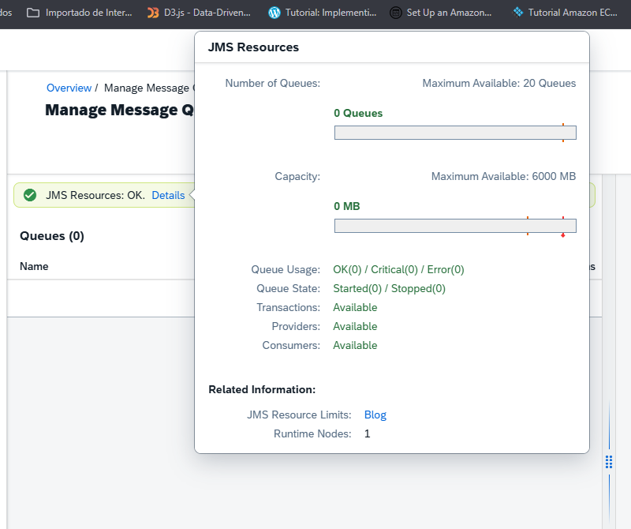

**Resultado y validación:** recursos JMS disponibles según el monitor. La publicación efectiva se validó en 18.2.

**Problemas encontrados:** ninguno durante la comprobación de recursos.

**Aprendizaje:** distinguir la disponibilidad de infraestructura de una operación de mensajería ejecutada.

### 18.2 - Publicación de mensajes en una cola

**Estado:** ✅ Completado

**Objetivo:** publicar una orden JSON desde HTTPS en JMS y verificarla en Monitor.

**Prerrequisitos:** 18.1, package `CPI Learning Lab`, acceso a Postman y autorización de invocación.

**Arquitectura implementada:**

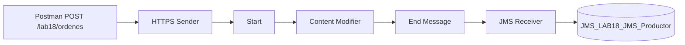

**iFlow:** `LAB18-JMS-Productor`, versión desplegada `1.0.0`.

| Configuración | Valor validado |
|---|---|
| HTTPS Address | `/lab18/ordenes` |
| Authorization | `User Role`, `ESBMessaging.send` |
| CSRF Protected | Desactivado |
| Content Modifier / Message Header | `Create`, `CamelHttpResponseCode`, `Constant`, `202` |
| JMS Queue Name | `JMS_LAB18_JMS_Productor` |
| Access Type | `Non-Exclusive` |
| Retention Threshold for Alerting | `2` días |
| Expiration Period | `30` días |
| Compress / Encrypt Stored Message | Activados |
| Transfer Exchange Properties | Desactivado |

**Laboratorio paso a paso:**

1. Crear el iFlow con HTTPS Sender, Start, Content Modifier, End Message y JMS Receiver; configurar los parámetros anteriores. Guardar y desplegar.

   **Evidencia 18-02 - Cola creada y Started**

   Se observa la cola JMS creada automáticamente con cero entradas iniciales.

   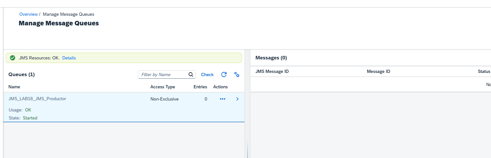

   **Evidencia 18-03 - Productor desplegado**

   Se confirma estado `Started`, versión `1.0.0` y endpoint HTTPS.

   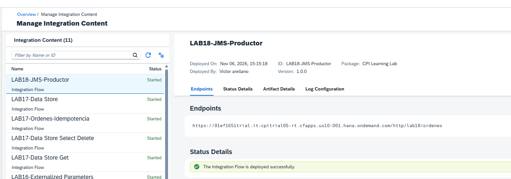

2. Crear en Postman la carpeta `18 - Integraciones asíncronas y colas` y la petición `18.2 - Publicar orden JMS - Caso positivo`, con método `POST`, autenticación y `Content-Type: application/json`. Enviar una sola vez:

   ```json
   {
     "ordenId": "ORD-18001",
     "cliente": "CLI-18001",
     "monto": 15000,
     "moneda": "CLP",
     "estado": "PENDIENTE"
   }
   ```

   **Evidencia 18-04 - Respuesta HTTP de Postman**

   Se observa `202 Accepted` y un body binario no legible. El código HTTP por sí solo no acredita la entrega a la cola.

   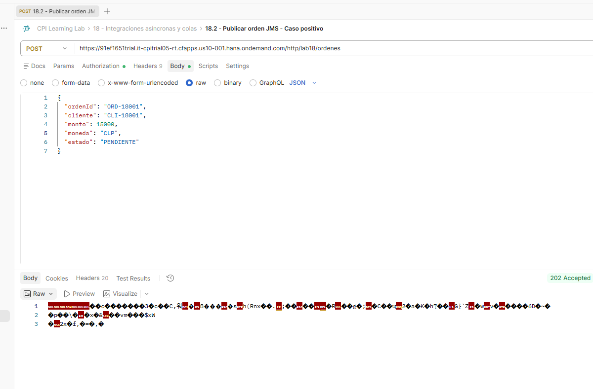

3. Verificar la arquitectura del productor en Design.

   **Evidencia 18-05 - iFlow productor configurado**

   Se observan los componentes y las conexiones HTTPS, Content Modifier y JMS.

   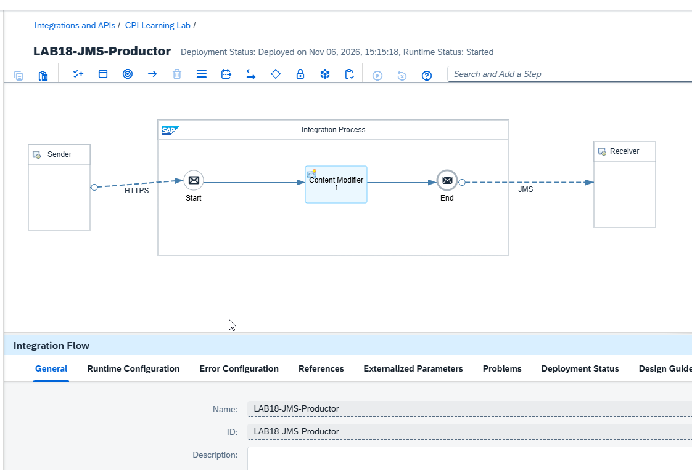

4. Abrir **Monitor → Manage Stores → Message Queues**. Se observa una entrada `Waiting`, `Retry Count = 0` y fecha `Retain Until` del 06/12/2026.

   **Evidencia 18-06 - Orden publicada en JMS**

   Se confirma una entrada en `JMS_LAB18_JMS_Productor`.

   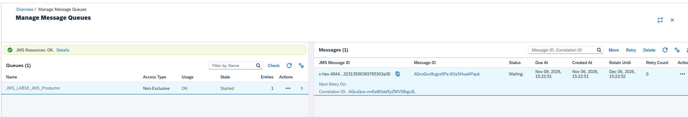

5. Abrir el detalle del mensaje y comprobar que el JSON contiene `ORD-18001` y los demás campos originales.

   **Evidencia 18-07 - Payload JSON conservado**

   El mensaje JMS contiene el JSON legible e íntegro.

   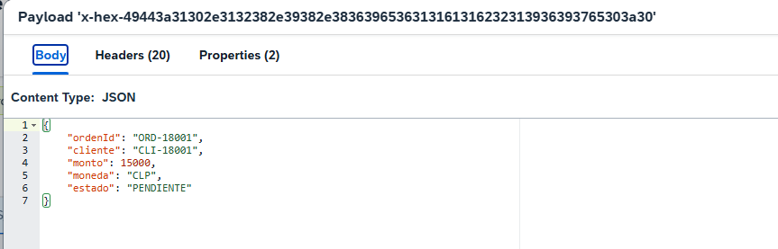

6. Revisar el MPL del productor: `Completed`, 882 ms, `IntermediateError = false`. El `MessageGuid` coincide con el identificador mostrado en la cola y los headers HTTP.

   **Evidencia 18-08 - MPL completado**

   Se comprueba el procesamiento y la correlación con la publicación.

   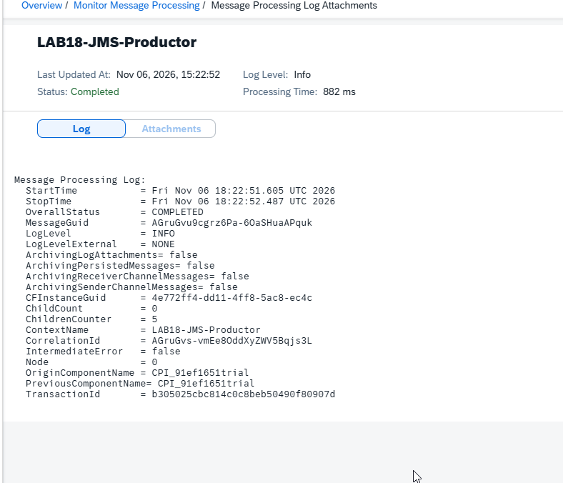

**Resultado y validación:** publicación efectiva de `ORD-18001`, mensaje almacenado en JMS con JSON íntegro, productor iniciado y MPL completado. El consumo posterior se validó en 18.3.

**Problema encontrado:** Postman devolvió un cuerpo binario no legible con HTTP `202`. Los headers de respuesta no incluían `Content-Type`; aparecían `Sap_use_data_compression: true` y `Transfer-Encoding: chunked`. No se confirmó la causa; no se modificó el iFlow. Se documenta como hallazgo abierto en KBA.

**Aprendizajes:** verificar el mensaje en la cola y correlacionarlo con el MPL; una respuesta HTTP no legible no implica corrupción del payload JMS.

### 18.3 - Consumo asíncrono mediante iFlow

**Estado:** ✅ Completado - validado el 06/11/2026.

**Objetivo:** recuperar una orden previamente publicada en JMS mediante un iFlow independiente, verificar su ejecución y relacionar los MPL de productor y consumidor sin modificar el JSON original.

**Conceptos:** el JMS Sender del consumidor lee desde la cola que alimenta el JMS Receiver del productor. El procesamiento se realiza con independencia temporal de la solicitud HTTPS inicial. Un Custom Header del MPL permite buscar por identificador funcional; los IDs de correlación permiten relacionar ejecuciones.

**Prerrequisitos:** 18.1 y 18.2 completados; mensaje `ORD-18001` aún almacenado en `JMS_LAB18_JMS_Productor` antes del primer despliegue del consumidor.

**Arquitectura implementada:**

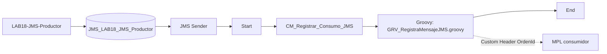

**iFlow:** `LAB18-JMS-Consumidor`, ID `LAB18_JMS_Consumidor`, versión observada `1.0.0` durante el primer despliegue. No se verificó un número de versión posterior al ajuste; no se presupone uno.

**Configuración del adaptador JMS Sender:**

| Parámetro | Valor observado/configurado |
|---|---|
| Queue Name | `JMS_LAB18_JMS_Productor` |
| Access Type | `Non-Exclusive` |
| Number of Concurrent Processes | `1` |
| Retry Interval | `1` minuto (valor observado) |
| Exponential Backoff | Activado (valor observado) |
| Maximum Retry Interval | `60` minutos (valor observado) |
| Dead-Letter Queue | Activado (valor observado) |

Los parámetros de reintento se observaron en la interfaz, **pero su comportamiento no fue probado** en este laboratorio; se evaluará en 18.4.

**Laboratorio paso a paso y evidencias:**

1. Confirmar en Monitor que la orden `ORD-18001` permanecía almacenada en la cola. Crear en `CPI Learning Lab` un iFlow independiente `LAB18-JMS-Consumidor`, con JMS Sender conectado a Start y con End. Configurar la cola existente, acceso `Non-Exclusive` y un proceso concurrente. No desplegar aún: el consumidor podría retirar el mensaje inmediatamente.
2. Incorporar `CM_Registrar_Consumo_JMS`. Inicialmente se configuró una Exchange Property `OrdenId` mediante `${jsonpath:$.ordenId}`. Esta expresión **no es parte de la configuración final**, pues impidió el arranque del iFlow; la extracción se trasladó a Groovy.

   **Evidencia 18-09 - Configuración inicial del consumidor**

   Se documenta el Content Modifier con la expresión inicialmente configurada. La captura corresponde al estado previo a la corrección, no al diseño final.

   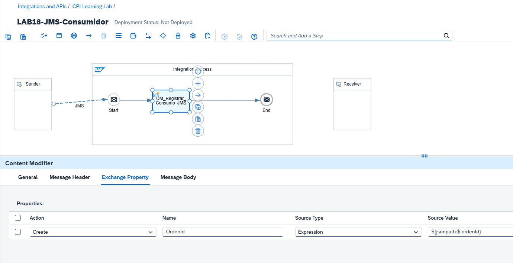

3. Incorporar un Groovy Script entre Content Modifier y End, con función `processData`. Verificar que el recurso asociado es `/script/GRV_RegistraMensajeJMS.groovy` (nombre efectivo observado, distinto del nombre inicialmente propuesto).

   **Evidencia 18-10 - Arquitectura y asociación del Groovy**

   Se comprueba la conexión JMS Sender → Start → Content Modifier → Groovy Script → End y el recurso vinculado.

   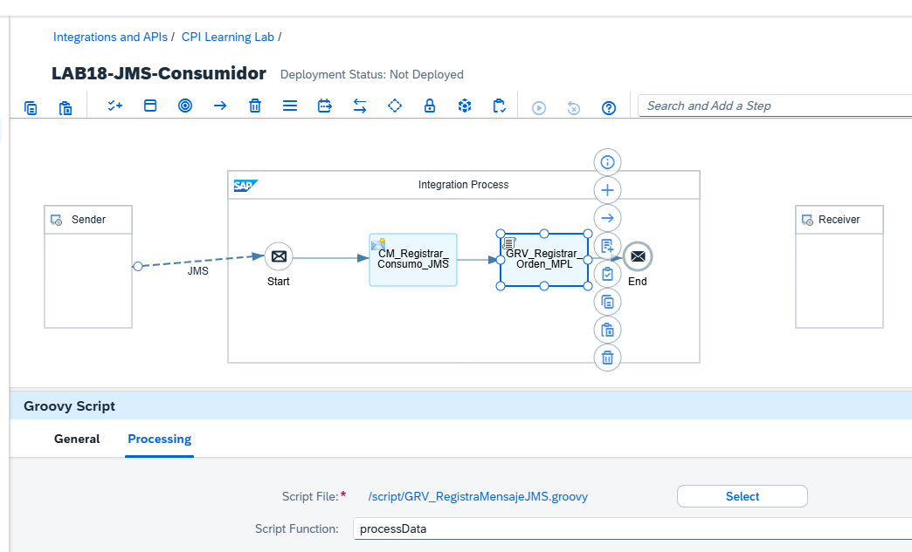

4. Crear y guardar el recurso Groovy. El primer código recuperaba `OrdenId` desde una Exchange Property. Tras detectar el error de arranque, se corrigió para leer el JSON directamente con `JsonSlurper` y `java.io.Reader`, establecer `OrdenId` como propiedad y registrarlo en el MPL. El contenido funcional final es:

   ```groovy
   import com.sap.gateway.ip.core.customdev.util.Message
   import groovy.json.JsonSlurper

   def Message processData(Message message) {
       def json = new JsonSlurper().parse(message.getBody(java.io.Reader))
       def ordenId = json.ordenId

       if (ordenId == null || ordenId.toString().trim().isEmpty()) {
           throw new IllegalArgumentException("El mensaje no contiene un ordenId valido")
       }

       message.setProperty("OrdenId", ordenId.toString())
       def messageLog = messageLogFactory.getMessageLog(message)
       if (messageLog != null) {
           messageLog.addCustomHeaderProperty("OrdenId", ordenId.toString())
       }
       return message
   }
   ```

   La captura siguiente documenta el recurso asociado **antes de la corrección definitiva**; el código anterior representa la corrección que se utilizó para obtener el procesamiento exitoso.

   **Evidencia 18-11 - Recurso Groovy del consumidor**

   Se identifica el recurso y la lógica inicial de registro de `OrdenId` en el MPL.

   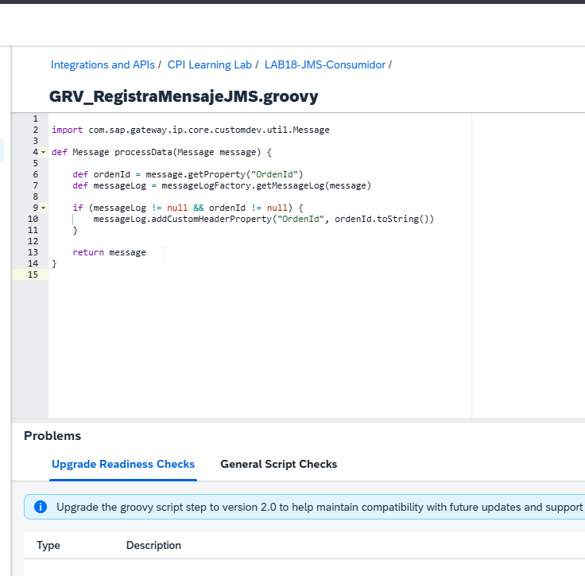

5. Desplegar inicialmente el consumidor. El estado fue `The Integration Flow is not operational`; el detalle indicó `Unknown function: jsonpath:$.ordenId` durante `Context startup failed`. El fallo ocurrió al crear la propiedad del Content Modifier, antes de validar consumo. Se conservó el error y se autorizó la corrección.

   **Evidencia 18-12 - Error de despliegue por expresión JSONPath**

   La captura del monitor muestra el error de arranque y la expresión rechazada.

   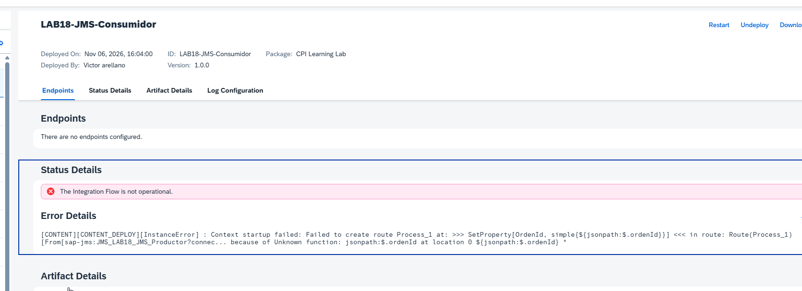

6. Eliminar la Exchange Property problemática del Content Modifier. Actualizar el Groovy para extraer el identificador directamente del JSON. El editor advirtió que analizar el body con `message.getBody(String)` y `parseText` no utilizaba streaming; se aplicó el patrón ya registrado en KBA: `new JsonSlurper().parse(message.getBody(java.io.Reader))`. El usuario confirmó que desapareció la advertencia, guardó y desplegó.
7. Revisar **Monitor → Message Processing**. El consumidor finalizó `Completed` en **836 ms**; el Custom Header `OrdenId` mostró `ORD-18001`. El `Correlation ID` coincidió con el del productor y el `Predecessor ID` correspondió al Message ID del productor.

   **Evidencia 18-13 - Consumo JMS completado y correlacionado**

   El MPL confirma la ejecución exitosa y la trazabilidad funcional de `ORD-18001`.

   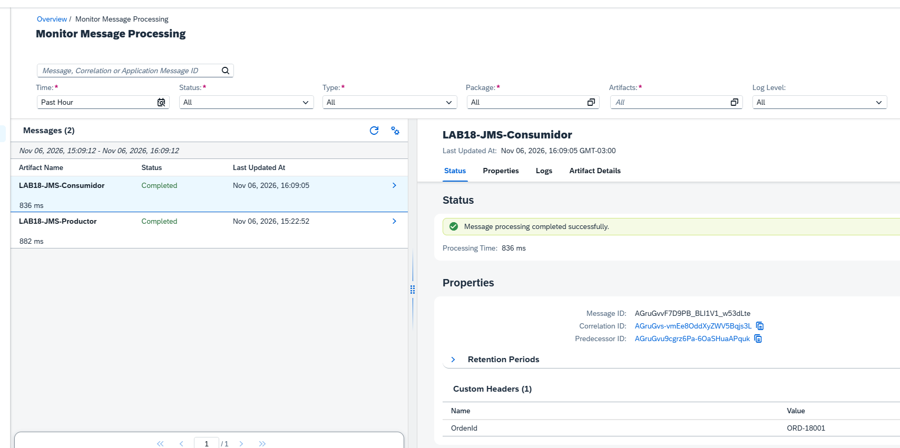

8. Abrir **Monitor → Manage Stores → Message Queues**, actualizar la vista y comprobar la cola. Se observaron `JMS Resources: OK`, `State: Started`, **Entries = 0** y `Messages (0)`.

   **Evidencia 18-14 - Cola vacía tras el consumo**

   La cola no conserva entradas pendientes después de la ejecución exitosa del consumidor.

   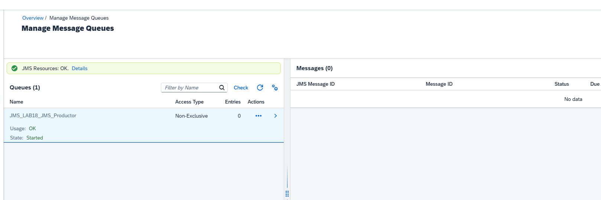

**Resultado esperado y validación:** procesamiento del JSON por el consumidor, registro de `OrdenId` en MPL, correlación con el productor y cola sin entradas pendientes. **Todos estos criterios fueron observados** para `ORD-18001`. No se afirma que se hayan probado fallos, reintentos, duplicados o semánticas de entrega en escenarios adversos.

**Problemas encontrados:** (1) expresión `${jsonpath:$.ordenId}` no reconocida en el Content Modifier al iniciar el runtime; (2) advertencia de streaming al usar `getBody(String)` con `JsonSlurper.parseText`, resuelta mediante `java.io.Reader`. El primer problema se registra como hallazgo reutilizable; el segundo se relaciona con el KBA ya existente.

**Aprendizajes:** comprobar el despliegue real, no solo la sintaxis visual del editor; usar un parser de JSON compatible con streaming; mantener el body original; correlacionar MPLs mediante identificadores técnicos y el identificador funcional `OrdenId`; verificar el vaciado de la cola tras el consumo.


### 18.4 - Errores, reintentos y duplicados

**Estado:** ✅ Completado — validado el 09/11/2026.

**Objetivo:** comprobar la persistencia del mensaje JMS ante un fallo del consumidor, los reintentos automáticos y manuales, la recuperación posterior a una corrección controlada y la ausencia de deduplicación funcional en el escenario implementado.

**Conceptos:** JMS desacopla la aceptación de un mensaje de su procesamiento. Un fallo del consumidor puede dar lugar a reintentos sin nueva publicación. El identificador técnico del mensaje no equivale al identificador funcional de una orden; la idempotencia requiere un control explícito.

**Prerrequisitos:** laboratorios 18.1–18.3 completados; iFlows `LAB18-JMS-Productor` y `LAB18-JMS-Consumidor`; cola `JMS_LAB18_JMS_Productor`; Postman y acceso a Monitor. Se guardó la versión `1.0.1` del consumidor como punto de retorno antes de las pruebas. El consumidor se restauró posteriormente con el script original, según confirmación de la ejecución del laboratorio.

**Arquitectura del escenario:**

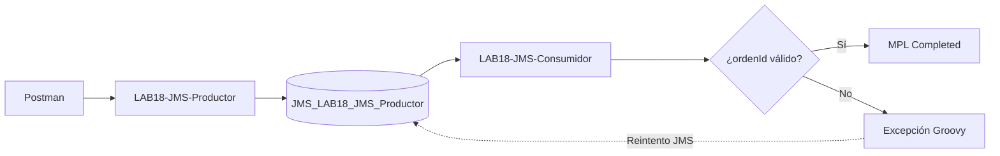

#### 18.4.1 — Error controlado por ausencia de `ordenId`

1. Verificar en Monitor el despliegue del consumidor y su asociación a `JMS_LAB18_JMS_Productor`. La versión `1.0.1` figuró desplegada el 09/11/2026 a las 16:39:05.

   **Evidencia 18-15 — Consumidor operativo antes del error.** Estado de despliegue satisfactorio y cola JMS configurada.

   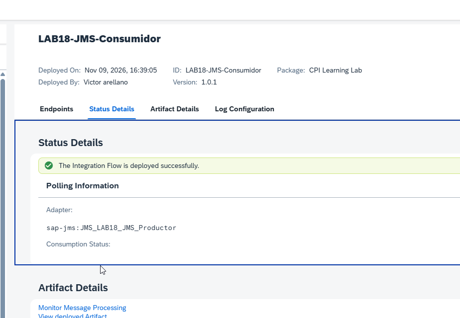

2. Duplicar la petición positiva en la carpeta Postman `18 - Integraciones asíncronas y colas` y nombrarla `18.4 - Orden sin ordenId - Error controlado`. Publicar una sola vez:

   ```json
   {
     "cliente": "CLI-18401",
     "monto": 15000,
     "moneda": "CLP",
     "estado": "PENDIENTE"
   }
   ```

   Postman devolvió `202 Accepted`; el cuerpo HTTP continuó siendo binario, hallazgo ya registrado en KBA y cuya causa no fue confirmada. La aceptación HTTP no equivale a un consumo satisfactorio.

   **Evidencia 18-16 — Publicación HTTP del mensaje sin identificador.** Petición sin `ordenId` y respuesta `202`.

   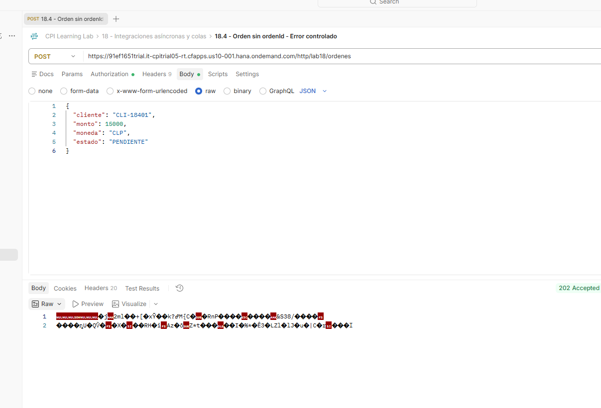

3. En **Monitor → Monitor Message Processing**, verificar el productor `Completed` y el consumidor `Retry`. El MPL informó que se había iniciado un reintento automático y mostró `IllegalArgumentException: El mensaje no contiene un ordenId valido` desde `GRV_RegistraMensajeJMS.groovy`.

   **Evidencia 18-17 — Error funcional y estado Retry.** El consumidor rechaza el JSON incompleto sin impedir la publicación anterior.

   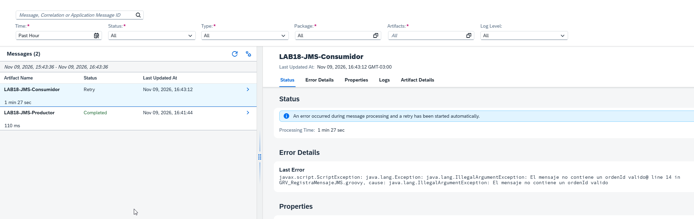

**Validación:** error funcional reproducido y reintento iniciado; no se confundió el estado `Completed` del productor con el resultado del consumidor.

#### 18.4.2 — Reintentos y configuración del adaptador JMS Sender

1. En **Monitor → Manage Stores → Message Queues**, comprobar que la cola permanecía `Started` con **una entrada** `Failed`, `Retry Count = 3` y `Next Retry On = 09/11/2026 16:48:42`.

   **Evidencia 18-18 — Mensaje retenido con reintentos.** Entrada fallida conservada y contador de intentos.

   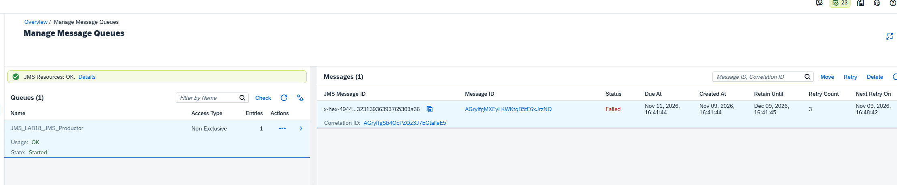

2. Actualizar Monitor tras el siguiente intento. El contador pasó a **4** y `Next Retry On` a **16:56:42**. La diferencia respecto de la hora anterior programada fue de **8 minutos**.

   **Evidencia 18-19 — Evolución del intervalo.** Se observa el aumento del contador y el próximo reintento.

   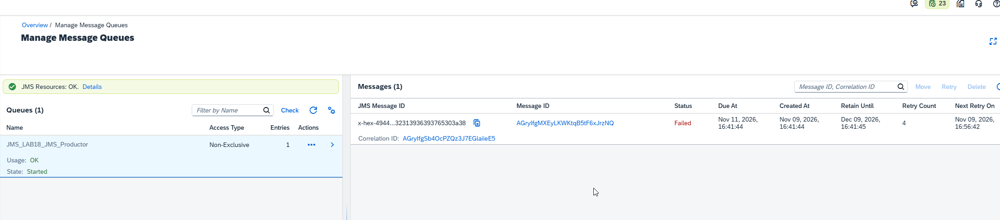

3. En una comprobación posterior, la entrada seguía `Failed` con `Retry Count = 5` y próximo reintento a las **17:12:42**; respecto de 16:56:42, la separación programada aumentó a **16 minutos**. El MPL aún mostraba el error anterior porque su última actualización, a las 16:57:12, precedía al despliegue del Groovy corregido a las 16:58:08. No se interpretó ese MPL como prueba de fallo del nuevo código.

**Configuración y comportamiento de las cuatro propiedades JMS:**

| Propiedad | Configuración | Función y límite de interpretación |
|---|---|---|
| `Retry Interval (in min)` | `1` | Intervalo base para programar nuevos intentos después de un fallo. Con backoff activado, no todos los intervalos son de un minuto. |
| `Exponential Backoff` | Activado | Incrementa progresivamente la espera entre intentos fallidos. Las diferencias observadas de 8 y 16 minutos son consistentes con esta estrategia; no se midió la secuencia completa. |
| `Maximum Retry Interval (in min)` | `60` | Limita el intervalo entre intentos. **No** limita a 60 minutos la duración total de la recuperación ni define por sí solo el número máximo de reintentos. |
| `Dead-Letter Queue` | Activado | Protección prevista para determinados fallos graves del proceso de ejecución, como caídas repetidas del worker asociadas a un mensaje. **No** equivale a enviar automáticamente a una cola de errores cada JSON inválido o cada excepción de Groovy. |

**Diferencia entre errores funcionales y DLQ.** En este laboratorio, la excepción `IllegalArgumentException` produjo estado `Retry` en MPL y entrada `Failed` en la cola original, con contador creciente. No se observó un mensaje `Blocked` ni una activación de DLQ. La documentación SAP describe la protección de DLQ ante fallos repetidos del worker; no se realizó una prueba destructiva para provocar una caída del runtime. Si se desea aislar órdenes funcionalmente inválidas, corresponde diseñar explícitamente un tratamiento de errores o una cola de negocio separada. La expiración del mensaje, configurada en el JMS Receiver del productor, es distinta de estos cuatro parámetros.

**Referencia técnica:** [SAP Help — Apply the Retry Pattern with JMS Queue](https://help.sap.com/docs/integration-suite/sap-integration-suite/apply-retry-pattern-with-jms-queue).

#### 18.4.3 — Recuperación controlada y Retry manual

1. Se aprobó modificar temporalmente el consumidor para procesar exclusivamente el mensaje de prueba cuyo `cliente` fuera `CLI-18401`, sin relajar la validación de los demás mensajes. Se conservó un punto de retorno anterior a la modificación.
2. En el Groovy se incorporó temporalmente la siguiente condición, manteniendo la lectura del body mediante `java.io.Reader`, la Exchange Property y el Custom Header `OrdenId`:

   ```groovy
   if (ordenId == null || ordenId.toString().trim().isEmpty()) {
       if (json.cliente?.toString() == "CLI-18401") {
           ordenId = "ORD-18401-RECUPERADA"
       } else {
           throw new IllegalArgumentException(
               "El mensaje no contiene un ordenId valido"
           )
       }
   }
   ```

   Esta asignación es **exclusivamente didáctica**: `cliente` no identifica de forma única un mensaje, y asignar un identificador artificial a una orden inválida no es una estrategia apropiada de recuperación de datos de negocio en producción.
3. Desplegar el consumidor actualizado. Se observó la versión `1.0.1` desplegada a las **16:58:08**. Como el siguiente intento automático estaba programado para las 17:12:42, se eligió ejecutar **Retry manual** sobre la entrada `Failed`, sin volver a publicar desde Postman.
4. En **Manage Message Queues** comprobar `Entries = 0` y `Messages (0)` después del reintento.

   **Evidencia 18-20 — Cola vacía tras Retry manual.** La entrada previamente fallida dejó de figurar en la cola.

   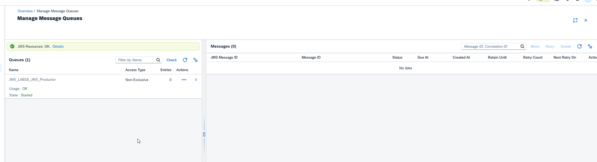

5. En **Monitor Message Processing**, comprobar `LAB18-JMS-Consumidor = Completed` el **09/11/2026 a las 17:06:07**, con Custom Header `OrdenId = ORD-18401-RECUPERADA`. El MPL mostró 11 ejecuciones (*Runs*) acumuladas en el historial de ese procesamiento; no debe interpretarse esa cifra como 11 publicaciones independientes.

   **Evidencia 18-21 — MPL completado tras recuperación.** Confirma el identificador asignado durante la prueba y el resultado exitoso.

   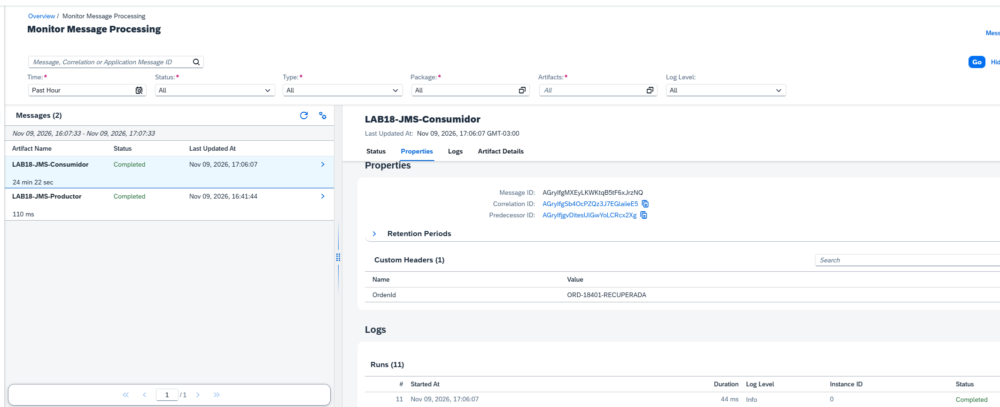

6. Restaurar el script original, retirando la excepción para `CLI-18401`. El usuario confirmó la restauración del consumidor. La verificación de un despliegue posterior de la versión restaurada no se documentó con una captura específica; el procesamiento positivo de 18.4.4 verificó que el consumidor seguía operativo, pero no prueba por sí solo la ausencia de la condición temporal en el código desplegado.

**Resultado y validación:** recuperación **manual** comprobada, sin republicar el mensaje, con MPL `Completed` y cola vacía. Los reintentos **automáticos** se comprobaron en 18.4.2; no se atribuye la recuperación exitosa a un reintento automático.

#### 18.4.4 — Publicaciones duplicadas e idempotencia

1. Reutilizar el productor y el consumidor sin agregar Data Store ni Idempotent Process Call. En Postman, crear la petición `18.4 - Orden duplicada - Idempotencia` con:

   ```json
   {
     "ordenId": "ORD-18402",
     "cliente": "CLI-18402",
     "monto": 25000,
     "moneda": "CLP",
     "estado": "PENDIENTE"
   }
   ```

2. Publicar la orden una primera vez y verificar HTTP `202 Accepted`.

   **Evidencia 18-22 — Primera publicación de ORD-18402.** Aceptación HTTP del primer mensaje.

   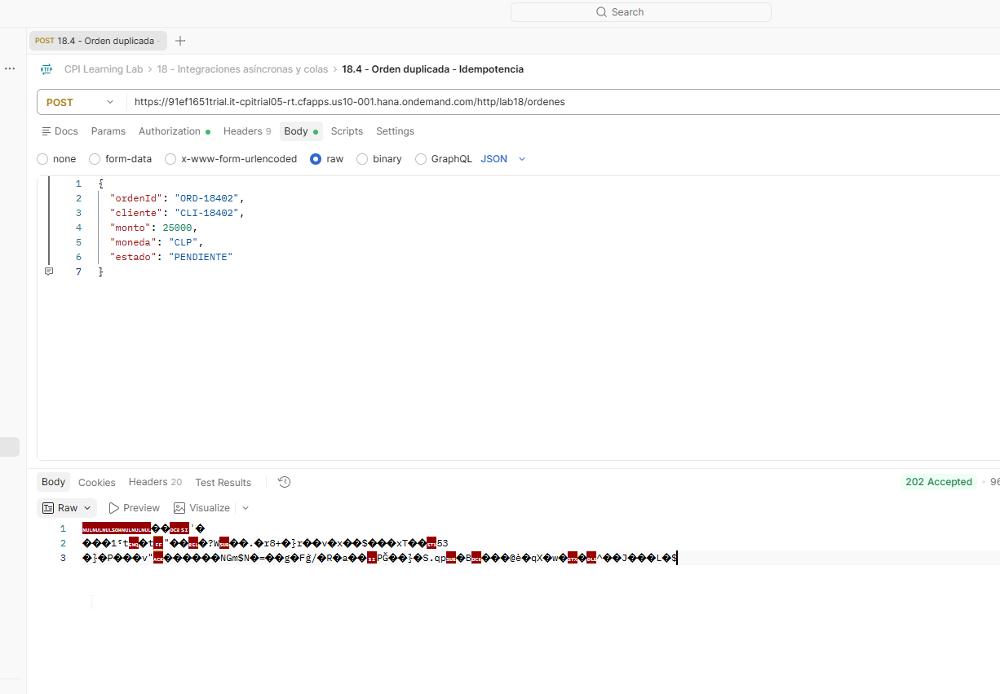

3. Verificar en Monitor que productor y consumidor finalizaron `Completed` a las **17:24:04**. El consumidor registró `OrdenId = ORD-18402`, duración **10 ms** y Message ID `AGryK-TY8FYwOLcV-YiolkVIH7gf`.

   **Evidencia 18-23 — Primer consumo.** Identificador técnico y funcional de la primera ejecución.

   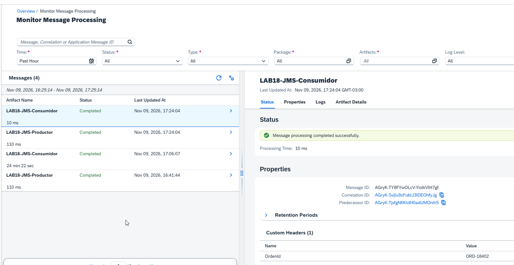

4. Publicar **una segunda vez** el mismo JSON; Postman volvió a mostrar `202 Accepted`.

   **Evidencia 18-24 — Segunda publicación de ORD-18402.** Se reutiliza exactamente el mismo identificador de negocio.

   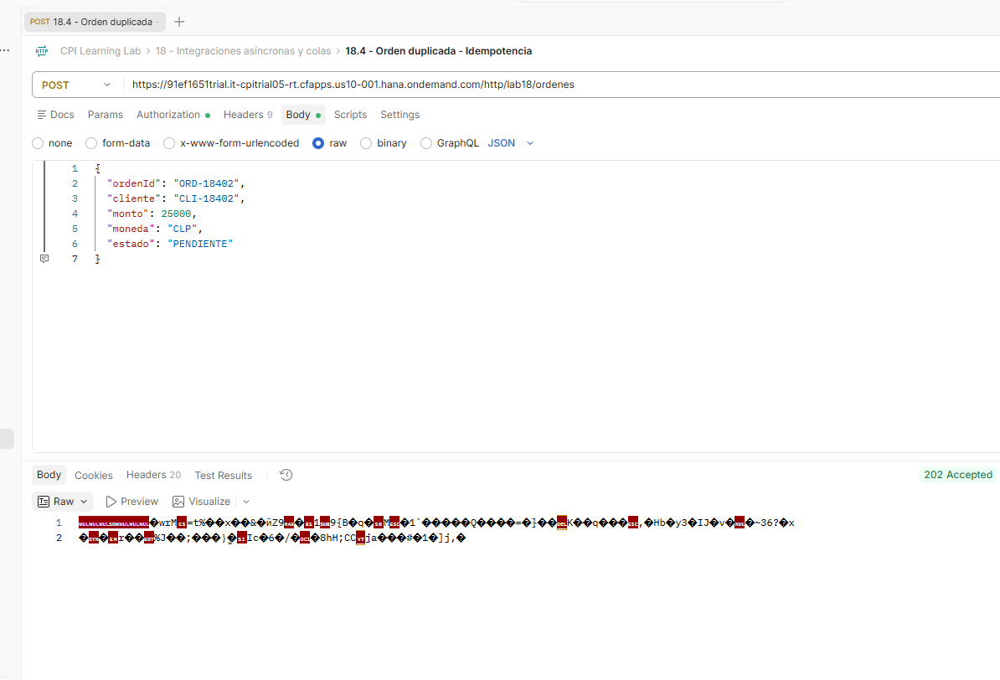

5. Verificar el segundo consumo: productor y consumidor `Completed` a las **17:26:22**, `OrdenId = ORD-18402`, duración **6 ms**, Message ID `AGryLG5-UGSNwseR2ACbL6Kri5Fp`.

   **Evidencia 18-25 — Segundo consumo.** El identificador técnico difiere del primer consumo aunque `OrdenId` es idéntico.

   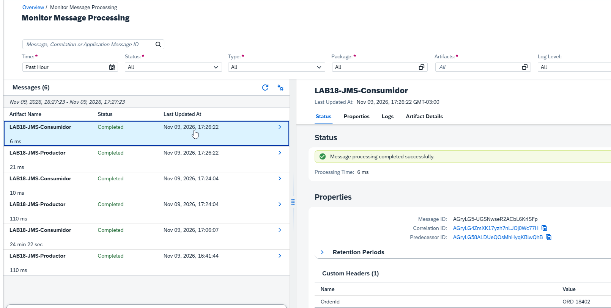

**Comparación verificada:**

| Indicador | Primera publicación | Segunda publicación |
|---|---|---|
| OrdenId | `ORD-18402` | `ORD-18402` |
| Productor | `Completed` | `Completed` |
| Consumidor | `Completed` | `Completed` |
| Hora de finalización | 17:24:04 | 17:26:22 |
| Tiempo de consumidor | 10 ms | 6 ms |
| Message ID del consumidor | `AGryK-TY8FYwOLcV-YiolkVIH7gf` | `AGryLG5-UGSNwseR2ACbL6Kri5Fp` |

**Resultado esperado y validación:** se comprobaron dos procesamientos técnicos independientes de una misma orden funcional. El consumidor de este laboratorio no implementa deduplicación; ello no constituye un defecto de JMS. La idempotencia funcional, ya estudiada en el capítulo 17 mediante Idempotent Process Call y Data Store, debe diseñarse explícitamente cuando el negocio requiera evitar efectos duplicados. No se repitió esa implementación en el capítulo 18.

**Problemas encontrados:** el error de negocio sin `ordenId` fue deliberado y se recuperó; la respuesta HTTP binaria continúa como hallazgo abierto ya registrado en KBA. No se verificó una activación real de DLQ, ni se probó un sistema receptor con efectos persistentes.

**Aprendizajes:** distinguir publicación y consumo; interpretar `Retry` (MPL) frente a `Failed` (entrada JMS); diferenciar reintento automático de Retry manual; no confundir el máximo intervalo de espera con el plazo total; separar protección DLQ de errores funcionales; reconocer que identificadores técnicos distintos pueden compartir el mismo identificador de negocio.

**Estado final del laboratorio:** ✅ Completado. Evidencias 18-15 a 18-25. El capítulo 18 continúa 🟨 En curso hasta validar 18.5.


### 18.5 - Monitorización y validación integral

**Estado:** ✅ Completado — 09/11/2026.

**Objetivo:** demostrar la trazabilidad de una orden desde su publicación HTTPS hasta el procesamiento asíncrono en JMS, relacionando los registros MPL del productor y del consumidor y verificando el estado final de la cola.

**Conceptos:** Message ID identifica un procesamiento técnico; Correlation ID permite agrupar ejecuciones relacionadas; Predecessor ID enlaza el procesamiento consumidor con el mensaje precedente; Custom Header permite búsquedas mediante un identificador funcional. La respuesta HTTP del productor y el estado del consumidor son observaciones independientes.

**Prerrequisitos:** laboratorios 18.1–18.4 completados; iFlows `LAB18-JMS-Productor` y `LAB18-JMS-Consumidor` operativos; cola `JMS_LAB18_JMS_Productor`; acceso a Postman y a Monitor. Se reutilizaron los artefactos existentes sin modificaciones ni nuevas versiones.

**Arquitectura validada:**

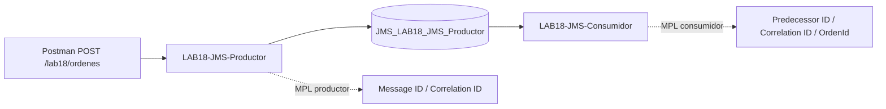

#### Procedimiento y evidencias

1. En Postman, ejecutar `18.5 - Trazabilidad integral - Orden positiva` mediante `POST` al endpoint `/http/lab18/ordenes` con el siguiente JSON:

   ```json
   {
     "ordenId": "ORD-18501",
     "cliente": "CLI-18501",
     "monto": 35000,
     "moneda": "CLP",
     "estado": "PENDIENTE"
   }
   ```

   Se obtuvo **HTTP 202 Accepted**. El body HTTP continuó siendo binario no legible; la causa permanece sin confirmar, conforme al hallazgo registrado en KBA. Esta respuesta demuestra la aceptación HTTP, no por sí sola el consumo.

   **Evidencia 18-26 — Publicación de orden para trazabilidad.** Petición con `ORD-18501` y respuesta HTTP 202.

   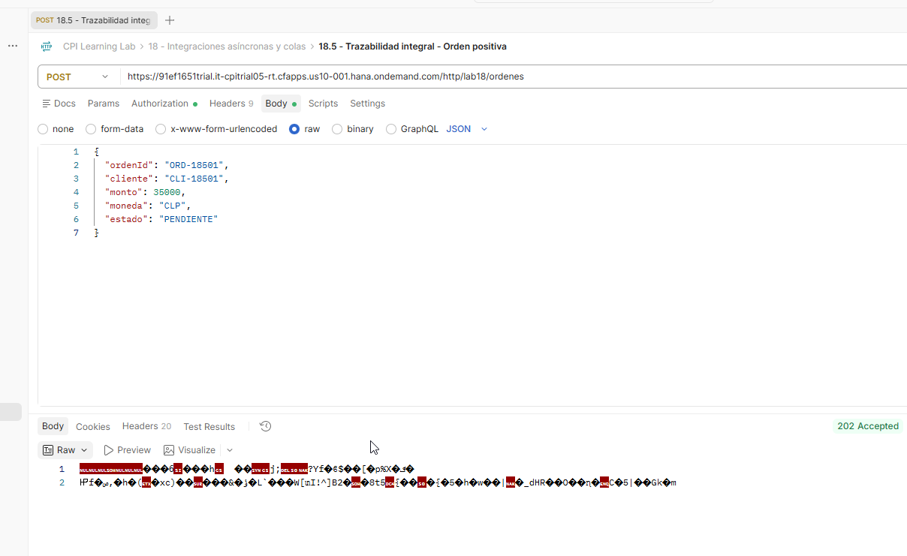

2. En **Monitor → Monitor Message Processing**, localizar el MPL de `LAB18-JMS-Productor` asociado a la publicación. Se observó `Completed`, actualizado el **09/11/2026 a las 17:47:50**, con tiempo de procesamiento **91 ms**.

   - **Message ID del productor:** `AGryMXbmux8gz2nAZ4zUk5ZgMVYs`.
   - **Correlation ID:** `AGryMXbRQXLs7sPfQLfYDBAJOudm`.

   **Evidencia 18-27 — MPL del productor.** Estado satisfactorio e identificadores técnicos de la publicación.

   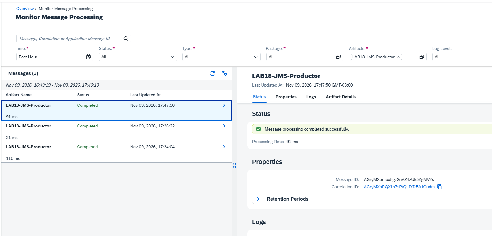

3. Localizar el MPL de `LAB18-JMS-Consumidor` actualizado a las **17:47:50**. Se observó `Completed`, duración **4 ms**, y los siguientes valores:

   - **Message ID del consumidor:** `AGryMXb4d7PoRo6jhyaGdB0amlp3`.
   - **Correlation ID:** `AGryMXbRQXLs7sPfQLfYDBAJOudm`, igual al productor.
   - **Predecessor ID:** `AGryMXbmux8gz2nAZ4zUk5ZgMVYs`, igual al Message ID del productor.
   - **Custom Header:** `OrdenId = ORD-18501`.

   La coincidencia del Correlation ID y el enlace explícito por Predecessor ID permiten relacionar ambos procesamientos. El Custom Header vincula la ejecución del consumidor con la orden de negocio.

   **Evidencia 18-28 — Correlación del consumidor.** MPL completado, identificadores técnicos y Custom Header `OrdenId`.

   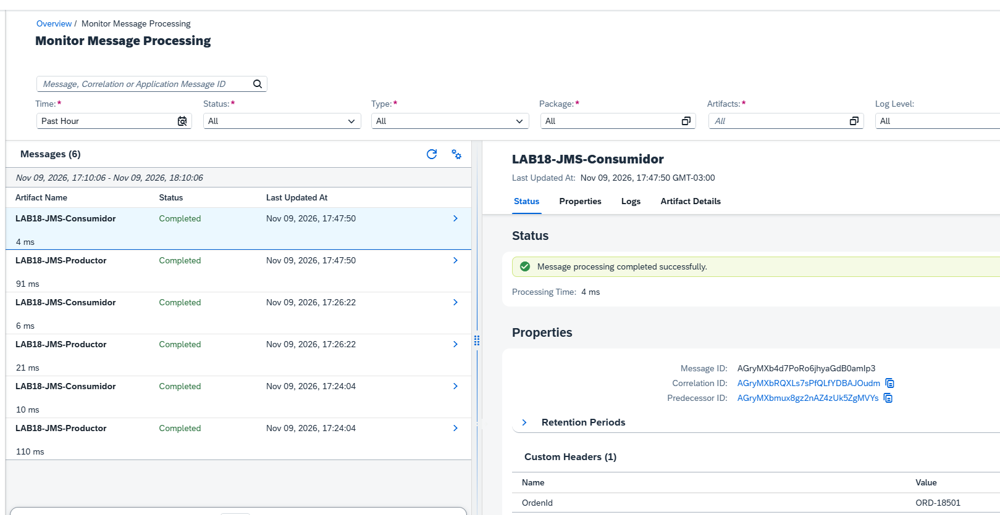

4. Buscar en Monitor el **Correlation ID** `AGryMXbRQXLs7sPfQLfYDBAJOudm`. El resultado mostró **dos registros**, uno para el productor y otro para el consumidor, ambos `Completed` a las 17:47:50. Esta consulta permite reconstruir el recorrido sin localizar cada artefacto por separado.

   **Evidencia 18-29 — Búsqueda por Correlation ID.** Se recuperan ambos procesamientos relacionados.

   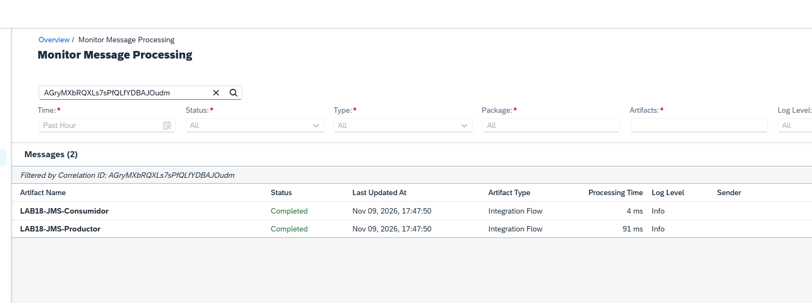

5. En los filtros de **Monitor Message Processing**, utilizar **Custom Header** con la expresión `OrdenId=ORD-18501`. Este filtro utiliza el valor registrado en el MPL por el Groovy del consumidor.

   **Evidencia 18-30 — Configuración del filtro funcional.** Criterio `name=value` aplicado al Custom Header.

   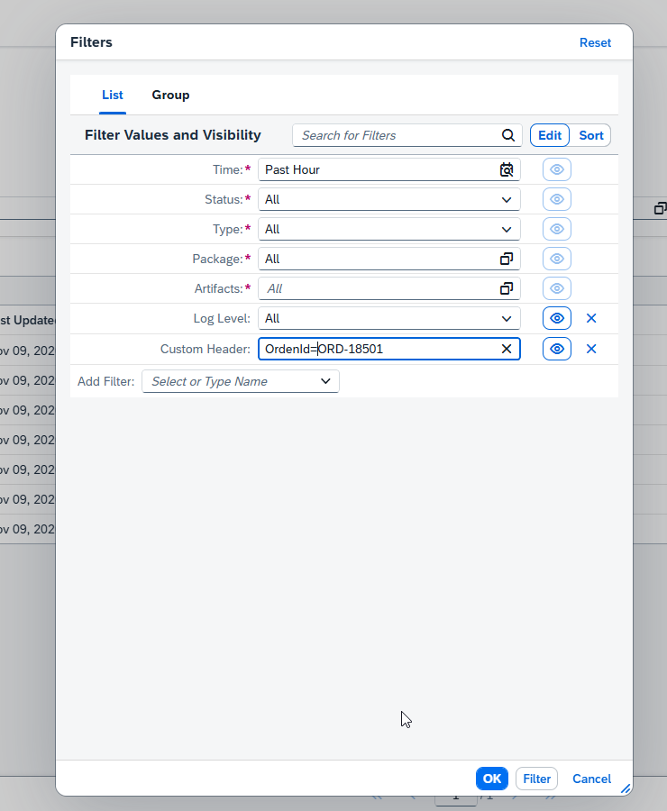

   El filtro devolvió **un registro**: `LAB18-JMS-Consumidor`, `Completed`, 17:47:50, 4 ms. El productor no aparece en esta consulta porque no registra ese Custom Header en el escenario implementado.

   **Evidencia 18-31 — Búsqueda funcional satisfactoria.** Resultado del filtro `OrdenId=ORD-18501`.

   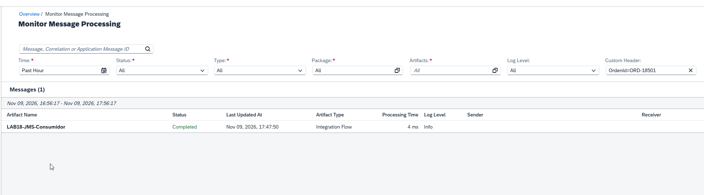

6. En **Monitor → Manage Stores → Message Queues**, revisar `JMS_LAB18_JMS_Productor`. Se observaron **JMS Resources: OK**, **Usage: OK**, **State: Started**, **Access Type: Non-Exclusive**, **Entries = 0** y **Messages (0)**. No quedaron mensajes pendientes en la cola en el momento de la comprobación.

   **Evidencia 18-32 — Cola vacía tras el procesamiento.** Estado final del almacenamiento JMS.

   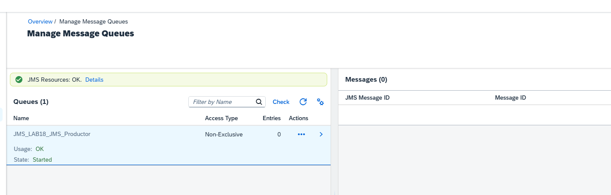

#### Resultado esperado y validación

| Control | Resultado observado |
|---|---|
| Publicación HTTP | `202 Accepted` |
| MPL productor | `Completed`, 91 ms |
| MPL consumidor | `Completed`, 4 ms |
| Correlation ID | Coincidente en ambos MPL |
| Predecessor ID del consumidor | Coincide con Message ID del productor |
| Identificador funcional | `OrdenId=ORD-18501` en Custom Header del consumidor |
| Búsqueda por Correlation ID | Dos MPL, productor y consumidor |
| Búsqueda por Custom Header | Un MPL del consumidor |
| Cola JMS al finalizar | `Started`, cero entradas |

**Problemas encontrados:** el cuerpo HTTP de respuesta permanece binario; su causa no se determinó. No se observaron errores de publicación, consumo ni correlación en esta ejecución.

**Aprendizajes:** el estado `Completed` del productor no sustituye la validación del consumidor; la correlación técnica se verifica mediante identificadores MPL y no solamente por coincidencia horaria; el Custom Header permite una búsqueda funcional por orden; la cola vacía acredita que no había mensajes pendientes al momento de la inspección, sin demostrar garantías universales de entrega exactamente una vez.

**Estado final:** ✅ Completado. Evidencias 18-26 a 18-32.

## Criterios de validación y cierre

Cada laboratorio solo pasará a `✅ Completado` con evidencia práctica que respalde su resultado. Los conceptos explicados sin comprobación conservarán `🟦 Revisado`; los bloqueos reales se registrarán como `⛔ Bloqueado`. Las evidencias usarán numeración correlativa `18-01`, `18-02`, etc., asignada antes de solicitar cada captura, con título y descripción junto al paso correspondiente.

## Referencias

- `README.md` - estado y ruta del curso.
- `INSTRUCCIONES.md` - reglas generales.
- `docs/METODOLOGIA-LABORATORIOS.md` - preparación, investigación técnica, evidencias y documentación.
- `docs/17-data-store-persistencia-temporal.md` - continuidad del escenario de órdenes.
- SAP Help Portal - referencias técnicas específicas pendientes de consulta antes de la implementación.
