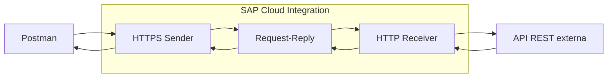
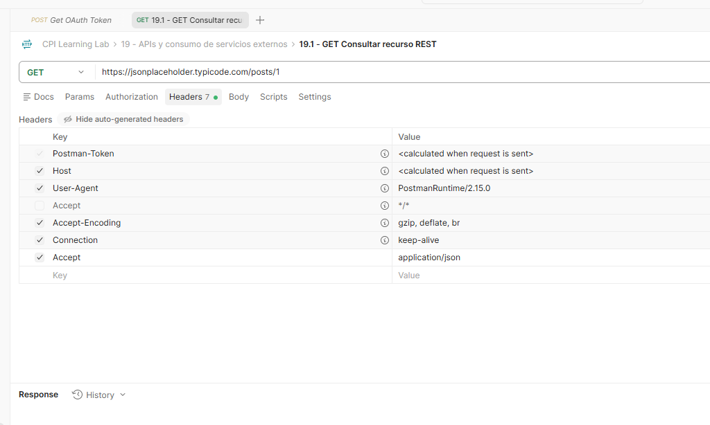
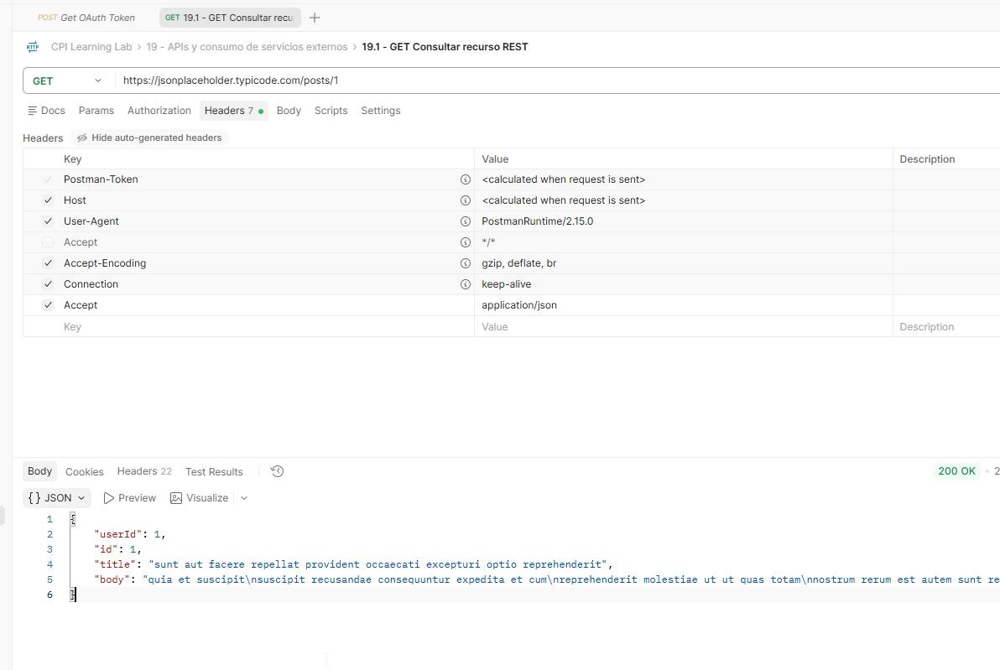
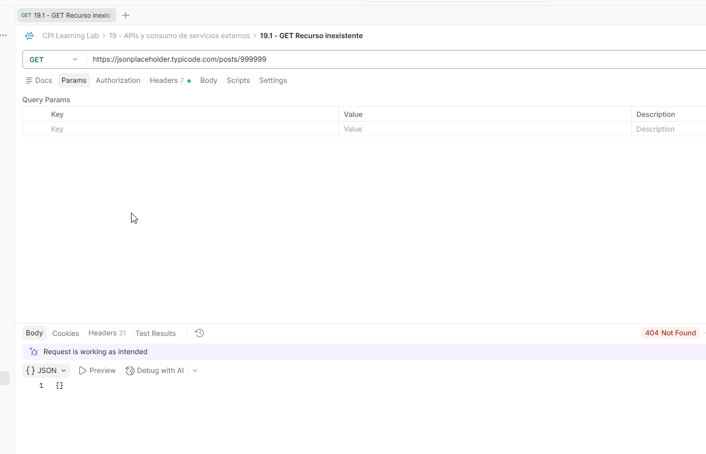
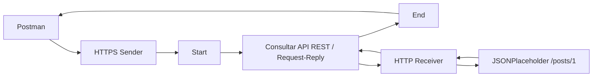
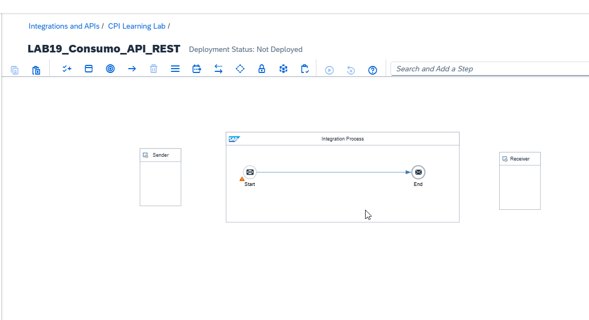
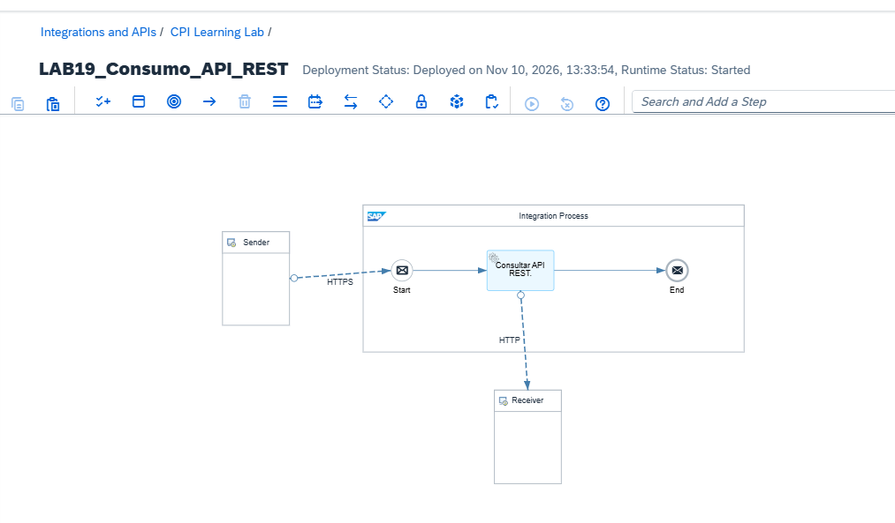
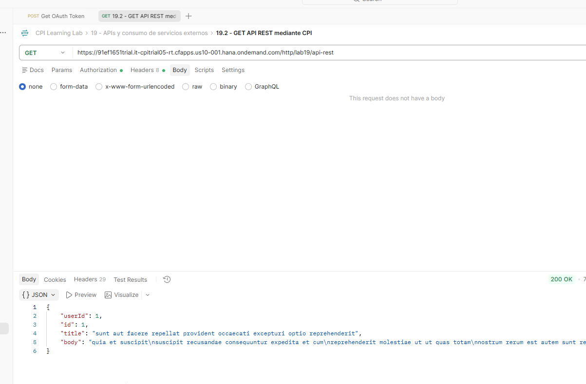
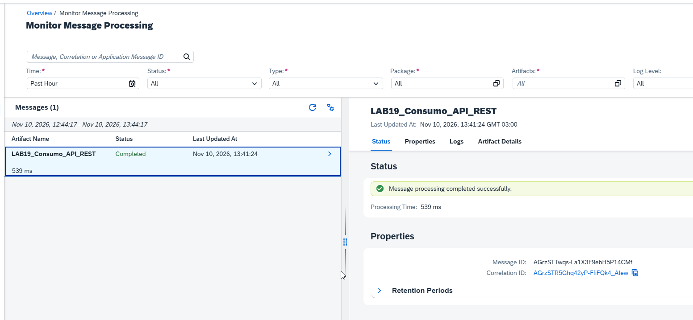

# 19 - APIs y consumo de servicios externos

**Estado del tema:** 🟨 En curso — 19.1 y 19.2 completados
**Package:** `CPI Learning Lab`
**Inicio:** 10/11/2026

## Objetivo y contexto

Comprender los contratos HTTP de servicios REST y consumir una API pública desde SAP Cloud Integration mediante un flujo síncrono, distinguiendo la respuesta al cliente del registro de procesamiento en Monitor. Se aprovechan los conocimientos previos de HTTPS Sender, Request-Reply, HTTP Receiver, OAuth y MPL; no se modifican artefactos de capítulos anteriores.

## Alcance

- Interpretar métodos HTTP, URL, headers, códigos de estado y representaciones JSON.
- Comprobar directamente en Postman una respuesta positiva y una negativa de una API pública.
- Implementar y validar un iFlow CPI que consulte un servicio REST externo.
- Posteriormente: parametrización de solicitudes, autenticación saliente, errores HTTP y escenario integrador.

**Fuera de alcance:** OData (capítulo 20) y administración de APIs con API Management. Los mecanismos de errores HTTP en CPI se estudiarán en 19.5.

## Plan de laboratorios y tiempos estimados

| Laboratorio | Actividad | Validación | Estimación |
|---|---|---|---|
| 19.1 | Contrato HTTP y consulta REST directa | GET 200 con JSON; GET 404 | 35 min |
| 19.2 | Consumo de API REST mediante CPI | iFlow Started, HTTP 200, MPL Completed | 50 min |
| 19.3 | Parámetros dinámicos, headers y JSON | Consultas con parámetros variables y respuestas comprobadas | 50 min |
| 19.4 | Autenticación y configuración segura | Consumo autenticado validado | 55 min |
| 19.5 | Errores HTTP y diagnóstico | Casos negativos y comportamiento de CPI comprobados | 55 min |
| 19.6 | Integración completa y Postman | Flujo integral comprobado | 45 min |
| **Total estimado** | | | **4 h 50 min** |

Las duraciones son estimaciones iniciales, no tiempos medidos. No incluyen pausas ni eventuales bloqueos del entorno.

## Arquitectura conceptual

La solicitud entra a CPI por HTTPS; Request-Reply espera la respuesta del servicio externo consultado por HTTP Receiver y la devuelve al cliente.

## Prerrequisitos y restricciones

- Acceso a SAP Integration Suite, Design, Monitor y al package `CPI Learning Lab`.
- Postman y mecanismo de autenticación OAuth de entrada previamente utilizado en el curso.
- Conectividad HTTPS desde CPI a `jsonplaceholder.typicode.com`. Su disponibilidad se validó durante 19.2, no se asumió por el resultado de Postman.
- No incorporar credenciales, tokens ni secretos en evidencias o repositorio.

## 19.1 - Fundamentos REST y contratos HTTP

**Estado:** ✅ Completado

### Objetivo y conceptos

Identificar los elementos de un contrato HTTP (método, URL, headers, código de estado y cuerpo) y diferenciar una respuesta satisfactoria de un recurso inexistente. El header `Accept` expresa el formato esperado de la respuesta; `Content-Type` describe el formato del contenido enviado, cuando existe.

**Prerrequisitos:** Postman y conectividad al servicio público JSONPlaceholder.

### Procedimiento, configuración y evidencias

1. En la colección `CPI Learning Lab`, crear la carpeta `19 - APIs y consumo de servicios externos` y la petición `19.1 - GET Consultar recurso REST`:

   | Campo | Valor |
   |---|---|
   | Método | `GET` |
   | URL | `https://jsonplaceholder.typicode.com/posts/1` |
   | Authorization | `No Auth` |
   | Header habilitado | `Accept: application/json` |
   | Body | Ninguno |

   **Evidencia 19-01 — Petición GET configurada.** La captura muestra el método, recurso y header `Accept` habilitado; el header `Accept: */*` autogenerado aparece deshabilitado.

   

2. Ejecutar la petición. Se obtuvo **HTTP 200 OK** con un objeto JSON que contiene `userId: 1`, `id: 1`, `title` y `body`.

   **Evidencia 19-02 — Respuesta positiva de JSONPlaceholder.** Se observa el código HTTP 200 y el JSON del recurso `posts/1`.

   

3. Duplicar la petición como `19.1 - GET Recurso inexistente` y consultar `https://jsonplaceholder.typicode.com/posts/999999`, manteniendo `GET`, `No Auth` y `Accept: application/json`. Se obtuvo **HTTP 404 Not Found** y cuerpo `{}`.

   **Evidencia 19-03 — Recurso inexistente.** La captura muestra el recurso solicitado, el código 404 y el objeto JSON vacío.

   

### Resultado esperado y validación

| Caso | Esperado | Observado |
|---|---|---|
| `GET /posts/1` | 200 y recurso JSON | 200; `id = 1`, `userId = 1`, `title` y `body` presentes |
| `GET /posts/999999` | 404 | 404; body `{}` |

**Problemas encontrados:** ninguno en las pruebas realizadas.

**Aprendizajes:** HTTP 404 acredita que el servidor devolvió una respuesta de recurso inexistente; no demuestra por sí mismo una falla de conectividad. Un HTTP 200 debe contrastarse también con los datos esperados.

## 19.2 - Consumo síncrono de API REST mediante CPI

**Estado:** ✅ Completado

### Objetivo y conceptos

Construir un iFlow independiente que reciba una petición HTTPS autenticada, consulte sincrónicamente JSONPlaceholder mediante HTTP Receiver y devuelva el JSON al cliente. Request-Reply espera la respuesta del receptor antes de finalizar el procesamiento.

**Prerrequisitos:** 19.1 completado; acceso a Design, Deploy y Monitor; autenticación OAuth para el endpoint CPI.

### Arquitectura implementada

### Procedimiento, configuración y evidencias

1. Crear el artefacto `LAB19_Consumo_API_REST` en el package `CPI Learning Lab`, sin modificar iFlows anteriores. Registrar el estado inicial mediante `Save` y `Save as Version` (`1.0.0`) antes de editar sus componentes.

   **Evidencia 19-04 — Artefacto creado.** Se observa el iFlow con su estructura inicial y estado `Not Deployed`.

   

2. Conectar el Sender con Start mediante el adaptador HTTPS y establecer:

   | Parámetro HTTPS Sender | Valor |
   |---|---|
   | Address | `/lab19/api-rest` |
   | Authorization | `User Role` |
   | User Role | `ESBMessaging.send` |
   | CSRF Protected | Desactivado |

   El endpoint utiliza autenticación de entrada y se consume inicialmente mediante GET, sin body ni modificación de recursos.

3. Insertar un componente **Request-Reply** denominado `Consultar API REST` entre Start y End; conectar Request-Reply al participante Receiver mediante HTTP Receiver:

   | Parámetro HTTP Receiver | Valor |
   |---|---|
   | Address | `https://jsonplaceholder.typicode.com/posts/1` |
   | Proxy Type | `Internet` |
   | Authentication | `None` |
   | Method | `GET` |

   El destino y el recurso son fijos en este laboratorio; la parametrización se estudiará en 19.3. La API de pruebas no requiere autenticación saliente para esta consulta.

4. Guardar el diseño con `Save` y ejecutar `Deploy`. El iFlow mostró **Runtime Status: Started**.

   **Evidencia 19-05 — Arquitectura completa y runtime iniciado.** Se observan Sender HTTPS, Request-Reply, Receiver HTTP y estado `Started`.

   

5. Crear la petición independiente `19.2 - GET API REST mediante CPI` en la carpeta Postman del capítulo 19:

   | Campo | Valor |
   |---|---|
   | Método | `GET` |
   | URL | `https://<host-cpi>/http/lab19/api-rest` |
   | Authorization | OAuth 2.0, según configuración del entorno |
   | Header | `Accept: application/json` |
   | Body | Ninguno |

   Se obtuvo **HTTP 200 OK** y JSON con `userId = 1`, `id = 1`, `title` y `body`, coherente con la consulta directa del 19.1.

   **Evidencia 19-06 — Consumo REST desde CPI.** Se ve el endpoint CPI, el código HTTP 200 y el recurso JSON devuelto.

   

6. En **Monitor → Monitor Message Processing**, localizar la ejecución de `LAB19_Consumo_API_REST`. El MPL mostró **Completed** el **10/11/2026 a las 13:41:24 (GMT-03:00)** y **539 ms** de procesamiento; se mostraron Message ID y Correlation ID.

   **Evidencia 19-07 — Procesamiento completado.** El MPL confirma `Completed` para el iFlow y registra su tiempo de ejecución.

   

7. Revisar el listado de artefactos en Design. Tras las modificaciones, el artefacto aparecía como `Draft`. Registrar el diseño funcional validado mediante **Save as Version**, versión **`1.0.1`**, con el comentario `19.2 - Consumo API REST validado con HTTP 200 y MPL Completed`. Se confirmó que el listado mostraba la versión numerada. No se requirió un nuevo despliegue por el solo hecho de versionar.

### Resultado esperado y validación

| Control | Resultado observado |
|---|---|
| iFlow | `LAB19_Consumo_API_REST` |
| Estado runtime | `Started` |
| Petición Postman | HTTP `200 OK`, JSON con `id = 1` |
| MPL | `Completed`, 539 ms |
| Versión de diseño final | `1.0.1` confirmada en listado |

**Problemas encontrados:** ninguno durante la ejecución funcional documentada. El estado `Draft` posterior a la edición fue regularizado mediante `Save as Version`.

**Aprendizajes:** `Save` guarda el diseño; `Deploy` publica el contenido ejecutable; `Save as Version` conserva un estado numerado del diseño. La versión inicial `1.0.0` sirve como punto de partida y la versión `1.0.1` representa el resultado funcional validado. Versionar no implica desplegar de nuevo. El HTTP 200 del cliente y el MPL Completed aportan verificaciones complementarias.

## Criterios de validación del capítulo

Un laboratorio se considera completado solo cuando su resultado práctico está respaldado por evidencias verificables. Los laboratorios posteriores mantendrán sus estados según el avance real y no se presumirá su funcionamiento antes de ejecutar pruebas.

## Referencias

- [SAP Help Portal — SAP Cloud Integration](https://help.sap.com/docs/integration-suite/sap-integration-suite/cloud-integration)
- [JSONPlaceholder — Guía y recursos](https://jsonplaceholder.typicode.com/guide/)
- `README.md` y `docs/METODOLOGIA-LABORATORIOS.md` — estado del curso, versionado y convenciones de evidencias.
