# 19 - APIs y consumo de servicios externos

**Estado del tema:** 🟨 En curso - 19.1, 19.2, 19.3 y 19.4 completados
**Package:** `CPI Learning Lab`
**Inicio:** 10/11/2026

## Objetivo y contexto

Comprender los contratos HTTP de servicios REST y consumir una API pública desde SAP Cloud Integration mediante un flujo síncrono, distinguiendo la respuesta al cliente del registro de procesamiento en Monitor. Se aprovechan los conocimientos previos de HTTPS Sender, Request-Reply, HTTP Receiver, OAuth y MPL; no se modifican artefactos de capítulos anteriores.

## Alcance

- Interpretar métodos HTTP, URL, headers, códigos de estado y representaciones JSON.
- Comprobar directamente en Postman una respuesta positiva y una negativa de una API pública.
- Implementar y validar un iFlow CPI que consulte un servicio REST externo.
- Parametrización de solicitudes y autenticación saliente; posteriormente, errores HTTP y escenario integrador.

**Fuera de alcance:** OData (capítulo 20) y administración de APIs con API Management. Los mecanismos de errores HTTP en CPI se estudiarán en 19.5.

## Plan de laboratorios y tiempos estimados

| Laboratorio | Actividad | Validación | Estimación |
|---|---|---|---|
| 19.1 | Contrato HTTP y consulta REST directa | GET 200 con JSON; GET 404 | 35 min |
| 19.2 | Consumo de API REST mediante CPI | iFlow Started, HTTP 200, MPL Completed | 50 min |
| 19.3 | Parámetros dinámicos, headers y JSON | Consultas con parámetros variables y respuestas comprobadas | 50 min |
| 19.4 | Autenticación y configuración segura | Consumo autenticado validado | 55 min |
| 19.5 | Errores HTTP y diagnóstico | Casos negativos y comportamiento de CPI comprobados | 55 min |
| 19.6 | Integración completa y Postman | Flujo integral comprobado | 45 min |
| **Total estimado** | | | **4 h 50 min** |

Las duraciones son estimaciones iniciales, no tiempos medidos. No incluyen pausas ni eventuales bloqueos del entorno.

## Arquitectura conceptual

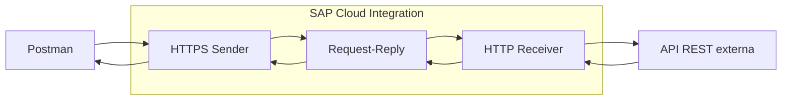

La solicitud entra a CPI por HTTPS; Request-Reply espera la respuesta del servicio externo consultado por HTTP Receiver y la devuelve al cliente.

## Prerrequisitos y restricciones

- Acceso a SAP Integration Suite, Design, Monitor y al package `CPI Learning Lab`.
- Postman y mecanismo de autenticación OAuth de entrada previamente utilizado en el curso.
- Conectividad HTTPS desde CPI a `jsonplaceholder.typicode.com`. Su disponibilidad se validó durante 19.2, no se asumió por el resultado de Postman.
- No incorporar credenciales, tokens ni secretos en evidencias o repositorio.

## 19.1 - Fundamentos REST y contratos HTTP

**Estado:** ✅ Completado

### Objetivo y conceptos

Identificar los elementos de un contrato HTTP (método, URL, headers, código de estado y cuerpo) y diferenciar una respuesta satisfactoria de un recurso inexistente. El header `Accept` expresa el formato esperado de la respuesta; `Content-Type` describe el formato del contenido enviado, cuando existe.

**Prerrequisitos:** Postman y conectividad al servicio público JSONPlaceholder.

### Procedimiento, configuración y evidencias

1. En la colección `CPI Learning Lab`, crear la carpeta `19 - APIs y consumo de servicios externos` y la petición `19.1 - GET Consultar recurso REST`:

   | Campo | Valor |
   |---|---|
   | Método | `GET` |
   | URL | `https://jsonplaceholder.typicode.com/posts/1` |
   | Authorization | `No Auth` |
   | Header habilitado | `Accept: application/json` |
   | Body | Ninguno |

   **Evidencia 19-01 - Petición GET configurada.** La captura muestra el método, recurso y header `Accept` habilitado; el header `Accept: */*` autogenerado aparece deshabilitado.

   

2. Ejecutar la petición. Se obtuvo **HTTP 200 OK** con un objeto JSON que contiene `userId: 1`, `id: 1`, `title` y `body`.

   **Evidencia 19-02 - Respuesta positiva de JSONPlaceholder.** Se observa el código HTTP 200 y el JSON del recurso `posts/1`.

   

3. Duplicar la petición como `19.1 - GET Recurso inexistente` y consultar `https://jsonplaceholder.typicode.com/posts/999999`, manteniendo `GET`, `No Auth` y `Accept: application/json`. Se obtuvo **HTTP 404 Not Found** y cuerpo `{}`.

   **Evidencia 19-03 - Recurso inexistente.** La captura muestra el recurso solicitado, el código 404 y el objeto JSON vacío.

   

### Resultado esperado y validación

| Caso | Esperado | Observado |
|---|---|---|
| `GET /posts/1` | 200 y recurso JSON | 200; `id = 1`, `userId = 1`, `title` y `body` presentes |
| `GET /posts/999999` | 404 | 404; body `{}` |

**Problemas encontrados:** ninguno en las pruebas realizadas.

**Aprendizajes:** HTTP 404 acredita que el servidor devolvió una respuesta de recurso inexistente; no demuestra por sí mismo una falla de conectividad. Un HTTP 200 debe contrastarse también con los datos esperados.

## 19.2 - Consumo síncrono de API REST mediante CPI

**Estado:** ✅ Completado

### Objetivo y conceptos

Construir un iFlow independiente que reciba una petición HTTPS autenticada, consulte sincrónicamente JSONPlaceholder mediante HTTP Receiver y devuelva el JSON al cliente. Request-Reply espera la respuesta del receptor antes de finalizar el procesamiento.

**Prerrequisitos:** 19.1 completado; acceso a Design, Deploy y Monitor; autenticación OAuth para el endpoint CPI.

### Arquitectura implementada

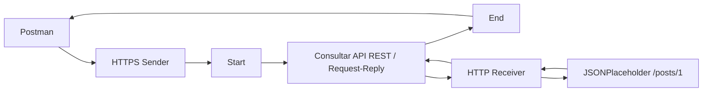

### Procedimiento, configuración y evidencias

1. Crear el artefacto `LAB19_Consumo_API_REST` en el package `CPI Learning Lab`, sin modificar iFlows anteriores. Registrar el estado inicial mediante `Save` y `Save as Version` (`1.0.0`) antes de editar sus componentes.

   **Evidencia 19-04 - Artefacto creado.** Se observa el iFlow con su estructura inicial y estado `Not Deployed`.

   

2. Conectar el Sender con Start mediante el adaptador HTTPS y establecer:

   | Parámetro HTTPS Sender | Valor |
   |---|---|
   | Address | `/lab19/api-rest` |
   | Authorization | `User Role` |
   | User Role | `ESBMessaging.send` |
   | CSRF Protected | Desactivado |

   El endpoint utiliza autenticación de entrada y se consume inicialmente mediante GET, sin body ni modificación de recursos.

3. Insertar un componente **Request-Reply** denominado `Consultar API REST` entre Start y End; conectar Request-Reply al participante Receiver mediante HTTP Receiver:

   | Parámetro HTTP Receiver | Valor |
   |---|---|
   | Address | `https://jsonplaceholder.typicode.com/posts/1` |
   | Proxy Type | `Internet` |
   | Authentication | `None` |
   | Method | `GET` |

   El destino y el recurso son fijos en este laboratorio; la parametrización se estudiará en 19.3. La API de pruebas no requiere autenticación saliente para esta consulta.

4. Guardar el diseño con `Save` y ejecutar `Deploy`. El iFlow mostró **Runtime Status: Started**.

   **Evidencia 19-05 - Arquitectura completa y runtime iniciado.** Se observan Sender HTTPS, Request-Reply, Receiver HTTP y estado `Started`.

   

5. Crear la petición independiente `19.2 - GET API REST mediante CPI` en la carpeta Postman del capítulo 19:

   | Campo | Valor |
   |---|---|
   | Método | `GET` |
   | URL | `https://<host-cpi>/http/lab19/api-rest` |
   | Authorization | OAuth 2.0, según configuración del entorno |
   | Header | `Accept: application/json` |
   | Body | Ninguno |

   Se obtuvo **HTTP 200 OK** y JSON con `userId = 1`, `id = 1`, `title` y `body`, coherente con la consulta directa del 19.1.

   **Evidencia 19-06 - Consumo REST desde CPI.** Se ve el endpoint CPI, el código HTTP 200 y el recurso JSON devuelto.

   

6. En **Monitor → Monitor Message Processing**, localizar la ejecución de `LAB19_Consumo_API_REST`. El MPL mostró **Completed** el **10/11/2026 a las 13:41:24 (GMT-03:00)** y **539 ms** de procesamiento; se mostraron Message ID y Correlation ID.

   **Evidencia 19-07 - Procesamiento completado.** El MPL confirma `Completed` para el iFlow y registra su tiempo de ejecución.

   

7. Revisar el listado de artefactos en Design. Tras las modificaciones, el artefacto aparecía como `Draft`. Registrar el diseño funcional validado mediante **Save as Version**, versión **`1.0.1`**, con el comentario `19.2 - Consumo API REST validado con HTTP 200 y MPL Completed`. Se confirmó que el listado mostraba la versión numerada. No se requirió un nuevo despliegue por el solo hecho de versionar.

### Resultado esperado y validación

| Control | Resultado observado |
|---|---|
| iFlow | `LAB19_Consumo_API_REST` |
| Estado runtime | `Started` |
| Petición Postman | HTTP `200 OK`, JSON con `id = 1` |
| MPL | `Completed`, 539 ms |
| Versión de diseño final | `1.0.1` confirmada en listado |

**Problemas encontrados:** ninguno durante la ejecución funcional documentada. El estado `Draft` posterior a la edición fue regularizado mediante `Save as Version`.

**Aprendizajes:** `Save` guarda el diseño; `Deploy` publica el contenido ejecutable; `Save as Version` conserva un estado numerado del diseño. La versión inicial `1.0.0` sirve como punto de partida y la versión `1.0.1` representa el resultado funcional validado. Versionar no implica desplegar de nuevo. El HTTP 200 del cliente y el MPL Completed aportan verificaciones complementarias.

## 19.3 - Parámetros dinámicos, headers y respuestas JSON

**Estado:** ✅ Completado

### Objetivo y conceptos

Permitir que un mismo endpoint HTTPS de CPI consulte diferentes recursos REST mediante el parámetro de consulta `id`, validar su formato antes de llamar al servicio externo y comprobar las respuestas JSON. Se reutiliza el iFlow `LAB19_Consumo_API_REST`, conservando la versión funcional de 19.2 como punto de recuperación.

**Prerrequisitos:** 19.2 completado; manejo de headers, Exchange Properties y Groovy estudiado en capítulos anteriores.

### Arquitectura implementada

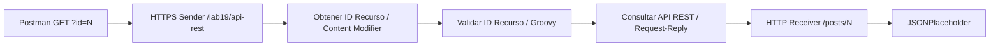

### Procedimiento, configuración y evidencias

1. Mantener la dirección de HTTPS Sender `/lab19/api-rest`. Incorporar un **Content Modifier** denominado `Obtener ID Recurso`, antes de `Consultar API REST`, con la siguiente Exchange Property:

   | Campo | Valor |
   |---|---|
   | Name | `P_ID_RECURSO` |
   | Source Type | `Expression` |
   | Source Value | `${header.CamelHttpQuery}` |
   | Data Type | `java.lang.String` |

   La propiedad contiene inicialmente la cadena de consulta completa, como `id=2`; no debe confundirse con el identificador ya validado.

2. Incorporar el **Groovy Script** `Validar ID Recurso` entre el Content Modifier y Request-Reply. Asociar el recurso `GRV_Validar_ID_Recurso.groovy`:

   ```groovy
   import com.sap.gateway.ip.core.customdev.util.Message
   import java.net.URLDecoder

   def Message processData(Message message) {
       String query = message.getHeader('CamelHttpQuery', String)
       if (!query) {
           throw new IllegalArgumentException('El parametro id es obligatorio')
       }

       List<String> ids = []
       query.split('&', -1).each { parametro ->
           String[] partes = parametro.split('=', 2)
           String nombre = URLDecoder.decode(partes[0], 'UTF-8')
           if (nombre == 'id') {
               String valor = partes.length == 2 ?
                   URLDecoder.decode(partes[1], 'UTF-8') : ''
               ids.add(valor)
           }
       }

       if (ids.size() != 1) {
           throw new IllegalArgumentException('Debe existir exactamente un parametro id')
       }

       String id = ids[0]
       if (!(id ==~ /[0-9]+/) || !(id ==~ /.*[1-9].*/)) {
           throw new IllegalArgumentException('El parametro id debe ser un entero positivo')
       }

       message.setProperty('P_ID_RECURSO', id)
       return message
   }
   ```

   El script exige exactamente un parámetro `id`, admite únicamente dígitos y rechaza el valor cero. El identificador validado reemplaza el valor provisional de la propiedad. No se altera el body.

3. Modificar el **HTTP Receiver** para consultar el recurso indicado por la propiedad:

   | Campo | Valor |
   |---|---|
   | Address | `https://jsonplaceholder.typicode.com/posts/${property.P_ID_RECURSO}` |
   | Proxy Type | `Internet` |
   | Authentication | `None` |
   | Method | `GET` |

   Guardar y desplegar el iFlow. El runtime se verificó en estado **Started**.

4. Crear en Postman `19.3 - GET API REST ID dinamico`, método GET, OAuth de entrada a CPI y URL `https://<host-cpi>/http/lab19/api-rest?id=2`. Se obtuvo **HTTP 200** con JSON `id: 2` y `userId: 1`.

   **Evidencia 19-08 - Consumo REST con identificador dinámico.** La respuesta de Postman muestra la URL CPI con `id=2`, HTTP 200 y el JSON correspondiente.

   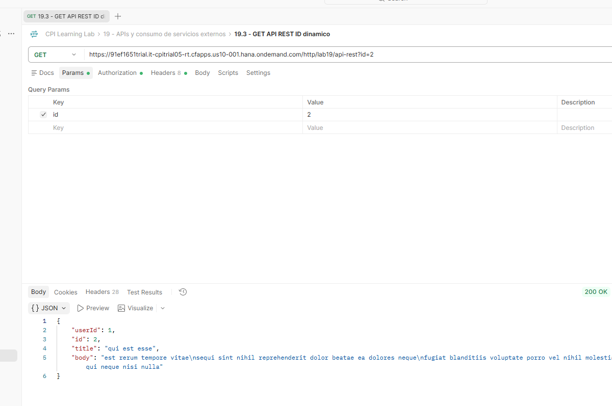

5. Cambiar únicamente el parámetro a `id=15`. Se confirmó **HTTP 200**, `id: 15` y `userId: 2`. Esta segunda ejecución verifica que la respuesta cambia según el identificador, sin modificar el diseño del iFlow. No se requiere captura adicional.

6. Ejecutar la misma petición con `id=abc`. Postman recibió **HTTP 500**; el MPL registró **Failed**, `IllegalArgumentException` y el mensaje `El parametro id debe ser un entero positivo` en `GRV_Validar_ID_Recurso.groovy`. La excepción confirma el rechazo en el script; el código HTTP 500 no constituye todavía una respuesta funcional de validación para el consumidor.

   **Evidencia 19-09 - Identificador inválido rechazado.** El MPL muestra la excepción emitida por Groovy para `id=abc`.

   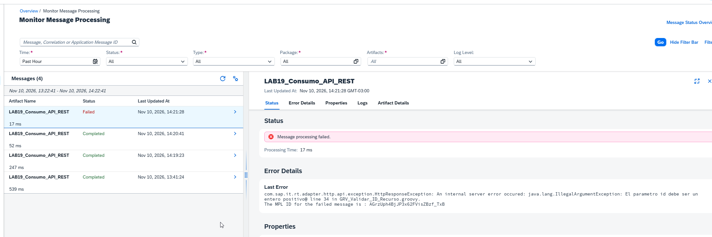

7. Deshabilitar el parámetro `id` en Postman y ejecutar la URL sin query string. Postman recibió **HTTP 500** y el MPL registró **Failed**, `IllegalArgumentException` y `El parametro id es obligatorio`, originado en `GRV_Validar_ID_Recurso.groovy`.

   **Evidencia 19-10 - Parámetro obligatorio rechazado.** El MPL identifica el error por ausencia del parámetro `id`.

   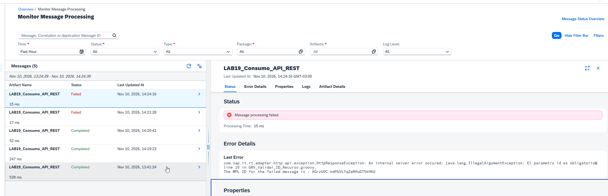

8. Tras validar los casos anteriores, guardar una versión numerada mediante **Save as Version**. Se confirmó la creación de la versión validada; no se requiere un nuevo despliegue exclusivamente por versionar.

### Resultado esperado y validación

| Caso | Resultado observado |
|---|---|
| `?id=2` | HTTP 200; JSON `id=2` |
| `?id=15` | HTTP 200; JSON `id=15` |
| `?id=abc` | HTTP 500 al cliente; MPL Failed con rechazo explícito de Groovy |
| Sin parámetro `id` | HTTP 500 al cliente; MPL Failed con mensaje de parámetro obligatorio |
| Despliegue | Runtime Started |
| Versionado | Versión funcional guardada y confirmada |

**Problemas encontrados:** las entradas inválidas se traducen actualmente en HTTP 500, al no existir todavía un tratamiento explícito de errores HTTP. El manejo de respuestas controladas queda dentro del laboratorio 19.5.

**Aprendizajes:** la query string entrante no equivale a un identificador individual; debe interpretarse y validarse. Una Exchange Property permite desacoplar el parámetro recibido de la dirección dinámica del receptor. El MPL permite distinguir la causa interna de un error de la respuesta HTTP recibida por Postman.

## 19.4 - Autenticación y consumo seguro de APIs externas

**Estado:** ✅ Completado

### Objetivo y conceptos

Distinguir la autenticación OAuth de entrada (Postman → CPI) de la autenticación Basic saliente (CPI → API externa). Configurar credenciales mediante **Security Material**, comprobar el éxito y el rechazo de credenciales incorrectas, y restaurar el diseño funcional.

**Prerrequisitos:** 19.3 completado; acceso a Security Material; Postman y autenticación OAuth entrante operativa.

### Arquitectura implementada

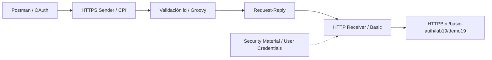

La autenticación entrante y la saliente son independientes. El parámetro `id=2` se conserva para satisfacer la validación del laboratorio anterior, aunque HTTPBin no lo requiere para su contrato de autenticación.

### Procedimiento, configuración y evidencias

1. Crear en Postman la petición `19.4 - GET Basic Auth directo`, `GET https://httpbin.org/basic-auth/lab19/demo19`, inicialmente con `No Auth`. Se obtuvo **HTTP 401 Unauthorized**. Configurar después **Basic Auth** con usuario de prueba `lab19` y contraseña de prueba correspondiente al endpoint; se obtuvo **HTTP 200**, `authenticated: true`, `authorized: true`, `user: lab19`. Esta comprobación directa verifica el contrato del servicio, pero no demuestra todavía el uso de CPI.

2. En **Monitor → Manage Security → Security Material**, crear y desplegar **User Credentials** con nombre `LAB19_HTTPBIN_BASIC`, usuario `lab19` y contraseña de prueba del servicio. La contraseña se almacena en Security Material y no en el iFlow ni en el repositorio.

3. Modificar temporalmente el HTTP Receiver de `LAB19_Consumo_API_REST`:

   | Campo | Valor |
   |---|---|
   | Address | `https://httpbin.org/basic-auth/lab19/demo19` |
   | Proxy Type | `Internet` |
   | Authentication | `Basic` |
   | Credential Name | `LAB19_HTTPBIN_BASIC` |
   | Method | `GET` |

   Mantener la validación de `id` de 19.3, guardar y desplegar. El iFlow mostró **Started**. El HTTP Receiver obtiene las credenciales por referencia al material de seguridad.

4. Ejecutar la petición independiente `19.4 - GET Basic Auth mediante CPI`, `GET https://<host-cpi>/http/lab19/api-rest?id=2`, con **OAuth** hacia CPI. Se obtuvo **HTTP 200**, JSON con `authenticated: true`, `authorized: true` y `user: lab19`.

   **Evidencia 19-11 - Autenticación Basic saliente desde CPI.** Postman consulta el endpoint CPI, no HTTPBin directamente, y muestra la respuesta de autenticación aceptada.

   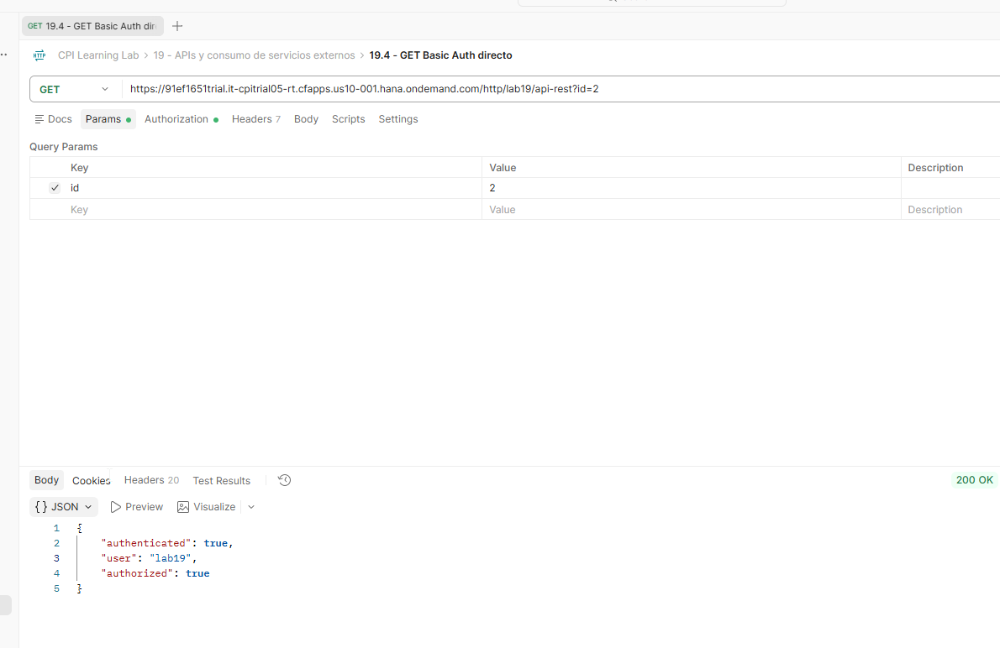

5. Verificar la ejecución en **Monitor Message Processing**: el MPL de `LAB19_Consumo_API_REST` mostró **Completed**, con tiempo de procesamiento de **65 ms**.

   **Evidencia 19-12 - Procesamiento de autenticación completado.** El MPL registra la ejecución satisfactoria de la solicitud autenticada.

   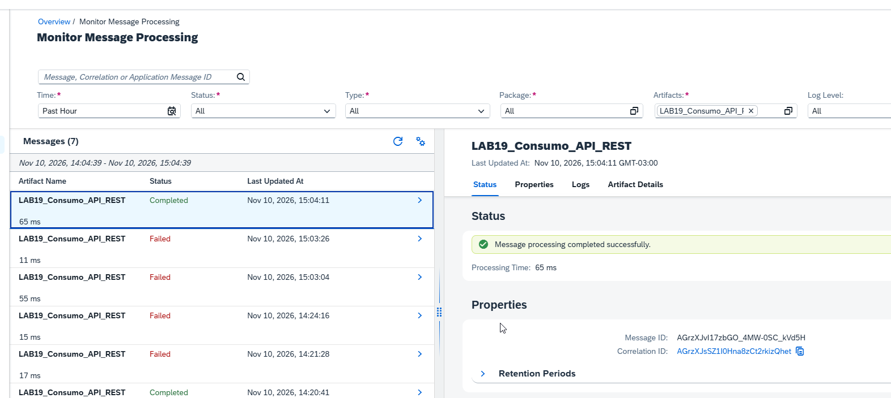

6. Crear y desplegar un segundo User Credentials denominado `LAB19_HTTPBIN_BASIC_INVALID`, con el mismo usuario de prueba y una contraseña deliberadamente incorrecta. Cambiar **solo** el `Credential Name` del HTTP Receiver a este segundo material, guardar y desplegar; no crear versión numerada para este estado temporal.

7. Ejecutar la petición OAuth de Postman a CPI con `?id=2`. Postman recibió **HTTP 500 Internal Server Error**. El MPL registró **Failed** y `HttpResponseException` con `statusCode: 401` al invocar HTTPBin. El servicio externo rechazó las credenciales; CPI propagó el fallo como error interno hacia el cliente.

   **Evidencia 19-13 - Respuesta de CPI ante credenciales inválidas.** Postman muestra HTTP 500 y el identificador del mensaje fallido.

   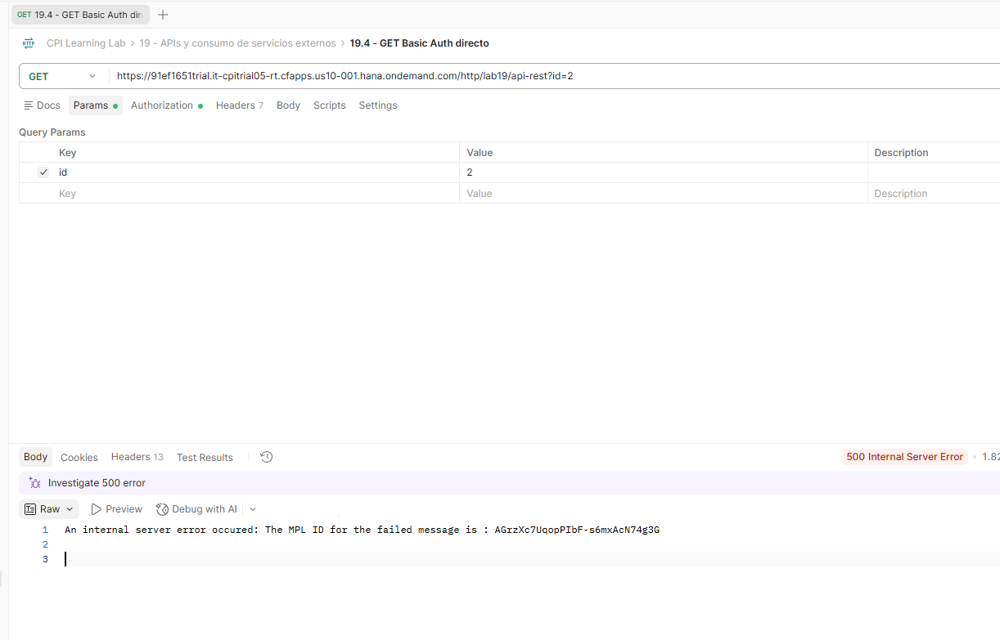

   **Evidencia 19-14 - HTTP 401 externo registrado en MPL.** El detalle del error muestra `statusCode: 401` y permite diferenciar el rechazo del servicio externo del HTTP 500 observado por el cliente.

   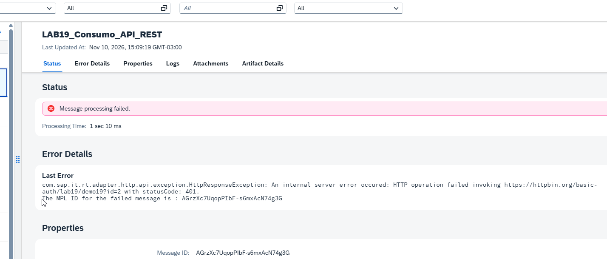

8. Restaurar el `Credential Name` a `LAB19_HTTPBIN_BASIC`, guardar y desplegar. Se confirmó una nueva ejecución con **HTTP 200**, `authenticated: true` y `authorized: true`. Registrar mediante **Save as Version** el estado funcional validado; la creación de la versión fue confirmada. No es necesario repetir la evidencia positiva del paso 4.

### Resultado esperado y validación

| Caso | Resultado observado |
|---|---|
| HTTPBin sin autenticación, directamente desde Postman | HTTP 401 |
| HTTPBin con Basic válido, directamente desde Postman | HTTP 200; autenticación aceptada |
| Postman OAuth → CPI → HTTPBin Basic válido | HTTP 200; JSON de autenticación aceptada; MPL Completed |
| Postman OAuth → CPI → HTTPBin Basic inválido | HTTP 500 al cliente; MPL Failed con HTTP 401 del receptor |
| Restauración de credenciales válidas | HTTP 200 confirmado |
| Versionado | Versión funcional guardada y confirmada |

**Problemas encontrados:** el rechazo HTTP 401 del receptor se presenta al consumidor de CPI como HTTP 500 en ausencia de un tratamiento explícito. Se estudiará su manejo en 19.5. Las credenciales incorrectas se mantuvieron separadas de las válidas para evitar alterar el material ya comprobado.

**Aprendizajes:** la autenticación de entrada no sustituye la autenticación del receptor. Security Material desacopla las credenciales del diseño. El MPL permite identificar el código HTTP real de un servicio externo aunque la respuesta final de CPI sea diferente. La restauración se validó antes de registrar la versión funcional.

## Criterios de validación del capítulo

Un laboratorio se considera completado solo cuando su resultado práctico está respaldado por evidencias verificables. Los laboratorios 19.1 a 19.4 están completados con validación práctica; 19.5 y 19.6 permanecen pendientes. No se presume el funcionamiento de laboratorios todavía no ejecutados.

## Referencias

- [SAP Help Portal - SAP Cloud Integration](https://help.sap.com/docs/integration-suite/sap-integration-suite/cloud-integration)
- [JSONPlaceholder - Guía y recursos](https://jsonplaceholder.typicode.com/guide/)
- [HTTPBin - Servicio de pruebas HTTP](https://httpbin.org/)
- `README.md` y `docs/METODOLOGIA-LABORATORIOS.md` - estado del curso, versionado y convenciones de evidencias.
