# 20 - OData en Integration Suite

**Estado del tema:** ✅ Completado - laboratorios 20.1 a 20.6 validados dentro de sus alcances; operaciones de escritura no implementadas.
**Package de referencia:** `CPI Learning Lab`
**Servicios de pruebas:** Northwind OData V2 (`https://services.odata.org/V2/Northwind/Northwind.svc/`) y V4 (`https://services.odata.org/V4/Northwind/Northwind.svc/`)

## Objetivo y contexto

Comprender el modelo de entidades y metadatos de OData y construir consultas verificables antes de consumir servicios OData desde SAP Cloud Integration. Se reutilizan Postman y los conceptos HTTP del capítulo 19, sin modificar sus iFlows.

## Alcance del capítulo

| Laboratorio | Propósito | Estado |
|---|---|---|
| 20.1 | Service Document, metadata, entidad, clave y EntitySet | ✅ Completado |
| 20.2 | `$filter`, `$select`, `$orderby`, `$top`, `$expand` y consulta combinada | ✅ Completado |
| 20.3 | OData Receiver V2 en CPI | ✅ Completado |
| 20.4 | Selección dinámica del recurso OData mediante header y property | ✅ Completado |
| 20.5 | OData V4 | ✅ Completado |
| 20.6 | Paginación OData V4 mediante token de continuación y Router; escritura fuera del alcance validado | ✅ Completado |

## Prerrequisitos

- Postman y acceso HTTPS al servicio público Northwind OData V2.
- Conocimientos de GET, headers y JSON/XML adquiridos en el capítulo 19.
- Para laboratorios posteriores: acceso a Design y Monitor de SAP Integration Suite.
- No registrar secretos ni credenciales en el repositorio.

## Arquitectura de los laboratorios 20.1 y 20.2

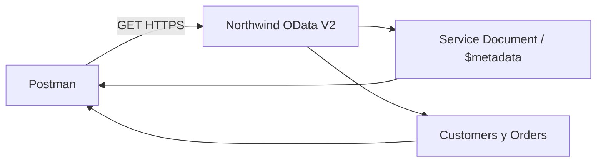

## 20.1 - Fundamentos, entidades y metadata

**Estado:** ✅ Completado

### Objetivo y conceptos

Identificar el contrato autodescriptivo de un servicio OData V2. El **Service Document** publica colecciones; `$metadata` describe tipos (`EntityType`), conjuntos (`EntitySet`), claves (`Key`) y relaciones (`NavigationProperty`). `Customer` es el tipo; `Customers` es el conjunto publicado.

**Prerrequisitos:** Postman, servicio Northwind accesible; no se requiere iFlow.

### Procedimiento y evidencias

1. Crear la carpeta `20 - OData en Integration Suite` dentro de la colección `CPI Learning Lab` y la petición `20.1 - GET Service Document`: método `GET`, URL raíz `https://services.odata.org/V2/Northwind/Northwind.svc/`, `No Auth`, `Accept: application/xml`, sin body. La raíz permite descubrir colecciones sin conocer su estructura. Se recibió **HTTP 200**, XML con colecciones como `Categories`, `Customers`, `Employees` y `Order_Details`.

   **Evidencia 20-01 - Service Document.** URL, HTTP 200 y colecciones del servicio.

   

2. Crear `20.1 - GET Metadata` con `GET https://services.odata.org/V2/Northwind/Northwind.svc/$metadata`, `No Auth` y `Accept: application/xml`. Se recibió **HTTP 200** con XML EDMX y tipos `Category`, `Customer`, `Employee`, `Order`, entre otros. El documento declara `DataServiceVersion="1.0"` y `MaxDataServiceVersion="2.0"`; el segundo valor indica la versión máxima declarada y no debe confundirse con la versión de cada entidad.

   **Evidencia 20-02 - Metadatos EDMX.** Estructura EDMX, namespaces y tipos de entidad.

   

3. En el XML, expandir `EntityType Name="Customer"`. La clave se define mediante `PropertyRef Name="CustomerID"`; `CustomerID` es `Edm.String`, `Nullable="false"`, `MaxLength="5"` y `FixedLength="true"`. `CompanyName` es obligatoria, de longitud máxima 40. También se identificaron `City`, `Country`, `Orders` y `CustomerDemographics`. Las relaciones permiten navegar a recursos relacionados.

   **Evidencia 20-03 - Estructura de Customer.** Clave, propiedades y relaciones de navegación.

   

4. Crear `20.1 - GET Customer por clave`: `GET https://services.odata.org/V2/Northwind/Northwind.svc/Customers('ALFKI')`, `No Auth`, sin body y sin header `Accept` explícito en la ejecución satisfactoria. Las comillas corresponden a la clave `Edm.String`. Se recibió **HTTP 200**, una entrada Atom/XML con `CustomerID=ALFKI`, `CompanyName=Alfreds Futterkiste`, `City=Berlin` y `Country=Germany`. La propiedad `Region` se devolvió como nula.

   **Evidencia 20-04 - Consulta por clave.** Respuesta HTTP 200 y propiedades de `ALFKI`.

   

5. En `$metadata`, localizar el contenedor `NorthwindEntities` y comprobar `EntitySet Name="Customers" EntityType="NorthwindModel.Customer"`. Esta declaración conecta el nombre de la colección con el tipo que define sus propiedades y clave.

   **Evidencia 20-05 - Relación EntitySet/EntityType.** Contenedor y mapeo `Customers` → `NorthwindModel.Customer`.

   

### Resultado y validación

Las cinco comprobaciones se realizaron en Postman. Se validó la publicación de colecciones, el contrato EDMX, la clave, las relaciones y la lectura de una entidad real.

### Problema técnico y solución comprobada

La consulta individual devolvió **HTTP 415 Unsupported Media Type** al solicitar `Accept: application/xml`. El cuerpo del error indicó incompatibilidad entre los tipos MIME aceptados y los formatos de entidad soportados. Al retirar el header `Accept` explícito, la misma consulta devolvió **HTTP 200** con Atom/XML. No se verificó por separado una petición con `Accept: application/atom+xml`.

### Aprendizajes

El Service Document y `$metadata` cumplen funciones diferentes. Los tipos, claves y relaciones se definen en el modelo, mientras que los recursos concretos se consultan mediante el EntitySet y su clave. El formato admitido para `$metadata` no garantiza que el mismo `Accept` sea válido para leer entidades.

## 20.2 - Consultas OData V2

**Estado:** ✅ Completado

### Objetivo y conceptos

Aplicar operadores estandarizados de consulta sobre `Customers` y navegar a `Orders`. `$filter` restringe registros; `$select` restringe propiedades; `$orderby` define el orden; `$top` limita la cantidad; `$expand` incorpora relaciones navegables. `$format=json` solicita JSON.

**Prerrequisitos:** laboratorio 20.1 completado, Postman y Northwind disponible.

### Procedimiento y evidencias

1. Crear `20.2 - GET Customers Filter` con `GET /Customers`, `No Auth`, sin `Accept` explícito y parámetros `$filter=Country eq 'Germany'`, `$format=json`. Se obtuvo **HTTP 200** y JSON con `d.results`; el primer cliente visible `ALFKI` tenía `Country=Germany`. La captura verifica ese registro, no la totalidad de la colección.

   **Evidencia 20-06 - Filtro por país.** Parámetros, HTTP 200 y cliente `ALFKI` con país Alemania.

   

2. Crear `20.2 - GET Customers Select`: `GET /Customers` con `$select=CustomerID,CompanyName,Country`, `$top=3`, `$format=json`; retirar `$filter`. Se recibió **HTTP 200** y tres clientes (`ALFKI`, `ANATR`, `ANTON`) con las tres propiedades de negocio solicitadas y `__metadata` técnico. `$select` reduce el conjunto de propiedades transferidas.

   **Evidencia 20-07 - Proyección de propiedades.** Tres clientes y tres propiedades de negocio.

   

3. Crear `20.2 - GET Customers OrderBy`: `GET /Customers` con `$select=CustomerID,CompanyName,Country`, `$orderby=CompanyName desc`, `$top=5`, `$format=json`. Se recibió **HTTP 200**. La captura permite comprobar el orden descendente de los primeros tres nombres visibles: `Wolski Zajazd`, `Wilman Kala` y `White Clover Markets`; el usuario confirmó cinco registros en la respuesta.

   **Evidencia 20-08 - Orden descendente y límite.** Parámetros y primeros resultados ordenados.

   

4. Crear `20.2 - GET Customer Expand Orders`: `GET /Customers('ALFKI')` con `$expand=Orders` y `$format=json`. Se obtuvo **HTTP 200**. `Orders.results` contenía pedidos, entre ellos `OrderID=10643`. Otras relaciones del pedido, como `Employee` y `Order_Details`, permanecieron como `__deferred`; `$expand=Orders` no implica expandir automáticamente todas las relaciones.

   **Evidencia 20-09 - Pedidos expandidos.** `Orders.results` y un pedido relacionado con `ALFKI`.

   

5. Crear `20.2 - GET Customers Combined Query`: `GET /Customers` con `$filter=Country eq 'Germany'`, `$select=CustomerID,CompanyName,Country`, `$orderby=CompanyName desc`, `$top=5`, `$format=json`. Se recibió **HTTP 200**; el usuario confirmó cinco registros de Alemania. Los tres visibles (`Toms Spezialitäten`, `QUICK-Stop`, `Ottilies Käseladen`) están en orden descendente. El sentido `desc` corresponde a la configuración realmente ejecutada.

   **Evidencia 20-10 - Consulta combinada.** Filtro, selección, orden y límite en una petición.

   

### Resultado y validación

Se validaron respuestas HTTP 200 y datos visibles para los cinco escenarios. La combinación de operadores funcionó en Northwind; las capturas no prueban exhaustivamente cada elemento de las colecciones no visibles.

### Hallazgo de formato JSON

En pruebas controladas realizadas en Postman, el usuario observó `d.results` en consultas sin `$top` y un arreglo directamente bajo `d` al agregar `$top`. La respuesta con `$top` declaró `Content-Type: application/json;odata=verbose;charset=utf-8`. Esta diferencia se observó en el servicio de referencia, pero **no se ha determinado su causa técnica ni demostrado que sea una regla general de OData V2**. Los consumidores que procesen el JSON deben verificar la estructura real recibida antes de asumir una ruta fija.

### Aprendizajes

Los operadores permiten consultar de manera selectiva y recuperar relaciones sin construir endpoints particulares para cada filtro. Las referencias `__deferred` identifican relaciones no expandidas. Las diferencias de representación JSON deben contrastarse con el contenido y los headers reales.

## Arquitectura de los laboratorios 20.3 y 20.4

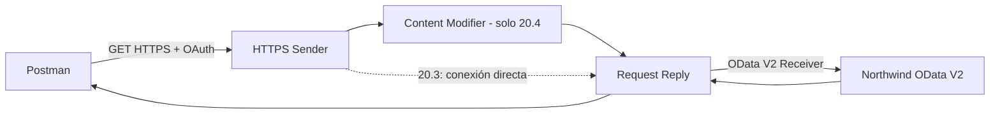

En 20.3, HTTPS Sender se conecta directamente a Request Reply; en 20.4 se incorpora Content Modifier para preparar el recurso de consulta. El servicio externo responde sin autenticación saliente; el endpoint CPI se invoca con la autorización configurada en HTTPS Sender.

## 20.3 - Consulta de Customers mediante OData Receiver V2

**Estado:** ✅ Completado

### Objetivo y conceptos

Consumir una colección OData V2 desde Cloud Integration utilizando el adaptador nativo y una operación de lectura síncrona. `Query (GET)` obtiene una colección; `Request Reply` espera la respuesta del receptor y la devuelve al emisor HTTPS. El adaptador entrega en este escenario un XML de entidades, distinto de la representación Atom/XML observada al consultar directamente Northwind.

**Prerrequisitos:** 20.1 y 20.2, acceso al paquete `CPI Learning Lab`, Postman con OAuth 2.0 y acceso al monitor MPL.

### Procedimiento y evidencias

1. Crear el iFlow `LAB20_Consulta_OData_V2` en `CPI Learning Lab` y registrar una versión numerada inicial antes de configurar sus componentes. Incorporar `HTTPS Sender → Start → Request Reply → End` y un participante Receiver enlazado mediante **OData V2**. La separación entre emisor HTTPS y receptor OData permite exponer una URL propia de CPI sin acoplar al consumidor a la URL pública de Northwind.

2. Configurar **HTTPS Sender** con `Address: /lab20/odata-v2`, `Authorization: User Role`, `User Role: ESBMessaging.send` y CSRF desactivado. Se trata de un endpoint de lectura GET protegido por la autorización de CPI.

3. Configurar **OData Receiver V2 / Connection** con `Address: https://services.odata.org/V2/Northwind/Northwind.svc/`, `Proxy Type: Internet`, `Authentication: None`, `CSRF Protected: activado` y `Reuse Connection: activado`. El servicio público no requirió credenciales salientes durante la prueba.

4. En **Processing**, utilizar `Model Operation` para seleccionar `Query (GET)` sobre el EntitySet `Customers`; establecer `Resource Path: Customers` y `Query Options: $top=3`. Mantener `Enable Batch Processing: desactivado`, `Custom Query Options: vacío`, `Content Type: Atom`, `Attach Error Details on Failure: activado` y timeout de un minuto. `$top=3` limita la consulta para obtener una respuesta pequeña y verificable.

5. Guardar y desplegar el iFlow. El diseñador mostró `Deployed` y `Runtime Status: Started`.

   **Evidencia 20-11 - iFlow OData V2 desplegado.** Arquitectura HTTPS Sender, Request Reply y OData Receiver V2, con runtime iniciado.

   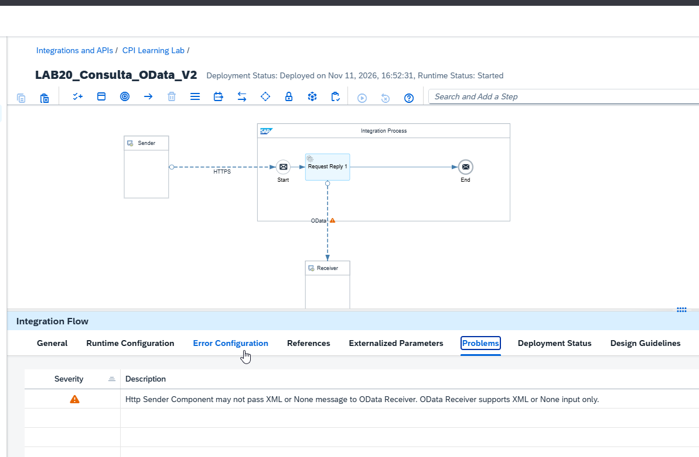

6. Crear en Postman la petición independiente `20.3 - GET Customers OData V2`: `GET {{cpi_base_url}}/http/lab20/odata-v2`, OAuth 2.0, sin body. La ejecución devolvió **HTTP 200**, XML con raíz `<Customers>` y tres elementos `<Customer>` (cantidad confirmada en la validación). Entre los clientes identificados se encuentran `ALFKI` y `ANATR`.

   **Evidencia 20-12 - Consulta OData V2 desde Postman.** Endpoint CPI, HTTP 200 y respuesta XML con tres clientes.

   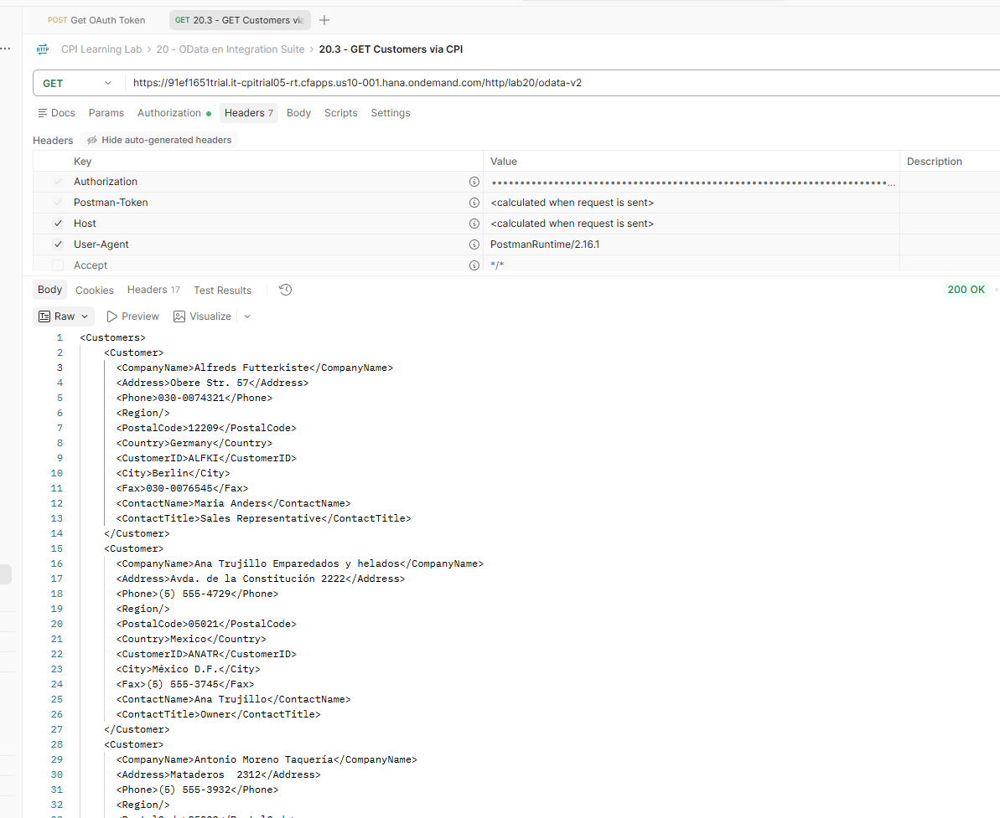

7. Consultar el registro correspondiente en **Monitor Message Processing**. El MPL mostró `Completed`, `OverallStatus: COMPLETED`, `IntermediateError: false` y un tiempo de procesamiento de **198 ms**. Esta comprobación distingue la respuesta recibida por el consumidor del resultado del procesamiento en CPI.

   **Evidencia 20-13 - MPL de consulta OData V2.** Procesamiento completado del iFlow `LAB20_Consulta_OData_V2`.

   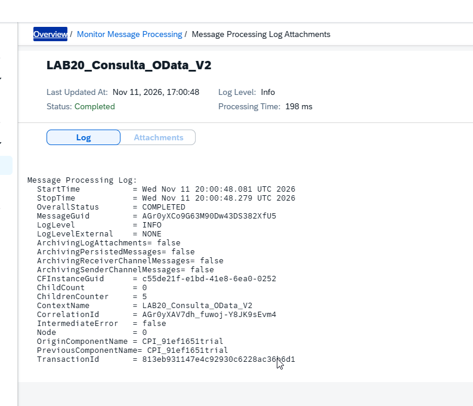

### Resultado esperado y validación

Se esperaba HTTP 200, tres clientes XML y un MPL Completed. Los tres resultados se comprobaron. El adaptador resolvió una consulta `Query (GET)` con `$top=3` sin requerir un cuerpo de entrada.

### Problemas encontrados y alcance

El diseñador mostró el warning `Http Sender Component may not pass XML or None message to OData Receiver. OData Receiver supports XML or None input only.`. No impidió el despliegue ni la ejecución satisfactoria de este GET sin body. Esto no demuestra compatibilidad universal para otras operaciones o formatos.

### Aprendizajes

El adaptador nativo permite consumir una colección OData sin construir manualmente la llamada HTTP al servicio. La validación requiere comprobar tanto el resultado de Postman como el MPL. La estructura XML observada debe tratarse como salida efectiva del adaptador, no como una copia literal de la respuesta Atom del backend.

## 20.4 - Selección dinámica de recurso OData V2 desde Postman

**Estado:** ✅ Completado, dentro del alcance de selección dinámica de EntitySet

### Objetivo y conceptos

Seleccionar el recurso OData en tiempo de ejecución mediante un header HTTP, un Content Modifier y una Exchange Property, sin modificar ni redesplegar el iFlow entre consultas. Se utilizan `Customers` y `Categories` como recursos del servicio Northwind.

**Prerrequisitos:** 20.3, HTTPS Sender, Content Modifier, headers, exchange properties y monitorización MPL.

### Procedimiento y evidencias

1. Crear un iFlow independiente `LAB20_Consulta_OData_Dinamica_V2` en el paquete `CPI Learning Lab`, con versión inicial `1.0.0`. La separación conserva intacto el iFlow de 20.3. Definir `HTTPS Sender` con `Address: /lab20/odata-dinamica-v2`, autorización `User Role / ESBMessaging.send` y CSRF desactivado. Construir `Start → Content Modifier → Request Reply → End` y conectar Request Reply al Receiver mediante **OData V2**.

2. Configurar el receptor con la misma conexión a Northwind del laboratorio 20.3. En Processing, seleccionar `Query (GET)` y `Resource Path: ${property.odataResourcePath}`, con `Query Options` vacío, Batch Processing desactivado y `Content Type: Atom`. La documentación SAP del adaptador admite expresiones de headers o properties en `Resource Path`; no se presupone soporte equivalente en `Query Options`.

3. En el Content Modifier, crear la Exchange Property `odataResourcePath`, inicialmente como constante `Customers` (`java.lang.String`). Desplegar y comprobar `Started`. Crear la petición Postman `20.4 - GET Customers Dynamic Resource Path`, método GET, OAuth 2.0, sin body y URL `{{cpi_base_url}}/http/lab20/odata-dinamica-v2`. Se recibió **HTTP 200** y XML `<Customers>` con clientes, lo que valida la resolución de la ruta desde una propiedad.

   **Evidencia 20-14 - Resource Path mediante Exchange Property.** Respuesta HTTP 200 y colección XML Customers con la propiedad inicialmente constante.

   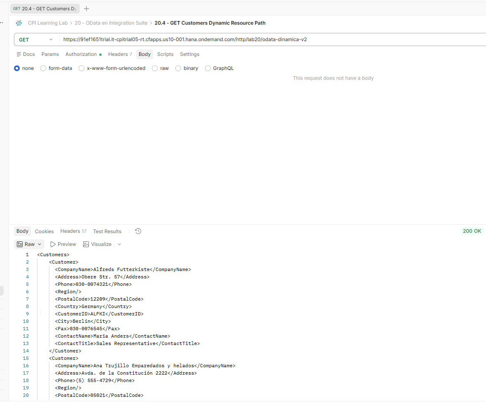

4. Consultar el MPL de la ejecución satisfactoria. El registro seleccionado del iFlow `LAB20_Consulta_OData_Dinamica_V2` mostró **Completed** y **1 s 414 ms** de procesamiento (11/11/2026, 17:29:14). Este registro corresponde a la consulta de Customers con propiedad constante.

   **Evidencia 20-15 - MPL de Resource Path dinámico.** Registro seleccionado en estado Completed.

   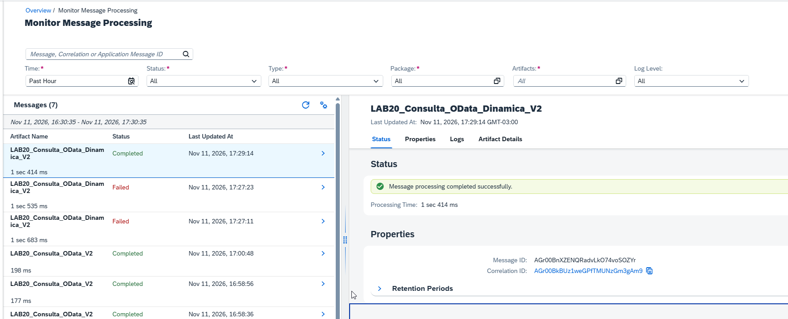

5. Registrar la versión `1.0.1` antes de incorporar la lectura del header externo. En el Content Modifier, cambiar la propiedad `odataResourcePath` a `Source Type: Header`, `Source Value: X-OData-Resource` y `Data Type: java.lang.String`. Mantener `Resource Path: ${property.odataResourcePath}` en el receptor. En **Runtime Configuration** del iFlow, agregar `X-OData-Resource` a **Allowed Header(s)**. Esta configuración permite que el header de entrada sea accesible para el procesamiento del mensaje. Guardar y desplegar el diseño modificado.

6. Crear la petición independiente `20.4 - GET Customers Header Dinamico`: `GET {{cpi_base_url}}/http/lab20/odata-dinamica-v2`, OAuth 2.0, sin body, header `X-OData-Resource: Customers`. Se obtuvo **HTTP 200** y XML `<Customers>`, con clientes como `ALFKI` y `ANATR`.

   **Evidencia 20-16 - Recurso Customers recibido por header.** Header personalizado, HTTP 200 y respuesta XML de clientes.

   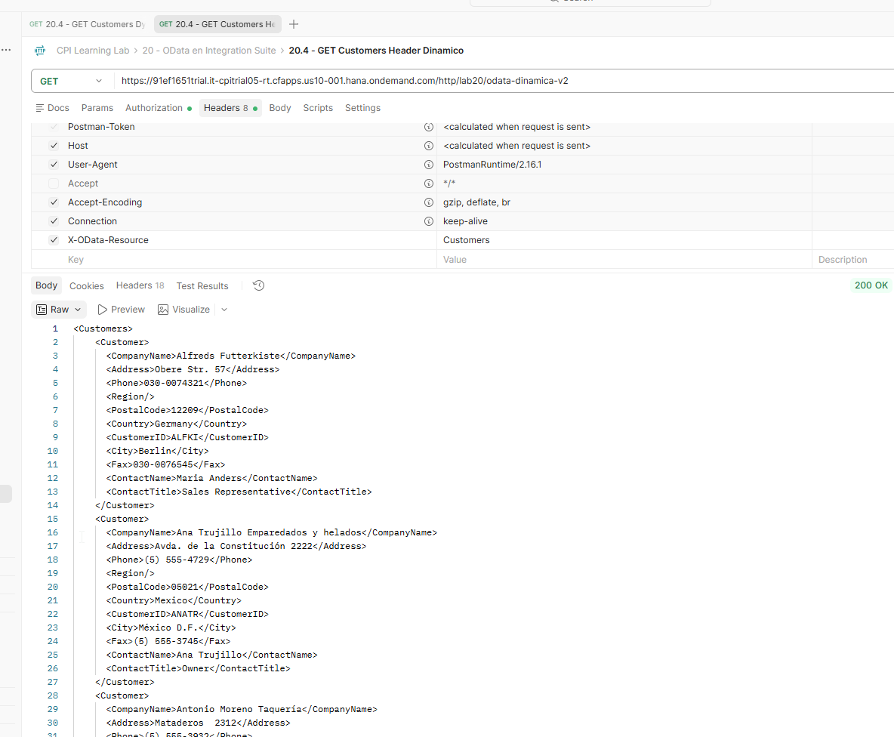

7. En Postman, cambiar únicamente el valor del header a `X-OData-Resource: Categories`, sin modificar ni redesplegar el iFlow. Se obtuvo **HTTP 200** y XML `<Categories>` con categorías como `Beverages`, `Condiments`, `Confections` y `Dairy Products`. El contraste entre ambas ejecuciones demuestra la selección de un EntitySet diferente a partir del valor recibido.

   **Evidencia 20-17 - Recurso Categories recibido por header.** Mismo endpoint, header Categories y respuesta XML de categorías.

   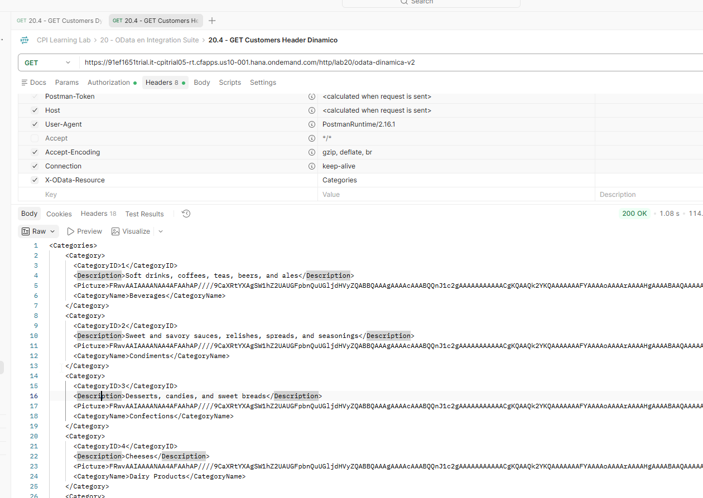

8. Verificar la arquitectura desplegada y el estado `Started`. El flujo final contiene HTTPS Sender, Content Modifier, Request Reply y OData Receiver V2. Se mantiene visible el warning de compatibilidad del adaptador observado en 20.3, sin impedir estas consultas GET.

   **Evidencia 20-18 - Arquitectura final del iFlow dinámico.** Diagrama del iFlow y runtime Started.

   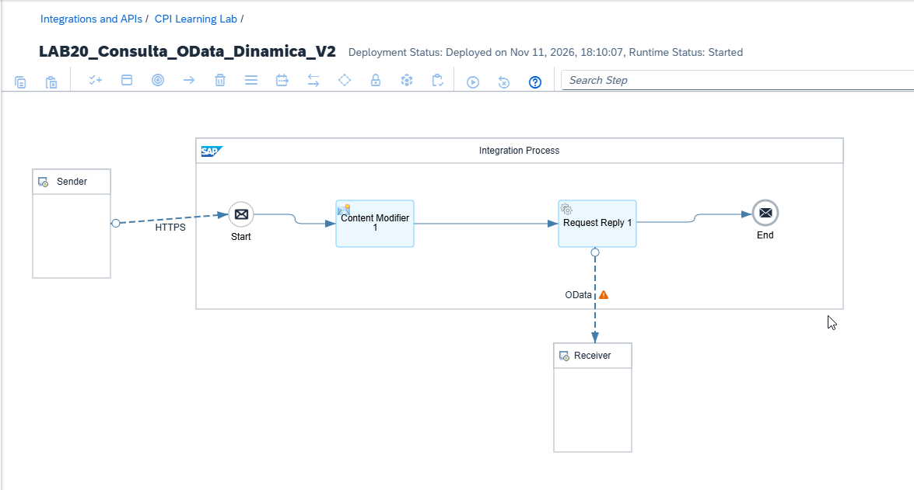

### Resultado esperado y validación

Se esperaba obtener dos colecciones distintas desde el mismo endpoint de CPI, cambiando solamente el header de Postman. Se validaron **HTTP 200 con Customers** y **HTTP 200 con Categories**, sin nuevo despliegue entre ambas solicitudes. La consulta inicial con Exchange Property constante también quedó validada con MPL Completed.

### Restricciones y seguridad

El laboratorio demuestra selección dinámica de recurso, **no** la parametrización de `$filter`, `$top` ni otras opciones de consulta. No se implementó una lista de recursos permitidos, por lo que la configuración debe considerarse **de laboratorio** y no una política segura de exposición de entidades para producción. Un diseño productivo requeriría validar explícitamente el recurso solicitado antes de invocar el receptor.

### Aprendizajes

`Allowed Header(s)` permite recibir el header personalizado en el procesamiento; Content Modifier lo transfiere a una Exchange Property; el OData Receiver resuelve esa propiedad como `Resource Path`. La operación permanece fija en `Query (GET)`; la selección de recurso no equivale a seleccionar dinámicamente el método HTTP.

## Arquitectura del laboratorio 20.5

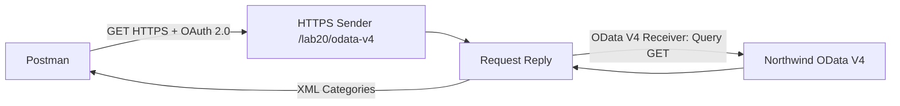

## 20.5 - Consulta OData V4 desde SAP Cloud Integration

**Estado:** ✅ Completado

### Objetivo y conceptos

Comprobar el contrato de un servicio OData V4 y consumir una colección desde CPI mediante el adaptador OData V4 Receiver. Se contrastan el Service Document, el documento `$metadata`, la consulta directa en JSON y la representación XML devuelta por el adaptador en la ejecución validada.

**Prerrequisitos:** laboratorios 20.1 a 20.4, Postman, OAuth 2.0 para el endpoint CPI, acceso a Design y Monitor, y disponibilidad del adaptador OData V4 Receiver.

**Servicio:** `https://services.odata.org/V4/Northwind/Northwind.svc/`.

### Procedimiento y evidencias

1. Crear en Postman la petición independiente `20.5 - GET Service Document OData V4`, método `GET`, URL raíz del servicio y header `Accept: application/json`. Se obtuvo **HTTP 200** y JSON con `@odata.context` y `value`, donde se publican EntitySets como `Categories`, `CustomerDemographics` y `Customers`. El Service Document permite descubrir los recursos disponibles.

   **Evidencia 20-19 - Service Document OData V4.** URL, HTTP 200 y conjuntos de entidades publicados.

   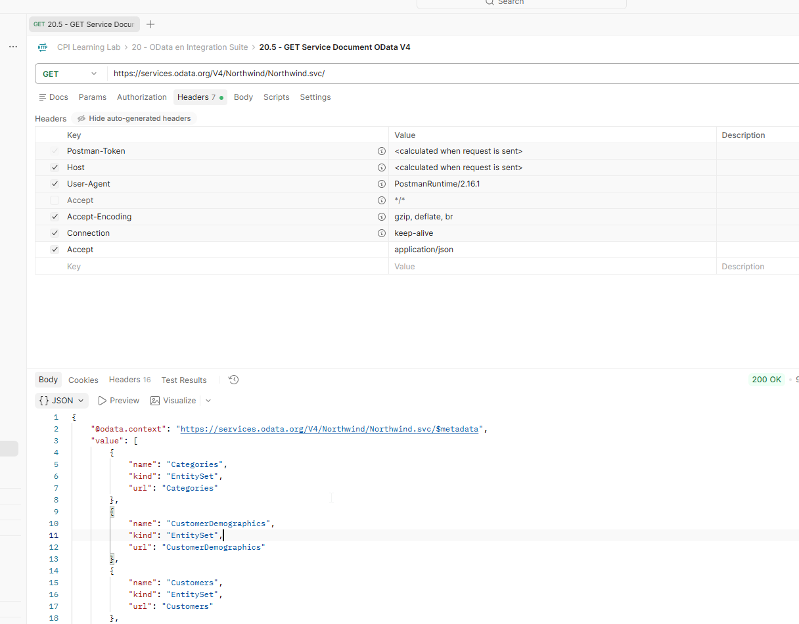

2. Crear `20.5 - GET Metadata OData V4`: `GET https://services.odata.org/V4/Northwind/Northwind.svc/$metadata`. Se obtuvo **HTTP 200** y XML EDMX con `edmx:Edmx Version="4.0"`, namespace `NorthwindModel`, `EntityType Name="Category"`, clave `CategoryID` de tipo `Edm.Int32` y propiedad de navegación `Products`. Los metadatos describen la estructura y relaciones del modelo, no los registros de negocio.

   **Evidencia 20-20 - Metadatos OData V4.** EDMX 4.0, EntityType, clave y NavigationProperty.

   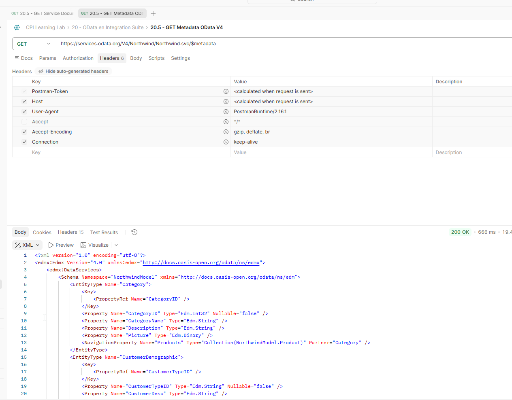

3. Crear `20.5 - GET Categories OData V4`: `GET https://services.odata.org/V4/Northwind/Northwind.svc/Categories?$top=3`, con `Accept: application/json`. Se obtuvo **HTTP 200** y JSON con `@odata.context` y la colección `value`. El usuario comprobó tres categorías; la captura muestra la primera y un campo `Picture` extenso. `$top=3` permite acotar la cantidad de entidades consultadas.

   **Evidencia 20-21 - Categories OData V4 con límite.** HTTP 200, parámetro `$top=3` y respuesta JSON.

   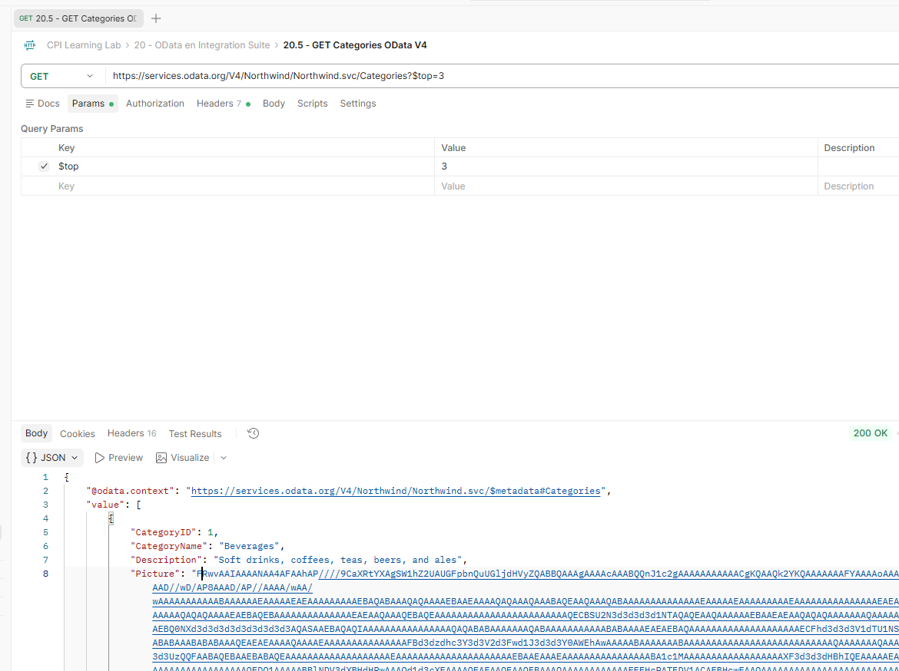

4. Crear el iFlow independiente `LAB20_Consulta_OData_V4` en el package `CPI Learning Lab` y guardar la versión inicial `1.0.0` antes de configurarlo. Construir `HTTPS Sender → Start → Request Reply → End`, conectando Request Reply a un Receiver mediante **OData V4**. Esta arquitectura expone un endpoint CPI propio y ejecuta una consulta síncrona al servicio externo.

5. Configurar **HTTPS Sender** con `Address: /lab20/odata-v4`, `Authorization: User Role`, `User Role: ESBMessaging.send` y `CSRF Protected: desactivado`. La prueba es GET y el endpoint CPI requiere autorización; el servicio Northwind público no requirió autenticación saliente.

6. Configurar **OData V4 Receiver / Connection** con `Address: https://services.odata.org/V4/Northwind/Northwind.svc/`, `Proxy Type: Internet`, `Authentication: None`, `Allow Chunking: desactivado`, `CSRF Protected: desactivado`, `Timeout (in min): 1` y `Reuse Connection: activado`. En **Processing**, definir `Operation: Query (GET)`, `Resource Path: Categories`, `Query Options: $top=3`, `Process in Pages: desactivado` y `Attach Error Details on Failure: activado`. La paginación se reserva para 20.6.

7. Guardar y verificar que la pestaña **Problems** no presente errores. Desplegar y comprobar el estado `Started` del iFlow. La comprobación de diseño y despliegue precede a la prueba funcional.

   **Evidencia 20-22 - iFlow OData V4 desplegado.** Arquitectura y estado Started del artefacto.

   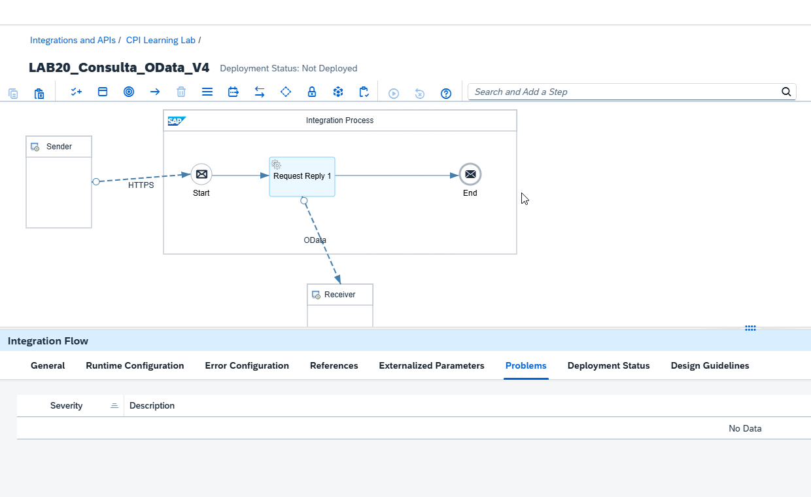

8. Crear en Postman la petición independiente `20.5 - GET Categories OData V4 via CPI`: método `GET`, URL `{{cpi_base_url}}/http/lab20/odata-v4`, autorización OAuth 2.0 y sin body. Se obtuvo **HTTP 200** en **1,64 s**, con XML `<Categories>` que contenía tres elementos `<Category>`, identificados por `CategoryID` 1, 2 y 3 (`Beverages`, `Condiments`, `Confections`).

   **Evidencia 20-23 - Consulta OData V4 a través de CPI.** Endpoint CPI, HTTP 200 y XML con tres categorías.

   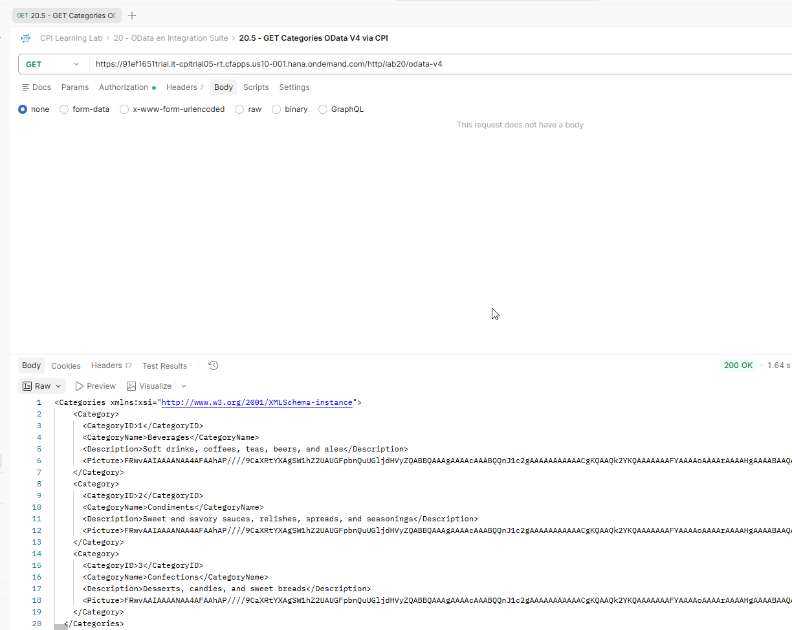

9. Consultar **Monitor Message Processing** para `LAB20_Consulta_OData_V4`. El registro mostró `Status: Completed`, `OverallStatus: COMPLETED`, `IntermediateError: false` y **Processing Time: 786 ms**, el **11/11/2026**. Esta validación confirma el procesamiento correcto en CPI, además de la respuesta HTTP recibida por Postman.

   **Evidencia 20-24 - MPL de consulta OData V4.** Registro Completed sin error intermedio.

   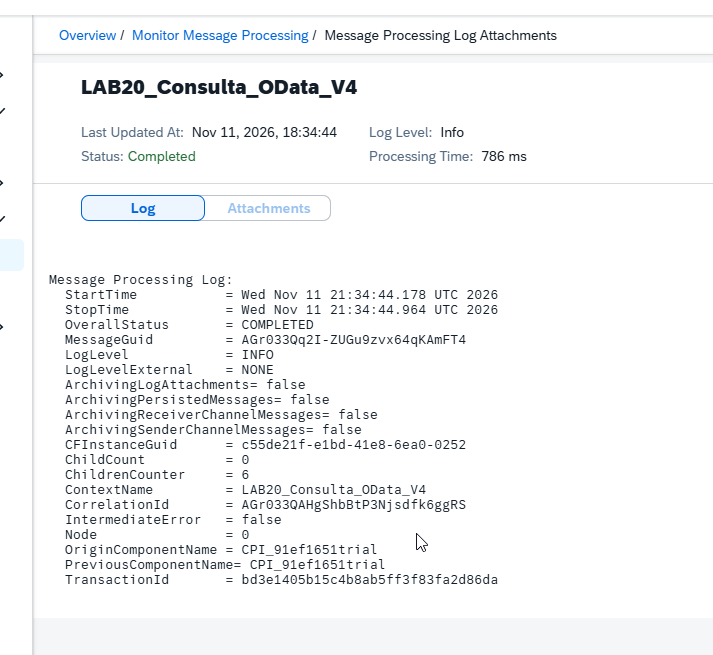

10. Guardar la versión final **`1.0.1`** del iFlow, correspondiente al diseño validado. No es necesario redesplegar únicamente por registrar una versión de diseño.

### Resultado esperado y validación

Se esperaba consultar `Categories` mediante OData V4 Receiver, recibir HTTP 200 con tres categorías y comprobar MPL Completed. Los tres resultados se verificaron. El iFlow final quedó registrado como versión `1.0.1`.

### Problemas encontrados y alcance

Durante la configuración inicial, el diseñador mostró `Attribute 'Address' is mandatory` y `Enter a valid resource, eg: Entity(keyPredicate)` porque aún faltaban valores de conexión y recurso. Tras completar `Address` y `Resource Path: Categories`, el usuario confirmó que **Problems** no mostraba errores. No se observaron fallos de ejecución en la prueba final.

### Aprendizajes

El Service Document OData V4 devolvió JSON y `$metadata` devolvió XML EDMX 4.0. La consulta directa de `Categories?$top=3` devolvió JSON, mientras que la consulta a través del OData V4 Receiver de CPI devolvió XML de entidades. Este es el comportamiento **observado en el escenario probado**, no una afirmación universal sobre todos los adaptadores, operaciones o configuraciones. La respuesta HTTP y el MPL deben validarse por separado.

## Arquitectura del laboratorio 20.6

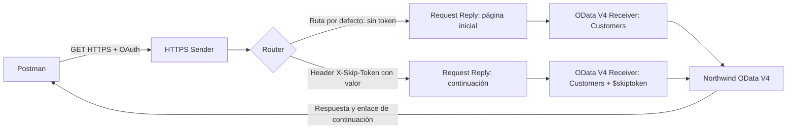

El cliente realiza una petición por página. El servidor entrega un token de continuación, que el cliente envía en una nueva solicitud. **No existe un bucle de paginación automática dentro de este diseño**.

## 20.6 - Paginación OData V4 mediante token de continuación

**Estado:** ✅ Completado - paginación explícita validada con dos páginas sucesivas.

### Objetivo y conceptos

Implementar un endpoint CPI que permita solicitar la primera página de `Customers` y continuar la consulta con el `$skiptoken` proporcionado por Northwind. Distinguir la paginación **controlada por el servidor**, que entrega `@odata.nextLink`, de la ejecución automática de múltiples páginas dentro de un único mensaje CPI.

El token se trata como un valor de continuación entregado por el servidor: no se calcula ni incrementa manualmente. El cliente realiza una nueva petición HTTP por cada página. El laboratorio **no valida** el uso de `Process in Pages`, la consolidación de páginas ni operaciones de escritura.

**Prerrequisitos:** laboratorio 20.5, Postman con OAuth 2.0 para CPI, acceso a Design/Monitor y servicio Northwind OData V4 disponible.

**Artefacto:** `LAB20_Paginacion_OData_V4`, creado como copia de `LAB20_Consulta_OData_V4`, con versión inicial `1.0.0`. La versión final de diseño no quedó confirmada en las evidencias disponibles; no se atribuye una versión adicional.

### Configuración de componentes

| Componente | Parámetro | Valor | Motivo |
|---|---|---|---|
| HTTPS Sender | Address | `/lab20/odata-paginacion-v4` | Endpoint independiente del laboratorio 20.5 |
| HTTPS Sender | Autorización | OAuth 2.0 utilizado en Postman para acceder al endpoint protegido | Mantener la protección del endpoint CPI |
| Runtime Configuration | Allowed Header(s) | `X-Skip-Token` | Permitir el uso del header personalizado en el enrutamiento |
| Router | Ruta con token | Non-XML; `${header.x-skip-token} != ''` | Enviar las peticiones con token a la consulta de continuación |
| Router | Ruta sin token | Default Route | Ejecutar la primera consulta sin `$skiptoken` |
| OData V4 Receiver, ruta inicial | Operation / Resource Path | `Query (GET)` / `Customers` | Consultar la primera página |
| OData V4 Receiver, ruta inicial | Query Options | Vacío | No suministrar token en la primera solicitud |
| OData V4 Receiver, ruta con token | Operation / Resource Path | `Query (GET)` / `Customers` | Consultar la siguiente página |
| OData V4 Receiver, ruta con token | Query Options | `$skiptoken=${header.x-skip-token}` | Transferir el token recibido al servicio OData |
| Servicio externo | URL base | `https://services.odata.org/V4/Northwind/Northwind.svc/` | Servicio OData V4 de referencia |

La ruta por defecto se diferencia de la ruta con token por **Query Options vacío**. Las dos rutas mantienen la misma colección `Customers`. La selección de ruta depende del header; no se realiza una segunda consulta automáticamente.

### Procedimiento y evidencias

1. Copiar `LAB20_Consulta_OData_V4` como `LAB20_Paginacion_OData_V4` en `CPI Learning Lab`. Crear la versión inicial `1.0.0` antes de configurar el nuevo escenario. Establecer la dirección HTTPS `/lab20/odata-paginacion-v4`. Configurar un **Router** con dos caminos, cada uno hacia un **Request Reply** y su receptor OData V4. Guardar y desplegar. La arquitectura permite separar la primera consulta de la continuación sin modificar el iFlow original.

   **Evidencia 20-25 - Arquitectura de paginación OData V4.** Se identifica el Router y los dos caminos de consulta del iFlow.

   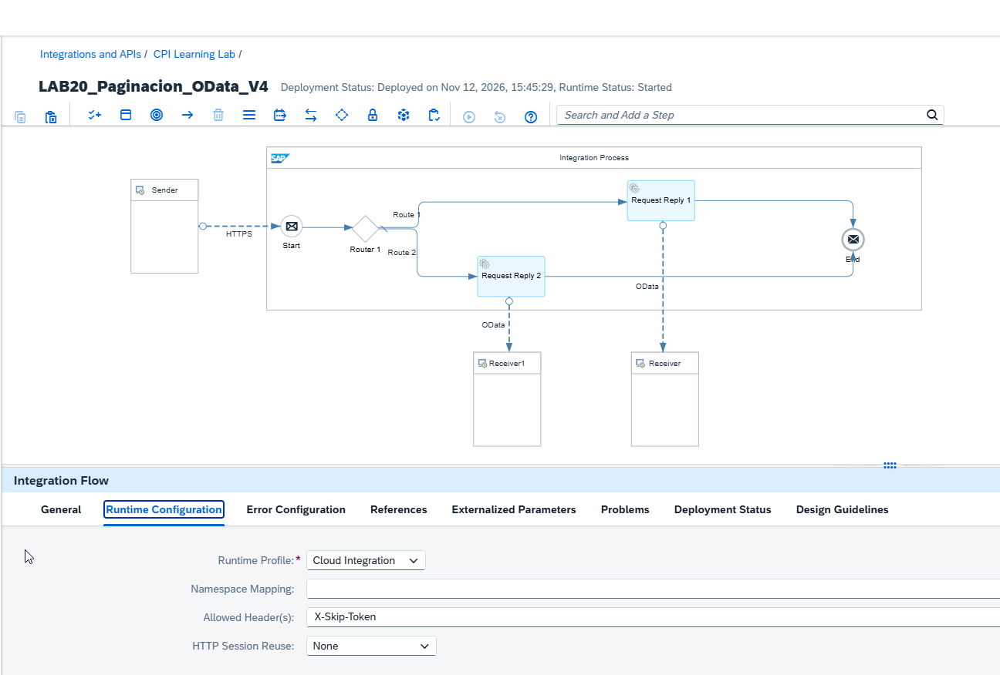

2. Configurar la ruta de continuación del Router con tipo **Non-XML** y condición `${header.x-skip-token} != ''`. Mantener el otro camino como **Default Route**. Incluir `X-Skip-Token` entre los headers permitidos del iFlow. El Router elige la consulta de continuación únicamente cuando recibe un token con valor.

   **Evidencia 20-26 - Condición del Router.** Configuración de la ruta condicionada por el header y camino por defecto.

   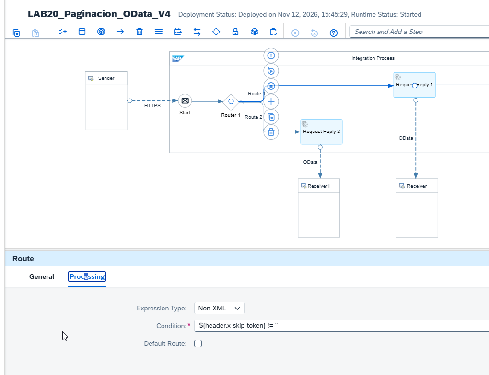

3. Configurar ambos receptores OData V4 con el recurso `Customers`. En la ruta inicial, dejar **Query Options vacío**. En la ruta de continuación, definir **Query Options** como `$skiptoken=${header.x-skip-token}`. Esto conserva el valor de continuación entregado por el servicio, sin generar un token propio.

   **Evidencia 20-27 - Query Options de continuación.** El receptor de la ruta con token utiliza la expresión de header en `$skiptoken`.

   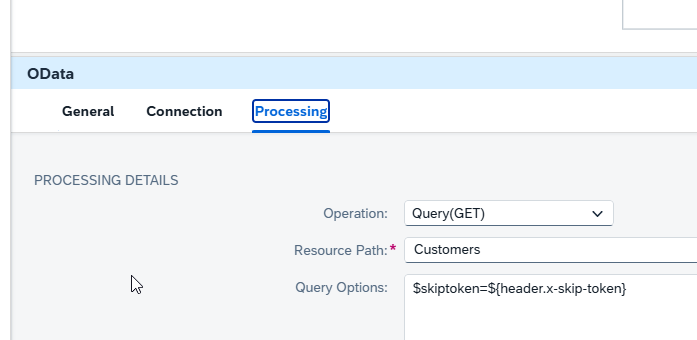

4. En Postman, ejecutar una petición **GET** a `{{cpi_base_url}}/http/lab20/odata-paginacion-v4`, con la autorización OAuth 2.0 utilizada en el capítulo y **sin** header `X-Skip-Token`. La respuesta fue **HTTP 200** y la página observada terminó con el cliente `ERNSH`.

   **Evidencia 20-28 - Primera página de Customers.** Consulta inicial sin token y respuesta satisfactoria.

   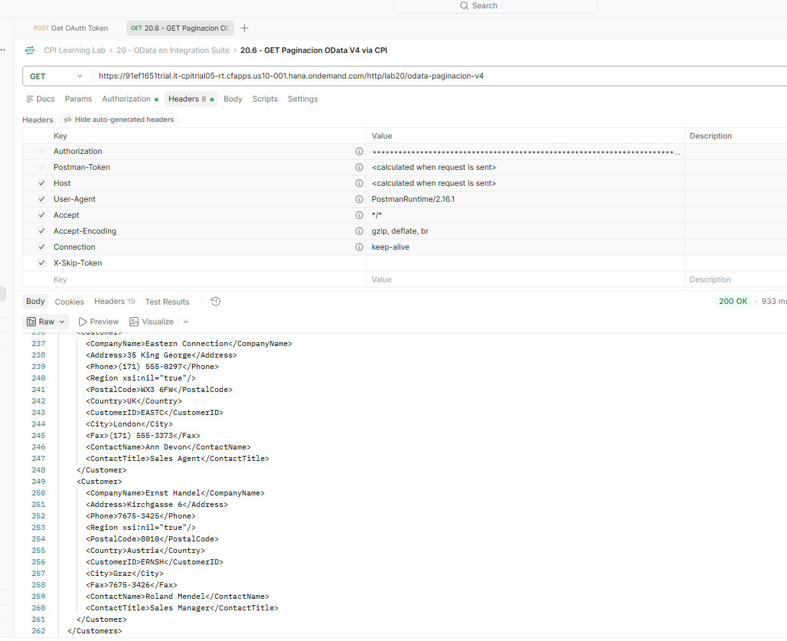

5. Revisar los headers de la primera respuesta. Se observó `Nextlink` con un enlace de continuación que contenía `$skiptoken='ERNSH'`. Este valor procede del servicio y permite solicitar la siguiente página.

   **Evidencia 20-29 - Enlace de continuación inicial.** Header `Nextlink` con el token de la primera página.

   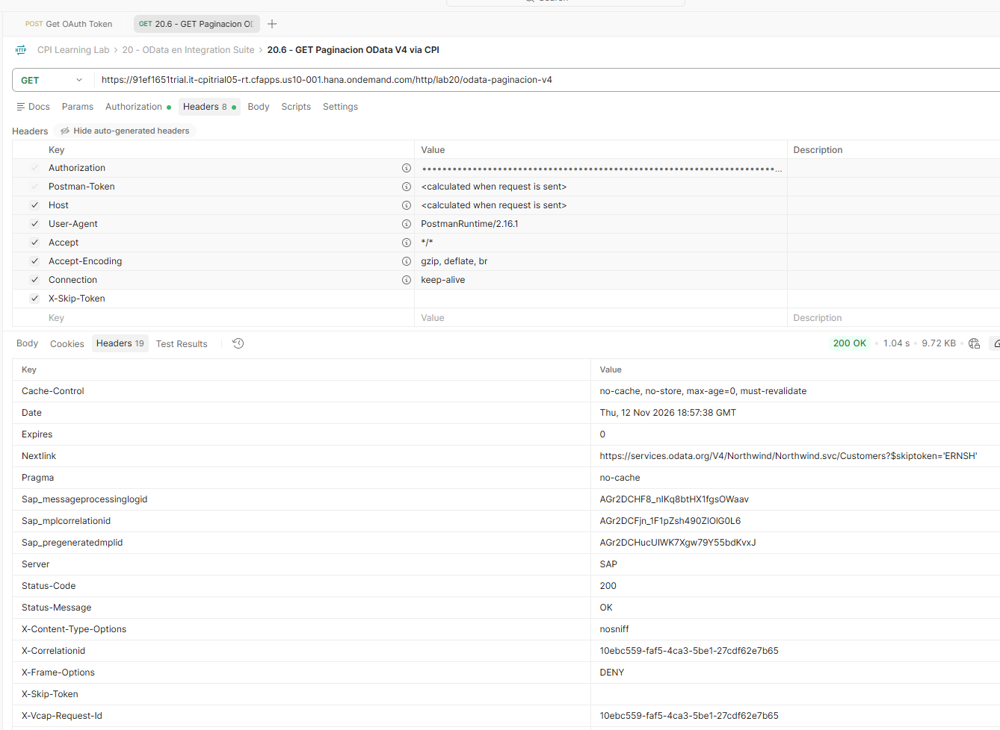

6. Ejecutar una segunda petición **GET** al mismo endpoint CPI, agregando el header `X-Skip-Token: 'ERNSH'`. La respuesta fue **HTTP 200** y la página observada terminó con el cliente `LACOR`. Esto verifica que el Router utiliza el camino de continuación y que el receptor consulta datos posteriores al token anterior.

   **Evidencia 20-30 - Segunda página de Customers.** Header de entrada con token y respuesta de continuación.

   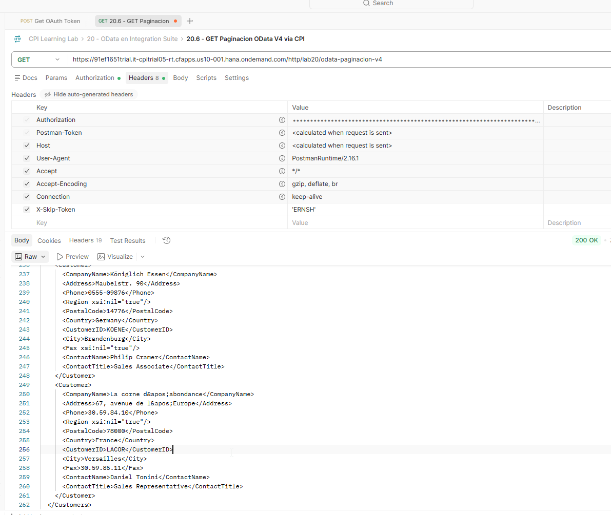

7. Revisar los headers de la segunda respuesta. Se observó un nuevo `Nextlink` con `$skiptoken='LACOR'`, que habilita continuar con otra petición si se requieren más registros.

   **Evidencia 20-31 - Continuación después de la segunda página.** Segundo enlace de continuación entregado por Northwind.

   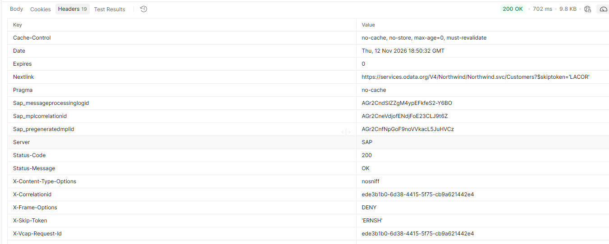

8. Verificar en **Monitor → Message Processing** el registro de ejecución de `LAB20_Paginacion_OData_V4`. La captura aportada mostró **Completed**, `OverallStatus = COMPLETED`, `IntermediateError = false` y **265 ms** de procesamiento. El MPL valida el procesamiento de la solicitud observada; no representa un recorrido automático de varias páginas dentro de una misma ejecución.

   **Evidencia 20-32 - MPL de paginación OData V4.** Ejecución completada sin error intermedio.

   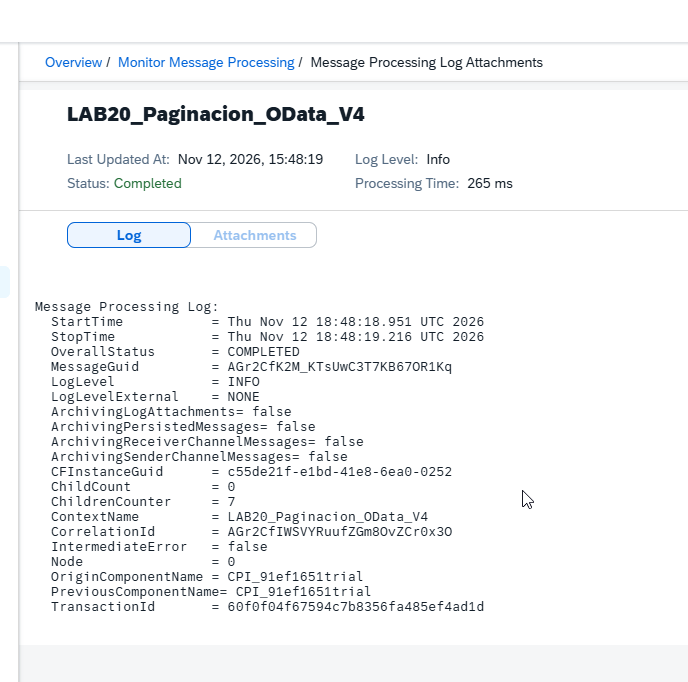

### Resultado esperado y validación

| Criterio | Resultado observado | Estado |
|---|---|---|
| Primera consulta sin token | HTTP 200, página hasta `ERNSH` | ✅ Validado |
| Enlace de continuación de la primera página | `Nextlink` con `$skiptoken='ERNSH'` | ✅ Validado |
| Segunda consulta con token | HTTP 200, página hasta `LACOR` | ✅ Validado |
| Nuevo enlace de continuación | `Nextlink` con `$skiptoken='LACOR'` | ✅ Validado |
| Ejecución CPI | MPL `Completed`, sin error intermedio | ✅ Validado |
| Paginación automática en una sola ejecución CPI | No implementada ni demostrada | Fuera del alcance |
| Operaciones de escritura OData | No implementadas ni demostradas | Fuera del alcance |

### Restricciones y alcance de la validación

La validación final se centra en **dos solicitudes HTTP independientes** y en la reutilización del token de continuación. No se han validado casos de token inválido, paginación concurrente, cambios de datos entre páginas ni tratamiento de errores del servicio.

### Aprendizajes

`$skiptoken` no es un desplazamiento numérico que el cliente deba calcular: es un valor de continuación definido por el servidor. `@odata.nextLink` y el header `Nextlink` observado en CPI permiten obtener ese valor para una nueva consulta. El Router ofrece dos caminos con configuraciones estáticas distintas de **Query Options**, sin necesidad de activar `Process in Pages`. El código HTTP de Postman y el estado MPL son verificaciones complementarias.

**Referencias:** [OData V4 - URL Conventions](https://docs.oasis-open.org/odata/odata/v4.01/odata-v4.01-part2-url-conventions.html) · [SAP Help - OData V4 Receiver Adapter](https://help.sap.com/docs/cloud-integration/sap-cloud-integration/configure-odata-v4-receiver-adapter)

## Estado de validación del capítulo

Los laboratorios **20.1 a 20.6** cuentan con resultados prácticos validados dentro de sus alcances. El capítulo se considera **✅ Completado** para consultas OData V2/V4 y paginación explícita con token. No se implementaron operaciones de escritura ni paginación automática en CPI. La parametrización de `$filter` y `$top` desde CPI y el control de recursos permitidos no forman parte de las capacidades validadas en 20.4.

## Referencias

- [OData V2 - URI Conventions](https://www.odata.org/documentation/odata-version-2-0/uri-conventions/)
- [OData V2 - JSON Format](https://www.odata.org/documentation/odata-version-2-0/json-format/)
- [OData.org - Reference Services](https://www.odata.org/odata-services/)
- [SAP Help - Configure the OData V2 Receiver Adapter](https://help.sap.com/docs/cloud-integration/sap-cloud-integration/configure-odata-v2-receiver-adapter)
- [SAP Help Portal - Cloud Integration](https://help.sap.com/docs/cloud-integration)
- [SAP Help - Configure the OData V4 Receiver Adapter](https://help.sap.com/docs/cloud-integration/sap-cloud-integration/configure-odata-v4-receiver-adapter)
