# 20 - OData en Integration Suite

**Estado del tema:** 🟨 En curso - laboratorios 20.1 y 20.2 completados; 20.3 a 20.6 pendientes.
**Package de referencia:** `CPI Learning Lab`
**Servicio de pruebas:** Northwind OData V2 (`https://services.odata.org/V2/Northwind/Northwind.svc/`)

## Objetivo y contexto

Comprender el modelo de entidades y metadatos de OData y construir consultas verificables antes de consumir servicios OData desde SAP Cloud Integration. Se reutilizan Postman y los conceptos HTTP del capítulo 19, sin modificar sus iFlows.

## Alcance del capítulo

| Laboratorio | Propósito | Estado |
|---|---|---|
| 20.1 | Service Document, metadata, entidad, clave y EntitySet | ✅ Completado |
| 20.2 | `$filter`, `$select`, `$orderby`, `$top`, `$expand` y consulta combinada | ✅ Completado |
| 20.3 | OData Receiver V2 en CPI | ⬜ Pendiente |
| 20.4 | Consultas dinámicas desde CPI | ⬜ Pendiente |
| 20.5 | OData V4 | ⬜ Pendiente |
| 20.6 | Paginación y operaciones de escritura, condicionadas al servicio | ⬜ Pendiente |

## Prerrequisitos

- Postman y acceso HTTPS al servicio público Northwind OData V2.
- Conocimientos de GET, headers y JSON/XML adquiridos en el capítulo 19.
- Para laboratorios posteriores: acceso a Design y Monitor de SAP Integration Suite.
- No registrar secretos ni credenciales en el repositorio.

## Arquitectura de los laboratorios 20.1 y 20.2

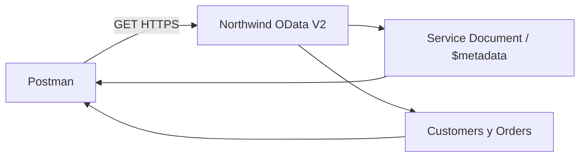

## 20.1 - Fundamentos, entidades y metadata

**Estado:** ✅ Completado

### Objetivo y conceptos

Identificar el contrato autodescriptivo de un servicio OData V2. El **Service Document** publica colecciones; `$metadata` describe tipos (`EntityType`), conjuntos (`EntitySet`), claves (`Key`) y relaciones (`NavigationProperty`). `Customer` es el tipo; `Customers` es el conjunto publicado.

**Prerrequisitos:** Postman, servicio Northwind accesible; no se requiere iFlow.

### Procedimiento y evidencias

1. Crear la carpeta `20 - OData en Integration Suite` dentro de la colección `CPI Learning Lab` y la petición `20.1 - GET Service Document`: método `GET`, URL raíz `https://services.odata.org/V2/Northwind/Northwind.svc/`, `No Auth`, `Accept: application/xml`, sin body. La raíz permite descubrir colecciones sin conocer su estructura. Se recibió **HTTP 200**, XML con colecciones como `Categories`, `Customers`, `Employees` y `Order_Details`.

   **Evidencia 20-01 - Service Document.** URL, HTTP 200 y colecciones del servicio.

   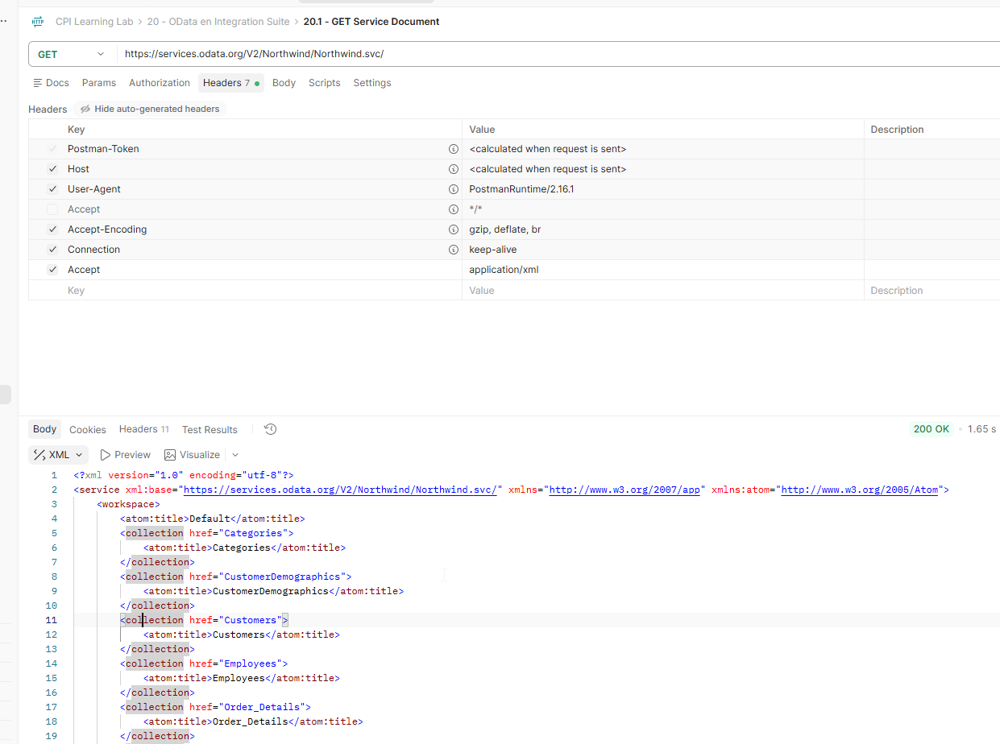

2. Crear `20.1 - GET Metadata` con `GET https://services.odata.org/V2/Northwind/Northwind.svc/$metadata`, `No Auth` y `Accept: application/xml`. Se recibió **HTTP 200** con XML EDMX y tipos `Category`, `Customer`, `Employee`, `Order`, entre otros. El documento declara `DataServiceVersion="1.0"` y `MaxDataServiceVersion="2.0"`; el segundo valor indica la versión máxima declarada y no debe confundirse con la versión de cada entidad.

   **Evidencia 20-02 - Metadatos EDMX.** Estructura EDMX, namespaces y tipos de entidad.

   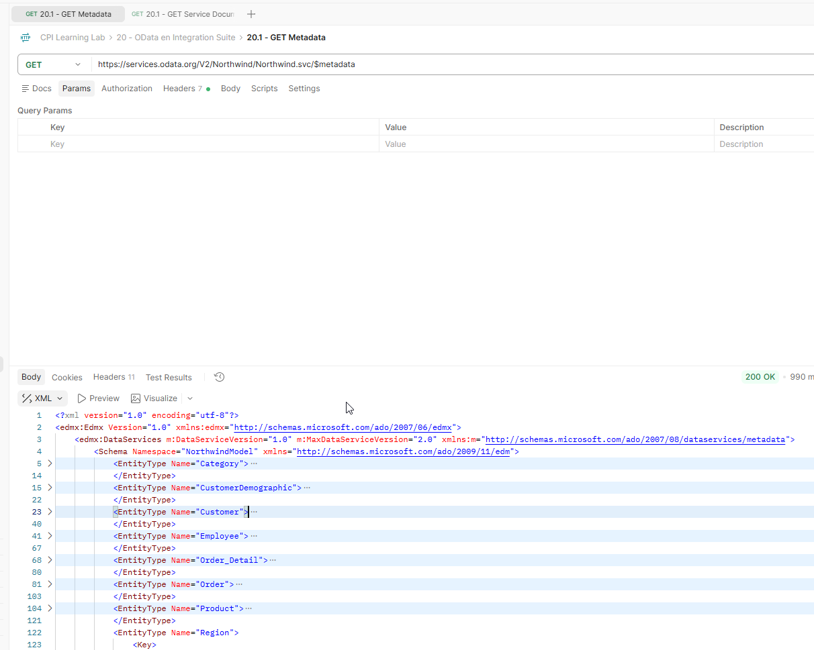

3. En el XML, expandir `EntityType Name="Customer"`. La clave se define mediante `PropertyRef Name="CustomerID"`; `CustomerID` es `Edm.String`, `Nullable="false"`, `MaxLength="5"` y `FixedLength="true"`. `CompanyName` es obligatoria, de longitud máxima 40. También se identificaron `City`, `Country`, `Orders` y `CustomerDemographics`. Las relaciones permiten navegar a recursos relacionados.

   **Evidencia 20-03 - Estructura de Customer.** Clave, propiedades y relaciones de navegación.

   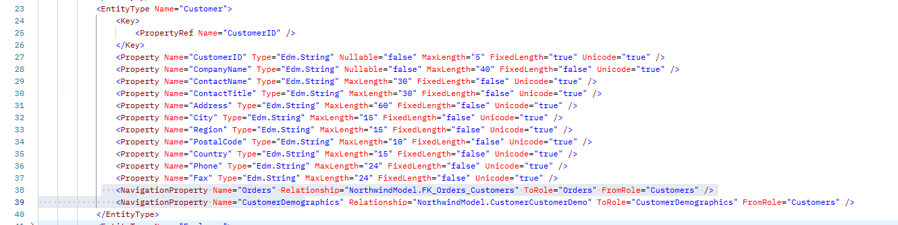

4. Crear `20.1 - GET Customer por clave`: `GET https://services.odata.org/V2/Northwind/Northwind.svc/Customers('ALFKI')`, `No Auth`, sin body y sin header `Accept` explícito en la ejecución satisfactoria. Las comillas corresponden a la clave `Edm.String`. Se recibió **HTTP 200**, una entrada Atom/XML con `CustomerID=ALFKI`, `CompanyName=Alfreds Futterkiste`, `City=Berlin` y `Country=Germany`. La propiedad `Region` se devolvió como nula.

   **Evidencia 20-04 - Consulta por clave.** Respuesta HTTP 200 y propiedades de `ALFKI`.

   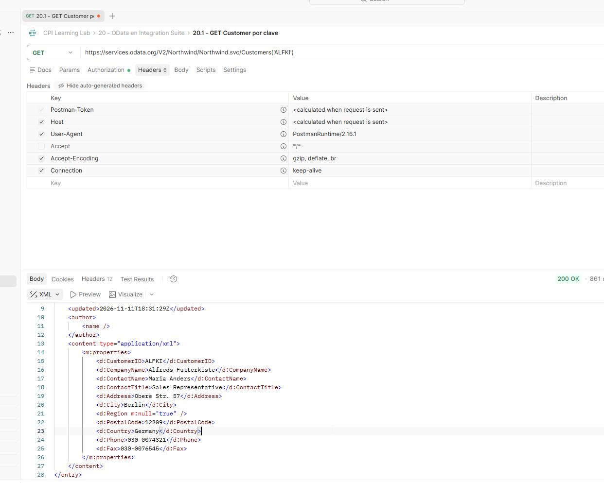

5. En `$metadata`, localizar el contenedor `NorthwindEntities` y comprobar `EntitySet Name="Customers" EntityType="NorthwindModel.Customer"`. Esta declaración conecta el nombre de la colección con el tipo que define sus propiedades y clave.

   **Evidencia 20-05 - Relación EntitySet/EntityType.** Contenedor y mapeo `Customers` → `NorthwindModel.Customer`.

   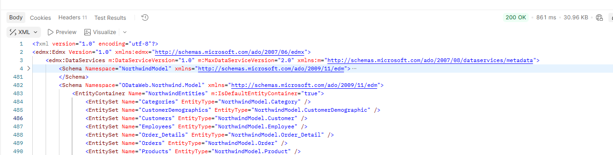

### Resultado y validación

Las cinco comprobaciones se realizaron en Postman. Se validó la publicación de colecciones, el contrato EDMX, la clave, las relaciones y la lectura de una entidad real.

### Problema técnico y solución comprobada

La consulta individual devolvió **HTTP 415 Unsupported Media Type** al solicitar `Accept: application/xml`. El cuerpo del error indicó incompatibilidad entre los tipos MIME aceptados y los formatos de entidad soportados. Al retirar el header `Accept` explícito, la misma consulta devolvió **HTTP 200** con Atom/XML. No se verificó por separado una petición con `Accept: application/atom+xml`.

### Aprendizajes

El Service Document y `$metadata` cumplen funciones diferentes. Los tipos, claves y relaciones se definen en el modelo, mientras que los recursos concretos se consultan mediante el EntitySet y su clave. El formato admitido para `$metadata` no garantiza que el mismo `Accept` sea válido para leer entidades.

## 20.2 - Consultas OData V2

**Estado:** ✅ Completado

### Objetivo y conceptos

Aplicar operadores estandarizados de consulta sobre `Customers` y navegar a `Orders`. `$filter` restringe registros; `$select` restringe propiedades; `$orderby` define el orden; `$top` limita la cantidad; `$expand` incorpora relaciones navegables. `$format=json` solicita JSON.

**Prerrequisitos:** laboratorio 20.1 completado, Postman y Northwind disponible.

### Procedimiento y evidencias

1. Crear `20.2 - GET Customers Filter` con `GET /Customers`, `No Auth`, sin `Accept` explícito y parámetros `$filter=Country eq 'Germany'`, `$format=json`. Se obtuvo **HTTP 200** y JSON con `d.results`; el primer cliente visible `ALFKI` tenía `Country=Germany`. La captura verifica ese registro, no la totalidad de la colección.

   **Evidencia 20-06 - Filtro por país.** Parámetros, HTTP 200 y cliente `ALFKI` con país Alemania.

   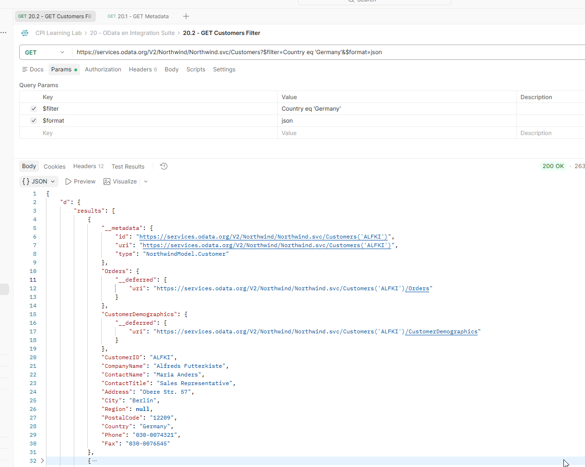

2. Crear `20.2 - GET Customers Select`: `GET /Customers` con `$select=CustomerID,CompanyName,Country`, `$top=3`, `$format=json`; retirar `$filter`. Se recibió **HTTP 200** y tres clientes (`ALFKI`, `ANATR`, `ANTON`) con las tres propiedades de negocio solicitadas y `__metadata` técnico. `$select` reduce el conjunto de propiedades transferidas.

   **Evidencia 20-07 - Proyección de propiedades.** Tres clientes y tres propiedades de negocio.

   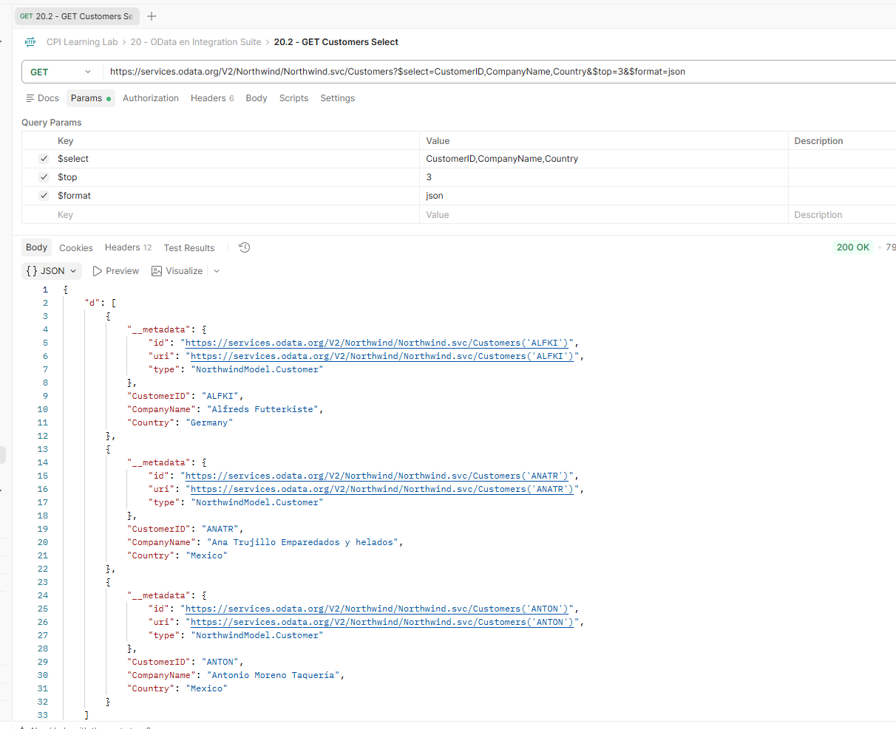

3. Crear `20.2 - GET Customers OrderBy`: `GET /Customers` con `$select=CustomerID,CompanyName,Country`, `$orderby=CompanyName desc`, `$top=5`, `$format=json`. Se recibió **HTTP 200**. La captura permite comprobar el orden descendente de los primeros tres nombres visibles: `Wolski Zajazd`, `Wilman Kala` y `White Clover Markets`; el usuario confirmó cinco registros en la respuesta.

   **Evidencia 20-08 - Orden descendente y límite.** Parámetros y primeros resultados ordenados.

   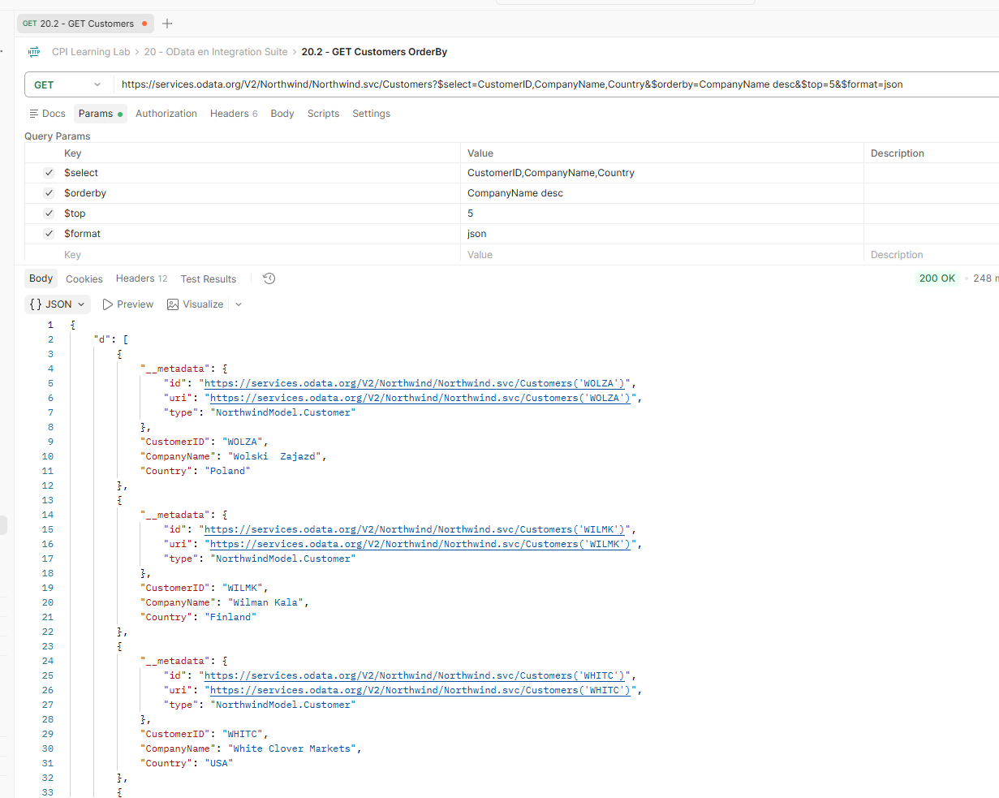

4. Crear `20.2 - GET Customer Expand Orders`: `GET /Customers('ALFKI')` con `$expand=Orders` y `$format=json`. Se obtuvo **HTTP 200**. `Orders.results` contenía pedidos, entre ellos `OrderID=10643`. Otras relaciones del pedido, como `Employee` y `Order_Details`, permanecieron como `__deferred`; `$expand=Orders` no implica expandir automáticamente todas las relaciones.

   **Evidencia 20-09 - Pedidos expandidos.** `Orders.results` y un pedido relacionado con `ALFKI`.

   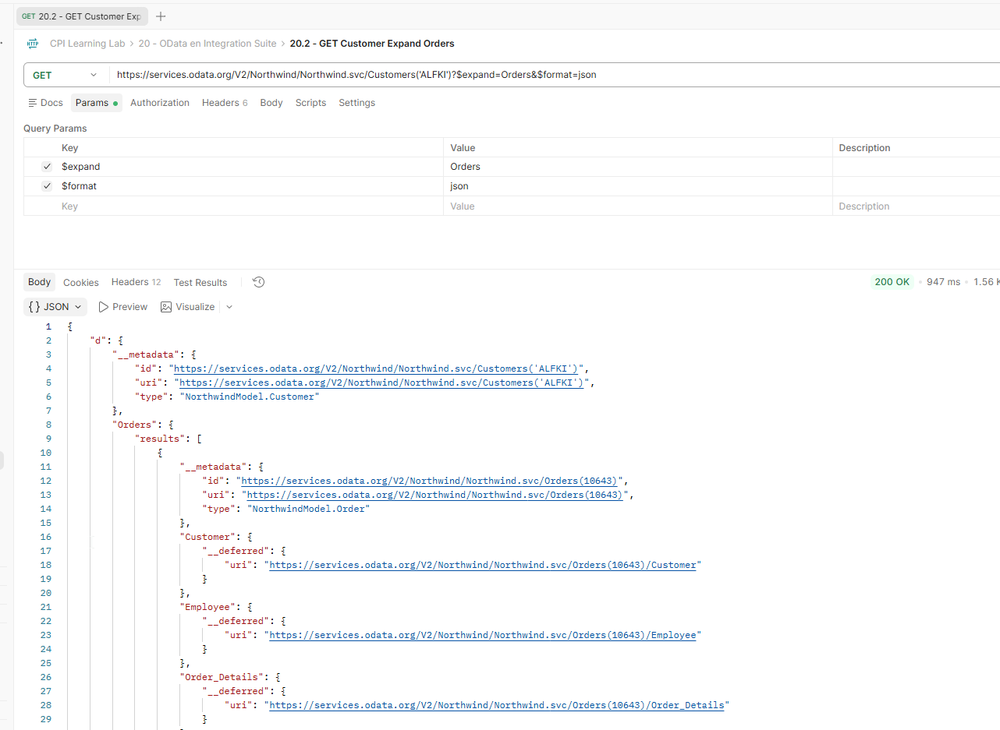

5. Crear `20.2 - GET Customers Combined Query`: `GET /Customers` con `$filter=Country eq 'Germany'`, `$select=CustomerID,CompanyName,Country`, `$orderby=CompanyName desc`, `$top=5`, `$format=json`. Se recibió **HTTP 200**; el usuario confirmó cinco registros de Alemania. Los tres visibles (`Toms Spezialitäten`, `QUICK-Stop`, `Ottilies Käseladen`) están en orden descendente. El sentido `desc` corresponde a la configuración realmente ejecutada.

   **Evidencia 20-10 - Consulta combinada.** Filtro, selección, orden y límite en una petición.

   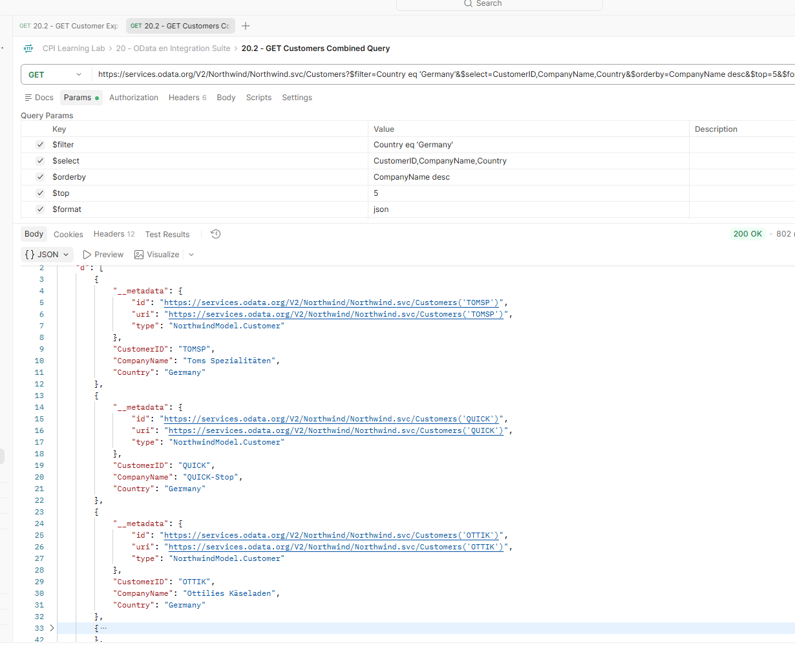

### Resultado y validación

Se validaron respuestas HTTP 200 y datos visibles para los cinco escenarios. La combinación de operadores funcionó en Northwind; las capturas no prueban exhaustivamente cada elemento de las colecciones no visibles.

### Hallazgo de formato JSON

En pruebas controladas realizadas en Postman, el usuario observó `d.results` en consultas sin `$top` y un arreglo directamente bajo `d` al agregar `$top`. La respuesta con `$top` declaró `Content-Type: application/json;odata=verbose;charset=utf-8`. Esta diferencia se observó en el servicio de referencia, pero **no se ha determinado su causa técnica ni demostrado que sea una regla general de OData V2**. Los consumidores que procesen el JSON deben verificar la estructura real recibida antes de asumir una ruta fija.

### Aprendizajes

Los operadores permiten consultar de manera selectiva y recuperar relaciones sin construir endpoints particulares para cada filtro. Las referencias `__deferred` identifican relaciones no expandidas. Las diferencias de representación JSON deben contrastarse con el contenido y los headers reales.

## Estado de validación del capítulo

Los laboratorios **20.1** y **20.2** cuentan con evidencia práctica y están completados. Los laboratorios **20.3 a 20.6** permanecen pendientes; el capítulo completo continúa **🟨 En curso**. Hasta este corte no se creó ni modificó ningún iFlow.

## Referencias

- [OData V2 - URI Conventions](https://www.odata.org/documentation/odata-version-2-0/uri-conventions/)
- [OData V2 - JSON Format](https://www.odata.org/documentation/odata-version-2-0/json-format/)
- [OData.org - Reference Services](https://www.odata.org/odata-services/)
- [SAP Help Portal - Cloud Integration](https://help.sap.com/docs/cloud-integration)
