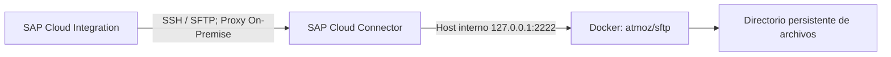

# Guía reproducible — SFTP local con Docker y SAP Cloud Connector

**Proyecto:** SAP Integration Suite Learning Lab  
**Capítulo:** 21 — Integración SFTP y archivos  
**Estado:** 🟨 En curso (infraestructura y conectividad comprobadas; operaciones de escritura/lectura mediante iFlow pendientes)  
**Plataforma comprobada:** Windows, Docker Compose v5.1.4, SAP Cloud Connector 2.16.2, SAP BTP en AWS US East (VA).

> Esta guía distingue los pasos comprobados en el laboratorio de los parámetros que deben recuperarse de la configuración local. No se dispone en este documento del contenido íntegro del `compose.yaml`, `.env.example` ni del script de inicialización: no se reconstruyen como si fueran los originales. Para reproducir exactamente el entorno, conservar esos archivos sanitizados en Git.

## 1. Objetivo y arquitectura

Disponer de un servidor SFTP de laboratorio en un contenedor Docker, accesible desde SAP Cloud Integration mediante un túnel SAP Cloud Connector, sin exponer el servicio SFTP directamente a Internet.



El host virtual registrado en Cloud Connector es `sftp-learning-lab.internal:2222`. El destino interno es `127.0.0.1:2222` y el mapeo utiliza el protocolo `TCP` y el tipo de backend `Non-SAP System`. Este direccionamiento supone que Cloud Connector y Docker se ejecutan en el **mismo equipo Windows**; si se instalan en equipos diferentes, `127.0.0.1` debe reemplazarse por una dirección alcanzable desde el equipo que ejecuta Cloud Connector.

## 2. Prerrequisitos

- Cuenta SAP BTP con SAP Integration Suite / Cloud Integration y permisos para configurar conectividad y Security Material.
- Docker Desktop operativo con soporte para contenedores Linux y `docker compose`.
- SAP Cloud Connector instalado, con acceso administrativo y conectividad a la subcuenta BTP.
- PowerShell, `ssh-keygen` y un editor de archivos de texto.
- Archivos del entorno versionados sin secretos: `compose.yaml`, `.env.example`, script de inicialización de claves si corresponde, y documentación.

Comprobar herramientas:

```powershell
docker --version
docker compose version
ssh-keygen -?
```

En el equipo original se comprobó `Docker Compose version v5.1.4`. La versión del instalador MSI de Cloud Connector utilizada fue `2.16.2`; posteriormente se identificó una descarga portable `2.19.2`, **sin evidencia de que se haya instalado**. No confundir ambas versiones.

## 3. Organización de archivos y Git

Raíz de trabajo original: `E:\Proyectos\SapIntegrationSuiteLearningLab`.

```text
SapIntegrationSuiteLearningLab/
├── docs/
├── tools/
│   └── sftp/
│       ├── compose.yaml                # nombre de referencia; verificar el archivo real
│       ├── .env.example                # plantilla sin contraseñas
│       ├── .env                        # secreto local: NO subir
│       ├── data/                       # archivos de ejecución: NO subir
│       └── ssh/                        # claves privadas: NO subir
└── README.md
```

La comprobación `git check-ignore` mostró que `tools/sftp/.env`, `tools/sftp/data/prueba.txt` y `tools/sftp/ssh/ssh_host_ed25519_key` estaban ignorados. Al instalar en otro PC, comprobar **todo el directorio de secretos**, no solo los tres ejemplos:

```powershell
cd E:\Proyectos\SapIntegrationSuiteLearningLab
git check-ignore tools/sftp/.env tools/sftp/data/prueba.txt tools/sftp/ssh/ssh_host_ed25519_key
git status --short
```

Recomendación de reglas en `.gitignore` (revisar antes de añadirlas para no excluir archivos que sí se quieran versionar):

```gitignore
/tools/sftp/.env
/tools/sftp/data/
/tools/sftp/ssh/
```

`.env.example` sirve para documentar **nombres de variables y valores de muestra**, nunca la contraseña real. En cada equipo se crea un `.env` local a partir de la plantilla y se completa con credenciales nuevas. No publicar archivos de respaldo de Cloud Connector que contengan material sensible.

## 4. Preparar servidor SFTP

1. Clonar el repositorio en el equipo nuevo y abrir PowerShell en `tools/sftp`.
2. Verificar el contenido real de `compose.yaml`, la imagen y sus volúmenes. En el laboratorio se utilizó `atmoz/sftp:latest`, servicio `sftp` y contenedor `sap-learning-lab-sftp`. Para instalaciones reproducibles, conviene fijar una etiqueta o digest de imagen en vez de depender de `latest`.
3. Crear `.env` a partir de `.env.example` y establecer la contraseña local de `labuser`. El formato exacto de variables depende del `compose.yaml` conservado; **no asumir** nombres ni sintaxis no verificados.
4. Preparar los directorios `data` y `ssh` según los volúmenes definidos en Compose.
5. Generar la clave de host ED25519 si el diseño de Compose la monta desde Windows:

```powershell
ssh-keygen -t ed25519 -f .\ssh\ssh_host_ed25519_key -N '""'
```

El comando original generó una clave privada y otra pública (`.pub`) sin frase de paso. **No publicar la clave privada.** En otro equipo se recomienda generar una identidad nueva, salvo que exista una razón controlada para restaurar exactamente la identidad del servidor.

6. Si se utiliza el script de inicialización de claves de host creado durante la resolución del incidente, conservarlo junto con Compose. Su propósito es instalar las claves con permisos correctos dentro del sistema Linux del contenedor, antes de iniciar `sshd`.
7. Iniciar y verificar:

```powershell
docker compose up -d
docker compose ps
docker logs sap-learning-lab-sftp --tail 40
```

En la instalación validada, `docker compose ps` mostró `sap-learning-lab-sftp` **Up** y la publicación `127.0.0.1:2222->22/tcp`. La publicación limitada a loopback reduce la exposición del puerto a la red externa; verificar el resultado efectivo en cada equipo.

8. Probar la conexión desde el propio Windows con un cliente SFTP y `labuser` contra `127.0.0.1`, puerto `2222`. El laboratorio confirmó que esta conexión funcionaba. No almacenar la contraseña en comandos, capturas o Git.

9. Comprobar identidad de host:

```powershell
docker exec sap-learning-lab-sftp ssh-keygen -lf /etc/ssh/ssh_host_ed25519_key.pub
docker exec sap-learning-lab-sftp cat /etc/ssh/ssh_host_ed25519_key.pub
```

El primer comando obtiene la huella; el segundo obtiene la **clave pública completa**, que se necesitará para `SSH Known Hosts` en Cloud Integration. Son datos diferentes.

## 5. Incidente: permisos de claves SSH en volúmenes Windows

**Síntoma comprobado:** los logs mostraron `WARNING: UNPROTECTED PRIVATE KEY FILE!`, permisos `0777` y `Unable to load host key ... bad permissions`; también `chmod: ... Read-only file system`. `sshd` continuó escuchando porque existían otras claves, por lo que una conexión exitosa no demostraba que estuviera utilizando ED25519.

**Diagnóstico:** la clave privada montada desde Windows dentro del contenedor tenía permisos incompatibles con los exigidos por OpenSSH. Un montaje de solo lectura impedía corregirlos directamente con `chmod` sobre ese archivo. Este diagnóstico corresponde a la configuración observada, no a todos los montajes Docker sobre Windows.

**Corrección aplicada:** se preparó una inicialización que copia o instala el material necesario en una ruta Linux con permisos adecuados antes de ejecutar `sshd`. En los logs posteriores se observó `Running /etc/sftp.d/10-host-key.sh ...` y, tras reiniciar, `Executing sshd` sin el aviso anterior de permisos. El contenido exacto del script debe conservarse para reproducir la corrección.

**Incidente adicional:** `Public key for /etc/ssh/ssh_host_ed25519_key does not match private key`. Se verificó posteriormente que la huella de la clave pública del contenedor coincidía con la generada en Windows y con la presentada a CPI. Al instalar de nuevo, mantener emparejados el archivo privado y el `.pub` y comprobarlos antes de dar por corregido el incidente.

**Otro diagnóstico útil:** el comando `docker run ... -c 'grep ... /entrypoint'` falló con `sshd re-exec requires execution with an absolute path` al no sobrescribir adecuadamente el `ENTRYPOINT`. Se corrigió utilizando explícitamente `--entrypoint /bin/sh` y consultando la configuración con `docker image inspect atmoz/sftp:latest --format '{{json .Config.Entrypoint}}'` (resultado `['/entrypoint']`).

## 6. Instalar y conectar SAP Cloud Connector

1. Instalar SAP Cloud Connector en Windows y acceder a la interfaz administrativa local HTTPS. En la instalación observada se utilizó `https://localhost:8443`.
2. Registrar la subcuenta SAP BTP. Los campos visibles fueron `Region`, `Subaccount`, `Display Name`, `Login E-Mail`, `Password`, `Location ID` y `Description`.
3. Seleccionar la región que corresponde a la subcuenta. En este laboratorio: **US East (VA) - AWS**. El identificador de subcuenta debe obtenerse del cockpit BTP del entorno que se esté configurando; no copiar el del PC original.
4. Utilizar un usuario autorizado para establecer la conexión, sin publicar la contraseña. El `Location ID` se dejó vacío.
5. Guardar y comprobar `Connected` y el certificado de subcuenta válido. El primer estado mostraba `no active resources available`, lo que no significaba que el túnel estuviera caído: todavía no existían recursos expuestos.
6. En `Cloud To On-Premise → Access Control`, crear un mapeo:

| Campo | Valor validado |
|---|---|
| Back-end Type | `Non-SAP System` |
| Protocol | `TCP` |
| Internal Host | `127.0.0.1` |
| Internal Port | `2222` |
| Virtual Host | `sftp-learning-lab.internal` |
| Virtual Port | `2222` |
| Check Internal Host | Según la configuración y comprobación local |

7. Verificar que el mapeo figure como `Reachable`. Este estado confirma que Cloud Connector puede alcanzar el destino interno; **no** demuestra por sí solo autenticación SFTP.

## 7. Verificar conectividad desde SAP Cloud Integration

En `Monitor → Test Connectivity → SSH`, utilizar:

| Parámetro | Valor |
|---|---|
| Host | `sftp-learning-lab.internal` |
| Port | `2222` |
| Proxy Type | `On-Premise` |
| Location ID | Vacío |
| Timeout | `10000` ms |
| Enable Support for Deprecated Algorithms | Desactivado |

**Primera prueba:** `Authentication = None`. Se comprobó `Successfully reached host` y `Host Key Type = ssh-ed25519`, con huella coincidente con la obtenida del contenedor. Esta prueba verifica conectividad y negociación SSH, **no** la autenticación del usuario.

**Crear credencial:** en `Monitor → Security Material → Create → User Credentials`, registrar una credencial con alias `LAB21_SFTP_BASIC`, usuario `labuser` y contraseña local, y desplegarla. El alias no es secreto; la contraseña sí.

**Registrar confianza de host:** en `Security Material → Create → SSH Known Hosts`, añadir una línea de formato OpenSSH:

```text
[sftp-learning-lab.internal]:2222 ssh-ed25519 CLAVE_PUBLICA_BASE64_DEL_SERVIDOR
```

Sustituir el marcador por la cadena base64 obtenida del archivo `/etc/ssh/ssh_host_ed25519_key.pub`, sin copiar el comentario final. **No utilizar la huella SHA256 en ese campo.** Desplegar el artefacto.

**Segunda prueba:** `Authentication = User Credentials`, `Credential Name = LAB21_SFTP_BASIC`, `Host Key Verification = Against Tenant`. El laboratorio mostró conexión exitosa con clave `ssh-ed25519`. No desactivar la verificación de host para resolver errores de confianza.

**Tercera prueba:** activar `Check Directory Access` y establecer `Directory = /upload`. Se obtuvo conexión exitosa y listado de permisos del directorio (`.` con `drwxrwxrwx`). Esto demuestra acceso al directorio, pero **no** una operación de escritura mediante un iFlow.

### Evidencias verificadas

- `21-01-cpi-ssh-ed25519-on-premise.png`: conexión SSH y huella ED25519.
- `21-02-cpi-ssh-autenticacion-known-hosts.png`: prueba con credencial y `Against Tenant`.
- `21-03-cpi-sftp-acceso-directorio.png`: acceso a `/upload`.

Incorporar las imágenes en sus pasos respectivos dentro del documento consolidado del capítulo 21, con rutas relativas reales una vez subidas al repositorio.

## 8. Errores de confianza y conectividad

| Síntoma | Diagnóstico sustentado | Acción |
|---|---|---|
| `Cannot access known hosts artifact` | En la prueba se había seleccionado `Against Tenant` y no había entradas SSH Known Hosts configuradas | Crear y desplegar Known Hosts; repetir prueba |
| Se presenta `ssh-rsa` en vez de ED25519 | La clave ED25519 había sido rechazada por permisos en el contenedor; RSA seguía disponible | Corregir instalación/permisos y verificar huella negociada |
| `Permission 0777 ... too open` | OpenSSH rechaza clave privada con permisos inseguros | Copiar/instalar clave en sistema Linux con permisos correctos |
| `Public key ... does not match private key` | Archivos de clave pública/privada no coinciden en ese momento | Verificar y restaurar el par correcto; comprobar huella final |
| `Connected` pero `no active resources available` | Túnel conectado sin recursos expuestos todavía | Configurar mapeo TCP en Access Control |

## 9. Contraseña de administrador de Cloud Connector: recuperación y respaldo

Durante el laboratorio se olvidó temporalmente la contraseña administrativa de Cloud Connector, pero finalmente se recordó y se continuó. **No se ejecutó ni validó un procedimiento de recuperación de contraseña.**

No está comprobado que subir un XML de usuarios original permita recuperar el acceso administrativo. Tampoco se ha verificado el formato exacto de almacenamiento de la contraseña (hash, cifrado u otro mecanismo) para la versión instalada. Por ello, **no debe documentarse la sustitución de un XML como método probado u oficialmente soportado**.

Procedimiento de contingencia seguro para otro PC:

1. **Antes de migrar**, comprobar que existe una cuenta administrativa operativa y que se conoce su contraseña.
2. Realizar un respaldo mediante el mecanismo de exportación o backup soportado por la versión instalada de Cloud Connector, y guardar también los datos de la subcuenta, mapeos y certificados necesarios, protegidos y fuera de Git.
3. Conservar el instalador o anotar la versión exacta, porque las opciones de recuperación pueden cambiar entre versiones.
4. Si se pierde el acceso, consultar la documentación oficial y el soporte SAP para el procedimiento aplicable a **esa versión**; no reemplazar archivos internos de usuarios ni editar hashes sin instrucciones oficiales verificadas.
5. Si se decide reinstalar, tratarlo como una **nueva instalación**, comprobar qué configuraciones pueden restaurarse con respaldo y cuáles deben reconfigurarse, y repetir las pruebas de túnel, mapeo y conectividad.

**Pendiente de investigación específica:** mecanismo oficialmente soportado para restablecer la contraseña de administrador de Cloud Connector 2.16.2 y alcance de restauración de usuarios/configuración desde backup. No asumir que el XML de usuarios, por sí solo, restaura credenciales.

## 10. Migración a otro PC y lista de comprobación

1. Clonar repositorio; comprobar archivos versionados y `.gitignore`.
2. Instalar Docker Desktop y SAP Cloud Connector; comprobar versiones.
3. Crear `.env` con nueva contraseña y regenerar claves SSH de host o restaurar de forma segura las originales.
4. Iniciar Compose, verificar contenedor `Up`, logs y conexión SFTP local.
5. Conectar Cloud Connector a la subcuenta BTP y crear mapeo TCP al host interno correcto.
6. Comprobar `Reachable` y prueba SSH desde CPI.
7. Si cambió la clave de host, **actualizar SSH Known Hosts** con la clave pública nueva tras validar su huella. No reutilizar a ciegas el artefacto anterior.
8. Crear/verificar `LAB21_SFTP_BASIC` en Security Material; nunca reutilizar una contraseña anterior sin autorización.
9. Validar SSH con `Against Tenant` y acceso a `/upload`.
10. Antes de marcar el laboratorio de archivos como completado, probar escritura/lectura reales desde iFlows y registrar MPL y contenido del archivo.

## 11. Limpieza y seguridad

- No subir `.env`, archivos privados SSH, contraseñas, exportaciones sensibles ni archivos operativos del directorio `data`.
- Las claves **de host** identifican el servidor; no confundirlas con las claves de **autenticación de usuario**.
- El usuario SFTP del laboratorio no debe utilizarse en producción; limitar permisos de archivos en entornos reales.
- Mantener la publicación del puerto en loopback cuando Cloud Connector y Docker estén en el mismo PC.
- No cambiar `Host Key Verification` a `Off` como solución permanente.
- Los resultados de pruebas SSH no sustituyen pruebas funcionales de lectura y escritura SFTP.

## 12. Referencias y límites

- SAP Help Portal: [SAP Integration Suite](https://help.sap.com/docs/integration-suite).
- SAP Help Portal: [SAP Cloud Connector](https://help.sap.com/docs/connectivity/sap-btp-connectivity-cf).
- Repositorio de la imagen de laboratorio: [atmoz/sftp](https://github.com/atmoz/sftp).

Estas referencias se proporcionan para consulta; **no** se afirma haber verificado en ellas el procedimiento de recuperación de contraseña. Los valores y resultados concretos anteriores provienen de las capturas y salidas de consola realizadas durante el laboratorio.
