# 21 - Integración SFTP y archivos

**Estado del capítulo:** 🟨 En curso - laboratorios 21.1, 21.2, 21.3 y 21.4 completados; 21.5 y 21.6 pendientes.
**Package:** `CPI Learning Lab`
**Entorno:** SAP BTP Trial, SAP Cloud Integration, SAP Cloud Connector 2.16.2, Docker Desktop y servidor `atmoz/sftp` en Windows 11.

## Objetivo y contexto

Implementar integraciones de archivos mediante SFTP en SAP Cloud Integration, utilizando SAP Cloud Connector para conectar el tenant con un servidor SFTP local. El capítulo continúa los conceptos de adaptadores, seguridad, monitorización y gestión de errores de los capítulos anteriores.

## Alcance y plan de laboratorios

| Laboratorio | Objetivo | Estado | Tiempo estimado inicial |
|---|---|---|---|
| 21.1 | Infraestructura, seguridad y conectividad SFTP | ✅ Completado | Variable por instalación |
| 21.2 | Escritura de archivos mediante SFTP Receiver | ✅ Completado | 45–60 min |
| 21.3 | Lectura de archivos mediante SFTP Sender, polling e idempotencia | ✅ Completado | - |
| 21.4 | Ciclo de vida de archivos: Move File y Delete File | ✅ Completado | - |
| 21.5 | Transformaciones de archivos | ⬜ Pendiente | Por definir en diseño |
| 21.6 | Errores, MPL y trazabilidad | ⬜ Pendiente | Por definir en diseño |

## Arquitectura

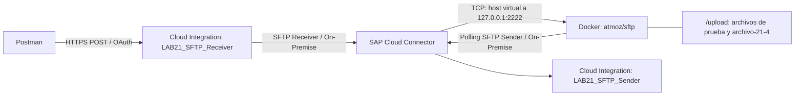

En 21.2 se validó la escritura remota; en 21.3 la lectura periódica y la idempotencia; en 21.4 las políticas de archivado y eliminación posterior al procesamiento.

## Prerrequisitos e instalación

- Acceso a SAP Integration Suite / Cloud Integration, Design, Monitor y Security Material.
- SAP Cloud Connector conectado al subaccount del laboratorio, sin Location ID.
- Docker Desktop operativo y servidor SFTP `sap-learning-lab-sftp` accesible localmente.
- Credencial segura `LAB21_SFTP_BASIC` y SSH Known Hosts desplegado.
- Postman con autenticación OAuth para invocar endpoints HTTPS del runtime.

La instalación detallada del servidor, las claves de host SSH, la configuración de Cloud Connector y la reproducción en otro PC se documenta en la **[Guía de instalación SFTP y Cloud Connector](21-guia-instalacion-sftp-cloud-connector.md)**.

**Seguridad:** no almacenar contraseñas, claves privadas, service keys, tokens ni contenido sensible de `.env` en Git. Los scripts y el ejemplo de variables pueden versionarse sin secretos.

## 21.1 - Fundamentos y conectividad SFTP

**Estado:** ✅ Completado

### Objetivo y conceptos

Disponer de un servidor SFTP local y validar su acceso desde SAP Cloud Integration a través de SAP Cloud Connector. SFTP utiliza SSH sobre TCP; la autenticación del usuario y la verificación de la clave de host son controles distintos.

### Preparación y configuración

1. Preparar Docker Desktop y el contenedor `sap-learning-lab-sftp`, basado en `atmoz/sftp`, con usuario SFTP `labuser`, directorio `/home/labuser/upload` y puerto local `127.0.0.1:2222` hacia el puerto 22 del contenedor. El directorio local `tools/sftp/data` se utiliza para conservar los archivos del laboratorio. Los valores sensibles se almacenan fuera de Git.
2. Preparar la clave SSH de host ED25519 persistente. En este entorno Windows, montar directamente la clave privada dentro del contenedor produjo permisos `0777`, rechazados por OpenSSH. Se utilizó un script de inicialización en `/etc/sftp.d/` que copia la clave al sistema de archivos del contenedor, establece propietario `root` y permisos `600`, y genera su clave pública. Se verificó que la huella ofrecida a CPI coincidiera con la del contenedor. Véase `KBA-LAB-021-A`.
3. Conectar SAP Cloud Connector 2.16.2 al subaccount SAP BTP Trial. En **Cloud To On-Premise / Access Control**, registrar un recurso `Non-SAP System`, protocolo `TCP`, dirección interna `127.0.0.1:2222` y dirección virtual `sftp-learning-lab.internal:2222`, sin Location ID. La comprobación de host interno mostró `Reachable`.
4. En Security Material de Cloud Integration, configurar `LAB21_SFTP_BASIC` como **User Credentials** para `labuser`. Registrar y desplegar SSH Known Hosts con la clave pública real del servidor y la entrada `[sftp-learning-lab.internal]:2222 ssh-ed25519 ...`. No documentar la contraseña ni una clave pública inventada.
5. En **SSH Connectivity Test**, usar host `sftp-learning-lab.internal`, puerto `2222`, proxy `On-Premise`, Location ID vacío, autenticación `User Credentials` con `LAB21_SFTP_BASIC`, verificación de host `Against Tenant`, timeout `10000` ms. Activar **Check Directory Access** e indicar `/upload`.

### Resultado, validación y evidencias

El test devolvió `Successfully reached host`; se verificó la clave de host ED25519, la autenticación y el listado de `/upload`. Esta prueba acredita acceso al directorio, **no escritura**; la escritura se comprobó en 21.2.

**Evidencia 21-01 - Conectividad SSH ED25519 a través de Cloud Connector.** Prueba de conexión y huella de host coincidente.

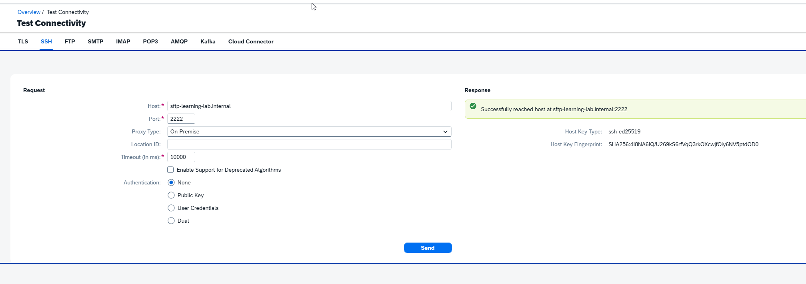

**Evidencia 21-02 - Autenticación y Known Hosts.** Prueba con credenciales del tenant y verificación de host activada.

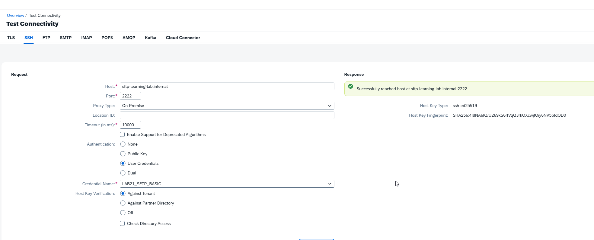

**Evidencia 21-03 - Acceso al directorio SFTP.** Listado remoto de `/upload` desde el test de conectividad.

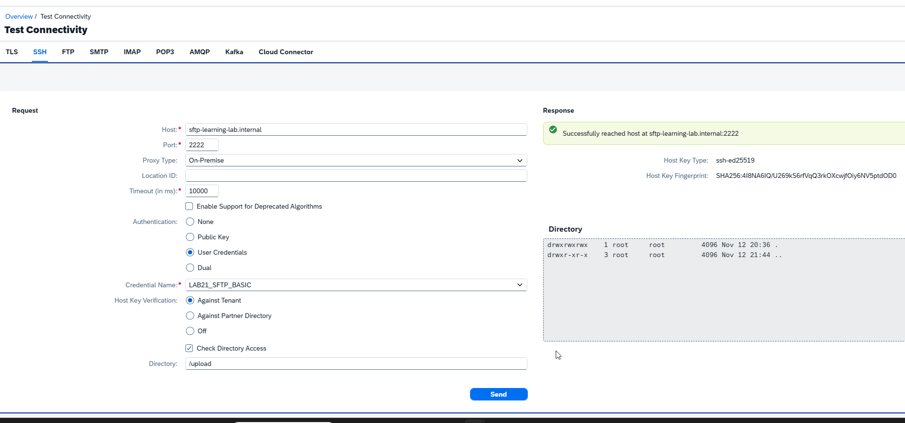

### Problemas encontrados y aprendizajes

- La clave ED25519 montada desde Windows fue rechazada por permisos demasiado abiertos; la inicialización dentro del contenedor resolvió el problema (`KBA-LAB-021-A`).
- El test informó `Cannot access known hosts artifact` hasta crear y desplegar el artefacto Known Hosts (`KBA-LAB-021-B`).
- La pérdida temporal de acceso administrativo a Cloud Connector se resolvió recordando la contraseña; **no se probó** restaurar usuarios desde XML (`KBA-LAB-021-C`).

## 21.2 - Escritura mediante SFTP Receiver

**Estado:** ✅ Completado

### Objetivo y conceptos

Recibir un mensaje de texto por HTTPS desde Postman, escribirlo en un servidor SFTP on-premise, comprobar la sobrescritura y observar el comportamiento ante permisos insuficientes. El adaptador SFTP Receiver realiza la escritura; la respuesta HTTP no sustituye la comprobación del archivo.

### Prerrequisitos

Laboratorio 21.1 validado; Security Material y Known Hosts desplegados; acceso al package `CPI Learning Lab`; Postman con Bearer Token autorizado.

### Diseño e implementación

1. Crear el iFlow `LAB21_SFTP_Receiver` en `CPI Learning Lab`, guardarlo y crear inmediatamente la versión inicial `1.0.0`, antes de configurar el flujo. La versión inicial es un punto de partida, no una prueba de funcionamiento.
2. Configurar un **HTTPS Sender** con Address `/lab21/sftp/receiver`, autorización `User Role`, rol `ESBMessaging.send` y `CSRF Protected` desactivado. Reutiliza la autenticación OAuth ya probada en el curso.
3. Conectar **Start Event** directamente con **End Event**, sin transformaciones, para conservar el cuerpo recibido.
4. Agregar Receiver `SFTP_Server` y conectarlo mediante un Message Flow con adaptador **SFTP**.
5. Configurar **SFTP → Target**: Directory `/upload`, File Name `lab21-02-prueba.txt`, Append Timestamp desactivado, Address `sftp-learning-lab.internal:2222`, Proxy Type `On-Premise`, Location ID vacío, Authentication `User Name/Password` y Credential Name `LAB21_SFTP_BASIC`. En esta interfaz, host y puerto se indican juntos en Address.
6. Mantener **SFTP → Processing**: Change Directories Stepwise activado, Create Directories activado, Flatten File Names desactivado, Prevent Directory Traversal activado, Use Fast Exists Check activado, Handling for Existing Files `Override`, Use Temporary File desactivado. `Override` permite reemplazar el contenido anterior; es una decisión que debe revisarse en escenarios productivos.
7. Guardar y desplegar. Se observó `Deployed` y Runtime Status `Started`, sin problemas visibles en el diseñador.

**Evidencia 21-04 - iFlow desplegado e iniciado.** Diseño HTTPS → SFTP, estado Started y pestaña Problems sin errores.

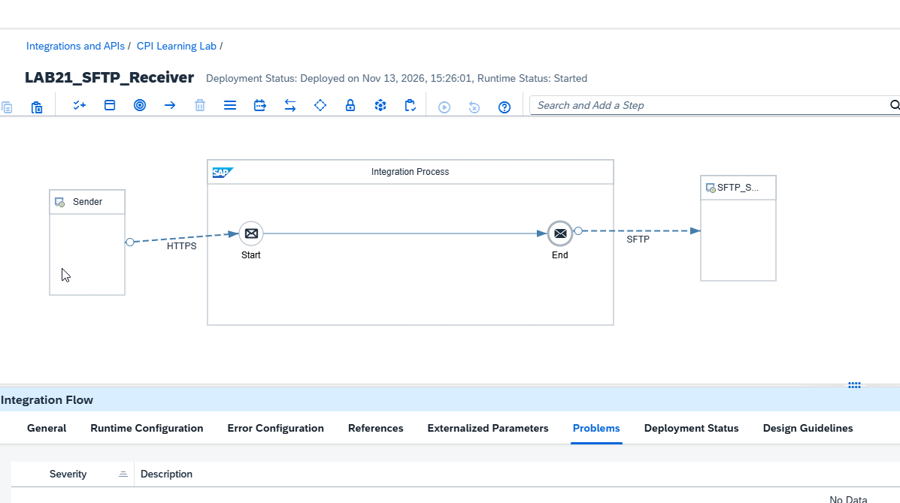

### Prueba positiva: escritura inicial

8. Crear en Postman la carpeta `21 - Integración SFTP y archivos` y la petición independiente `21.2 - Escritura de archivo SFTP`: método `POST`, URL del runtime terminada en `/http/lab21/sftp/receiver`, OAuth Bearer Token, `Content-Type: text/plain`, Body raw:

   ```text
   LAB21-SFTP-RECEIVER
   Orden: ORD-21001
   Origen: Postman
   Destino: SFTP
   ```

   La respuesta observada fue **HTTP 200 OK** con el contenido de entrada.

   **Evidencia 21-05 - Petición y respuesta HTTPS.** Postman muestra el body y HTTP 200 sin revelar el token.

   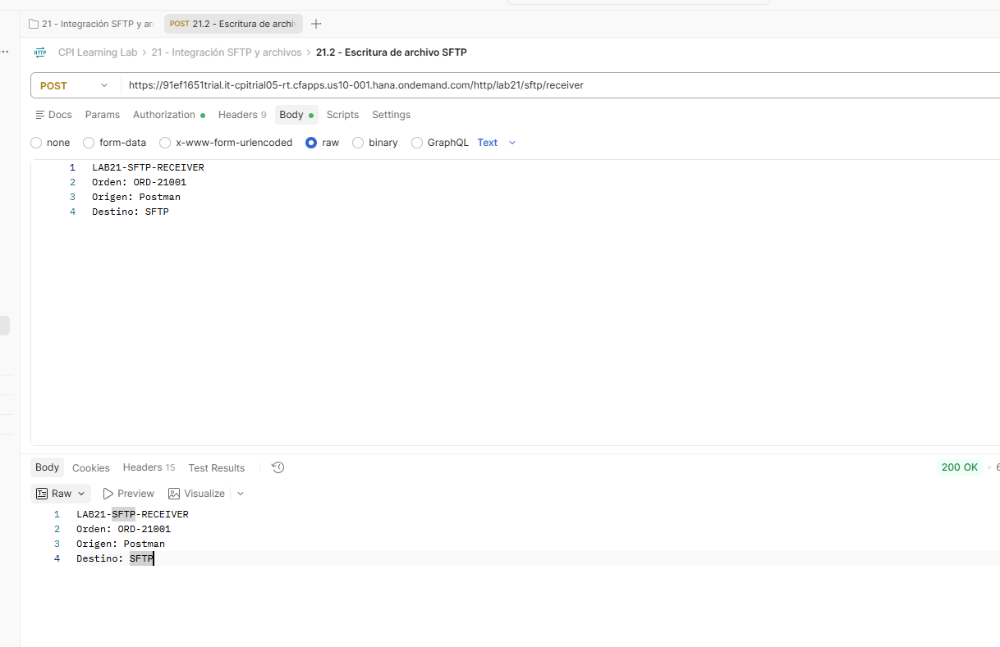

9. Verificar en Docker el archivo creado:

   ```powershell
   docker exec sap-learning-lab-sftp ls -l /home/labuser/upload/lab21-02-prueba.txt
   docker exec sap-learning-lab-sftp cat /home/labuser/upload/lab21-02-prueba.txt
   ```

   Se observó un archivo de **69 bytes** con las cuatro líneas y la orden `ORD-21001`.

   **Evidencia 21-06 - Archivo escrito y contenido.** Docker muestra el archivo y su contenido real.

   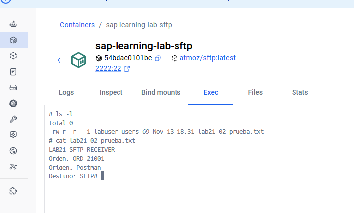

10. Consultar **Monitor → Message Processing** para `LAB21_SFTP_Receiver`. El mensaje finalizó **Completed**, con `InternalError=false` y duración observada de **5 s 667 ms**.

    **Evidencia 21-07 - MPL Completed.** Registro de procesamiento correcto.

    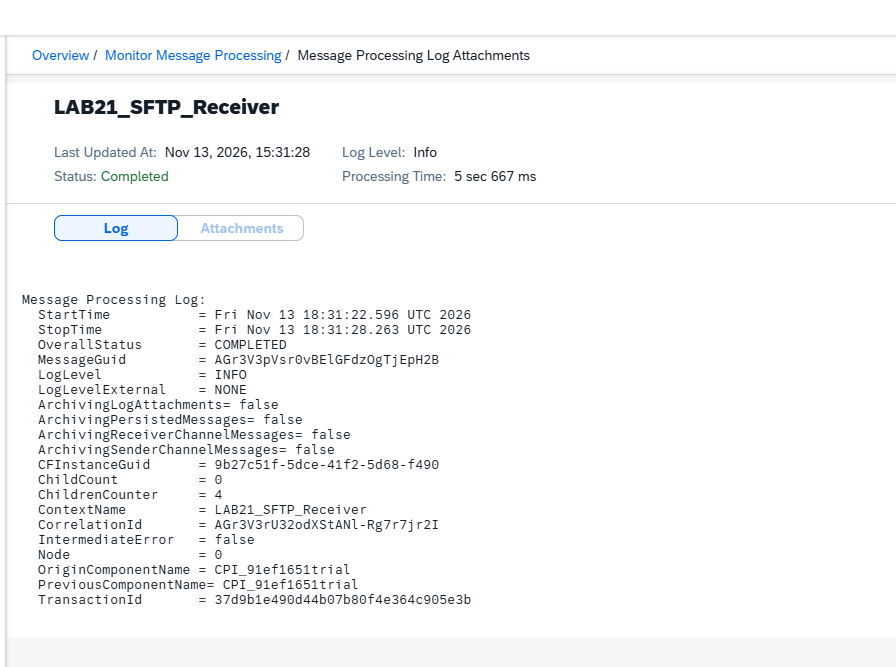

### Prueba de sobrescritura

11. Repetir la petición POST cambiando el Body a:

    ```text
    LAB21-SFTP-RECEIVER
    Orden: ORD-21002
    Origen: Postman
    Destino: SFTP
    Prueba: Sobrescritura
    ```

    Se recibió **HTTP 200 OK**. La lectura posterior en Docker mostró un único archivo de **92 bytes** con `ORD-21002` y sin `ORD-21001`: comportamiento `Override` validado.

    **Evidencia 21-08 - Sobrescritura del archivo existente.** Contenido nuevo sin la orden anterior.

    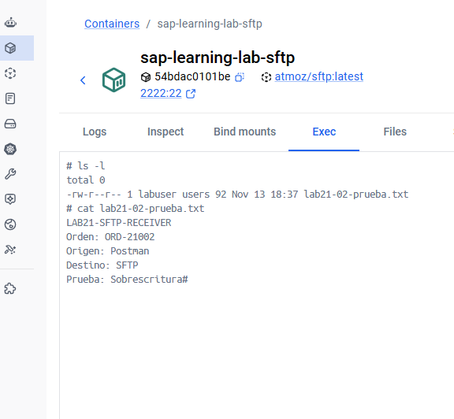

### Prueba negativa: permisos insuficientes

12. Preparar un directorio aislado no escribible por `labuser`:

    ```powershell
    docker exec -u root sap-learning-lab-sftp sh -c "mkdir -p /home/labuser/upload/sin-permisos && chown root:root /home/labuser/upload/sin-permisos && chmod 555 /home/labuser/upload/sin-permisos"
    docker exec sap-learning-lab-sftp ls -ld /home/labuser/upload/sin-permisos
    ```

    Se verificaron propietario `root root` y permisos `dr-xr-xr-x`.
13. Crear la versión numerada `1.0.1` del diseño funcional validado, con comentario `Laboratorio 21.2 - SFTP Receiver validado: escritura y sobrescritura`. La creación de la versión no implica despliegue.
14. Cambiar temporalmente **Directory** a `/upload/sin-permisos`, guardar y desplegar; confirmar `Started`.
15. Ejecutar el POST con Body:

    ```text
    LAB21-SFTP-RECEIVER
    Orden: ORD-21003
    Origen: Postman
    Destino: SFTP
    Prueba: Error de permisos
    ```

    La respuesta fue **HTTP 500 Internal Server Error** y contenía el identificador del MPL fallido.

    **Evidencia 21-09 - Error HTTP de escritura.** Postman muestra el error 500 de la prueba controlada.

    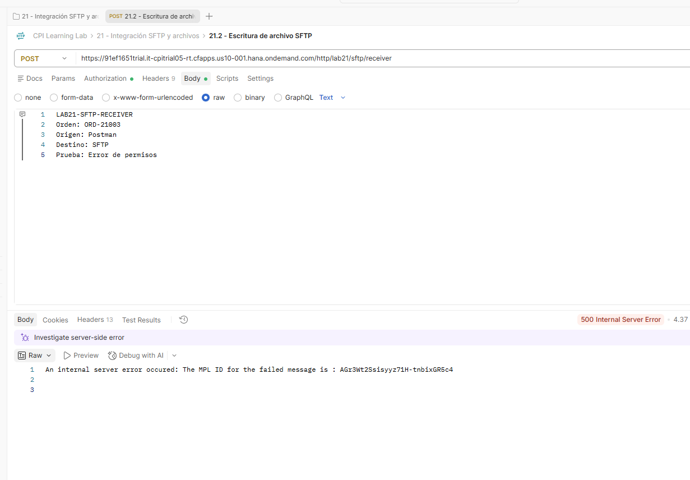

16. En Monitor se observó el mensaje **Failed** y `Last Error` con `Permission denied`, consistente con los permisos del directorio. Tiempo observado: **3 s 905 ms**. Esta prueba no atribuye el fallo a las credenciales ni a Cloud Connector.

    **Evidencia 21-10 - MPL Failed y Permission denied.** Diagnóstico del fallo de escritura.

    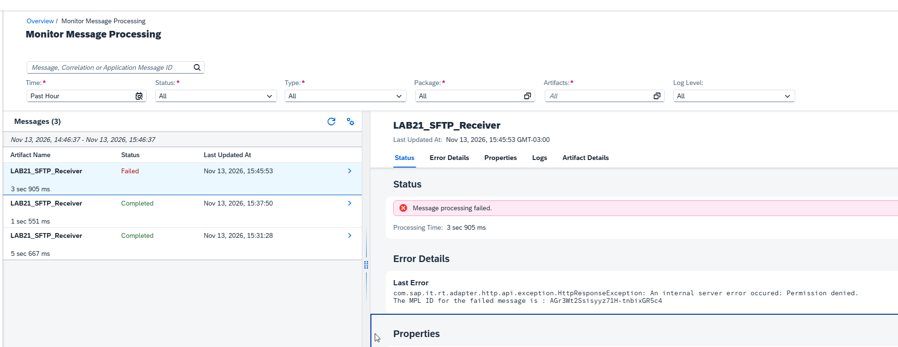

### Restauración y validación final

17. Restaurar **Directory** a `/upload`, guardar y desplegar nuevamente. Repetir POST con la orden `ORD-21004`; se obtuvo **HTTP 200 OK**. La lectura del archivo desde Docker confirmó que contenía `ORD-21004`, sin órdenes anteriores. El iFlow queda con la configuración funcional restaurada.

### Resultado esperado y validación

| Caso | Resultado observado | Estado |
|---|---|---|
| Escritura inicial | HTTP 200, archivo con ORD-21001, MPL Completed | ✅ |
| Archivo existente (`Override`) | HTTP 200, archivo reemplazado con ORD-21002 | ✅ |
| Directorio sin permisos | HTTP 500, MPL Failed, `Permission denied` | ✅ |
| Restauración del destino | HTTP 200, archivo con ORD-21004 | ✅ |

### Problemas encontrados, aprendizajes y límites

- El campo **Address** del SFTP Receiver en esta interfaz utiliza `host:puerto`; no existe un campo Port separado en la captura observada.
- `Override` sustituye el contenido anterior; se comprobó sobre un nombre fijo de prueba. No representa una política de conservación de archivos.
- Los permisos del servidor remoto pueden producir HTTP 500 y MPL Failed aunque el iFlow esté `Started`.
- El HTTP 200 se complementó con lectura real del archivo; por sí solo no se utilizó como prueba de persistencia.
- No se validaron en 21.2 lectura por polling, tratamiento masivo, nombres dinámicos, archivos temporales ni recuperación automática de errores.

## 21.3 - Lectura periódica mediante SFTP Sender

**Estado:** ✅ Completado

### Objetivo, conceptos y prerrequisitos

Configurar un iFlow iniciado por **SFTP Sender** para leer archivos desde el servidor local a través de Cloud Connector, validar el polling, observar el payload mediante Trace y comprobar que un archivo conservado no se procese repetidamente con la política de idempotencia.

Se reutilizan el servidor, el host virtual, el Security Material `LAB21_SFTP_BASIC` y el SSH Known Hosts verificados en 21.1. No se necesita una petición Postman: el evento de entrada lo origina el adaptador SFTP Sender.

### Arquitectura y configuración

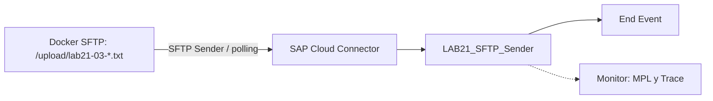

1. Crear `LAB21_SFTP_Sender` en el package `CPI Learning Lab`, guardar y registrar la versión inicial `1.0.0`. Conectar el **Start Event** del SFTP Sender directamente con **End Event**, sin receiver adicional. Esta estructura permite aislar la lectura y verificar el mensaje sin añadir transformaciones ni escritura externa.
2. Configurar **SFTP Sender → Source** con **Directory** `/upload`, **Address** `sftp-learning-lab.internal:2222`, **Proxy Type** `On-Premise`, **Location ID** vacío, **Authentication** `User Name/Password` y **Credential Name** `LAB21_SFTP_BASIC`. Se utiliza la conexión validada en 21.1.
3. Configurar inicialmente **File Name** `lab21-03-entrada.txt`, con **Regex Filtering** desactivado. Posteriormente ampliar a `lab21-03-*.txt` para procesar otro archivo de la misma serie sin alterar el resto del directorio.
4. En **Processing**, establecer **Read Lock Strategy** `None`, **Empty File Handling** `Process Empty File`, **Max Messages per Poll** `1`, **Lock Timeout** `15` minutos, **Poll on One Worker Only** desactivado, **Change Directories Stepwise** desactivado, **Include Subdirectories** desactivado y **Use Fast Exists Check** activado. El límite de un mensaje por sondeo facilita correlacionar cada ejecución con su archivo de prueba.
5. Seleccionar **Post-Processing** `Keep File and Mark as Processed in Idempotent Repository`, con **Idempotent Repository** `Database`. Se conserva el archivo de origen y se utiliza un registro de procesamiento para evitar consumirlo repetidamente.
6. En **Scheduler**, configurar sondeo **Daily**, cada **5 minutos**, dentro del intervalo **00:00–24:00 GMT**. Guardar y desplegar el iFlow; comprobar `Started`.

**Evidencia 21-11 - SFTP Sender desplegado e iniciado.** El runtime muestra `LAB21_SFTP_Sender` operativo para iniciar lecturas por polling.

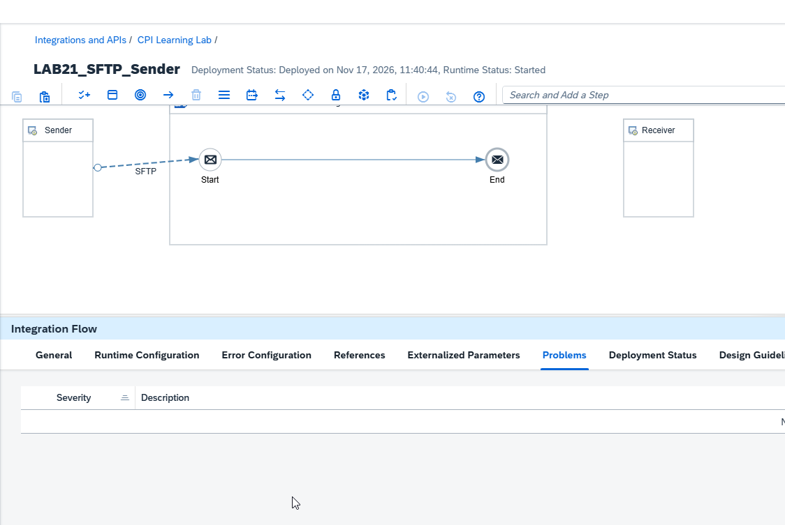

### Prueba de lectura y polling

7. Crear en el directorio local vinculado a `/upload` el archivo `lab21-03-entrada.txt`, con contenido de prueba que incluya `ORD-21005`. Mantener el filtro específico del archivo y esperar el siguiente sondeo.
8. Revisar **Monitor → Message Processing**. Se observó un MPL `Completed` el **17/11/2026 a las 11:45:05**, con duración de **439 ms**. El archivo original de **133 bytes** fue leído por el adaptador.

**Evidencia 21-12 - Mensaje procesado correctamente.** MPL `Completed` correspondiente a la lectura del archivo de entrada.

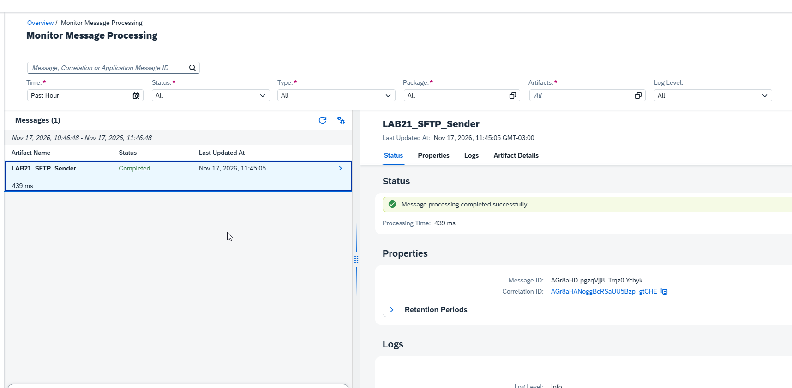

### Prueba de idempotencia

9. Mantener el archivo original en `/upload` y observar el monitor durante **8 minutos y 50 segundos**, intervalo superior a un ciclo de polling. No se registró un nuevo procesamiento del mismo archivo en el periodo observado. Este resultado valida el comportamiento en la ventana de prueba, sin establecer garantías sobre todas las condiciones de reinicio o retención del repositorio.

**Evidencia 21-13 - Ausencia de reprocesamiento observado.** El monitor permite contrastar la ejecución inicial con la ventana de observación posterior.

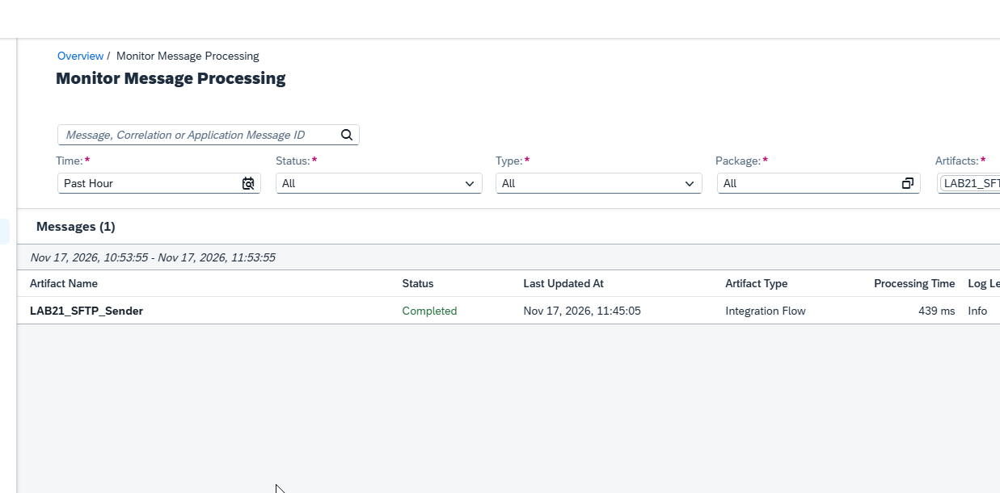

### Inspección del payload con Trace

10. Conservar la política de idempotencia y ampliar el filtro a `lab21-03-*.txt` (Regex Filtering desactivado). Guardar y desplegar los cambios. Crear el archivo `lab21-03-trace.txt` con la orden `ORD-21006`, de **147 bytes**.
11. Activar temporalmente **Trace** en Monitor, esperar el polling y revisar el cuerpo del mensaje. El payload recuperado coincidió con el contenido del archivo de prueba. Restablecer el nivel de registro a **Info** al terminar.

**Evidencia 21-14 - Payload de archivo validado mediante Trace.** El cuerpo leído en CPI coincide con el archivo `lab21-03-trace.txt`.

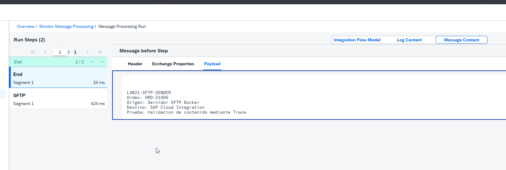

12. Comprobar en Docker que los archivos de prueba permanecen en el directorio de origen tras su procesamiento, de acuerdo con la política `Keep File`.

**Evidencia 21-15 - Archivo conservado en SFTP.** Verificación del archivo original después de su lectura.

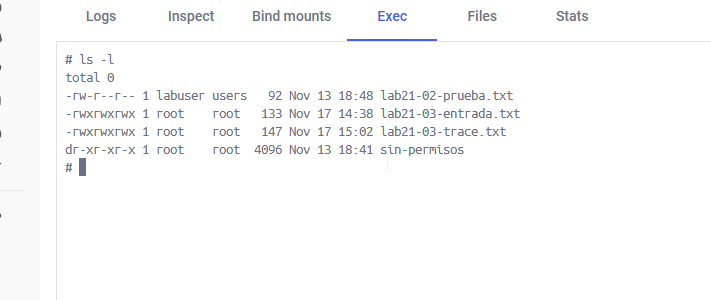

### Resultado, validación y aprendizajes

| Caso | Resultado observado | Estado |
|---|---|---|
| SFTP Sender desplegado | `Started` | ✅ |
| Lectura por polling | MPL `Completed`, 439 ms | ✅ |
| Archivo ya procesado | Sin segundo MPL observado en 8 min 50 s | ✅ |
| Inspección del mensaje | Trace con payload `ORD-21006` coincidente | ✅ |
| Conservación de archivo | Archivo presente en Docker tras el procesamiento | ✅ |

**Versionado:** la configuración de 21.3 quedó conservada como versión `1.0.2`, con comentario `Laboratorio 21.3 - SFTP Sender validado con polling, idempotencia y Trace`. La versión `1.0.1` se utilizó durante el avance del laboratorio.

**Límites:** no se verificaron procesamiento paralelo, cambios de archivo con igual nombre, comportamiento tras limpiar el repositorio de idempotencia ni reinicios del runtime. La ausencia de reprocesamiento corresponde únicamente a la ventana observada.

## 21.4 - Ciclo de vida de archivos: Move File y Delete File

**Estado:** ✅ Completado

### Objetivo, conceptos y prerrequisitos

Comparar dos políticas de postprocesamiento del **SFTP Sender** sobre archivos descartables: `Move File`, que traslada el archivo a un directorio de archivado, y `Delete File`, que lo elimina después de su procesamiento. Se reutiliza `LAB21_SFTP_Sender` y su conectividad de 21.3; no se necesitan nuevas peticiones Postman.

### Arquitectura

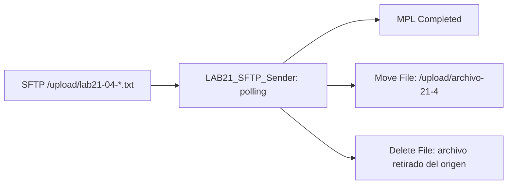

Las dos políticas se validaron **secuencialmente**, cambiando la configuración del mismo adaptador. El diagrama representa alternativas, no operaciones simultáneas sobre un mismo archivo.

### Prueba 1: Move File

1. Partir de la configuración funcional de 21.3 conservada en la versión `1.0.2` y preparar un directorio de archivado dentro del servidor SFTP:

   ```powershell
   docker exec -u root sap-learning-lab-sftp sh -c "mkdir -p /home/labuser/upload/archivo-21-4 && chown labuser:users /home/labuser/upload/archivo-21-4 && chmod 755 /home/labuser/upload/archivo-21-4"
   docker exec sap-learning-lab-sftp ls -ld /home/labuser/upload/archivo-21-4
   ```

   Se verificaron los permisos `drwxr-xr-x` y el propietario `labuser:users`. El directorio debe permitir el archivado por el usuario SFTP.
2. En **SFTP Sender → Source**, establecer **File Name** `lab21-04-*.txt`, con **Regex Filtering** desactivado. En **Processing**, seleccionar **Post-Processing** `Move File` y **Archive Directory** `archivo-21-4`, relativo al directorio `/upload`. Mantener el polling de 5 minutos y **Include Subdirectories** desactivado. Guardar.
3. Crear `lab21-04-move.txt` en el directorio local vinculado al SFTP con contenido UTF-8:

   ```text
   LAB21-SFTP-LIFECYCLE
   Orden: ORD-21007
   Origen: /upload
   Operacion: Move File
   Destino esperado: /upload/archivo-21-4
   Prueba: Archivado posterior al procesamiento
   ```

4. Desplegar `LAB21_SFTP_Sender`, comprobar `Started` y esperar el siguiente sondeo. Se observó un MPL **Completed** el **17/11/2026 a las 12:25:03**, con duración de **460 ms**.
5. Comprobar en Docker que el archivo ya no existe en `/home/labuser/upload/lab21-04-move.txt` y que aparece en `/home/labuser/upload/archivo-21-4/lab21-04-move.txt` (165 bytes).

   ```powershell
   docker exec sap-learning-lab-sftp ls -l /home/labuser/upload/lab21-04-move.txt
   docker exec sap-learning-lab-sftp ls -l /home/labuser/upload/archivo-21-4/
   ```

   **Evidencia 21-16 - Archivado posterior al procesamiento.** El archivo desapareció del origen y apareció en el directorio de archivado.

   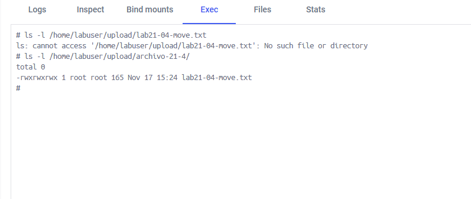

   **Evidencia 21-17 - MPL de Move File completado.** La ejecución que originó el movimiento terminó en `Completed`.

   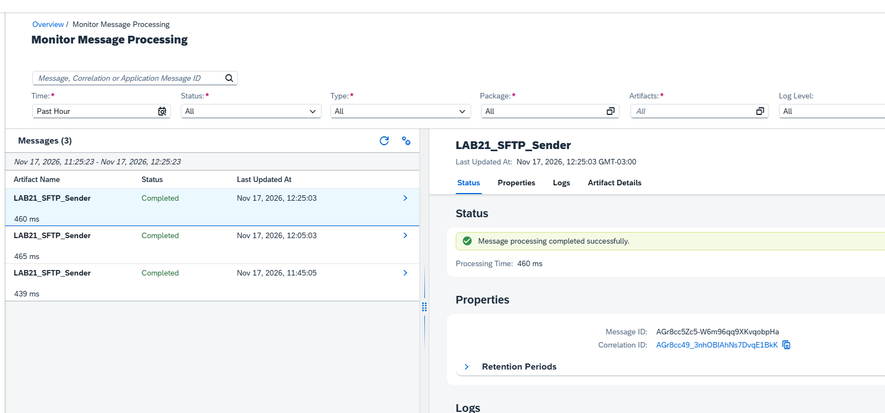

6. Leer el contenido archivado para verificar que la operación conservó el mensaje original:

   ```powershell
   docker exec sap-learning-lab-sftp cat /home/labuser/upload/archivo-21-4/lab21-04-move.txt
   ```

   La salida incluyó las líneas originales y la orden `ORD-21007`.

   **Evidencia 21-18 - Contenido conservado después del archivado.** Lectura del archivo archivado con `ORD-21007`.

   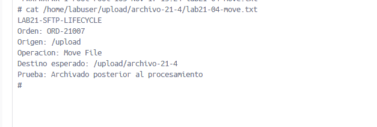

### Prueba 2: Delete File

7. Registrar la versión `1.0.3` del iFlow con la configuración `Move File` validada y el comentario `Laboratorio 21.4 - Move File validado: archivado y conservacion del contenido`. Esto proporciona un punto de recuperación antes de cambiar a una política destructiva.
8. En **SFTP Sender → Processing**, cambiar únicamente **Post-Processing** a `Delete File`, conservando **File Name** `lab21-04-*.txt`. Guardar, sin desplegar todavía.
9. Crear el archivo descartable `lab21-04-delete.txt` con contenido UTF-8:

   ```text
   LAB21-SFTP-LIFECYCLE
   Orden: ORD-21008
   Origen: /upload
   Operacion: Delete File
   Prueba: Eliminacion posterior al procesamiento
   ```

10. Desplegar el iFlow y comprobar `Started`. En **Monitor → Message Processing** se observó un MPL **Completed** el **17/11/2026 a las 12:35:03**, con duración de **442 ms** y resultado `Message processing completed successfully`.

    **Evidencia 21-19 - MPL de Delete File completado.** CPI completó el procesamiento de la prueba de eliminación.

    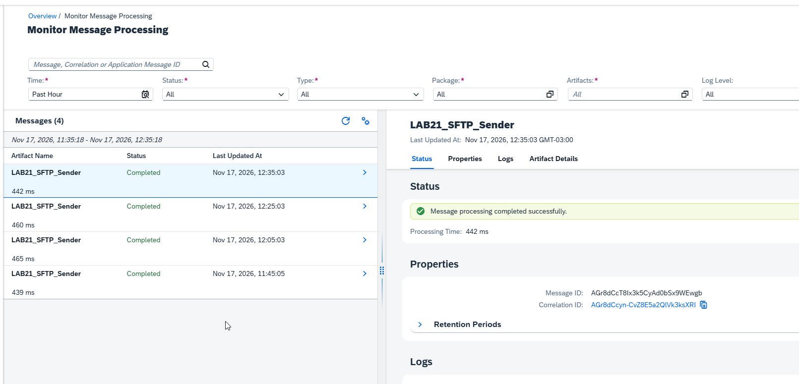

11. Verificar en Docker la ausencia del archivo de prueba:

    ```powershell
    docker exec sap-learning-lab-sftp ls -l /home/labuser/upload/lab21-04-delete.txt
    ```

    La salida fue `No such file or directory`. La comprobación se realizó después del MPL exitoso y sobre el archivo descartable preparado para esta prueba.

    **Evidencia 21-20 - Archivo eliminado del origen.** Docker confirma que `lab21-04-delete.txt` no está presente después del procesamiento.

    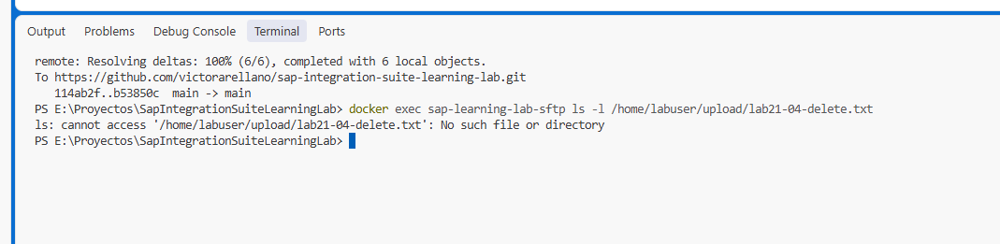

### Restauración y estado final

12. Recuperar en el diseñador la versión `1.0.2` y verificar **File Name** `lab21-03-*.txt`, **Post-Processing** `Keep File and Mark as Processed in Idempotent Repository` e **Idempotent Repository** `Database`.
13. Restaurar esa versión, guardar cuando corresponda y desplegar el iFlow. Se confirmó el despliegue de la configuración recuperada, de modo que la política destructiva `Delete File` no queda como configuración final prevista del laboratorio.

### Resultado y validación

| Caso | Resultado observado | Estado |
|---|---|---|
| `Move File` | MPL Completed; archivo ausente del origen y presente en `archivo-21-4` | ✅ |
| Integridad del archivo archivado | Contenido original con `ORD-21007` | ✅ |
| `Delete File` | MPL Completed; archivo descartable ausente del origen | ✅ |
| Recuperación | Versión `1.0.2` restaurada y desplegada, según comprobación del operador | ✅ |

### Aprendizajes y límites

- `Move File` permite separar los archivos consumidos de los pendientes sin perder su contenido; la prueba confirmó el movimiento y la integridad del texto.
- `Delete File` es una operación destructiva. Debe probarse únicamente con archivos descartables y un filtro restringido.
- Un MPL `Completed` demuestra el éxito del procesamiento registrado, pero la comprobación del efecto sobre el archivo requiere inspeccionar también el servidor SFTP.
- El archivado se probó con un archivo y un directorio de destino preparado previamente. No se ensayaron fallos de archivado, reintentos, concurrencia ni políticas de retención.


## 21.5 - Transformaciones de archivos CSV a XML

**Estado:** ✅ Completado.

### Objetivo y conceptos

Implementar un flujo SFTP de extremo a extremo que lea un archivo CSV, convierta sus registros a XML mediante el componente nativo **CSV to XML Converter** y escriba el resultado en otro directorio SFTP. El XSD define la estructura de salida y el elemento repetible correspondiente a cada fila. Se reutilizan la conectividad SFTP, Cloud Connector y las credenciales validadas en 21.1–21.4.

### Prerrequisitos

- Servidor SFTP local, SAP Cloud Connector, credencial `LAB21_SFTP_BASIC` y SSH Known Hosts operativos.
- Directorio `/upload` disponible y directorio de salida `/upload/salida-21-5` creado con permisos de escritura para `labuser`.
- Esquema local `docs/xsd/tema-21/LAB21_05_Ordenes.xsd`.
- Archivos CSV de prueba en UTF-8, con separador coma.

### Arquitectura implementada

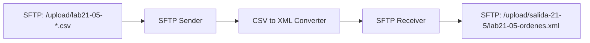

**iFlow:** `LAB21_SFTP_Transformacion`, versión numerada final confirmada `1.0.1`, desplegado y con runtime `Started`. El flujo se creó independientemente de `LAB21_SFTP_Sender` para conservar los laboratorios anteriores.

### Configuración y procedimiento

1. Crear `LAB21_SFTP_Transformacion` en `CPI Learning Lab`, guardar y registrar una versión inicial antes de configurar componentes. El versionado proporciona un punto de recuperación previo a las pruebas.
2. Conectar **SFTP Sender** al Start Event. Utilizar `sftp-learning-lab.internal:2222`, proxy `On-Premise`, credencial `LAB21_SFTP_BASIC`, directorio `/upload` y filtro `lab21-05-*.csv`. Configurar conservación e idempotencia mediante repositorio `Database` para evitar reprocesar archivos ya reconocidos. El filtro separa este laboratorio de los anteriores.
3. Incorporar **CSV to XML Converter** entre Start y End. Cargar `LAB21_05_Ordenes.xsd` mediante **XML Schema → Select → Upload from File System**. El XSD define raíz `Ordenes`, elemento repetible `Orden` y campos `ordenId` (`xs:string`), `cliente` (`xs:string`) y `monto` (`xs:decimal`).
4. Configurar el conversor:

   | Campo | Valor |
   |---|---|
   | XML Schema | `LAB21_05_Ordenes.xsd` |
   | Path to Target Element in XSD | `/Ordenes/Orden` |
   | Record Marker in CSV | Vacío |
   | Field Separator in CSV | `Comma (,)` |
   | Exclude First Line Header | Activado |

   La ruta selecciona el elemento XML repetible para cada registro CSV; el encabezado se excluye porque no representa una orden.

   **Evidencia 21-21 - Configuración inicial del conversor.** Panel de Processing antes de cargar el esquema, mostrando campos obligatorios y opciones disponibles.

   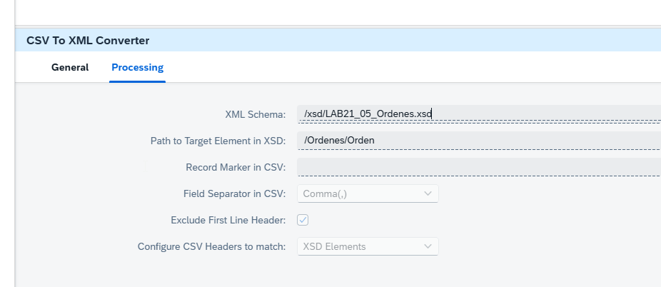

5. Conectar el **SFTP Receiver** al proceso y configurarlo con el mismo host, proxy y credencial. Utilizar `Directory = /upload/salida-21-5` y `File Name = lab21-05-ordenes.xml`. El directorio de salida evita mezclar archivos de entrada con resultados. El nombre fijo implica que las ejecuciones exitosas posteriores pueden sobrescribir el XML anterior.
6. Guardar y registrar la versión numerada antes del despliegue. La versión final confirmada del iFlow fue `1.0.1`. Crear en `/upload` el archivo `lab21-05-ordenes.csv`:

   ```csv
   ordenId,cliente,monto
   ORD-21009,CLIENTE-A,15000
   ORD-21010,CLIENTE-B,27500
   ORD-21011,CLIENTE-C,32000
   ```

7. Desplegar el iFlow y esperar el polling. En Monitor se registró **Completed** el 17/11/2026 a las 14:56:37 (GMT-03:00), duración **4 s 544 ms**.

   **Evidencia 21-22 - MPL de transformación completado.** Estado `Completed` de la ejecución positiva.

   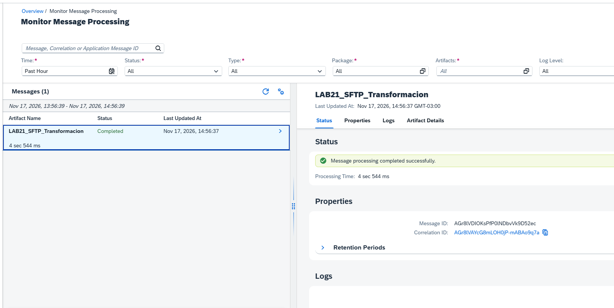

8. Inspeccionar `tools/sftp/data/salida-21-5/lab21-05-ordenes.xml`. Se observaron tres elementos `Orden`, con los identificadores, clientes y montos del CSV original.

   **Evidencia 21-23 - XML generado.** Archivo XML en el directorio de salida, con tres registros transformados.

   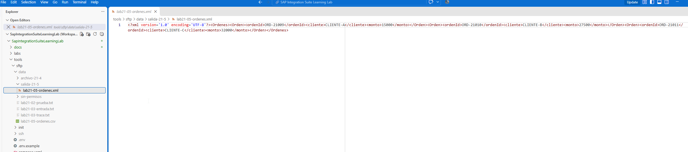

9. Verificar el diseño desplegado: SFTP Sender → CSV to XML Converter → SFTP Receiver, runtime `Started`. El editor mostró una advertencia naranja en el conversor.

   **Evidencia 21-24 - Diseño final del iFlow.** Arquitectura desplegada y advertencia visible.

   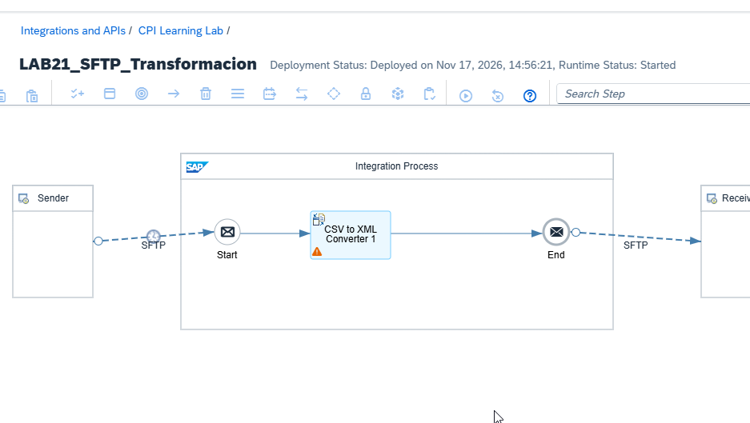

10. Revisar **Problems**. El editor indicó: `SFTP Sender may not pass Text message to CSV To XML Converter. CSV To XML Converter supports Text input only.` La advertencia señala una posible incompatibilidad de tipos, pero no impidió la ejecución positiva observada. No se añadió código ni un componente adicional para eliminarla. Véase `KBA-LAB-021-E`.

    **Evidencia 21-25 - Advertencia de tipos de mensaje.** Texto exacto mostrado por el editor.

    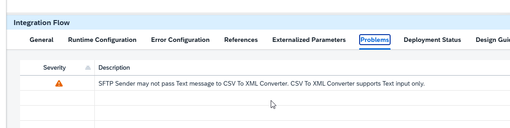

### Prueba negativa y control

11. Crear en `/upload` `lab21-05-ordenes-invalidas.csv`:

    ```csv
    ordenId,cliente,monto
    ORD-21012,CLIENTE-A,15000
    ORD-21013,CLIENTE-B,MONTO_INVALIDO
    ORD-21014,CLIENTE-C,32000
    ```

    La ejecución del 17/11/2026 a las 15:07:13 terminó **Failed** (327 ms), con `java.lang.IndexOutOfBoundsException: Index 0 out of bounds for length 0`.

    **Evidencia 21-26 - MPL Failed del CSV inválido.** Error registrado en el procesamiento.

    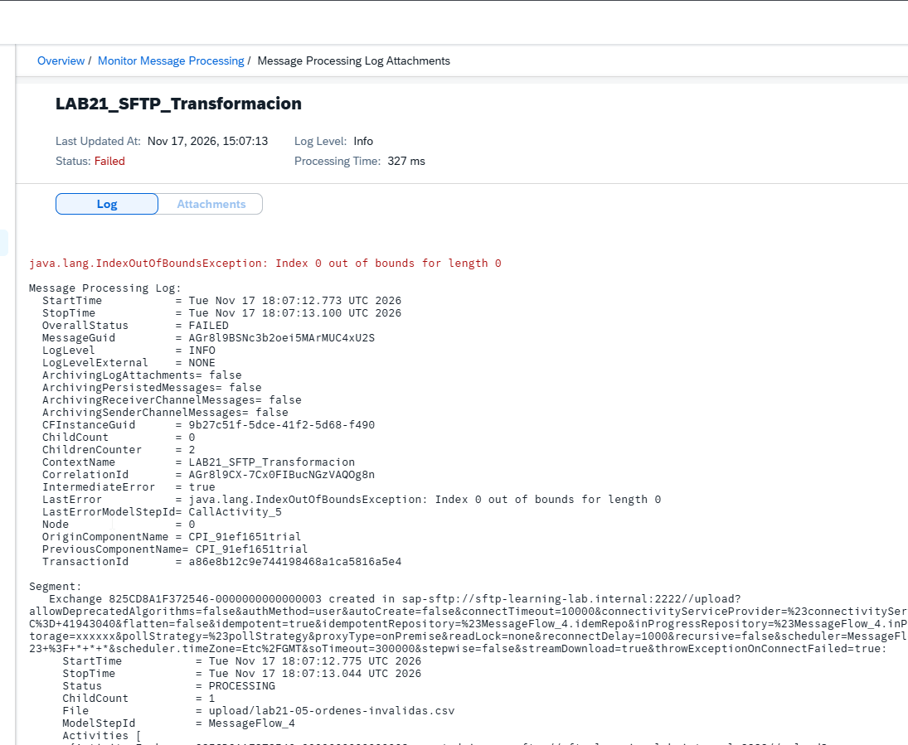

12. Revisar el log detallado. El fallo se localizó en `CallActivity_5`, actividad `bean[ref:csvtoxmlprocessorCallActivity_5 method:process]`. La excepción ocurrió en el conversor; el log no identifica explícitamente una validación del campo decimal.

    **Evidencia 21-27 - Error en CSV to XML Converter.** Segmento del log con actividad y excepción.

    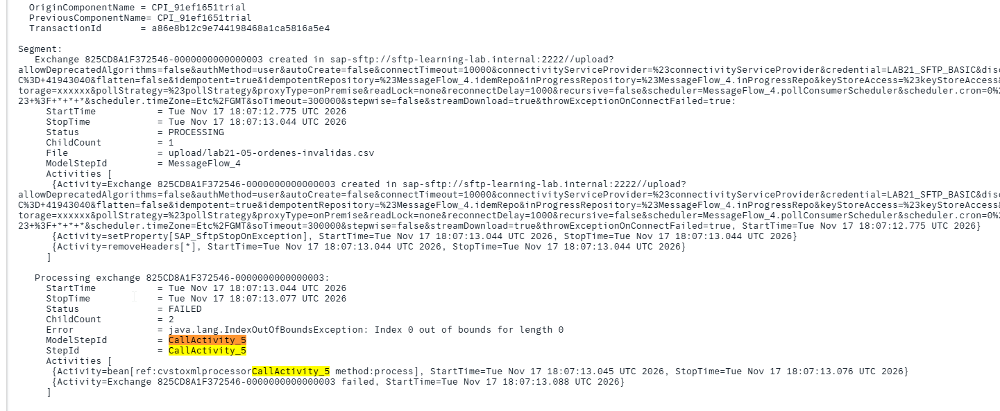

13. Crear `lab21-05-ordenes-control.csv`, conservando los tres registros anteriores y reemplazando únicamente `MONTO_INVALIDO` por `27500`. El MPL del 17/11/2026 a las 15:13:05 terminó **Completed**, en **2 s 488 ms**. En la ventana de monitorización se observaron cuatro ejecuciones: tres `Completed` y una `Failed`; otra ejecución `Completed` de las 15:07:25 no quedó asociada de forma concluyente a un archivo.

    **Evidencia 21-28 - MPL de prueba de control.** Ejecución `Completed` posterior al cambio del dato.

    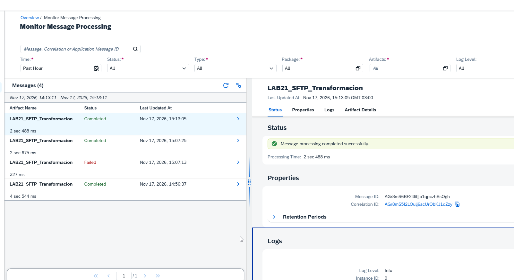

14. Inspeccionar el XML sobrescrito en el directorio de salida. Se verificaron `ORD-21012` (15000), `ORD-21013` (27500) y `ORD-21014` (32000), bajo raíz `Ordenes`.

    **Evidencia 21-29 - XML de prueba de control.** Los tres registros con valores esperados.

    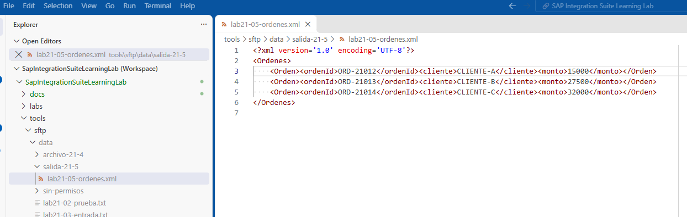

15. Verificar el estado final. El operador confirmó la versión `1.0.1`, la presencia del archivo inválido en el directorio SFTP durante la comprobación y la ausencia de nuevos `Failed` en la ventana de una hora mostrada. Posteriormente confirmó que movió los archivos de prueba fuera del directorio vigilado. No se modificó ni redeplegó el iFlow para esta limpieza.

### Resultados y validación

| Caso | Evidencia práctica | Estado |
|---|---|---|
| CSV válido → XML | MPL Completed y tres órdenes correctas en el archivo de salida | ✅ |
| Diseño desplegado | SFTP Sender → CSV to XML Converter → SFTP Receiver; Started | ✅ |
| CSV con `MONTO_INVALIDO` | MPL Failed y excepción en `csvtoxmlprocessor` | ✅ Fallo observado |
| CSV de control numérico | MPL Completed y XML con tres órdenes correctas | ✅ |
| Limpieza | Archivos de prueba retirados del directorio vigilado, según confirmación del operador | ✅ |

### Problemas encontrados y aprendizajes

- **Advertencia de compatibilidad:** el editor advierte que SFTP Sender podría no entregar un mensaje Text al conversor. La ejecución positiva demuestra funcionamiento para el CSV probado, no compatibilidad universal. Véase `KBA-LAB-021-E`.
- **Error con CSV inválido:** el procesador CSV a XML lanzó `IndexOutOfBoundsException`. El cambio controlado del valor no numérico por uno numérico coincidió con el paso de `Failed` a `Completed`; la causa interna exacta de la excepción no quedó demostrada. Véase `KBA-LAB-021-F`.
- **Salida con nombre fijo:** las ejecuciones exitosas pueden sobrescribir el archivo XML previo. Por eso se validó el contenido tras cada prueba.
- **Idempotencia:** conservar archivos en origen no garantiza por sí solo que se reprocesen; el comportamiento debe contrastarse con los MPL y la configuración efectiva.
- **Alcance:** no se verificaron otras codificaciones, delimitadores, validación exhaustiva contra XSD, múltiples archivos concurrentes ni reintentos automáticos.

### Referencias

- [SAP Integration Suite - documentación oficial](https://help.sap.com/docs/integration-suite)
- [KBA y hallazgos](kba-y-hallazgos.md), `KBA-LAB-021-E` y `KBA-LAB-021-F`.


## Referencias y documentación complementaria

- [SAP Integration Suite - SAP Help Portal](https://help.sap.com/docs/integration-suite)
- [SAP Cloud Connector - SAP Help Portal](https://help.sap.com/docs/connectivity)
- [Guía de instalación SFTP y Cloud Connector](21-guia-instalacion-sftp-cloud-connector.md)
- [KBA y hallazgos](kba-y-hallazgos.md) - `KBA-LAB-021-A`, `021-B`, `021-C` y `021-D`.

## Estado del capítulo

**21.1:** ✅ Completado. **21.2:** ✅ Completado. **21.3:** ✅ Completado. **21.4:** ✅ Completado. **21.5:** ⬜ Pendiente. **21.6:** ⬜ Pendiente. **Capítulo 21:** 🟨 En curso.
