# 21 - Integración SFTP y archivos

**Estado del capítulo:** 🟨 En curso - laboratorios 21.1 y 21.2 completados; 21.3 a 21.6 pendientes.
**Package:** `CPI Learning Lab`
**Entorno:** SAP BTP Trial, SAP Cloud Integration, SAP Cloud Connector 2.16.2, Docker Desktop y servidor `atmoz/sftp` en Windows 11.

## Objetivo y contexto

Implementar integraciones de archivos mediante SFTP en SAP Cloud Integration, utilizando SAP Cloud Connector para conectar el tenant con un servidor SFTP local. El capítulo continúa los conceptos de adaptadores, seguridad, monitorización y gestión de errores de los capítulos anteriores.

## Alcance y plan de laboratorios

| Laboratorio | Objetivo | Estado | Tiempo estimado inicial |
|---|---|---|---|
| 21.1 | Infraestructura, seguridad y conectividad SFTP | ✅ Completado | Variable por instalación |
| 21.2 | Escritura de archivos mediante SFTP Receiver | ✅ Completado | 45–60 min |
| 21.3 | Lectura de archivos mediante SFTP Sender | ⬜ Pendiente | Por definir en diseño |
| 21.4 | Ciclo de vida de archivos | ⬜ Pendiente | Por definir en diseño |
| 21.5 | Transformaciones de archivos | ⬜ Pendiente | Por definir en diseño |
| 21.6 | Errores, MPL y trazabilidad | ⬜ Pendiente | Por definir en diseño |

## Arquitectura

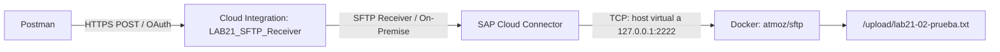

La escritura SFTP desde CPI se validó en 21.2. La lectura periódica mediante SFTP Sender queda fuera de los resultados validados hasta ejecutar 21.3.

## Prerrequisitos e instalación

- Acceso a SAP Integration Suite / Cloud Integration, Design, Monitor y Security Material.
- SAP Cloud Connector conectado al subaccount del laboratorio, sin Location ID.
- Docker Desktop operativo y servidor SFTP `sap-learning-lab-sftp` accesible localmente.
- Credencial segura `LAB21_SFTP_BASIC` y SSH Known Hosts desplegado.
- Postman con autenticación OAuth para invocar endpoints HTTPS del runtime.

La instalación detallada del servidor, las claves de host SSH, la configuración de Cloud Connector y la reproducción en otro PC se documenta en la **[Guía de instalación SFTP y Cloud Connector](21-guia-instalacion-sftp-cloud-connector.md)**. El enlace requiere incorporar dicho archivo en `docs/`.

**Seguridad:** no almacenar contraseñas, claves privadas, service keys, tokens ni contenido sensible de `.env` en Git. Los scripts y el ejemplo de variables pueden versionarse sin secretos.

## 21.1 - Fundamentos y conectividad SFTP

**Estado:** ✅ Completado

### Objetivo y conceptos

Disponer de un servidor SFTP local y validar su acceso desde SAP Cloud Integration a través de SAP Cloud Connector. SFTP utiliza SSH sobre TCP; la autenticación del usuario y la verificación de la clave de host son controles distintos.

### Preparación y configuración

1. Preparar Docker Desktop y el contenedor `sap-learning-lab-sftp`, basado en `atmoz/sftp`, con usuario SFTP `labuser`, directorio `/home/labuser/upload` y puerto local `127.0.0.1:2222` hacia el puerto 22 del contenedor. El directorio local `tools/sftp/data` se utiliza para conservar los archivos del laboratorio. Los valores sensibles se almacenan fuera de Git.
2. Preparar la clave SSH de host ED25519 persistente. En este entorno Windows, montar directamente la clave privada dentro del contenedor produjo permisos `0777`, rechazados por OpenSSH. Se utilizó un script de inicialización en `/etc/sftp.d/` que copia la clave al sistema de archivos del contenedor, establece propietario `root` y permisos `600`, y genera su clave pública. Se verificó que la huella ofrecida a CPI coincidiera con la del contenedor. Véase `KBA-LAB-021-A`.
3. Conectar SAP Cloud Connector 2.16.2 al subaccount SAP BTP Trial. En **Cloud To On-Premise / Access Control**, registrar un recurso `Non-SAP System`, protocolo `TCP`, dirección interna `127.0.0.1:2222` y dirección virtual `sftp-learning-lab.internal:2222`, sin Location ID. La comprobación de host interno mostró `Reachable`.
4. En Security Material de Cloud Integration, configurar `LAB21_SFTP_BASIC` como **User Credentials** para `labuser`. Registrar y desplegar SSH Known Hosts con la clave pública real del servidor y la entrada `[sftp-learning-lab.internal]:2222 ssh-ed25519 ...`. No documentar la contraseña ni una clave pública inventada.
5. En **SSH Connectivity Test**, usar host `sftp-learning-lab.internal`, puerto `2222`, proxy `On-Premise`, Location ID vacío, autenticación `User Credentials` con `LAB21_SFTP_BASIC`, verificación de host `Against Tenant`, timeout `10000` ms. Activar **Check Directory Access** e indicar `/upload`.

### Resultado, validación y evidencias

El test devolvió `Successfully reached host`; se verificó la clave de host ED25519, la autenticación y el listado de `/upload`. Esta prueba acredita acceso al directorio, **no escritura**; la escritura se comprobó en 21.2.

**Evidencia 21-01 - Conectividad SSH ED25519 a través de Cloud Connector.** Prueba de conexión y huella de host coincidente.

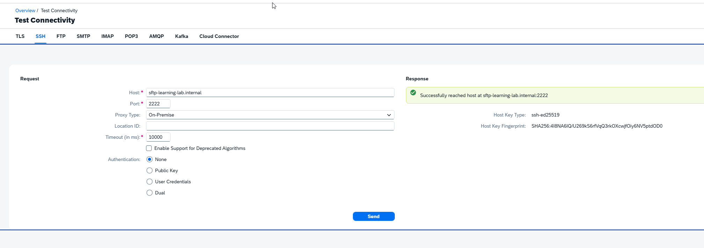

**Evidencia 21-02 - Autenticación y Known Hosts.** Prueba con credenciales del tenant y verificación de host activada.

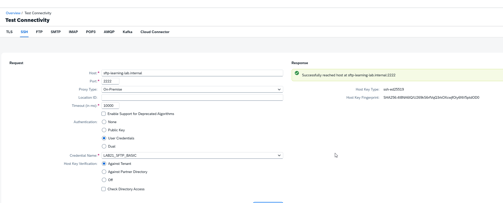

**Evidencia 21-03 - Acceso al directorio SFTP.** Listado remoto de `/upload` desde el test de conectividad.

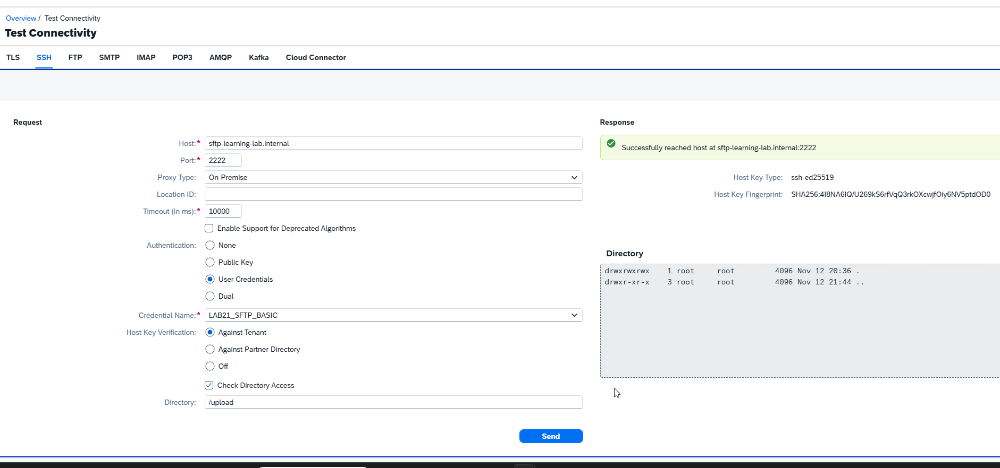

### Problemas encontrados y aprendizajes

- La clave ED25519 montada desde Windows fue rechazada por permisos demasiado abiertos; la inicialización dentro del contenedor resolvió el problema (`KBA-LAB-021-A`).
- El test informó `Cannot access known hosts artifact` hasta crear y desplegar el artefacto Known Hosts (`KBA-LAB-021-B`).
- La pérdida temporal de acceso administrativo a Cloud Connector se resolvió recordando la contraseña; **no se probó** restaurar usuarios desde XML (`KBA-LAB-021-C`).

## 21.2 - Escritura mediante SFTP Receiver

**Estado:** ✅ Completado

### Objetivo y conceptos

Recibir un mensaje de texto por HTTPS desde Postman, escribirlo en un servidor SFTP on-premise, comprobar la sobrescritura y observar el comportamiento ante permisos insuficientes. El adaptador SFTP Receiver realiza la escritura; la respuesta HTTP no sustituye la comprobación del archivo.

### Prerrequisitos

Laboratorio 21.1 validado; Security Material y Known Hosts desplegados; acceso al package `CPI Learning Lab`; Postman con Bearer Token autorizado.

### Diseño e implementación

1. Crear el iFlow `LAB21_SFTP_Receiver` en `CPI Learning Lab`, guardarlo y crear inmediatamente la versión inicial `1.0.0`, antes de configurar el flujo. La versión inicial es un punto de partida, no una prueba de funcionamiento.
2. Configurar un **HTTPS Sender** con Address `/lab21/sftp/receiver`, autorización `User Role`, rol `ESBMessaging.send` y `CSRF Protected` desactivado. Reutiliza la autenticación OAuth ya probada en el curso.
3. Conectar **Start Event** directamente con **End Event**, sin transformaciones, para conservar el cuerpo recibido.
4. Agregar Receiver `SFTP_Server` y conectarlo mediante un Message Flow con adaptador **SFTP**.
5. Configurar **SFTP → Target**: Directory `/upload`, File Name `lab21-02-prueba.txt`, Append Timestamp desactivado, Address `sftp-learning-lab.internal:2222`, Proxy Type `On-Premise`, Location ID vacío, Authentication `User Name/Password` y Credential Name `LAB21_SFTP_BASIC`. En esta interfaz, host y puerto se indican juntos en Address.
6. Mantener **SFTP → Processing**: Change Directories Stepwise activado, Create Directories activado, Flatten File Names desactivado, Prevent Directory Traversal activado, Use Fast Exists Check activado, Handling for Existing Files `Override`, Use Temporary File desactivado. `Override` permite reemplazar el contenido anterior; es una decisión que debe revisarse en escenarios productivos.
7. Guardar y desplegar. Se observó `Deployed` y Runtime Status `Started`, sin problemas visibles en el diseñador.

**Evidencia 21-04 - iFlow desplegado e iniciado.** Diseño HTTPS → SFTP, estado Started y pestaña Problems sin errores.

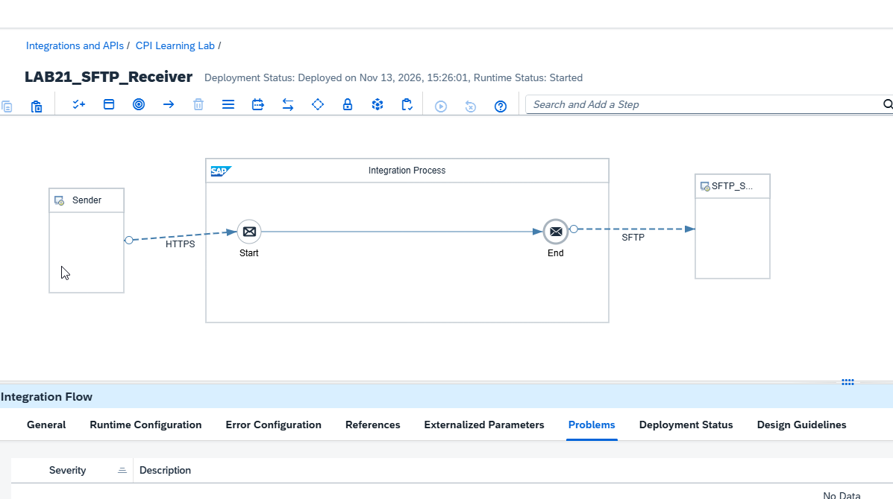

### Prueba positiva: escritura inicial

8. Crear en Postman la carpeta `21 - Integración SFTP y archivos` y la petición independiente `21.2 - Escritura de archivo SFTP`: método `POST`, URL del runtime terminada en `/http/lab21/sftp/receiver`, OAuth Bearer Token, `Content-Type: text/plain`, Body raw:

   ```text
   LAB21-SFTP-RECEIVER
   Orden: ORD-21001
   Origen: Postman
   Destino: SFTP
   ```

   La respuesta observada fue **HTTP 200 OK** con el contenido de entrada.

   **Evidencia 21-05 - Petición y respuesta HTTPS.** Postman muestra el body y HTTP 200 sin revelar el token.

   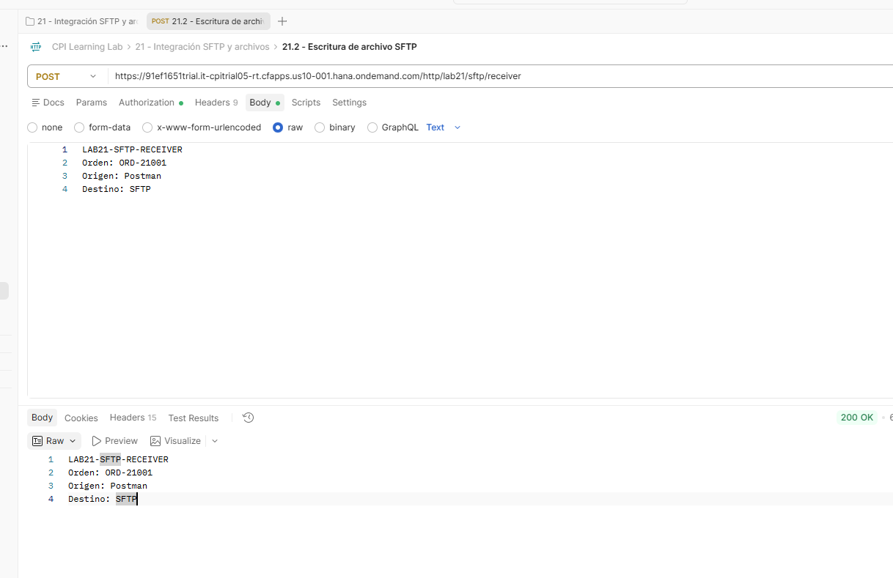

9. Verificar en Docker el archivo creado:

   ```powershell
   docker exec sap-learning-lab-sftp ls -l /home/labuser/upload/lab21-02-prueba.txt
   docker exec sap-learning-lab-sftp cat /home/labuser/upload/lab21-02-prueba.txt
   ```

   Se observó un archivo de **69 bytes** con las cuatro líneas y la orden `ORD-21001`.

   **Evidencia 21-06 - Archivo escrito y contenido.** Docker muestra el archivo y su contenido real.

   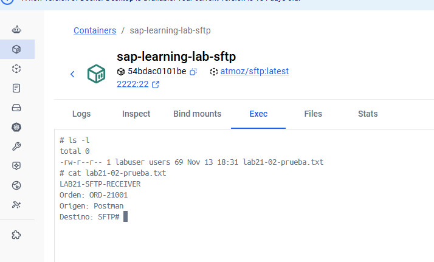

10. Consultar **Monitor → Message Processing** para `LAB21_SFTP_Receiver`. El mensaje finalizó **Completed**, con `InternalError=false` y duración observada de **5 s 667 ms**.

    **Evidencia 21-07 - MPL Completed.** Registro de procesamiento correcto.

    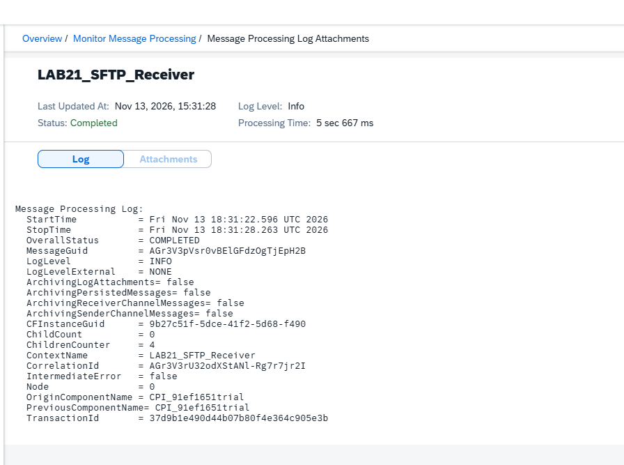

### Prueba de sobrescritura

11. Repetir la petición POST cambiando el Body a:

    ```text
    LAB21-SFTP-RECEIVER
    Orden: ORD-21002
    Origen: Postman
    Destino: SFTP
    Prueba: Sobrescritura
    ```

    Se recibió **HTTP 200 OK**. La lectura posterior en Docker mostró un único archivo de **92 bytes** con `ORD-21002` y sin `ORD-21001`: comportamiento `Override` validado.

    **Evidencia 21-08 - Sobrescritura del archivo existente.** Contenido nuevo sin la orden anterior.

    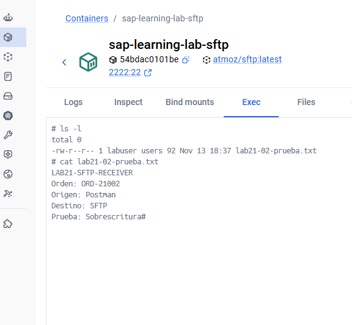

### Prueba negativa: permisos insuficientes

12. Preparar un directorio aislado no escribible por `labuser`:

    ```powershell
    docker exec -u root sap-learning-lab-sftp sh -c "mkdir -p /home/labuser/upload/sin-permisos && chown root:root /home/labuser/upload/sin-permisos && chmod 555 /home/labuser/upload/sin-permisos"
    docker exec sap-learning-lab-sftp ls -ld /home/labuser/upload/sin-permisos
    ```

    Se verificaron propietario `root root` y permisos `dr-xr-xr-x`.
13. Crear la versión numerada `1.0.1` del diseño funcional validado, con comentario `Laboratorio 21.2 - SFTP Receiver validado: escritura y sobrescritura`. La creación de la versión no implica despliegue.
14. Cambiar temporalmente **Directory** a `/upload/sin-permisos`, guardar y desplegar; confirmar `Started`.
15. Ejecutar el POST con Body:

    ```text
    LAB21-SFTP-RECEIVER
    Orden: ORD-21003
    Origen: Postman
    Destino: SFTP
    Prueba: Error de permisos
    ```

    La respuesta fue **HTTP 500 Internal Server Error** y contenía el identificador del MPL fallido.

    **Evidencia 21-09 - Error HTTP de escritura.** Postman muestra el error 500 de la prueba controlada.

    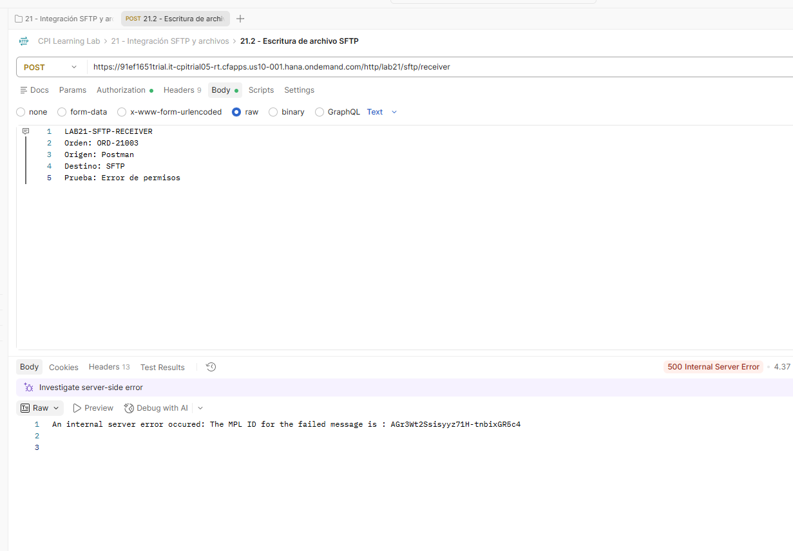

16. En Monitor se observó el mensaje **Failed** y `Last Error` con `Permission denied`, consistente con los permisos del directorio. Tiempo observado: **3 s 905 ms**. Esta prueba no atribuye el fallo a las credenciales ni a Cloud Connector.

    **Evidencia 21-10 - MPL Failed y Permission denied.** Diagnóstico del fallo de escritura.

    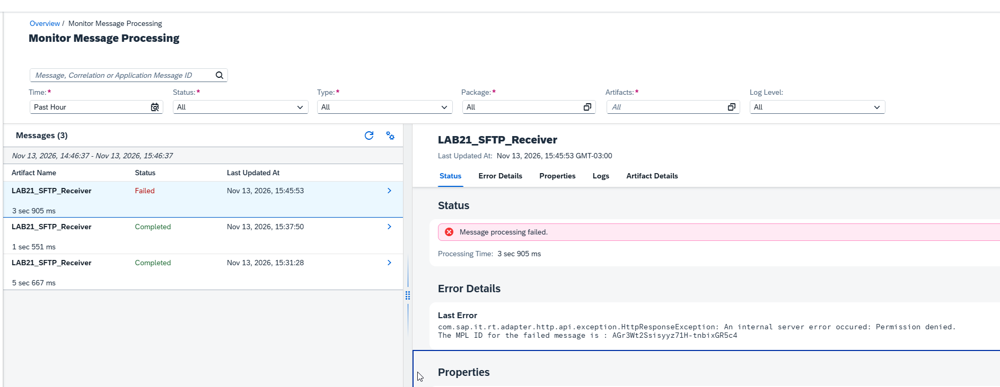

### Restauración y validación final

17. Restaurar **Directory** a `/upload`, guardar y desplegar nuevamente. Repetir POST con la orden `ORD-21004`; se obtuvo **HTTP 200 OK**. La lectura del archivo desde Docker confirmó que contenía `ORD-21004`, sin órdenes anteriores. El iFlow queda con la configuración funcional restaurada.

### Resultado esperado y validación

| Caso | Resultado observado | Estado |
|---|---|---|
| Escritura inicial | HTTP 200, archivo con ORD-21001, MPL Completed | ✅ |
| Archivo existente (`Override`) | HTTP 200, archivo reemplazado con ORD-21002 | ✅ |
| Directorio sin permisos | HTTP 500, MPL Failed, `Permission denied` | ✅ |
| Restauración del destino | HTTP 200, archivo con ORD-21004 | ✅ |

### Problemas encontrados, aprendizajes y límites

- El campo **Address** del SFTP Receiver en esta interfaz utiliza `host:puerto`; no existe un campo Port separado en la captura observada.
- `Override` sustituye el contenido anterior; se comprobó sobre un nombre fijo de prueba. No representa una política de conservación de archivos.
- Los permisos del servidor remoto pueden producir HTTP 500 y MPL Failed aunque el iFlow esté `Started`.
- El HTTP 200 se complementó con lectura real del archivo; por sí solo no se utilizó como prueba de persistencia.
- No se validaron aún lectura por polling, tratamiento masivo, nombres dinámicos, archivos temporales ni recuperación automática de errores.

## Referencias y documentación complementaria

- [SAP Integration Suite - SAP Help Portal](https://help.sap.com/docs/integration-suite)
- [SAP Cloud Connector - SAP Help Portal](https://help.sap.com/docs/connectivity)
- [Guía de instalación SFTP y Cloud Connector](21-guia-instalacion-sftp-cloud-connector.md) - documento complementario que debe publicarse en `docs/`.
- [KBA y hallazgos](kba-y-hallazgos.md) - `KBA-LAB-021-A`, `021-B`, `021-C` y el hallazgo de permisos de 21.2.

## Estado y próximos laboratorios

**21.1:** ✅ Completado. **21.2:** ✅ Completado. **Capítulo 21:** 🟨 En curso. Los laboratorios 21.3–21.6 requieren diseño y validación propios antes de cambiar su estado.
