# 22 - Patrones de integración aplicados en CPI

**Estado:** 🟨 En curso

## Objetivo y contexto

Aplicar patrones de integración a órdenes de negocio, reutilizando Router, Request Reply, Exchange Properties, XML, Gather y monitorización estudiados en capítulos anteriores. El capítulo anterior abordó integración SFTP y archivos; aquí se estudia la lógica de distribución y composición de mensajes independientemente del transporte.

## Alcance y plan de laboratorios

| Laboratorio | Objetivo | Estado |
|---|---|---|
| 22.1 Message Filter | Filtrar órdenes según su estado | ✅ Completado |
| 22.2 Recipient List y Multicast | Distribuir y consolidar respuestas de destinatarios | ✅ Completado |
| 22.3 Process Direct | Comunicación entre iFlows | ✅ Completado |
| 22.4 Canonical Data Model | Modelo común de datos | ✅ Completado |
| 22.5 Aggregator | Agregación de mensajes | ⬜ Pendiente |
| 22.6 Integrador | Combinar patrones | ⬜ Pendiente |

Estimación inicial del capítulo: 215–300 minutos, no equivalente a tiempo real medido. La estimación inicial de 22.2 fue 40–55 minutos; las dificultades del editor extendieron su ejecución.

## Arquitectura conceptual

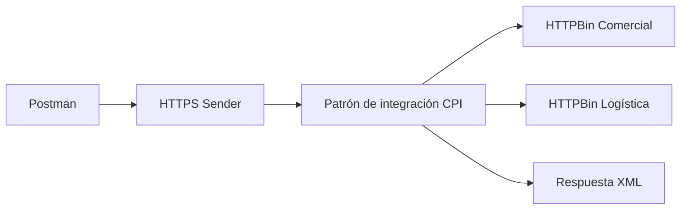

HTTPBin simula destinatarios externos; no representa sistemas comerciales o logísticos reales.

## Prerrequisitos y criterios de validación

- Package `CPI Learning Lab`, runtime Cloud Integration y acceso a Monitor.
- Postman con OAuth 2.0 y carpeta `22 - Patrones de integración aplicados en CPI`.
- Conectividad HTTPS hacia `https://httpbin.org/post`.
- Validar despliegue, respuesta XML, rutas y trazas pertinentes. No almacenar credenciales ni tokens en evidencias.

## 22.1 - Message Filter

**Estado:** ✅ Completado

### Objetivo y conceptos

Un Message Filter permite descartar mensajes que no cumplen una condición. En este escenario se implementa con Router: únicamente las órdenes aprobadas se envían al receptor; la ruta por defecto devuelve un resultado funcional de descarte.

### Configuración y procedimiento

1. Crear `LAB22_Message_Filter` y registrar versión inicial `1.0.0`.

**Evidencia 22-01 - Versión inicial del iFlow**


2. Configurar HTTPS Sender: Address `/lab22/message-filter`, User Role `ESBMessaging.send`, CSRF desactivado para este laboratorio; autenticación OAuth.
3. Crear `CM_Conservar_OrderId` con Exchange Property `OrderId`, XPath `/Order/OrderId/text()`, tipo `java.lang.String`. Se conserva el identificador antes de que Request Reply reemplace el body.
4. Configurar `RT_Filtrar_Orden`: ruta `Orden_Aprobada`, condición XML `/Order/Status = 'APROBADA'`; ruta `Orden_Descartada` por defecto.

**Evidencia 22-02 - Condición XPath del Router**


5. En la ruta aprobada incorporar `RR_Enviar_Orden` con HTTP Receiver: Address `https://httpbin.org/post`, POST, Internet, Authentication None, Timeout 60000 ms, Throw Exception on Failure marcado.
6. Después de Request Reply, configurar `CM_Respuesta_Enviada`: header `Content-Type` Constant `application/xml`, body Expression:

```xml
<Result><OrderId>${property.OrderId}</OrderId><Status>ENVIADO</Status><Message>Orden enviada al destinatario</Message></Result>
```

7. En la ruta por defecto configurar `CM_Respuesta_Descartada`, mismo header y body Expression:

```xml
<Result><OrderId>${property.OrderId}</OrderId><Status>DESCARTADO</Status><Message>Orden no aprobada</Message></Result>
```

8. Conectar ambas rutas al End, guardar y desplegar. Runtime Started.

**Evidencia 22-03 - Diseño completo y estado de despliegue**

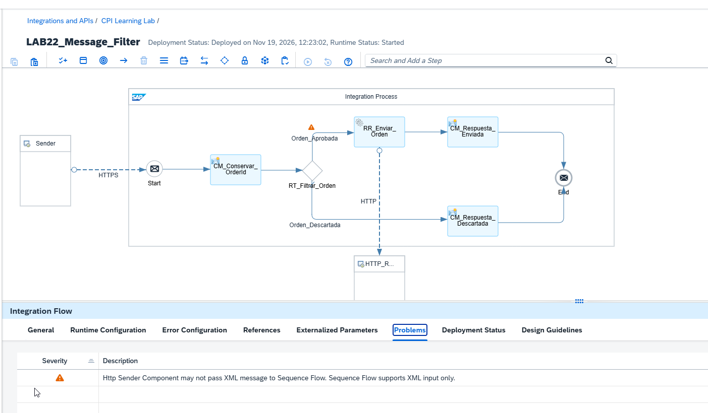

### Pruebas en Postman

POST `/http/lab22/message-filter`, OAuth 2.0, Content-Type `application/xml`.

```xml
<Order><OrderId>ORD-22001</OrderId><Customer>CLIENTE-A</Customer><Amount>150000</Amount><Status>APROBADA</Status></Order>
```

| Petición (22.1 - Message Filter) | OrderId | Status entrada | HTTP | Resultado validado |
|---|---|---|---|---|
| Orden aprobada | ORD-22001 | APROBADA | 200 | ENVIADO |
| Orden pendiente | ORD-22002 | PENDIENTE | 200 | DESCARTADO |
| Orden rechazada | ORD-22003 | RECHAZADA | 200 | DESCARTADO |
| Orden sin estado | ORD-22004 | Elemento ausente | 200 | DESCARTADO |

**Evidencia 22-04 - Postman: orden aprobada**

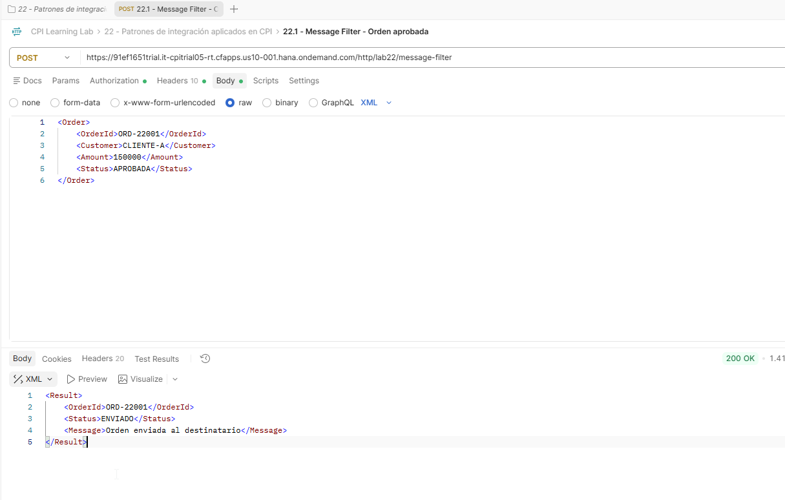


**Evidencia 22-05 - Postman: orden descartada**


### Validación mediante Trace

La ruta por defecto registró seis pasos y no incluyó llamada HTTP; la ruta aprobada registró nueve pasos, incluyendo HTTP Receiver. La respuesta de HTTPBin contiene el POST y XML original de la orden aprobada.

**Evidencia 22-06 - Trace de ruta por defecto**


**Evidencia 22-07 - Trace de ruta aprobada y respuesta HTTPBin**

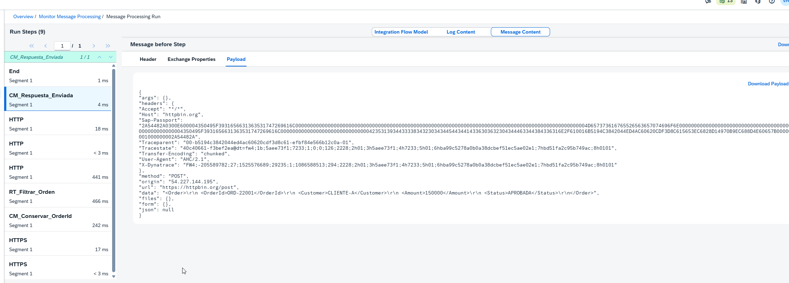

### Resultados, problemas y aprendizajes

La condición XPath seleccionó únicamente las órdenes aprobadas. El descarte es una decisión funcional, no un error HTTP. El diseñador mostró una advertencia sobre el formato XML del HTTPS Sender; no impidió las pruebas con XML válido. No se comprobó XML mal formado. Se restauró Info y se registró la versión de diseño `1.0.1`.

## 22.2 - Recipient List y Multicast

**Estado:** ✅ Completado

### Objetivo y conceptos

Distribuir una orden a dos destinatarios y combinar sus respuestas. Sequential Multicast establece una secuencia de ramas; Parallel Multicast permite procesamiento concurrente sin exigir ese orden. Join reúne las ramas y Gather combina sus contenidos. Recipient List condicional selecciona destinatarios según una regla de negocio.

### 22.2.1 - Sequential Multicast

**Estado:** ✅ Completado

Crear `LAB22_Multicast`, versión inicial `1.0.0`.

**Evidencia 22-08 - Versión inicial del Multicast**


Configurar HTTPS Sender con `/lab22/multicast`, User Role `ESBMessaging.send`, CSRF desactivado y OAuth. Agregar `CM_Conservar_Datos_Orden` con propiedades de tipo `java.lang.String`:

| Propiedad | Source Type | XPath |
|---|---|---|
| OrderId | XPath | `/Order/OrderId/text()` |
| RequiresShipping | XPath | `/Order/RequiresShipping/text()` |

La segunda propiedad conserva el indicador de envío, aunque la selección condicional posterior evalúa directamente el XML; no interviene en las pruebas de Multicast.

Agregar `MC_Distribuir_Orden` de tipo Sequential Multicast, con Comercial en posición 1 y Logistica en posición 2.

| Componente | Comercial | Logística |
|---|---|---|
| Content Modifier de entrada | CM_Destinatario_Comercial | CM_Destinatario_Logistica |
| Header Constant X-Recipient | Comercial | LOGISTICA |
| Request Reply | RR_Enviar_Comercial | RR_Enviar_Logistica |
| Receiver | HTTPBin_Comercial | HTTPBin_Logistica |
| Content Modifier de respuesta | CM_Respuesta_Comercial | CM_Respuesta_Logistica |

Ambos HTTP Receiver: `https://httpbin.org/post`, POST, Internet, Authentication None, Request Headers `X-Recipient`, Timeout 60000 ms, Throw Exception on Failure marcado. No modificar el body antes del envío. En ambos Content Modifier finales establecer `Content-Type` Constant `application/xml`, body Expression:

```xml
<Result><OrderId>${property.OrderId}</OrderId><Recipient>COMERCIAL</Recipient><Status>ENVIADO</Status></Result>
```

En Logística sustituir `COMERCIAL` por `LOGISTICA`. Conectar ambos al único Join `JN_Unir_Destinatarios`; después insertar `GT_Consolidar_Respuestas`, Incoming Format `XML (Same Format)`, Aggregation Algorithm `Combine`, y End.

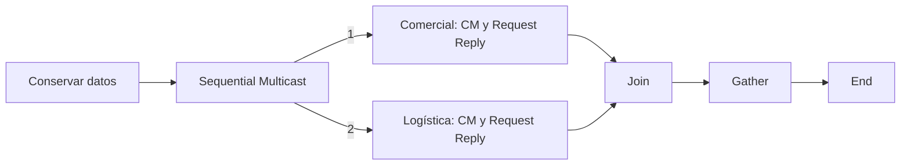

**Evidencia 22-09 - Diseño completo y secuencia Comercial–Logistica**

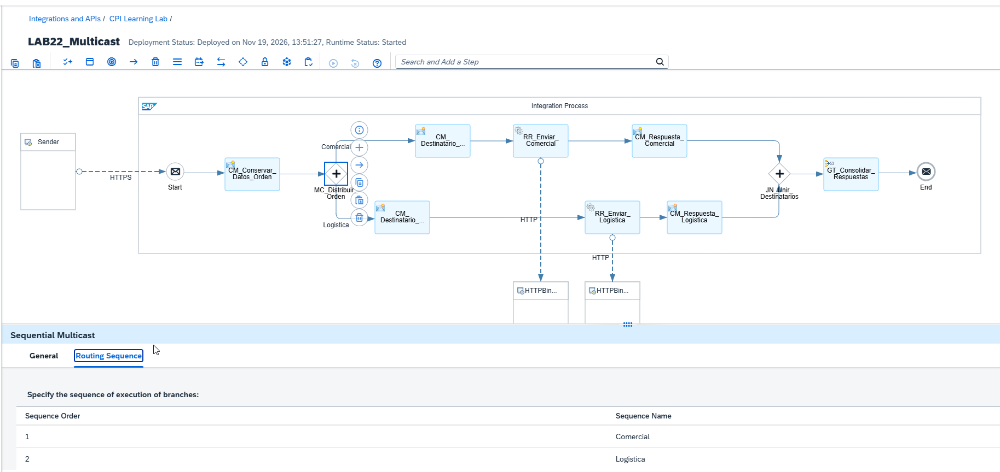

Guardar y desplegar. Ejecutar Postman `22.2 - Multicast - Sequential`, POST `/http/lab22/multicast`, OAuth, Content-Type `application/xml`:

```xml
<Order><OrderId>ORD-22101</OrderId><Customer>CLIENTE-A</Customer><Amount>150000</Amount><RequiresShipping>true</RequiresShipping></Order>
```

Resultado observado HTTP 200:

```xml
<multimap:Messages xmlns:multimap="http://sap.com/xi/XI/SplitAndMerge">
  <multimap:Message1>
    <Result><OrderId>ORD-22101</OrderId><Recipient>COMERCIAL</Recipient><Status>ENVIADO</Status></Result>
    <Result><OrderId>ORD-22101</OrderId><Recipient>LOGISTICA</Recipient><Status>ENVIADO</Status></Result>
  </multimap:Message1>
</multimap:Messages>
```

**Evidencia 22-10 - Respuesta XML consolidada en Postman**


Habilitar Trace y repetir la petición. El Trace registró 17 pasos, Comercial en segmento 2 y Logística en segmento 3. La respuesta JSON de HTTPBin observada antes de `CM_Respuesta_Comercial` confirma el POST, XML original y header `X-Recipient: Comercial`.

**Evidencia 22-11 - Respuesta HTTPBin de Comercial**


La comprobación equivalente de Logística fue confirmada por el operador del laboratorio; su captura final no fue inspeccionada independientemente.

**Evidencia 22-12 - Respuesta HTTPBin de Logística**

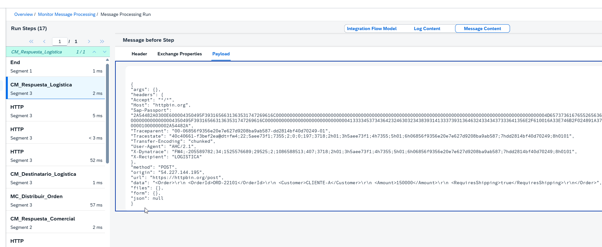

Restaurar Info y registrar versión de diseño `1.0.1`. La secuencia configurada y el orden de los resultados fueron verificados.

### 22.2.2 - Parallel Multicast

**Estado:** ✅ Completado

Copiar `LAB22_Multicast` como `LAB22_Multicast_Parallel`, versión inicial `1.0.0`. Cambiar HTTPS Sender a `/lab22/multicast-parallel` antes de desplegar para mantener ambos escenarios separados. Sustituir Sequential Multicast por Parallel Multicast; conservar las dos ramas, adaptadores, Join y Gather. Verificar las conexiones y nombres tras guardar y reabrir el editor.

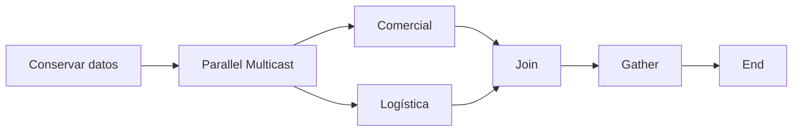

Despliegue validado: Started, 19/11/2026 14:56:22.

**Evidencia 22-13 - Diseño Parallel Multicast desplegado**


Duplicar petición secuencial en Postman como `22.2 - Multicast - Parallel`; cambiar endpoint a `/http/lab22/multicast-parallel`, conservar el XML y la autenticación.

Resultado HTTP 200: dos elementos Result con identificador ORD-22101 y estado ENVIADO, esta vez Logística antes que Comercial.

**Evidencia 22-14 - Respuesta consolidada en orden inverso**

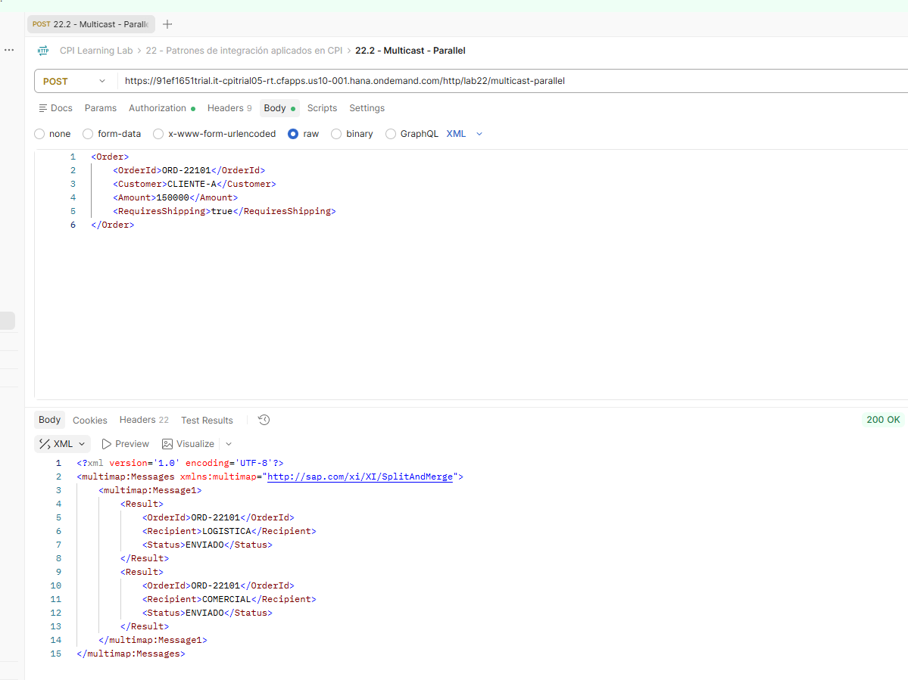

Habilitar Trace y repetir la petición. Se registraron 17 pasos y se observaron pasos de las ramas intercalados. Comercial figuró en segmento 3, Logística en segmento 2. Ambos Content Modifier mostraron inicio 14:59:20 con precisión de segundos; Activities no aportó marcas temporales más precisas.

**Evidencia 22-15 - Trace de ejecución de las ramas paralelas**


Restaurar Info y registrar versión de diseño `1.0.1`. La integridad del artefacto secuencial original fue confirmada por el operador tras revisar el diseño.

### Comparación y aprendizajes

| Aspecto | Sequential | Parallel |
|---|---|---|
| HTTP | 200 | 200 |
| Resultados | 2 | 2 |
| Orden observado | Comercial, Logística | Logística, Comercial |
| Trace | Ramas secuenciadas | Pasos intercalados |

El orden de respuesta observado no es una garantía contractual para Parallel Multicast. No se demostró el solapamiento exacto en milisegundos ni una mejora cuantitativa de rendimiento. Las versiones indicadas corresponden a Design; no se verificó nuevamente el número de versión del runtime después de Save as Version.

### Problemas encontrados

Routing Sequence mostró temporalmente nombres duplicados; guardar y reabrir corrigió la visualización. Durante el reemplazo del Multicast en la copia también hubo dificultades de conexión y nombres desactualizados; la reconstrucción de conexiones y reapertura permitieron recuperar el diseño, posteriormente desplegado y probado. La causa interna no fue determinada. Véase [KBA y hallazgos](kba-y-hallazgos.md).

### 22.2.3 - Recipient List condicional

**Estado:** ✅ Completado

#### Objetivo y diseño

Seleccionar los destinatarios efectivos según el contenido de una orden. Las ramas del Multicast son estáticas: ambas se inician, pero la llamada HTTP de Logística depende de una condición. No se implementa una lista dinámica de endpoints.

1. Copiar `LAB22_Multicast` como `LAB22_Recipient_List`, descripción `22.2 - Recipient List condicional`, versión inicial `1.0.0`. Cambiar el HTTPS Sender a `/lab22/recipient-list` antes del despliegue. Conservar autorización, propiedades, rama Comercial, Sequential Multicast, Join y Gather.
2. Crear `LIP_Procesar_Logistica` con Router `RT_Requiere_Envio`. Configurar ruta `Envio_Requerido`, Expression Type XML, XPath `/Order/RequiresShipping = 'true'`; ruta `Envio_No_Requerido` como Default. Evaluar el Body original antes de Request Reply.
3. En la ruta requerida configurar `CM_Destinatario_Logistica` con header Constant `X-Recipient = LOGISTICA`, `RR_Enviar_Logistica` y `CM_Respuesta_Logistica`. Asociar el Receiver HTTP de Logística al Request Reply local con los mismos parámetros de 22.2.1. Conservar el Body original antes de la llamada.
4. En ambas rutas configurar el header de respuesta `Content-Type` Constant `application/xml`. Para `CM_Respuesta_Logistica` y `CM_Respuesta_Logistica_Omitida`, respectivamente, usar Body Expression:

```xml
<Result><OrderId>${property.OrderId}</OrderId><Recipient>LOGISTICA</Recipient><Status>ENVIADO</Status></Result>
```

```xml
<Result><OrderId>${property.OrderId}</OrderId><Recipient>LOGISTICA</Recipient><Status>OMITIDO</Status></Result>
```

5. Reemplazar los pasos de Logística del proceso principal por `PC_Procesar_Logistica`, asociado a `LIP_Procesar_Logistica`. Conectar su salida al Join existente; mantener Gather con XML (Same Format) y Combine. El proceso local devuelve un XML compatible con el resultado Comercial, incluso cuando omite la llamada.

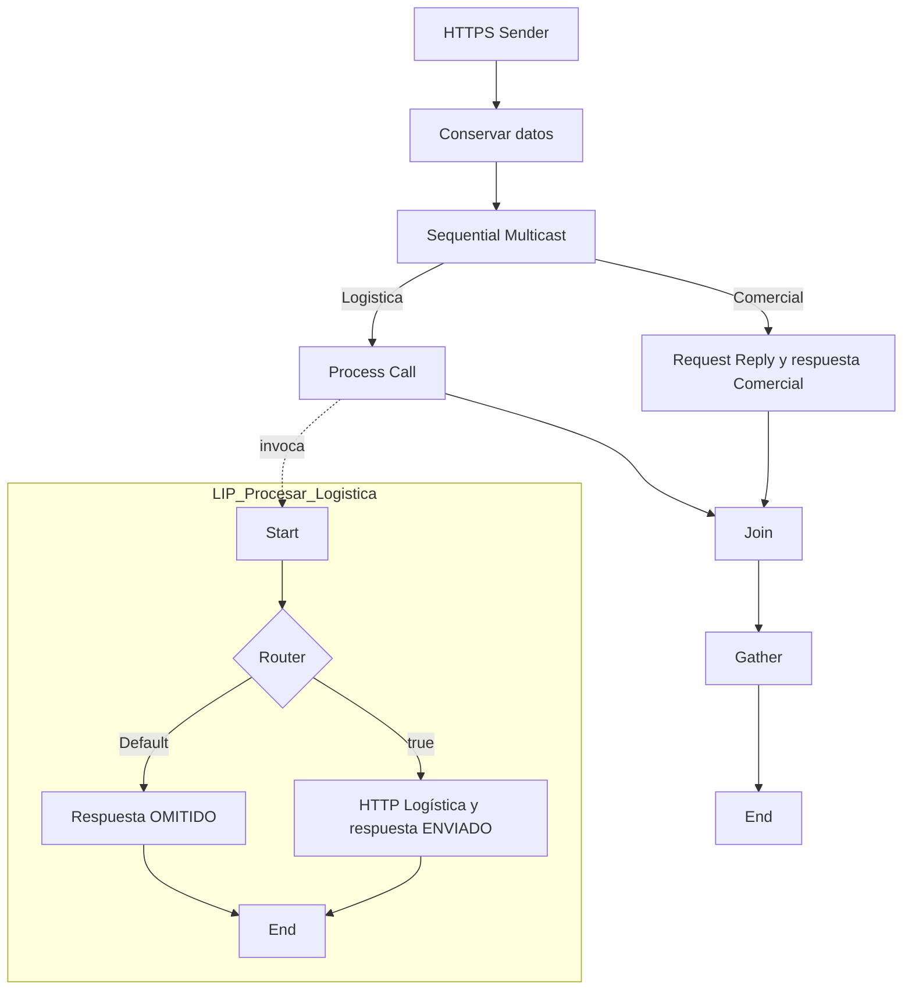

6. Guardar y desplegar. Diseño sin problemas reportados (`No Data`), Runtime Started, 19/11/2026 18:12:39.

**Evidencia 22-16 - Diseño completo con proceso local y despliegue**

El proceso principal invoca el Router encapsulado en el proceso local.

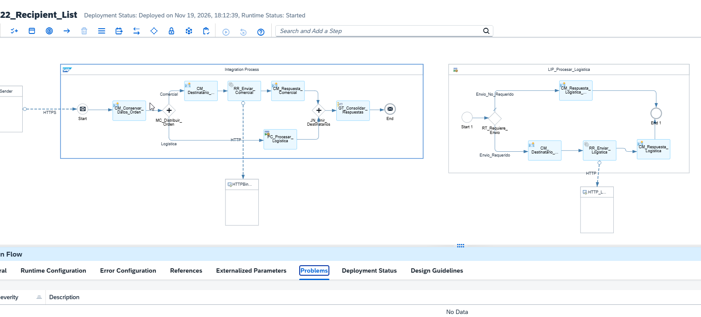


#### Pruebas funcionales

POST `/http/lab22/recipient-list`, OAuth existente, Content-Type `application/xml`. Peticiones independientes en la carpeta del capítulo.

```xml
<Order><OrderId>ORD-22201</OrderId><Customer>CLIENTE-A</Customer><Amount>150000</Amount><RequiresShipping>true</RequiresShipping></Order>
```

| Petición (22.2 - Recipient List) | OrderId | RequiresShipping | HTTP | Comercial | Logística |
|---|---|---|---|---|---|
| Envio requerido | ORD-22201 | true | 200 | ENVIADO | ENVIADO |
| Envio no requerido | ORD-22202 | false | 200 | ENVIADO | OMITIDO |
| Sin indicador de envio | ORD-22203 | Ausente | 200 | ENVIADO | OMITIDO |

Para los casos restantes cambiar OrderId y el indicador según la tabla; en el tercero eliminar el elemento completo. Los tres casos fueron observados en Postman, con la estructura multimap de Gather. La ausencia del campo se trata como omisión por decisión funcional del laboratorio.

**Evidencia 22-17 - Envío requerido**

HTTP 200 y ambos destinatarios ENVIADO.

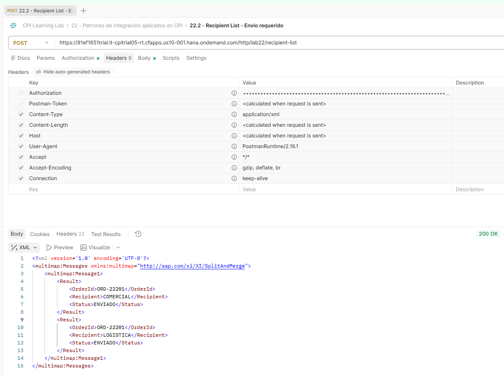

**Evidencia 22-18 - Envío no requerido**

HTTP 200 y Logística OMITIDO.

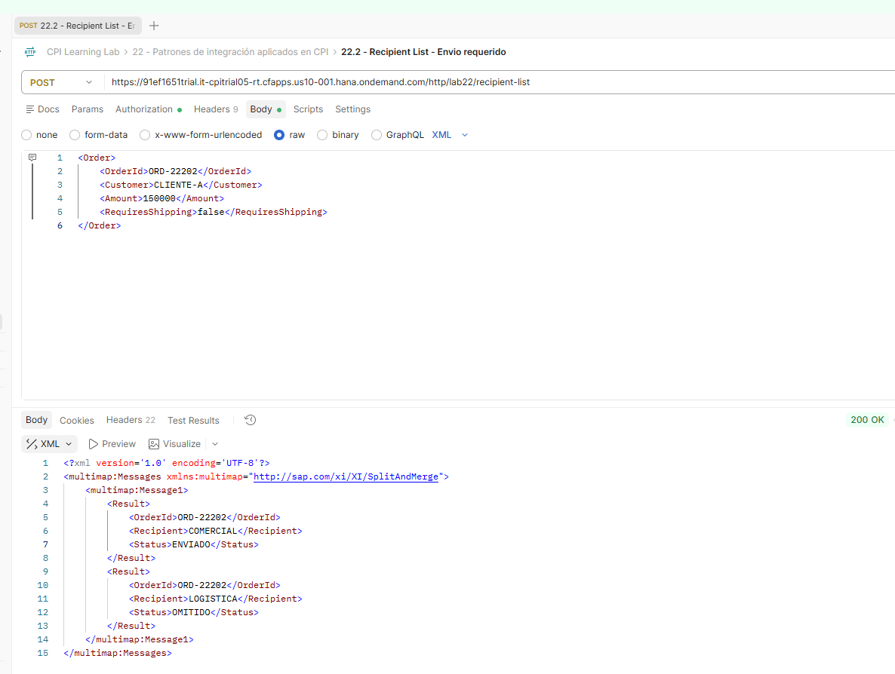


#### Validación mediante Trace

Activar Trace y repetir los casos false y true. En false se observaron 15 pasos: HTTP Comercial en segmento 2, Process Call, Router y `CM_Respuesta_Logistica_Omitida` en segmento 3, sin HTTP de Logística en la secuencia visible.

**Evidencia 22-19 - Trace de Logística omitida**

La ruta Default devuelve el resultado sin invocar al receptor de Logística.

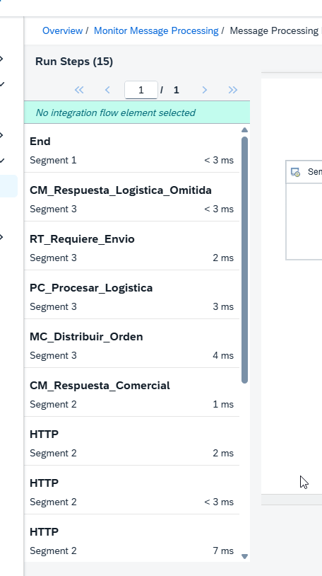


En true se observaron 19 pasos. Antes de `CM_Respuesta_Logistica`, la respuesta de HTTPBin confirma POST a `/post`, header `X-Recipient: LOGISTICA` y XML de ORD-22201 con RequiresShipping true. Redactar metadatos de trazabilidad e IP antes de publicar.

**Evidencia 22-20 - Trace de Logística enviada**

Respuesta del servicio HTTP en segmento 3.

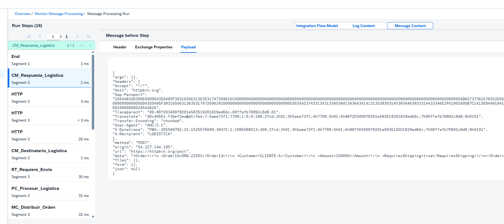


Restaurar Info y registrar versión de diseño `1.0.1`. El operador confirmó el cierre. El Router decide la llamada efectiva, no la creación de ramas del Multicast.

### 22.2.4 - Comportamiento ante errores

**Estado:** ✅ Completado

#### Objetivo y procedimiento

Analizar el procesamiento parcial cuando falla el segundo destinatario. Conservar `1.0.1` como punto de recuperación. Modificar temporalmente el Receiver HTTP de Logística a `https://httpbin.org/status/500`, método POST, Throw Exception on Failure activado, timeout 60000 ms. Mantener Comercial sin cambios. Guardar y desplegar sin registrar una versión numerada del escenario defectuoso. Activar Trace.

Duplicar la petición de envío requerido como `22.2 - Recipient List - Error en Logistica`, cambiar OrderId a `ORD-22204`, mantener RequiresShipping true. Resultado observado: HTTP 500 Internal Server Error con MPL ID, sin respuesta XML consolidada.

**Evidencia 22-21 - Error recibido por el emisor**

HTTP 500 para la orden ORD-22204.

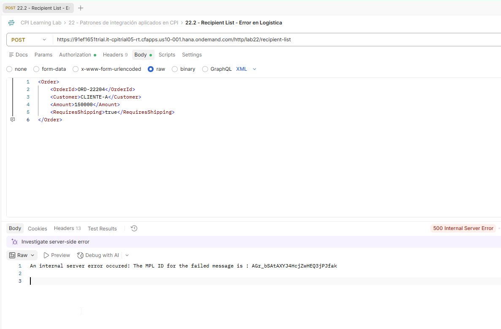


El Trace de 18 pasos muestra `CM_Respuesta_Comercial` ejecutado en segmento 2 y error HTTP en segmento 3, Process Step 15, duración 860 ms. La excepción es `org.apache.camel.component.ahc.AhcOperationFailedException`, statusCode 500, RealDestinationUrl `https://httpbin.org/status/500`.

**Evidencia 22-22 - Detalle de excepción HTTP**

El error se localiza en el Receiver de Logística.

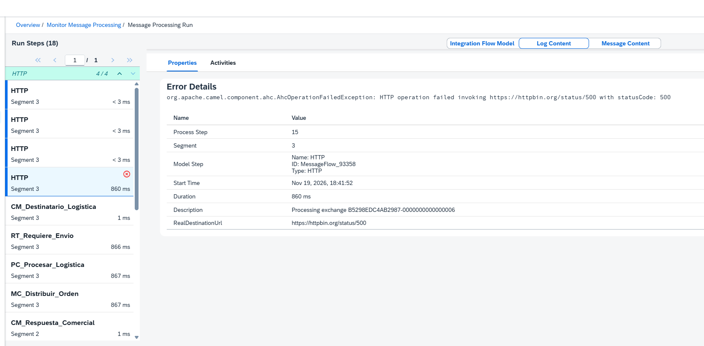

**Evidencia 22-23 - Propagación del error**

El modelo muestra el fallo en la rama de Logística y su propagación al proceso principal.

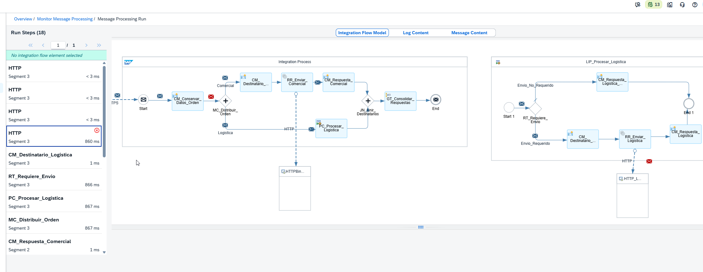


Manteniendo el destino erróneo, ejecutar `Envio no requerido` (ORD-22202, false). Resultado HTTP 200, Comercial ENVIADO y Logística OMITIDO.

**Evidencia 22-24 - Aislamiento condicional del fallo**

La orden sin envío no resulta afectada por el destino erróneo.

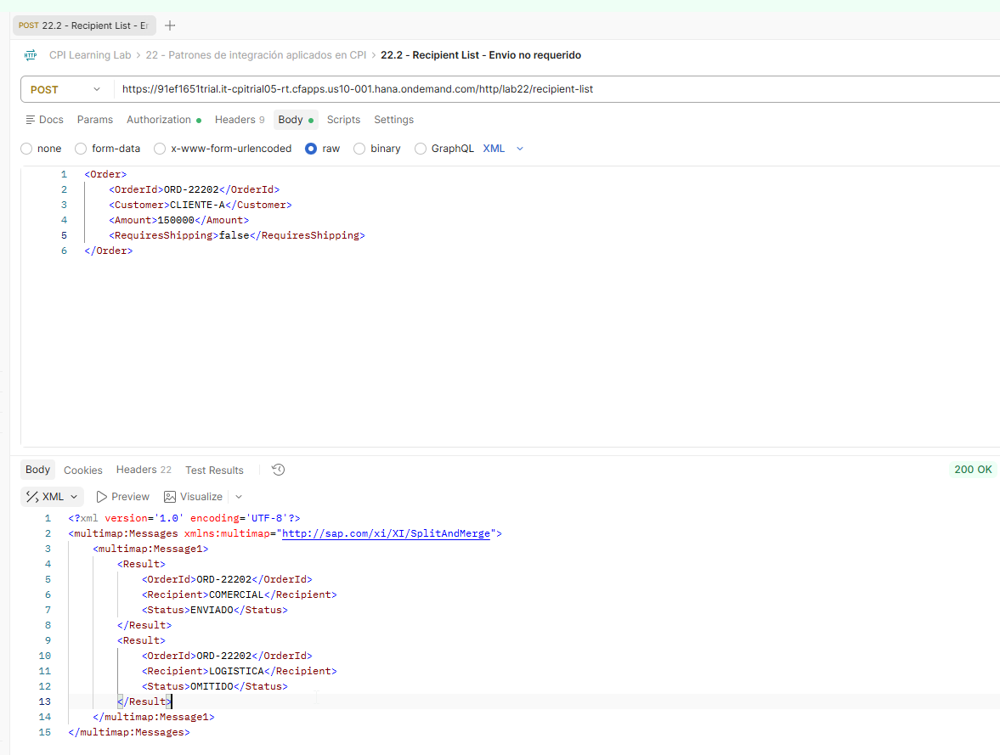


Restaurar Address `https://httpbin.org/post`, POST y Throw Exception on Failure activado; guardar, desplegar y repetir envío requerido. El operador confirmó HTTP 200 con ambos destinatarios ENVIADO, Started e Info restaurado. No registrar otra versión hasta incorporar XSLT.

#### Aprendizajes y alcance

El fallo global no implica que no haya ocurrido un envío previo. La ejecución de la respuesta Comercial antes de la excepción demuestra procesamiento previo de esa rama. Un reintento completo puede duplicar efectos externos; HTTPBin no permite probar persistencia ni rollback de una transacción de negocio. El MPL muestra la excepción, aunque no se conservó una captura separada del estado global Failed. La petición de error queda como caso histórico: reproducirla requiere reconfigurar temporalmente el destino.

### 22.2.5 - Normalización del XML consolidado

**Estado:** ✅ Completado

#### Objetivo y procedimiento

Eliminar la envoltura técnica de Gather y construir un contrato XML de negocio sin namespaces técnicos. Utilizar XSLT Mapping nativo, sin Groovy.

1. En `LAB22_Recipient_List`, insertar `XSL_Normalizar_Resultados` después de `GT_Consolidar_Respuestas` y antes de End.
2. Crear el recurso `XSL_Normalizar_Resultados.xsl` en UTF-8 sin BOM, sin declaración XML inicial. Contenido definitivo:

```xml
<xsl:stylesheet version="1.0"
    xmlns:xsl="http://www.w3.org/1999/XSL/Transform"
    xmlns:multimap="http://sap.com/xi/XI/SplitAndMerge"
    exclude-result-prefixes="multimap">
    <xsl:output method="xml" encoding="UTF-8" indent="yes"/>
    <xsl:template match="/">
        <Results>
            <xsl:for-each select="/multimap:Messages/multimap:Message1/Result">
                <Result>
                    <OrderId><xsl:value-of select="OrderId"/></OrderId>
                    <Recipient><xsl:value-of select="Recipient"/></Recipient>
                    <Status><xsl:value-of select="Status"/></Status>
                </Result>
            </xsl:for-each>
        </Results>
    </xsl:template>
</xsl:stylesheet>
```

3. En Processing seleccionar Source `Integration Flow`, Resource mediante **Select → Upload from File System**; asociar `/mapping/XSL_Normalizar_Resultados.xsl`. Output Format `Bytes`.

**Evidencia 22-25 - Configuración de XSLT Mapping**

Recurso asociado y formato Bytes; componente ubicado después de Gather.

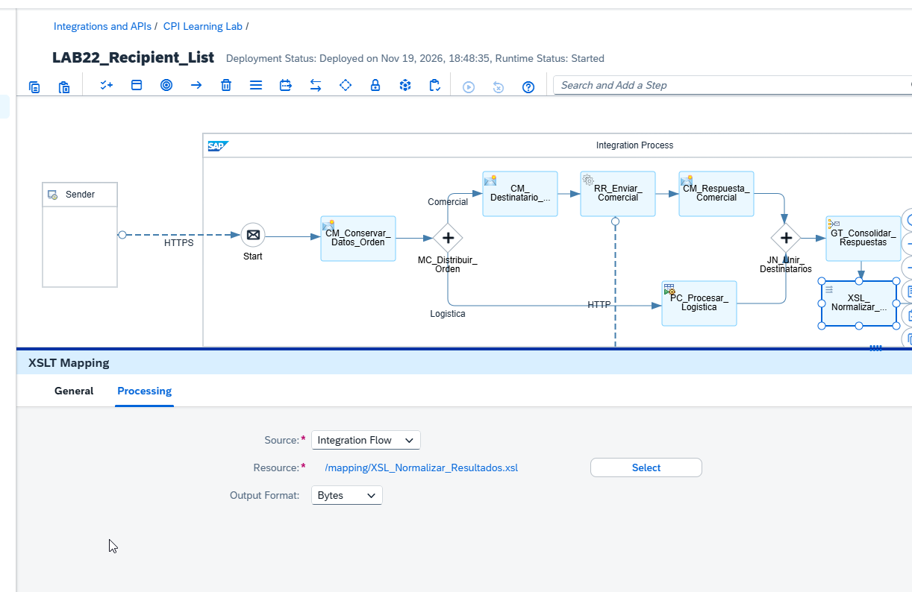


4. Guardar y desplegar. Ejecutar únicamente la petición `22.2 - Recipient List - Envio requerido` con el XML Order original de ORD-22201. HTTP 200, respuesta observada:

```xml
<Results>
    <Result><OrderId>ORD-22201</OrderId><Recipient>COMERCIAL</Recipient><Status>ENVIADO</Status></Result>
    <Result><OrderId>ORD-22201</OrderId><Recipient>LOGISTICA</Recipient><Status>ENVIADO</Status></Result>
</Results>
```

**Evidencia 22-26 - XML normalizado en Postman**

Ambos resultados conservan sus valores, sin envoltura ni declaraciones multimap.

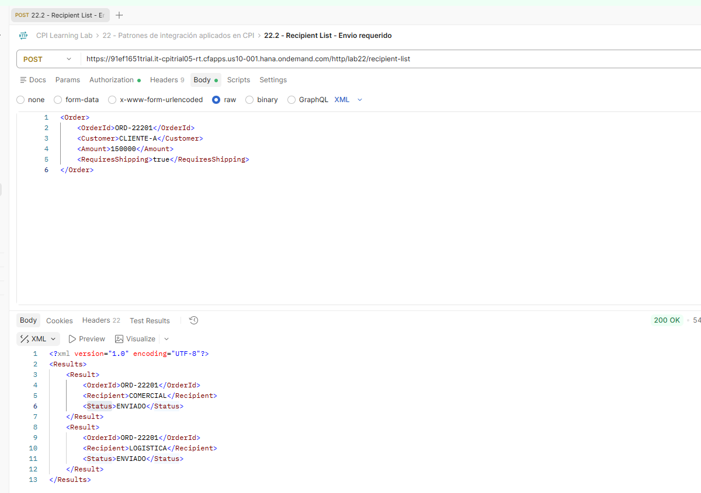


5. Registrar versión de diseño `1.0.2`, comentario `22.2 - Recipient List con normalizacion XSLT` y mantener Info. Cierre confirmado por el operador; no se inspeccionó una captura independiente de la versión final del runtime.

#### Problemas y aprendizajes

La carga inicial del XSLT fue rechazada con `The processing instruction target matching "[xX][mM][lL]" is not allowed`. La carga fue exitosa tras retirar la declaración XML y guardar el recurso según el procedimiento anterior. La causa exacta del archivo inicial no se comprobó. El uso de `xsl:copy-of` conservaba declaraciones de namespace del origen; la reconstrucción de elementos con `xsl:value-of` eliminó esas declaraciones. Véase [KBA y hallazgos](kba-y-hallazgos.md).

La transformación recibe la salida de Gather y no modifica el contrato de entrada Order. Se validó un caso representativo de normalización; no se repitieron los tres escenarios de routing ya comprobados. La transformación se limita a la estructura observada y a los campos explícitos del contrato.

### Cierre de 22.2

| Artefacto | Versión de diseño | Endpoint |
|---|---|---|
| LAB22_Multicast | 1.0.1 | /http/lab22/multicast |
| LAB22_Multicast_Parallel | 1.0.1 | /http/lab22/multicast-parallel |
| LAB22_Recipient_List | 1.0.2 | /http/lab22/recipient-list |

Los cinco ejercicios de 22.2 fueron validados. El capítulo continúa en curso.

## 22.3 - ProcessDirect

**Estado:** ✅ Completado

### Objetivo y conceptos

Comunicar dos iFlows del mismo tenant de forma síncrona mediante ProcessDirect, separando la interfaz HTTPS de la lógica reutilizable del proveedor. Request Reply espera la respuesta del proveedor; ProcessDirect no requiere publicar un endpoint HTTP adicional.

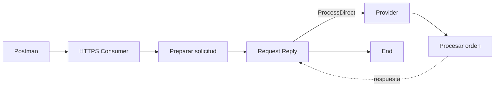

### Configuración del proveedor

Crear `LAB22_PD_Provider` en el package CPI Learning Lab, versión inicial `1.0.0`.

**Evidencia 22-27 - Versión inicial del proveedor**

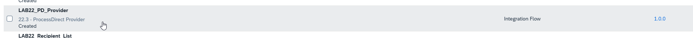

Configurar ProcessDirect Sender con Address `/lab22-pd-provider`. En Runtime Configuration establecer Allowed Header(s) `X-Source`, para admitir el header utilizado en el contrato entre los iFlows.

Agregar `CM_Procesar_Orden` entre Start y End:

| Sección | Nombre | Tipo | Valor |
|---|---|---|---|
| Message Header | Content-Type | Constant | application/xml |
| Exchange Property | OrderId | XPath | `/Order/OrderId/text()` |

La propiedad utiliza `java.lang.String`. Configurar Body Expression:

```xml
<Result><OrderId>${property.OrderId}</OrderId><Status>PROCESADO</Status><ProcessedBy>LAB22_PD_Provider</ProcessedBy><Source>${header.X-Source}</Source></Result>
```

Guardar y desplegar. El proveedor debe estar Started antes de invocarlo.

**Evidencia 22-29 - Proveedor desplegado correctamente**

Runtime Started y configuración del header permitido.

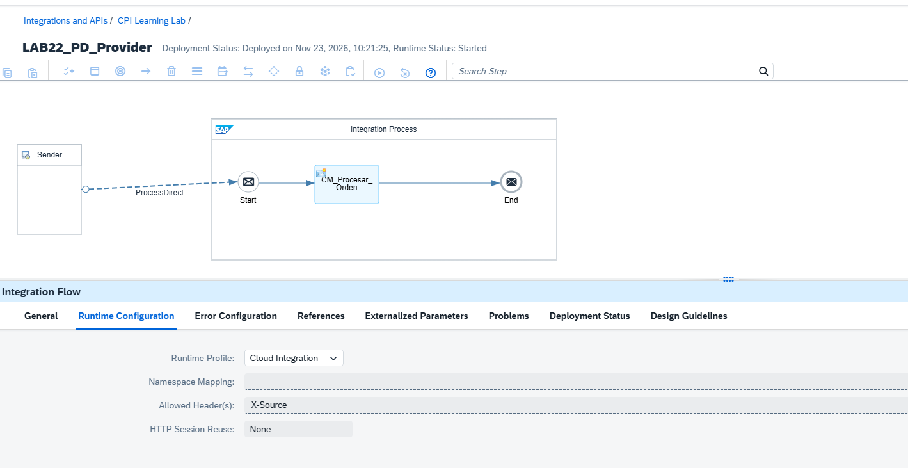

### Configuración del consumidor

Crear `LAB22_PD_Consumer` con HTTPS Sender, Address `/lab22/processdirect`, autenticación OAuth 2.0 en Postman. Agregar `CM_Preparar_Solicitud` para establecer el header `X-Source` con valor constante `LAB22_PD_Consumer`, conservando el XML de entrada. Agregar `RR_Invocar_Proveedor` y conectar un Receiver mediante ProcessDirect, Address `/lab22-pd-provider`. Conectar Request Reply al End.

La dirección ProcessDirect debe coincidir con la del proveedor; no es la URL pública utilizada por Postman.

**Evidencia 22-30 - Configuración del consumidor**

Request Reply y dirección interna del proveedor.

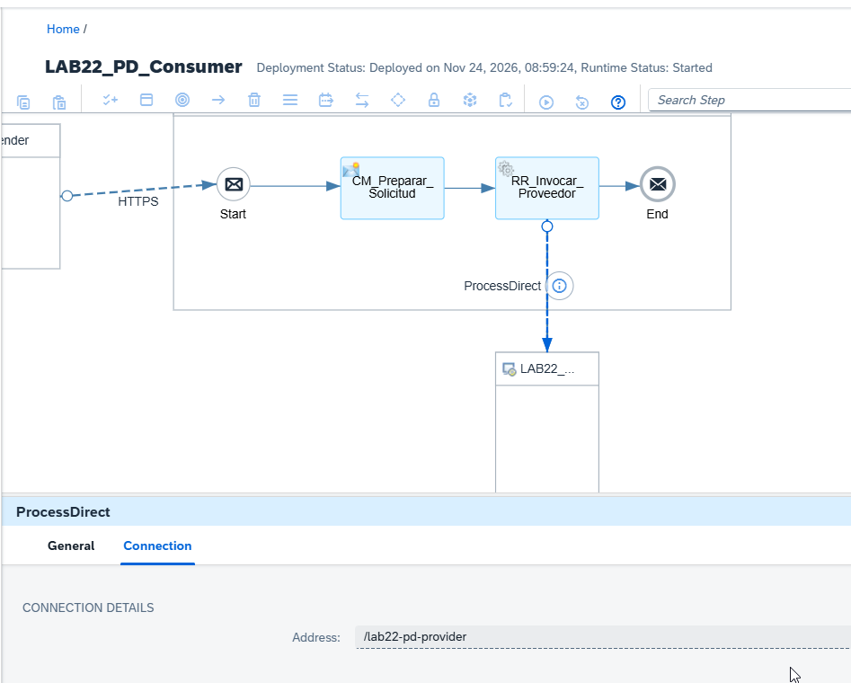

Guardar y desplegar el consumidor.

### Prueba funcional

Petición `22.3 - ProcessDirect`, POST `/http/lab22/processdirect`, OAuth 2.0, Content-Type `application/xml`.

```xml
<Order><OrderId>ORD-22301</OrderId><Amount>1500</Amount></Order>
```

Resultado validado HTTP 200:

```xml
<Result><OrderId>ORD-22301</OrderId><Status>PROCESADO</Status><ProcessedBy>LAB22_PD_Provider</ProcessedBy><Source>LAB22_PD_Consumer</Source></Result>
```

**Evidencia 22-31 - Respuesta correcta en Postman**

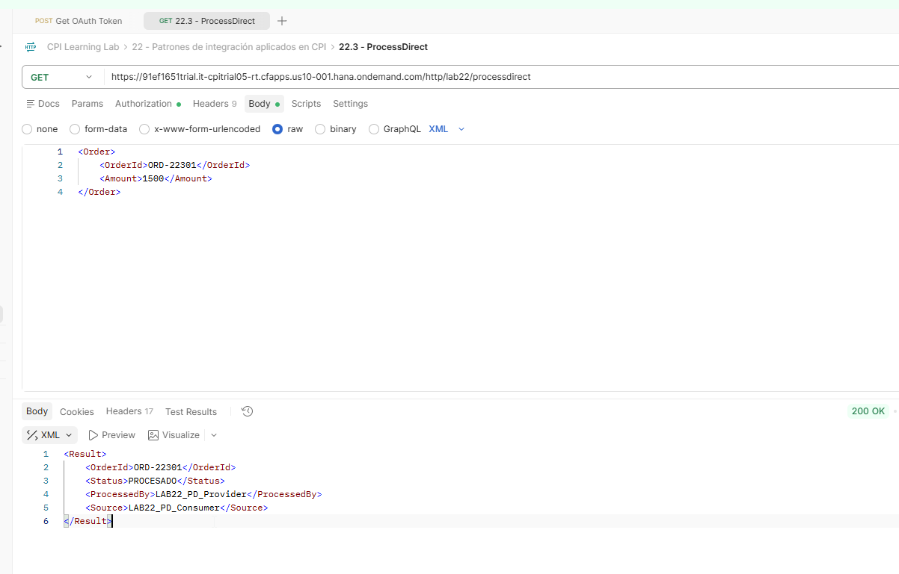

### Monitorización y trazabilidad

En Monitor Message Processing se observaron ambos artefactos Completed el 24/11/2026 a las 09:10:17, con tiempos de 16 ms para Consumer y 6 ms para Provider. Son tiempos observados, no una medición comparativa de rendimiento.

**Evidencia 22-32 - Ejecución de ambos iFlows**

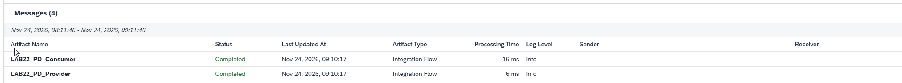

Filtrar por Correlation ID para identificar los dos MPL asociados a la misma ejecución.

**Evidencia 22-33 - Correlación entre consumidor y proveedor**

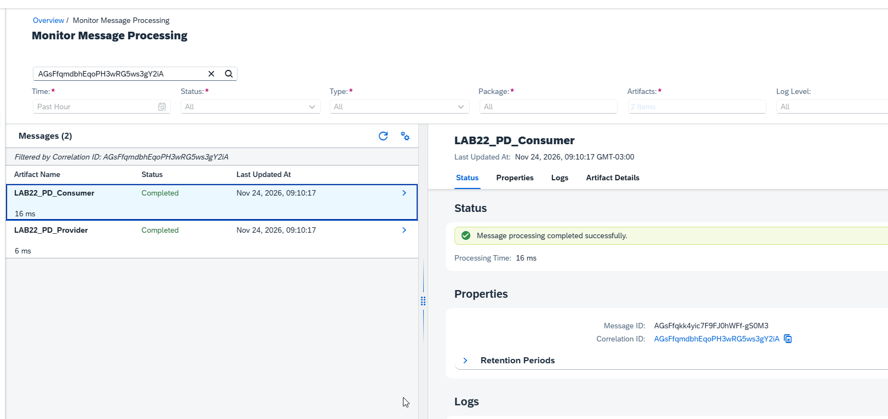

### Resultados y aprendizajes

Se verificó la invocación síncrona, el retorno del XML generado por el proveedor, la transferencia de X-Source y la correlación de ambos MPL. La prueba final POST después del despliegue conservó HTTP 200 y el mismo resultado. No se probaron llamadas entre tenants ni propagación de excepciones del proveedor. La incidencia de plataforma se registra separadamente en [KBA y hallazgos](kba-y-hallazgos.md).

## 22.4 - Canonical Data Model

**Estado:** ✅ Completado

### Objetivo y conceptos

Normalizar dos formatos de órdenes hacia un contrato común. Cada origen requiere su propia transformación al modelo canónico; los consumidores posteriores pueden depender del contrato común en lugar de cada formato de origen. El laboratorio valida las transformaciones de entrada, no mappings de salida hacia sistemas adicionales.

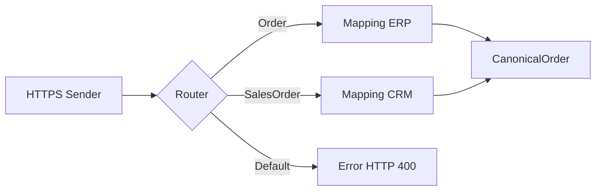

### Configuración y procedimiento

1. Crear `LAB22_Canonical_Data_Model`, versión inicial `1.0.0`. Configurar HTTPS Sender Address `/lab22/canonical-data-model`.
2. Incorporar `ERP_Order.xsd`, `CRM_SalesOrder.xsd` y `CanonicalOrder.xsd` mediante References → Local. Los esquemas definen las estructuras utilizadas por los mappings; su carga no activa validación integral de mensajes.

**Evidencia 22-34 - Recursos XSD**

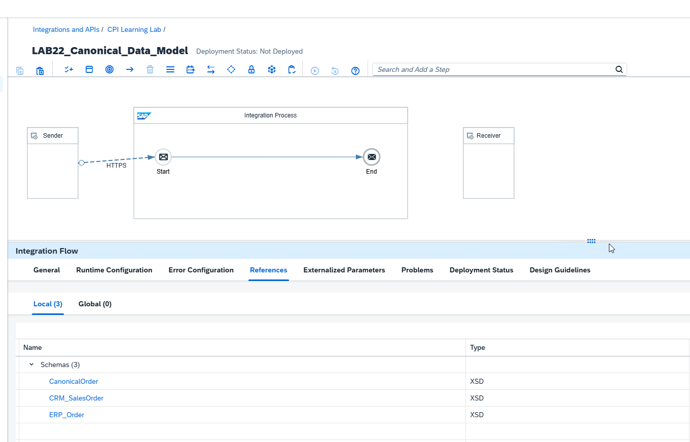

3. Agregar `RT_Identificar_Origen` con las siguientes rutas:

| Ruta | Expression Type | Condición |
|---|---|---|
| ERP | XML | `/Order` |
| CRM | XML | `/SalesOrder` |
| Formato_No_Soportado | Default | Sin condición |

El Router reconoce la estructura, no la identidad autenticada del sistema emisor.

4. En ERP agregar `MM_ERP_to_CanonicalOrder`. Crear el recurso local de mapping mediante la acción Create del componente; seleccionar Add source message y Add target message en el editor. Source `ERP_Order.xsd`, Target `CanonicalOrder.xsd`. Conectar los campos directamente:

| Order | CanonicalOrder |
|---|---|
| OrderId | Id |
| CustomerId | CustomerId |
| Amount | TotalAmount |
| Currency | Currency |

**Evidencia 22-35 - Mapping ERP**

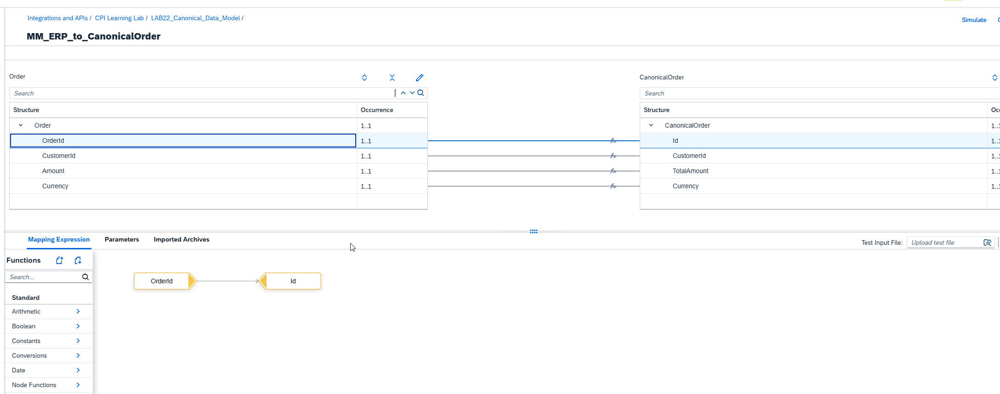

5. En CRM agregar `MM_CRM_to_CanonicalOrder` y crear su recurso local. Source `CRM_SalesOrder.xsd`, Target `CanonicalOrder.xsd` (el mismo contrato de destino).

| SalesOrder | CanonicalOrder |
|---|---|
| Number | Id |
| Account | CustomerId |
| Total | TotalAmount |
| CurrencyCode | Currency |

**Evidencia 22-36 - Mapping CRM**

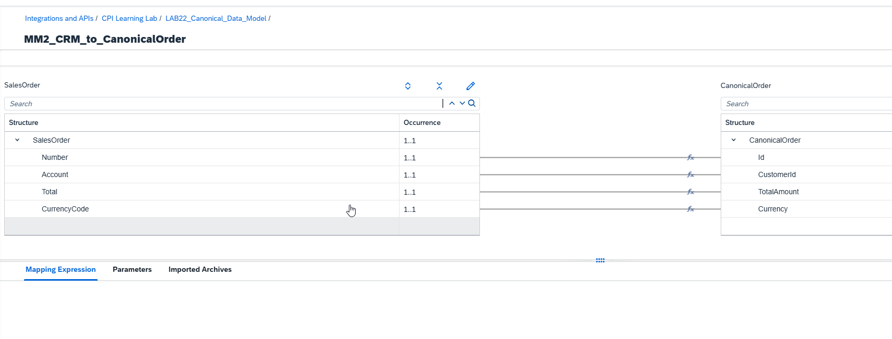

6. En la ruta Default agregar `CM_Formato_No_Soportado`, headers Constant `CamelHttpResponseCode = 400` y `Content-Type = application/xml`. Body Constant:

```xml
<Error><Code>UNSUPPORTED_FORMAT</Code><Message>Formato de origen no soportado</Message></Error>
```

7. Conectar las tres rutas al End. Guardar y revisar Problems.

**Evidencia 22-37 - Diseño completo**

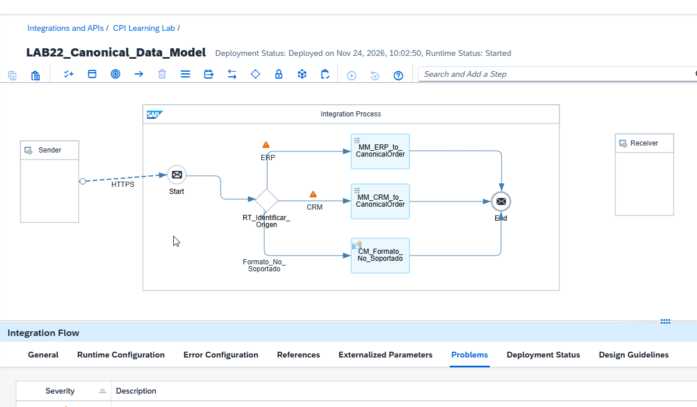

Se observaron dos advertencias de compatibilidad de formato entre HTTPS Sender y Message Mapping. No se modificó el diseño para eliminarlas. Desplegar y comprobar Started.

### Pruebas funcionales

Las tres peticiones utilizan POST `/http/lab22/canonical-data-model`, OAuth 2.0 y Content-Type `application/xml`.

#### ERP

Petición `22.4 - Canonical Data Model ERP`:

```xml
<Order><OrderId>ORD-22401</OrderId><CustomerId>C100</CustomerId><Amount>1500</Amount><Currency>CLP</Currency></Order>
```

HTTP 200, respuesta (presentada con formato para lectura):

```xml
<CanonicalOrder><Id>ORD-22401</Id><CustomerId>C100</CustomerId><TotalAmount>1500</TotalAmount><Currency>CLP</Currency></CanonicalOrder>
```

**Evidencia 22-38 - Postman ERP**

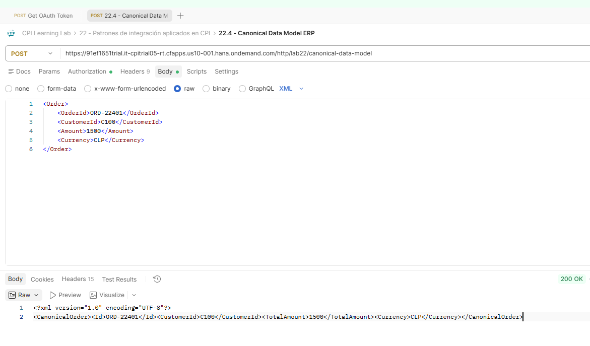

#### CRM

Petición `22.4 - Canonical Data Model CRM`:

```xml
<SalesOrder><Number>ORD-22401</Number><Account>C100</Account><Total>1500</Total><CurrencyCode>CLP</CurrencyCode></SalesOrder>
```

HTTP 200 y los mismos cuatro valores y estructura canónica que ERP.

**Evidencia 22-39 - Postman CRM**

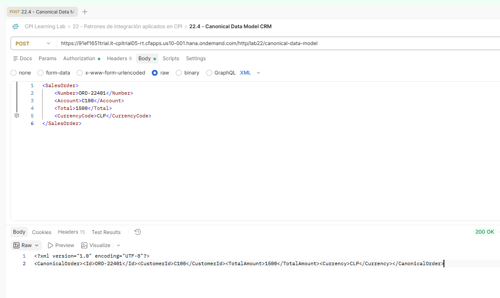

#### Formato no soportado

Petición `22.4 - Canonical Data Model Formato No Soportado`:

```xml
<PurchaseOrder><Id>ORD-22401</Id><Amount>1500</Amount></PurchaseOrder>
```

HTTP 400 Bad Request y XML Error con Code UNSUPPORTED_FORMAT y Message Formato de origen no soportado.

**Evidencia 22-40 - Rechazo controlado**

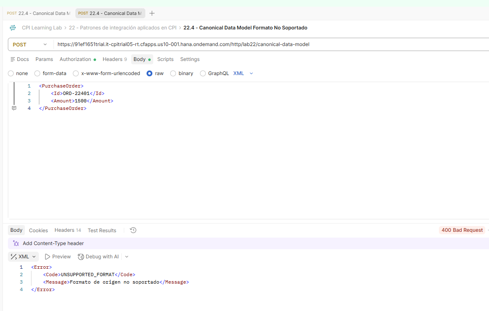

### Resultados, problemas y aprendizajes

| Caso | HTTP esperado | HTTP observado | Resultado |
|---|---|---|---|
| ERP | 200 | 200 | CanonicalOrder |
| CRM | 200 | 200 | CanonicalOrder |
| Formato desconocido | 400 | 400 | UNSUPPORTED_FORMAT |

La carga inicial de los tres XSD fue rechazada con `Illegal processing instruction target ("xml")`, posición `[2,5]`. Retirar la declaración XML y volver a cargar permitió incorporar los esquemas. La causa exacta de los archivos iniciales no se inspeccionó. Véase [KBA y hallazgos](kba-y-hallazgos.md).

Las advertencias del editor no impidieron las pruebas con XML válido. No se comprobó XML mal formado ni validación integral contra los XSD. La identificación del emisor real requiere mecanismos adicionales; la raíz XML solo identifica el formato.

Registrar `1.0.1` mediante Save as Version, descripción `22.4 - Canonical Data Model validado`, desplegar y repetir las tres pruebas. El operador confirmó el cierre de esta secuencia.

## Estado del capítulo

Los laboratorios 22.1 a 22.4 están completados. Permanecen pendientes 22.5 Aggregator y 22.6 Integrador.

## Referencias

- [SAP Help Portal - Cloud Integration](https://help.sap.com/docs/cloud-integration).
- [HTTPBin](https://httpbin.org/), servicio utilizado en las pruebas.
- [Capítulo 09 - Routing](09-routing-router-condiciones.md).
- [Capítulo 10 - Splitter y Gather](10-splitter-gather-procesamiento-colecciones.md).
- [Capítulo 14 - Monitorización](14-monitorización-mpl-trazabilidad.md).
