# 22 - Patrones de integración aplicados en CPI

**Estado:** 🟨 En curso

## Objetivo y contexto

Aplicar patrones de integración a órdenes de negocio, reutilizando Router, Request Reply, Exchange Properties, XML, Gather y monitorización estudiados en capítulos anteriores. El capítulo anterior abordó integración SFTP y archivos; aquí se estudia la lógica de distribución y composición de mensajes independientemente del transporte.

## Alcance y plan de laboratorios

| Laboratorio | Objetivo | Estado |
|---|---|---|
| 22.1 Message Filter | Filtrar órdenes según su estado | ✅ Completado |
| 22.2 Recipient List y Multicast | Distribuir y consolidar respuestas de destinatarios | 🟨 En curso |
| 22.3 Process Direct | Comunicación entre iFlows | ⬜ Pendiente |
| 22.4 Canonical Data Model | Modelo común de datos | ⬜ Pendiente |
| 22.5 Aggregator | Agregación de mensajes | ⬜ Pendiente |
| 22.6 Integrador | Combinar patrones | ⬜ Pendiente |

Estimación inicial del capítulo: 215–300 minutos, no equivalente a tiempo real medido. La estimación inicial de 22.2 fue 40–55 minutos; las dificultades del editor extendieron su ejecución.

## Arquitectura conceptual

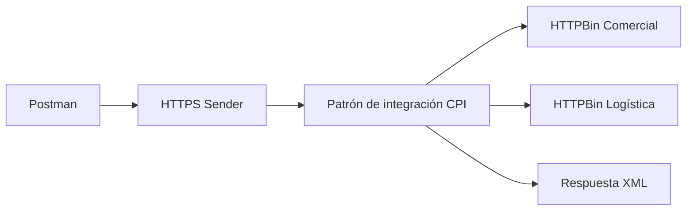

HTTPBin simula destinatarios externos; no representa sistemas comerciales o logísticos reales.

## Prerrequisitos y criterios de validación

- Package `CPI Learning Lab`, runtime Cloud Integration y acceso a Monitor.
- Postman con OAuth 2.0 y carpeta `22 - Patrones de integración aplicados en CPI`.
- Conectividad HTTPS hacia `https://httpbin.org/post`.
- Validar despliegue, respuesta XML, rutas y trazas pertinentes. No almacenar credenciales ni tokens en evidencias.

## 22.1 - Message Filter

**Estado:** ✅ Completado

### Objetivo y conceptos

Un Message Filter permite descartar mensajes que no cumplen una condición. En este escenario se implementa con Router: únicamente las órdenes aprobadas se envían al receptor; la ruta por defecto devuelve un resultado funcional de descarte.

### Configuración y procedimiento

1. Crear `LAB22_Message_Filter` y registrar versión inicial `1.0.0`.

**Evidencia 22-01 - Versión inicial del iFlow**

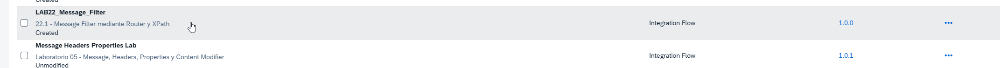

2. Configurar HTTPS Sender: Address `/lab22/message-filter`, User Role `ESBMessaging.send`, CSRF desactivado para este laboratorio; autenticación OAuth.
3. Crear `CM_Conservar_OrderId` con Exchange Property `OrderId`, XPath `/Order/OrderId/text()`, tipo `java.lang.String`. Se conserva el identificador antes de que Request Reply reemplace el body.
4. Configurar `RT_Filtrar_Orden`: ruta `Orden_Aprobada`, condición XML `/Order/Status = 'APROBADA'`; ruta `Orden_Descartada` por defecto.

**Evidencia 22-02 - Condición XPath del Router**

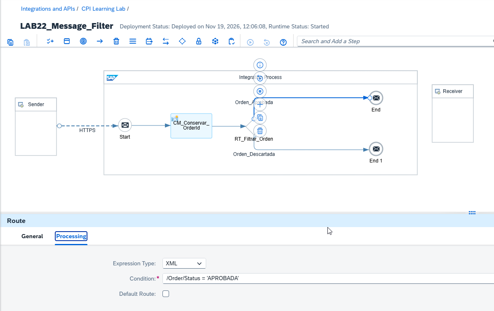

5. En la ruta aprobada incorporar `RR_Enviar_Orden` con HTTP Receiver: Address `https://httpbin.org/post`, POST, Internet, Authentication None, Timeout 60000 ms, Throw Exception on Failure marcado.
6. Después de Request Reply, configurar `CM_Respuesta_Enviada`: header `Content-Type` Constant `application/xml`, body Expression:

```xml
<Result><OrderId>${property.OrderId}</OrderId><Status>ENVIADO</Status><Message>Orden enviada al destinatario</Message></Result>
```

7. En la ruta por defecto configurar `CM_Respuesta_Descartada`, mismo header y body Expression:

```xml
<Result><OrderId>${property.OrderId}</OrderId><Status>DESCARTADO</Status><Message>Orden no aprobada</Message></Result>
```

8. Conectar ambas rutas al End, guardar y desplegar. Runtime Started.

**Evidencia 22-03 - Diseño completo y estado de despliegue**


### Pruebas en Postman

POST `/http/lab22/message-filter`, OAuth 2.0, Content-Type `application/xml`.

```xml
<Order><OrderId>ORD-22001</OrderId><Customer>CLIENTE-A</Customer><Amount>150000</Amount><Status>APROBADA</Status></Order>
```

| Petición (22.1 - Message Filter) | OrderId | Status entrada | HTTP | Resultado validado |
|---|---|---|---|---|
| Orden aprobada | ORD-22001 | APROBADA | 200 | ENVIADO |
| Orden pendiente | ORD-22002 | PENDIENTE | 200 | DESCARTADO |
| Orden rechazada | ORD-22003 | RECHAZADA | 200 | DESCARTADO |
| Orden sin estado | ORD-22004 | Elemento ausente | 200 | DESCARTADO |

**Evidencia 22-04 - Postman: orden aprobada**


**Evidencia 22-05 - Postman: orden descartada**

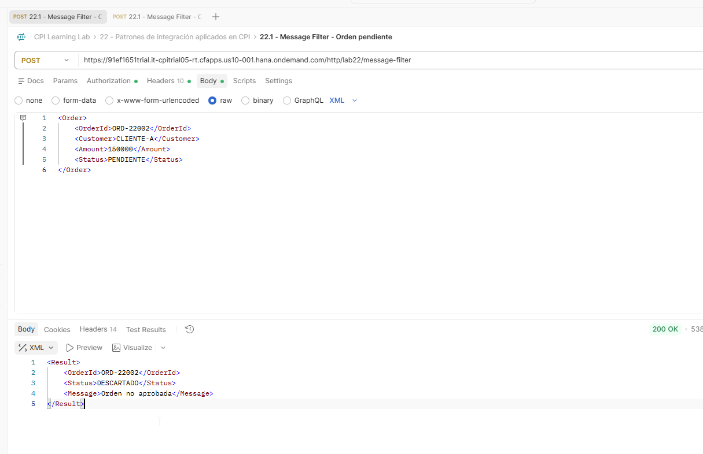

### Validación mediante Trace

La ruta por defecto registró seis pasos y no incluyó llamada HTTP; la ruta aprobada registró nueve pasos, incluyendo HTTP Receiver. La respuesta de HTTPBin contiene el POST y XML original de la orden aprobada.

**Evidencia 22-06 - Trace de ruta por defecto**

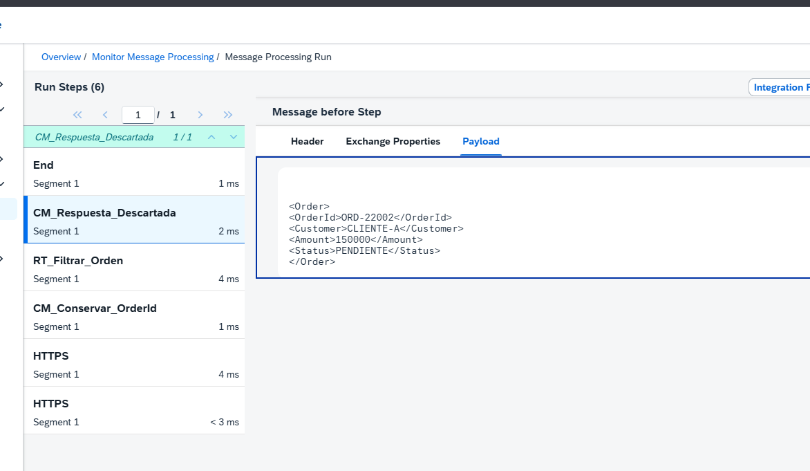


**Evidencia 22-07 - Trace de ruta aprobada y respuesta HTTPBin**


### Resultados, problemas y aprendizajes

La condición XPath seleccionó únicamente las órdenes aprobadas. El descarte es una decisión funcional, no un error HTTP. El diseñador mostró una advertencia sobre el formato XML del HTTPS Sender; no impidió las pruebas con XML válido. No se comprobó XML mal formado. Se restauró Info y se registró la versión de diseño `1.0.1`.

## 22.2 - Recipient List y Multicast

**Estado:** 🟨 En curso

### Objetivo y conceptos

Distribuir una orden a dos destinatarios y combinar sus respuestas. Sequential Multicast establece una secuencia de ramas; Parallel Multicast permite procesamiento concurrente sin exigir ese orden. Join reúne las ramas y Gather combina sus contenidos. Recipient List condicional seleccionará destinatarios según una regla de negocio.

### 22.2.1 - Sequential Multicast

**Estado:** ✅ Completado

Crear `LAB22_Multicast`, versión inicial `1.0.0`.

**Evidencia 22-08 - Versión inicial del Multicast**


Configurar HTTPS Sender con `/lab22/multicast`, User Role `ESBMessaging.send`, CSRF desactivado y OAuth. Agregar `CM_Conservar_Datos_Orden` con propiedades de tipo `java.lang.String`:

| Propiedad | Source Type | XPath |
|---|---|---|
| OrderId | XPath | `/Order/OrderId/text()` |
| RequiresShipping | XPath | `/Order/RequiresShipping/text()` |

La segunda propiedad se reserva para la selección condicional; no interviene en las pruebas actuales.

Agregar `MC_Distribuir_Orden` de tipo Sequential Multicast, con Comercial en posición 1 y Logistica en posición 2.

| Componente | Comercial | Logística |
|---|---|---|
| Content Modifier de entrada | CM_Destinatario_Comercial | CM_Destinatario_Logistica |
| Header Constant X-Recipient | Comercial | LOGISTICA |
| Request Reply | RR_Enviar_Comercial | RR_Enviar_Logistica |
| Receiver | HTTPBin_Comercial | HTTPBin_Logistica |
| Content Modifier de respuesta | CM_Respuesta_Comercial | CM_Respuesta_Logistica |

Ambos HTTP Receiver: `https://httpbin.org/post`, POST, Internet, Authentication None, Request Headers `X-Recipient`, Timeout 60000 ms, Throw Exception on Failure marcado. No modificar el body antes del envío. En ambos Content Modifier finales establecer `Content-Type` Constant `application/xml`, body Expression:

```xml
<Result><OrderId>${property.OrderId}</OrderId><Recipient>COMERCIAL</Recipient><Status>ENVIADO</Status></Result>
```

En Logística sustituir `COMERCIAL` por `LOGISTICA`. Conectar ambos al único Join `JN_Unir_Destinatarios`; después insertar `GT_Consolidar_Respuestas`, Incoming Format `XML (Same Format)`, Aggregation Algorithm `Combine`, y End.

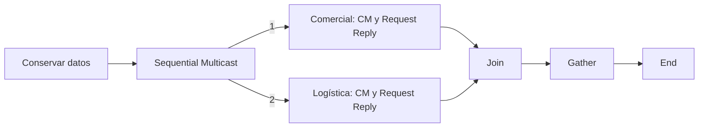

**Evidencia 22-09 - Diseño completo y secuencia Comercial–Logistica**


Guardar y desplegar. Ejecutar Postman `22.2 - Multicast - Sequential`, POST `/http/lab22/multicast`, OAuth, Content-Type `application/xml`:

```xml
<Order><OrderId>ORD-22101</OrderId><Customer>CLIENTE-A</Customer><Amount>150000</Amount><RequiresShipping>true</RequiresShipping></Order>
```

Resultado observado HTTP 200:

```xml
<multimap:Messages xmlns:multimap="http://sap.com/xi/XI/SplitAndMerge">
  <multimap:Message1>
    <Result><OrderId>ORD-22101</OrderId><Recipient>COMERCIAL</Recipient><Status>ENVIADO</Status></Result>
    <Result><OrderId>ORD-22101</OrderId><Recipient>LOGISTICA</Recipient><Status>ENVIADO</Status></Result>
  </multimap:Message1>
</multimap:Messages>
```

**Evidencia 22-10 - Respuesta XML consolidada en Postman**

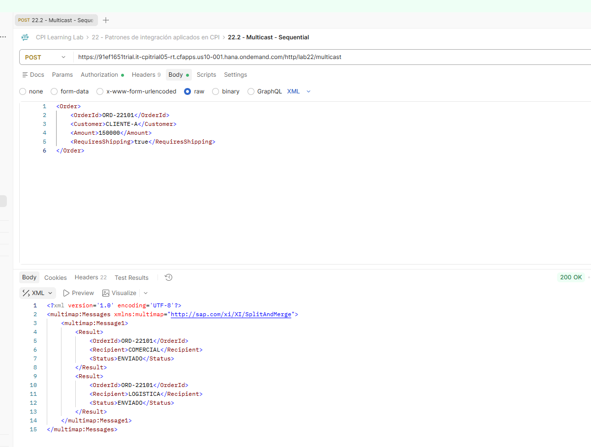

Habilitar Trace y repetir la petición. El Trace registró 17 pasos, Comercial en segmento 2 y Logística en segmento 3. La respuesta JSON de HTTPBin observada antes de `CM_Respuesta_Comercial` confirma el POST, XML original y header `X-Recipient: Comercial`.

**Evidencia 22-11 - Respuesta HTTPBin de Comercial**

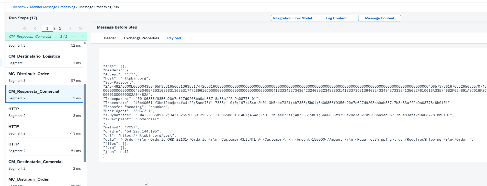

La comprobación equivalente de Logística fue confirmada por el operador del laboratorio; su captura final no fue inspeccionada independientemente.

**Evidencia 22-12 - Respuesta HTTPBin de Logística**


Restaurar Info y registrar versión de diseño `1.0.1`. La secuencia configurada y el orden de los resultados fueron verificados.

### 22.2.2 - Parallel Multicast

**Estado:** ✅ Completado

Copiar `LAB22_Multicast` como `LAB22_Multicast_Parallel`, versión inicial `1.0.0`. Cambiar HTTPS Sender a `/lab22/multicast-parallel` antes de desplegar para mantener ambos escenarios separados. Sustituir Sequential Multicast por Parallel Multicast; conservar las dos ramas, adaptadores, Join y Gather. Verificar las conexiones y nombres tras guardar y reabrir el editor.

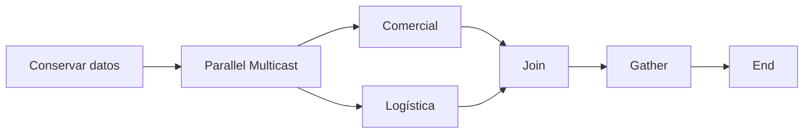

Despliegue validado: Started, 19/11/2026 14:56:22.

**Evidencia 22-13 - Diseño Parallel Multicast desplegado**

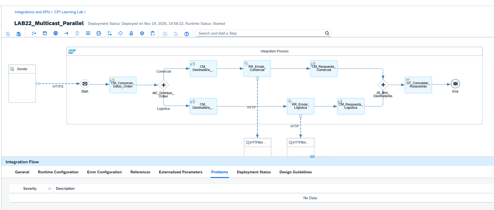

Duplicar petición secuencial en Postman como `22.2 - Multicast - Parallel`; cambiar endpoint a `/http/lab22/multicast-parallel`, conservar el XML y la autenticación.

Resultado HTTP 200: dos elementos Result con identificador ORD-22101 y estado ENVIADO, esta vez Logística antes que Comercial.

**Evidencia 22-14 - Respuesta consolidada en orden inverso**


Habilitar Trace y repetir la petición. Se registraron 17 pasos y se observaron pasos de las ramas intercalados. Comercial figuró en segmento 3, Logística en segmento 2. Ambos Content Modifier mostraron inicio 14:59:20 con precisión de segundos; Activities no aportó marcas temporales más precisas.

**Evidencia 22-15 - Trace de ejecución de las ramas paralelas**

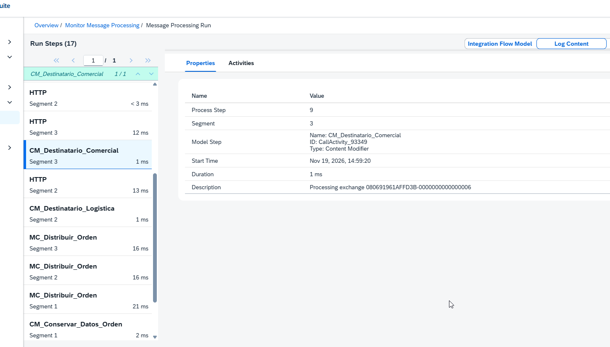

Restaurar Info y registrar versión de diseño `1.0.1`. La integridad del artefacto secuencial original fue confirmada por el operador tras revisar el diseño.

### Comparación y aprendizajes

| Aspecto | Sequential | Parallel |
|---|---|---|
| HTTP | 200 | 200 |
| Resultados | 2 | 2 |
| Orden observado | Comercial, Logística | Logística, Comercial |
| Trace | Ramas secuenciadas | Pasos intercalados |

El orden de respuesta observado no es una garantía contractual para Parallel Multicast. No se demostró el solapamiento exacto en milisegundos ni una mejora cuantitativa de rendimiento. Las versiones indicadas corresponden a Design; no se verificó nuevamente el número de versión del runtime después de Save as Version.

### Problemas encontrados

Routing Sequence mostró temporalmente nombres duplicados; guardar y reabrir corrigió la visualización. Durante el reemplazo del Multicast en la copia también hubo dificultades de conexión y nombres desactualizados; la reconstrucción de conexiones y reapertura permitieron recuperar el diseño, posteriormente desplegado y probado. La causa interna no fue determinada. Véase [KBA y hallazgos](kba-y-hallazgos.md).

### Alcance pendiente de 22.2

| Actividad | Estado |
|---|---|
| Recipient List condicional | ⬜ Pendiente |
| Comportamiento ante errores | ⬜ Pendiente |
| Normalización del XML consolidado | ⬜ Pendiente |

## Referencias

- [SAP Help Portal - Cloud Integration](https://help.sap.com/docs/cloud-integration).
- [HTTPBin](https://httpbin.org/), servicio utilizado en las pruebas.
- [Capítulo 09 - Routing](09-routing-router-condiciones.md).
- [Capítulo 10 - Splitter y Gather](10-splitter-gather-procesamiento-colecciones.md).
- [Capítulo 14 - Monitorización](14-monitorización-mpl-trazabilidad.md).
