# 23 - Transporte, versionado y despliegue entre ambientes

**Estado:** 🟨 En curso

## Objetivo y contexto

Estudiar la promoción controlada de contenido de Cloud Integration, distinguir diseño, configuración y runtime, y evaluar mecanismos de transporte y recuperación. Se reutiliza el iFlow de parámetros externalizados del capítulo 16.

## Alcance y plan de laboratorios

| Laboratorio | Objetivo | Estado |
|---|---|---|
| 23.1 Arquitectura y estrategias de transporte | Identificar mecanismos y restricciones del entorno | ✅ Completado |
| 23.2 Exportación e importación de contenido | Validar portabilidad individual y parámetros | ✅ Completado |
| 23.3 Configuración posterior al transporte | Configurar y probar el destino lógico | ⬜ Pendiente |
| 23.4 Liberación y rollback | Evaluar recuperación de versiones | ⬜ Pendiente |
| 23.5 Cloud Transport Management | Evaluar aprovisionamiento y transporte gestionado | ⬜ Pendiente |
| 23.6 Ciclo de liberación controlado | Integrar las prácticas de liberación | ⬜ Pendiente |

## Prerrequisitos y criterios de validación

- SAP BTP Trial, Cloud Integration y acceso a Design, Settings y BTP Cockpit.
- Paquete `CPI Learning Lab` y artefacto del capítulo 16.
- Acceso a archivos ZIP y editor de texto para inspección sin modificaciones.
- Para las pruebas posteriores de runtime, Postman con OAuth y peticiones independientes por laboratorio.
- No trasladar ni eliminar la suscripción existente; no publicar secretos.

## 23.1 - Arquitectura y estrategias de transporte

**Estado:** ✅ Completado

### Objetivo y conceptos

En un ciclo de liberación, el contenido se desarrolla en DEV, se valida en QA y se promueve a PRD. El transporte permite trasladar el diseño entre ambientes; la configuración de destino y el despliegue son operaciones diferenciadas. El objetivo del laboratorio es determinar qué mecanismos ofrece CPI y cuáles pueden utilizarse en el entorno Trial disponible.

#### Modalidades de transporte

| Modalidad | Significado y uso |
|---|---|
| None | Transporte manual: descargar un archivo ZIP e importarlo en el destino sin un gestor central de transportes. |
| CTS+ Direct | Envío directo a Enhanced Change and Transport System, útil cuando existe una infraestructura CTS+ integrada con el landscape SAP. |
| MTAR Download | Generación de un archivo Multitarget Application Archive para cargarlo manualmente en CTS+ o Cloud Transport Management. Es una alternativa intermedia, distinta del ZIP manual. |
| Transport Management Service | Envío a SAP Cloud Transport Management (CTMS), que permite gestionar rutas, colas e importaciones controladas entre ambientes. |

El transporte gestionado requiere configurar la comunicación y las rutas correspondientes. Para este laboratorio se mantiene `None`: permite estudiar la portabilidad del contenido sin aprovisionar servicios adicionales.

#### Disponibilidad, asignación y aprovisionamiento en BTP

| Nivel | Qué representa |
|---|---|
| Global Account → Service Assignments | Servicios y planes disponibles para la cuenta global, sujetos a región y cuota. |
| Subaccount → Entitlements | Derecho asignado a una subcuenta para consumir un servicio y plan. No crea por sí mismo recursos operativos. |
| Subaccount → Instances and Subscriptions | Recursos efectivamente aprovisionados: instancias de servicio para consumo técnico y suscripciones a aplicaciones para acceder a sus funcionalidades. |

Content Agent Service participa en la preparación y exportación del contenido para el transporte gestionado; CTMS administra su encaminamiento e importación. Las siguientes evidencias permiten comprobar por separado si ambos servicios están disponibles, asignados y aprovisionados.

### Configuración y procedimiento

1. Abrir Settings → Integrations → Transport. Identificar las modalidades disponibles: None, CTS+ Direct, MTAR Download y Transport Management Service. Mantener None, sin modificar la configuración.

**Evidencia 23-01 - Modalidades de transporte**

El selector muestra cuatro opciones y Check Configuration deshabilitado con None.

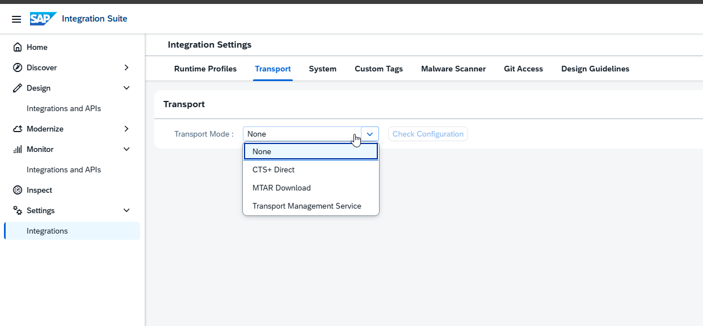

2. Consultar Global Account → Service Assignments para Content Agent Service y Cloud Transport Management.

**Evidencia 23-02 - Content Agent Service**

La cuenta global dispone de los planes `application` y `standard` de `content-agent` y `free (Application)` de `content-agent-ui`. Esto acredita disponibilidad, todavía no una instancia o suscripción activa.

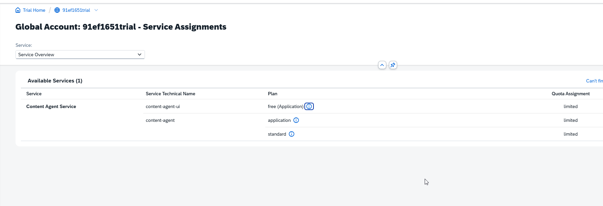


**Evidencia 23-03 - Cloud Transport Management**

Se observa alm-ts lite (Application); la consulta complementaria identifica transport standard. El plan lite indica 500 MB de cuota de archivos y una semana de retención de elementos en cola, con disponibilidad regional en US East (VA) y Singapore. Estos límites corresponden al plan lite, no a todos los planes de CTMS.

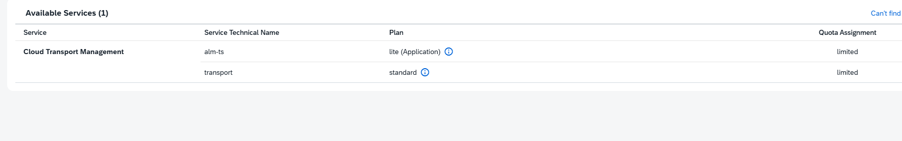

3. Consultar Subaccount → Entitlements para verificar las asignaciones efectivas.

**Evidencia 23-04 - Entitlements de Content Agent**

Los tres planes muestran una unidad compartida asignada al subaccount. La subcuenta tiene derecho a consumirlos; aún falta comprobar si se han aprovisionado.

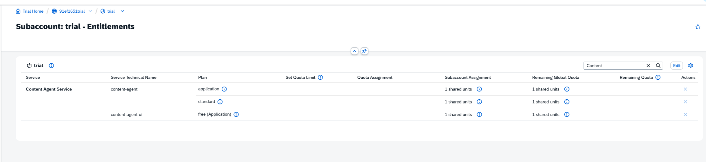


**Evidencia 23-05 - Entitlements de Cloud Transport Management**

`transport standard` y `alm-ts lite` muestran una unidad compartida cada uno. El primero corresponde al servicio técnico y el segundo a la aplicación. La asignación permite plantear su habilitación posterior.

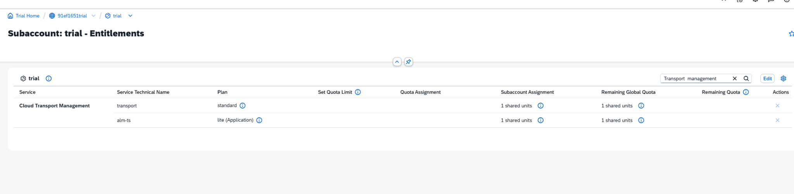

4. Consultar Services → Instances and Subscriptions, sin crear recursos.

**Evidencia 23-06 - Estado inicial de aprovisionamiento**

Integration Suite y SAP Business Application Studio están suscritos; existe una instancia SAP Process Integration Runtime integration-flow. No aparecen instancias ni suscripciones de los servicios de transporte. Por tanto, aunque existe disponibilidad y asignación de derechos, no se ha comprobado que CTMS ni Content Agent estén operativos en esta subcuenta.

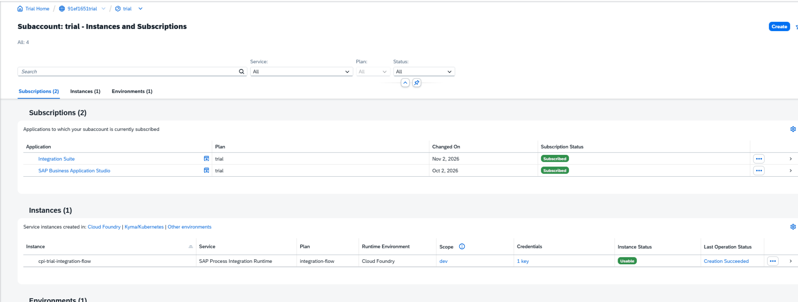

5. Consultar Global Account → Account Explorer y Entity Assignments para determinar si existe un destino independiente y cuota para habilitarlo.

**Evidencia 23-07 - Landscape actual**

Existe un subaccount trial en AWS US East (VA). Se comprueba el landscape para determinar si hay un segundo tenant que pueda actuar como destino real de un transporte.

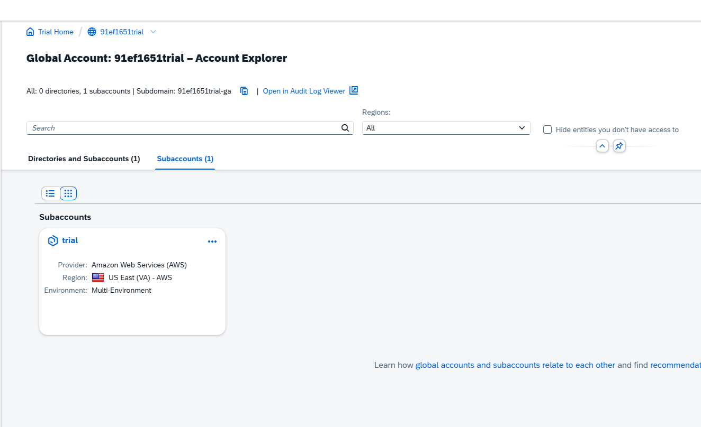


**Evidencia 23-08 - Cuota de Integration Suite**

integrationsuite-trial, plan trial (Application): una unidad asignada y cero unidades de cuota global restante. Crear otra subcuenta, incluso en otra región, no aportaría por sí solo una cuota adicional de Integration Suite dentro de esta cuenta global.

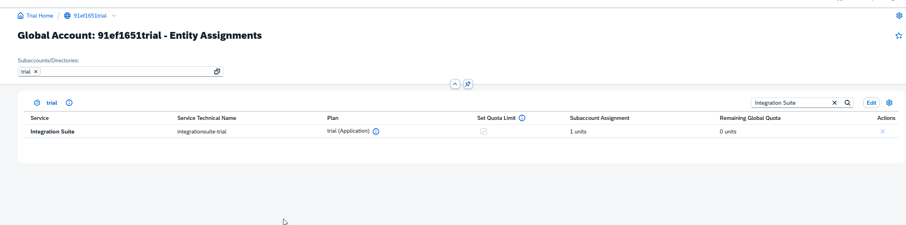

### Resultado esperado y validación

Se identificaron los mecanismos disponibles, los entitlements y la infraestructura existente. La cuota actual impide asignar una segunda suscripción Trial de Integration Suite sin modificar las asignaciones existentes. No se creó otro subaccount ni se aprovisionaron servicios.

### Problemas encontrados y aprendizajes

El transporte real entre dos tenants queda fuera de la infraestructura actualmente disponible. La disponibilidad de CTMS no demuestra su funcionamiento ni las autorizaciones necesarias. Los laboratorios de importación utilizarán separación lógica dentro del mismo tenant; el aprovisionamiento de CTMS se evaluará en 23.5.

## 23.2 - Exportación e importación de contenido

**Estado:** ✅ Completado

### Objetivo y conceptos

Aplicar la modalidad manual identificada en 23.1 y comprobar qué información viaja con el contenido, qué restricciones presenta su importación y qué debe configurarse posteriormente. Se reutiliza el iFlow del capítulo 16 porque dispone de parámetros externalizados y permite comparar el diseño con la configuración efectiva del origen.

| Alcance | Finalidad | Validación realizada |
|---|---|---|
| Paquete completo | Trasladar o respaldar un conjunto de artefactos como unidad de contenido. | Exportación e inspección del ZIP; no se importó el paquete completo. |
| iFlow individual | Trasladar selectivamente una integración sin incluir todo el paquete. | Descarga, comparación de parámetros e importación en un paquete auxiliar. |

En ambos casos se utiliza un archivo local, no una orden gestionada por CTMS ni un MTAR. Como solo existe un tenant, el paquete auxiliar representa un destino lógico para estudiar la importación; no reproduce el aislamiento de ambientes independientes. La importación registra contenido de diseño y no implica un despliegue automático.

### Configuración y procedimiento

1. En Design → Integrations and APIs → CPI Learning Lab → Artifacts, identificar `LAB16-Externalized Parameters`, ID `LAB16-Externalized_Parameters`. Utilizar la versión vigente observada, sin modificarla.

**Evidencia 23-09 - Artefacto de origen**

El paquete contiene 48 artefactos; el iFlow muestra versión 1.0.2, distinta de la 1.0.1 documentada previamente. No se determinó la causa del cambio.

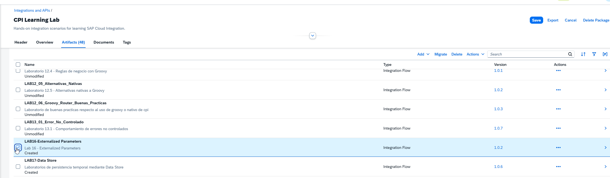

2. Exportar el paquete mediante Export e inspeccionar el ZIP sin modificarlo.

**Evidencia 23-10 - Estructura del ZIP del paquete**

Se observan archivos *_content, contentmetadata.md, ExportInformation.info, hash y resources.cnt. La estructura muestra un archivo de intercambio que agrupa contenido y metadatos del paquete, diferente de la estructura de un iFlow individual. No se verificó la correspondencia individual de los archivos técnicos ni el contenido de hash y resources.cnt. La prueba demuestra la exportación del conjunto, no su restauración completa.

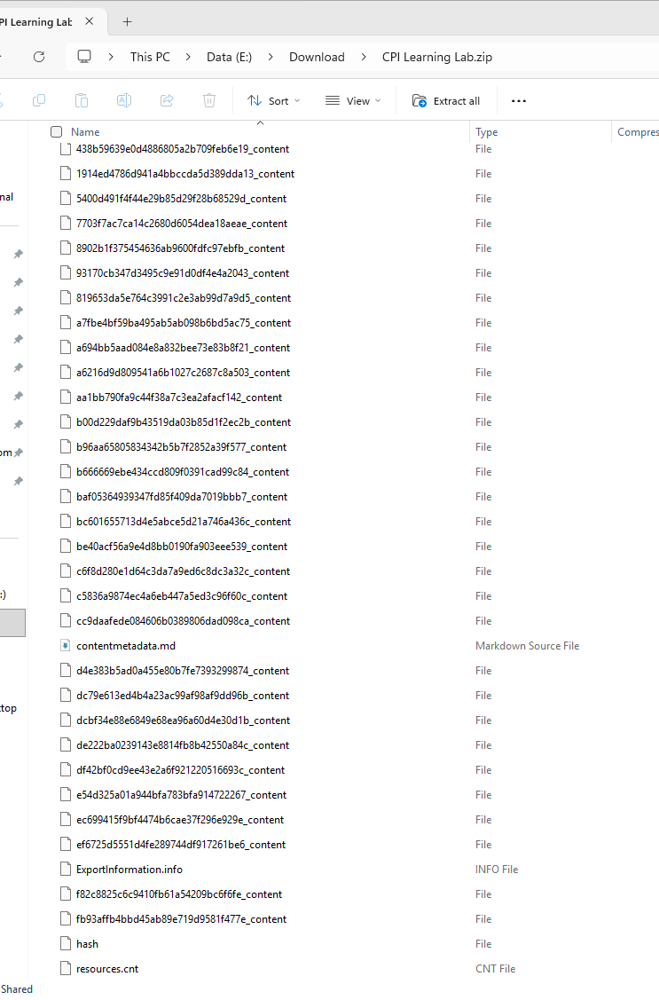

3. Descargar el iFlow mediante Actions → Download. Seleccionar Default Values Only y conservar el ZIP original.

**Evidencia 23-11 - Opciones de descarga**

El diálogo permite `Default Values Only` (valores predeterminados definidos en el diseño) y `Merged Configured and Default Values` (valores configurados cuando existen, complementados con los predeterminados). La elección determina qué configuración se incorpora al archivo que recibirá el destino.

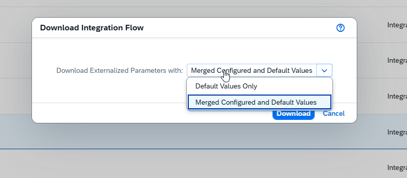


**Evidencia 23-12 - Estructura del ZIP individual**

Se observan `META-INF`, `src`, `.project` y `metainfo.prop`. A diferencia del paquete completo, el ZIP individual permite inspeccionar directamente los recursos de la integración y sus archivos de parámetros.

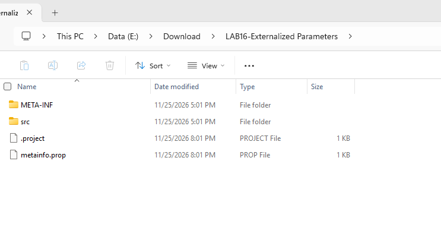

4. Extraer una copia del ZIP e inspeccionar `src/main/resources/parameters.prop` y `parameters.propdef`.

**Evidencia 23-13 - Valores predeterminados**

P_AMBIENTE=PRD, P_BODY_RESPUESTA=constant y P_HTTP_ADDRESS=/lab16/parameters.

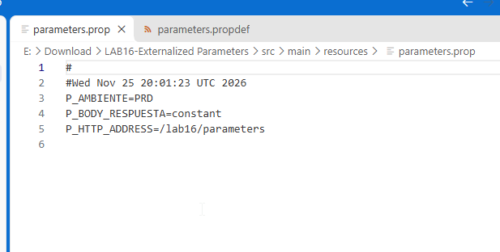


**Evidencia 23-14 - Definición de parámetros**

Mientras `parameters.prop` almacena valores, `parameters.propdef` contiene sus definiciones y metadatos. Los tres parámetros tienen tipo `xsd:string` e `isRequired=false`; `P_BODY_RESPUESTA` tiene metadato `isCombobox=true`. `P_HTTP_ADDRESS` referencia el atributo `urlPath` del Sender.

**Interpretación de `P_BODY_RESPUESTA`:** el capítulo 16 registra un intento de externalización con ese nombre y la posterior decisión de externalizar únicamente `ambiente` mediante `{{P_AMBIENTE}}`, manteniendo el tipo de Message Body como Constant. SAP documenta Constant y Expression como opciones del tipo de cuerpo. El valor `constant` y el metadato `isCombobox=true` son consistentes con un parámetro asociado a ese selector, no con el contenido JSON de la respuesta. La captura posterior del Content Modifier muestra Type = Constant y un cuerpo con `{{P_AMBIENTE}}`. No se ha confirmado si el parámetro quedó como definición residual del intento anterior o si todavía tiene una referencia activa en el modelo; tampoco que SAP lo genere automáticamente. No debe tratarse como el texto de respuesta ni como una configuración funcional pendiente de QA sin comprobar esa asociación.

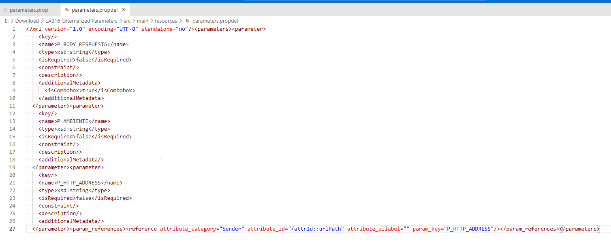

5. Repetir la descarga con Merged Configured and Default Values, extraer en otra carpeta y comparar parameters.prop.

**Evidencia 23-15 - Valores combinados**

El endpoint cambia a /lab16/parameters-v2; los otros dos valores permanecen iguales.

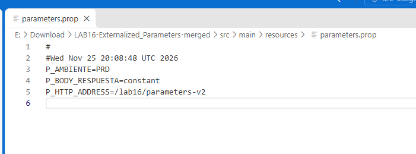

| Parámetro | Default Values Only | Merged Configured and Default Values |
|---|---|---|
| P_AMBIENTE | PRD | PRD |
| P_BODY_RESPUESTA | constant | constant |
| P_HTTP_ADDRESS | /lab16/parameters | /lab16/parameters-v2 |

La descarga combinada incorpora el valor configurado del endpoint. El valor predeterminado de ambiente ya es PRD; por tanto, seleccionar Default no garantiza una configuración apropiada para QA.

6. Crear un paquete auxiliar con Name `CPI Learning Lab Transport`, Technical Name `CPILearningLabTransport` y Short Description `Laboratorios de transporte, versionado y despliegue entre ambientes.`. Dejar Version y Vendor sin asignar.

**Evidencia 23-16 - Paquete auxiliar**

El paquete separa el artefacto importado del contenido original para evaluar su portabilidad sin alterar el laboratorio 16. No constituye un segundo tenant.

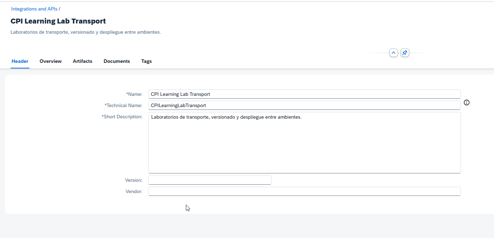

7. En Artifacts → Add → Integration Flow → Upload, seleccionar el ZIP de valores predeterminados. Observar la validación del ID original sin confirmar la creación.

**Evidencia 23-17 - ID duplicado**

La interfaz indica: The ID LAB16-Externalized_Parameters is already in use for another artifact. Provide a different ID. La restricción observada demuestra que cambiar de paquete no basta para importar una segunda copia con el mismo identificador dentro del tenant.

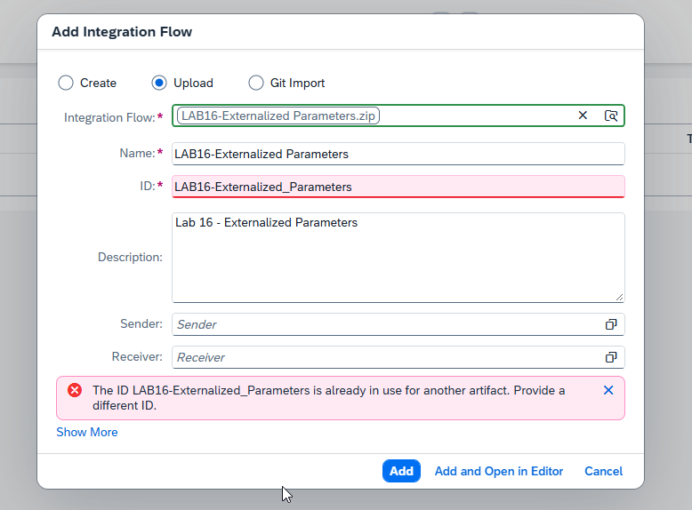

8. Cambiar Name e ID a `LAB23_Transport_Target`, Description a `Lab 23 - Importación y configuración de contenido transportado`. Confirmar Add.

**Evidencia 23-18 - Artefacto importado**

El nuevo paquete muestra un artefacto con versión 1.0.2. Se preservó el número de versión del contenido descargado al crear una copia con otro ID. No fue necesario generar una versión inicial adicional. Este cambio de ID es una adaptación del laboratorio al tenant único, no un requisito demostrado para transportar entre tenants.

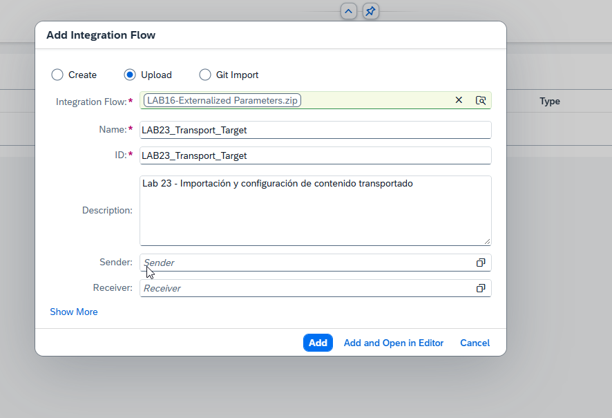

9. Abrir el diseñador e inspeccionar el flujo sin modificarlo.

**Evidencia 23-19 - Diseño importado**

Se observa HTTPS Sender, Start, CM_Respuesta_Parametros y End, además del participante Receiver sin conexión. Deployment Status: Not Deployed.

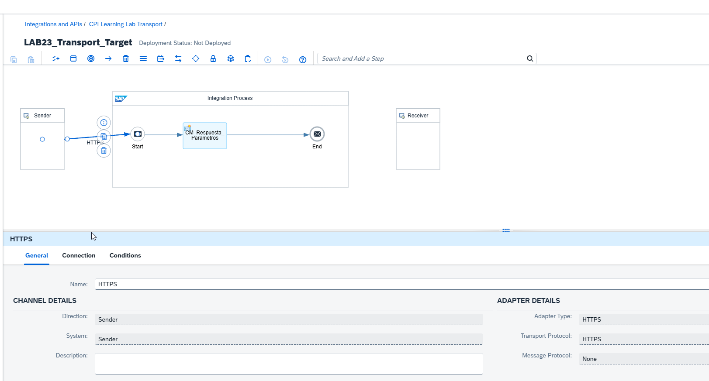

10. Abrir Actions → Configure y revisar Sender y More sin guardar cambios.

**Evidencia 23-20 - Parámetro del Sender**

`P_HTTP_ADDRESS` conserva `/lab16/parameters`, el valor del ZIP Default. Antes de desplegar la copia en el mismo tenant deberá asignarse un endpoint que no interfiera con el original.

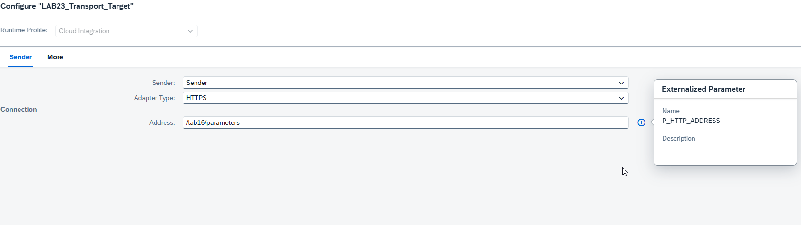


**Evidencia 23-21 - Parámetro del Content Modifier**

`P_AMBIENTE` conserva `PRD`; el cuerpo contiene la referencia `{{P_AMBIENTE}}`. El diseño y la externalización se conservan, pero el valor importado no representa necesariamente el ambiente de destino.

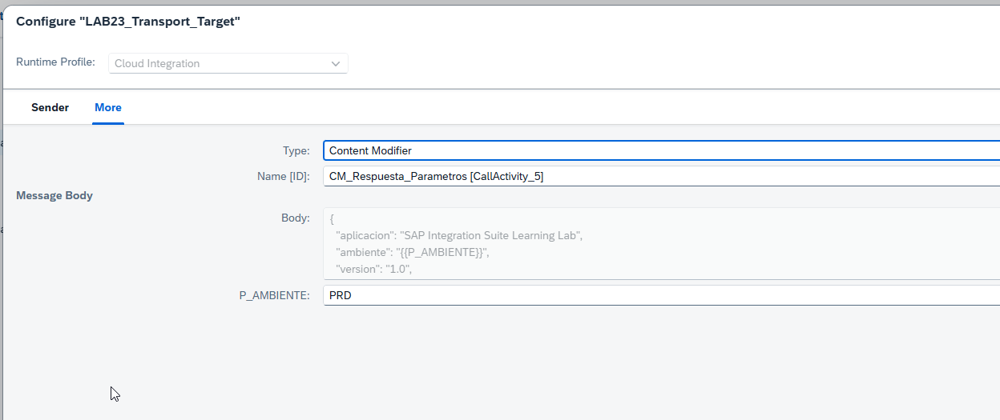

11. Cerrar Configure y abrir Version History mediante el número de versión.

**Evidencia 23-22 - Historial de versiones**

Solo aparece 1.0.2 como Active Version, creada el 25/11/2026, con comentario Resource Created. La versión importada inicia su propio historial; no se observa una colección de versiones anteriores que permita recuperar automáticamente estados del origen.

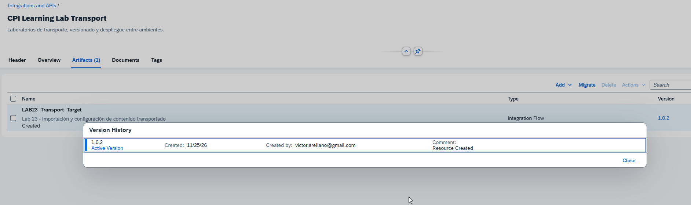

### Resultado esperado y validación

| Comprobación | Resultado |
|---|---|
| Exportación de paquete e iFlow | ZIP obtenidos e inspeccionados |
| Diferencia Default/Merged | Verificada en P_HTTP_ADDRESS |
| Unicidad del ID | Rechazo visible antes de confirmar la importación |
| Importación independiente | LAB23_Transport_Target creado con versión 1.0.2 |
| Diseño | Componentes principales visibles; no desplegado |
| Parámetros | Endpoint y ambiente coinciden con Default; P_BODY_RESPUESTA no visible en Configure |
| Historial | Una sola versión visible en destino; no se inspeccionó el historial completo del origen |

### Problemas encontrados y aprendizajes

La colisión de ID se resolvió asignando un identificador independiente, sin sobrescribir el origen. La separación por paquetes no evita colisiones de identificadores dentro del tenant. La descarga individual conservó el número de versión, pero el destino no presenta versiones anteriores. No debe asumirse que un ZIP individual permite recuperar todo el historial de origen.

El endpoint y el ambiente importados requieren revisión antes del despliegue. `P_BODY_RESPUESTA` aparece en los archivos exportados, pero no se confirmó una referencia activa en el modelo importado. Esta incertidumbre no invalida la comparación de valores ni la importación realizada. No se realizó una prueba de runtime ni un transporte entre tenants en 23.2.

## 23.3 - Configuración posterior al transporte

**Estado:** ✅ Completado

### Objetivo y conceptos

Configurar el artefacto importado para representar un ambiente de destino QA, desplegarlo y comprobar su funcionamiento sin afectar al artefacto de origen.

El transporte del contenido no garantiza que los parámetros importados sean apropiados para el ambiente de destino. La configuración posterior permite adaptar el comportamiento de una integración sin modificar su lógica de diseño.

### Arquitectura validada

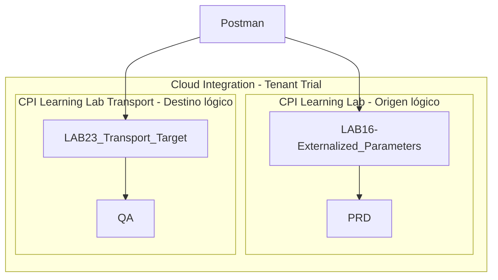

Ambos artefactos funcionan dentro del mismo tenant, con identificadores, endpoints y configuraciones independientes. La separación representa ambientes lógicos y no un landscape físicamente distribuido.

### Configuración y procedimiento

#### 1. Configurar el endpoint de destino

Abrir Actions → Configure del artefacto `LAB23_Transport_Target`.

Asignar al parámetro `P_HTTP_ADDRESS` el valor:

`/lab23/transport-target`

El cambio evita interferir con los endpoints utilizados por el artefacto de origen.

**Evidencia 23-23 - Configuración del endpoint de destino**

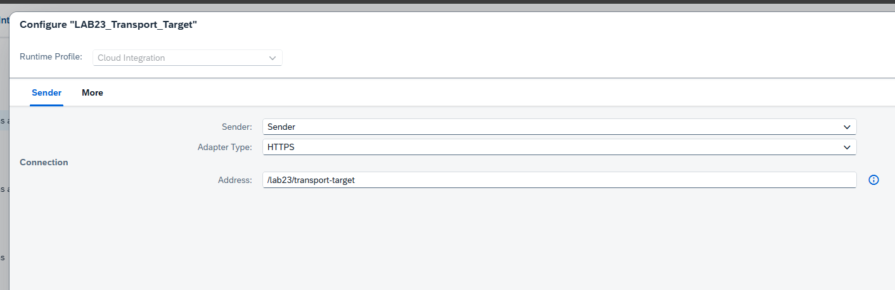

#### 2. Configurar el ambiente de destino

Asignar al parámetro `P_AMBIENTE` el valor `QA`.

El Content Modifier utiliza la referencia `{{P_AMBIENTE}}`, permitiendo adaptar la respuesta al ambiente sin modificar el cuerpo definido en el diseño.

**Evidencia 23-24 - Configuración del ambiente QA**

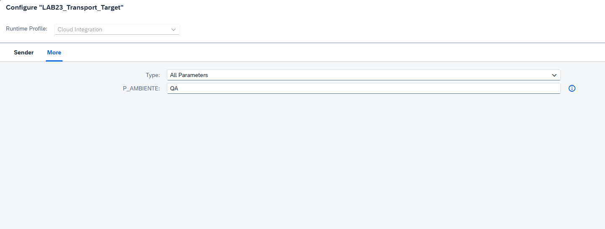

#### 3. Verificar la versión del artefacto

Comprobar el estado del artefacto después de guardar la configuración.

**Evidencia 23-25 - Versión posterior a la configuración**

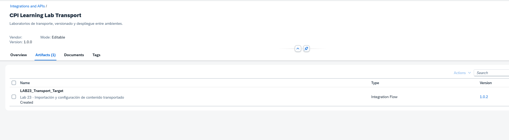

#### 4. Desplegar el artefacto

Desplegar `LAB23_Transport_Target` y verificar su disponibilidad en Monitor.

**Evidencia 23-26 - Artefacto de destino desplegado**

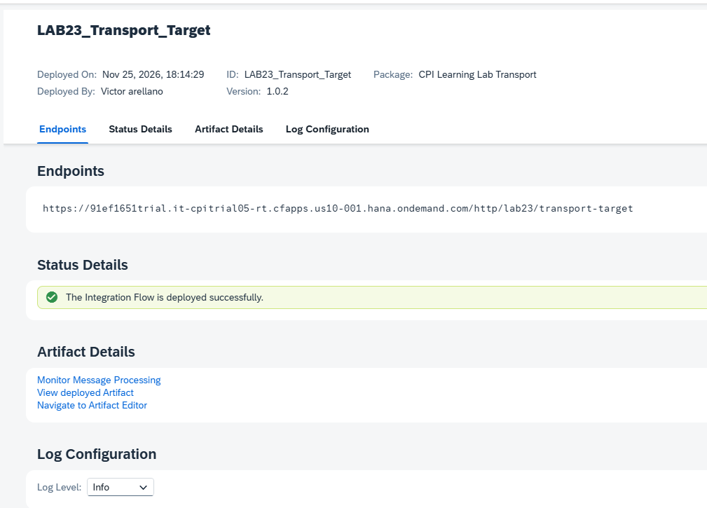

#### 5. Validar el ambiente de destino mediante Postman

Ejecutar una petición GET sobre:

`/http/lab23/transport-target`

Comprobar HTTP 200 OK y el valor `QA` en el campo `ambiente`.

**Evidencia 23-27 - Validación funcional del destino QA**

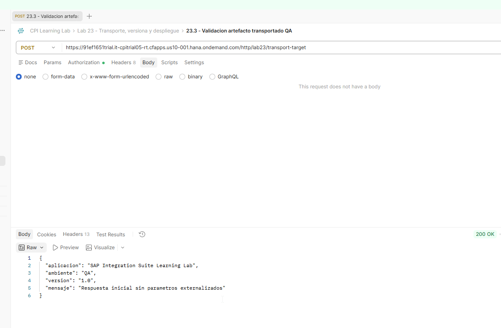

#### 6. Verificar el procesamiento del mensaje

Consultar Monitor Message Processing y localizar la ejecución correspondiente a `LAB23_Transport_Target`.

**Evidencia 23-28 - MPL del artefacto de destino**

El mensaje presenta procesamiento exitoso, con un tiempo de ejecución de 6 ms.

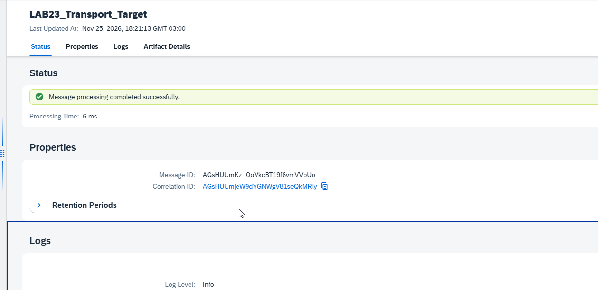

#### 7. Validar la independencia del artefacto de origen

Ejecutar una petición GET sobre el endpoint original:

`/http/lab16/parameters-v2`

La respuesta debe conservar el ambiente `PRD`.

**Evidencia 23-29 - Validación funcional del origen PRD**

La petición devuelve HTTP 200 OK, ambiente PRD y versión funcional 1.0.

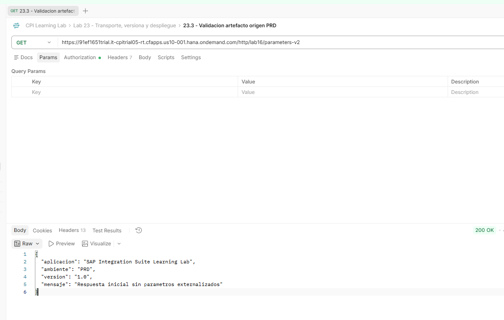

### Resultado esperado y validación

| Comprobación | Resultado |
|---|---|
| Endpoint independiente | Validado |
| Configuración QA del destino | Validada |
| Despliegue del destino | Correcto |
| Respuesta HTTP del destino | 200 OK |
| Procesamiento del mensaje | Exitoso |
| Disponibilidad del origen | 200 OK |
| Ambiente del origen | PRD |

### Problemas encontrados y aprendizajes

La configuración importada debe revisarse antes del despliegue. Los parámetros permiten adaptar una integración al ambiente de destino sin modificar su lógica.

La prueba demuestra la independencia funcional de los dos artefactos dentro del mismo tenant. No demuestra aislamiento de infraestructura ni transporte entre tenants independientes.

## 23.4 - Liberación y rollback

**Estado:** ✅ Completado

### Objetivo y conceptos

Validar el ciclo de liberación de una nueva versión de un iFlow y la recuperación de una versión anterior mediante Version History, comprobando por separado el estado de diseño, la versión desplegada y el comportamiento funcional.

Una reversión de diseño no equivale automáticamente a un rollback operativo. Para recuperar el comportamiento anterior es necesario comprobar qué versión permanece ejecutándose en el runtime y realizar el despliegue correspondiente.

### Configuración y procedimiento

#### 1. Preparar una nueva liberación

Modificar el Content Modifier `CM_Respuesta_Parametros` del artefacto `LAB23_Transport_Target`.

Mantener Message Body de tipo Constant y utilizar el siguiente contenido:

```json
{
    "aplicacion": "SAP Integration Suite Learning Lab",
    "ambiente": "{{P_AMBIENTE}}",
    "version": "1.1",
    "mensaje": "Nueva liberacion del artefacto transportado"
}
```

El cambio permite identificar funcionalmente la nueva liberación, conservando la externalización del ambiente.

**Evidencia 23-30 - Contenido de la nueva liberación**

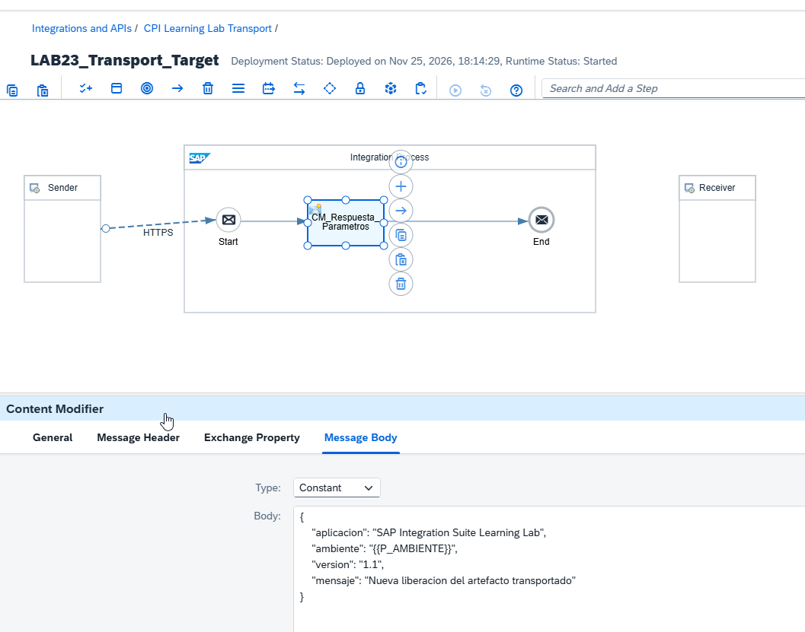

#### 2. Crear una versión numerada

Guardar el cambio mediante Save as Version y registrar la versión técnica `1.0.3`.

Verificar Version History.

**Evidencia 23-31 - Historial de la nueva liberación**

La versión 1.0.3 aparece como Active Version y la versión anterior 1.0.2 permanece disponible para recuperación.

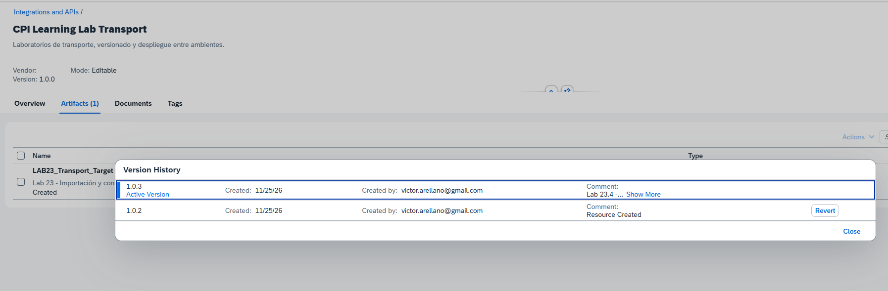

#### 3. Desplegar la nueva versión

Desplegar el artefacto y comprobar en Monitor la versión técnica 1.0.3 y la disponibilidad del endpoint.

**Evidencia 23-32 - Nueva versión desplegada**

El artefacto presenta despliegue exitoso y conserva el endpoint `/http/lab23/transport-target`.

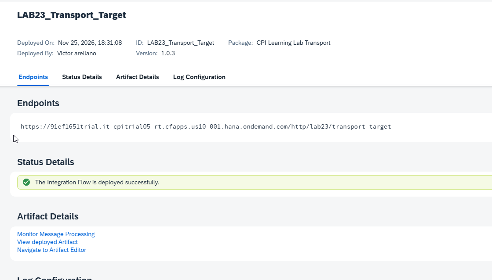

#### 4. Validar funcionalmente la liberación

Ejecutar la petición independiente de Postman `23.4 - Validacion nueva liberacion`.

**Evidencia 23-33 - Respuesta de la nueva liberación**

Se obtiene HTTP 200 OK con el siguiente contenido:

```json
{
    "aplicacion": "SAP Integration Suite Learning Lab",
    "ambiente": "QA",
    "version": "1.1",
    "mensaje": "Nueva liberacion del artefacto transportado"
}
```

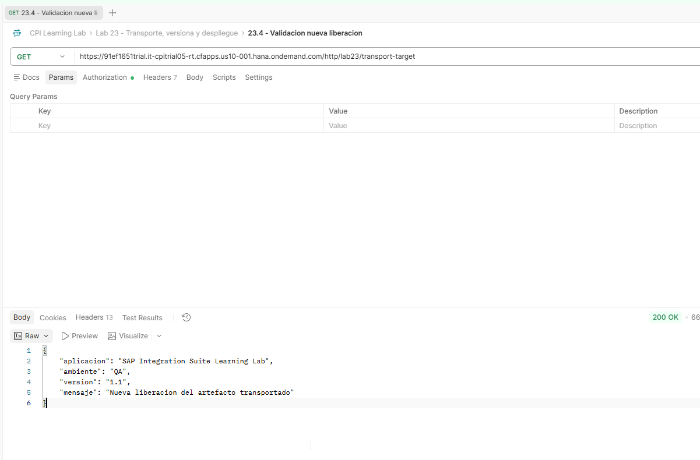

#### 5. Recuperar la versión anterior en Design

Abrir Version History y ejecutar Revert sobre la versión 1.0.2.

**Evidencia 23-34 - Reversión de la versión de diseño**

La versión 1.0.2 aparece como Active Version. La versión 1.0.3 continúa disponible en el historial.

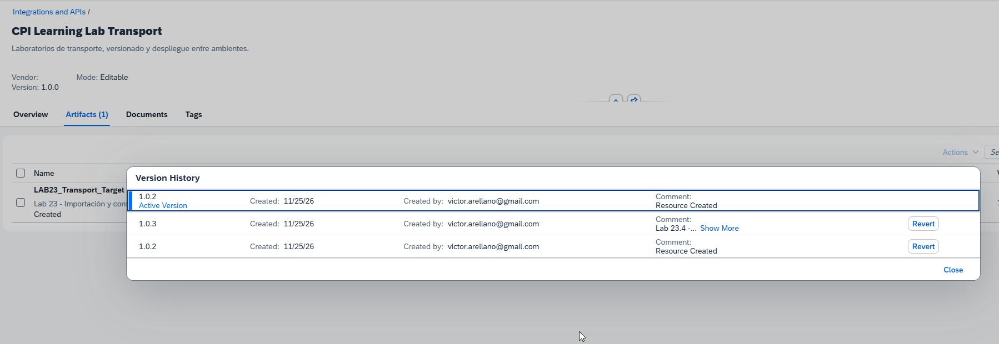

#### 6. Comprobar el runtime antes del rollback operativo

Consultar el artefacto desplegado en Monitor, antes de realizar un nuevo despliegue.

**Evidencia 23-35 - Runtime posterior a Revert**

Monitor continúa mostrando la versión 1.0.3 desplegada.

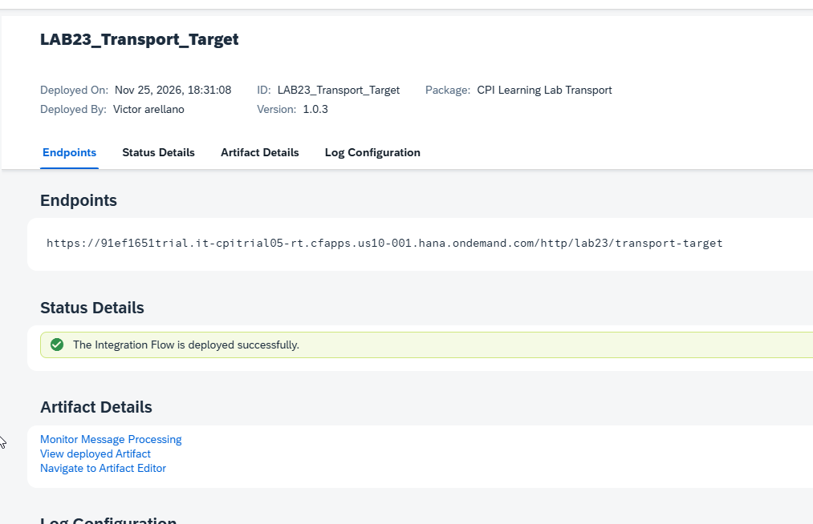

Esta comprobación demuestra que Revert modificó la versión activa de diseño, pero no sustituyó automáticamente la versión desplegada.

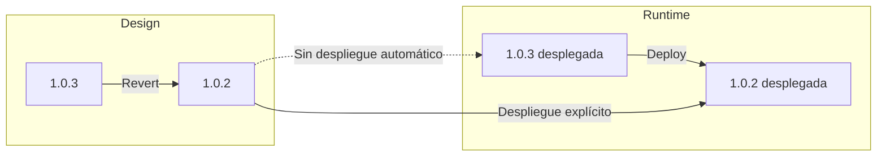

#### 7. Desplegar la versión recuperada

Ejecutar Deploy sobre el artefacto restaurado y comprobar la versión en Monitor.

**Evidencia 23-36 - Rollback desplegado**

La versión técnica 1.0.2 aparece desplegada correctamente y mantiene el endpoint de destino.

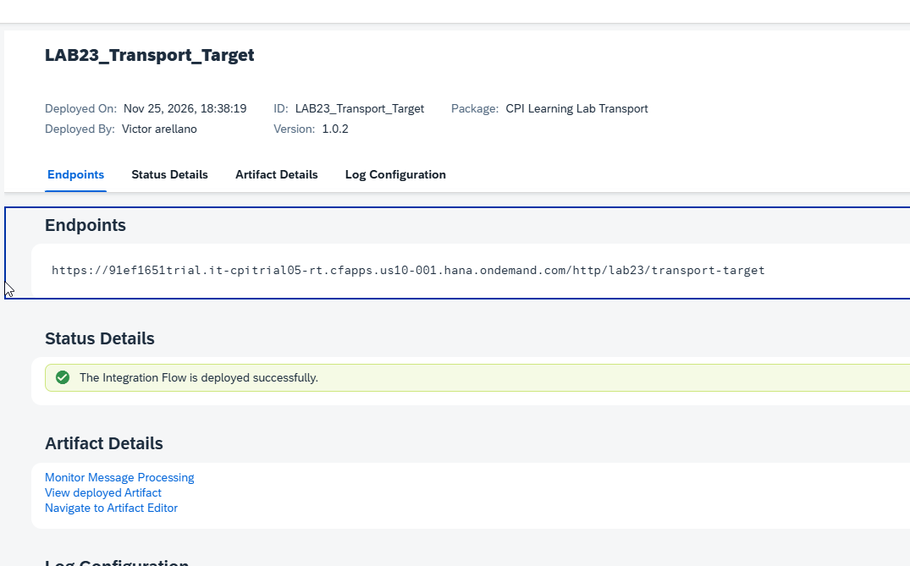

#### 8. Validar funcionalmente el rollback

Ejecutar la petición independiente `23.4 - Validacion rollback`.

**Evidencia 23-37 - Validación funcional del rollback**

Se obtiene HTTP 200 OK con la respuesta anterior:

```json
{
    "aplicacion": "SAP Integration Suite Learning Lab",
    "ambiente": "QA",
    "version": "1.0",
    "mensaje": "Respuesta inicial sin parametros externalizados"
}
```

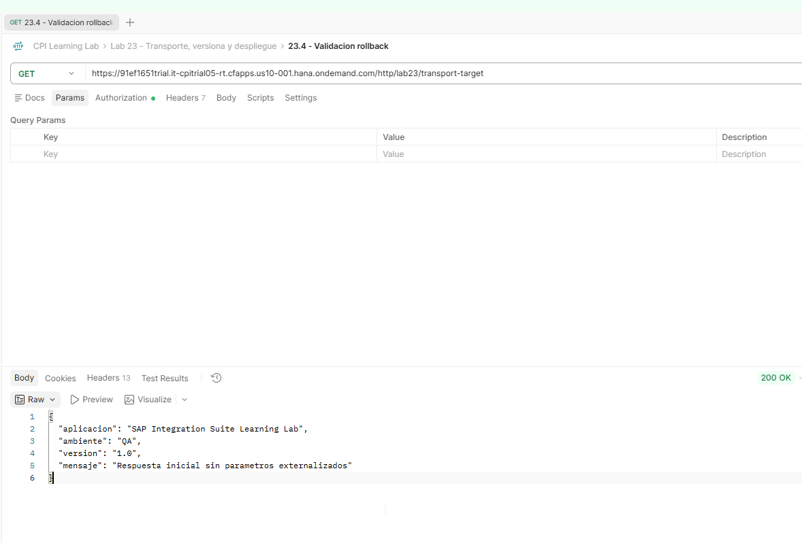

El contenido funcional anterior se recupera y el ambiente QA permanece configurado.

### Resultado esperado y validación

| Etapa | Versión técnica | Versión funcional | Ambiente | HTTP |
|---|---|---|---|---|
| Inicial | 1.0.2 | 1.0 | QA | 200 OK |
| Nueva liberación | 1.0.3 | 1.1 | QA | 200 OK |
| Rollback | 1.0.2 | 1.0 | QA | 200 OK |

### Ciclo de liberación y rollback validado

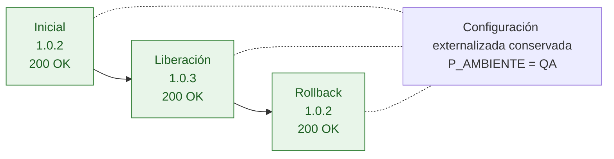

### Problemas encontrados y aprendizajes

- La versión técnica del artefacto y la versión funcional incluida en el JSON son conceptos independientes.
- Save as Version permite conservar estados de diseño recuperables.
- Revert recupera una versión de diseño, pero no modifica automáticamente el runtime.
- El rollback operativo requiere desplegar la versión recuperada y validar nuevamente su comportamiento.
- En el escenario probado, el parámetro externalizado P_AMBIENTE conservó el valor QA durante la liberación y la recuperación.
- La conservación de parámetros observada no debe generalizarse a cambios que eliminen o modifiquen sus definiciones.
- El estado de despliegue exitoso debe complementarse con una prueba funcional del endpoint.

## Referencias

- [Capítulo 16 - Externalized Parameters](16-externalized-parameters-configuración-ambiente.md).
- [Capítulo 04 - Packages, artefactos y ciclo de vida](04-packages-artefactos-ciclo-vida-iflow.md).
- [SAP Help - Modalidades de transporte](https://help.sap.com/doc/978cdb2059244c10b55a8bd916484a63/CLOUD/en-US/b989b7906c871014bc6ce3c22a1e81b1.html).
- [SAP Help - Enabling Content Transport](https://help.sap.com/docs/integration-suite/sap-integration-suite/enabling-content-transport-cloud-foundry-environment).
- [SAP Help - Define Content Modifier](https://help.sap.com/docs/cloud-integration/sap-cloud-integration/define-content-modifier).
- [SAP Help Portal - SAP Integration Suite](https://help.sap.com/docs/integration-suite).
- [KBA y hallazgos del laboratorio](kba-y-hallazgos.md).
