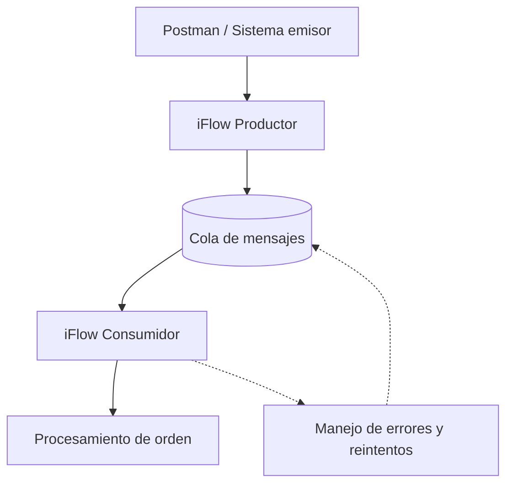

# Metodología de laboratorios

**Proyecto:** SAP Integration Suite Learning Lab
**Aplicación:** capítulos y laboratorios del curso
**Documento complementario:** `INSTRUCCIONES.md`

## 1. Objetivo

Establecer un procedimiento reproducible para planificar, implementar, validar y documentar los laboratorios de SAP Integration Suite, con foco inicial en Cloud Integration (CPI). El avance se basa en resultados comprobables, no solo en explicaciones.

## 2. Preparación obligatoria de cada capítulo

Antes de proponer instrucciones prácticas:

1. Consultar `README.md` y verificar el estado real del curso.
2. Consultar `INSTRUCCIONES.md` y este documento.
3. Consultar el Markdown del capítulo anterior para conservar su estructura, nomenclatura y presentación de evidencias.
4. Revisar los laboratorios completados y evitar repeticiones innecesarias.
5. Acordar el alcance, los laboratorios, los prerrequisitos y las validaciones del nuevo capítulo.

Si algún archivo no está disponible, informarlo explícitamente. No asumir su contenido ni comenzar una implementación que dependa de él.

## 2.1. Investigación técnica y aprobación del diseño antes de cada laboratorio

**Obligatorio antes de crear, versionar o modificar un iFlow.** Esta fase se realiza después de revisar el estado del repositorio y antes del primer paso práctico.

1. **Identificar las capacidades involucradas.** Enumerar componentes, adaptadores, operaciones y opciones concretas que se usarán, incluyendo formatos de mensaje y ámbito de ejecución.
2. **Consultar fuentes oficiales de SAP.** Revisar SAP Help Portal y, cuando corresponda, notas SAP o documentación oficial del componente y de su versión. Comprobar requisitos, restricciones, entradas y salidas, semántica de las opciones, comportamiento ante errores y compatibilidad entre componentes. Incluir enlaces y referencias precisas; no presentar documentación no consultada como verificada.
3. **Contrastar con el entorno real.** Revisar configuraciones y evidencias de laboratorios anteriores, y distinguir diferencias de versión o interfaz. Si no se puede confirmar una característica, marcarla como **no verificada** y proponer una prueba exploratoria explícita antes de depender de ella.
4. **Presentar una ficha de diseño previa**, que contenga:
   - Problema de integración y objetivo de aprendizaje.
   - Valor nuevo frente a laboratorios anteriores; reutilización prevista.
   - Arquitectura y secuencia de procesamiento (diagrama textual o Mermaid si aporta claridad).
   - iFlows afectados y versionado previsto; Data Stores y otros recursos.
   - Formato y ejemplos de entrada/salida, métodos HTTP y códigos de respuesta.
   - Configuración relevante de cada componente y motivo técnico.
   - Matriz de casos positivos, negativos y límites; resultados esperados y evidencias necesarias.
   - Riesgos, efectos secundarios, seguridad, limpieza y reversibilidad.
   - Fuentes oficiales consultadas y puntos que siguen siendo hipótesis.
5. **Revisión de viabilidad.** Antes de iniciar, identificar incompatibilidades de formatos, limitaciones del runtime y supuestos no demostrados. No construir una cadena de componentes que dependa de comportamientos no confirmados.
6. **Solicitar aprobación expresa del diseño.** El usuario debe comprender qué se implementará y qué se validará. Los cambios sustanciales posteriores requieren explicar el motivo y obtener nueva aprobación.
7. **Ejecutar paso a paso.** Solo después de la aprobación aplicar la sección 3 de esta metodología. La ejecución valida el escenario previamente diseñado; no sustituye la investigación técnica.

### Tratamiento de incertidumbre y fallos

- Diferenciar **documentado por SAP**, **validado en este entorno** y **pendiente de comprobar**.
- Si una prueba contradice el diseño, detener la implementación, consultar las fuentes y el MPL, presentar el diagnóstico sustentado y actualizar la ficha antes de continuar.
- No atribuir una causa al componente, al runtime o a SAP sin evidencia suficiente.
- Registrar en `docs/kba-y-hallazgos.md` los errores reutilizables con síntoma, diagnóstico, corrección, validación y alcance.
- Evitar pruebas y capturas redundantes. Las evidencias se acuerdan antes de solicitarlas, con nombre correlativo y propósito concreto.

**Criterio de entrada al laboratorio:** no iniciar la implementación mientras falten fuentes esenciales, el diseño no sea viable o el usuario no haya aprobado el alcance.

## 2.2. Presentación inicial obligatoria del capítulo: alcance, tiempos y diagramas

**Aplicación:** desde el capítulo 18 y para todos los capítulos restantes o adicionales. Esta presentación se realiza después de consultar los documentos de la sección 2 y antes de la investigación detallada, aprobación del diseño e implementación descritas en 2.1.

Antes de iniciar cada capítulo, el asistente debe presentar y acordar con el usuario:

1. **Introducción y propósito:** qué problema de integración aborda el capítulo, por qué es relevante y cómo continúa los aprendizajes anteriores.
2. **Alcance delimitado:** capacidades que se estudiarán, qué queda fuera y dependencias que podrían impedir la práctica. Diferenciar propuestas de funcionalidades verificadas en el entorno.
3. **Microaprendizajes y laboratorios:** tabla con identificador correlativo (`NN.1`, `NN.2`, etc.), objetivo, actividad prevista y validación observable. Evitar ejercicios redundantes.
4. **Estimación de duración:** rango de tiempo por laboratorio y total, incluyendo configuración, pruebas, capturas y documentación. Separar tiempo efectivo de pausas; declarar incertidumbres por aprovisionamiento, permisos o restricciones de Trial.
5. **Arquitectura conceptual:** incorporar al menos un diagrama Mermaid en la introducción cuando existan componentes o flujos de mensajes que explicar. Mostrar emisores, iFlows, adaptadores o servicios intermedios, receptores y direcciones de comunicación. Explicar el significado del diagrama y distinguir claramente la arquitectura propuesta de la validada. Si Mermaid no aporta claridad, justificar su omisión y usar un esquema textual.
6. **Relación con el capítulo anterior:** indicar qué componentes, conocimientos, iFlows o recursos podrían reutilizarse, sin modificar artefactos antes de la aprobación correspondiente.
7. **Riesgos y prerrequisitos:** identificar accesos, servicios y capacidades aún no comprobados; no comprometer resultados que dependan de ellos.
8. **Criterio de cierre:** definir qué resultados prácticos y evidencias permitirán marcar cada laboratorio como `✅ Completado`.
9. **Aprobación del alcance:** solicitar confirmación del usuario antes de pasar al diseño técnico y a los pasos de implementación. Si cambian de manera sustancial los laboratorios o la arquitectura, presentar el cambio y obtener nueva aprobación.

### Ejemplo de presentación arquitectónica (capítulo 18)

El siguiente diagrama es **conceptual y propuesto**, no acredita disponibilidad de JMS, Event Mesh ni ejecución en SAP BTP Trial. La elección de infraestructura de colas requiere validación técnica y del entorno antes del laboratorio.



El diagrama representa la separación entre publicación y consumo de mensajes. La ruta punteada ilustra conceptualmente la recuperación ante fallos: **no implica** que todo error vuelva automáticamente a la cola ni garantiza un mecanismo de reintento determinado. Las políticas efectivas se comprobarán según el adaptador y el servicio disponibles.

### Registro en el Markdown del capítulo

La introducción aprobada debe quedar al inicio del archivo del capítulo, antes de los laboratorios, con las secciones **Objetivo y contexto**, **Alcance**, **Plan de laboratorios y tiempos estimados**, **Arquitectura conceptual**, **Prerrequisitos y restricciones** y **Criterios de validación**. Conservar el diagrama Mermaid como código editable en GitHub. Ajustar las estimaciones cuando existan datos reales de ejecución, sin confundir estimaciones con tiempos medidos.

Esta presentación no sustituye la ficha de diseño técnico ni la investigación oficial de la sección 2.1; ambas siguen siendo obligatorias antes de crear, versionar o modificar iFlows.

## 3. Secuencia de trabajo por laboratorio

1. Presentar el objetivo específico y explicar por qué se realizará el ejercicio.
2. Identificar el iFlow y los recursos que se utilizarán. Antes de modificar un iFlow existente o crear una nueva versión, avisar y esperar confirmación.
3. Indicar **un solo paso práctico a la vez**, con los valores exactos de configuración y su justificación.
4. Informar **antes de solicitar una captura** el nombre exacto del archivo de evidencia.
5. Esperar la captura o el resultado del usuario y verificar lo que efectivamente demuestra.
6. Registrar el resultado validado y avanzar al siguiente paso. Si hay un error, diagnosticarlo antes de continuar.

No afirmar que un despliegue, una prueba o una configuración funciona si todavía no existe evidencia suficiente.

## 4. Convenciones de evidencias

### 4.1. Nombres de archivos

Utilizar el formato:

`NN-XX-descripcion-breve.png`

Donde:

- `NN`: número de capítulo, con dos dígitos.
- `XX`: secuencia correlativa de evidencia dentro del capítulo, con dos dígitos.
- `descripcion-breve`: descripción específica, en minúsculas y separada por guiones.

Ejemplos del capítulo 12:

- `12-01-iflow-creado.png`
- `12-02-https-sender-configuracion.png`

La numeración continúa a lo largo de todo el capítulo y no se reinicia por laboratorio. Antes de asignar un número, revisar las evidencias ya registradas para evitar duplicaciones.

### 4.2. Captura y validación

- Solicitar capturas solo cuando aporten evidencia útil de configuración, ejecución o resultado.
- Verificar que el contenido de la captura respalde la afirmación documentada.
- Si una captura no demuestra el resultado esperado, solicitar la comprobación faltante sin marcar el paso como validado.
- No incluir capturas con contraseñas, tokens, client secrets, service keys o material sensible. Si se expone una credencial real, rotarla y excluir la captura.

### 4.3. Referencias en Markdown

Cada evidencia debe aparecer **en el paso al que corresponde**, no reunida sin contexto al final del laboratorio. Incluir título, descripción y referencia relativa a la imagen. La ruta concreta debe seguir la estructura real del repositorio, verificada antes de consolidar el capítulo.

Ejemplo de formato (la ruta debe adaptarse a la carpeta real de evidencias):

```markdown
**Evidencia 12-02 — Configuración de HTTPS Sender**

Se verifica el endpoint, la autorización y la configuración de CSRF del adaptador HTTPS.


```

No afirmar que la imagen está incorporada al repositorio hasta comprobar que el archivo existe en la ruta indicada.

## 5. Organización de Postman

- Mantener una colección general del curso, con **una carpeta por capítulo**.
- Crear **peticiones independientes por laboratorio**, identificadas por número y objetivo.
- Configurar método HTTP, URL, autenticación, headers, body y pruebas según cada caso.
- Utilizar variables de entorno para valores reutilizables y evitar secretos en archivos exportados.
- Cuando un laboratorio requiera casos positivos y negativos, crear peticiones diferenciadas si facilita su ejecución.
- Validar cada petición individualmente antes de considerar pruebas agrupadas mediante Collection Runner.
- No confundir la independencia de peticiones Postman con la obligación de crear un iFlow diferente para cada una.

## 6. iFlows, cambios y versionado

- Antes de crear o reutilizar un iFlow, revisar los artefactos existentes.
- Informar previamente cualquier modificación de un iFlow existente, creación de versión o cambio que pueda afectar laboratorios anteriores.
- Explicar el motivo técnico de cada decisión de diseño y señalar las alternativas nativas cuando corresponda.
- Diferenciar claramente **Save**, **Deploy** y la versión de diseño/runtime cuando sean relevantes para la validación.
- No ejecutar cambios ni despliegues no acordados.

## 7. Errores y hallazgos

Los errores son parte del aprendizaje. Para cada error relevante:

1. Registrar el síntoma observable y el contexto.
2. Revisar la configuración, los mensajes y las trazas disponibles.
3. Diferenciar la causa comprobada de las hipótesis no verificadas.
4. Documentar la corrección y la prueba que demuestra su resultado.
5. Si el aprendizaje es reutilizable, incorporarlo a `docs/kba-y-hallazgos.md` con síntomas, diagnóstico, solución y alcance.

No atribuir causas a SAP, al runtime, a la región o a la cuenta Trial sin evidencia.

## 8. Estados y criterios de cierre

Estados permitidos:

| Estado | Criterio |
|---|---|
| ⬜ Pendiente | No iniciado |
| 🟨 En curso | Implementación o estudio en progreso |
| 🟦 Revisado | Conceptos explicados, sin validación práctica suficiente |
| ✅ Completado | Resultado práctico ejecutado y comprobado |
| 🔁 Reforzar | Existe una brecha que requiere práctica adicional |
| ⛔ Bloqueado | Una dependencia impide continuar |

Al cambiar el estado de un tema, actualizarlo tanto en `README.md` como en el Markdown del capítulo. No usar `✅ Completado` únicamente por haber explicado un concepto o preparado código sin probarlo.

## 9. Documentación final del capítulo

Generar un Markdown consolidado, limpio y apto para GitHub, que incluya:

- Estado del tema y objetivo.
- Conceptos y prerrequisitos.
- Laboratorios con pasos reproducibles y justificación de las configuraciones.
- Resultados esperados y resultados efectivamente validados.
- Evidencias tituladas y descritas junto al paso correspondiente.
- Problemas encontrados, soluciones verificadas y aprendizajes.
- Referencias técnicas pertinentes.

**No incluir** comentarios dirigidos al usuario, notas internas del proceso de redacción, iteraciones descartadas, pruebas fallidas ya corregidas sin valor pedagógico ni tareas que ya fueron resueltas.

Antes de dar por cerrado el capítulo:

1. Revisar la numeración y las rutas de todas las evidencias.
2. Comprobar que los resultados descritos coinciden con las pruebas realizadas.
3. Confirmar el estado final del tema.
4. Actualizar el `README.md` y el documento del capítulo.
5. Registrar los hallazgos reutilizables en el KBA.
6. Confirmar qué archivos se han incorporado realmente al repositorio y cuáles quedan por subir.

## 10. Seguridad

Nunca documentar ni publicar credenciales reales, tokens, contraseñas, claves privadas ni service keys completas. Usar placeholders y variables. Antes de subir capturas, scripts, colecciones Postman o documentación, revisar que no contengan secretos.

## 11. Regla de continuidad

Al iniciar una nueva conversación o capítulo, **releer las referencias del repositorio** en vez de depender del recuerdo de conversaciones anteriores. Si no se puede comprobar un detalle, indicarlo y solicitar la referencia necesaria. Mantener el avance paso a paso y no repetir tareas que ya estén verificadas.

## 12. Convenciones técnicas y particularidades del entorno SAP CPI

### 12.1. Campos no editables o gestionados automáticamente

- No asumir que todos los campos visibles en SAP Cloud Integration son editables.
- En Content Modifier, el campo Data Type puede aparecer no editable según la configuración y el tipo de origen seleccionado.
- Cuando Source Type = Constant y Data Type no permite edición, dejar el campo sin modificar.
- No insistir en configuraciones que la interfaz del usuario no permite realizar.
- Priorizar siempre el comportamiento observado en el entorno real del laboratorio.

### 12.2. Validación de instrucciones técnicas

- Antes de indicar valores de configuración, considerar las particularidades verificadas en laboratorios anteriores.
- Diferenciar campos obligatorios, opcionales, calculados y no editables.
- Si la interfaz difiere de lo esperado, revisar la captura antes de continuar.
- Registrar las diferencias reutilizables en docs/kba-y-hallazgos.md cuando corresponda.

### 12.3. Continuidad técnica

Antes de configurar componentes utilizados anteriormente, revisar las particularidades ya documentadas para evitar repetir errores o configuraciones innecesarias.

## 13. Responsabilidades y entrega de documentación

### 13.1. Administración del repositorio

- El usuario administra el repositorio GitHub: incorpora archivos, imágenes y colecciones, realiza commits y publica los cambios.
- El asistente utiliza GitHub para **consultar y verificar** la versión vigente. No debe crear commits, modificar archivos remotos ni intentar subir documentación, salvo que el usuario lo solicite expresamente.
- La ausencia de permisos de escritura del asistente no impide continuar: el mecanismo habitual es entregar archivos descargables.

### 13.2. Entregables del asistente

- Para cada capítulo, entregar un **Markdown completo, consolidado y descargable**, construido sobre la última versión verificada del repositorio.
- Para cambios en `README.md`, entregar por defecto un **fragmento identificable para reemplazo**; generar el README completo únicamente cuando el usuario lo solicite.
- Para `docs/kba-y-hallazgos.md`, entregar el texto de las incorporaciones correspondientes, sin reescribir el historial existente innecesariamente.
- Informar con precisión qué archivo debe reemplazarse y qué fragmento debe incorporarse. No afirmar que los cambios ya están publicados.
- Entregar los archivos Markdown en **UTF-8 con BOM** y verificar que los caracteres acentuados se conserven correctamente.

### 13.3. Conservación de evidencias

- Antes de editar un capítulo, consultar su versión actual y revisar los nombres y números de evidencias existentes.
- Mantener las referencias de imágenes ya documentadas. Las nuevas evidencias deben seguir la numeración correlativa y aparecer junto al paso que demuestran, con título y descripción.
- **No inventar nombres, rutas ni existencia de capturas.** Si una captura fue vista en la conversación pero no se ha acordado su nombre definitivo, solicitarlo o dejar explícita esa limitación antes de cerrar la documentación.
- Evitar capturas duplicadas cuando una evidencia anterior ya demuestra el resultado.
- No declarar que una imagen está subida al repositorio sin verificarla allí.

### 13.4. Control previo a la entrega

Antes de ofrecer los archivos descargables, comprobar:

1. Que se utilizó la versión vigente del documento, sin perder laboratorios ni evidencias anteriores.
2. Que los estados reflejan las validaciones prácticas y coinciden con el fragmento de README.
3. Que cada evidencia nueva tiene numeración, nombre, descripción y ubicación verificables.
4. Que no hay comentarios internos, tareas resueltas ni iteraciones descartadas.
5. Que los enlaces relativos, acentos y codificación son correctos.
6. Que se distingue lo efectivamente validado de lo pendiente y que no se incluyen secretos.

**Regla de continuidad:** al comenzar una nueva conversación, aplicar este procedimiento aunque el asistente disponga de herramientas con capacidad de escritura en GitHub.

### 13.5. Consolidación periódica durante un capítulo

- Consolidar la documentación **cada dos laboratorios abordados**, sin esperar a finalizar el capítulo.
- En cada corte, consultar la versión vigente del Markdown del capítulo en GitHub y entregar una versión consolidada que conserve los laboratorios y evidencias anteriores.
- Actualizar en el mismo corte el fragmento correspondiente de `README.md` y las incorporaciones pertinentes a `docs/kba-y-hallazgos.md`.
- Diferenciar laboratorios completados con evidencia práctica (`✅ Completado`) de temas solo analizados (`🟦 Revisado`) o todavía en curso (`🟨 En curso`).
- Evitar pruebas, capturas y repeticiones que no aporten evidencia nueva.
- El usuario revisa y publica los archivos en GitHub; el asistente no realiza commits salvo autorización expresa.

## 14. Escenarios integradores por capítulo

- Cuando un capítulo incluya varios laboratorios relacionados, evaluar un **escenario integrador** que combine capacidades ya estudiadas y permita verificar un flujo funcional de extremo a extremo.
- El escenario debe responder a un objetivo de integración concreto, con datos de entrada, procesamiento, resultado esperado y comprobaciones observables. No basta con reunir pasos anteriores sin aportar una validación nueva.
- Priorizar la reutilización de iFlows, componentes, configuraciones y conocimientos del curso cuando sea técnicamente adecuado. Antes de modificar un iFlow existente o crear una nueva versión, avisar y solicitar confirmación.
- Evitar adelantar funcionalidades de capítulos posteriores si ello introduce complejidad innecesaria. Cuando corresponda, limitar el escenario al alcance del capítulo actual.
- Mantener peticiones Postman independientes y evidencias correlativas del capítulo. Validar tanto el resultado funcional como los estados o mensajes relevantes en Monitor cuando aporten información nueva.
- El escenario integrador **no es obligatorio**: incorporarlo solo cuando tenga valor pedagógico y técnico. Su alcance y sus criterios de aceptación deben acordarse antes de implementarlo.
- Considerarlo `✅ Completado` únicamente cuando exista evidencia práctica verificable del flujo integrado. Las explicaciones o diseños sin ejecución conservan el estado correspondiente.
- Documentar el escenario en el Markdown del capítulo, con su propósito, arquitectura o flujo, decisiones de diseño, pasos reproducibles, resultados y evidencias situadas donde corresponden.
