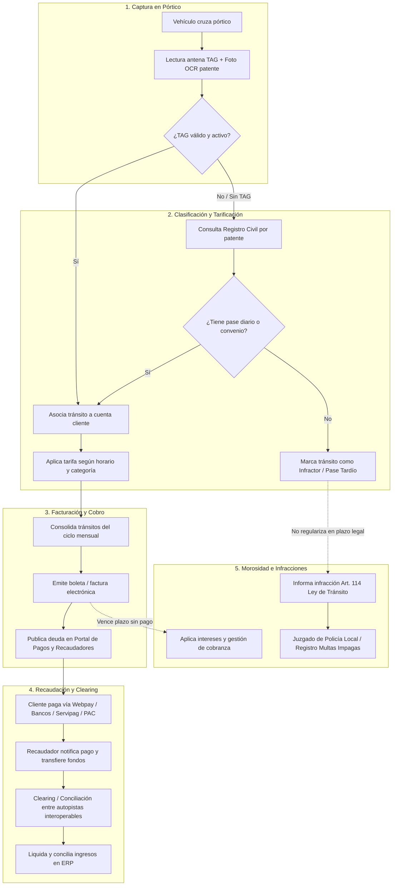
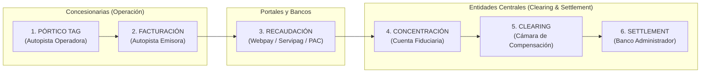
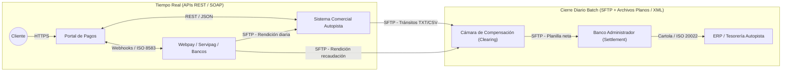

# Preparación de entrevista — Ingeniero de Procesos TI / Gestión de Proyectos

**Entrevista:** lunes 16 de noviembre de 2026, 12:30–13:00, Microsoft Teams.
**Objetivo:** repasar conceptos y practicar respuestas basadas en experiencias reales, sin atribuir responsabilidades no confirmadas.

> **Cómo usar esta guía:** leer primero los discursos de las secciones 1 a 7. No memorizarlos literalmente: recordar la secuencia *contexto → responsabilidad propia → acciones → resultado*. Los textos son propuestas para adaptar a tu forma de hablar. Cuando no haya resultados cuantificados, no inventarlos.

## 1. Mensaje central y presentación profesional

**Posicionamiento:** profesional con más de 20 años en sistemas empresariales, especializado en comprender procesos existentes, detectar brechas, modernizar plataformas, integrar sistemas y coordinar implementaciones. La experiencia de gestión se ha desarrollado principalmente desde responsabilidades técnicas y de coordinación.

**Pregunta: «Cuéntame sobre ti». Speech (60–90 segundos)**

> Soy Licenciado en Ciencias de la Computación y tengo más de veinte años de experiencia en sistemas empresariales, principalmente en desarrollo, integración y modernización tecnológica.
>
> He trabajado en distintos sectores, como banca, salud, logística y servicios, tanto en la implementación de soluciones como en el análisis de sistemas existentes y sus procesos de negocio.
>
> En algunos proyectos me ha correspondido levantar información con usuarios y responsables de áreas, identificar problemas comunes y proponer planes de mejoramiento. En otros he asumido liderazgo técnico, planificación de actividades, coordinación de proveedores y revisión de entregables.
>
> Me interesa este cargo porque combina el análisis de procesos con la ejecución y coordinación de proyectos TI. Creo que mi experiencia me permite conectar las necesidades de las áreas usuarias con soluciones técnicas viables.

**Tres ideas que deben quedar claras:** (1) entiendes el negocio antes de proponer tecnología; (2) organizas trabajo para producir entregables verificables; (3) puedes participar desde el diagnóstico hasta la implementación.

## 2. Análisis y mejora de procesos TI

### Conceptos para repasar

- **AS-IS:** descripción del proceso actual: actores, actividades, sistemas, datos, reglas y puntos de dolor.
- **TO-BE:** proceso objetivo, con cambios propuestos y resultados esperados.
- **Análisis de brechas:** diferencias entre la situación actual y la deseada.
- **Levantamiento:** entrevistas, revisión de aplicaciones y documentos, identificación de problemas y necesidades.
- **Priorización:** impacto, urgencia, dependencias, esfuerzo y riesgos; no necesariamente todo se implementa de una vez.
- **Plan de mejoramiento:** iniciativas, secuencia, responsables, entregables, criterios de validación y seguimiento.

**Pregunta: «¿Cómo abordas el análisis y la mejora de un proceso TI?» Speech**

> Primero necesito entender cómo funciona el proceso actual: cuál es su objetivo, quiénes participan, qué sistemas lo soportan y qué problemas tienen los usuarios.
>
> Para eso converso con los responsables de las áreas, reviso los sistemas y reúno evidencia de las limitaciones actuales. Con esa información identifico problemas comunes, necesidades y dependencias entre aplicaciones.
>
> Después evalúo alternativas y propongo un plan de mejoramiento priorizado, considerando impacto, factibilidad y riesgos. Me interesa que el plan se traduzca en actividades y entregables concretos, que luego puedan verificarse con los usuarios.
>
> He trabajado de esa manera, por ejemplo, en un proyecto para SENCE y en otro para la Empresa Portuaria de Iquique.

### Caso A: SENCE, mediante Xemantics

**Hechos que puedes respaldar:** proyecto de estandarización del modelo de datos corporativo; revisión de los sistemas; entrevistas con usuarios y jefaturas de áreas; identificación de problemas comunes, necesidades y limitaciones; propuesta de plan de mejoramiento basada en evidencias recopiladas.

**Speech de ejemplo:**

> En SENCE participé en un proyecto de estandarización del modelo de datos corporativo. Para abordar el trabajo revisé los sistemas involucrados y conversé con usuarios y jefes de área para entender cómo utilizaban la información, qué problemas compartían y qué necesitaban resolver.
>
> Ese levantamiento permitió reunir evidencia de las limitaciones existentes y formular un plan de mejoramiento. Lo relevante fue no partir proponiendo una solución tecnológica, sino comprender primero el funcionamiento de los sistemas y las necesidades transversales de la organización.

**Si preguntan por el resultado:** afirmar que propusiste un plan de mejoramiento. No afirmar que se implementó íntegramente, que hubo ahorros o que se aprobó, salvo que puedas confirmarlo.

### Caso B: Empresa Portuaria de Iquique

**Hechos que puedes respaldar:** entrevistas con responsables de sistemas operacionales; análisis de necesidades y problemas; propuesta de plan de trabajo para mejorar procesos, principalmente mediante mejoras a sistemas existentes.

**Speech de ejemplo:**

> En la Empresa Portuaria de Iquique participé en un trabajo de diagnóstico y mejoramiento de sistemas operacionales. Me reuní con las personas responsables de esos sistemas para conocer los procesos, sus dificultades y las oportunidades de mejora.
>
> A partir de ese levantamiento propuse un plan de trabajo orientado principalmente a mejorar las aplicaciones existentes y, con ello, los procesos que soportaban. Fue un trabajo donde el conocimiento de los usuarios resultó fundamental para definir propuestas realistas.

**Posibles repreguntas:** ¿cómo documentabas hallazgos?, ¿cómo priorizaste?, ¿qué áreas tenían necesidades contrapuestas?, ¿qué se implementó finalmente? Preparar solo lo que recuerdes con certeza.

## 3. Gestión de proyectos: tu enfoque ágil y orientado a entregables

### Tu manera de trabajar

La idea central es **tener una dirección clara, descomponerla en etapas manejables y revisar periódicamente el plan**. Un cambio de prioridades no equivale a perder el control: exige evaluar impacto, reordenar el trabajo y mantener trazabilidad de lo pendiente.

**Pregunta: «¿Cómo abordas la gestión de un proyecto?» Speech**

> Me gusta trabajar con un enfoque ágil, pero con planificación. Primero busco entender el objetivo y el alcance del proyecto, y luego preparo una hoja de ruta con etapas y entregables concretos.
>
> Para cada etapa identifico las actividades, dependencias, prioridades y fechas de referencia. Durante la ejecución reviso el avance y ajusto la planificación cuando aparecen nuevas necesidades o cambian las prioridades.
>
> Lo importante para mí es que esos cambios sean visibles y no se pierda el hilo del proyecto: saber qué se completó, qué está pendiente, qué bloquea el avance y cuál es el siguiente entregable verificable.
>
> He trabajado con Scrum, Kanban y enfoques en cascada, y procuro elegir las prácticas que mejor se ajustan al contexto, en lugar de aplicar una metodología rígidamente.

### Ejemplo de organización: Beridian

Proyecto personal útil para explicar tu **método actual de trabajo**, no para hacerlo pasar por gestión de un equipo corporativo.

- Definición de objetivos y roadmap.
- División del desarrollo en fases con alcance definido.
- Entregables tangibles y verificables por etapa.
- Seguimiento de tareas, decisiones y documentación.
- Fechas planificadas que pueden desplazarse al cambiar prioridades; conservar un plan permite retomar sin perder contexto.

**Speech breve:**

> En un proyecto personal de software, Beridian, organicé el desarrollo mediante un roadmap y fases con entregables verificables. Eso me ha servido para mantener la dirección del proyecto aunque cambien mis prioridades y tenga que reprogramar fechas. No significa que los plazos dejen de importar: significa que los cambios deben reconocerse, evaluarse y reflejarse en el plan.

**Advertencia importante:** en una entrevista no digas simplemente «no cumplo las fechas porque aparecen otras cosas». Mejor: «cuando cambia la prioridad, reevalúo el impacto y actualizo el plan». En proyectos con compromisos externos, cualquier cambio de plazo debe comunicarse y acordarse con quienes corresponda.

### Scrum, Kanban, cascada y Jira

| Tema | Conceptos que debes poder explicar | Tu experiencia declarada |
|---|---|---|
| Scrum | Backlog, sprint, planificación, revisión, retrospectiva, incremento | Has trabajado con Scrum; precisar el rol concreto si preguntan |
| Kanban | Visualizar flujo, trabajo en curso, bloqueos, mejora continua | Has trabajado con Kanban |
| Cascada | Etapas secuenciales, hitos, aprobación y control de cambios | Has trabajado con enfoques en cascada |
| Jira | Registro, prioridad, seguimiento, fechas, estados y cierre | En Xemantics registrabas actividades, priorizabas, fijabas fechas y anotabas fechas reales de cierre |
| Roadmap | Objetivos, etapas, dependencias, hitos y entregables | Lo has aplicado en Beridian |
| Metodología en Notion | Documentar el proceso de trabajo y reutilizar criterios y decisiones | Has trabajado en una metodología ágil; evitar atribuirle resultados organizacionales no verificados |

**Pregunta: «¿Qué experiencia tienes con Jira?»**

> En Xemantics lo utilicé para registrar actividades de proyectos, priorizarlas, establecer fechas de resolución y hacer seguimiento hasta su cierre, incluyendo el registro de las fechas reales. Lo usaba como herramienta de organización y trazabilidad del trabajo.

**Pregunta: «¿Qué haces cuando una fecha no se cumple?»**

> Primero identifico la causa y el impacto sobre los demás entregables. Reviso si hubo cambios de alcance, dependencias no previstas o problemas de estimación. Después propongo un ajuste de actividades o prioridades, lo comunico a los involucrados y actualizo el plan. El objetivo es que la desviación sea visible y gestionable, no ocultarla.

### Conceptos adicionales de gestión

- **Alcance:** qué está incluido y qué no.
- **Hito:** punto de control relevante; no siempre es un entregable.
- **Entregable:** resultado concreto sujeto a aceptación.
- **Riesgo:** evento futuro incierto con impacto potencial; **incidencia:** problema ya ocurrido.
- **Dependencia:** actividad o decisión necesaria para avanzar.
- **Criterio de aceptación:** condición observable para considerar correcto un entregable.
- **Gestión de cambios:** analizar impacto en alcance, costo, plazo y calidad antes de aprobar modificaciones.
- **PMBOK:** referencia de buenas prácticas de dirección de proyectos; conocerlo no equivale a tener certificación PMP ni experiencia como PM dedicado.

## 4. Coordinación de proveedores y bolsa de horas

### Caso real: aplicación móvil en Xemantics

**Hechos aportados:** presupuesto limitado convertido en bolsa de horas; preparación de un framework de trabajo para el proveedor; definición de actividades según planificación; revisión de entregables y puesta en producción al finalizar la implementación.

**Pregunta: «¿Has gestionado proveedores, entregables y bolsas de horas?» Speech**

> Sí, tengo una experiencia concreta en Xemantics, durante el desarrollo de una aplicación móvil con apoyo de un proveedor externo.
>
> Contábamos con un presupuesto limitado, que tradujimos a una bolsa de horas. Para aprovechar ese presupuesto preparé un framework de trabajo que el proveedor pudiera utilizar y definí las actividades que necesitábamos desarrollar, de acuerdo con una planificación.
>
> Mi participación incluyó orientar técnicamente el trabajo, revisar lo entregado y participar en la etapa de puesta en producción una vez terminada la implementación.
>
> Es una experiencia de gestión de proveedor desde el alcance, las horas disponibles y la calidad técnica; no la presentaría como administración de contratos de gran escala.

**Preguntas que podrían hacer:** ¿cómo estimaban horas?, ¿qué hacías si el proveedor excedía lo previsto?, ¿cómo aceptabas entregables?, ¿qué incluía el framework?, ¿cómo se manejaban cambios? Debes responder con detalles que recuerdes; no inventar mecanismos formales de control.

**Enfoque de respuesta sobre control de horas:**

> Partiría por definir actividades acotadas y estimaciones de esfuerzo, compararlas con la disponibilidad total y priorizar lo indispensable. Durante la ejecución revisaría el consumo frente al avance y, si surgiera una desviación, evaluaría el impacto y las alternativas antes de comprometer trabajo adicional.

Esta última es una **respuesta metodológica**, no una afirmación de que todos esos controles se aplicaron exactamente así en aquel proyecto.

## 5. Procesos financieros, recaudación y compensaciones

### Conceptos y diferencias

| Concepto | Significado |
|---|---|
| Recaudación | Recepción y registro de pagos o ingresos |
| Pago | Operación por la que un pagador cumple una obligación monetaria |
| Conciliación | Comparación de registros de fuentes diferentes para detectar diferencias |
| Clearing financiero | Proceso de intercambio, validación y/o compensación de obligaciones entre participantes de un sistema de pagos, según su diseño |
| Settlement financiero | Liquidación de las obligaciones mediante transferencia definitiva de fondos conforme a las reglas del sistema |
| Compensación regulatoria a clientes | Ajuste o beneficio aplicado a clientes conforme a reglas regulatorias; **no equivale automáticamente a clearing financiero** |
| Reliquidación tarifaria | Recalcular importes de períodos anteriores por cambios tarifarios retroactivos, según reglas aplicables |

### Casos de experiencia

**Conciliación bancaria — Río Blanco:** trabajo en sistema que recuperaba movimientos y procesaba cartolas para contrastar información. Confirmar los detalles operativos que recuerdes antes de profundizar.

**Pagos — Ultramar:** modernización de portal de pagos e integraciones bancarias. Distinguir participación en sistemas de pago de participación en liquidación interbancaria.

**Recaudación — Tecnología y Salud:** registro de compra de prestaciones e integración de registros hacia sistemas externos de clínicas por API REST o web services y procesos de fondo. No afirmar que controlabas el flujo completo de fondos si no fue así.

**Compensaciones y reliquidaciones — EMEC / CONAFE / CGE:** participación en procesos de compensación a clientes conforme a reglas de la SEC; el resultado se reflejaba como descuento en la boleta mensual. También procesos de reliquidación por cambios retroactivos en tarifas eléctricas. **No se confirma la periodicidad regulatoria exacta ni las reglas específicas**, por lo que conviene decir «en los procesos que nos correspondía ejecutar» en vez de afirmar que la SEC ordenaba siempre una compensación anual.

**Pregunta: «¿Has trabajado con clearing o settlement?» Speech honesto**

> No he trabajado directamente en clearing o settlement interbancario, al menos no con esas responsabilidades. Sí he participado en procesos relacionados con pagos, conciliación y compensaciones.
>
> En el sector eléctrico, por ejemplo, trabajé con procesos que calculaban compensaciones a clientes según reglas regulatorias y las reflejaban como descuentos en la facturación. También participé en reliquidaciones asociadas a cambios retroactivos de tarifas.
>
> Son procesos de cálculo, ajuste y control de información financiera, aunque no los equipararía técnicamente con el clearing o settlement de un sistema de pagos.

**Pregunta: «¿Cómo investigas una diferencia de conciliación?»**

> Identificaría las fuentes y reglas con las que se comparan los movimientos. Revisaría identificadores, fechas, montos, estados, duplicidades y transacciones pendientes. Luego verificaría si la diferencia viene de los datos, de una regla de negocio o de un proceso de integración. Finalmente corregiría o derivaría la causa según corresponda y validaría que la conciliación cierre correctamente.

Esta es una respuesta de **método propuesto**.

## 6. Base técnica para el cargo

### SQL y PostgreSQL

**Speech:**

> Tengo experiencia con SQL Server, PostgreSQL y otras bases relacionales, tanto en desarrollo y consultas como en integración, procesos batch, migraciones y análisis de problemas. En proyectos de modernización me ha tocado revisar dependencias de datos y asegurar que los procesos sigan funcionando después de los cambios.

**Repaso:** joins; índices; planes de ejecución; transacciones ACID; bloqueos; procedimientos; integridad referencial; ETL; respaldo y validación de migraciones. En PostgreSQL, `EXPLAIN ANALYZE` permite observar un plan con ejecución real: usarlo con precaución porque ejecuta la consulta.

### Linux

**Speech:**

> Mi experiencia en Linux se relaciona principalmente con operación y soporte de aplicaciones, revisión de logs, automatización con Bash, tareas programadas con cron y diagnóstico de procesos. No me presentaría como administrador de infraestructura Linux especializado.

**Repaso:** `grep`, `tail`, `less`, `ps`, `top`, `df`, `du`, permisos, `systemctl`, cron, variables de entorno y códigos de salida.

### Integraciones

**Speech:**

> En una integración parto revisando el contrato de datos, las reglas de negocio y las dependencias entre sistemas. Me preocupo de autenticación, validaciones, manejo de errores, reintentos, trazabilidad y pruebas. Si hay transacciones sensibles, también considero la idempotencia para evitar duplicaciones por reenvíos.

**Ejemplos reales:** REST, web services, HL7, Transbank, IMED, integraciones bancarias, procesos batch y experiencia SAP CPI/BTP. Evitar profundizar en herramientas no solicitadas si distraen del cargo.

## 7. Preguntas conductuales y delicadas

### «¿Por qué dejaste tu último trabajo?»

**Versión recomendada:**

> Ingresé con la expectativa de asumir un desafío de mayor responsabilidad, vinculado al liderazgo de un área y a iniciativas de transformación digital. Con el tiempo, ese desarrollo profesional no se concretó como esperaba. Después de evaluar la situación, decidí cerrar esa etapa y buscar una oportunidad más alineada con mi experiencia y con el tipo de aporte que quiero realizar.

**Si piden más detalles:** explicar que el alcance efectivo del cargo no evolucionó hacia las responsabilidades originalmente planteadas. Evitar acusaciones o descalificaciones; no necesitas negar la discrepancia.

### «¿Por qué te interesa un rol de procesos y proyectos?»

> Porque buena parte de mi trayectoria ya ha combinado análisis de procesos, modernización y coordinación técnica. Me interesa contribuir más desde la identificación de necesidades, la planificación y la ejecución de mejoras, sin perder la capacidad de entender técnicamente las soluciones.

### «¿Cuál es tu principal fortaleza?»

> Mi capacidad de análisis. He trabajado con sistemas existentes, tecnologías diferentes y procesos que no siempre están completamente documentados. Me acomoda investigar, conversar con quienes conocen la operación, identificar dependencias y convertir los hallazgos en soluciones o planes de trabajo concretos.

### «¿Cuál es tu principal debilidad o área de desarrollo?»

> Mi experiencia de gestión ha estado principalmente ligada al liderazgo técnico y a proyectos de software, más que a la administración integral de grandes carteras o presupuestos corporativos. Es un ámbito que me interesa seguir desarrollando, aprovechando la experiencia que ya tengo en planificación, coordinación y seguimiento.

### «¿Cómo gestionas un requerimiento poco claro?»

> Primero identifico qué proceso o sistemas afecta y qué se espera resolver. Después complemento el requerimiento conversando con los involucrados y revisando evidencia. Si es un defecto, intento reproducirlo y contrastar el resultado actual con el esperado. Solo cuando el problema está suficientemente entendido paso a definir y validar la solución.

### «¿Qué haces frente a un atraso?»

> Identifico la causa, evalúo dependencias y consecuencias, y reviso opciones para replanificar o recuperar el avance. Si afecta un compromiso, lo comunico oportunamente. Para mí, mantener el plan actualizado es parte del control del proyecto.

## 8. Banco de casos: cuál usar para cada pregunta

| Pregunta o competencia | Caso principal | Alternativa |
|---|---|---|
| Diagnóstico de procesos | SENCE | Empresa Portuaria de Iquique |
| Entrevistas con usuarios | SENCE | Empresa Portuaria de Iquique |
| Plan de mejoramiento | Empresa Portuaria de Iquique | SENCE |
| Roadmap y etapas | Beridian (personal) | Experiencia laboral de planificación, si se solicitan detalles |
| Proveedores y bolsa de horas | Aplicación móvil, Xemantics | Trabajos puntuales con externos |
| Jira y seguimiento | Xemantics | — |
| Conciliación bancaria | Río Blanco | — |
| Pagos e integraciones | Ultramar | Tecnología y Salud |
| Compensaciones y ajustes | EMEC / CONAFE / CGE | — |
| Modernización de sistemas críticos | Banco de Chile | Ultramar |
| Coordinación técnica y producción | Tecnología y Salud | Xemantics |

## 9. Preguntas inteligentes para hacer al entrevistador

1. «¿El cargo se concentra más en diagnóstico y mejora de procesos o en planificación y seguimiento de proyectos?»
2. «¿Los proyectos se ejecutan con equipos internos, proveedores externos o una combinación?»
3. «¿Qué esperan que haya logrado la persona en los primeros tres o seis meses?»
4. Si hay tiempo: «¿Qué herramientas utilizan para seguimiento de proyectos y documentación de procesos?»

## 10. Repaso rápido: 15 minutos antes de conectarte

### Cinco mensajes clave

1. **Analizo antes de proponer:** entrevistas, revisión de sistemas, evidencia, brechas y plan.
2. **Tengo ejemplos directos:** SENCE y Empresa Portuaria de Iquique.
3. **Gestiono con dirección y flexibilidad:** roadmap, etapas, entregables, seguimiento y replanificación explícita.
4. **He coordinado proveedor y horas:** aplicación móvil de Xemantics, framework, actividades, revisión y puesta en producción.
5. **Conozco procesos financieros relacionados:** conciliación, pagos, recaudación, compensaciones regulatorias y reliquidaciones; sin afirmar experiencia directa en clearing/settlement interbancario.

### Lista de comprobación

- [ ] Puedo presentarme en 60–90 segundos.
- [ ] Puedo explicar SENCE en 60 segundos sin inventar resultados.
- [ ] Puedo explicar Empresa Portuaria de Iquique en 60 segundos.
- [ ] Puedo explicar cómo planifico y cómo gestiono cambios de prioridad.
- [ ] Puedo contar la experiencia de bolsa de horas de Xemantics.
- [ ] Distingo compensación regulatoria de clearing y settlement.
- [ ] Puedo explicar SQL, Linux e integraciones con ejemplos propios.
- [ ] Puedo responder por qué salí del último trabajo sin extenderme.
- [ ] Tengo dos preguntas preparadas para el entrevistador.
- [ ] Probé Teams, micrófono, cámara y conexión.

### Reglas para responder

- Respuestas habituales de 45–90 segundos; ampliar solo si preguntan.
- Distinguir **«yo hice»**, **«participé»** y **«el equipo hizo»**.
- No inventar fechas, métricas, aprobaciones, implementaciones ni presupuestos.
- Si no recuerdas una regla regulatoria, decirlo y explicar el proceso que sí recuerdas.
- No transformar la flexibilidad de un proyecto personal en una excusa para incumplir compromisos laborales.
- No presentar gestión técnica como dirección formal de programas o portafolios.

---

**Siguiente paso cuando estés preparado:** simulación de entrevista de 30 minutos, pregunta por pregunta, con retroalimentación sobre claridad, pertinencia, precisión y respaldo en tu experiencia.

**Nota de alcance:** esta guía usa los antecedentes relatados por ti y las preguntas del aviso trabajadas previamente. No verifica de forma independiente resultados, responsabilidades específicas ni reglas regulatorias históricas. Los discursos son formulaciones propuestas para ensayar y corregir según tu recuerdo.
